# ArXiv Daily Digest - 2026-10-23 (LLM 后训练的 RL（RLHF / DPO / GRPO / RLAIF / RLVR）, 10 papers)

**Generated**: 2026-10-23 17:00 CST

**Source**: arXiv cs.CV, cs.SD, eess.AS, cs.CL, cs.AI, cs.RO, cs.LG submissions, listing day 2026-10-22 (announced 2026-10-23 00:00 UTC)

**Batch window**: 2026-10-21T18:00:00Z .. 2026-10-22T18:00:00Z（arXiv 公告批次横跨两个 UTC 日：前一日 18:00 UTC 起算，当日 17:59:59 UTC 截止）

**Track**: rl_llm (top 10 of 535 papers scanned, 107 full reads)

**Scope**: 大语言模型后训练 RL：RLHF / DPO / GRPO / RLAIF / RLVR 与奖励建模

---

## Top 10 - LLM 后训练的 RL（RLHF / DPO / GRPO / RLAIF / RLVR）

### 1. MOER: Mix-Policy Optimization under Expert Prefix Guidance with Selective Rollback

**arXiv**: [2610.30873](https://arxiv.org/abs/2610.30873) | **Score**: 9.0 (relevance 9.0 x 0.7 + quality 9.0 x 0.3) | **Tags**: rl-llm, mix-policy, GRPO, trust-region, off-policy | **Categories**: cs.AI, cs.LG | **Pages**: 17

**Authors**: Xuyang Zhong, Jiuding Yang, Yiwen Guo, Chen Liu

**Affiliation**: City University of Hong Kong

**Abstract**

> Mix-policy optimization incorporates off-policy expert data into the reinforcement learning (RL) loop to transcend the capability boundary of on-policy RL. However, existing methods either provide static full-trace guidance that suppresses self-exploration, or adopt expert prefix guidance without correctness guarantees, leading to suboptimal performance or even training collapse. In this paper, we propose MOER, a mix-policy optimization framework that harmonizes expert guidance with self-exploration. MOER injects a decaying expert chain-of-thought prefix into the prompt and lets the model complete the remaining reasoning, with the prefix length progressively annealed to encourage self-exploration. A selective rollback mechanism replaces failed completions with the original full expert trace, guaranteeing the correctness of every off-policy trajectory. Furthermore, a harmonized mix-policy objective optimizes on-policy tokens with a GRPO loss while supervising both expert prefix and completion tokens with a trust-region SFT loss, substantially stabilizing training. Extensive experiments show that MOER achieves the highest average scores in mathematical and general domain reasoning tasks, outperforming all basic and mix-policy baselines, and generalizes consistently across diverse tasks, model scales, and base model categories. Codes are available at https://github.com/CityU-MLO/MOER.

**Key findings**

- **Finding**: 混合策略优化把**离策略专家数据**引入 RL 循环，以突破纯在策略 RL 的能力边界。
- **Finding**: 但现有方法要么提供**静态的全轨迹引导**从而压制自我探索，要么采用**无正确性保证的专家前缀引导**，导致次优性能甚至训练崩溃。
- **Finding**: MOER 在 prompt 中注入**逐次衰减的专家思维链前缀**，让模型自行完成剩余推理，前缀长度逐步退火以鼓励自我探索。
- **Finding**: **选择性回滚**机制用原始的完整专家轨迹替换失败的补全，保证每一条离策略轨迹的正确性。
- **Finding**: **协调的混合策略目标**：在策略 token 上用 GRPO 损失，同时用**信赖域 SFT 损失**监督专家前缀与补全 token，显著稳定训练。
- **Finding**: 在数学与通用领域推理任务上取得最高平均分，超过所有基础与混合策略基线，并在不同任务、模型规模与基座模型类别上稳定泛化。
- **Inference**: 「选择性回滚」是这篇最实用的部分：它把「保证离策略样本正确」这件难事降级成一个廉价的检查 + 替换。
- **Inference**: 用信赖域 SFT 损失而非 RL 损失来监督专家 token，等于承认离策略数据不该被当成同分布样本——这个克制值得学。
- **Recommendation**: 强烈推荐。做 RLHF / GRPO 训练工程、想引入专家数据的人必读。

**Key figures**

*Framework - Overview of MOER, which incorporates decaying expert prefix guidance with a selective rollback mechanism and harmonized mix-policy objective. Decaying expert prefix guidance encour- ages the*

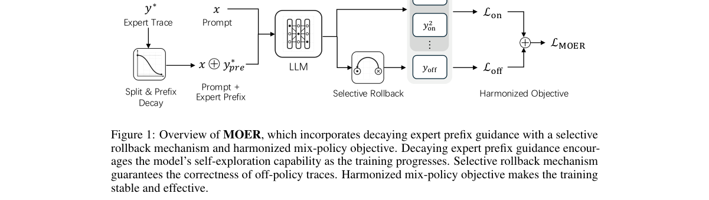

*Result - Training dynamics of MOER and other baselines with prefix guidance. The base model is Qwen2.5-Math-7B. (a) MOER reaches the highest validation accuracy. (b) Selective rollback mechanism guar*

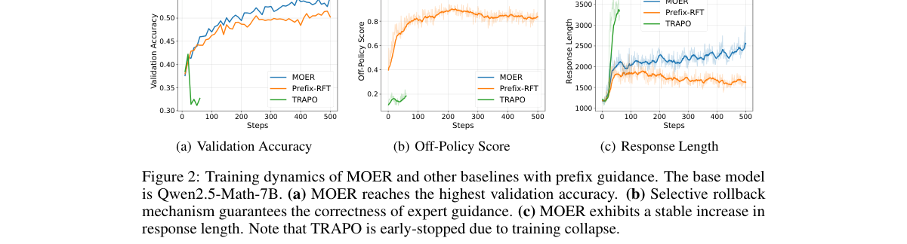

**Why this ranks #1**: 混合策略优化里最实在的两个补丁：退火的专家前缀 + 选择性回滚，把「压制自我探索」和「训练崩溃」同时解决。

---

### 2. Questioning Instrumental Convergence in RLVR: Checkpoint Evidence from OLMo-3

**arXiv**: [2610.31624](https://arxiv.org/abs/2610.31624) | **Score**: 9.0 (relevance 9.0 x 0.7 + quality 9.0 x 0.3) | **Tags**: rl-llm, RLVR, safety, checkpoint-trajectory, non-monotonic | **Categories**: cs.AI, cs.LG | **Pages**: 15

**Authors**: Barış Alparslan, Sandy Tanwisuth, Caleb Petterson

**Affiliation**: University of Minnesota - Twin Cities

**Abstract**

> Instrumental convergence is often invoked as a general reason to expect capable agents to acquire or express power-seeking subgoals: self-preservation, resource acquisition, deception, or resistance to oversight which poses an important threat to the society. For LLMs, reinforcement learning is the first stage of post-training that directly optimizes behavior against an objective; therefore, it is the stage where convergent instrumental behavior, on IC grounds, likely to appear. Does reinforcement learning with verifiable rewards (RLVR) make a model more likely to express instrumental-convergence behavior, or does this depend on the training regime, evaluation frame, and stage of post-training? We study this question as a checkpoint-conditioned behavioral trajectory rather than as a single before/after safety score. Using InstrumentalEval, we evaluate OLMo-3-7B-Think across SFT, DPO, 13 intermediate RLVR checkpoints, and the final RLVR model. The trajectory is nonmonotonic: instrumental rate rises from 25.0% at SFT to 46.1% near RLVR step 200, then falls to 11.8% at the final checkpoint. Paired item-level tests and step-wise regression support the final SFT-to-RLVR reduction. Prompt framing does not explain this pattern: a harmful-prompt indicator combined with other framing effects explains only 15% of within-checkpoint score variance on average, and Iterative Null-space Projection (INLP) removes a detectable framing direction without changing the SFT-to-final-RLVR gap. Together with preliminary 32B endpoint results (35.53% SFT to 22.37% RLVR final), these findings indicate that RLVR does not monotonically increase instrumental behavior in this setting: the rate rises early, then falls below the SFT baseline. The result is specific to this model family and benchmark, and judge agreement is moderate, so absolute rates should be read cautiously.

**Key findings**

- **Finding**: 工具性趋同（instrumental convergence）常被援引为期待强智能体习得权力寻求子目标的一般理由——自保、资源获取、欺骗或抵制监督。
- **Finding**: 对 LLM 而言，RL 是后训练中**第一个直接针对目标优化行为**的阶段，因此最可能出现趋同的工具性行为。
- **Finding**: 作者把问题当作**以 checkpoint 为条件的行为轨迹**来研究，而非单一的「训练前 vs 训练后」安全分数。
- **Finding**: 用 InstrumentalEval 评测 OLMo-3-7B-Think 在 SFT、DPO、**13 个中间 RLVR checkpoint** 与最终 RLVR 模型上的表现。
- **Finding**: 轨迹**非单调**：工具性比率从 SFT 的 **25.0%** 升到 RLVR 第 200 步附近的 **46.1%**，随后降到最终 checkpoint 的 **11.8%**。
- **Finding**: 配对条目级检验与逐步回归支持最终 SFT→RLVR 的下降（配对 t 检验 p = 0.015；Wilcoxon 符号秩检验 p = 0.03；逐步回归 β₂ = −15.34）。
- **Finding**: 提示框架无法解释这一模式：有害提示指示与其它框架效应平均只解释 checkpoint 内分数方差的 15%；INLP 移除了可检测的框架方向却不改变 SFT→最终 RLVR 的差距。
- **Finding**: 32B 端点的初步结果同样显示下降（**35.53% SFT → 22.37% RLVR 最终**）。
- **Finding**: 作者明确限定：该结论限于该模型族与该基准，评审一致性中等，绝对数值应谨慎解读。
- **Inference**: 「中间 checkpoint 比最终 checkpoint 更危险」是个反直觉且有政策含义的发现——如果成立，安全评估不能只看终版模型。
- **Inference**: 作者主动列出三条限定（模型族、基准、评审一致性），这种自我约束反而让结论更可信。
- **Recommendation**: 强烈推荐。做 RLVR、安全评估、模型发布把关的人必读。

**Key figures**

本篇未提取到可用图（PDF 内无符合图注正则的 Figure 1/2）。

**Why this ranks #2**: RLVR 会让人工智能更强也更危险吗？这篇按 checkpoint 追踪，发现它**非单调**：先升后降，最终低于 SFT 基线。

---

### 3. Reward-Weighted Preference Optimization for Selective Combinatorial Optimization Problems

**arXiv**: [2610.31239](https://arxiv.org/abs/2610.31239) | **Score**: 8.7 (relevance 9.0 x 0.7 + quality 8.0 x 0.3) | **Tags**: rl-llm, preference-optimization, reward-gap, combinatorial-optimization | **Categories**: cs.AI | **Pages**: 37

**Authors**: Haohui Zhang, Xinyu Hu, Wouter van Heeswijk, Neil Yorke-Smith, Martijn Mes

**Affiliation**: University of Twente; University of Bath

**Abstract**

> Reinforcement learning has emerged as an effective approach for combinatorial optimization, but most existing methods focus on problems such as the Travelling Salesperson Problem (TSP) in which all elements must be served. Selective combinatorial optimization problems (SCOPs), including the Orienteering Problem (OP), Prize-Collecting TSP (PCTSP), Stochastic PCTSP and Knapsack Problem (KP), additionally require selecting which elements to include. This selection creates sampled solutions with substantially different objective values, yet standard preference optimization reduces such comparisons to binary rankings and discards the magnitude of these differences. We introduce Reward-Weighted Preference Optimization (RWPO), a pairwise training objective that incorporates reward-gap information into preference learning. For candidate trajectories sampled from the same instance, RWPO weights each preference loss according to the normalized difference in their rewards, assigning greater training emphasis to comparisons that represent larger improvements in solution quality. We further combine RWPO with scale-specific fine-tuning and reward- and likelihood-weighted tilted sampling to adapt trained policies to larger and shifted instance distributions without relying on local-search post-processing. Experiments on the OP, PCTSP, Stochastic PCTSP, and KP show that RWPO consistently improves over unweighted preference optimization and policy-gradient baselines across a wide range of instance sizes. On the OP, the resulting solver exceeds the mean reward of the Compass metaheuristic at scales from 100 to 2,000 nodes. The results demonstrate that preserving reward-gap information can substantially improve preference-based learning for selective combinatorial optimization and support generalization to large-scale instances.

**Key findings**

- **Finding**: RL 已成为组合优化的有效方法，但多数工作聚焦 TSP 这类**必须服务全部元素**的问题。
- **Finding**: **选择性组合优化问题（SCOP）**（含定向越野问题 OP、收益收集 TSP、随机 PCTSP 与背包问题）额外要求**选择纳入哪些元素**。
- **Finding**: 这种选择使采样解的目标值差异巨大，而**标准偏好优化把比较退化为二元排序，丢弃了差异幅度**。
- **Finding**: RWPO 引入奖励差信息的成对训练目标：对来自同一实例的候选轨迹，按其奖励的归一化差值给每个偏好损失加权，对代表更大解质量改进的比较赋予更大训练权重。
- **Finding**: 并把 RWPO 与**尺度特定微调**、以及奖励与似然加权的倾斜采样结合，把训练好的策略适配到更大与偏移的实例分布，且**不依赖局部搜索后处理**。
- **Finding**: 在 OP、PCTSP、随机 PCTSP 与 KP 上，RWPO 在广泛的实例规模上一致优于无权重的偏好优化与策略梯度基线。
- **Finding**: 在 OP 上，所得求解器在 **100 到 2000 节点**规模上超过 Compass 元启发式的平均奖励。
- **Inference**: 「二元排序丢弃幅度」在文本偏好里损失有限（人类偏好本来就稀疏），但在有连续奖励的场景里损失巨大——这个对比本身很有启发。
- **Inference**: 把 RWPO 从组合优化搬到 LLM 偏好学习上也未必不成立——那里同样存在「差多少」的信息被丢弃。
- **Recommendation**: 推荐。做偏好优化、DPO 加权、或任何有连续奖励信号的场景的人应读。

**Key figures**

*Framework - Overview of the RWPO training and adaptation pipeline. The distributions below are conceptual visualizations of probability mass over solutions (with empirical validation provided in Appendi*

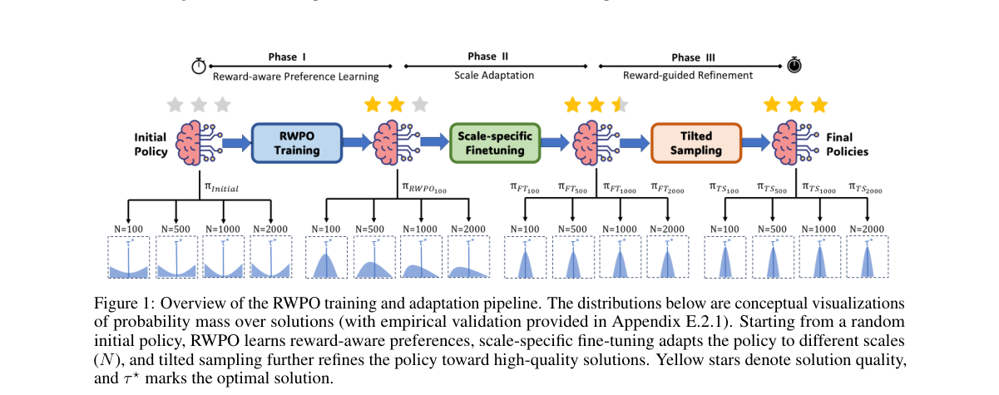

**Why this ranks #3**: 标准 DPO 把比较压成二元排序，丢掉了「好多少」；在组合优化里这个信息量最大。

---

### 4. Group Relative Policy Optimisation Improves Multilingual Speech Recognition in Low-Resource Languages

**arXiv**: [2610.30663](https://arxiv.org/abs/2610.30663) | **Score**: 8.7 (relevance 9.0 x 0.7 + quality 8.0 x 0.3) | **Tags**: rl-llm, GRPO, ASR, low-resource, exposure-bias | **Categories**: cs.AI, cs.CL | **Pages**: 5

**Authors**: Tim Wenjie Hu, Evelyn Nafula Ouma, Benjamin Akera, John A. Quinn

**Affiliation**: Sunbird AI

**Abstract**

> Autoregressive encoder-decoder speech recognition models trained with teacher forcing can suffer from exposure bias, limiting their ability to recover from their own prediction errors at inference time. Recent work has shown that reinforcement learning with Group Relative Policy Optimisation (GRPO) improves speech recognition in major languages with LLM-based models. We extend this line of work to smaller, non-LLM encoder-decoder ASR models, using Whisper-large-v3 as a case study across 51 African languages. The benefits of this approach are most pronounced when training data is scarce or when input audio is noisy or degraded. Our resulting model, SunflowerASR, achieves the best published macro-averaged WER on the AfriVox-v2 (0.227) and SimbaBench (0.372) benchmarks, and is publicly available.

**Key findings**

- **Finding**: 教师强制训练的自回归 ASR 模型会遭受**暴露偏差**，推理时难以从自己的预测错误中恢复。
- **Finding**: 近期工作显示 **GRPO** 能改善基于 LLM 模型的语音识别；本文把这条线**扩展到更小的非 LLM encoder-decoder 架构**。
- **Finding**: 以 **Whisper-large-v3**（1.55B）为案例，在 **51 种非洲语言**上训练，训练数据从 5.2 小时（Ruruuli）到 1392 小时不等。
- **Finding**: GRPO 训练目标设为**最小化字符错误率（CER）**。
- **Finding**: 收益在**训练数据稀缺**或**输入音频噪声大、已退化**时最为明显。
- **Finding**: 所得模型 **SunflowerASR** 在 AfriVox-v2（**0.227**）与 SimbaBench（**0.372**）上取得最好的公开宏平均 WER，并已公开。
- **Inference**: 「GRPO 有效」通常被默认为只在 LLM 解码器上成立，这篇证明小模型的 encoder-decoder 同样受益——这扩大了 RL 后训练的可适用面。
- **Inference**: 「数据稀缺时收益最大」这一条件性结论，对真正做低资源语音的人比对做大盘评测的人更有用。
- **Recommendation**: 强烈推荐。做 ASR 后训练、低资源语音、GRPO 应用的人必读。

**Key figures**

*Framework - CER before (supervised fine-tuning only) and after GRPO for Whisper-large-v3 on 51 African languages. The improvement becomes more pronounced at increasing levels of background noise.*

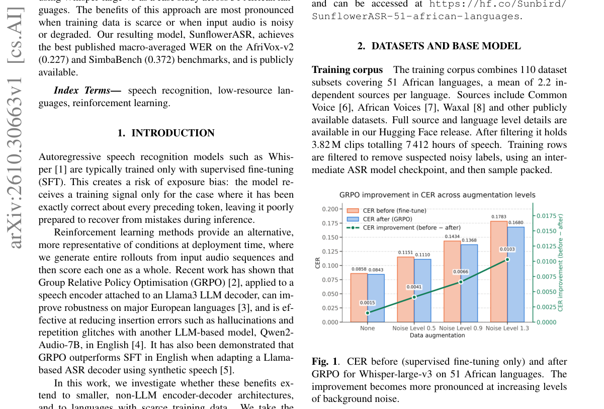

*Result - WER by language on the Sunbird Speech Benchmark, comparing SunflowerASR against external baselines. Languages are sorted by the WER of SunflowerASR.*

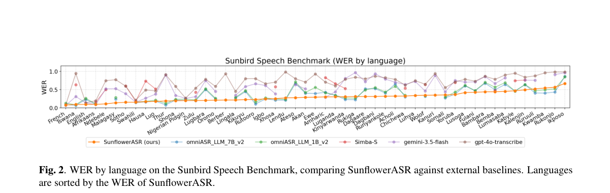

**Why this ranks #4**: GRPO 也能帮非 LLM 的小 ASR 模型治暴露偏差：51 种非洲语言上拿下最好的公开宏平均 WER。

---

### 5. Inherited, Not Invented: Tracing the Provenance of Wait in Reasoning Models

**arXiv**: [2610.30882](https://arxiv.org/abs/2610.30882) | **Score**: 8.3 (relevance 8.0 x 0.7 + quality 9.0 x 0.3) | **Tags**: rl-llm, RLHF, provenance, token-analysis, evaluation | **Categories**: cs.CL, cs.LG | **Pages**: 36

**Authors**: Zhizhuo Kou, Sizai Hou, Long Chen, Jian Yang, Junyu Luo, Jingshu Peng, Wenkai Zhang, Sirui Han, Yike Guo

**Affiliation**: The Hong Kong University of Science and Technology; Peking University; Huawei Noah's Ark Lab

**Abstract**

> Reinforcement learning (RL) is credited with teaching reasoning models to write {wait} before reconsidering a step, yet large RL accuracy gains do not require the word. This view can confuse what RL discovers with what a model inherits from its training data. We trace the word through open models' training histories, reading it with label-free indices of frequency, position, form and usage and an injected-error test, all computed from sampled outputs. We find that zero-RL almost never coins the marker: on bases that lack the word, RL raises MATH-500 accuracy substantially while {wait} stays near absent. It arrives with training data: mid-training in OLMo-3, and fine-tuning on reasoning traces installs it in most models whose base lacks it. Where the base already uses it, both released RL-Zero recipes (OLMo-3, MiMo) multiply it, whereas KL-free GRPO from the same base does not; OLMo-3's recipe wears down its form and makes it a more sensitive but more liberal alarm; RL after supervised fine-tuning barely changes it, and our GRPO recipe erases a marker seeded by fine-tuning. Finally, we show that marker frequency alone does not indicate RL-induced reasoning and caution against LLM-as-a-judge revision metrics, as automated judges can reverse human-labelled trends.

**Key findings**

- **Finding**: RL 常被归功于教会推理模型在重新考虑一步前先写 {wait}，但**大量 RL 精度提升并不需要这个词**。
- **Finding**: 作者沿着开放模型的训练历史追踪这个词，用频率、位置、形式与用法等**无标签指标**加一个注入错误测试，全部从采样输出计算。
- **Finding**: 关键发现：**零 RL 几乎从不铸造这个标记**——在原本没有该词的基座上，RL 大幅提升 MATH-500 准确率，而 {wait} 仍近乎缺席。
- **Finding**: 它随**训练数据**到来：在 OLMo-3 的中期训练中出现；在推理轨迹上微调则为大多数原本没有它的模型装上了它。
- **Finding**: 在基座已使用该词时，两个已发布的 RL-Zero 配方（OLMo-3、MiMo）会**放大**它，而同基座的**无 KL 的 GRPO 不会**。
- **Finding**: OLMo-3 的配方会**磨损**它的形式，使其成为更敏感但也更宽松的警报信号；SFT 之后的 RL 几乎不改变它，而作者的 GRPO 配方会**抹掉**由微调植入的标记。
- **Finding**: 最后指出：**标记频率本身不足以表明 RL 诱发的推理**，并警告不要用 LLM-as-a-judge 修订指标——自动评审可能反转人工标注的趋势。
- **Inference**: 这篇是对「RL 教会模型思考」这一叙事的直接纠偏：很多可解释的行为其实是数据泄漏进训练流程的产物。
- **Inference**: 「无 KL 的 GRPO 不放大标记、而 RL-Zero 放大」这一对比暗示放大效应来自 KL 约束这一族正则，与具体奖励设计关系不大。
- **Inference**: 顺手提醒了 LLM-as-a-judge 在修订类指标上的不可靠性，这是一个很容易被忽略的方法学警告。
- **Recommendation**: 强烈推荐。做 RL 可解释性、推理模型分析、或用 token 频率做归因的人必读。

**Key figures**

*Framework - RL rarely coins wait: the marker enters with mid-training or fine-tuning on traces.*

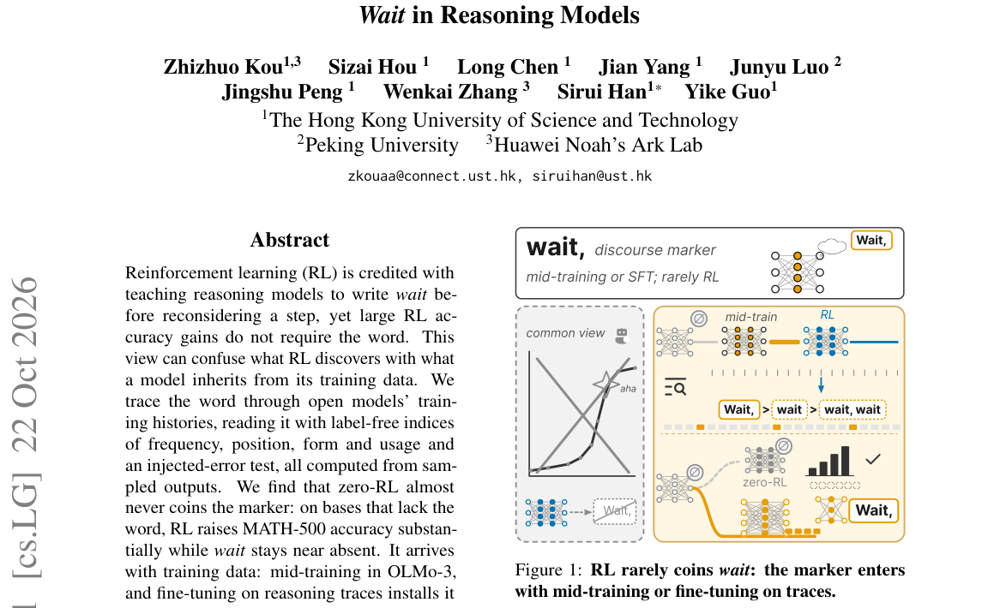

*Result - Our methodology extracts a marker’s evolutionary history from its occurrences, one checkpoint at a time. The pipeline processes ❶lineages and sampled traces into ❷matched occurrences, from w*

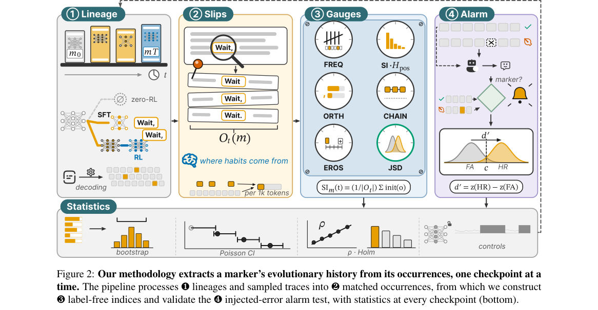

**Why this ranks #5**: 推理模型爱说的「等一下」不是 RL 教出来的——多半是训练数据带来的；这篇把功劳还给数据。

---

### 6. RECAP: Looking Once Is Not Enough for Vision-Language Reasoning

**arXiv**: [2610.30834](https://arxiv.org/abs/2610.30834) | **Score**: 8.3 (relevance 8.0 x 0.7 + quality 9.0 x 0.3) | **Tags**: rl-llm, GRPO, VLM-reasoning, temporal-grounding, reward-design | **Categories**: cs.CV | **Pages**: 33

**Authors**: Zhaolu Kang, Tailong Luo, Chenxin Li, Yingjie He, Zhenyu Yu, Fengyu Zhou, Jiachen Qian, Lei Wei, Shuang Chen, Jiachen Li, Eric Hanchen Jiang, Rongchao Zhang

**Affiliation**: Peking University; Wayne State University

**Abstract**

> Long chain-of-thought reasoning improves vision-language models (VLMs), but it also exposes a temporal grounding failure: as generation unfolds, models may drift from image evidence while reinforcement learning still provides only a final-answer reward. We study this gap through visual revisit, a temporally localized reactivation of image evidence during reasoning. Across three VLM backbones, revisit peaks are predictive of correctness and causally linked to performance: masking them degrades accuracy more than masking non-peaks, while injecting revisit-like peaks into failed rollouts partially restores correct answers. Control analyses show that this signal is not explained by raw attention strength, uncertainty, logit margin, or hidden-state norm. We propose RECAP, a GRPO-compatible training method that turns detached revisit traces into a credit-assignment signal. RECAP uses revisit-conditioned advantage estimation, dynamic discounting, and gated value prediction to propagate final rewards through visually important reasoning steps, without extra rewards, additional rollouts, or inference-time changes. Across Qwen2.5-VL-7B, InternVL3-8B, and LLaVA-OV-7B, RECAP consistently improves over GRPO and VPPO, yielding $+6.1$--$+6.5$ HallusionBench gains over the SFT base while preserving reasoning and text-only performance. Results on larger LoRA-tuned models, Chinese zero-shot benchmarks, visual perturbations, and human evaluation further demonstrate robust improvements in image-grounded reasoning.

**Key findings**

- **Finding**: 长思维链推理改善 VLM，但暴露出**时间定位失效**：随着生成推进，模型可能**偏离图像证据**，而 RL 仍只提供最终答案奖励。
- **Finding**: 作者通过**视觉重访（visual revisit）**——推理过程中对图像证据做时间定位的再激活——研究这一差距。
- **Finding**: 跨三个 VLM 骨干，重访峰值**可预测正确性**且与性能有因果关联：遮蔽它们比遮蔽非峰值更伤性能。
- **Finding**: 向失败 rollout 注入类重访峰值可**部分恢复**性能。
- **Inference**: 这指出了一个 RLVR 设计的通用盲点：当奖励只在终局给出，而错误在过程中累积，过程级信号就是必需的。
- **Inference**: 「遮蔽峰值比遮蔽非峰值更伤」是因果性证据而非相关性，这在视觉推理研究里并不常见，值得单独标出。
- **Recommendation**: 推荐。做多模态 RL、RLVR 奖励设计、VLM 推理的人应读。

**Key figures**

*Result - The RECAP framework. A detached revisit signal ˜rt is extracted from cross-modal attention and injected into three parts of the surrogate estimator: the trace-augmented input, dynamic discou*

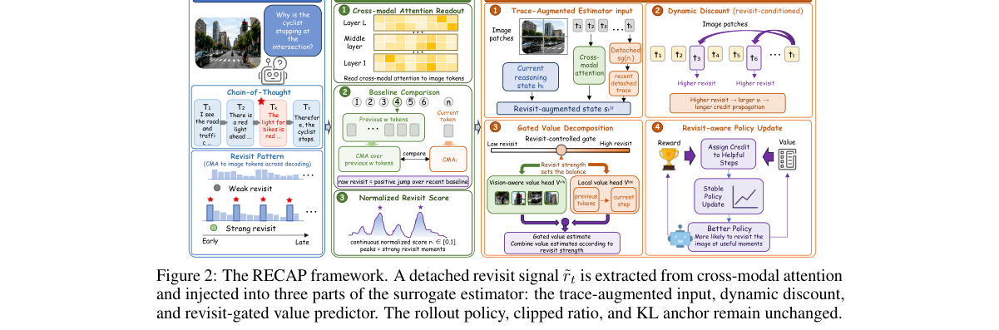

**Why this ranks #6**: 长 CoT 会让 VLM 逐渐「脱离图像」：把最终答案奖励换成位置感知的重访奖励。

---

### 7. ReflectPO: Reflection-Guided Policy Optimization for Long-Horizon LLM Agents

**arXiv**: [2610.30933](https://arxiv.org/abs/2610.30933) | **Score**: 7.7 (relevance 8.0 x 0.7 + quality 7.0 x 0.3) | **Tags**: rl-llm, agentic-RL, error-recovery, tree-credit-assignment | **Categories**: cs.CL | **Pages**: 24

**Authors**: Rumei Li, Xunliang Cai

**Affiliation**: Meituan

**Abstract**

> With external tools, large language models (LLMs) can tackle complex tasks through sustained environmental interaction. LLM-based agents are therefore increasingly used to tackle complex long-horizon tasks in real-world environments. However, these tasks involve sequential, interdependent decisions and changes in environmental states. Early execution errors affect subsequent interaction histories and environmental states, and their effects accumulate along the decision chain. To address this challenge, we propose Reflection-Guided Policy Optimization (ReflectPO), a reinforcement learning framework for autonomous error recovery in long-horizon tasks. ReflectPO comprises two core components. The first is Reflection-Guided Sampling. We use branch differences and repeated visits in interaction trajectories to construct hints for error recovery. The second is Tree-Structured Credit Assignment. We organize sampled trajectories into trees and assign action-level credit using parent--child reward differences and recovery gains. Experiments over two long-horizon tool-use benchmarks show that ReflectPO outperforms multiple existing baselines in most domains. It also achieves the best overall performance on average. Further analyses show that ReflectPO effectively improves agents' ability to recognize their own deviations, recover from erroneous states, and continue making progress toward task completion.

**Key findings**

- **Finding**: 借助外部工具，LLM 能通过持续的与环境交互处理复杂任务，因此越来越多地被用于长程真实任务。
- **Finding**: 但这类任务包含**相互依赖的序列决策**与环境状态变化，**早期的执行错误会影响后续交互历史与环境状态，其影响沿决策链累积**。
- **Finding**: ReflectPO 是面向长程任务**自主错误恢复**的 RL 框架，含两个核心组件。
- **Finding**: **Reflection-Guided Sampling**：利用交互轨迹中的**分支差异与重复访问**构造错误恢复的提示。
- **Finding**: **Tree-Structured Credit Assignment**：把采样轨迹组织成树，用父子奖励差与恢复收益分配动作级信用。
- **Finding**: 在两个长程工具使用基准上，ReflectPO 在多数领域优于多个现有基线，并取得最佳平均表现。
- **Finding**: 进一步分析显示它有效提升了智能体**识别自身偏差、从错误状态恢复、并继续朝任务完成推进**的能力。
- **Inference**: 「重复访问」被用作错误信号是个巧妙的代理——同一状态下反复出现往往意味着前面做错了。
- **Inference**: 树状信用分配把长链信用分配难题转成了局部父子差分，这比全局回报差分更贴近「哪一步导致了偏离」。
- **Recommendation**: 强烈推荐。做 agentic RL、长程任务、工具使用智能体的人必读。

**Key figures**

*Framework - Recovery trajectory sampling in ReflectPO. Contrast-based sampling compares target and reference trajectories after a shared branch point. Loop-based sampling identifies repeated visits with*

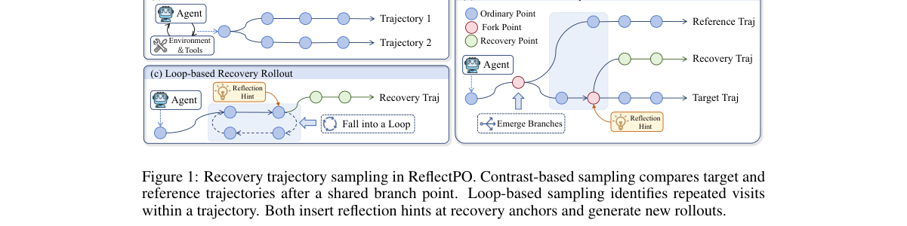

*Result - Credit assignment in ReflectPO. Original actions receive tree-based advantages from em- pirical outcome differences between parent and child nodes. Recovery actions receive paired advan- tag*

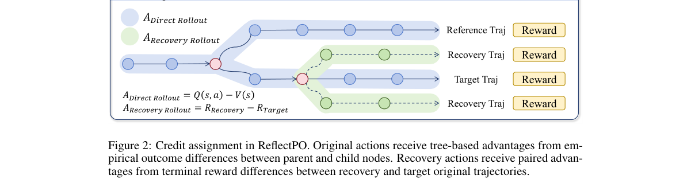

**Why this ranks #7**: 长程智能体的错误会沿决策链累积；ReflectPO 用「分支差异 + 重复访问」构造恢复提示，再做树状信用分配。

---

### 8. GIFT: Gradient Informed Filtering for Distillation Augmented Reasoning RL

**arXiv**: [2610.30796](https://arxiv.org/abs/2610.30796) | **Score**: 8.0 (relevance 8.0 x 0.7 + quality 8.0 x 0.3) | **Tags**: rl-llm, GRPO, distillation, gradient-conflict, token-level | **Categories**: cs.LG | **Pages**: 26

**Authors**: Shijie Li, Yilin Gao, Tieyuan Chen, Yun Luo, Weiyao Lin, Hang Yu

**Affiliation**: Shanghai Jiao Tong University; Tencent

**Abstract**

> Training large language models for complex reasoning tasks relies on two complementary signals: sparse, outcome-grounded reinforcement learning (RL) for correctness, and dense, token-level distillation for guidance. However, complementarity in supervision does not guarantee compatibility in optimization; imitation-focused distillation can conflict with the outcome-driven RL objective, and existing hybrids lack a principled resolution. We propose \textbf{GIFT} (\textbf{G}radient-\textbf{I}nformed \textbf{F}il\textbf{T}ering for Distillation-Augmented Reasoning RL), a novel method that directly addresses the allocation problem of which teacher updates to apply. GIFT performs a token-level geometric analysis, decomposing the distillation gradient into a component \textbf{parallel} to the RL gradient, which measures first-order conflict and provides a \textbf{safety} filter, and a component \textbf{orthogonal} to it, which quantifies novel directional guidance and provides a measure of \textbf{value}. This decomposition yields a principled scoring rule to rank token-level guidance. We combine this with a progressive \textbf{coverage annealing} schedule that shrinks the budget of tokens receiving distillation, ensuring that the most conflicting updates are discarded first while the most complementary ones are retained at full strength. This facilitates a smooth transition from dense, geometrically-filtered guidance to a pure, outcome-grounded objective at convergence. Extensive experiments on mathematical and logical reasoning benchmarks show that GIFT consistently outperforms strong baselines across multiple model scales, achieving relative gains of up to 9.5\% on difficult mathematical reasoning tasks. Code: https://github.com/lilifree/GIFT

**Key findings**

- **Finding**: 训练大模型做复杂推理依赖两个互补信号：**稀疏的结果导向 RL**（保证正确性）与**稠密的 token 级蒸馏**（提供引导）。
- **Finding**: 但监督上的互补**不保证优化上的兼容**——模仿导向的蒸馏会与结果导向的 RL 目标冲突，而现有混合方案缺少有原则的化解方式。
- **Finding**: GIFT 直接处理「哪些教师更新该用」这个分配问题，做 **token 级几何分析**。
- **Finding**: 把蒸馏梯度分解为与 RL 梯度**平行**的分量（度量一阶冲突，提供**安全**过滤）与**正交**的分量（量化新颖方向，提供**价值**度量）。
- **Finding**: 该分解给出有原则的 token 级引导排序规则。
- **Finding**: 并配合**渐进覆盖退火**调度：逐步缩小接受蒸馏的 token 预算，确保最先丢弃最冲突的更新，最互补的保留满强度。
- **Finding**: 这促成从「稠密、经几何过滤的引导」到「纯粹结果导向目标」的平滑过渡。
- **Finding**: 在数学与逻辑推理基准上，GIFT 在多个模型规模上一致优于强基线，在困难数学推理任务上取得最高 **9.5%** 的相对增益。
- **Inference**: 把梯度冲突/互补做成可测量的几何量，是把「蒸馏与 RL 不兼容」这种经验判断变成可操作的分配规则的关键一步。
- **Inference**: 「先丢最冲突的」这种预算退火，比等权重混合要稳得多——它让混合变成一个随训练推进的连续过程。
- **Recommendation**: 强烈推荐。做推理 RL + 蒸馏混合、或研究梯度冲突的人必读。

**Key figures**

*Framework - GIFT decomposes the distillation gradient into conflict (ai) and complement (bi) compo- nents relative to the RL gradient, ranks tokens, and anneals the selection budget from full to zero.*

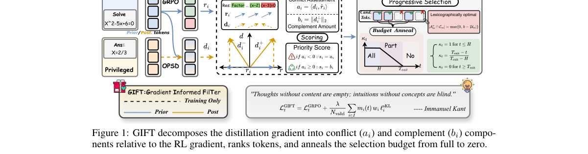

**Why this ranks #8**: 蒸馏与 RL 的梯度会打架：GIFT 用几何分解把教师更新分成「冲突」与「互补」两部分，再排序分配。

---

### 9. Consistency Is Not Validity: Self-Rewarded Moral Argumentation Makes Language Models Decisive but Pliable

**arXiv**: [2610.30349](https://arxiv.org/abs/2610.30349) | **Score**: 7.3 (relevance 7.0 x 0.7 + quality 8.0 x 0.3) | **Tags**: rl-llm, self-reward, moral-judgment, sycophancy, google-deepmind | **Categories**: cs.AI, cs.CL, cs.LG | **Pages**: 20

**Authors**: Marius De Kuthy Meurers, Aaron Parisi, Bernd Bohnet

**Affiliation**: Google DeepMind

**Abstract**

> LLMs are increasingly consulted for moral judgment. We aim to improve performance on such tasks by rewarding good arguments, on the premise that arguing well increases the likelihood of judging well. We train a reinforcement learning policy initialized from a state-of-the-art language model in a self-judged tournament with masked thinking: the generated arguments are judged pairwise on argument quality by the policy itself. As an empirical basis, we extract authentic dilemmas from classic novels, using a logic solver to verify that each constitutes a conflict. We show that our judge rates argument quality like human annotators, and the policy then adopts the language register that it rewards. Testing on the external benchmarks MoralChoice, ELEPHANT, and MORABLES, we find that the policy becomes more decisive and invariant to the order in which options are presented, but sycophancy and reframing remain a challenge to validity. Two ablation studies with synthetic dilemmas and unmasked thinking match the reordering gains, but show a weaker register shift and higher sycophancy. We conclude that consistency is not validity: consistency under reordering can be optimized without improving the moral judgment it is meant to signal.

**Key findings**

- **Finding**: LLM 越来越多地被用于道德判断，作者希望通过对**好论证**的奖励来提升表现，前提是「论证好更可能判断好」。
- **Finding**: 作者从一个先进语言模型初始化，在**掩蔽思维（masked thinking）的自裁锦标赛**中训练 RL 策略：生成的论证由策略自身以论证质量成对评判。
- **Finding**: 经验基础是：从经典小说中提取**真实的两难**，并用逻辑求解器验证每个确实构成冲突。
- **Finding**: 结果：裁判对论证质量的评分与人工标注者相近，策略随后**采用它所奖励的语言风格**。
- **Finding**: 在外部基准 MoralChoice、ELEPHANT、MORABLES 上，策略变得更**果断**，且对选项呈现顺序**更不敏感**。
- **Finding**: 但**谄媚（sycophancy）与重构（reframing）仍是有效性的挑战**。
- **Finding**: 两项用合成两难与未掩蔽思维的消融复现了重排序增益，但显示语言风格迁移更弱、谄媚更强。
- **Finding**: 作者结论：**一致性不是有效性**——重排序下的一致性可以被优化，而不必改善它本应传递的道德判断。
- **Inference**: 「自奖励 + 掩蔽思维」避免了自我强化的思维链污染，是这类自博弈评测里一个值得抄的工程细节。
- **Inference**: 论文标题本身就是它的贡献：把「更果断、更抗顺序扰动」与「判断更准」分开，是很多对齐论文没有做的一步。
- **Recommendation**: 强烈推荐。做自奖励、道德评测、或关心「一致性 ≠ 有效性」的人必读。

**Key figures**

*Framework - 4B Base, 4B after GRPO (step 48), and 31B judges on IBM-ArgQ-30k across the human preference gap Δ (bands: 95% Wilson CIs). Top: resolved accu- racy. Bottom: presentation-flip rate (dashed)*

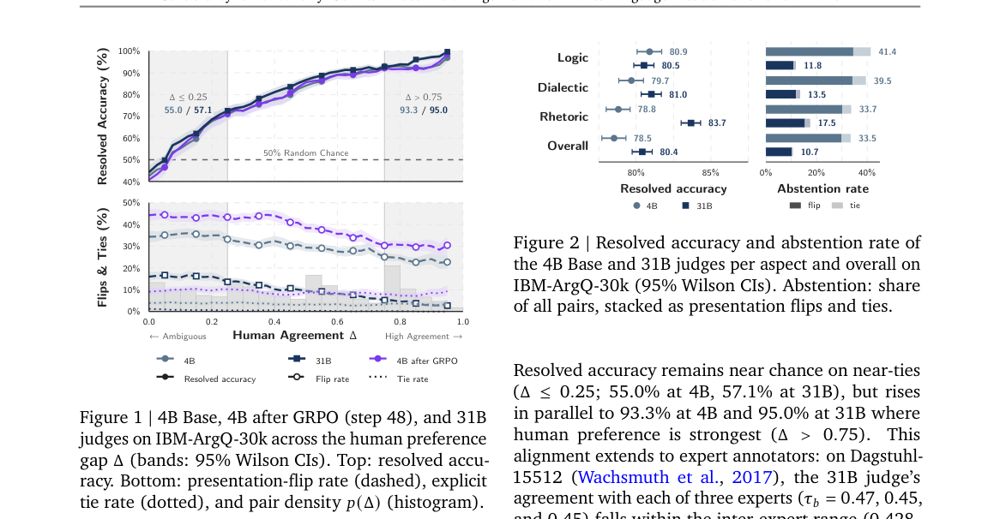

*Result - Resolved accuracy and abstention rate of the 4B Base and 31B judges per aspect and overall on IBM-ArgQ-30k (95% Wilson CIs). Abstention: share of all pairs, stacked as presentation flips an*

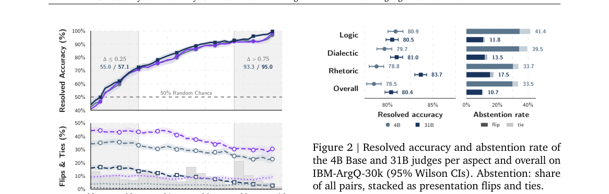

**Why this ranks #9**: 自裁判锦标赛训出的策略更果断，但作者自己给出结论：**一致性不等于有效性**。

---

### 10. What Pairwise Evaluation Misses: Reward Scores across Prompts

**arXiv**: [2610.31090](https://arxiv.org/abs/2610.31090) | **Score**: 7.3 (relevance 7.0 x 0.7 + quality 8.0 x 0.3) | **Tags**: rl-llm, reward-model, evaluation, prompt-clustering, audit | **Categories**: cs.AI, cs.CL | **Pages**: 31

**Authors**: Mateusz Modrzejewski, Tomasz Radzikowski

**Affiliation**: Warsaw University of Technology

**Abstract**

> Reward models score responses for preference optimization, filtering and ranking, and pooling scores across prompts needs them to be comparable. Yet pairwise evaluation compares two responses to the same prompt, so any score component shared by a prompt's responses cancels and goes untested. We study this component by comparing between-prompt variation in model scores with the same variation in human ratings of the same responses. We propose a human-referenced audit, built from a between-prompt variance share, a sibling-rating regression and prompt substitutions, and apply it to eighteen released scorers and six matched training conditions. We find that scores cluster by prompt more than the ratings do: on HelpSteer2, six reward models have between-prompt shares of 0.34 to 0.64 against a human share near zero. Replacing the original prompt with a fixed instruction keeps substantial clustering but weakens agreement with prompt-level human ratings, so clustering alone does not show agreement with humans. Part of that variation is useful: subtracting prompt means lowers the helpfulness of globally selected responses, and scores stay sensitive to a wrong prompt even when training shuffles prompt means. We propose that reward evaluation check between-prompt variation, sensitivity to a wrong prompt and usefulness for selection separately.

**Key findings**

- **Finding**: 奖励模型为偏好优化、过滤与排序给响应打分，**跨 prompt 汇总分数要求它们可比**。
- **Finding**: 但**成对评测**只比较同一 prompt 的两个响应，于是该 prompt 响应之间共享的任何分数分量都会被抵消，**从未被检验**。
- **Finding**: 作者通过比较模型分数的 prompt 间变化与人类对同样响应评分的对应变化来研究这一分量。
- **Finding**: 提出**人类参照审计**，由 prompt 间方差占比、兄弟评分回归与 prompt 替换构成。
- **Finding**: 应用到 **18 个已发布评分器**与 6 个匹配的训练条件。
- **Finding**: 发现**分数按 prompt 聚集的程度远高于人类评分**：在 HelpSteer2 上，六个奖励模型的 prompt 间占比为 **0.34–0.64**，而人类的占比接近零。
- **Finding**: 把原 prompt 换成固定指令后聚集依然明显，但与 prompt 级人类评分的一致性减弱——说明**聚集本身并不表明与人类一致**。
- **Finding**: 这部分变化是有用的：减去 prompt 均值会**降低全局挑选响应的有用性**，且即使训练打乱了 prompt 均值，分数仍对错误 prompt 敏感。
- **Finding**: 作者建议奖励评测**分别**检查 prompt 间变化、对错误 prompt 的敏感性与对选择任务的有用性。
- **Inference**: 「成对评测测不到 prompt 层面的偏差」是个很尖锐的方法学缺口——它意味着整个偏好优化的评测范式在一半维度上是盲的。
- **Inference**: 「聚集 ≠ 与人类一致」这个区分尤其重要，否则很容易把一个可检测的缺陷误读成模型学到了什么。
- **Recommendation**: 强烈推荐。做奖励模型、评测、或用奖励分做全局挑选的人必读。

**Key figures**

*Framework - Between-prompt variation and mismatch sensitivity on HelpSteer2 validation for thirteen of the eighteen released scorers. (a) The share under the original prompt and under one generic prompt*

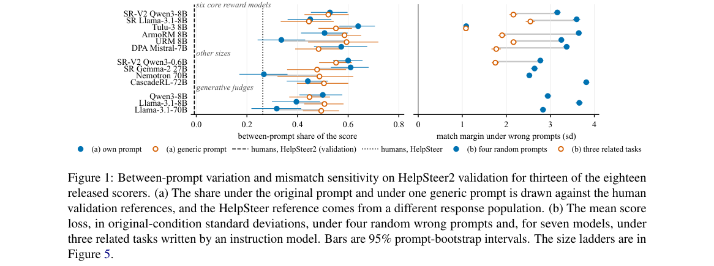

*Result - Controls and human references for seven reward models. (a) HelpSteer2 validation shares under the original prompt, under one generic prompt and after log-length adjustment. (b) The share on*

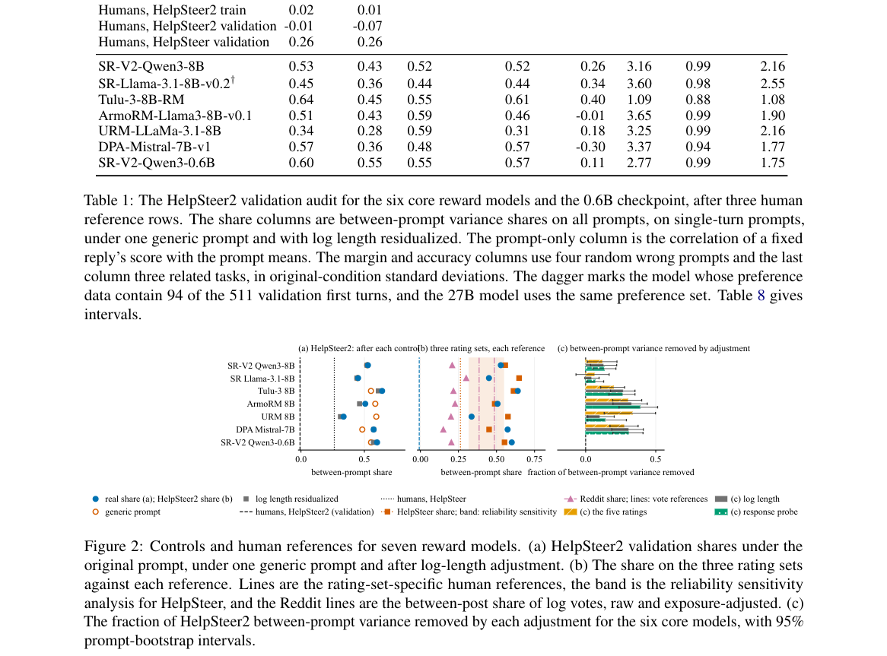

**Why this ranks #10**: 成对评测有个看不见的盲区：同一 prompt 的共享分量会被抵消掉，从而**完全未经测试**。

---

## Footer

- Total papers scanned across all 7 tracks: 535（原始 705 条）
- rl_llm track final top-10: 10
- Wild-cards in this track: 0
- Figure assets: 2026-10-23/res/

Generated by `mine-arxiv-daily-digest` skill. Sister file: `2026-10-23_rl_llm_entry.md`.
