# ArXiv Daily Digest - 2026-10-26 (AIGC 音频生成与编辑, 10 papers)

**Generated**: 2026-10-26 17:00 CST

**Source**: arXiv cs.CV, cs.SD, eess.AS, cs.CL, cs.AI, cs.RO, cs.LG submissions, listing day 2026-10-23 (announced 2026-10-26 00:00 UTC)

**Batch window**: 2026-10-22T18:00:00Z .. 2026-10-23T18:00:00Z（arXiv 公告批次横跨两个 UTC 日：前一日 18:00 UTC 起算，当日 17:59:59 UTC 截止）

**Track**: aigc_audio (top 10 of 474 papers scanned, 70 full reads)

**Scope**: TTS、语音克隆、音乐 / 音频生成、语音增强与修复（仅生成侧）

⚠️ **Wild-card**: 本批该线 3 篇为 wild-card 补足，已在正文逐条标注并给出理由。

---

## Top 10 - AIGC 音频生成与编辑

### 1. Melody Guidance for Audio Diffusion Models Without Retraining

**arXiv**: [2610.32211](https://arxiv.org/abs/2610.32211) | **Score**: 9.7 (relevance 10.0 x 0.7 + quality 9.0 x 0.3) | **Tags**: AIGC-audio, music-generation, audio-diffusion, training-free, differentiable-pitch, guidance | **Categories**: eess.AS | **Pages**: 5

**Authors**: Cristobal Andrade, Sebastian J. Schlecht, Ben Maman, Meinard Müller

**Affiliation**: Friedrich-Alexander-Universitaet Erlangen-Nuernberg; International Audio Laboratories Erlangen

**Abstract**

> Controlling melody in audio generation normally requires training a conditional generative model on audio paired with pitch curves or MIDI notes. We instead guide an existing unconditional diffusion model, originally trained without melody inputs, to follow a target melody without retraining or modifying it. During inference, a differentiable pitch detector steers the sampled audio toward the desired pitches, while the diffusion model keeps it close to the distribution of realistic audio learned during training. Our main contribution is a sampling method that balances these two directions, providing melody control while preserving audio quality. To improve stability, we initialize sampling with a simple synthesized version of the target melody rather than pure noise. Experiments on piano, guitar, and singing voice show melody accuracy comparable to conditional models trained specifically for melody control. Our method therefore adds melody control to existing audio diffusion models without requiring paired melody data or task-specific retraining.

**Key findings**

- **Finding**: 通常要控制音频生成的旋律，必须用「音频 + 音高曲线 / MIDI」配对数据训练条件生成模型；本文改为**引导**一个原本无条件训练、完全不接触旋律输入的扩散模型。
- **Finding**: 推理时用可微的音高检测器把采样出的音频推向目标音高，同时扩散模型自身把音频保持在训练时学到的真实音频分布附近。
- **Finding**: 核心贡献是一个在这两个方向之间取平衡的**采样方法**：既给旋律控制，又保住音频质量。
- **Finding**: 为提高稳定性，采样不从纯噪声起步，而从目标旋律的简单合成版本初始化。
- **Finding**: 在钢琴、吉他与人声上，旋律准确率与专门为旋律控制训练的**条件模型相当**。
- **Finding**: 结论：不需要配对旋律数据、也不需要任务特定重训，就能给已有音频扩散模型加上旋律控制。
- **Inference**: 「用可微音高检测器做引导」把 melody-conditioned TTS 从一个训练问题降级成了一个采样问题——这是生成模型可控性的一条通用套路（与 TIE 的 CLIP 引导同源）。
- **Inference**: 从合成旋律初始化的细节值得注意：纯噪声起步时引导信号在早期步噪声太大，模型容易被推离分布；这是所有「训练无关引导」方法共同的工程坑。
- **Recommendation**: 强烈推荐。做音乐生成、音频可控生成、或想在不重训的前提下加条件的人必读。

**Key figures**

*Framework - Overview of melody-guided sampling. The target F0 curve y synthesizes the warm-start signal xinit, which is encoded to zinit and refined through guided reverse diffusion using the dSWIPE-based*

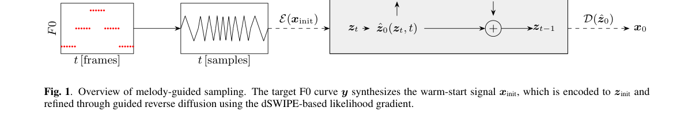

*Result - Mean OA as a function of tinit across guidance strengths λ.*

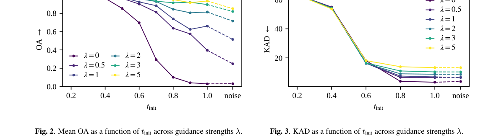

**Why this ranks #1**: 不给成对旋律数据、不重训模型，就给已有的无条件音频扩散模型加上旋律控制——准确度追平专用条件模型。

---

### 2. X-Dubbing: Speech-to-Speech Translation under Temporal and Visual Constraints

**arXiv**: [2610.32042](https://arxiv.org/abs/2610.32042) | **Score**: 9.0 (relevance 9.0 x 0.7 + quality 9.0 x 0.3) | **Tags**: AIGC-audio, TTS, dubbing, speech-to-speech-translation, audiovisual-alignment, no-paired-data | **Categories**: cs.CL, cs.CV, eess.AS | **Pages**: 11

**Authors**: Jeongsoo Choi, Ji-Hoon Kim, Junseok Ahn, Joon Son Chung

**Affiliation**: KAIST; Chung-Ang University

**Abstract**

> Cross-lingual dubbing aims to convert source speech into target-language speech that remains synchronized with the original video. The key to this task is to produce a faithful translation that is naturally speakable within the source timing, which is non-trivial because languages differ in duration, rhythm, and articulation. In this paper, we propose X-Dubbing, which formulates the task as a joint problem of time-aware speech-to-text translation and video-aware text-to-speech. Specifically, our method consists of a Dubbing Translator that generates temporally structured scripts and a Voice Actor that renders them in synchrony with the source video, both grounded in a language-agnostic timing budget. We further refine the translator with dubbing-aware feedback from the synthesized speech, encouraging scripts that yield well-synchronized dubbing. This design requires no paired dubbing data, as the two components are trained on speech-text and monolingual audio-visual data respectively. Extensive experiments show that X-Dubbing outperforms recent baselines across diverse metrics, including isochrony and audio-visual correspondence.

**Key findings**

- **Finding**: 跨语种配音要把源语音转成与原视频同步的目标语言语音，难点在语言间时长、节奏与发音差异——译文既要忠实又要能在原时间预算内自然说出。
- **Finding**: X-Dubbing 把任务形式化为**时间感知的语音到文本翻译**与**视频感知的文本到语音**的联合问题。
- **Finding**: 两个部件：Dubbing Translator 生成带时间结构的脚本，Voice Actor 依据源视频同步渲染，两者都建立在**语言无关的 timing budget** 之上。
- **Finding**: 进一步用合成语音反馈来「配音感知地」精修翻译器，促使脚本产出更易同步的译文。
- **Finding**: 该设计**不需要成对配音数据**：两个部件分别在语音-文本数据与单语音视频数据上训练。
- **Finding**: 在等时性（isochrony）与音视频对应等多个指标上优于近期基线。
- **Inference**: 「语言无关的时间预算」是关键抽象：把「多长」与「说什么」解耦后，翻译器与 TTS 各自可以在自己的数据上训练，这是没有成对配音数据时的必要设计。
- **Inference**: 用合成语音反过来调翻译器，形成一个无监督的「可发音性」闭环——这个思路可以推广到任何时长受限的翻译任务。
- **Recommendation**: 推荐。做配音、本地化、TTS 与视频对齐的人必读。

**Key figures**

*Framework - Comparison of fixed-video dubbing pipelines. (a) Time-aware translation generates timing- constrained scripts for a visually-blind TTS; optimized in isolation, this misses fine-grained visua*

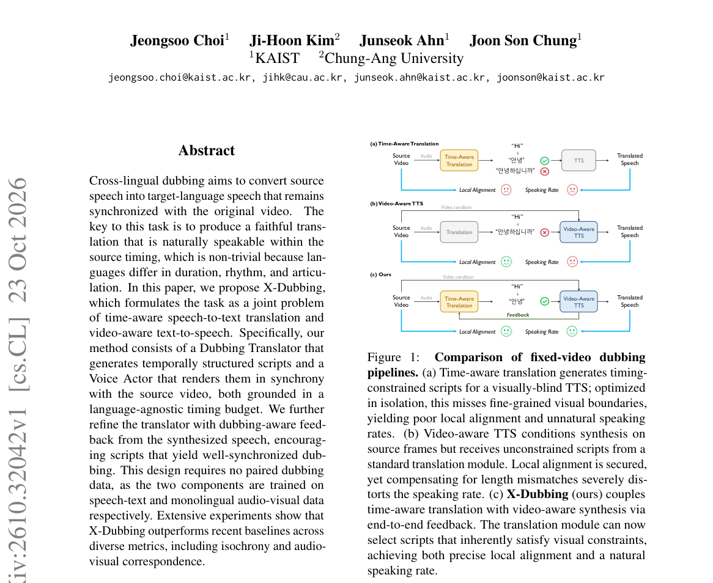

*Result - Method overview of X-Dubbing. The proposed framework couples a timing-aware dubbing translator and a video-conditioned voice actor through synthesized dubbing feedback.*

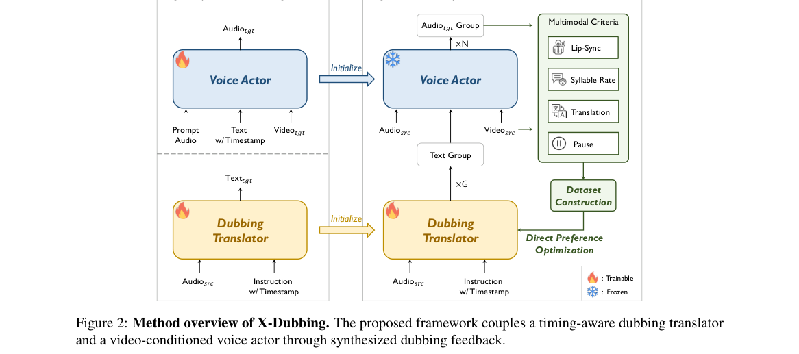

**Why this ranks #2**: 跨语种配音拆成「时间感知的翻译 + 视频感知的 TTS」两段，用语言无关的时间预算对齐，无需成对配音数据。

---

### 3. MI-MIDI 2: From Observation to Control with Sparse Autoencoders in Text-to-MIDI Generation

**arXiv**: [2610.32007](https://arxiv.org/abs/2610.32007) | **Score**: 8.7 (relevance 9.0 x 0.7 + quality 8.0 x 0.3) | **Tags**: AIGC-audio, music-generation, text-to-MIDI, sparse-autoencoder, feature-attribution, intervention | **Categories**: cs.AI, cs.SD | **Pages**: 20

**Authors**: Jakub Poćwiardowski, Mateusz Modrzejewski

**Affiliation**: Institute of Computer Science Warsaw University of Technology

**Abstract**

> Sparse autoencoders (SAEs) can expose features of a generative model without predefined labels, but in language models the evidence used to interpret these features has proven an unreliable guide to which of them steer the output. Whether interpretations of SAE features predict control in music generators has not, to our knowledge, been tested. We develop an end-to-end protocol for discovering and evaluating SAE features in text-to-MIDI generation and apply it to text2midi and MIDI-LLM. The protocol characterizes features through correlations with musical metrics, shared instrument programs, and automated descriptions, each with its own control: note-density adjustment, matched inactive excerpts, and permutation calibration. It then tests candidates by intervention, measured directly in the generated MIDI against unmodified generation and a matched random direction, ranks them in screens, and confirms selected features on new prompts. Evidence that survives these controls points to features that steer the output. Descriptions exceed permutation controls for instrumentation, and a feature whose description names a synth-lead program introduces that program in a prespecified confirmation and in a replication on disjoint prompts and reappears in independently trained dictionaries. Features selected by density-adjusted correlations show a small positive shift of their target metric as a family, whereas features selected by raw correlations show none. An atlas provides MIDI, piano-roll, and audio examples for every feature of the targeted screen.

**Key findings**

- **Finding**: 稀疏自编码器（SAE）能在没有预定义标签的情况下暴露生成模型的特征，但在语言模型里，用于解释特征的证据已被证明不能可靠地指示「哪些特征真正在调控输出」。
- **Finding**: 本文发展了一套端到端的协议，用来在 text-to-MIDI 生成中**发现并评估** SAE 特征，并应用到 text2midi 与 MIDI-LLM 上。
- **Finding**: 协议用三类证据刻画特征：与音乐指标的相关性、共享的乐器 program、自动化描述；每一类都有对应的对照——音符密度调整、匹配的 inactive 片段、置换校准。
- **Finding**: 随后用**干预**直接检验候选特征：在生成的 MIDI 上与未修改生成、与匹配的随机方向对比测量，并排序、在新 prompt 上确认。
- **Finding**: 能扛住这些对照的证据，才指向真正能调控输出的特征：描述在乐器音色上超过置换对照；一个描述中提到 synth-lead program 的特征，在预设确认中确实引入了该 program，并在不相交 prompt 上复现、在独立训练的字典里再次出现。
- **Finding**: 按**密度校正相关性**选出的特征，作为一个整体让其目标指标出现小幅正向偏移；而按**原始相关性**选出的特征则完全没有偏移。
- **Finding**: 论文发布了一个 feature atlas，为目标筛选中的每个特征提供 MIDI、piano-roll 与音频样例。
- **Inference**: 「原始相关性毫无作用、密度校正后才有微弱作用」是本篇最重要的负面/正面混合结论——它说明 SAE 特征归因不做密度校正基本是在读噪声。
- **Inference**: 这套「干预 + 对照 + 跨 prompt 复现 + 跨字典复现」的四重验证模板，本身就值得抄到任何 SAE 归因研究里。
- **Recommendation**: 推荐。做可解释生成、特征控制、SAE 归因的人必读。

**Key figures**

*Framework - Overview of the experiments. Each observational route has its own control; interventions compare the feature direction with baseline generation and a matched random direction, with endpoints*

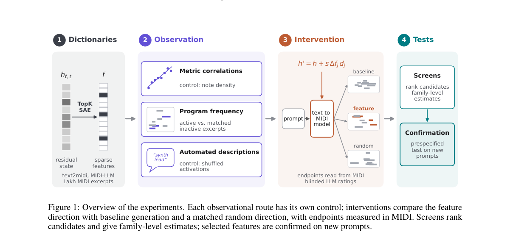

*Result - Only instrumentation descriptions exceed the permutation calibration. After describing a feature, the LLM reviewer picks four of eight held-out excerpts, four of which activate the feature.*

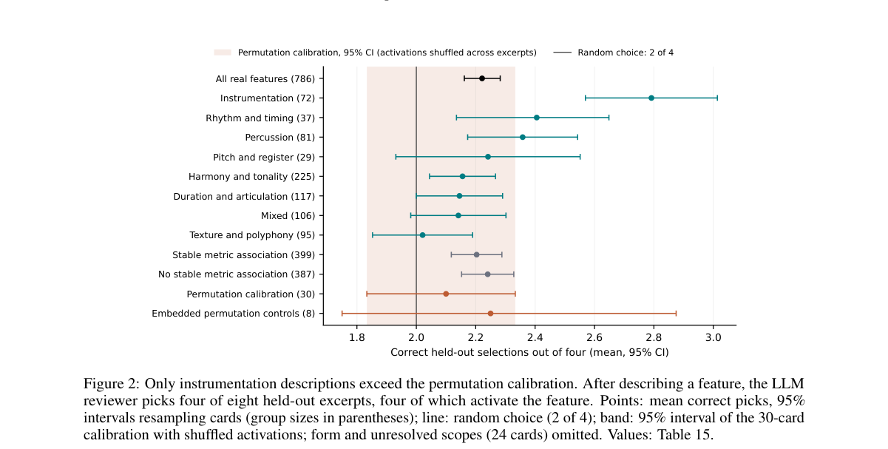

**Why this ranks #3**: 第一次系统检验「SAE 特征的解释能不能预测控制力」——在音乐生成上答案是「密度校正后的相关性可以，纯相关性不行」。

---

### 4. DRAMA-Eval: A Benchmark for Context-Aware, Multi-Turn, Multi-Speaker Speech Generation

**arXiv**: [2610.31796](https://arxiv.org/abs/2610.31796) | **Score**: 8.7 (relevance 9.0 x 0.7 + quality 8.0 x 0.3) | **Tags**: AIGC-audio, speech-generation, benchmark, multi-speaker, multi-turn, LLM-as-judge, long-range-coherence | **Categories**: cs.SD, eess.AS | **Pages**: 20

**Authors**: Jingbin Hu, Zihang Yang, Xiaoge Peng, Haoyu Zhang, Ziyu Zhang, Qirui Zhan, Huakang Chen, Zhao Guo, Wenjie Tian, Kangxiang Xia, Wenkang Hou, Ruonan You

**Affiliation**: Northwestern Polytechnical University ASLP; Nanjing University ASLP; Shenzhen Pimei Technology

**Abstract**

> Recent advances in speech generation are shifting toward context-aware, multi-turn, and multi-speaker synthesis. While these capabilities are in high demand for applications such as audiobook and audio drama production, evaluation has not kept pace with these advances. Beyond traditional zero-shot Text-to-Speech (TTS), modern systems in this domain primarily fall into three categories: instruction-controllable generation models, multi-turn dialogue models, and the audio branches of audio-visual generation models. However, existing benchmarks evaluate these paradigms in isolation, failing to provide a unified assessment of context modeling, instruction following, and multi-speaker generation. Meanwhile, recent progress in audio understanding models has made it feasible to evaluate such complex scenarios using LLM-as-a-Judge approaches. To bridge this gap, we introduce DRAMA-Eval, a comprehensive benchmark for evaluating such systems. DRAMA-Eval utilizes structured script contexts and offers a holistic evaluation framework covering objective, local, and global aspects of generation quality, enabling the assessment of acoustic fidelity, sentence-level execution, and long-range coherence. We benchmark leading open-source and commercial models on a human?verified dataset. The results reveal critical weaknesses in long-range speaker consistency and implicit instruction following that require deep contextual understanding. To facilitate reproducible research, we release a 12-hour bilingual (Chinese-English) test set of manually corrected real-world scripts, accompanied by ground-truth audio, evaluation code, and benchmark results.

**Key findings**

- **Finding**: 语音生成正在从零样本 TTS 转向三类系统：指令可控生成模型、多轮对话模型、视听生成的音频分支；而现有基准是分开评的，无法统一考察上下文建模、指令遵循与多说话人生成。
- **Finding**: 随着音频理解模型的进展，用 LLM-as-a-Judge 评估这类复杂场景已经可行。
- **Finding**: DRAMA-Eval 用结构化剧本上下文作为条件，评测框架覆盖**客观、局部、全局**三层生成质量，可分别考察声学保真、句级执行与长程连贯性。
- **Finding**: 在人工校验过的数据集上评测了主流开源与商业模型。
- **Finding**: 结果暴露出两个关键弱点：**长程说话人一致性**与**隐式指令遵循**，两者都需要深层上下文理解。
- **Finding**: 发布 12 小时中英双语测试集（人工校正的真实剧本），附带真值音频、评测代码与基准结果。
- **Inference**: 「多轮 + 多说话人 + 上下文」是语音生成从 demo 走向有声内容生产的最后一关，这套基准补的正是产线上的评测缺口。
- **Inference**: 结论把「长程一致性」和「隐式指令」并列为两大短板，说明当前生成系统的短程质量已基本解决，问题转移到了状态维持。
- **Recommendation**: 推荐。做语音生成、有声内容、语音生成评测的人必读。

**Key figures**

*Framework - Data construction pipeline of DRAMA-Eval, comprising real-world audio collection, automatic annotation, script refinement, and human review.*

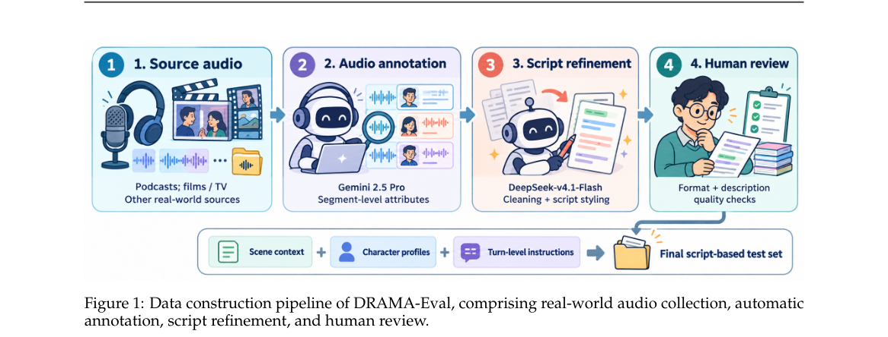

*Result - Distributions of audio sources, scene categories, speaker counts, and turn counts in DRAMA- Eval. All values are percentages.*

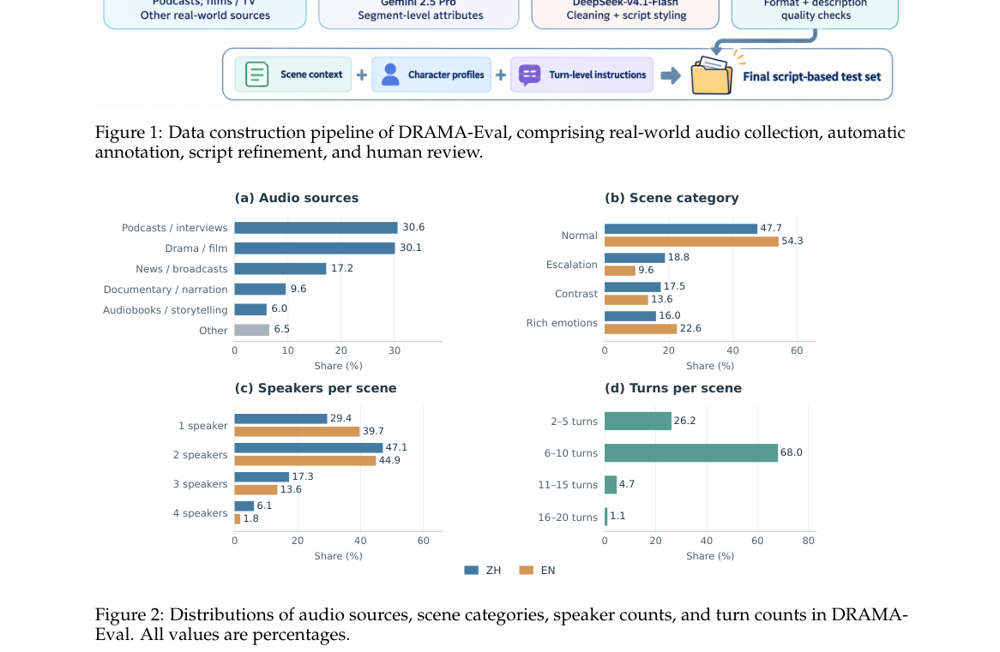

**Why this ranks #4**: 给「上下文感知 + 多轮 + 多说话人」语音生成做统一基准，结论是长程说话人一致性与隐式指令遵循是当前最大短板。

---

### 5. MG-REPA: Multi-Granularity Representation Alignment for Generative Target Speaker Extraction

**arXiv**: [2610.32161](https://arxiv.org/abs/2610.32161) | **Score**: 8.0 (relevance 8.0 x 0.7 + quality 8.0 x 0.3) | **Tags**: AIGC-audio, target-speaker-extraction, diffusion-transformer, REPA, SSL-teacher, speaker-verification | **Categories**: cs.AI, eess.AS | **Pages**: 5

**Authors**: Dohwan Kim, Jung-Woo Choi

**Affiliation**: KAIST

**Abstract**

> Generative target speaker extraction (TSE) models achieve high-quality extraction, but suffer from considerably slow training convergence. Representation Alignment (REPA) accelerates diffusion transformer training by aligning hidden states with a pre-trained Self-Supervised Learning (SSL) teacher. However, existing alignment in the speech and audio domain operates at a single granularity. For TSE, frame-level alignment leaves the global, time-invariant characteristics of the target speech implicit, whereas utterance-level alignment leaves the time-varying content implicit, even though extracting the target requires both. We propose Multi-Granularity Representation Alignment (MG-REPA), aligning the hidden states with an SSL model at the frame level and a speaker verification model at the utterance level. We further apply temporal normalization to the frame-level target, removing its utterance-level statistics so that each branch concentrates on its granularity. On Libri2Mix, MG-REPA reaches the OVRL and PESQ of a MeanFlow-TSE baseline with $3.0\times$ and $2.1\times$ fewer epochs, respectively. Trained for 750 epochs, it is competitive with the published 2,000-epoch baseline on intrusive metrics while improving non-intrusive metrics. An ablation demonstrates that MG-REPA outperforms alignment at a single granularity.

**Key findings**

- **Finding**: 生成式目标说话人提取（TSE）质量高但训练收敛极慢；REPA 通过把隐状态与预训练自监督（SSL）教师对齐来加速扩散 Transformer 训练。
- **Finding**: 问题在于：语音/音频领域的既有对齐都只做**单一粒度**——帧级对齐让目标语音「全局、时间不变」的特征隐含，句级对齐让「时变内容」隐含，而 TSE 两者都需要。
- **Finding**: MG-REPA 同时做两级对齐：帧级用 SSL 模型，句级用说话人验证模型。
- **Finding**: 对帧级目标额外施加**时间归一化**，去掉它的句级统计量，使每一支只专注于自己的粒度。
- **Finding**: 在 Libri2Mix 上，MG-REPA 达到 MeanFlow-TSE 基线的 OVRL 与 PESQ，所需轮数分别少 **3.0×** 与 **2.1×**。
- **Finding**: 训练 750 轮时在侵入式指标上与已发表的 2000 轮基线相当，同时非侵入式指标更好；消融显示优于单粒度对齐。
- **Inference**: 「时间归一化把句级统计从帧级目标里剥掉」是这篇最巧的一步：不这么做，两级目标会互相打架，等于把两个信息源乘在一起而不是相加。
- **Inference**: REPA 在图像扩散里已经成熟，语音侧居然要自己发明粒度拆分——说明跨模态迁移「能搬方法、不能搬超参」。
- **Recommendation**: 推荐。做语音生成、扩散 Transformer 加速、说话人提取的人必读。

**Key figures**

*Framework - MG-REPA significantly accelerates diffusion transformer training. Convergence of OVRL and PESQ on Libri2Mix Noisy.*

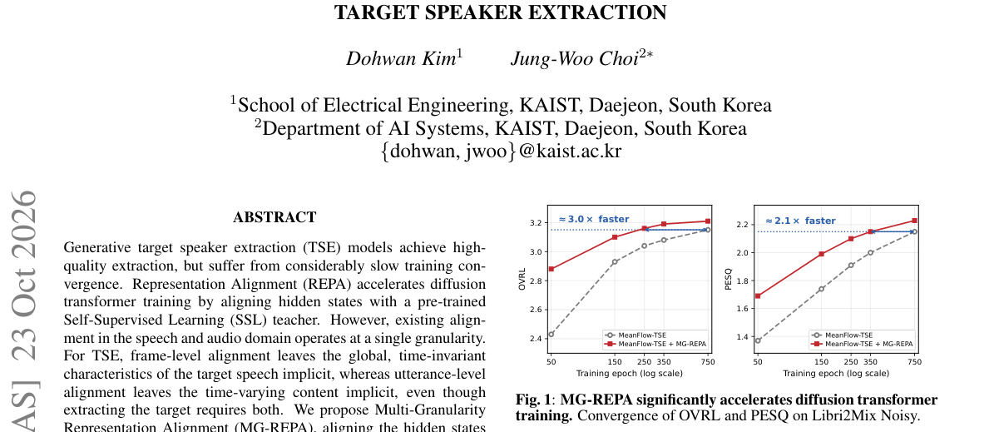

*Result - Overview of MG-REPA.*

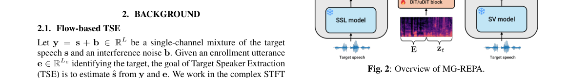

**Why this ranks #5**: 把 REPA 的对齐粒度从单层拆成「帧级 SSL + 句级说话人验证」两支，训练轮数直接砍到 1/3。

---

### 6. Efficient Streaming Audio-Visual Target Speaker Extraction for Real-World Acoustic Scenes

**arXiv**: [2610.32749](https://arxiv.org/abs/2610.32749) | **Score**: 7.3 (relevance 7.0 x 0.7 + quality 8.0 x 0.3) | **Tags**: AIGC-audio, target-speaker-extraction, streaming, edge-deployment, contrastive-loss, real-scene-benchmark | **Categories**: cs.SD | **Pages**: 28

**Authors**: Wendi Sang, Kai Li, Yifan Li, Jianqiang Huang, Xiaolin Hu

**Affiliation**: Tsinghua University; Qinghai University

**Abstract**

> Streaming audio-visual target speaker extraction (AVTSE) is essential for latency-sensitive applications. However, current causal systems face two coupled gaps. First, standard benchmarks fix the number of speakers at two and ignore the near-/far-field interference, reverberation, and sudden noise of real scenes. Second, high-performance causal architectures are too heavy for edge deployment. Lightweight alternatives try to reclaim capacity by repeatedly invoking a small separator, which offsets the savings. To address the first gap, we release RealSSA, a realistic AVTSE benchmark consisting of RealSSA-Sim and RealSSA-Real. RealSSA-Sim provides controllable simulated scenes with 1--5 dynamic near-field interfering speakers; scenes with far-field interference additionally include 10--15 far-field interfering speakers. RealSSA-Real provides a held-out real-recorded evaluation set. To address the second gap, we propose Falcon, a causal AVTSE method. Its Separator performs multi-scale time-frequency separation in a single encoder--decoder pass. We train Falcon with an encoder-space speaker contrastive loss. This loss suppresses near-field leakage at zero inference cost and transfers across backbones. Falcon achieves state-of-the-art extraction quality on RealSSA-Sim, LRS2-2Mix, LRS3-2Mix, and VoxCeleb2-2Mix. Compared with the causal AV-TFGridNet baseline, it cuts parameters by 91.9%, computation by 20.2 times, and GPU inference latency by 11.1 times. Code and demo are available at https://cslikai.cn/Falcon/.

**Key findings**

- **Finding**: 指出流式视听目标说话人提取（AVTSE）有两个耦合的缺口：标准基准固定两人、忽略近场/远场干扰、混响与突发噪声；高性能因果架构对边缘部署太重。
- **Finding**: 针对前者发布 RealSSA 基准：RealSSA-Sim 提供可控模拟场景，含 1–5 个动态近场干扰说话人，远场干扰场景再加 10–15 个远场干扰说话人；RealSSA-Real 提供留出的真实录音评测集。
- **Finding**: 针对后者提出 Falcon：其 Separator 在**单次 encoder–decoder 前向**里完成多尺度时频分离。
- **Finding**: 用编码器空间的说话人对比损失训练 Falcon，该损失在**零推理代价**下抑制近场泄漏，且可跨骨干迁移。
- **Finding**: 在 RealSSA-Sim、LRS2-2Mix、LRS3-2Mix、VoxCeleb2-2Mix 上取得 SOTA 提取质量。
- **Finding**: 相比因果 AV-TFGridNet 基线：参数减少 91.9%，计算量减少 20.2 倍，GPU 推理延迟降低 11.1 倍。代码与 demo 公开。
- **Inference**: 「对比损失抑制近场泄漏且零推理开销」是这篇能同时做到 SOTA 与 20 倍加速的关键——它把鲁棒性挪进了训练目标而不是推理结构。
- **Inference**: RealSSA 基准可能比方法本身更有价值：真实场景的近场干扰/混响/突发噪声长期是 AVTSE 论文回避的区域。
- **Recommendation**: 强烈推荐。做流式语音分离、边缘部署、目标说话人提取的人必读。

**Key figures**

*Result - Overall pipeline of Falcon for audio-visual target speaker extraction.*

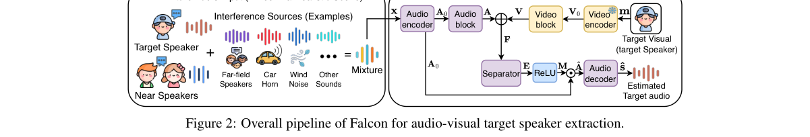

**Why this ranks #6**: 把参数量砍 91.9%、算力砍 20.2 倍、GPU 延迟砍 11.1 倍，同时在真实场景基准上拿 SOTA。

---

### 7. NECTAR: Automatic Negative Clue Estimation via Centroid-Space Mapping for Target Speaker Extraction

⚠️ **[wild-card=yes]** — 目标说话人提取（TSE）本身是判别式信号处理任务，不是生成模型；但它与本线第 5、6 名（MG-REPA 生成式 TSE、实时视听 TSE）同属语音生成/提取家族，放在一起能看清「判别式负线索 → 生成式解混」这条技术演进线。

**arXiv**: [2610.32133](https://arxiv.org/abs/2610.32133) | **Score**: 7.0 (relevance 7.0 x 0.7 + quality 7.0 x 0.3) | **Tags**: AIGC-audio, target-speaker-extraction, negative-clue, speaker-embedding, Libri2Mix, SI-SDRi | **Categories**: eess.AS | **Pages**: 5

**Authors**: Hyungjun Yoo, Yongjoon Lee, Jung-Woo Choi

**Affiliation**: KAIST

**Abstract**

> Target speaker extraction (TSE) aims to extract a desired speaker from a mixture using auxiliary clues such as enrollment speech. An interferer-related representation can provide a useful negative clue for TSE, but such information is not directly available from the target enrollment. To derive this representation from the observed mixture, we analyze the relationship between the speaker representations of a speech mixture and its constituent speakers. Our analysis shows that the mixture centroid lies near the midpoint of its constituent speaker centroids, whereas this relationship does not hold for single-utterance embeddings. Based on this observation, we propose NECTAR, NEgative Clue for TARget speaker extraction, which automatically derives an interferer-related negative clue from the mixture using the centroid-space relationship. We further introduce a Centroid-Space Mapper (CSM) to estimate the required centroid representations from a mixture and a target enrollment. NECTAR achieves the highest SI-SDRi on Libri2Mix among the compared systems trained on LibriSpeech train-clean-100, reaching 16.18 dB.

**Key findings**

- **Finding**: 目标说话人提取需要「登记语音」这类辅助线索；但与干扰者相关的表示其实是有用的负线索，只是无法从目标登记语音里直接得到。
- **Finding**: 作者分析混合语音与其成分说话人的说话人表示之间的关系，发现**混合语音的质心接近其成分说话人质心的中点**，而单句嵌入不具备这一性质。
- **Finding**: 据此提出 NECTAR（NEgative Clue for TARget speaker extraction），利用该质心空间关系，从观测到的混合语音中自动导出与干扰者相关的负线索。
- **Finding**: 进一步提出 Centroid-Space Mapper (CSM)，从「混合语音 + 目标登记语音」估计所需的质心表示。
- **Finding**: 在 LibriSpeech train-clean-100 训练的系统对比中，NECTAR 取得最高 SI-SDRi，**16.18 dB**。
- **Inference**: 「混合质心≈成分质心中点」是一个很简洁的代数性质，作者顺手把它变成了一个免费的负线索来源——这类从表示几何里挖信号的做法值得学。
- **Inference**: 把本篇与本线第 5、6 名（生成式 TSE、因果流式 AV-TSE）并读，能看清 TSE 这条线从判别式负线索到生成式解混的完整路径。
- **Recommendation**: 推荐（wild-card）。做目标说话人提取、说话人表征、解混的人值得读。

**Key figures**

*Result - Effect of centroid size on centroid deviation. Deviation is shown for different scaling factors λ as the centroid size N increases.*

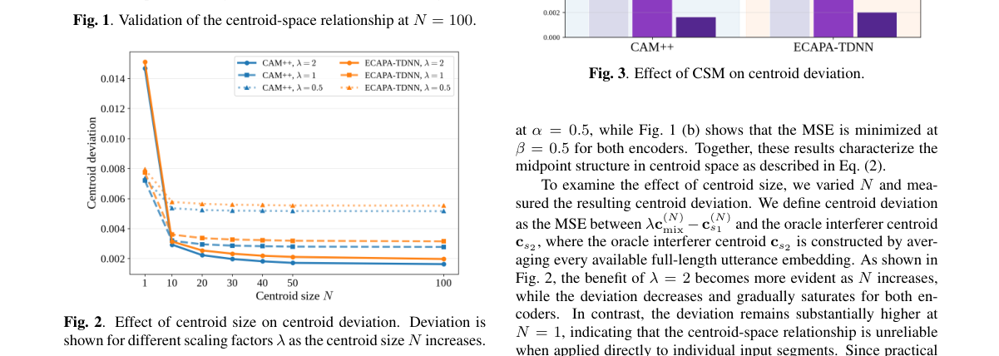

**Why this ranks #7**: 从混合语音里自动反推「干扰者」的负线索，不必额外标注——与上两篇正好构成 TSE 的判别式→生成式演进。  [wild-card]

---

### 8. SEMAC: Spherical Energy Matching Ambisonics Codec for Efficient Higher-Order Ambisonics Compression

**arXiv**: [2610.32981](https://arxiv.org/abs/2610.32981) | **Score**: 6.6 (relevance 6.0 x 0.7 + quality 8.0 x 0.3) | **Tags**: AIGC-audio, ambisonics, neural-audio-codec, spatial-audio, compression, energy-envelope, MUSHRA | **Categories**: eess.AS | **Pages**: 5

**Authors**: Christoph Hold, Jan Buethe, Jean-Marc Valin, Jan Skoglund, Toni Hirvonen, Nils Peters

**Affiliation**: Google; Samsung Research America; Trinity College Dublin

**Abstract**

> Higher-order Ambisonics (HOA) is an attractive format for immersive spatial audio, but its high channel count and directional properties present significant audio coding challenges. The widely deployed Opus audio codec supports HOA through Channel Mapping Families 2 and 3 (RFC 8486), which code and transmit every Ambisonics channel, so the bitrate grows quadratically with the spherical harmonic order. We introduce SEMAC, which instead represents an Ambisonics signal by a quantized full-order directional energy envelope together with fewer CELT-coded transport channels. CELT separates a per-band energy envelope from the signal shape and restores it after quantization, and SEMAC generalizes this principle to directional signals. Since the reduced transport spans only a lower-dimensional subspace, the decoder re-imposes the envelope observed at the encoder input, restoring the directional energy distribution at full order. A MUSHRA test on fifth-order material compares SEMAC against Opus CMF~3 in matched configurations at 512 and 768 kbit/s. SEMAC with 16 of 36 transport channels is rated above full-order CMF~3 at both rates, and at equal transport channel count above order truncation. The proposed SEMAC strategy of coding fewer transport channels with the directional envelope is found perceptually preferable to coding all HOA channels at low precision.

**Key findings**

- **Finding**: 高阶 Ambisonics（HOA）沉浸音频格式的通道数与方向性强，但编码困难：广泛部署的 Opus 通过 CMF 2 / 3（RFC 8486）逐通道编解码，码率随球谐阶数**平方增长**。
- **Finding**: SEMAC 改为把 Ambisonics 信号表示为**量化的全阶方向性能量包络** + 更少的 CELT 编码传输通道。
- **Finding**: CELT 本身就把每频带能量包络与信号形状分离并在量化后恢复；SEMAC 把这一原理推广到方向性信号。
- **Finding**: 由于缩减后的传输只张成低维子空间，解码器重新施加编码端观测到的包络，从而恢复全阶方向能量分布。
- **Finding**: 在五阶素材上做 MUSHRA 听测，与 Opus CMF 3 在 512 与 768 kbit/s 匹配配置下对比：**SEMAC 用 36 个传输通道中的 16 个，在两个码率下评分都高于全阶 CMF 3**，且在相同传输通道数下高于阶数截断。
- **Finding**: 结论：「少编传输通道 + 编方向包络」在低码率下比「低精度编全部 HOA 通道」在感知上更可取。
- **Inference**: 这是本批少见的「编解码器工程」论文，但它对做神经音频 codec 的人有直接启发：空间音频的高阶结构本质上是低维的，包络 + 低维子空间是比逐通道更自然的编码基底。
- **Inference**: 与本线其余论文的生成范式不同，但都属于「音频信号的可压缩生成表示」，是 aigc_audio 词表里 Audio_Super_Resolution 一侧的边界样本。
- **Recommendation**: 推荐。做空间音频、神经音频 codec、沉浸式音频的人值得读。

**Key figures**

*Framework - SEMAC signal flow. (a) The spherical filterbank transforms SH coefficients into directional beams, from which the per-band directional energy envelope is extracted as side information; the sig*

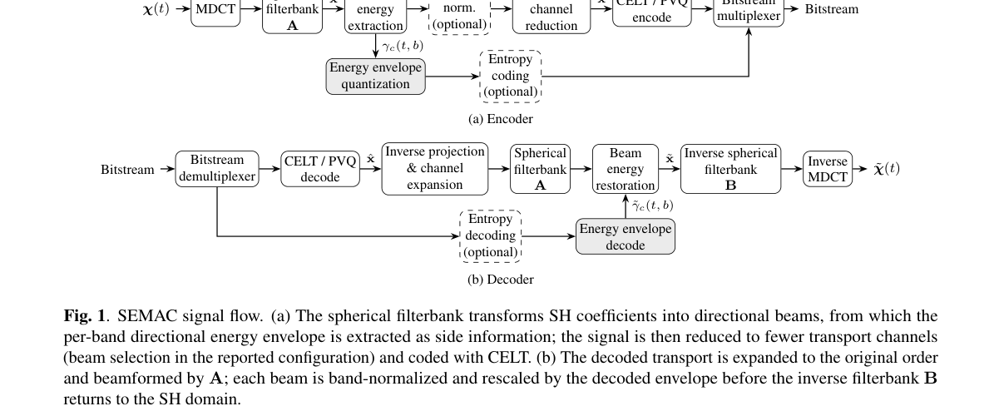

*Result - Violin plots with quartiles, and medians with boot- strapped 95 % confidence intervals of MUSHRA ratings for fifth-order input at 512 and 768 kbit/s. SEMAC is compared against Opus CMF 3 with*

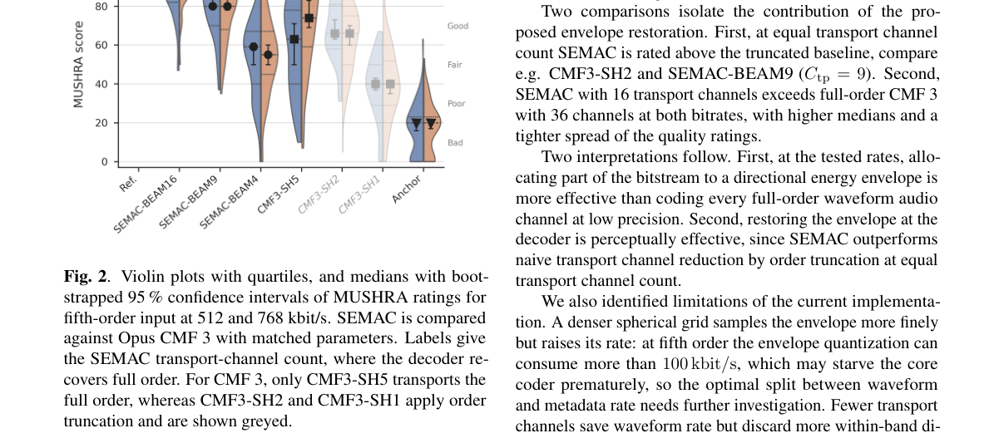

**Why this ranks #8**: 高阶 Ambisonics 不再逐通道编码：只传全阶方向性能量包络 + 少数传输通道，把码率从平方增长压下来。

---

### 9. Noisy Target Training Meets Drifting for Weakly-Supervised Speech Enhancement

⚠️ **[wild-card=yes]** — 本批 eess.AS 仅 15 篇、cs.SD 仅 12 篇，纯音频生成论文不足以填满 10 篇；语音增强属于音频信号复原，与生成模型共享表征与解码骨干，故按 wild-card 补足。

**arXiv**: [2610.32870](https://arxiv.org/abs/2610.32870) | **Score**: 6.3 (relevance 6.0 x 0.7 + quality 7.0 x 0.3) | **Tags**: AIGC-audio, speech-enhancement, weak-supervision, noisy-target-training, Sinkhorn, distribution-matching | **Categories**: cs.SD, eess.AS | **Pages**: 5

**Authors**: Yoshiki Masuyama, Dominik Klement, Christoph Boeddeker, Julius Richter, Kohei Saijo, Gordon Wichern, Takahiro Edo, Jonathan Le Roux

**Affiliation**: Mitsubishi Electric Research Laboratories; Brno University of Technology; Mitsubishi Electric Corporation

**Abstract**

> In speech enhancement, standard supervised training requires pairs of noisy and clean speech. Such pairs are typically created by artificially degrading clean speech, leading to a domain mismatch between synthetic training data and real recordings. Noisy target training (NyTT) mitigates this limitation by training an enhancement model to predict a noisy recording from a noisier version generated by adding extra noise. However, since the training target is noisy, NyTT might learn to leave residual noise in the enhanced output. In this paper, we address this issue in NyTT by incorporating a Sinkhorn drifting loss that matches the distribution of the enhanced speech to that of unpaired clean speech. The Sinkhorn drifting loss attracts enhanced speech toward high-density regions of the clean-speech distribution while repelling it from the current enhanced-speech distribution in latent space. This loss uses only unpaired clean speech rather than the clean counterpart of each degraded recording, preserving the weakly-supervised nature of NyTT. Experimental results on VoiceBank-DEMAND and CHiME-3 real recordings demonstrate the efficacy of the proposed combination.

**Key findings**

- **Finding**: 标准监督语音增强需要成对的噪声/干净语音，而这类对通常是把干净语音人工退化得到，与真实录音存在域差。
- **Finding**: NyTT（noisy target training）缓解了这一限制：训练模型去预测一段「比噪声更噪」的录音，即目标本身带噪。
- **Finding**: 但正因为训练目标带噪，NyTT 可能学会在增强输出里**留下残余噪声**。
- **Finding**: 本文给 NyTT 加入 Sinkhorn drifting loss，把增强语音的分布匹配到**非配对**干净语音的分布上。
- **Finding**: 该损失在隐空间里把增强语音拉向干净语音分布的高密度区域，同时把它推离当前的增强语音分布。
- **Finding**: 它只用非配对干净语音，而不需要每条退化录音对应的干净版本，从而保持 NyTT 的弱监督性质。
- **Finding**: 在 VoiceBank-DEMAND 与 CHiME-3 真实录音上验证了这一组合的有效性。
- **Inference**: 「用非配对分布匹配替代逐样本配对」是弱监督语音增强的关键一步——它把监督信号从「样本级」降级到「分布级」，却换来了对真实录音的鲁棒性。
- **Inference**: 本篇是纯增强（复原）而非生成，因此按 wild-card 标注；它与生成侧共享表征骨干与解码结构，故放在本线。
- **Recommendation**: 推荐（wild-card）。做语音增强、弱监督学习、真实录音域适配的人值得读。

**Key figures**

*Framework - Overview of the proposed NyTT with unpaired drifting.*

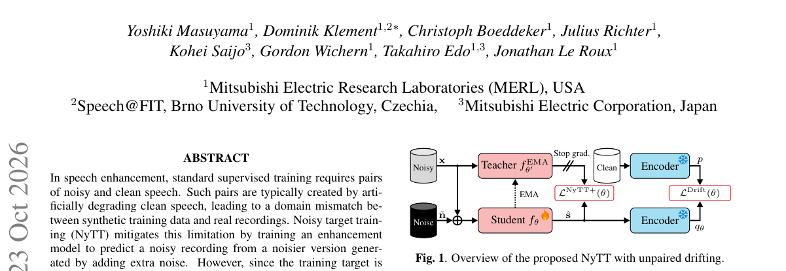

**Why this ranks #9**: 弱监督语音增强里给增强结果配一个「分布漂移」损失，用非配对干净语音把残留噪声压掉。  [wild-card]

---

### 10. ICASSP 2026 Radar Acoustic Speech Enhancement (RASE) Challenge

⚠️ **[wild-card=yes]** — 雷达声学语音增强挑战赛，属于「语音增强」评测侧而非生成侧；因本批音频生成论文数量不足 10 篇，按 wild-card 补足，用于给该线补一个公开基准的坐标。

**arXiv**: [2610.32202](https://arxiv.org/abs/2610.32202) | **Score**: 5.6 (relevance 5.0 x 0.7 + quality 7.0 x 0.3) | **Tags**: AIGC-audio, speech-enhancement, radar-vibrometry, mmWave, through-glass, ICASSP-2026, challenge | **Categories**: eess.AS | **Pages**: 4

**Authors**: Zhi-Wei Tan, V. G. Reju, Ritesh C. Tewari, Ruotong Ding, Patrick A. Naylor, Andy W. H. Khong

**Affiliation**: Nanyang Technological University; Imperial College London

**Abstract**

> This paper presents the ICASSP 2026 Radar Acoustic Speech Enhancement (RASE) Grand Challenge, the first community challenge dedicated to benchmarking speech enhancement from millimeter-wave (mmWave) radar vibrometry. The challenge targets realistic through-glass sensing scenarios where microphones are ineffective or impractical. We introduce a curated dataset of paired radar and clean speech recordings, standardized preprocessing, a baseline system, and a secure Codabench-based evaluation framework with unified objective metrics. The RASE Challenge establishes the first public benchmark for radar-based speech enhancement and aims to foster reproducible research in this emerging field.

**Key findings**

- **Finding**: ICASSP 2026 雷达声学语音增强（RASE）挑战赛是**首个**专门评测毫米波雷达振幅测振语音增强的社区挑战赛。
- **Finding**: 目标场景是真实的**透玻璃感知**：此时麦克风失效或不适用。
- **Finding**: 提供成对的雷达与干净语音录音数据集、标准化预处理、一个基线系统，以及基于 Codabench 的安全评测框架与统一客观指标。
- **Finding**: 该挑战赛为雷达语音增强建立了首个公开基准，目标是推动这一新兴方向的可复现研究。
- **Inference**: 「麦克风失效场景」是语音增强里长期被回避的工业痛点（隔玻璃、极端噪声、强电磁干扰），雷达振幅测振给出的是物理上更稳的替代信号源。
- **Inference**: 本篇是评测/社区资源而非生成方法，按 wild-card 标注；把它放进本线是为了让该线不至于全是生成论文而失去工程坐标。
- **Recommendation**: 推荐（wild-card）。做雷达感知、鲁棒语音增强或关注 ICASSP 挑战赛的人值得读。

**Key figures**

本篇未提取到可用图（PDF 内无符合图注正则的 Figure 1/2）。

**Why this ranks #10**: 第一个毫米波雷达语音增强公开挑战赛——麦克风失效的透玻璃场景终于有了统一基准。  [wild-card]

---

## Footer

- Total papers scanned across all 7 tracks: 474（原始 663 条）
- aigc_audio track final top-10: 10
- Wild-cards in this track: 3
- Figure assets: 2026-10-26/res/

Generated by `mine-arxiv-daily-digest` skill. Sister file: `2026-10-26_aigc_audio_entry.md`.
