# ArXiv Daily Digest - 2026-10-26 (AIGC 图像 / 视频 / 3D 生成与编辑, 10 papers)

**Generated**: 2026-10-26 17:00 CST

**Source**: arXiv cs.CV, cs.SD, eess.AS, cs.CL, cs.AI, cs.RO, cs.LG submissions, listing day 2026-10-23 (announced 2026-10-26 00:00 UTC)

**Batch window**: 2026-10-22T18:00:00Z .. 2026-10-23T18:00:00Z（arXiv 公告批次横跨两个 UTC 日：前一日 18:00 UTC 起算，当日 17:59:59 UTC 截止）

**Track**: aigc_visual (top 10 of 474 papers scanned, 70 full reads)

**Scope**: 图像 / 视频 / 3D / 4D 生成、编辑与可控生成

---

## Top 10 - AIGC 图像 / 视频 / 3D 生成与编辑

### 1. Scaling Transformer Energy-based Models For High Quality Image Synthesis

**arXiv**: [2610.31889](https://arxiv.org/abs/2610.31889) | **Score**: 9.7 (relevance 10.0 x 0.7 + quality 9.0 x 0.3) | **Tags**: AIGC-image, energy-based-model, latent-diffusion, inference-time-scaling, FID, representation-alignment | **Categories**: cs.CV, cs.LG | **Pages**: 19

**Authors**: Jungsoo Lee, Alexi Gladstone, Yilun Du

**Affiliation**: MIT; UIUC; Harvard University

**Abstract**

> Energy-Based Models (EBMs) are a flexible class of generative models that decouple probabilistic modeling from the generation process. This decoupling directly enables compositional generation and inference-time scaling, where sample quality can be refined simply by increasing sampling steps. However, severe challenges in high-dimensional sampling and training instabilities with deep architectures have restricted EBMs to low-dimensional regimes. To resolve these bottlenecks, we introduce the Transformer Energy-Based Model (TEM), a scalable transformer energy function operating entirely within a latent space. On top of this backbone, we extract energies at multiple layers and sum them, composing complementary constraints from local texture to global semantics. Furthermore, two components make this high-quality at scale: Positive Representation Alignment (PRA), which supervises TEM's intermediate representations with a vision foundation model, and advanced sampling strategies that improve sample quality at inference. TEM-XL achieves an FID-50K of 3.82 on class-conditional ImageNet 256$\times$256 without classifier-free guidance, showing that a contrastive EBM can generate high-fidelity images. On ImageNet 512$\times$512, TEM achieves an FID-50K of 8.24, demonstrating that the approach scales to higher resolution. We further validate the core promises of EBMs: compositional generation, zero-shot inpainting, and out-of-distribution detection.

**Key findings**

- **Finding**: 提出 Transformer Energy-Based Model (TEM)：完全在隐空间里学一个可扩展的 transformer 能量函数，把概率建模与生成过程彻底解耦。
- **Finding**: 从多个层抽取能量并求和，组合出从局部纹理到全局语义的互补约束。
- **Finding**: Positive Representation Alignment (PRA) 用预训练视觉基础模型监督 TEM 的中间表征，配合更高级的采样策略共同支撑高分辨率质量。
- **Finding**: TEM-XL 在 class-conditional ImageNet 256×256 上**不使用** classifier-free guidance 达到 FID-50K 3.82；512×512 上达到 8.24。
- **Finding**: 额外验证了 EBM 的三项核心承诺：组合式生成、零样本 inpainting、分布外检测。
- **Inference**: 「无 CFG 也能到 3.82」意味着能量建模是 CFG 之外的第二条提质路径——对已把 CFG 蒸馏做进管线的团队，这是增量而非替代。
- **Inference**: PRA 本质上就是把扩散模型里成熟的 REPA 搬到 EBM 上：「用视觉基础模型当中间表征教师」已是跨范式的通用手法，迁移成本极低。
- **Recommendation**: 推荐。做图像生成架构、采样加速，或想理解 EBM 为何长期卡在低维的人，值得读。

**Key figures**

*Framework - High-fidelity ImageNet 256×256, 512×512 generation and compositional synthesis by TEM- XL/2. Left: uncurated class-conditional samples from 80 Langevin steps. The two large images are 512×51*

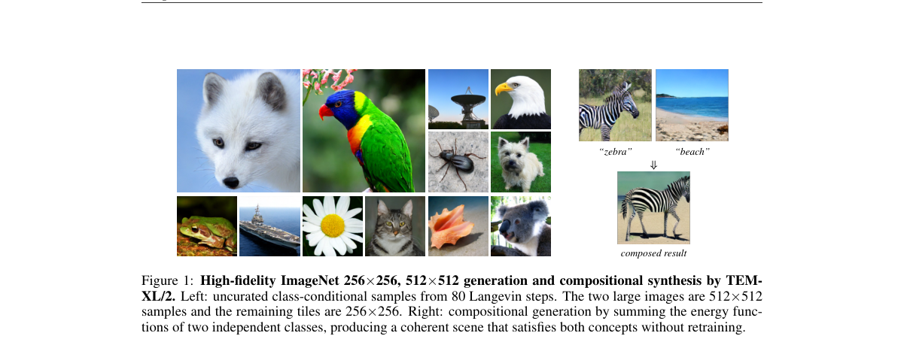

*Result - Proposed Architecture and Training Strategy. Left: the Transformer Energy-Based Model pro- cesses VAE-encoded latent tokens through a stack of TEM blocks. Energy heads at multiple intermedia*

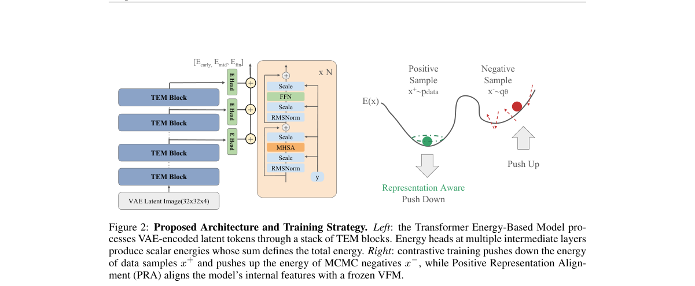

**Why this ranks #1**: 不用 classifier-free guidance 就在 ImageNet 256 打到 FID-50K 3.82——EBM 回到高保真生成的第一梯队。

---

### 2. SyncVid: World-Equivariant Diffusion for Synchronized Video Generation

**arXiv**: [2610.31765](https://arxiv.org/abs/2610.31765) | **Score**: 9.7 (relevance 10.0 x 0.7 + quality 9.0 x 0.3) | **Tags**: AIGC-video, diffusion, camera-control, multi-view, world-equivariance, LoRA, structured-noise | **Categories**: cs.CV | **Pages**: 28

**Authors**: Farhad G. Zanjani, Animesh Karnewar, Fatih Porikli, Amirhossein Habibian

**Affiliation**: Qualcomm AI Research

**Abstract**

> Generating multiple videos of a dynamic scene from a single reference video requires synthesizing both observed and unobserved content consistently across viewpoints. Existing camera-control methods for video diffusion typically rely on architectural mechanisms, including camera embeddings, cross-view attention, and geometric conditioning. Although effective for static scene content, these approaches often struggle with the fine-grained, dynamic geometry that must remain coherent across views and over time. We synchronize the diffusion process itself by sampling the Gaussian noise prior in a canonical 3D space derived from the source video and rasterizing it into target cameras, rather than sampling independently in each 2D image plane. Our method, SyncVid, lifts a monocular video into a canonical 4D representation, associates noise with scene geometry and unseen space, and rasterizes the resulting structured noise into arbitrary views. Because rendering can introduce local correlations, we further propose a cross-view-consistent whitening procedure that decorrelates neighboring pixels while preserving correspondence across views. The structured noise serves as the diffusion prior for a LoRA-adapted pretrained video diffusion model, requiring no architectural modifications. By enforcing spatiotemporal and cross-view coherence at the source of stochasticity, SyncVid generates synchronized videos and improves both perceptual quality and cross-view consistency in our experiments. Project page: https://qualcomm-ai-research.github.io/SyncVid-Webpage.

**Key findings**

- **Finding**: 指出既有相机控制方法依赖相机嵌入、跨视角注意力、几何条件等架构机制，对静态内容有效，但难以处理**细粒度动态几何**的跨视角跨时间一致性。
- **Finding**: SyncVid 的做法是**同步扩散过程本身**：从源视频导出规范 3D 空间，在该空间里采样高斯噪声先验，再光栅化到目标相机，而不是在每个 2D 图像平面独立采样。
- **Finding**: 把单目视频提升为规范 4D 表示，让噪声同时关联场景几何与未观测空间；再把结构化噪声光栅化到任意视角。
- **Finding**: 针对光栅化引入的局部相关性，提出跨视角一致的白化（whitening）过程，在去相关相邻像素的同时保留跨视角对应关系。
- **Finding**: 结构化噪声作为 LoRA 适配后的预训练视频扩散模型的先验，**不需要任何架构改动**。
- **Finding**: 实验显示在感知质量与跨视角一致性上都优于基线。项目页由 Qualcomm AI Research 公开。
- **Inference**: 真正的创新点是「把随机性的源头结构化」——不碰网络、只改噪声分布，这类做法迁移到自有视频模型上的成本比改架构低一个数量级。
- **Inference**: 白化步骤是必要的补丁：光栅化天然引入像素耦合，直接用会破坏扩散模型对噪声的统计假设，作者用跨视角一致白化把这层损伤补回去了。
- **Recommendation**: 推荐。做多视角视频生成、相机可控生成或世界模型视频先验的人必读。

**Key figures**

*Framework - Overview of SyncVid. Given a source video, SyncVid (1) lifts the observations into a canonical 4D point representation; (2) samples a Gaussian noise vector for each 3D primitive in the scene*

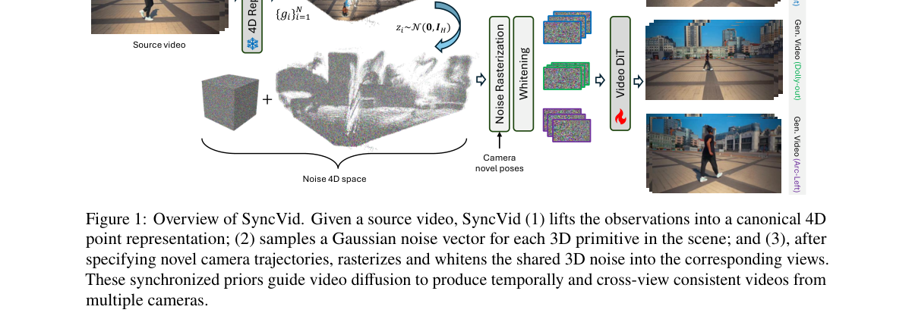

*Result - View-consistent whitening Noise vectors z𝑖are attached to 3D primitives and the cubemap; rasterization therefore provides cross-view correspondence, while overlapping footprints induce local*

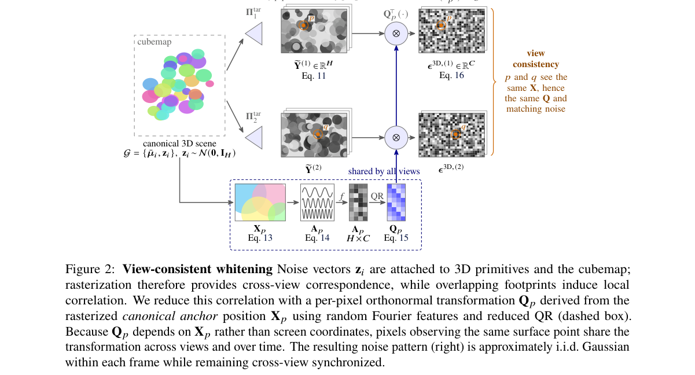

**Why this ranks #2**: 把相机控制从「加 embedding」换成「在世界等变的前噪声里采样」，动态几何跨视角跨时间都能对齐。

---

### 3. LOCI: Localized Continuous Control for Multi-Subject Image Editing

**arXiv**: [2610.31950](https://arxiv.org/abs/2610.31950) | **Score**: 8.7 (relevance 9.0 x 0.7 + quality 8.0 x 0.3) | **Tags**: AIGC-edit, multi-subject, spatial-localization, LoRA, Flux-Kontext, continuous-strength | **Categories**: cs.CV | **Pages**: 18

**Authors**: Sai Vidyaranya Nuthalapati, Shlok Kumar Mishra

**Affiliation**: Meta AI

**Abstract**

> Recent instruction-following image editors such as Flux.1-Kontext enable text-driven editing but lack fine-grained control over where and how much an edit is applied. Existing approaches provide either continuous but global control or spatially localized editing at a fixed strength. To our knowledge, none jointly supports explicit spatial localization, continuous per-region strength, and independent simultaneous control of multiple subjects. We present LOCI (LOcalized Continuous control for multi- subject Image editing). Given a multi-subject image with per-subject regions and instructions, LOCI edits each subject at an independently chosen, continuously adjustable strength, for instance gradually aging one person while adding a beard to another with minimal cross-region leakage. LOCI pairs subject-level attention binding for spatial isolation with a Regional LoRA layer that replaces the LoRA's scalar coefficient with a per-token scaling vector aligned to the spatial layout. A single adapter is trained at one suppression point, and continuous edit strengths follow by rescaling its regional residual at inference. Experiments on multi-subject scenes demonstrate that LOCI achieves strong edit fidelity with significantly reduced cross-region interference compared to baselines, while maintaining continuous control over edit strength

**Key findings**

- **Finding**: 指出 Flux.1-Kontext 一类指令编辑模型缺少「在哪改、改多少」的细粒度控制：现有方法要么连续但全局，要么空间局部但强度固定。
- **Finding**: LOCI 支持三个能力同时成立：显式空间定位、逐区域连续强度、多个主体的独立并行控制（例如给一个人渐变加龄、给另一个人加胡子）。
- **Finding**: 两大部件：主体级注意力绑定（subject-level attention binding）负责空间隔离；Regional LoRA 层把 LoRA 的**标量系数替换为按 token 对齐空间布局的缩放向量**。
- **Finding**: 单个适配器只在一个抑制点（suppression point）上训练，连续编辑强度在推理时通过缩放该区域残差得到。
- **Finding**: 多主体场景实验显示：编辑保真度高、跨区域干扰显著下降，同时保持连续强度可调。
- **Inference**: 「训练时只在抑制点学、推理时靠缩放残差外推连续强度」是个很工程化的思路：把连续控制从训练目标挪到推理期，几乎不增加训练成本。
- **Inference**: 多主体编辑的真正难点是注意力泄漏而非编辑能力——LOCI 的卖点是隔离而非生成，这点与主流「更强的编辑模型」路线是互补的。
- **Recommendation**: 推荐。做指令编辑、多主体一致性、局部可控编辑的人必读。

**Key figures**

*Framework - LOCI gives every subject its own continuous edit control. From one input, the top row strengthens the edit on the first teapot while the second stays pinned at the neutral anchor, the middle*

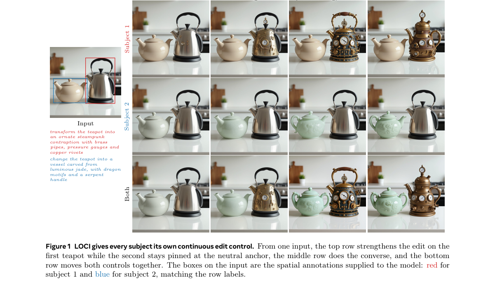

**Why this ranks #3**: 把 LoRA 的标量系数换成按 token 对齐空间布局的缩放向量，一次训练即可连续调节每个主体的编辑强度。

---

### 4. AlphaAnything: Extending Pretrained RGB Generators to RGBA

**arXiv**: [2610.32413](https://arxiv.org/abs/2610.32413) | **Score**: 8.7 (relevance 9.0 x 0.7 + quality 8.0 x 0.3) | **Tags**: AIGC-image, RGBA, alpha-channel, VAE-decoder, LoRA, transparent-generation, shared-latent | **Categories**: cs.CV | **Pages**: 42

**Authors**: Qijie Wang, Zhixin Xu, Zhe Li, Haowei Zhu, Honghao Qiao, Bo Peng, Dawei Li, Bin Wang

**Affiliation**: Tsinghua University; ByteDance; Peking University

**Abstract**

> Existing RGBA generation methods commonly learn a transparency-specific representation through reconstruction, introducing an additional training stage and potentially altering the RGB decoding function inherited from pretrained models. We present AlphaAnything, a lightweight framework that extends pretrained RGB generators to RGBA directly in their original latent space, without RGBA reconstruction pretraining. AlphaAnything inserts LoRA modules into the generative transformer and attaches an alpha branch to the frozen RGB VAE decoder. Unidirectional RGB-to-alpha feature sharing allows opacity supervision to shape the generative latent while guaranteeing that, for any fixed latent, RGB decoding remains identical to that of the pretrained decoder. We further introduce Endpoint-Aware Alpha Loss (EA Loss), which derives opacity supervision from the complementary foreground--background weights used in compositing. It supports exact opacity endpoints and continuous partial transparency while emphasizing localized alpha errors. Experiments on text-to-RGBA and image-to-RGBA tasks across multiple pretrained RGB backbones demonstrate competitive generation quality, and controlled ablations validate the shared-latent training design and EA Loss.

**Key findings**

- **Finding**: 指出既有 RGBA 生成方法通常要先学一套「透明度专用表征」，这既增加训练阶段，又可能破坏从预训练模型继承的 RGB 解码函数。
- **Finding**: AlphaAnything 直接在**原始隐空间**里扩展预训练 RGB 生成器，不需要 RGBA 重建预训练。
- **Finding**: 结构上是往生成 transformer 里插 LoRA 模块，再给**冻结的** RGB VAE 解码器挂一个 alpha 分支。
- **Finding**: 单向的 RGB→alpha 特征共享让不透明度监督去塑造生成隐空间，同时保证：对任意固定隐变量，RGB 解码结果与预训练解码器**完全一致**。
- **Finding**: Endpoint-Aware Alpha Loss (EA Loss) 从合成所用的前景/背景互补权重导出不透明度监督，兼顾精确端点与连续半透明，并强调局部 alpha 误差。
- **Finding**: 在多个预训练 RGB backbone 上的 text-to-RGBA 与 image-to-RGBA 任务上达到有竞争力的生成质量，消融验证了共享隐空间设计与 EA Loss。
- **Inference**: 「RGB 解码逐比特不变」这个约束是全文最漂亮的一处：它把「扩展生成器」的兼容性风险直接消掉，让预训练 RGB 模型可以零风险复用到 RGBA 场景。
- **Inference**: EA Loss 从合成权重反推不透明度监督，是把下游合成任务的要求反写进生成目标——这类「用下游物理/渲染约束做监督」的做法正在变多。
- **Recommendation**: 推荐。做透明图像生成、素材生产，或在已有 RGB 模型上做轻量扩展的人必读。

**Key figures**

*Framework - Representative text- and image-to-RGBA results. Each prompt specifies an asset to generate or extract. For text-to-RGBA, independently generated layers are manually arranged into the display*

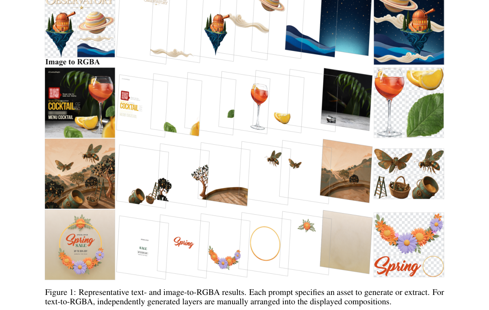

*Result - Overview of ALPHAANYTHING. Transformer LoRA and a VAE-embedded alpha branch learn RGBA generation through generative training. Unidirectional feature sharing keeps RGB decoding for any fixed*

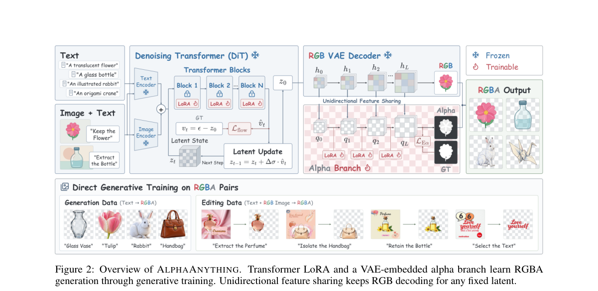

**Why this ranks #4**: 不重训 VAE、不加重建阶段，直接在预训练 RGB 生成器的原隐空间里长出透明度分支。

---

### 5. PASTA: Prompt-Aware Annealed Diffusion Sampling

**arXiv**: [2610.32390](https://arxiv.org/abs/2610.32390) | **Score**: 8.7 (relevance 9.0 x 0.7 + quality 8.0 x 0.3) | **Tags**: AIGC-image, layout-control, training-free, masked-guidance, shared-latent, reserved-region, UI-design | **Categories**: cs.AI, cs.CV, cs.LG | **Pages**: 15

**Authors**: Ren Ajiki, Ryugo Morita, Stanislav Frolov, Brian Bernhard Moser, Ko Watanabe, Riku Takahashi, Andreas Dengel, Jinjia Zhou

**Affiliation**: Hosei University; RPTU Kaiserslautern-Landau and DFKI GmbH

**Abstract**

> While Diffusion models produce high-quality images, real-world visual design requires intentionally preserving clean regions for headlines, logos, or UI elements. Existing layout-aware text-to-image methods struggle to strictly preserve reserved regions, often introducing unwanted content that complicates downstream editing. Existing approaches either manipulate attention to displace content or suppress conditioning via noise-level interventions. However, these methods sacrifice visual coherence, producing flat regions or noticeable style inconsistencies between reserved and non-reserved areas. To address this limitation, we propose a Prompt-Aware Shared-Latent Training-Free Annealed Diffusion Sampling (PASTA), a training-free framework that enforces reserved-region constraints by selectively applying semantic guidance to object-allowed regions during sampling. PASTA operates on a shared latent trajectory, where full-prompt and context-prompt guidance are fused through mask-guided sampling. An annealed schedule suppresses semantic leakage during early denoising stages while gradually restoring visual consistency in later stages. Extensive experiments demonstrate that PASTA improves reserved-region fidelity while preserving overall image realism and perceptual consistency.

**Key findings**

- **Finding**: 真实视觉设计（海报、标题、logo、UI 元素）需要**故意保留干净区域**，而现有 layout-aware 文生图方法往往塞进多余内容，反而拖慢下游编辑。
- **Finding**: 既有做法有两类：操纵注意力把内容挤开，或用噪声级干预抑制条件；两者都会牺牲视觉一致性，产生扁平区域或保留区/非保留区之间的风格断裂。
- **Finding**: PASTA（Prompt-Aware Shared-Latent Training-Free Annealed Diffusion Sampling）在**共享潜变量轨迹**上工作，用 mask 引导的采样把完整 prompt 引导与 context-prompt 引导融合起来。
- **Finding**: 退火（annealed）调度在早期去噪阶段压制语义泄漏，在后期逐步恢复视觉一致性。
- **Finding**: 全程 training-free；实验显示在提升保留区保真度的同时保住了整体真实感与感知一致性。
- **Inference**: 「共享潜变量轨迹 + 退火抑制」比直接切 CFG 更精细：它保留了同一张图的全局风格，这是掩码式方法最常见的失败点。
- **Inference**: training-free 意味着可以挂在任何现成扩散管线上，落地成本几乎为零——对做海报/广告素材自动化的团队实用性很高。
- **Recommendation**: 推荐。做版式控制、留白保持、设计素材生成的人值得读。

**Key figures**

*Framework - Red words in the prompt column indicate the context prompt Pctx, and yellow dashed boxes denote the reserved regions. TextCenGen [14] causes foreground content to overlap with the placed logo-*

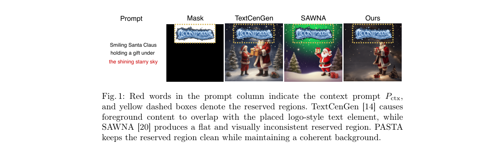

*Result - Overview of PASTA. Given a full prompt Pfull and a reserved-region mask M, PASTA computes guidance residuals from shared-latent noise predictions un- der full-prompt, context-prompt, and negat*

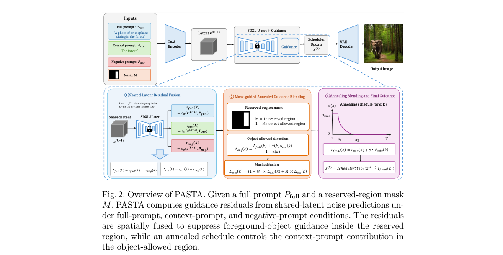

**Why this ranks #5**: training-free 就把标题/logo/UI 区域「留白」保住，而且不留扁平色块、不破坏风格一致性。

---

### 6. ChoreoStudio: Planning What, When, and Who in Music-Driven Group Choreography

**arXiv**: [2610.32325](https://arxiv.org/abs/2610.32325) | **Score**: 8.3 (relevance 8.0 x 0.7 + quality 9.0 x 0.3) | **Tags**: AIGC-video, motion-generation, music-conditioned, group-dance, formation-planning, diffusion | **Categories**: cs.AI, cs.CV, cs.SD | **Pages**: 26

**Authors**: Jing Xu, Cunjian Chen, Qiuhong Ke

**Affiliation**: Monash University

**Abstract**

> Music-driven group dance generation must decide not only how each dancer moves, but also what formation the group should form, when it should change, and who should execute each transition. Existing methods can generate orderly and rhythmically synchronized group motion, but remain limited in formation evolution and inter-dancer interaction. In human choreography, formation transitions often align with changes in high-level musical structure, such as the progression from an introduction to a chorus or from a chorus to a climax. We present ChoreoStudio, which makes choreography planning explicit. A music disentangler first decomposes the audio into frame-level rhythmic features and segment-level structural features. Given the segment-level features and sparse labels, a frozen omni-modal model acts as a scriptwriter, producing a global semantic description that guides the Director's choreography planning. Based on this context, the Director produces three coupled interaction decisions: a centroid-relative point set specifies what formation to produce, a transition gate determines when it should change, and a mobility allocation indicates who should execute the transition. The transition gate and mobility allocation are further conditioned on the planned geometric change, coupling formation targets with their temporal and dancer-specific execution. At a finer temporal scale, frame-aligned music features condition the diffusion generator to control detailed body motion and preserve beat-level alignment. The segment-level interaction plan is injected in parallel through frame-aligned instruction tokens and cross-dancer attention biases, coordinating how the generator realizes each transition. Experiments on AIOZ-GDance demonstrate that ChoreoStudio follows the planned interactions while achieving state-of-the-art performance in motion quality, group organization, and formation dynamics.

**Key findings**

- **Finding**: 指出既有音乐驱动群舞生成能产出整齐且节拍同步的动作，但在**队形演化**与**舞者间交互**上仍很有限。
- **Finding**: 先做音乐解耦：拆成帧级节奏特征与段级结构特征；再由一个**冻结的**全模态模型充当编剧，基于段级特征与稀疏标签产出全局语义描述。
- **Finding**: Director 由此产出三个耦合的交互决策：质心相对点集决定「变成什么队形」、transition gate 决定「什么时候变」、mobility allocation 决定「谁去变」。
- **Finding**: transition gate 与 mobility allocation 还会以规划出的几何变化为条件，把队形目标与时间、舞者特定的执行方式绑定在一起。
- **Finding**: 更细的时间尺度上，帧对齐音乐特征条件化扩散生成器控制身体细节并保持节拍级对齐；段级交互计划通过帧对齐指令 token 与跨舞者注意力偏置并行注入。
- **Finding**: 在 AIOZ-GDance 上，ChoreoStudio 既遵循了规划出的交互，又在动作质量、群体组织与队形动态三项上取得 SOTA。
- **Inference**: 「先规划、后生成」的两段式结构是把长时程一致性问题从生成器里搬到规划器里——这类解耦在视频/世界模型方向正在成为标准套路。
- **Inference**: 冻结全模态模型当编剧意味着规划能力可以随基础模型升级自动受益，论文没有把这写成卖点，但它其实是最大的杠杆。
- **Recommendation**: 推荐。做音乐驱动动作生成、编舞、多人协同生成的人必读。

**Key figures**

*Framework - Overview of ChoreoStudio. Multi-scale music features and a frozen omni-modal model provide rhythmic, structural, and semantic context. The Director jointly constructs a directed inter- dance*

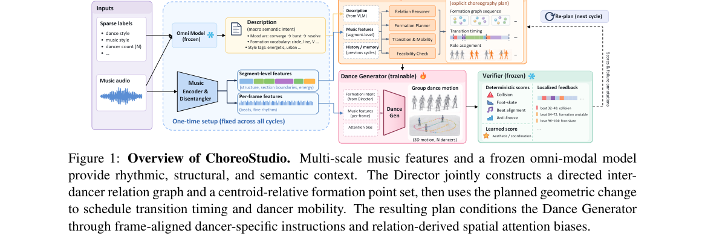

*Result - ChoreoStudio architecture. Segment-level structure and semantics guide the Director, while frame-level rhythm conditions motion synthesis; a mask marks unavailable motion. Through Perceive,*

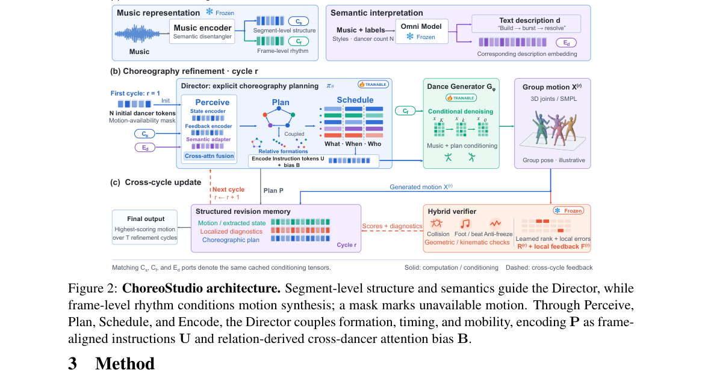

**Why this ranks #6**: 把编舞的「演什么队形、什么时候变、谁去变」显式拆成三个决策，再交给扩散生成器执行——AIOZ-GDance 上 SOTA。

---

### 7. CityLift: Compositional 3D Urban Generation from a Single Image

**arXiv**: [2610.32728](https://arxiv.org/abs/2610.32728) | **Score**: 8.0 (relevance 8.0 x 0.7 + quality 8.0 x 0.3) | **Tags**: AIGC-3D, urban-scene, building-mesh, flow-model, spatial-inheritance, single-image-to-3D | **Categories**: cs.CV | **Pages**: 12

**Authors**: Haoran Gong, Jie Feng, Chenxu Wang

**Affiliation**: Xi'an Jiaotong University; Zhongguancun Academy Beijing

**Abstract**

> Generating editable 3D urban scenes from a single image requires detailed building assets with a coherent spatial arrangement. Occlusion and perspective ambiguity make it difficult to infer complete building geometry together with consistent relative scales and positions. We present CityLift, a framework that generates individual textured building meshes from an urban image by coupling scene-level spatial modeling with building-level synthesis. CityLift first learns building shape and placement jointly through coupled scene and instance streams, producing coarse sparse structures in a common coordinate system. We then introduce generative spatial inheritance, which maps each building's coarse occupancy and scene-conditioned 3D feature field into a local volume to guide a flow model that generates finer structure. The same coordinate mapping places the generated meshes back into the scene, preserving their spatial relationship to the scaffold. To address the scarcity of urban data pairing scene images with individual 3D buildings, we construct CityLift-5K, comprising 4,997 synthetic scenes with instance masks, building meshes, and placement annotations. Experiments on CityLift-5K and scene blocks from UrbanScene3D and InstanceBuilding demonstrate improved building geometry and scene composition. The project page is available at https://ranhaogong.github.io/CityLift/.

**Key findings**

- **Finding**: 从单张图像生成可编辑 3D 城市场景，需要既有精细的建筑资产、又有连贯的空间排布；遮挡与透视歧义让「完整几何 + 一致的相对尺度位置」很难同时推断。
- **Finding**: CityLift 把**场景级空间建模**与**建筑级合成**耦合：先用耦合的场景流与实例流联合学习建筑的形状与摆放，在统一坐标系里生成粗粒度稀疏结构。
- **Finding**: 提出 generative spatial inheritance：把每个建筑的粗占据与场景条件 3D 特征场映射到局部体素，用**流模型**生成更精细的结构。
- **Finding**: 同一套坐标映射再把生成的 mesh 放回场景，从而保持它们与脚手架的空间关系。
- **Finding**: 为解决「图像配 3D 建筑」数据稀缺，构建了 CityLift-5K：4,997 个合成场景，含实例 mask、建筑 mesh 与摆放标注。
- **Finding**: 在 CityLift-5K 以及 UrbanScene3D、InstanceBuilding 的场景块上，建筑几何与场景构图均有提升。项目页公开。
- **Inference**: 「粗结构 → 局部体素 → 流模型细化 → 同一坐标映射放回」是一套很干净的层级式 3D 生成范式，可直接迁移到家具/道具资产生产。
- **Inference**: CityLift-5K 这类合成配套数据集往往是这类工作真正可复用的产出——单图到 3D 的瓶颈长期在数据而不是方法。
- **Recommendation**: 推荐。做单图 3D、场景资产生成、3D 内容生产的人值得读。

**Key figures**

*Framework - Overview of CityLift. Given a single urban image and its building instance masks, CityLift generates independently accessible textured building meshes while preserving their spatial composit*

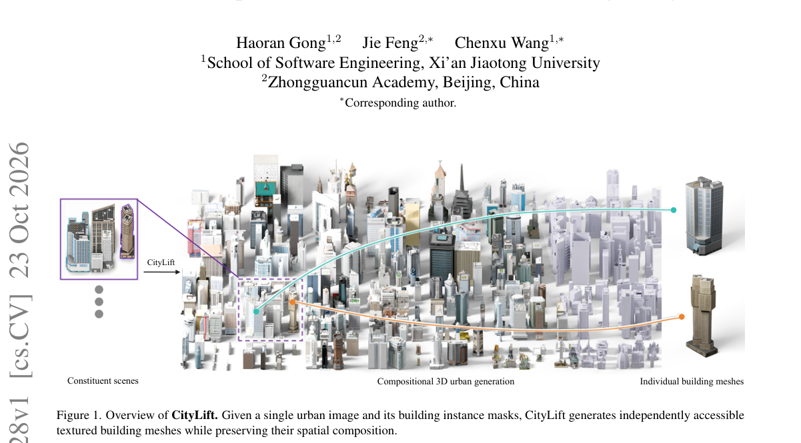

*Result - Overview of CityLift. Given a single urban image and building instance masks, CityLift generates individually editable building meshes in a shared scene frame. (a) A shared scene–instance ge*

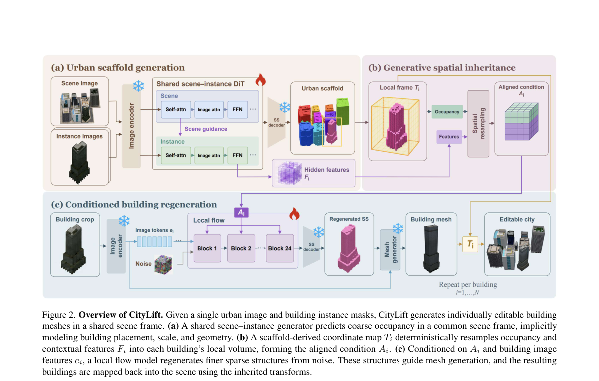

**Why this ranks #7**: 从单张街景图生成**可编辑的**带纹理建筑 mesh，还能保持建筑之间的相对尺度与位置关系。

---

### 8. TIE: Training-free CLIP Embedding Guidance for Compositional Text-to-Image Alignment

**arXiv**: [2610.32407](https://arxiv.org/abs/2610.32407) | **Score**: 8.0 (relevance 8.0 x 0.7 + quality 8.0 x 0.3) | **Tags**: AIGC-image, training-free, CLIP-embedding, compositional-alignment, concept-loss, concept-confusion, inference-time | **Categories**: cs.CV | **Pages**: 10

**Authors**: Sujung Hong, Tae Eun Choi, Youngjun Jun, Chanyong Yoon, Seong Jae Hwang

**Affiliation**: Yonsei University

**Abstract**

> Text-to-image (T2I) diffusion models have advanced notably, but still fail to satisfy prompt conditions, resulting in attribute mismatches and missing objects. These errors normally fall into two categories: concept loss, when an object or attribute (i.e., concept) goes missing, and concept confusion, when an attribute is assigned to the wrong object or multiple objects blend together. Recent studies suggest that these challenges are caused by the limited capacity of CLIP text encoder to capture fine-grained semantic details. Although several methods have been proposed, concept loss and concept confusion persist in recent T2I models when handling multi-object, multi-attribute prompts. In this paper, we conduct an embedding-level analysis to develop a training-free, inference-time solution for concept loss and concept confusion across CLIP-based T2I models. We find that (1) concepts mentioned later exhibit higher embedding entropy, reflecting less concentrated representations that are more often associated with concept loss, and (2) the first CLIP attention layer captures the strength of binding between each object and its attribute. Guided by our findings, we introduce TIE, a method that improves semantic alignment through a single text-embedding update. TIE addresses concept loss via entropy-aware singular value amplification and resolves concept confusion through interpolation-extrapolation binding based on CLIP attention scores, all in a training-free manner. Extensive experiments demonstrate that TIE enhances semantic fidelity in multi-concept scenarios with minimal sampling overhead. The project page is available at https://hong-sujung.github.io/TIE/.

**Key findings**

- **Finding**: 把 T2I 对不上 prompt 的错误归为两类：**概念丢失**（物体或属性没出现）与**概念混淆**（属性挂错对象、多个对象糊在一起）。
- **Finding**: 在嵌入层做分析发现两条事实：(1) prompt 中越靠后提到的概念嵌入熵越高、表示更分散，因而更容易丢失；(2) CLIP 第一层注意力就刻画了对象与属性的绑定强度。
- **Finding**: TIE 是 training-free、推理期的方案，只做**一次文本嵌入更新**。
- **Finding**: 概念丢失用 entropy-aware 奇异值放大解决；概念混淆用基于 CLIP 注意力分数的插值-外推绑定解决。
- **Finding**: 多概念场景实验显示语义保真度提升，且采样额外开销极小。项目页公开。
- **Inference**: 「越靠后的概念越容易丢」这个发现很实用——它给 prompt 排版提供了直接依据（重要概念应靠前），几乎零成本就能改善现有管线的输出。
- **Inference**: 把「CLIP 文本编码器容量不足」这个已被反复讨论的猜测，落到可操作的嵌入层干预上，是本批少见的「诊断→一行修复」闭环。
- **Recommendation**: 推荐。做 T2I 语义对齐、组合性 prompt、免训练调优的人必读。

**Key figures**

*Framework - Failure cases in simple prompts.*

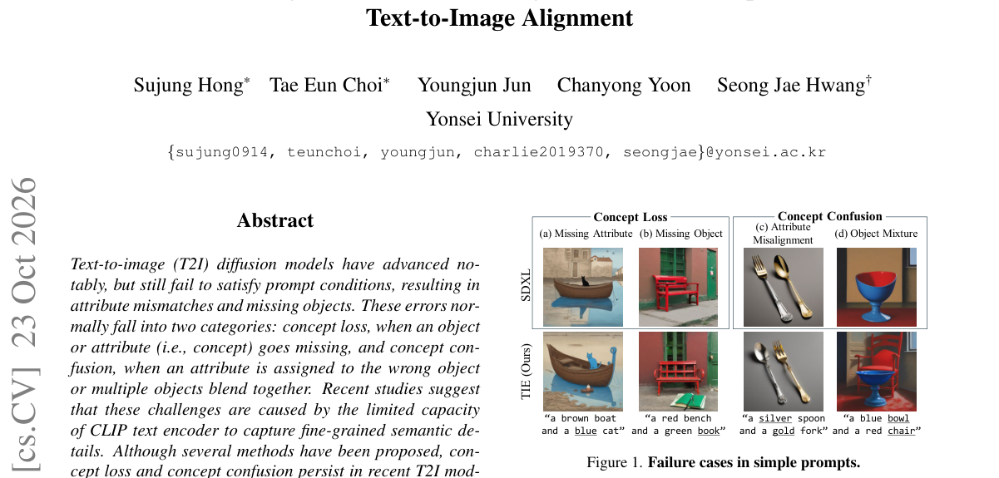

*Result - Analysis of positional bias and token entropy on concept loss. (a) When issuing the prompt "a 〈attr1〉〈obj1〉and a 〈attr2〉〈obj2〉", 〈attr2〉and 〈obj2〉is far more prone to being misaligned or mis*

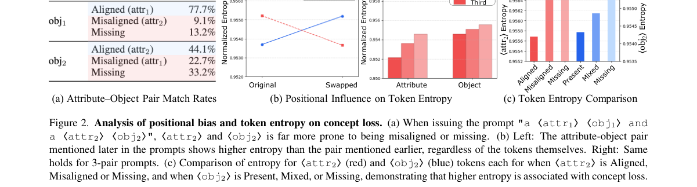

**Why this ranks #8**: 把 T2I 的「概念丢失 / 概念混淆」归因到 CLIP 文本嵌入，然后用一次文本嵌入更新在推理期修好。

---

### 9. CompMVR: Compression-Aware Multi-View Restoration Using Diffusion Models for Geometrically Consistent 3D Reconstruction

**arXiv**: [2610.32800](https://arxiv.org/abs/2610.32800) | **Score**: 8.0 (relevance 8.0 x 0.7 + quality 8.0 x 0.3) | **Tags**: AIGC-3D, multi-view-restoration, diffusion, compression-artifacts, novel-view-synthesis, camera-pose | **Categories**: cs.CV | **Pages**: 12

**Authors**: Dong-hwi Kim, Chaewon Moon, Hojun Song, Dongbeom Kim, Junyeong Jang, Aro Kim, Gahyeon Kim, Heejung Choi, Jehee Kim, Gianella Cravioto, Sohyun Lee, Gyeongjin Choi

**Affiliation**: Kyungpook National University

**Abstract**

> Real-world 3D reconstruction pipelines often rely on multi-view images degraded by lossy compression. While compression artifacts have been extensively studied in single-image or video restoration, their impact on multi-view geometry remains largely overlooked. In this work, we identify compression-induced cross-view geometric inconsistency as a critical failure mode, where view-dependent artifacts disrupt feature matching, dense correspondence, camera parameter estimation, and downstream 3D reconstruction tasks such as novel view synthesis. To address this problem, we propose CompMVR, a compression-aware multi-view diffusion restoration framework that jointly refines compressed views while preserving cross-view consistency, and construct compressed datasets for systematic evaluation. Unlike conventional restoration methods that optimize each image independently for 2D perceptual quality, CompMVR leverages learned compression priors and cross-view correspondence to recover visual details while improving geometric reliability across views. Experiments across diverse datasets, codecs, and compression levels demonstrate gains in restoration quality and downstream 3D tasks, including novel-view synthesis, camera pose estimation, and view matching. These results establish compressed multi-view restoration as a distinct problem and highlight its importance for 3D reconstruction under lossy compression. Code and data for this paper are available at https://mchaewon.github.io/CompMVR-project-page/.

**Key findings**

- **Finding**: 识别出**压缩诱导的跨视角几何不一致**这一关键失效模式：视角相关伪影会破坏特征匹配、稠密对应、相机参数估计以及新视角合成等下游 3D 任务。
- **Finding**: 此前压缩伪影只在单图/视频复原里被研究，它对多视角几何的影响基本被忽视。
- **Finding**: CompMVR 是压缩感知的多视角扩散复原框架，在精修压缩视角的同时**保持跨视角一致性**，并构建了压缩数据集用于系统评测。
- **Finding**: 与传统「逐图独立优化 2D 感知质量」的复原不同，CompMVR 利用学到的压缩先验与跨视角对应关系，在恢复视觉细节的同时提升几何可靠性。
- **Finding**: 在多种数据集、编解码器与压缩级别下，复原质量与下游 3D 任务（新视角合成、相机位姿估计、视角匹配）均有提升。代码与数据公开。
- **Inference**: 「压缩先验 + 跨视角一致性」的组合是这篇最有工程价值的部分：真实采集的多视角数据几乎必然被平台压缩过，这一步不做，后面所有几何估计都在放大噪声。
- **Inference**: 把「压缩多视角复原」立为一个独立问题（而非复原的一个子任务），类似 3D 领域把「低光」「去模糊」独立成条一样，值得注意。
- **Recommendation**: 推荐。做 3D 重建、多视角几何、真实数据采集管线的人值得读。

**Key figures**

*Framework - Effect of HEVC compression on VGGT feature matching in the Free/Lab scene. Lossy compression degrades cross-view correspondence: as the quantization parameter (QP) increases from 27 to 42, the*

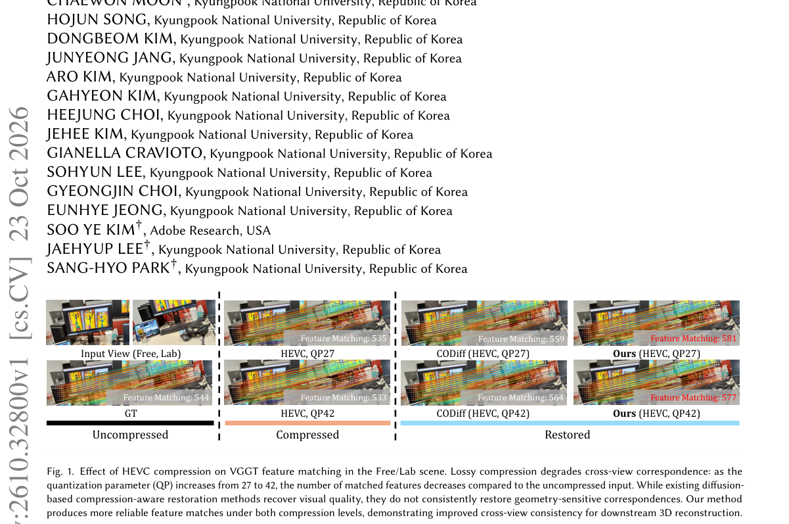

*Result - Overview of our proposed CompMVR. (a) In Stage 1, we learn a compression-aware latent representation by training a compression prior embedder. The latent is optimized through image reconstruct*

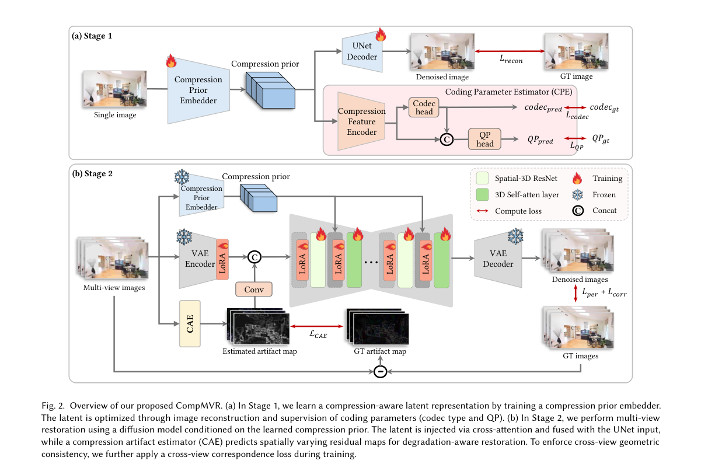

**Why this ranks #9**: 指出被忽略的一环：压缩伪影先破坏跨视角几何一致性，再毁掉整个 3D 重建管线。

---

### 10. PixGR: Pixel-Space Generative Decoding for Fast Feed-Forward 3D Reconstruction

**arXiv**: [2610.31908](https://arxiv.org/abs/2610.31908) | **Score**: 7.3 (relevance 7.0 x 0.7 + quality 8.0 x 0.3) | **Tags**: AIGC-3D, feed-forward-reconstruction, 3D-gaussian, flow-matching, pixel-space, sparse-view, differentiable-rendering | **Categories**: cs.CV | **Pages**: 19

**Authors**: Ranran Huang, Wenjing Bian, Weixun Luo, Ye Mao, Krystian Mikolajczyk

**Affiliation**: Imperial College London

**Abstract**

> We present PixGR, an efficient framework that integrates lightweight pixel-space generative modeling into feed-forward 3D Gaussian reconstruction to model scene uncertainty. Context observations are encoded once into a scene latent representation, which conditions generative decoding from noisy target views to produce a shared 3D Gaussian representation. We formulate this process using pixel-space flow matching, enabling end-to-end optimization of 3D reconstruction with direct pixel-space generative supervision through differentiable rendering. This avoids VAE-based latent compression and error propagation inherent in previous two-stage pipelines. To preserve feed-forward efficiency, PixGR caches the scene representation and performs iterative inference using a lightweight DiT decoder. Experiments demonstrate that PixGR outperforms regression-based approaches in challenging sparse-view settings, particularly with widely spaced observations and view extrapolation. Meanwhile, it maintains sub-second inference and remains competitive with substantially heavier pretrained generative models. Our project page is available at https://ranrhuang.github.io/pixgr/.

**Key findings**

- **Finding**: PixGR 把轻量像素空间生成建模嵌进前馈式 3D 高斯重建，用来建模场景不确定性。
- **Finding**: 上下文观测被**只编码一次**成场景隐表示，再以它为条件，从带噪目标视角做生成式解码，产出一份共享的 3D 高斯表示。
- **Finding**: 整个过程用**像素空间流匹配**建模，端到端优化 3D 重建，直接用可微渲染给出像素空间生成监督。
- **Finding**: 这样避开了此前两段式管线里 VAE 隐空间压缩带来的误差传播。
- **Finding**: 为保留前馈效率，PixGR 缓存场景表示，用轻量 DiT 解码器做迭代推理。
- **Finding**: 实验显示在观测稀疏且间距大、需要视角外推的困难设定下优于回归式方法，同时保持亚秒级推理，并可与重得多的预训练生成模型竞争。项目页公开。
- **Inference**: 「可微渲染 + 像素空间流匹配」等于把 3D 重建变成了一个条件生成问题，这是把生成模型能力迁移到几何任务的一条干净路径。
- **Inference**: 避开 VAE 隐空间是这个设计里最容易被低估的一点——两段式管线里隐空间压缩的误差会直接污染几何，而这里监督信号落在像素上。
- **Recommendation**: 推荐。做前馈 3D 重建、稀疏视图、3D 高斯的人必读。

**Key figures**

*Framework - Comparison of feed-forward reconstruction and generative pipelines. (a) Deterministic reconstruction cannot model scene uncertainty. Existing generative approaches address this limita- tion*

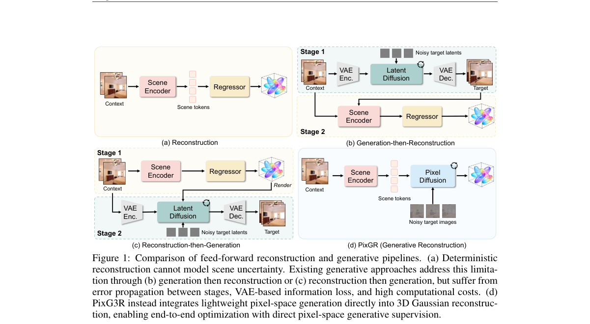

*Result - PixGR Overview. Multi-view posed context images are encoded once into a scene latent representation. Target viewpoints are sampled and encoded as ray maps, which are combined with noisy targ*

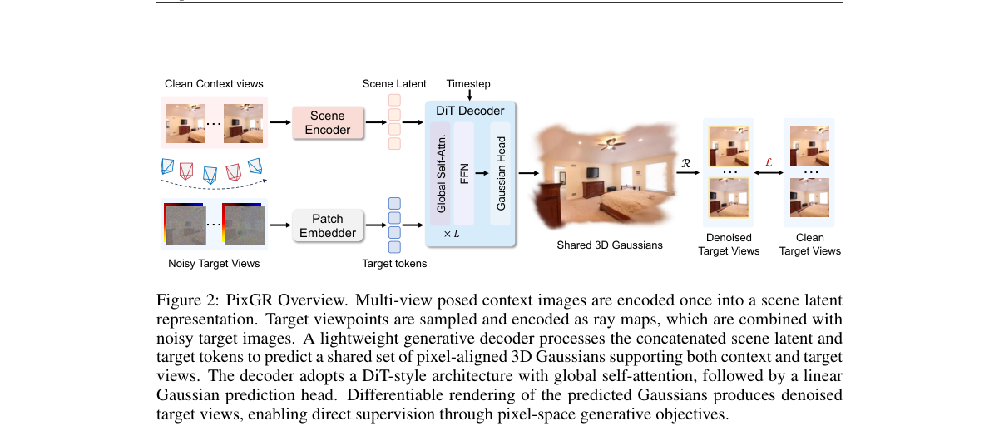

**Why this ranks #10**: 把 3D 重建的监督从「VAE 隐空间」搬回像素空间，用流匹配端到端学共享的 3D 高斯。

---

## Footer

- Total papers scanned across all 7 tracks: 474（原始 663 条）
- aigc_visual track final top-10: 10
- Wild-cards in this track: 0
- Figure assets: 2026-10-26/res/

Generated by `mine-arxiv-daily-digest` skill. Sister file: `2026-10-26_aigc_visual_entry.md`.
