# ArXiv Daily Digest - 2026-10-26 (音频与语音语言模型、双工语音助手, 10 papers)

**Generated**: 2026-10-26 17:00 CST

**Source**: arXiv cs.CV, cs.SD, eess.AS, cs.CL, cs.AI, cs.RO, cs.LG submissions, listing day 2026-10-23 (announced 2026-10-26 00:00 UTC)

**Batch window**: 2026-10-22T18:00:00Z .. 2026-10-23T18:00:00Z（arXiv 公告批次横跨两个 UTC 日：前一日 18:00 UTC 起算，当日 17:59:59 UTC 截止）

**Track**: audio_lm (top 10 of 474 papers scanned, 70 full reads)

**Scope**: 音频 / 语音语言模型、语音理解、ASR、流式与对话式语音

---

## Top 10 - 音频与语音语言模型、双工语音助手

### 1. Why Full-Duplex Speech Models Collapse in Long Conversations

**arXiv**: [2610.32349](https://arxiv.org/abs/2610.32349) | **Score**: 9.7 (relevance 10.0 x 0.7 + quality 9.0 x 0.3) | **Tags**: audio-LM, duplex-voice, long-horizon, context-exhaustion, sliding-window, KV-eviction, real-time | **Categories**: cs.CL, cs.SD | **Pages**: 31

**Authors**: Yeonju Kim, Bella Godiva, Se Jin Park, Yong Man Ro

**Affiliation**: KAIST; Kyung Hee University

**Abstract**

> Full-duplex speech models listen and speak at the same time, which makes them promising for natural, open-ended conversation. But can they sustain a coherent conversation for tens of minutes? Because they generate a token every frame, even while listening, they exhaust their context windows within minutes. Yet existing benchmarks evaluate only single turns or a few conversational rounds, too short to expose the long-horizon problem. We introduce the Full-Duplex Long-Horizon Benchmark (FD-LHB), which tests five recent full-duplex models on long replayed conversations and in live conversation with an LLM partner. Every evaluated model eventually either degrades or exhausts its context. Models that keep the full history often degrade before their context runs out, while sliding-window models still fall into repetition, silence, and gibberish. For sliding-window models, we identify two contributing mechanisms. Gibberish and silence are linked to Initialization-Anchor Eviction, where the sliding window discards the first KV entry. Repetition is also reinforced by the model's own recent outputs. Guided by this diagnosis, we apply two simple fixes: Initialization-Anchor Pinning (IAP) keeps that first entry, and Duplex Repetition Penalty (DRP) discourages echoing while guarding against prolonged silence. Together, they support the diagnosis and, without retraining, substantially reduce conversational collapse in replays of up to an hour while running in real time.

**Key findings**

- **Finding**: 全双工语音模型边听边说，但因为**每帧都要生成一个 token**，几分钟内就会耗尽上下文窗口。
- **Finding**: 现有基准只测单轮或几轮对话，太短，暴露不出长时程问题。
- **Finding**: 提出 FD-LHB（Full-Duplex Long-Horizon Benchmark）：在长回放对话与同 LLM 伙伴的实时对话中测试 5 个近期全双工模型。
- **Finding**: **所有**被测模型最终要么退化、要么耗尽上下文。
- **Finding**: 保留完整历史的模型往往在上下文用完**之前**就开始退化；滑动窗口模型则陷入重复、沉默与胡言乱语。
- **Finding**: 对滑动窗口模型定位出两条机制：胡言乱语与沉默源自 **Initialization-Anchor Eviction**（滑动窗口丢弃了第一个 KV 条目）；重复则被模型自己的近期输出进一步强化。
- **Finding**: 据此提出两个简单修复：Initialization-Anchor Pinning (IAP) 保留该条目，Duplex Repetition Penalty (DRP) 抑制回声同时防止长时间沉默。
- **Finding**: 两者共同支持了诊断结论，**无需重训**即可在最长一小时的回放中显著降低对话崩溃，且保持实时。
- **Inference**: 「保留第一个 KV 条目」这种级别的修复能救命，说明全双工长对话的很多问题不是模型能力问题，而是工程实现细节——这类论文对落地极有价值。
- **Inference**: 区分「退化」与「耗尽上下文」两种崩法很关键：前者说明模型在有限上下文下失稳（需要模型侧改进），后者只是工程配额问题，两者被混为一谈会让结论走偏。
- **Recommendation**: 强烈推荐。做全双工语音、实时语音助手、长对话系统的人必读。

**Key figures**

*Result - How three models degrade over a long conversation. Top: repetition and gibberish rate; middle: occurrence of each failure mode; bottom: output words per minute. Sliding-window models (a) Per*

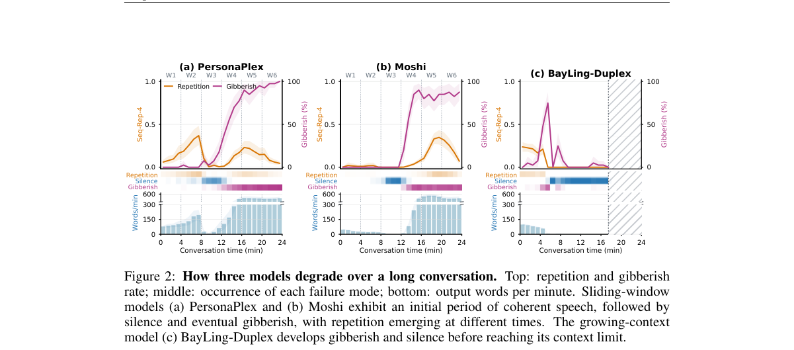

**Why this ranks #1**: 「全双工模型能不能撑住几十分钟」——答案是全都崩，而且崩法各不相同；两个免训练补丁就能大幅缓解。

---

### 2. CounselPlex: A Stressor-Aware Full-Duplex Counseling Model

**arXiv**: [2610.32702](https://arxiv.org/abs/2610.32702) | **Score**: 9.0 (relevance 9.0 x 0.7 + quality 9.0 x 0.3) | **Tags**: audio-LM, duplex-voice, counseling, stress-tracking, PAD-injection, RoPE-augmentation, long-turn | **Categories**: cs.CL, cs.SD | **Pages**: 21

**Authors**: Yeonju Kim, Bella Godiva, Yong Man Ro

**Affiliation**: KAIST

**Abstract**

> Full-duplex speech models can listen and speak at the same time, enabling natural, low-latency interaction. In counseling, however, these models often focus on the latest utterance and lose track of the seeker's underlying problem. We call this failure Stressor Blindness. We propose CounselPlex, a stressor-aware full-duplex framework that uses two operations. CounselPlex updates a short stressor state during seeker silence and injects this state into <PAD> positions while listening. We also introduce RoPE Position Shift Augmentation (RPSA), which broadens positional coverage during training and improves performance at longer turn depths in our evaluation. LLM-judge evaluations show improved counseling quality and stressor grounding over strong baselines.

**Key findings**

- **Finding**: 全双工语音模型能边听边说，但在咨询场景里往往只盯着最新一句话，丢掉来访者真正的困扰。
- **Finding**: 作者把这一失败命名为 **Stressor Blindness**。
- **Finding**: CounselPlex 用两个操作解决：来访者静默时更新一个**短的 stressor 状态**；倾听时把这个状态注入到 <PAD> 位置。
- **Finding**: 同时提出 RoPE Position Shift Augmentation (RPSA)，在训练时拓宽位置覆盖范围，在评估中提升了更长轮次深度下的表现。
- **Finding**: LLM-judge 评测显示，相比强基线，咨询质量与 stressor 落点（grounding）都有改善。
- **Inference**: 「静默期更新状态、倾听期注入状态」利用的正是全双工模型独有的时间结构——单轮模型没有这个通道，这个设计是有结构性的，不是补丁。
- **Inference**: RPSA 说明长轮次退化是位置编码外推能力问题，这与 FD-LHB 观察到的「长对话退化」是同一类病因的两面，两篇并读很有价值。
- **Recommendation**: 推荐。做情感支持、心理健康对话、长上下文语音应用的人必读。

**Key figures**

*Framework - Held-out example of Stressor Blindness. Trauma was disclosed eight turns before the seeker said they felt “constantly on edge.” The fine-tuned PersonaPlex† baseline*

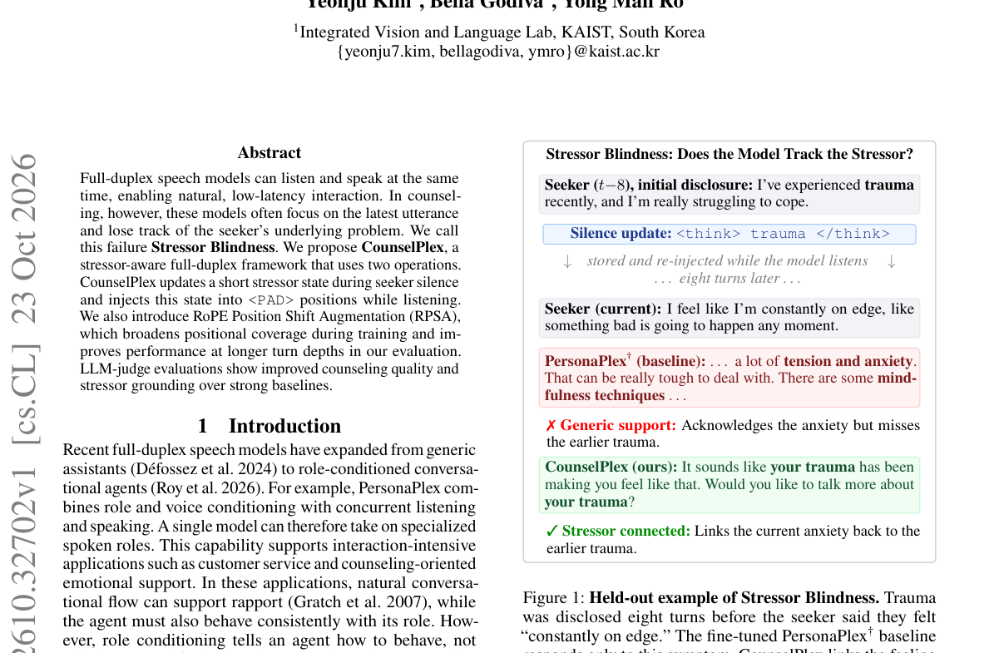

*Result - Overview of the CounselPlex framework. During seeker silence (top), CounselPlex generates an updated stressor state as a short think trace. When the seeker resumes speaking (bottom), the fra*

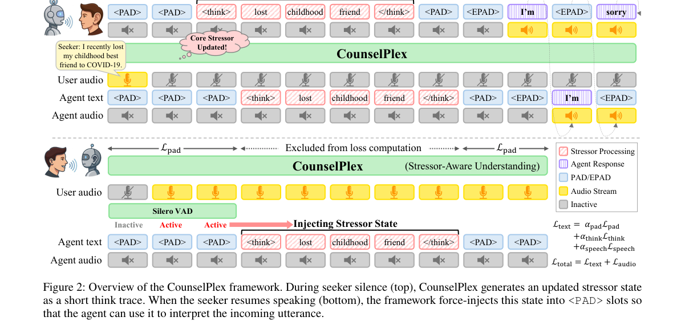

**Why this ranks #2**: 把咨询者「没说出口的核心困扰」做成一个短状态，在对方静默时更新、听的时候注入到 <PAD> 位。

---

### 3. Uni-Stream: A Unified Streaming Speech Language Model for Speech Synthesis and Recognition

**arXiv**: [2610.32187](https://arxiv.org/abs/2610.32187) | **Score**: 9.0 (relevance 9.0 x 0.7 + quality 9.0 x 0.3) | **Tags**: audio-LM, streaming-speech-LM, unified-ASR-TTS, interleaved-modal, two-stage-training, latent-analysis | **Categories**: cs.AI, eess.AS | **Pages**: 13

**Authors**: Xuan Shi, Chang Zeng, Tiantian Feng, Ye Zhang, Jun Liu, Shih-Heng Wang, Lie Lu, Shrikanth Narayanan

**Affiliation**: University of Southern California; National Institute of Informatics; MIT; Dolby Laboratories

**Abstract**

> Unified streaming speech language models aim to support speech recognition and synthesis within a single model, enabling real-time human-computer interaction. However, jointly supporting these two directions of speech-text conversion while preserving task-specific performance remains challenging. We propose Uni-Stream, a unified streaming speech language model built on compact pretrained speech models. Uni-Stream processes interleaved text and speech in a streaming format and achieves performance comparable to task-specific models through two-stage training. We also develop a data annotation pipeline for streaming training and will publicly release the generated transcriptions and word-level timestamps. We further examine Uni-Stream's representations across tasks and modalities and find that speech and text residence in distinct latent feature space even when trained in a unified model architecture, while representations within each modality become more task-dependent in later layers.

**Key findings**

- **Finding**: 统一流式语音语言模型要在**一个模型**里同时支持语音识别与合成，同时保住两个方向各自的性能。
- **Finding**: Uni-Stream 基于紧凑的预训练语音模型构建，以**流式格式**处理文本与语音交错的输入，通过两阶段训练达到与任务专用模型相当的性能。
- **Finding**: 还开发了一套流式训练的数据标注流程，并将公开生成的转写与词级时间戳。
- **Finding**: 对表征的分析发现：**即使在统一模型架构中，语音与文本仍住在不同的隐特征空间**；而每个模态内部的表征在更后面的层里变得更依赖任务。
- **Finding**: 这解释了为什么统一模型在两个方向上都能追平专用模型，却不会真正共享一份跨模态表征。
- **Inference**: 「统一模型 ≠ 统一表征」这个发现很值得警惕：它意味着跨模态能力的迁移在统一模型里可能根本不存在。
- **Inference**: 词级时间戳公开是个实用贡献——流式训练的数据标注一直是这类模型的隐性成本。
- **Recommendation**: 推荐。做流式语音模型、端到端语音对话、语音-文本统一架构的人必读。

**Key figures**

*Framework - Overview of Uni-Stream. (a) Streaming ASR and time-aligned TTS sequences (frame counts illustrative). (b) Shared backbone with text and diffusion heads. (c) Two-stage training: task-specific*

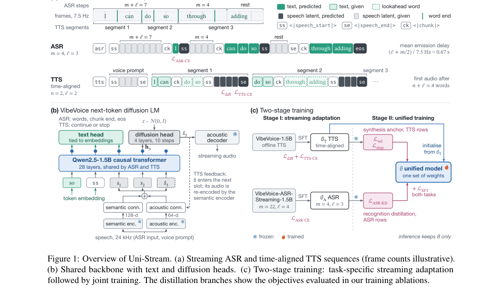

*Result - reveals two patterns: a persistent modal- ity gap and increasing task specificity with depth. In panels (a, b), speech–text similarity remains low for both ASR and TTS and does not increase a*

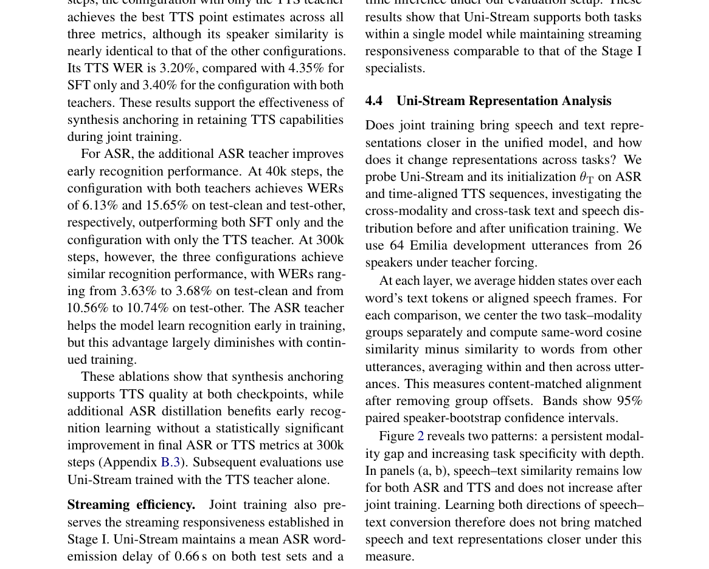

**Why this ranks #3**: 一个模型同时做识别与合成，且解耦出「语音与文本住在不同隐空间」这一发现。

---

### 4. DIAL-S2ST: Learning Latency Control for Simultaneous Speech-to-Speech Translation

**arXiv**: [2610.32214](https://arxiv.org/abs/2610.32214) | **Score**: 8.7 (relevance 9.0 x 0.7 + quality 8.0 x 0.3) | **Tags**: audio-LM, speech-to-speech, simultaneous-translation, latency-control, self-distillation, LoRA, single-model | **Categories**: cs.CL, cs.SD, eess.AS | **Pages**: 6

**Authors**: Jeongsoo Choi, Junseok Ahn, Joon Son Chung

**Affiliation**: KAIST

**Abstract**

> We propose DIAL-S2ST, a post-training method for learning inference-time latency control in simultaneous speech-to-speech translation models. Our approach reuses pretrained translation capabilities through self-distillation from lookahead predictions, while limiting the influence of large text distillation losses to account for the imitation gap. This provides supervision for earlier emission without paired target data or reward computation. To make the learned timing adjustable at inference, we jointly train a single LoRA adapter across scales with matched lookahead guidance. Experiments on French-to-English translation with Hibiki demonstrate that only 10 hours of source speech enable this adaptation, providing flexible latency control with a favorable quality-latency trade-off.

**Key findings**

- **Finding**: DIAL-S2ST 是一种后训练方法，为同时语音到语音翻译模型学到**推理期时延控制**能力。
- **Finding**: 做法是复用预训练翻译能力，通过从 lookahead 预测做**自蒸馏**；同时限制大文本蒸馏损失的影响，以考虑模仿差距（imitation gap）。
- **Finding**: 这为「更早发出」提供了监督，**不需要成对目标数据，也不需要奖励计算**。
- **Finding**: 为了让学到的时序在推理期可调，跨多个档位联合训练**单个 LoRA 适配器**，并配以匹配的 lookahead 引导。
- **Finding**: 在 Hibiki 上做法语到英译：仅 10 小时源语音即可完成这种适配，得到灵活的时延控制与质量-时延权衡。
- **Inference**: 「用 lookahead 自蒸馏代替奖励」把时延控制从 RL 问题降级成监督学习问题——这是很聪明的简化，也解释了为什么 10 小时数据就够。
- **Inference**: 单 LoRA 多档位的设计让部署端可以按网络状况调时延而不必换模型，对产品化非常友好。
- **Recommendation**: 推荐。做同时翻译、流式语音翻译、低时延语音系统的人必读。

**Key figures**

*Framework - Overview of DIAL-S2ST training and inference.*

**Why this ranks #4**: 一个 LoRA 同时给出多个时延档位，10 小时源语音就够——且完全不需要奖励计算。

---

### 5. MusicTwins: Training Audio-Language Models to Listen like Their Persona

**arXiv**: [2610.32495](https://arxiv.org/abs/2610.32495) | **Score**: 8.0 (relevance 8.0 x 0.7 + quality 8.0 x 0.3) | **Tags**: audio-LM, persona, music-perception, post-training, SFT-plus-RL, Audio-Flamingo, personalization | **Categories**: cs.AI, cs.SD | **Pages**: 20

**Authors**: Milan Liessens Dujardin, Kevin Miao

**Affiliation**: Bryel Labs UC Berkeley

**Abstract**

> People differ in how they perceive music, what associations they make with it, what they like about it, and how they respond to it. Computational models intended to simulate people in environments that include music should account for these differences. Although LLMs have been shown to reproduce aspects of human behavior, whether audio-language models (ALMs) can reproduce a specific person's responses to textual and musical stimuli remains underexplored. We introduce MusicTwins, a framework that combines persona summaries, personal memory, and post-training to generate person-specific responses. We construct persona representations from human writings, capturing background, views, personality, writing style, and a musical profile, and post-train Audio Flamingo Next through supervised fine-tuning and reinforcement learning. Evaluation on ten held-out personas shows notable improvements for Audio Flamingo Next in persona fidelity, including personality, writing style, and responses to music, supporting MusicTwins as a foundation for training audio-language models to listen like their persona.

**Key findings**

- **Finding**: 人对音乐的感知、联想、喜好与反应各不相同；模拟人的模型若要可信，就应当建模这些差异。
- **Finding**: 此前 LLM 已被证明能复现部分人类行为，但音频语言模型（ALM）能否复现特定个体对文本与音乐刺激的反应仍未被检验。
- **Finding**: MusicTwins 结合**人格摘要**、**个人记忆**与**后训练**来生成个体化响应。
- **Finding**: 人格表示从人类 writings 中构造，捕获背景、观点、个性、写作风格与一份**音乐画像**。
- **Finding**: 通过监督微调与强化学习对 Audio Flamingo Next 做后训练。
- **Finding**: 在 10 个留出人格上评测，Audio Flamingo Next 在人格一致性（个性、写作风格、对音乐的反应）上有明显提升。
- **Inference**: 把「音乐画像」写进人格表示、并用 RL 做后训练，是把通用 ALM 变成「有品味的人」的最小路径——对陪伴型、康复型音乐应用有直接价值。
- **Inference**: RL 出现在这里而不是 SFT 单独，说明人格一致性不是靠模仿数据就能拿到的，需要奖励侧塑形。
- **Recommendation**: 推荐。做音频语言模型、音乐个性化、人格化交互的人必读。

**Key figures**

*Result - Two illustrative applications for MusicTwins: teaching and music production assistants. The system prompt contains the persona summary, and memory contains specific experiences related to mu*

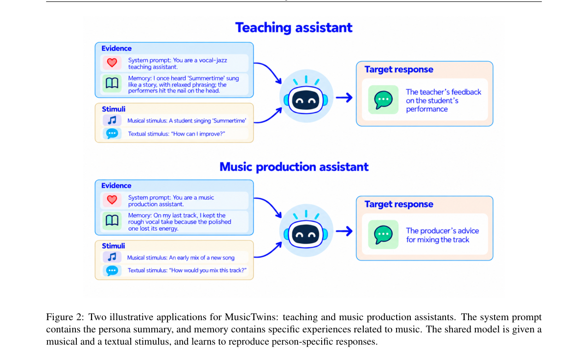

**Why this ranks #5**: 让音频语言模型「像某个人一样听音乐」：人格摘要 + 个人记忆 + 后训练，三人称一致性显著提升。

---

### 6. SURE-Tagger: Structured Speech Representations for Compositional Evaluation and Targeted Data Selection

**arXiv**: [2610.32198](https://arxiv.org/abs/2610.32198) | **Score**: 8.0 (relevance 8.0 x 0.7 + quality 8.0 x 0.3) | **Tags**: audio-LM, speech-captioning, structured-representation, abstention, data-selection, ASR-error-analysis | **Categories**: eess.AS | **Pages**: 33

**Authors**: Jing Peng, Huifei Wang, Weihan Chen, Shuo Gao, Bicheng Zhang, Junhao Du, Hanqi Li, Chaolei Liu, Wen Wen, Tao Liu, Xu Li, Yu Xi

**Affiliation**: Shanghai Jiao Tong University X-LANCE Lab; AISpeech Ltd.; Shenzhen University

**Abstract**

> Speech conveys linguistic content, speaker characteristics, temporal interactions, paralinguistic cues, and acoustic environments. While recent speech captioning models describe these dimensions in natural language, inconsistent attribute coverage and ambiguous omissions hinder systematic analysis across recordings. We introduce SURE-Tagger, a framework that constructs semi-structured speech representations with explicit attribute values, supplementary descriptions, and abstention under insufficient evidence. By integrating specialist observations through language-model reasoning, SURE-Tagger enables speech conditions to be consistently identified and jointly queried across datasets. We further introduce Tag-Bench, combining real recordings with controlled, agentically synthesized speech scenes and verified attribute annotations. On Tag-Bench, SURE-Tagger achieves the highest scores on 25 of 29 evaluated dimensions for real speech and 24 of 29 for synthetic speech, outperforming caption-based baselines across structural and descriptive attributes. Beyond annotation, we use these representations to construct cross-dataset evaluation subsets and reveal condition-specific ASR errors. Using a separate candidate pool, SURE-Tagger-guided selection reduces the overall ASR error rate of Qwen3-ASR-1.7B by 14.3% relative to the unadapted model under a one-hour fine-tuning budget, while caption-guided and random selection increase error in the same setting. These results demonstrate how structured speech representations can connect rich annotation, compositional evaluation, and targeted model improvement.

**Key findings**

- **Finding**: 语音同时承载语言内容、说话人特征、时间交互、副语言线索与声学环境；现有语音描述模型用自然语言描述这些维度，但属性覆盖不一致、缺失含义模糊，妨碍系统分析。
- **Finding**: SURE-Tagger 构造**半结构化**语音表示：显式属性值、补充描述、以及证据不足时的**弃权（abstention）**。
- **Finding**: 通过语言模型推理整合多个专家观察，使语音条件能在不同数据集里被一致识别与联合查询。
- **Finding**: 同时发布 Tag-Bench：结合真实录音与受控的 agent 合成语音场景，带经核验的属性标注。
- **Finding**: 在 Tag-Bench 上，真实语音 29 个维度中 25 个得分最高，合成语音 24/29 最高，在结构化与描述性属性上都优于基于描述的基线。
- **Finding**: 进一步用这些表示构造跨数据集评测子集，揭示出条件相关的 ASR 错误。
- **Finding**: 用独立的候选池做选择，SURE-Tagger 引导的选择在**一小时**微调预算下把 Qwen3-ASR-1.7B 的整体 ASR 错误率**相对降低 14.3%**，而描述引导与随机选择在同设定下反而**增加**错误。
- **Inference**: 「弃权」这个设计是全文的题眼：结构化标注系统最大的问题就是模型什么都敢答，允许弃权才让后续统计有意义。
- **Inference**: 一小时预算下相对降错 14.3%、而随机选择会变差——这说明结构化属性不只是描述性标注，而是真的能定位到「哪类数据该补」。
- **Recommendation**: 强烈推荐。做语音标注、数据选择、ASR 错误分析的人必读。

**Key figures**

*Framework - Free-form speech captions and a semi-structured speech representation. Left: ambiguities in attribute coverage and omission. Right: an illustrative schema excerpt with explicit attribute val*

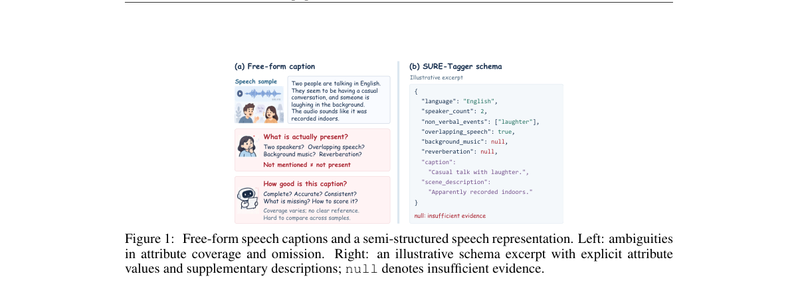

*Result - Overview of SURE-Tagger. The semi-structured representation combines explicit speech attributes with supplementary descriptions. SURE-Tagger constructs it by integrating observations from sp*

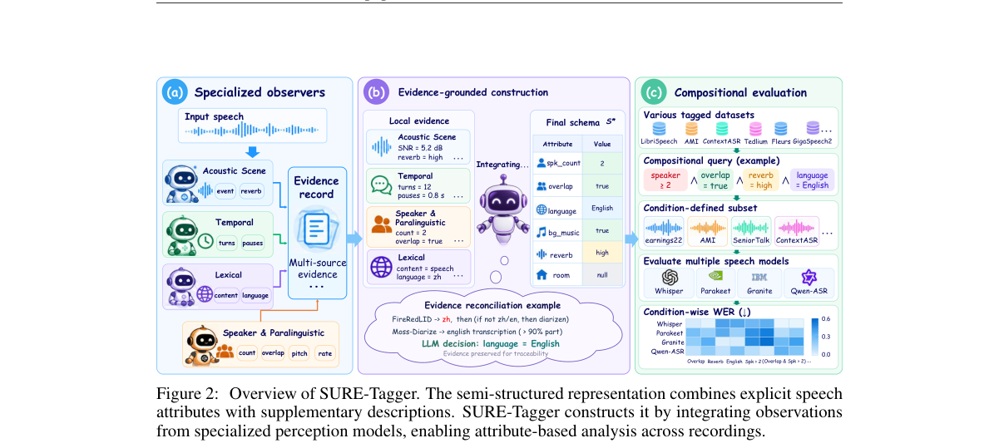

**Why this ranks #6**: 把语音描述从自由文本变成「带属性值、可弃权」的结构化标签，标注、评测、数据选择三件事一起解决。

---

### 7. RVG-Bench: A Benchmark for Reasoning-Driven Audio-Visual Temporal Grounding

**arXiv**: [2610.32268](https://arxiv.org/abs/2610.32268) | **Score**: 8.0 (relevance 8.0 x 0.7 + quality 8.0 x 0.3) | **Tags**: audio-LM, audio-visual, temporal-grounding, reasoning, benchmark, test-time-scaling, mIoU | **Categories**: cs.CV | **Pages**: 43

**Authors**: Yue Feng, Boshen Xu, Zihao Yue, Xiaokun Liu, Miao Yang, Xin Tao, Pengfei Wan, Qin Jin

**Affiliation**: AIM3 Lab Renmin University of China; Kling AI

**Abstract**

> Existing temporal video grounding (TVG) benchmarks primarily focus on localizing target video segments according to descriptive text queries of the visual content. However, real-world queries are more diverse and often require the model to first understand the user's intent before localization, such as finding visual evidence, identifying the cause of an event, or recalling a remembered moment, yet such queries remain largely overlooked. To mitigate this gap, we introduce RVG-Bench, a benchmark for reasoning-driven audio-visual temporal grounding, where every query is constructed such that the target segment can only be identified through reasoning about the query's underlying intent. We carefully construct the benchmark and rigorously verify its data quality to ensure models truly comprehend the audio-visual content. RVG-Bench comprises 1,255 videos and 1,890 query-interval pairs across eight reasoning types. We evaluate 22 models and find that the strongest, Qwen3.8-Omni-Flash, achieves only 49.6 mIoU. Through a series of controlled analyses, including oracle-grounding probes and test-time scaling experiments, we systematically examine where and why current models struggle, providing insights for future model development.

**Key findings**

- **Finding**: 现有时序视频定位（TVG）基准主要按描述性文本查询定位目标片段，但真实查询更发散，往往要求模型**先理解意图再定位**：找视觉证据、找事件起因、回忆某个时刻。
- **Finding**: RVG-Bench 的每个查询都被构造成：**只有通过推理查询背后的意图**才能确定目标片段。
- **Finding**: 构造过程经过严谨的数据质量核验，确保模型是真的在理解视听内容，而不是靠捷径匹配。
- **Finding**: 包含 1,255 个视频与 1,890 个「查询-区间」对，覆盖**八种推理类型**。
- **Finding**: 评测了 22 个模型，最强的 Qwen3.8-Omni-Flash 只拿到 **49.6 mIoU**。
- **Finding**: 通过一系列受控分析（oracle grounding 探针、测试时扩展实验）系统考察模型在哪里、为何失败。
- **Inference**: 22 个模型、最高 49.6 mIoU——这是本批「能力缺口」最明确的一个数字，说明「先理解意图再定位」远未被解决。
- **Inference**: oracle-grounding 探针这类受控分析是这个基准最有价值的部分：它能区分「定位能力不行」与「意图理解不行」，这对后续方法设计是决定性的。
- **Recommendation**: 推荐。做视听理解、时序定位、多模态推理评测的人必读。

**Key figures**

*Framework - From descriptive grounding to reasoning-driven grounding. Left: Tra- ditional TVG queries directly describe the target segment, making localization largely solvable via cross-modal semantic ma*

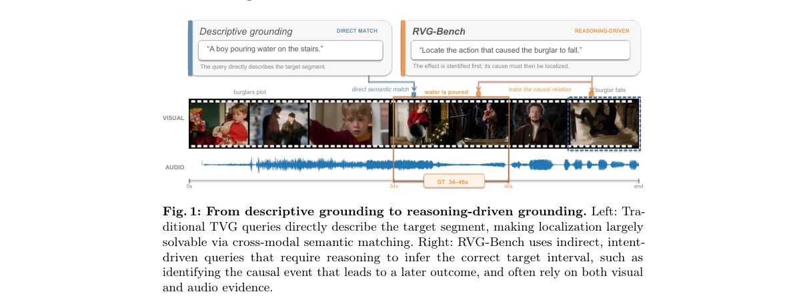

*Result - Overview of the RVG-Bench construction pipeline: (1) broad query proposal via multi-view captions; (2) rigorous quality filtering and target interval refinement using frontier MLLMs; (3) diffi*

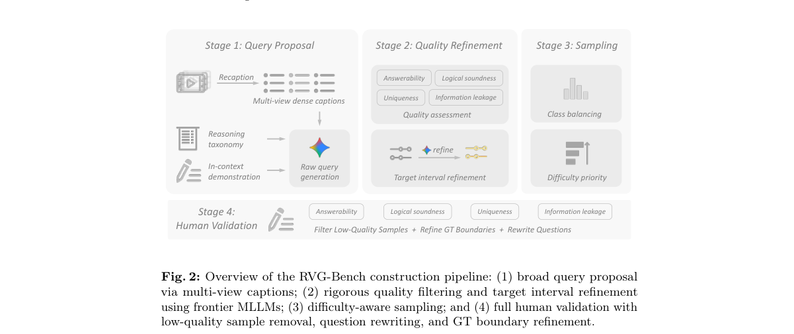

**Why this ranks #7**: 要求先推理意图再定位片段的视听基准——最强的 Qwen3.8-Omni-Flash 也只有 49.6 mIoU。

---

### 8. Concentrated Causal Influence, Distributed Diagnostic Information: Cognitive Impairment Decisions in Large Audio-Language Models

**arXiv**: [2610.32061](https://arxiv.org/abs/2610.32061) | **Score**: 7.3 (relevance 7.0 x 0.7 + quality 8.0 x 0.3) | **Tags**: audio-LM, mechanistic-interpretability, causal-ablation, cognitive-impairment, linear-readout, LALM | **Categories**: cs.CL, eess.AS | **Pages**: 30

**Authors**: Xiutian Zhao, Luqi Sun, Björn Schuller, Berrak Sisman

**Affiliation**: Johns Hopkins University CLSP; Imperial College London GLAM

**Abstract**

> Large audio-language models (LALMs) can assess cognitive impairment (CI) from speech, yet their answers reveal neither which internal components control the decision nor how much CI information is accessible in their representations. We investigate both questions through CI-contrast neurons (CICNs), selected by class-contrastive activation frequency in decoder MLPs. Across eight open LALMs and two corpora (Pitt and PROCESS-2), we causally test CICNs against size- and layer-matched random masks and activity-matched controls. In three of the five models that meet our eligibility criteria, ablation of small CICN sets causes large, class-directed prediction shifts; speech-identified masks also control transcript-only decisions, and three of four primary Pitt masks retain specificity on PROCESS-2. Position-restricted interventions locate the influence before the final answer position, most strongly after the speech or transcript evidence under letter-labeled options, largely as a decision-direction shift. Beyond causal localization, supervised linear readouts of frozen CICN activations achieve 0.92--0.97 AUC within Pitt, versus 0.67--0.84 for the models' direct answers. Matched random and all-neuron readouts reach comparable performance; top-ranked CICNs show only an exploratory advantage at very small unit budgets. These results distinguish concentrated causal control over output decisions from broadly distributed diagnostic information for CI detection in LALMs.

**Key findings**

- **Finding**: 大型音频语言模型（LALM）能从语音判断认知障碍（CI），但答案既不揭示是哪些内部组件在控制决策，也不揭示表征里到底有多少 CI 信息可用。
- **Finding**: 作者用 **CI-contrast neurons (CICNs)** 调查这两个问题：在 decoder MLP 中按类对比激活频率选出这些神经元。
- **Finding**: 在 8 个开源 LALM 与两个语料（Pitt、PROCESS-2）上，用尺寸与层数匹配的随机掩码及活动量匹配的对照做因果检验。
- **Finding**: 在满足入选标准的 5 个模型中的 3 个，**消融少量 CICN 集合**就会造成大幅、类定向的预测偏移；由语音识别的掩码同样能控制纯文本的决策；4 个主要 Pitt 掩码中有 3 个在 PROCESS-2 上仍保持特异性。
- **Finding**: 位置受限干预把影响定位到最终答案位**之前**，最强地出现在语音或文本证据之后、字母标注选项之后，主要表现为决策方向的偏移。
- **Finding**: 对冻结 CICN 激活做监督线性读出，在 Pitt 内达到 **0.92–0.97 AUC**，而模型自身直接给出的答案是 0.67–0.84。
- **Finding**: 但匹配的随机与全神经元读出也达到相当性能；排名靠前的 CICN 只在极小的单元预算下有探索性优势。
- **Inference**: 「因果上集中、诊断上分散」这个分离结论是全文最重要的输出：它警告不要用「能预测出答案」来反推「找到了决策机制」。
- **Inference**: 0.92–0.97 的线性读出 AUC 高于模型自己的答案，说明 CI 信息其实早就被编码好了，只是模型不会用——这对做表征探针的人是很强的信号。
- **Recommendation**: 推荐。做机制可解释性、音频语言模型、临床应用的人必读。

**Key figures**

*Framework - Ablating CICN masks on Pitt in their identification condition (24 masks). Each row shows the NC mask (blue circle), CI mask (red square), and matched random masks (gray). Left: ∆P(CI); right*

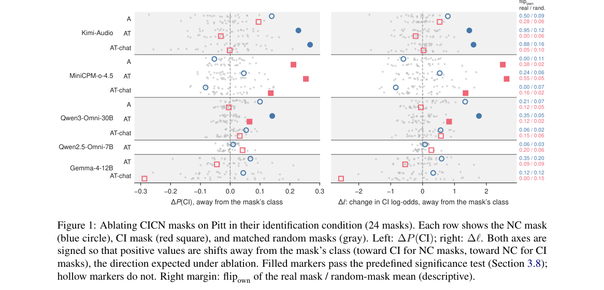

*Result - Position-restricted ablation on Pitt: change in P(CI) away from the mask’s class when ablation is restricted to one set of prefill positions. Each bar is a separate intervention, colored as*

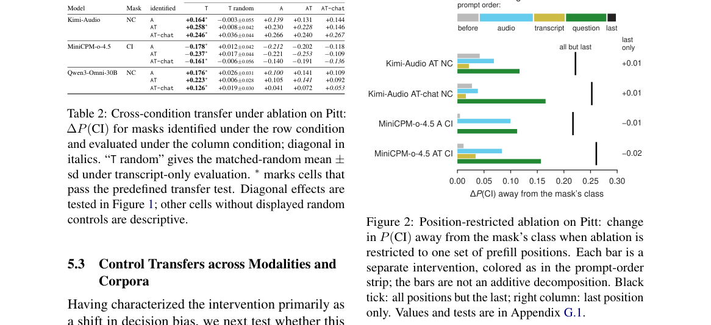

**Why this ranks #8**: 「决定答案的神经元」是少数几个，「含有诊断信息」的神经元却是散布的——两者必须分开评估。

---

### 9. CoupleFlow: Null-Calibrated Auditory Attention Decoding With Time-Locked Brain-Speech Coupling and Flow-Matching Likelihood Ratios

**arXiv**: [2610.32950](https://arxiv.org/abs/2610.32950) | **Score**: 7.3 (relevance 7.0 x 0.7 + quality 8.0 x 0.3) | **Tags**: audio-LM, EEG, auditory-attention-decoding, flow-matching, PMI, null-calibration, MEG | **Categories**: eess.AS | **Pages**: 40

**Authors**: Ali Alavi, Donald S. Williamson

**Affiliation**: The Ohio State University

**Abstract**

> Auditory attention decoding (AAD) seeks to identify the attended talker from brief noninvasive brain recordings by comparing neural responses with competing speech streams. Recent electroencephalography (EEG) decoders report nearly perfect accuracy from one second of data, yet we show that this performance fails to generalize to unseen speech because models exploit trial leakage, eye gaze, and acoustic cues instead of speech evoked neural activity. We introduce CoupleFlow, which decodes attention through temporal coupling between neural and acoustic embeddings. Its predictions remain at chance when the brain signal contains no informative coupling, preventing shortcuts based on speech content or talker identity. A conditional flow matching head implements a likelihood ratio decision rule based on pointwise mutual information between brain and speech. This rule is Bayes optimal when the recording depends only on the attended talker and removes preferences for speech that is likely a priori. We evaluate CoupleFlow with content disjoint splits recovered from the audio and null tests that distinguish genuine temporal coupling from trial recognition. Across nine EEG and magnetoencephalography (MEG) datasets processed through a common pipeline, spanning four languages, high density EEG recordings, listeners with hearing impairment, and a room with multiple talkers, CoupleFlow outperforms linear and deep baselines while all null tests remain at chance. Finally, we derive an evidence accumulation law that predicts accuracy across window lengths from a single parameter per dataset and predicts that parameter from the strength of neural speech tracking. This law identifies recording signal to noise ratio as a limit on decoding speed and reliability and estimates the window length required to reach a target accuracy.

**Key findings**

- **Finding**: 听觉注意解码（AAD）要从简短无创脑记录中判断听者注意了哪个说话人；EEG 解码器此前报告近乎完美的 1 秒数据准确率。
- **Finding**: 作者指出这种表现**无法泛化到未见语音**：模型利用的是试次泄漏、视线与声学线索，而不是语音诱发的神经活动。
- **Finding**: CoupleFlow 通过**神经与声学嵌入之间的时间耦合**来解码注意力：当脑信号中不存在有信息量的耦合时，其预测保持在随机水平，从而堵死基于语音内容或说话人身份的捷径。
- **Finding**: 一个条件流匹配（conditional flow matching）头实现了基于**脑-语音逐点互信息**的似然比判决规则；当录音只依赖被注意说话人时该规则是贝叶斯最优，并会去掉对先验上更可能语音的偏好。
- **Finding**: 评测覆盖 9 个 EEG 与脑磁图（MEG）数据集、4 种语言、高密度 EEG、听障听者以及多人房间，CoupleFlow 优于线性与深度基线，且**所有 null 测试都保持在随机水平**。
- **Finding**: 作者还导出**证据累积定律**：用每个数据集一个参数预测不同窗口长度下的准确率，并能由神经语音跟踪强度预测该参数。
- **Finding**: 该定律把记录信噪比识别为解码速度与可靠性的上限，并估计达到目标准确率所需的窗口长度。
- **Inference**: 「null 测试必须保持在随机水平」是把神经解码从「相关性刷分」拉回因果解释的最低门槛，这套设计应该成为该领域的标配。
- **Inference**: 流匹配头在这里不是炫技：它天然提供似然比，而似然比是唯一能把「先验偏置」从「证据」里扣掉的判决形式。
- **Recommendation**: 强烈推荐。做脑机接口、神经解码、EEG/MEG 分析的人必读。

**Key figures**

*Framework - CoupleFlow. The two small signal plots show the input of one real MAESTRO test window (listener S03): seven of its EEG channels and the envelopes of its K = 4 candidate talkers, with the att*

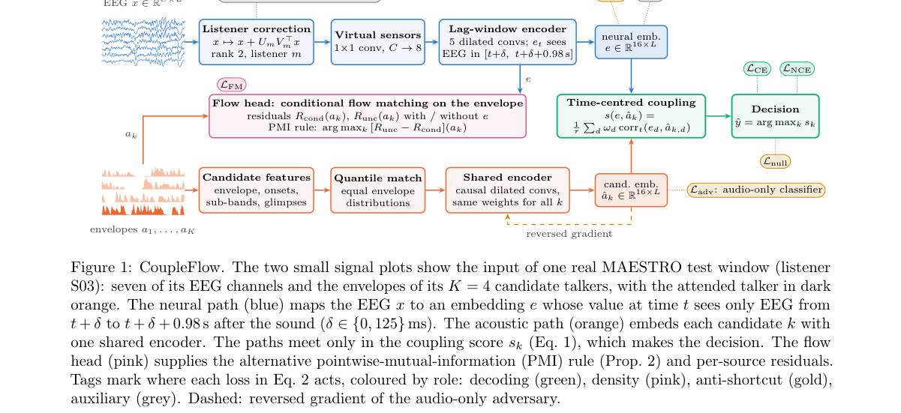

*Result - Accuracy vs. window length (log scale). Markers: CoupleFlow (seed 0), pooled over folds. Lines: Φ(κ*

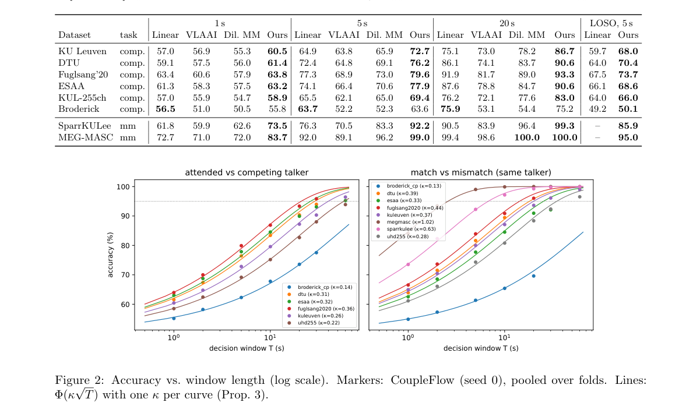

**Why this ranks #9**: 把「1 秒 EEG 就能近 100% 准确」的解码器打回原形：它们用的是试次泄漏与眼动，不是神经响应。

---

### 10. Sounding Surgical Instrument Localisation through Audio-Visual Correspondence

**arXiv**: [2610.32816](https://arxiv.org/abs/2610.32816) | **Score**: 7.0 (relevance 7.0 x 0.7 + quality 7.0 x 0.3) | **Tags**: audio-LM, audio-visual-correspondence, surgical-instrument, weak-supervision, localization, single-microphone | **Categories**: cs.CV, cs.SD | **Pages**: 12

**Authors**: Dominic Behling, Jonas Hein, Matthias Seibold

**Affiliation**: University Hospital Zurich; Eberhard Karls Universitaet Tuebingen

**Abstract**

> Surgical scene understanding is a prerequisite for context-aware and intelligent systems in the operating room. Current methods rely mostly on visual data, while acoustic sensing has shown potential to provide complementary information on surgical activity. First approaches for the localisation of surgical activity relied on microphone arrays and acoustic beamforming. This work investigates whether the active instrument can be localized from a single microphone and a camera by learning the correspondence between the appearance and the sound of surgical instruments, without annotating its position. We adapt weakly supervised audio-visual localisation, which learns from the co-occurrence of image and sound, to the surgical setting. We record simulated surgical actions, sawing, drilling, and chiseling, and train the model on these recordings without any spatial annotation to produce a heatmap over the sounding tool. We extend the training objective by two terms: a silence term, which suppresses the output for silence and background noise, and a composite term, which trains the model to select the sounding one of two visible instruments. The model localizes the active instrument on an independent corpus recorded with a different camera and microphone, in which instrument positions were obtained by optical tracking. It separates tool activity from silence and background noise and can attribute sound correctly when two tools are present. Audio-visual correspondence learned from in-domain recordings connects the sound of a surgical action to the instrument that produces it, using a single microphone and a camera. This proof of concept introduces a novel paradigm that enables the detection and localisation of surgical activity without manual annotations.

**Key findings**

- **Finding**: 手术场景理解依赖视觉数据，而声学传感可提供互补信息；早期的手术器械定位依赖麦克风阵列与声束形成。
- **Finding**: 本文研究能否用**单麦克风 + 单相机**、通过学习器械外观与声音的对应关系来定位正在发声的器械，且**不需要标注位置**。
- **Finding**: 方法是把弱监督视听定位改造到手术场景：从图像与声音的共现关系学习。
- **Finding**: 录制了锯、钻、凿三类模拟手术动作，在**无任何空间标注**的录音上训练，输出发声器械的热力图。
- **Finding**: 训练目标增加了两项：silence 项（抑制静音与背景噪声上的输出）与 composite 项（在两把可见器械中选出正在发声的那把）。
- **Finding**: 在用不同相机与麦克风录制的独立语料上（器械位置由光学跟踪获得）成功定位活动器械；能把工具活动与静音/背景噪声分开，也能在两把工具同时在场时正确归因声音。
- **Finding**: 作者称之为概念验证：它引入了「无需人工标注即可检测与定位手术活动」的新范式。
- **Inference**: 「单麦克风定位发声源」本身是个难题，论文靠外观-声音共现绕开了它——这提示多模态共现是解决无标注声源定位的一条通用路径。
- **Inference**: silence 项与 composite 项是两个针对性很强的负样本设计，尤其 composite 项直接对应「不要选错器械」这一实际失效模式。
- **Recommendation**: 推荐。做视听定位、弱监督定位、手术机器人感知的人必读。

**Key figures**

*Framework - Schematic overview of the method. Training adds two generated samples, a pair with negative audio (silence, background noise) and a composite of cropped halves with different instruments. Cosin*

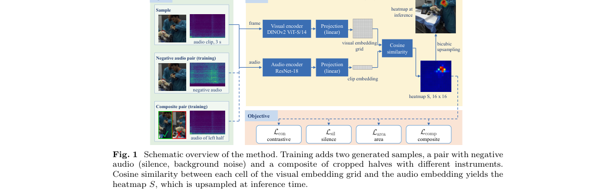

*Result - Heatmaps of the proposed model on the acoustic camera corpus. Green: ground-truth box. Left: drill. Middle: chisel, where the model responds to the hand swinging the hammer as well as to the ch*

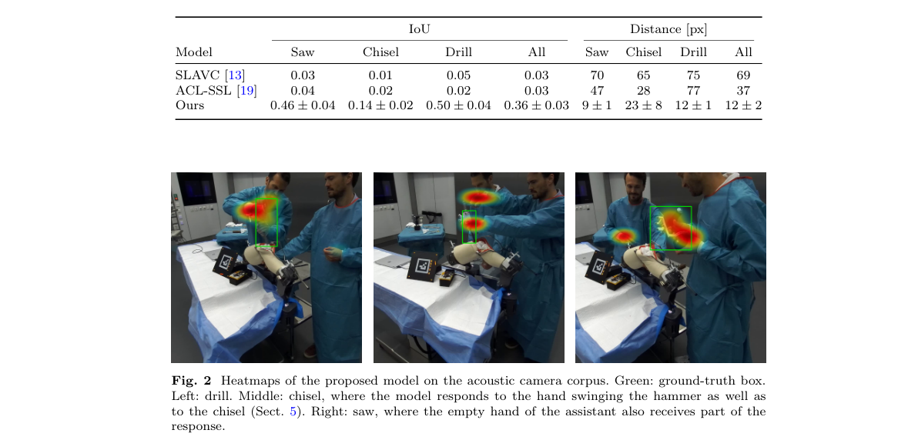

**Why this ranks #10**: 一个麦克风 + 一台相机，无位置标注，就能判断手术台上「哪个器械在响」。

---

## Footer

- Total papers scanned across all 7 tracks: 474（原始 663 条）
- audio_lm track final top-10: 10
- Wild-cards in this track: 0
- Figure assets: 2026-10-26/res/

Generated by `mine-arxiv-daily-digest` skill. Sister file: `2026-10-26_audio_lm_entry.md`.
