# ArXiv Daily Digest - 2026-10-26 (具身智能与世界模型, 10 papers)

**Generated**: 2026-10-26 17:00 CST

**Source**: arXiv cs.CV, cs.SD, eess.AS, cs.CL, cs.AI, cs.RO, cs.LG submissions, listing day 2026-10-23 (announced 2026-10-26 00:00 UTC)

**Batch window**: 2026-10-22T18:00:00Z .. 2026-10-23T18:00:00Z（arXiv 公告批次横跨两个 UTC 日：前一日 18:00 UTC 起算，当日 17:59:59 UTC 截止）

**Track**: embodied (top 10 of 474 papers scanned, 70 full reads)

**Scope**: 具身智能、机器人操作与导航、VLA、世界模型、触觉与仿真

---

## Top 10 - 具身智能与世界模型

### 1. MAST-VLA: Skill-Conditioned Adaptation with Trajectory-Affordance Priors for Multi-Skill Robot Manipulation

**arXiv**: [2610.32312](https://arxiv.org/abs/2610.32312) | **Score**: 9.7 (relevance 10.0 x 0.7 + quality 9.0 x 0.3) | **Tags**: embodied-ai, VLA, skill-conditioned-experts, trajectory-affordance, LoRA-MoE, CALVIN, long-horizon | **Categories**: cs.RO | **Pages**: 20

**Authors**: Jiachi Yang, Zhiyi Xu, Hongquan Zhang, Xin Tan, Zhizhong Zhang, Jingyu Gong, Yuan Xie

**Affiliation**: Shanghai Innovation Institute; Tianjin University; East China Normal University; Tongji University

**Abstract**

> Generalist robot manipulation requires a single vision-language-action (VLA) policy to execute diverse skills across scenes and instructions. However, current multi-skill VLA policies often leave two aspects of an instruction insufficiently modeled: which primitive skill to execute and where/how to contact and move objects. We propose MAST-VLA (Multi-skill Adaptation with Skill-conditioned experts and Trajectory-affordance priors), a dual-conditioning framework for robot manipulation. MAST-VLA introduces skill-conditioned LoRA Mixture-of-Experts (LoRA-MoE) adapters in the LLM backbone, where skill-query tokens and routing biases guide low-rank expert specialization, and converts a predicted affordance heatmap into a patch-level trajectory-affordance spatial prior for the action head. On the CALVIN ABC$\rightarrow$D long-horizon multi-skill cross-scene generalization setting, MAST-VLA achieves state-of-the-art performance, reaching an Avg. Len of 4.65 over five-subtask evaluation sequences. Real-robot multi-skill sequence experiments further validate its deployability under real perception and control noise.

**Key findings**

- **Finding**: 指出当前多技能 VLA 策略对指令的两个方面建模不足：**该执行哪个基础技能**，以及**在哪里/如何接触并移动物体**。
- **Finding**: MAST-VLA 在 LLM 骨干里引入**技能条件化的 LoRA 专家混合（LoRA-MoE）适配器**，用技能查询 token 与路由偏置引导低秩专家的专门化。
- **Finding**: 同时把预测出的 affordance 热力图转换为**patch 级的轨迹可供性空间先验**，喂给动作头。
- **Finding**: 在 CALVIN ABC→D 的长时程多技能跨场景泛化设定上取得 SOTA，五子任务评测序列的 Avg. Len 达到 **4.65**。
- **Finding**: 真实机器人上的多技能序列实验进一步验证了在真实感知与控制噪声下的可部署性。
- **Inference**: 「技能路由」与「空间可供性」分属两个层级，用两级条件而不是一个联合条件，是这类 VLA 里少见的干净分解。
- **Inference**: CALVIN ABC→D 的 Avg. Len 4.65 意味着平均能连续完成约 4.65 个子任务——长时程具身任务离「一次跑通」仍有明显距离。
- **Recommendation**: 强烈推荐。做 VLA、多技能策略、机器人泛化的人必读。

**Key figures**

*Result - Representative real-robot evaluation tasks. Representative test-time primitive subtasks are shown for two tabletop scenes. The examples cover diverse interaction modes, including nesting, pi*

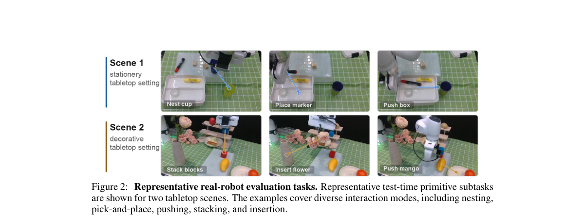

**Why this ranks #1**: 把「用哪个技能」和「在哪里接触物体」拆成两级条件，CALVIN ABC→D 长时程多技能跨场景泛化 SOTA。

---

### 2. From Tabletop to Walking Bot: Deploying a VLA Model on a Legged Manipulator Robot

**arXiv**: [2610.32271](https://arxiv.org/abs/2610.32271) | **Score**: 9.7 (relevance 10.0 x 0.7 + quality 9.0 x 0.3) | **Tags**: embodied-ai, VLA, legged-manipulation, Unitree-Go2, AgileX-Piper, deployment-recipe, real-robot | **Categories**: cs.RO | **Pages**: 3

**Authors**: Giovanni Minelli, Antonio Langella, Giovanni B. Dessy, Lorenzo Amatucci, Giulio Turrisi, Victor Barasuol, Claudio Semini

**Affiliation**: Istituto Italiano di Tecnologia

**Abstract**

> Vision-language-action (VLA) models are typically pretrained on broad, diverse datasets and subsequently fine-tuned on a comparatively small dataset tailored to a specific target robot. Such adaptation recipe is now widely established, achieving its most mature results on fixed-base arms due to their static base dynamics and consistent reference frame. Mounting the same arm on a quadruped extends the workspace to the entire floor, but fundamentally changes the embodiment: rather than controlling the arm in isolation, the policy must jointly coordinate base navigation, body posture, and end-effector motion. In this work, we study the practical demands of this embodiment change across data collection, model adaptation, and inference design to achieve closed-loop loco-manipulation on a Unitree Go2 with an AgileX Piper arm. We report the choices that made this real-robot deployment feasible, namely model variant, action horizon, and demonstration conventions, together with a study tailored to a pick-and-place task, separating data coverage from model capacity. We show that expanding demonstration coverage reduces held-out end-effector error by 30%, and incorporating secondary skills (such as pushing rather than grasping) introduces new behavioral modes without degrading baseline performance. Finally, closed-loop real-world experiments show how dataset composition shapes success and failure, validating the pipeline for more complex loco-manipulation.

**Key findings**

- **Finding**: 指出 VLA 的适配配方（大规模预训练 + 少量目标机器人示范微调）已在固定基座机械臂上成熟，因为基座动力学静止、参考系一致。
- **Finding**: 把同一条机械臂装到四足机器人上把工作空间扩展到整个地面，但**本质上改变了具身形态**：策略必须同时协调底盘导航、身体姿态与末端运动。
- **Finding**: 本文系统研究这一具身变化在**数据采集、模型适配、推理设计**三方面的实际需求，目标是 Unitree Go2 + AgileX Piper 上的闭环 loco-manipulation。
- **Finding**: 报告了让真机部署可行的关键选择：模型变体、动作时域（action horizon）与示范约定（demonstration conventions）。
- **Finding**: 针对取放任务做了一项研究，把**数据覆盖**与**模型容量**两个因素分开。
- **Finding**: 扩大示范覆盖使留出集末端执行器误差**降低 30%**；引入次级技能（如推而不抓）能带来新的行为模式且不损害基线性能。
- **Finding**: 闭环真实世界实验展示了数据集构成如何塑造成功与失败。
- **Inference**: 把「数据覆盖 vs 模型容量」分开测，是这类部署论文里少见的严谨做法——结论直接指向「先补数据、别急着换模型」。
- **Inference**: 「引入推而不抓这类次级技能不损害基线」是个反直觉但很重要的结论：行为多样性可以免费获得。
- **Recommendation**: 推荐。做腿足机器人、VLA 落地、真机部署的人必读。

**Key figures**

*Framework - Frames from a rollout of the deployed policy on the Go2 quadruped carrying the Piper arm. Body pitch, base motion, and arm motion are commanded through the same interface used during demonstra*

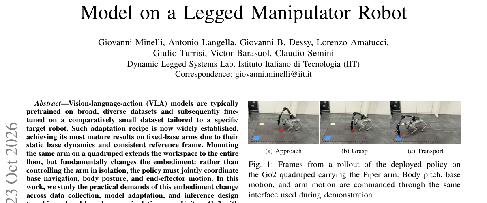

*Result - Collection and deployment share the robot-side percep- tion, locomotion, and arm-control modules. At deployment, VLA inference replaces the leader-side interface.*

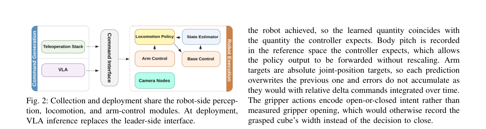

**Why this ranks #2**: 把 VLA 从固定基座机械臂搬到四足机器人上：数据覆盖扩 30% 降末端误差，动作时序与示范约定是成败关键。

---

### 3. UniAction: Unified Action Conditioning for World Models

**arXiv**: [2610.32977](https://arxiv.org/abs/2610.32977) | **Score**: 9.0 (relevance 9.0 x 0.7 + quality 9.0 x 0.3) | **Tags**: embodied-ai, world-model, action-conditioning, multi-embodiment, video-prior, positional-embedding | **Categories**: cs.CV | **Pages**: 22

**Authors**: Bowen Xue, Zizhang Li, Hong-Xing Yu, Jiajun Wu

**Affiliation**: Stanford University

**Abstract**

> Actions that condition world models are highly heterogeneous, and thus existing action-conditioned world models are typically built for individual action types, fragmenting already limited action-annotated data across separate models. We introduce UniAction, a unified action-conditioning framework that represents any action as a sparse set of action elements, each with a discrete semantic identity and a continuous spatiotemporal grounding coordinate. By mapping these coordinates directly into the pretrained video model's native positional space, UniAction allows heterogeneous actions to condition a shared world model within the same spatiotemporal structure. We further introduce cardinality-calibrated attention to address the bias from differing action representation granularities. We evaluate UniAction on four representative action forms: force, camera control, hand pose, and robot pose. UniAction outperforms conditioning alternatives in action following, and a single jointly trained model surpasses the action-specific experts, showing that heterogeneous action data benefit from unified model and joint training.

**Key findings**

- **Finding**: 指出条件动作世界模型面临的核心问题：动作**高度异质**，既有模型通常为单一动作类型而建，把本就有限的动作标注数据切碎到不同模型里。
- **Finding**: UniAction 把任意动作表示成**稀疏的动作元素集合**，每个元素带一个离散语义标识与一个连续的时空落点坐标。
- **Finding**: 把这些坐标**直接映射进预训练视频模型的原生位置空间**，使异质动作可以在同一套时空结构里条件化同一个世界模型。
- **Finding**: 另提出**基数校准注意力（cardinality-calibrated attention）**，处理不同动作表示粒度带来的偏差。
- **Finding**: 在力、相机控制、手部姿态、机器人姿态四种代表性动作上评测，动作跟随优于其他条件化方式。
- **Finding**: **单个联合训练的模型超过了各自的动作专用专家**，说明异质动作数据能从统一建模与联合训练中获益。
- **Inference**: 把坐标映射进预训练视频模型的原生位置空间，是「复用已有先验」的低成本做法——这比设计新的条件注入通道更容易规模化。
- **Inference**: 「统一模型超过专用专家」是本篇最强的一条结论，它反驳了「异质数据必然互相干扰」的默认假设。
- **Recommendation**: 强烈推荐。做世界模型、动作条件化、多形态机器人策略的人必读。

**Key figures**

*Framework - One world model for heterogeneous actions. Instead of training a separate model per action type (left), UniAction conditions a single world model (middle) on heterogeneous actions and outper*

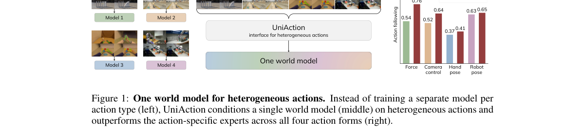

*Result - Overview of UniAction. Diverse action forms are represented as sparse action ele- ments: semantic identities index tokens in a shared codebook (Sec. 3.1), spatiotemporal positions use the ba*

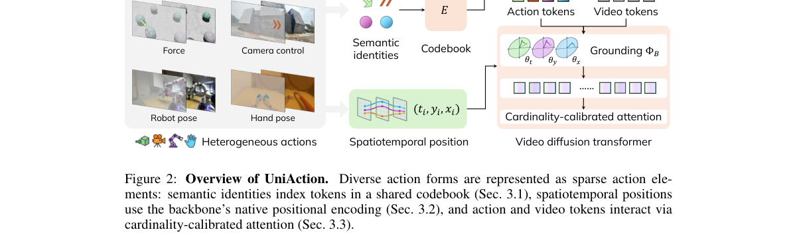

**Why this ranks #3**: 把任意动作统一成「离散语义 + 连续时空坐标」的稀疏元素集，一个世界模型同时吃力/相机/手/机器人四种动作。

---

### 4. UniWorld: A Unified World Model for Real-Time Visual World Simulation

**arXiv**: [2610.32381](https://arxiv.org/abs/2610.32381) | **Score**: 9.0 (relevance 9.0 x 0.7 + quality 9.0 x 0.3) | **Tags**: embodied-ai, world-model, video-generation, depth-conditioning, rolling-latent, real-time | **Categories**: cs.CV | **Pages**: 26

**Authors**: Xin Zhang, Yabo Chen, Shuaiwei Wang, Zixuan Duan, Haibin Huang, Feng Xu, Xuelong Li

**Affiliation**: Fudan University; China Telecom TeleAI; Jilin University; Nanjing University

**Abstract**

> Continuous visual world simulation requires coupling evolving scene geometry with temporally persistent appearance. We present UniWorld, a unified framework that integrates depth trajectories and reference appearance within a shared video generation model. The central design maintains visual and geometric histories on a common timeline. Noise-aligned overlapping continuation places generated history at the prescribed sampling noise level and commits only newly generated latents. Rolling depth latent state preserves the corresponding geometric controls, incrementally reads newly available geometry, and keeps the conditioning fixed within each sampling window. Together, these mechanisms ensure exact preservation of latent history while bounding the active depth state by the window size. We evaluate continuous generation, paired history interventions, and long-horizon behavior across diverse scene categories. The same generator supports estimated, native, and on-demand simulator depth, while cached and incremental execution paths produce bitwise-identical outputs. Appearance changes and geometric control branches operate through the same interface without modifying committed history. The measured steady-state DiT execution path achieves real-time generation throughput, demonstrating the efficiency of UniWorld for continuous visual world simulation.

**Key findings**

- **Finding**: 连续视觉世界模拟需要把**演化的场景几何**与**时间上持久的外观**耦合起来。
- **Finding**: UniWorld 在一个共享的视频生成模型里整合深度轨迹与参考外观。
- **Finding**: 核心设计是在**同一条时间轴**上维护视觉历史与几何历史。
- **Finding**: 噪声对齐的重叠续写（noise-aligned overlapping continuation）把生成的历史放到规定的采样噪声水平上，并只提交新生成的 latent。
- **Finding**: 滚动的深度 latent 状态保留对应的几何控制、增量读取新可用几何，并在每个采样窗口内保持条件固定。
- **Finding**: 两者共同保证：latent 历史被**精确保留**，同时活跃深度状态被窗口大小所界。
- **Finding**: 评测覆盖连续生成、配对历史干预与跨场景类别的长时程行为。
- **Finding**: 同一个生成器支持估计的、原生的与按需的仿真深度；缓存与增量两条执行路径产出**逐比特相同**的结果。
- **Finding**: 外观变化与几何控制分支走同一接口，且不修改已提交的历史。
- **Finding**: 实测稳态 DiT 执行路径达到**实时生成吞吐**。
- **Inference**: 「缓存与增量路径逐比特相同」这个工程保证很关键——它意味着实时系统不会因为执行路径不同而引入不可复现的偏差。
- **Inference**: 「只提交新生成的 latent」是长时程视频生成的通用记账法：它把历史漂移问题从模型能力降级为状态管理问题。
- **Recommendation**: 强烈推荐。做视频世界模型、实时生成、长时程生成的人必读。

**Key figures**

*Framework - UniWorld: from world geometry to continuous visual observations. Conceptual overview: depth trajectories describe geometric evolution, while reference RGB specifies appearance for a shared vi*

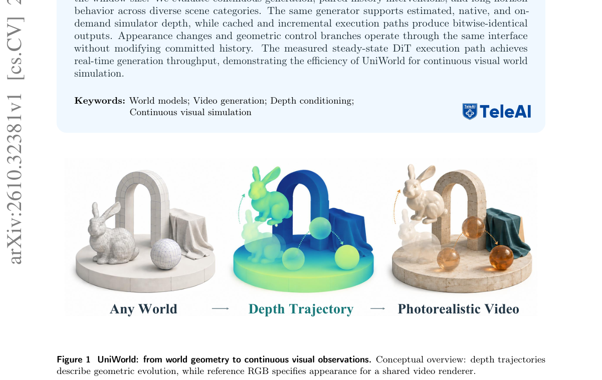

*Result - UniWorld: a unified renderer for heterogeneous world sources. Driving, human-activity, simulation, and synthetic sources are converted into a common rolling depth state. Each continuation win*

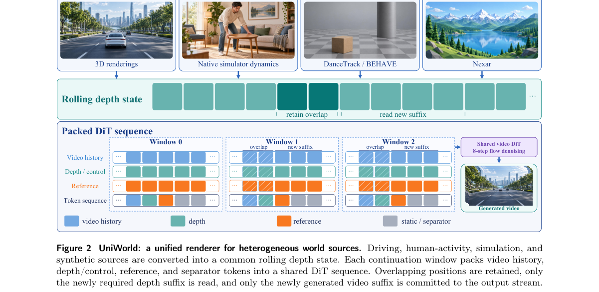

**Why this ranks #4**: 几何与外观放进同一个视频生成模型、共用一条时间轴，实时吞吐下还能做「配对历史干预」。

---

### 5. DT-JEPA: Learning to Predict Future Representations for Decision-Making

**arXiv**: [2610.32657](https://arxiv.org/abs/2610.32657) | **Score**: 8.7 (relevance 9.0 x 0.7 + quality 8.0 x 0.3) | **Tags**: embodied-ai, world-model, offline-RL, Decision-Transformer, JEPA, reward-free-pretraining, uncertainty | **Categories**: cs.LG | **Pages**: 35

**Authors**: Changxu Ni, Yiyang Ni, Jun Li, Feiran You, Hongyang Du, Haitao Zhao, Shi Jin

**Affiliation**: Southeast University; Jiangsu Second Normal University; The University of Hong Kong; National University of Defense Technology

**Abstract**

> Decision Transformer (DT) has demonstrated strong performance in various offline reinforcement learning (RL) tasks by conditioning action generation on expected future returns and historical trajectories. However, treating expected future returns as the condition provides an incomplete description of the future, as trajectories with different state transitions and behaviors may share similar returns. Moreover, expected future returns inherently depend on task-specific reward functions, which makes policy learning reliant on reward-labeled datasets and restricts its scalability to tasks with similar but unseen rewards. Recently, Joint Embedding Predictive Architectures (JEPA) have emerged as a promising paradigm of self-supervised learning-based world models, which learn predictive representations of future dynamics in latent space rather than reconstructing future states in the original space. Inspired by JEPA, we propose DT-JEPA, an offline pretraining and online fine-tuning framework that learns general knowledge from reward-free offline trajectories and achieves excellent adaptation to unseen tasks. Instead of predicting a single deterministic future embedding, we design a novel probabilistic predictor to model the conditional distribution of future representations in the latent space, thereby capturing both predictive information and uncertainty about future dynamics. Theoretically, we show that 1) the JEPA objective seeks to maximize a variational lower bound on the mutual information between historical representations and future trajectories; and 2) predictive future-conditioned policy learning admits a finite-sample performance bound with an O(N-1/4) estimation term. Experiments on D4RL benchmarks demonstrate that DT-JEPA achieves efficient adaptation across varying offline RL tasks, outperforming traditional DT-based and other offline RL methods.

**Key findings**

- **Finding**: 指出 Decision Transformer 把「期望未来回报」当作条件是不完整的：状态转移与行为不同的轨迹可能共享同一回报。
- **Finding**: 而且期望未来回报天然依赖任务特定奖励函数，使策略学习依赖带奖励标注的数据，限制其向「奖励相近但未见」的任务扩展。
- **Finding**: 受 JEPA 启发，DT-JEPA 采用**离线预训练 + 在线微调**框架，从无奖励的离线轨迹里学通用知识，并声称对未见任务有出色适配。
- **Finding**: 关键设计：不预测单一确定性未来嵌入，而是设计**概率化预测器**建模未来表征在隐空间的条件分布，同时刻画预测信息与未来动力学的不确定性。
- **Finding**: 理论上证明：(1) JEPA 目标在最大化历史表征与未来轨迹之间互信息的变分下界；(2) 预测式未来条件策略学习有有限样本性能界，含一个 O(N^-1/4) 估计项。
- **Finding**: 在 D4RL 基准上，DT-JEPA 在不同离线 RL 任务上都实现高效适配，优于传统 DT 类方法与其他离线 RL 方法。
- **Inference**: 「概率化预测器」把不确定性显式放进世界模型，这正是 Decision Transformer 原来缺的那块拼图——回报条件无法区分的轨迹，用表征分布可以。
- **Inference**: 从无奖励离线数据预训练、再用极少奖励适配，这条路径直接命中 offline RL 最贵的那一环（奖励标注）。
- **Recommendation**: 强烈推荐。做离线 RL、世界模型、JEPA 表征学习的人必读。

**Key figures**

*Result - Overview of the proposed DT-JEPA framework. DT-JEPA learns to make decisions using predicted future-dynamics information. During pretraining, a probabilistic JEPA predictor generates latent*

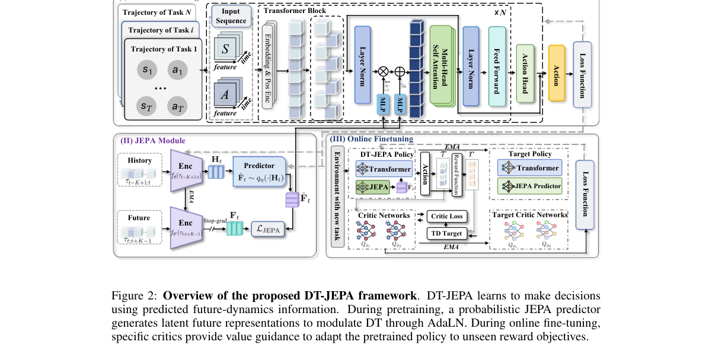

**Why this ranks #5**: 不用奖励、不重建像素，直接预测未来表征的**条件分布**——顺带给出一条有限样本界。

---

### 6. WorldMirror: Agentic Real-to-Sim Generation of Interactive Worlds from In-the-Wild Robot Demonstrations

**arXiv**: [2610.31834](https://arxiv.org/abs/2610.31834) | **Score**: 8.7 (relevance 9.0 x 0.7 + quality 8.0 x 0.3) | **Tags**: embodied-ai, real-to-sim, world-program, coding-agent, verification-feedback, DROID, digital-twin | **Categories**: cs.CV, cs.RO | **Pages**: 12

**Authors**: Tianling Xu, Weijie Wan, Honghao Su, Kailun Su, Junyuan Tang, Huichi Zhou, Haozheng Zhang, Qi Xiong, Ping Luo, Wenbo Ding, Tianxing Chen, Yue Chen

**Affiliation**: Tsinghua University; The University of Hong Kong; University College London

**Abstract**

> Existing approaches for robot learning in simulation often require substantial manual effort to construct scenes and specify tasks, limiting training scalability and data diversity. Meanwhile, in-the-wild robot demonstrations naturally provide diverse and realistic observations of real-world interactions. Leveraging these demonstrations for simulation requires both high-fidelity visual reconstruction and physically consistent interactions. General-purpose agents offer flexible adaptation to diverse scenarios and strong reasoning about 3D spatial relationships, while specialized generative models provide high-fidelity reconstruction of scene appearance and geometry. We introduce WorldMirror, an agentic real-to-sim framework that constructs interactive digital twins from in-the-wild robot demonstrations. Our central idea is to formulate real-to-sim construction as the iterative refinement of an executable world program. A coding agent decomposes the observed scene, plans reconstruction steps, and orchestrates specialized image and 3D generation tools, refining the program through verification feedback. A camera-pose-anchored scene representation organizes the world into static visual context, support geometry, and editable interactive assets while preserving spatial relationships among the scene, objects, and robot. The agent uses this representation to diagnose and correct reconstruction errors, enabling physically consistent interaction and trajectory replay. Experiments on DROID demonstrate that WorldMirror can reconstruct visually faithful and geometrically consistent interactive worlds while preserving the physical validity of recorded robot trajectories.

**Key findings**

- **Finding**: 指出机器人学习的仿真环境构造通常需要大量人工搭场景、定义任务，限制了训练的可扩展性与数据多样性。
- **Finding**: WorldMirror 把 real-to-sim 构造形式化为**对一个可执行世界程序的迭代精修**。
- **Finding**: 一个 coding agent 分解观察到的场景、规划重建步骤、编排专用的图像与 3D 生成工具，并通过**验证反馈**持续精修该程序。
- **Finding**: 以相机位姿为锚的场景表示把世界组织为静态视觉上下文、支撑几何与可编辑的可交互资产，同时保持场景、物体与机器人之间的空间关系。
- **Finding**: agent 用这一表示诊断并修正重建误差，从而实现物理一致的交互与轨迹回放。
- **Finding**: 在 DROID 上实验：WorldMirror 能重建视觉忠实、几何一致的交互世界，并保持已记录机器人轨迹的物理有效性。
- **Inference**: 「生成模型当工具、agent 当编排者、验证当信号」是本批最清晰的一种 real-to-sim 范式，它把生成质量的不确定性外包给了验证环节。
- **Inference**: 用相机位姿锚定表示是让「重建出来的 3D」还能被物理引擎用的关键——否则生成的 mesh 再好看也无法回放轨迹。
- **Recommendation**: 推荐。做 real-to-sim、仿真环境生成、机器人数据引擎的人必读。

**Key figures**

*Framework - WorldMirror constructs simulation-ready digital twins with high visual and interaction fidelity. GPT-6 Astra is competitive in spatial structure and layout, while WorldMirror achieves better*

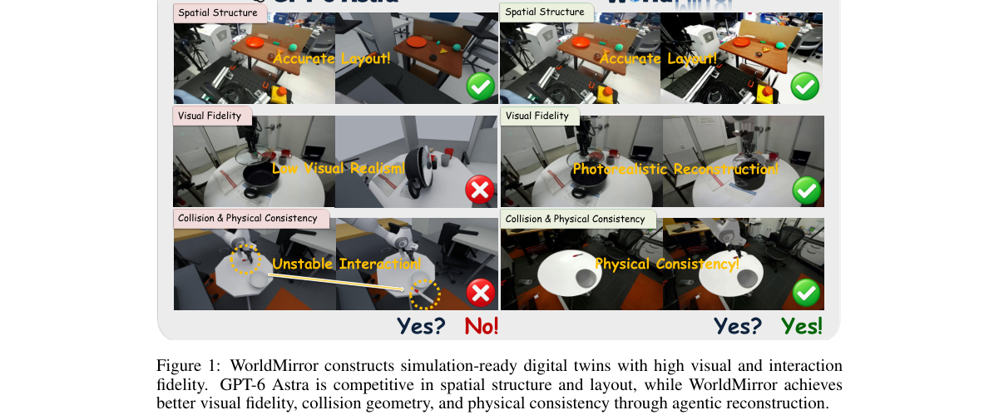

*Result - WorldMirror framework. A coding agent maintains an editable world, invokes scene and object generation tools, and aligns camera, assets, and robot through assembly code. Rendered observation*

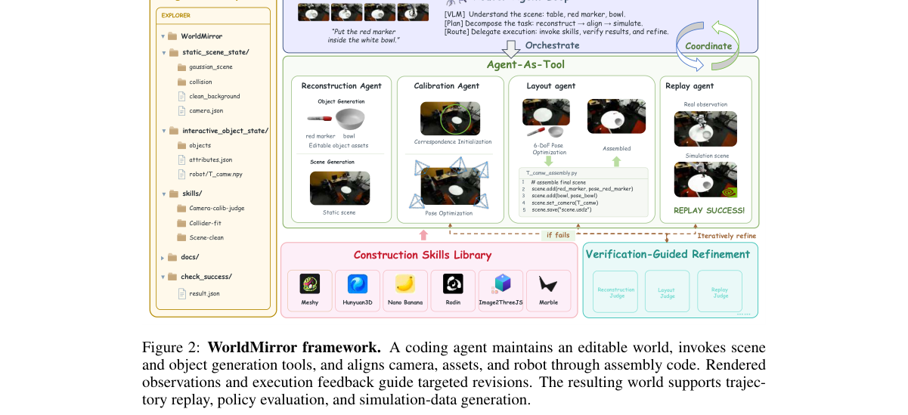

**Why this ranks #6**: 把 real-to-sim 重构成「迭代精修一个可执行世界程序」——生成模型只当工具，验证反馈才是驱动力。

---

### 7. SceneBloom: Agentic Indoor Environment Generation with Realistic and Diverse Layouts for Embodied Learning

**arXiv**: [2610.32978](https://arxiv.org/abs/2610.32978) | **Score**: 8.3 (relevance 8.0 x 0.7 + quality 9.0 x 0.3) | **Tags**: embodied-ai, scene-generation, diffusion-layout, geometric-compilation, collision-free, navigation-policy | **Categories**: cs.AI, cs.CV, cs.RO | **Pages**: 25

**Authors**: Yuhan Liu, Lianhui Qin, Shenji Wan

**Affiliation**: New York University; UC San Diego

**Abstract**

> Training generalizable embodied agents requires realistic, varied, and simulation-ready indoor environments. Language-guided methods support semantic planning and object-level reasoning, but precise spatial grounding remains difficult. Visual generative models offer rich priors over plausible arrangements, yet their outputs require geometric reasoning to become physically valid 3D scenes. We introduce SceneBloom, an agentic framework that combines visual layout sampling with contract-guided 3D compilation. A hierarchical sampler uses diffusion priors to generate furniture arrangements within functional zones. A compiler then uses relations extracted from each proposal to guide geometric fitting and local pose correction. Across five room types, SceneBloom attains the highest visual quality and physical stability among the compared methods and is the only method with no detected mesh collisions and out-of-bounds objects. Its layouts are also closer to the distribution of real rooms than those of all compared baselines. Object navigation policies trained in these realistic scenes achieve a higher success rate in held-out real scans than those trained on an equal number of real training scans. Code is available at https://github.com/Tinaliu0123/scenebloom.

**Key findings**

- **Finding**: 指出语言引导的方法能做语义规划与物体级推理，但**精确空间落地**仍然困难；视觉生成模型有丰富先验，但输出需要几何推理才能成为物理有效的 3D 场景。
- **Finding**: SceneBloom 把**视觉布局采样**与**契约引导的 3D 编译**结合起来。
- **Finding**: 层次化采样器用扩散先验在功能分区内生成家具排布；编译器则用每个提案中抽取的关系来指导几何拟合与局部位姿修正。
- **Finding**: 在五种房间类型上，SceneBloom 在被比较方法中取得最高视觉质量与物理稳定性，并且是**唯一**没有检测到 mesh 碰撞与越界物体的方法。
- **Finding**: 其布局分布也比所有被比较基线更接近真实房间的分布。
- **Finding**: 在这些真实感场景里训练的目标导航策略，在留出的真实扫描上的成功率高于用等量真实训练扫描训练的策略。代码公开。
- **Inference**: 「唯一零碰撞」是一个比任何美学指标都硬的指标——对具身训练来说，物理有效性的价值远高于像素保真度。
- **Inference**: 「用合成场景训练、真实扫描测试反而更好」这个结果说明合成环境的分布优势已经盖过了真实数据的稀缺劣势，这是 sim2real 的一种正面证据。
- **Recommendation**: 强烈推荐。做具身场景生成、仿真环境构建、导航的人必读。

**Key figures**

*Framework - Overview of SceneBloom. SceneBloom compiles visual proposals of functional zones into a simulation-ready 3D scene, and resampling the same prompt yields different layouts. Its scenes are mor*

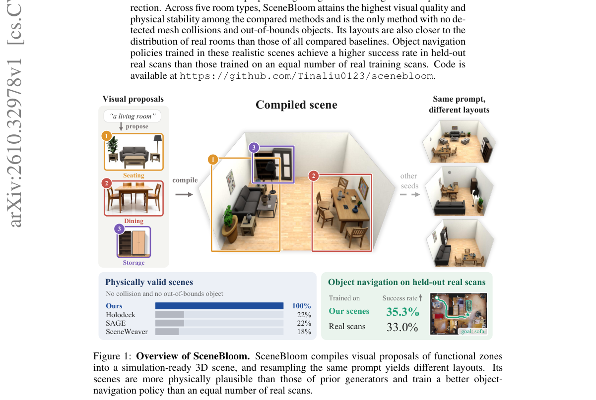

*Result - Framework overview. SceneBloom decouples visual layout sampling from 3D scene compilation. Given a room description and retrieved exemplars, a vision–language model (VLM) produces a zone pla*

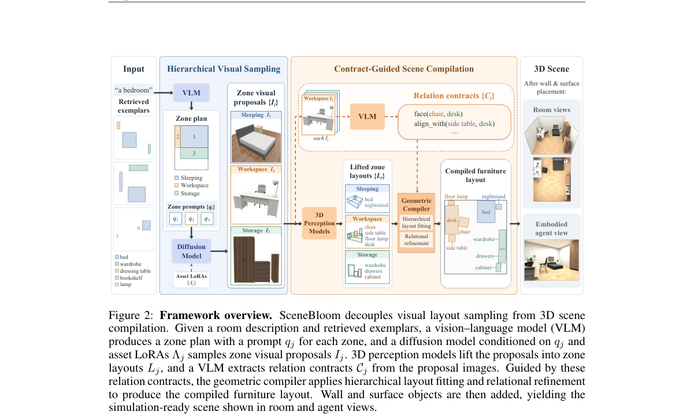

**Why this ranks #7**: 生成布局 + 几何编译两段式，五个房间类型里唯一做到「零 mesh 碰撞、零越界物体」。

---

### 8. HGWM: Hierarchical Graph-Guided World Model for Zero-Shot Object Navigation via Graph Matching

**arXiv**: [2610.32554](https://arxiv.org/abs/2610.32554) | **Score**: 8.0 (relevance 8.0 x 0.7 + quality 8.0 x 0.3) | **Tags**: embodied-ai, object-navigation, world-model, LLM-prior, graph-matching, HM3D, zero-shot | **Categories**: cs.RO | **Pages**: 18

**Authors**: I-tak Ieong, Hao Tang

**Affiliation**: Tsinghua University; Peking University

**Abstract**

> Zero-shot object navigation requires an embodied agent to choose where to search while retaining evidence from previous observations. HGWM couples an LLM-generated room-anchor prior with persistent spatial-semantic memory. A coarse stage assigns visual-semantic scores to candidate headings on a 0-10 scale; a fine stage measures symbolic compatibility between observed objects, room context, and the goal prior. Phase-dependent fusion combines these scores with an LLM direction recommendation before local action selection. On HM3D v0.1, the reported HGWM configuration achieves 62.6% success rate (SR) and 31.5% success weighted by path length (SPL), compared with 58.1% and 31.2% for WMNav. On MP3D, the corresponding values are 46.8% and 17.9%, compared with 45.4% and 17.2%. The results indicate higher success point estimates and modest path-efficiency gains. On HM3D v0.2, the full model obtains 74.4% SR and 31.9% SPL. Additional component ablations reduce SR by 0.9-2.3 percentage points and SPL by 0.6-1.5 points. These are author-reported aggregate measurements. The accompanying implementation repairs pass offline tests; episode-level rerun records are not available. Evaluation is confined to simulation.

**Key findings**

- **Finding**: 零样本物体导航要求具身智能体既决定「去哪找」，又能保留之前观察到的证据。
- **Finding**: HGWM 把 **LLM 生成的房间锚点先验**与**持久的空间语义记忆**耦合起来。
- **Finding**: 粗阶段给候选朝向打 0–10 的视觉语义分；细阶段度量「观察到的物体、房间上下文、目标先验」之间的符号兼容性。
- **Finding**: 阶段相关的融合把这些分数与 LLM 的方向建议结合起来，再做局部动作选择。
- **Finding**: HM3D v0.1 上，作者报告的 HGWM 配置取得 62.6% SR 与 31.5% SPL，对比 WMNav 的 58.1% 与 31.2%；MP3D 上为 46.8% 与 17.9%，对比 45.4% 与 17.2%。
- **Finding**: HM3D v0.2 上完整模型取得 74.4% SR 与 31.9% SPL。
- **Finding**: 作者明确说明：这些是**作者自报**的汇总测量值；配套实现通过了离线测试，但**没有逐 episode 的重跑记录**，且评估仅限仿真。
- **Inference**: 作者主动声明「无逐 episode 重跑记录、仅仿真」，这种自曝短板的做法在导航类论文里并不常见，反而让读者能正确看待 62.6% 这个数字的置信度。
- **Inference**: 把 LLM 先验当作「房间锚点」而不是直接给动作，是让 LLM 参与导航又不让它乱动的常见折中，值得抄。
- **Recommendation**: 推荐。做零样本导航、目标导航、LLM+具身的人值得读。

**Key figures**

*Framework - HGWM architecture. The LLM generates a hypothetical room–anchor prior, observations populate spatial-semantic memory, and graph-guided reasoning informs navigation. Hallucinated Prior and St*

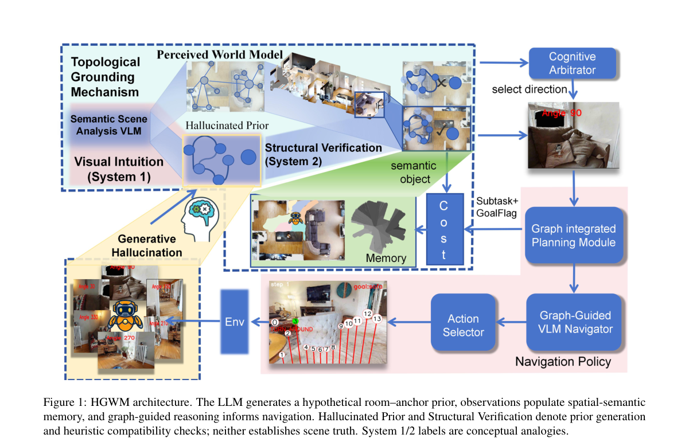

*Result - Coarse-to-fine illustration with example trajectory views. Coarse VLM scores use 0–10: 0 for a dead end without a visible target, 1–9 for intermediate opportunities, and 10 for a model-repor*

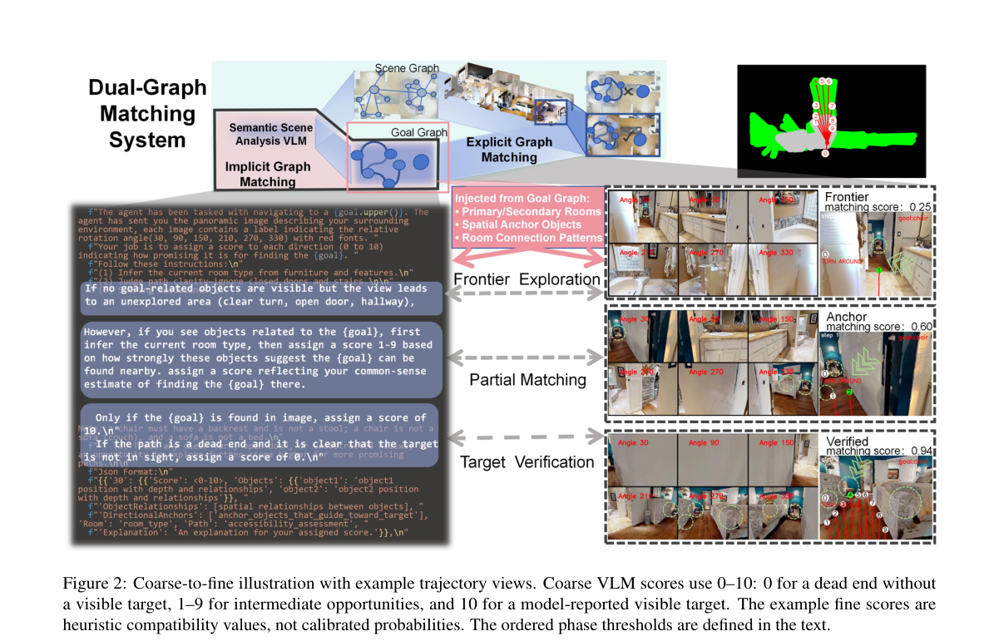

**Why this ranks #8**: 零样本物体导航：LLM 生成房间锚点先验 + 持久空间语义记忆，粗细两阶段打分融合。

---

### 9. Multimodal MPC via Bayesian Set Optimization for Dynamic Manipulation of Deformable Linear Objects

**arXiv**: [2610.31852](https://arxiv.org/abs/2610.31852) | **Score**: 8.0 (relevance 8.0 x 0.7 + quality 8.0 x 0.3) | **Tags**: embodied-ai, deformable-manipulation, MPC, control-as-inference, rope, multimodal-planning, IIT | **Categories**: cs.RO | **Pages**: 16

**Authors**: Youyuan Long, Gokhan Solak, Arash Ajoudani

**Affiliation**: Istituto Italiano di Tecnologia

**Abstract**

> Dynamic manipulation of deformable linear objects (DLOs) remains challenging due to underactuated, high-dimensional dynamics, delayed deformation responses, and the presence of multiple feasible motions under obstacle constraints. This paper presents BM2PC, a Bayesian Multimodal MPC framework for agile manipulation of DLOs. Building on the control-as-inference posterior, BM2PC formulates multimodal planning as a set optimization problem that balances control quality and behavioral diversity. An efficient incremental update maintains multiple promising control modes with low additional computational overhead. For real-world deployment, BM2PC incorporates an execution dynamics model that predicts actual end-effector motion and compensates for execution mismatch during fast manipulation. We evaluate BM2PC on rope tracking and obstacle avoidance in simulation and hardware, and on simulated disturbance rejection. In trajectory tracking, BM2PC generalizes better to unseen trajectories than a learning-based baseline without task-specific policy training or fine-tuning. Real-world experiments demonstrate accurate long-horizon tracking, reducing RMSE by 44.0% on the longest task. In obstacle avoidance, BM2PC achieves comparable performance to existing multimodal MPC methods while reducing planning time by 29% to 66%. These results demonstrate accurate dynamic control and efficient multimodal planning within a unified MPC framework. The core implementation of BM2PC and supplementary videos are available at https://github.com/Longyouyuan/BM2PC.

**Key findings**

- **Finding**: 动态操作可变形线性物体（DLO，如绳、缆、软管）受制于欠驱动高维动力学、滞后的形变响应，以及障碍约束下存在多条可行运动。
- **Finding**: BM2PC 基于「控制即推断」（control-as-inference）后验，把多模态规划形式化为**集合优化问题**，在控制质量与行为多样性之间取平衡。
- **Finding**: 高效的增量更新以很低的额外计算开销维持多个有前景的控制模式。
- **Finding**: 为真实部署，BM2PC 引入**执行动力学模型**预测实际末端运动，并在快速操作中补偿执行偏差。
- **Finding**: 仿真与硬件上评测了绳索跟踪、避障，以及仿真扰动抑制。
- **Finding**: 轨迹跟踪上，BM2PC 在**未见轨迹**上的泛化优于基于学习的基线，且不需要任务特定的策略训练或微调。
- **Finding**: 真实实验展示精确的长时程跟踪，在最长任务上 RMSE **降低 44.0%**。
- **Finding**: 避障上与既有多模态 MPC 方法性能相当，同时**规划时间减少 29%–66%**。
- **Inference**: 「不训练策略也能泛化到未见轨迹」是 MPC 相对学习式方法的核心优势，这篇给出了硬件级的量化证据。
- **Inference**: 「集合优化」这个形式化把「保持多个可行解」这件事变成了可增量求解的问题，比传统多模态 MPC 的采样加筛选更高效。
- **Recommendation**: 推荐。做软体/绳缆操作、MPC、工业机器人的人必读。

**Key figures**

*Framework - Overview of the proposed BM2PC framework. Candidate control sequences are sampled around the multi- modal warm-start set and evaluated through parallel rollouts using the execution dynamics mo*

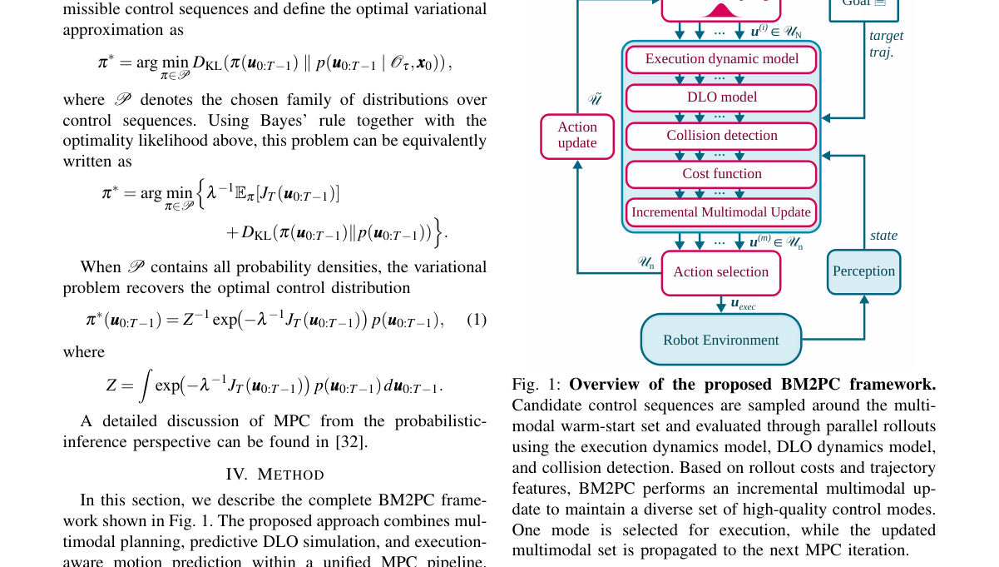

*Result - The DLO model. The rope is represented by N+1 mass points mj connected by linear spring–damper elements (ks*

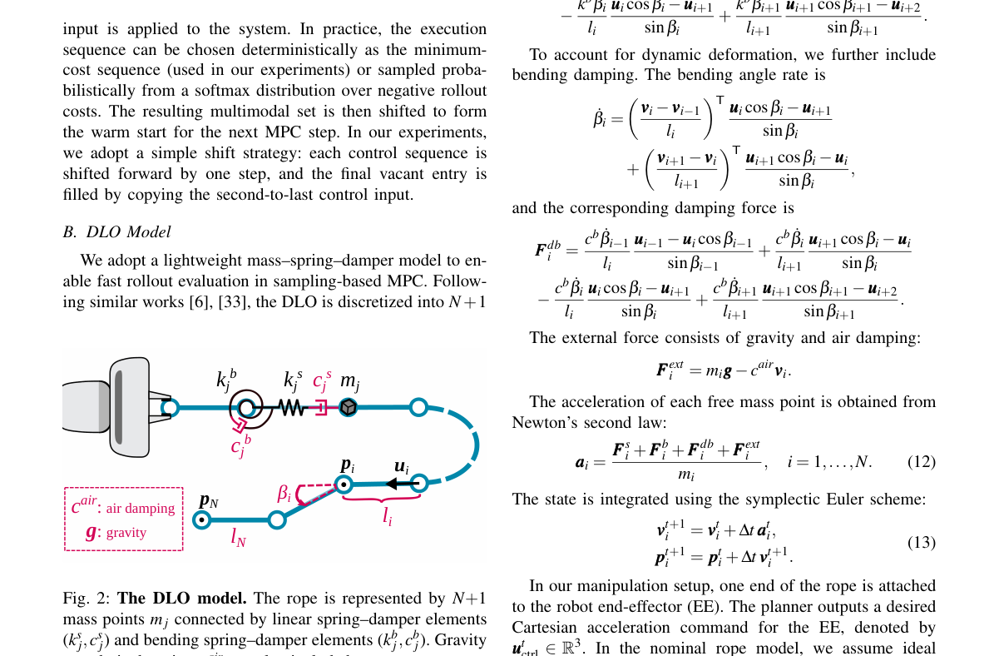

**Why this ranks #9**: 可变形线缆操作：把多模态 MPC 写成集合优化，规划时间省 29–66%，最长任务 RMSE 降 44%。

---

### 10. EgoForesight: Effectively Scaling Policy Learning with Noisy Egocentric Actions

**arXiv**: [2610.31845](https://arxiv.org/abs/2610.31845) | **Score**: 8.0 (relevance 8.0 x 0.7 + quality 8.0 x 0.3) | **Tags**: embodied-ai, VLA, egocentric-video, noisy-action-labels, privileged-future-distillation, RoboCasa, scaling | **Categories**: cs.CV, cs.RO | **Pages**: 33

**Authors**: Chubin Zhang, Changyuan Wang, Yirui Wang, Ao Li, Shilin Ma, Yue Su, Cai Zhou, Xiuwei Xu, Tianle Zhang, Yansong Tang

**Affiliation**: Tsinghua University; MIT

**Abstract**

> Scaling policy learning requires broad experience and reliable supervision. Robot demonstrations provide high-quality trajectory supervision but are costly to collect. Egocentric videos broaden task and environment coverage, yet motion reconstruction and retargeting introduce noisy action labels. To address this challenge, we introduce EgoForesight, a vision-language-action framework that learns jointly from both sources by reducing the influence of unreliable action labels and exploiting demonstrated outcomes as complementary supervision. A joint vision-action flow couples future visual representation prediction with action generation, unifying reliability-aware action learning with outcome-informed representation transfer. Specifically, reliability-conditioned corruption allocates action supervision across noise levels according to source reliability, while reliability-weighted regression regulates each source's contribution. Complementing this treatment of noisy labels, privileged-future representation distillation draws supervision from demonstrated outcomes. An exponential-moving-average teacher observes the current scene and clean future to encode action-relevant structure from the resulting scene change. Its deeper representations supervise an earlier student layer receiving a corrupted future, providing outcome-informed structure beyond noisy action annotations. Together, these mechanisms support effective scaling with noisy egocentric actions. Over the tested range, EgoForesight exhibits steeper scaling slopes than the baseline, reducing real-world open-loop action MSE by 20.5% and improving RoboCasa few-shot success by 8.1 percentage points at 30,000 hours of pretraining data. After post-training, it also achieves strong absolute performance in both simulated and real-world dexterous manipulation.

**Key findings**

- **Finding**: 扩大策略学习需要广泛经验与可靠监督；机器人示范质量高但采集昂贵，第一视角视频覆盖广却因动作重建与重定向产生**噪声动作标签**。
- **Finding**: EgoForesight 是一个同时从两类来源学习的视觉-语言-动作框架：降低不可靠动作标签的影响，并把示范的**结果**当作互补监督。
- **Finding**: 一个联合的视觉-动作流把「未来视觉表征预测」与「动作生成」耦合起来，统一了可靠性感知的动作学习与结果驱动的表征迁移。
- **Finding**: 两个机制：**可靠性条件化的腐蚀**按来源可靠性把动作监督分配到不同噪声等级；**可靠性加权回归**调节各来源的贡献比例。
- **Finding**: 第三个机制是**特权未来表征蒸馏**：一个 EMA 教师观察当前场景与干净未来，编码动作相关的结构；其深层表征监督一个接收腐蚀未来的浅层学生。
- **Finding**: 在测试范围内，EgoForesight 相对基线呈现**更陡的 scaling 斜率**：3 万小时预训练数据下真机开环动作 MSE 降低 20.5%，RoboCasa 少样本成功率提升 8.1 个百分点。
- **Finding**: 后训练后，在仿真与真机灵巧操作上都取得强绝对性能。
- **Inference**: 「用结果（示范发生了什么）监督表征、用标签（动作是什么）监督动作」这条分工很干净——它绕开了脏标签而不是试图清洗它。
- **Inference**: 更陡的 scaling 斜率比单点数字更重要：它说明这个方法会随数据量增长而放大优势，3 万小时还远没到饱和。
- **Recommendation**: 强烈推荐。做 VLA、数据规模化、第一视角学习的人必读。

**Key figures**

*Framework - Learning with noisy action labels. (a) Unlike methods that treat action labels equally, EgoForesight accounts for label reliability and enriches action representations through privileged-futu*

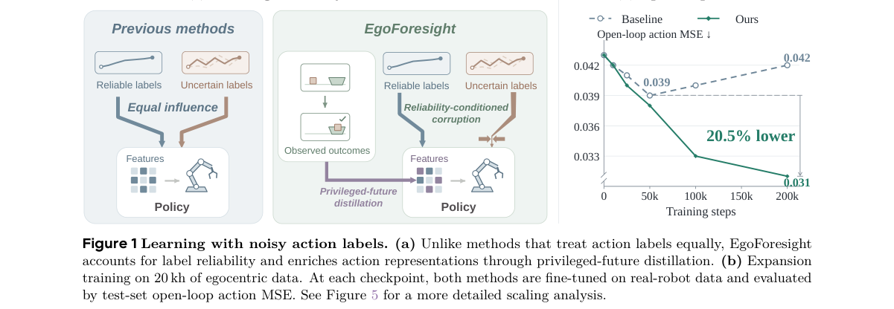

*Result - Overview of EgoForesight. Large-scale human videos expand training data but have less reliable action labels. Reliability-conditioned corruption samples stronger action corruption as reliabil*

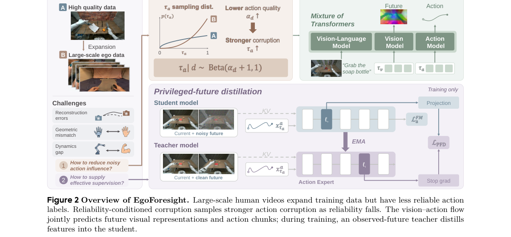

**Why this ranks #10**: 第一视角视频的动作标签很脏：按可靠性分配监督 + 用「特权未来」蒸馏，3 万小时预训练下真机误差降 20.5%。

---

## Footer

- Total papers scanned across all 7 tracks: 474（原始 663 条）
- embodied track final top-10: 10
- Wild-cards in this track: 0
- Figure assets: 2026-10-26/res/

Generated by `mine-arxiv-daily-digest` skill. Sister file: `2026-10-26_embodied_entry.md`.
