# ArXiv Daily Digest - 2026-10-26 (生成式内容模型的 RL, 10 papers)

**Generated**: 2026-10-26 17:00 CST

**Source**: arXiv cs.CV, cs.SD, eess.AS, cs.CL, cs.AI, cs.RO, cs.LG submissions, listing day 2026-10-23 (announced 2026-10-26 00:00 UTC)

**Batch window**: 2026-10-22T18:00:00Z .. 2026-10-23T18:00:00Z（arXiv 公告批次横跨两个 UTC 日：前一日 18:00 UTC 起算，当日 17:59:59 UTC 截止）

**Track**: rl_aigc (top 10 of 474 papers scanned, 70 full reads)

**Scope**: 扩散 / 流匹配模型的 RL 与偏好优化、生成式奖励模型、best-of-N 与测试时搜索

⚠️ **Wild-card**: 本批该线 5 篇为 wild-card 补足，已在正文逐条标注并给出理由。

---

## Top 10 - 生成式内容模型的 RL

### 1. ACWM-RM: A Reference-Free Reward Model from Complementary Mismatch Preferences

**arXiv**: [2610.32222](https://arxiv.org/abs/2610.32222) | **Score**: 10.0 (relevance 10.0 x 0.7 + quality 10.0 x 0.3) | **Tags**: rl-aigc, reward-model, action-conditioned-world-model, visual-quality, action-following, preference-data, RL | **Categories**: cs.CV | **Pages**: 35

**Authors**: Shibo Hong, Siyu Ren, FengJiao Chen, Zhongyuan Peng, Wei Shi, Yixin Cao

**Affiliation**: Fudan University; Meituan

**Abstract**

> Reinforcement learning has gained attention for improving action-conditioned world models (ACWMs), as it enables reward-driven optimization of visual quality (VQ) and action-following fidelity (AF) beyond flow-matching optimization. Realizing this potential requires reward signals that reliably rank videos by both VQ and AF. However, existing rewards capture only one dimension: metric-based rewards assess VQ but require ground-truth videos and do not directly assess AF, while inverse dynamics model (IDM) rewards assess AF without references but do not guarantee VQ. Moreover, IDMs, typically trained on real videos, may provide unreliable rewards for generated videos containing visual artifacts and physical inconsistencies. In this work, we introduce the Action and Video Mismatch Benchmark (AVM-Eval), comprising 67.2k pairs that evaluate how reliably IDMs assess AF on real and generated videos. We then propose ACWM-RM, a reward model that jointly assesses VQ and AF without ground-truth videos during reward computation. To train it, we first construct the Action and Video Mismatch Preference Dataset (AVM-Pref) with 506.3k pairs providing complementary supervision: action-mismatch pairs supervise AF, while video-mismatch pairs supervise VQ and expose the model to generated videos. We then pretrain an action-conditioned predictor on real videos to learn forward dynamics before jointly training it with a patch-weighted score head on AVM-Pref to transfer these dynamics to AF assessment on generated videos. Evaluation on AVM-Eval reveals the limited reliability of IDMs on generated videos, while downstream RL experiments show that ACWM-RM outperforms reward baselines in both criteria.

**Key findings**

- **Finding**: 指出 RL 已被用于改进动作条件世界模型（ACWM），可在流匹配优化之外按奖励驱动地优化**视觉质量（VQ）**与**动作跟随保真度（AF）**。
- **Finding**: 但现有奖励只能覆盖一个维度：基于指标的奖励能评 VQ，却需要真值视频且不直接评 AF；而**逆向动力学模型（IDM）奖励**能评 AF 却不能保证 VQ。
- **Finding**: 更麻烦的是：IDM 通常在真实视频上训练，对含视觉伪影与物理不一致的**生成视频**可能给出不可靠奖励。
- **Finding**: 作者先构建 **AVM-Eval**：67.2k 对样本，评测 IDM 在真实与生成视频上评估 AF 的可靠性。
- **Finding**: 再构建 **AVM-Pref**：506.3k 对偏好数据，提供互补监督——动作不匹配对监督 AF，视频不匹配对监督 VQ 并让模型见到生成视频。
- **Finding**: ACWM-RM 的训练流程：先在真实视频上预训练一个**动作条件预测器**学习前向动力学，再与 patch 加权的打分头在 AVM-Pref 上联合训练，把前向动力学迁移到对生成视频的 AF 评估上。
- **Finding**: 关键性质：奖励计算**全程不需要真值视频**，即可联合评估 VQ 与 AF。
- **Finding**: 在 AVM-Eval 上的评测揭示了 IDM 在生成视频上的可靠性有限；下游 RL 实验显示 ACWM-RM 在两项标准上均优于奖励基线。
- **Inference**: 「IDM 在生成视频上不可靠」这一诊断很关键——它意味着很多视频 RL 流水线里的奖励其实是噪声，但此前没人系统量化过。
- **Inference**: 「动作不匹配 vs 视频不匹配」两种互补偏好是这个设计最巧的地方：一个数据集同时提供了 AF 与 VQ 的监督，避免了分别造两个奖励模型。
- **Recommendation**: 强烈推荐。做视频生成 RL、奖励模型、世界模型后训练的人必读。

**Key figures**

*Result - Overview of (a,b) action-mismatch and video-mismatch pair construction for AVM-Eval and AVM-Pref, and (c) ACWM-RM reward computation without reference videos.*

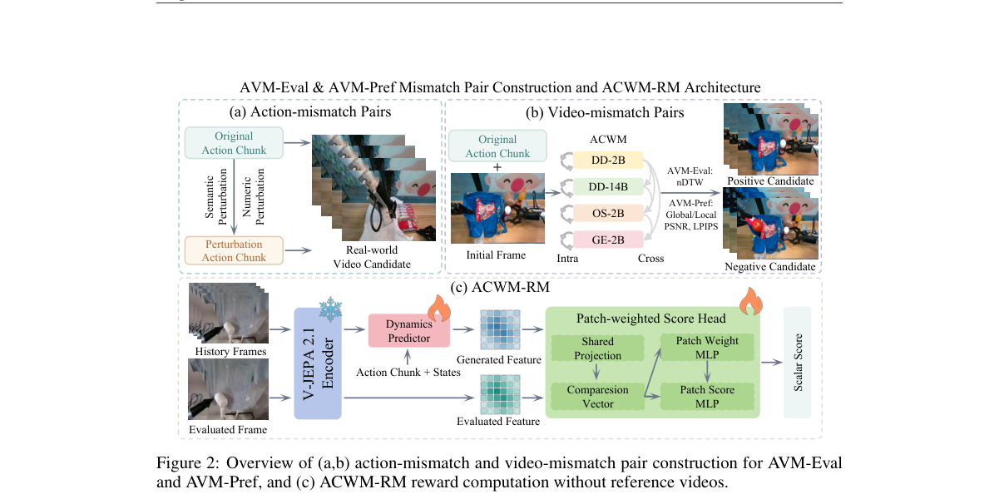

**Why this ranks #1**: 视频世界模型的奖励要同时判「视觉质量」和「动作跟随」，而 IDM 在生成视频上根本不可靠——这篇给出第一个两维参考无关奖励模型。

---

### 2. ImageRSI: Verification-Driven Recursive Self-Improvement for Agentic Image Generation

**arXiv**: [2610.32120](https://arxiv.org/abs/2610.32120) | **Score**: 9.7 (relevance 10.0 x 0.7 + quality 9.0 x 0.3) | **Tags**: rl-aigc, GRPO, image-generation, verifier-judge, experience-library, self-improvement, MindBench | **Categories**: cs.AI, cs.CV | **Pages**: 15

**Authors**: Shuo Han, Zhilin Wang, Peng Ling, Wenjia Gong, Yang Liu, Guanjun Jiang, Yukun Cao, Xike Xie

**Affiliation**: Alibaba Qwen Business Unit; Xidian University

**Abstract**

> Complex text-to-image requests remain difficult to satisfy reliably. Verifying and repairing an image can fix an individual output, but a successful repair does not necessarily carry over to other requests. We present ImageRSI, a framework that keeps the image generator frozen and combines three components: five-dimensional verification and repair within each task, an experience library shared across tasks, and offline updating of the judge. Candidate experiences enter the library only after paired A/B validation, and the judge is updated with supervised fine-tuning and GRPO on accumulated image-judgment records and evaluated before reuse. We also introduce ImageReq-Bench, a benchmark of 961 requests built around hard cases in real-world image-generation requests, each paired with an evaluation checklist. ImageRSI achieves a Checklist Strict Accuracy (CSA) of 52.6% on MindBench (with Nano Banana Pro as the generator) and 65.66% on ImageReq-Bench, and we compare system outcomes across judge-training configurations.

**Key findings**

- **Finding**: 指出复杂文生图请求很难稳定满足：验证并修复一张图能修好单次输出，但**成功的修复未必能迁移到其他请求**。
- **Finding**: ImageRSI 保持图像生成器**冻结**，由三个部件组成：单任务内的五维验证与修复、跨任务共享的经验库、以及裁判的离线更新。
- **Finding**: 候选经验必须先通过**成对 A/B 验证**才能进入经验库；裁判则用累积的「图像-评判」记录做 SFT 与 **GRPO** 训练，并在复用前先被评估。
- **Finding**: 同时发布 **ImageReq-Bench**：961 条围绕真实图像生成请求中困难案例构建的请求，每条配一份评估清单。
- **Finding**: ImageRSI 在 MindBench 上取得 **52.6%** 的 Checklist Strict Accuracy（以 Nano Banana Pro 作为生成器），在 ImageReq-Bench 上取得 **65.66%**。
- **Finding**: 作者比较了不同裁判训练配置下的系统结果。
- **Inference**: 「冻结生成器、改进裁判与经验」是本篇最重要的设计选择：它把难题从「怎么让生成器更好」换成「怎么让评判更准」，后者迭代快得多、也更可迁移。
- **Inference**: 「成对 A/B 验证后才进经验库」是防止经验库被噪声污染的关键闸门——这决定了递归自我改进会不会收敛。
- **Recommendation**: 强烈推荐。做图像生成质量控制、LLM-as-judge、Agent 式图像生成的人必读。

**Key figures**

*Framework - Schematic illustration of task-level repair and cross-task reuse of a relation-grounding strategy.*

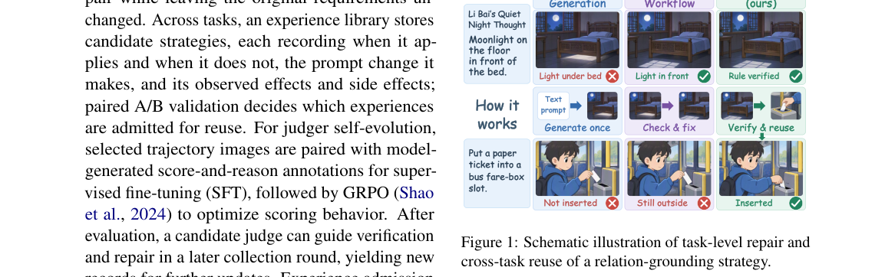

*Result - Overview of ImageRSI. (a) Online generation and verification: the frozen generator G produces an image, and the judge J(k) verifies it and guides targeted repair. (b) Cross-task experience:*

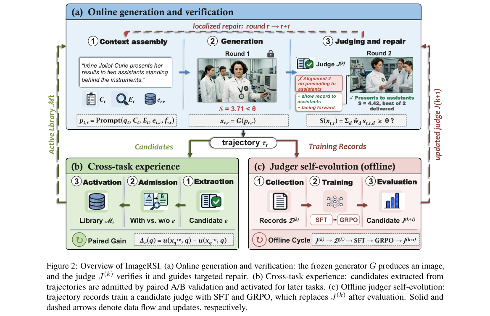

**Why this ranks #2**: 生成器冻结不动，把改进放在「验证 + 修复 + 经验库 + 用 GRPO 训裁判」上——跨请求迁移才是关键。

---

### 3. ViT-H: Generative Video-To-Humanoid Control with Motion Tracking Feedback

**arXiv**: [2610.32966](https://arxiv.org/abs/2610.32966) | **Score**: 9.0 (relevance 9.0 x 0.7 + quality 9.0 x 0.3) | **Tags**: rl-aigc, DPO, diffusion, humanoid-control, motion-tracking-feedback, Unitree-G1, teleoperation | **Categories**: cs.CV, cs.RO | **Pages**: 26

**Authors**: Zimo He, Tianyi Bian, Zizhong Yang, Hongjie Li, Nan Jiang, Jieming Cui, Baoxiong Jia, Yizhou Wang, Siyuan Huang, Yixin Zhu

**Affiliation**: Peking University; Beijing Institute for General Artificial Intelligence

**Abstract**

> Learning humanoid control from monocular human videos offers a scalable way to acquire diverse whole-body behaviors. Yet, existing reconstruction-retargeting-tracking pipelines are limited in system-level scalability by separately optimized intermediate stages and cannot directly optimize reference motion executability using downstream tracking feedback. We present ViT-H, a video-to-humanoid control framework following a generation-and-tracking paradigm. ViT-H directly generates humanoid reference motions from videos with a diffusion model, bypassing human motion reconstruction and retargeting, and uses motion-tracking outcomes to post-train the generator with direct preference optimization. We further introduce an autoregressive variant that enables real-time humanoid video teleoperation with sub-400 ms latency. Extensive experiments on the Unitree G1 demonstrate that ViT-H outperforms state-of-the-art reconstruction-retargeting-tracking pipelines in both motion quality and executability. We further show that ViT-H scales favorably with model size and with both pre-training and post-training data scale, while motion-tracking feedback consistently improves executability across different motion trackers.

**Key findings**

- **Finding**: 指出从单目人类视频学习人形控制是获取多样全身行为的可扩展路径，但「重建-重定向-跟踪」流水线的系统级扩展性有限，因为各中间阶段被分别优化，且**无法直接用下游跟踪反馈优化参考动作的可执行性**。
- **Finding**: ViT-H 走「生成 + 跟踪」范式：用扩散模型**直接从视频生成人形参考动作**，绕过人体动作重建与重定向。
- **Finding**: 关键一步：用**运动跟踪的结果**去**后训练生成器**，方法是直接偏好优化（DPO）。
- **Finding**: 另引入自回归变体，实现亚 400 ms 延迟的实时人形视频遥操作。
- **Finding**: 在 Unitree G1 上的大量实验显示，ViT-H 在**动作质量与可执行性**两方面都优于 SOTA 的重建-重定向-跟踪流水线。
- **Finding**: ViT-H 随模型规模、预训练数据规模与后训练数据规模都呈现良好扩展性；运动跟踪反馈在不同跟踪器上都能持续改善可执行性。
- **Inference**: 「把下游跟踪器的反馈变成生成器的偏好信号」是本篇最漂亮的一步：可执行性本来是个系统级指标，这里被转化成了生成模型可优化的目标。
- **Inference**: 「跟踪器不同、反馈照样有效」说明 DPO 学到的是「物理可执行性」这一稳定性质，而不是某个跟踪器的偏好——这对跨系统迁移是强证据。
- **Recommendation**: 强烈推荐。做生成式动作、人形控制、扩散模型偏好优化的人必读。

**Key figures**

*Framework - ViT-H transfers human motions from monocular videos to a physical Unitree G1. The top rows show offline video-to-humanoid control. Each film strip shows frames of an input video, and the fra*

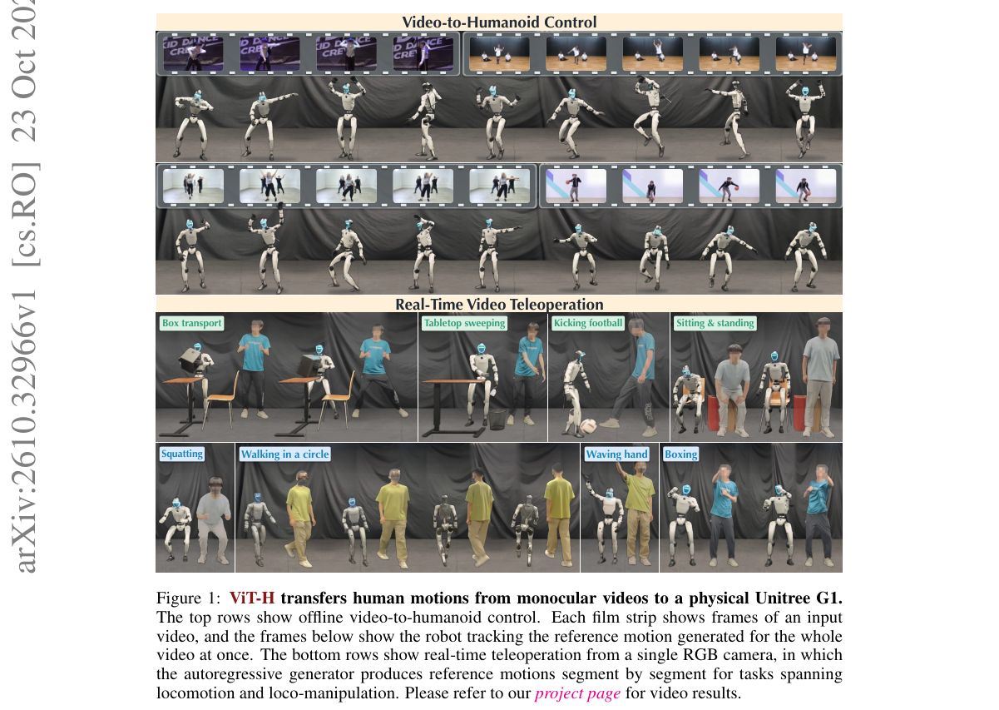

*Result - Overview of ViT-H. The diffusion-based generator (left) maps the camera orientations, bounding boxes, keypoints, and image features of a video directly to G1 reference motions, and its autor*

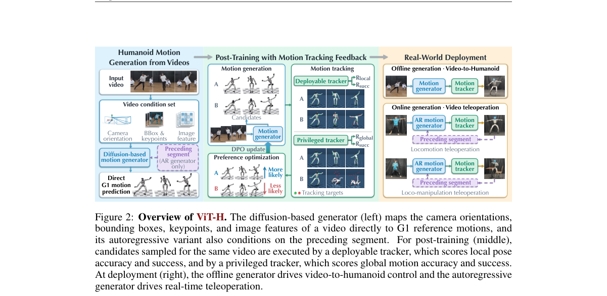

**Why this ranks #3**: 用运动跟踪器的反馈直接做 DPO 微调扩散动作生成器——把「可执行性」这个下游指标变成生成器的偏好信号。

---

### 4. EditJev: System One Routing for Image Editing Models

**arXiv**: [2610.32635](https://arxiv.org/abs/2610.32635) | **Score**: 8.7 (relevance 9.0 x 0.7 + quality 8.0 x 0.3) | **Tags**: rl-aigc, preference-model, model-routing, pairwise-ranking, edit-quality, latency, ImgEdit | **Categories**: cs.AI, cs.CV | **Pages**: 12

**Authors**: Zhile Guan, Xu Jiang, Yule Duan, Gongbo Zhang, Shuyu Wang, Xiao Chen, Jian Zhang

**Affiliation**: Peking University; Tsinghua University

**Abstract**

> Instruction-based image editing models exhibit pronounced sample-specific performance variation: different models can produce substantially different results for the same source image and editing instruction, and the best-performing model often varies across requests. These models also differ substantially in inference latency, making fixed-model deployment inefficient. We therefore study image editing model routing, which dynamically selects an editor from a candidate pool given an input image and editing instruction. We introduce EditJev, a System One routing model that directly predicts sample-level preference scores over candidate image editing models in a single forward pass. A lightweight preference head on a vision-language backbone produces a fixed-dimensional score vector without autoregressive model-name generation or response parsing. To train EditJev, we construct pairwise preferences from offline candidate outputs and optimize a pairwise ranking objective to learn relative model suitability. At inference time, EditJev combines the predicted preference scores with model-level speed scores to balance editing quality and generation latency. Experiments on ImgEdit and GEdit-En show that EditJev improves aggregate quality over the strongest fixed editor, from 4.540 to 4.592 and from 8.194 to 8.255, respectively, while reducing estimated end-to-end latency by 60.8% and 31.7%. These results demonstrate the effectiveness of direct, structured model routing for efficient image editing.

**Key findings**

- **Finding**: 指出指令式图像编辑模型存在明显的**样本级性能差异**：同一张源图、同一指令，不同模型结果差异很大，且最优模型常随请求变化。
- **Finding**: 各模型的推理延迟也差异显著，固定用一个模型部署效率低。
- **Finding**: EditJev 把它建模为**图像编辑模型路由**：给定输入图像与编辑指令，从候选池中动态选择一个编辑器。
- **Finding**: 它是一个 System One 路由模型，在**单次前向**里直接预测候选编辑器的样本级偏好分数。
- **Finding**: 实现上用视觉语言骨干上的轻量偏好头，输出固定维度的分数向量，**不做自回归的模型名生成，也不做回复解析**。
- **Finding**: 训练数据由离线候选输出构造**成对偏好**，优化成对排序目标以学习各模型的相对适用性。
- **Finding**: 推理时把偏好分数与模型级速度分数结合，在编辑质量与生成延迟之间取平衡。
- **Finding**: 在 ImgEdit 与 GEdit-En 上，EditJev 相对最强固定编辑器把聚合质量从 4.540 提到 **4.592**、从 8.194 提到 **8.255**，同时把估计端到端延迟降低 **60.8%** 与 **31.7%**。
- **Inference**: 「System One / 单次前向直出分数」这个设计避免了自回归选名带来的延迟与解析脆弱性，是把 LLM 判别能力工程化落地的典型做法。
- **Inference**: 本篇实质上是在多生成器之间学了一个**偏好模型**——它是 rl_aigc 关心的「生成式奖励/偏好模型」在工程侧的一个轻量版本。
- **Recommendation**: 推荐。做模型路由、多模型部署、编辑质量选择的人必读。

**Key figures**

*Framework - Left: Different image editing models exhibit complementary strengths: the optimal model varies across image-instruction pairs, and no single model consistently performs best for all editing*

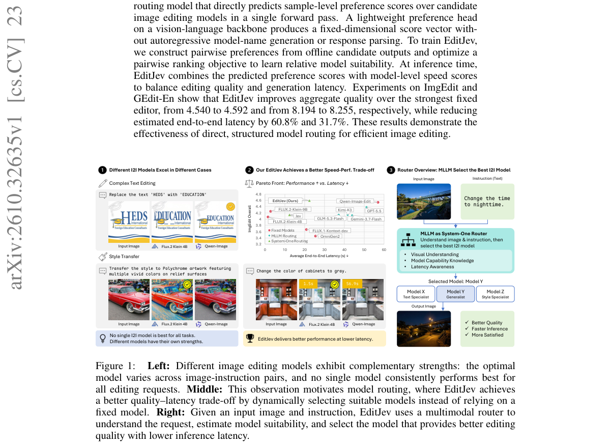

*Result - Overview of EditJev. The upper part shows offline candidate generation, automatic eval- uation, and router training. The lower part shows quality–latency-aware inference, which combines pref*

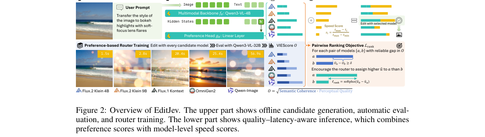

**Why this ranks #4**: 不同编辑模型在不同请求上强弱不同——用一次前向预测「哪个模型更适合这张图这条指令」，质量涨、延迟降。

---

### 5. Spatial Heuristic Strategy based Diffusion Reinforcement Learning for Online 3D Bin Packing

**arXiv**: [2610.32241](https://arxiv.org/abs/2610.32241) | **Score**: 8.0 (relevance 8.0 x 0.7 + quality 8.0 x 0.3) | **Tags**: rl-aigc, diffusion-RL, 3D-bin-packing, heuristic-prior, GNN, composite-reward, spatial-reasoning | **Categories**: cs.AI | **Pages**: 33

**Authors**: Tong Li, Qingyang Xu

**Affiliation**: Shandong University

**Abstract**

> Traditional heuristic methods have accumulated mature experience in core objectives, such as space utilization and layout compactness of 3D bin packing, relying on artificially designed rule-based logic. However, they exhibit obvious limitations in generalization ability and adaptability to dynamic scenarios. Diffusion reinforcement learning, which integrates the spatial search capability of reinforcement learning and the data distribution modeling capability of diffusion learning, has achieved certain progress in action distribution modeling and decision compliance constraints. Nevertheless, there remain issues including insufficient perception of the spatial topological structure in 3D bin packing and limited layout optimization capability. To address these problems, we propose a diffusion reinforcement learning method integrated with spatial heuristic strategies, which combines classical bin packing heuristic rules with a diffusion reinforcement learning framework. Specifically, it compresses the action space through heuristic action pre-screening, introduces a graph neural network to model the spatial structure, and designs a composite reward function incorporating flatness to suppress spatial fragmentation, thereby realizing the organic integration of prior knowledge and adaptive optimization. Experimental results demonstrate that the pro

**Key findings**

- **Finding**: 指出传统启发式方法在空间利用率与布局紧凑度等核心目标上积累了成熟经验，但泛化能力与动态场景适应性差。
- **Finding**: 扩散强化学习结合了 RL 的空间搜索能力与扩散学习的数据分布建模能力，在动作分布建模与决策合规约束上已有进展，但仍有问题：**对 3D 装箱的空间拓扑结构感知不足**，布局优化能力有限。
- **Finding**: 本文提出把扩散 RL 与**空间启发式策略**结合的方法：
- **Finding**: 三项具体设计——(1) 用启发式动作预筛选**压缩动作空间**；(2) 引入 GNN 建模空间结构；(3) 设计含**平整度**项的复合奖励，以抑制空间碎片化。
- **Finding**: 作者称这实现了先验知识与自适应优化的有机结合，并在实验中得到验证。
- **Inference**: 「启发式预筛动作空间 + GNN 表征拓扑 + 复合奖励」是一套典型的把领域知识塞进生成式 RL 的配方，对其他有强先验的组合优化任务都可复用。
- **Inference**: 用平整度项抑制碎片化，说明在生成式优化里，**几何可解释的软约束**往往比纯数据驱动奖励更稳定。
- **Recommendation**: 推荐（应用向）。做扩散 RL、组合优化、生成式布局的人值得读。

**Key figures**

*Framework - Three Spatial Partitioning Methods*

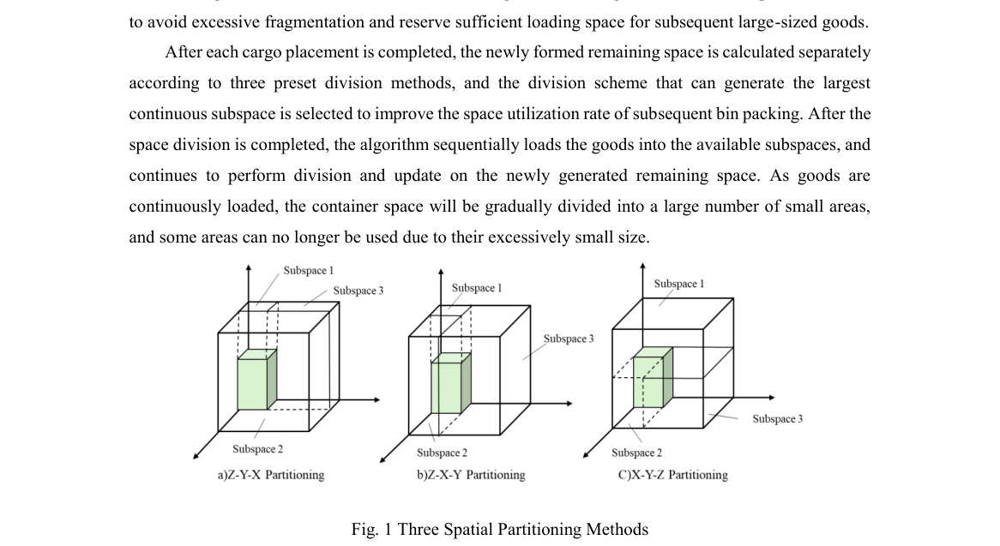

*Result - Spatial Merging Strategy*

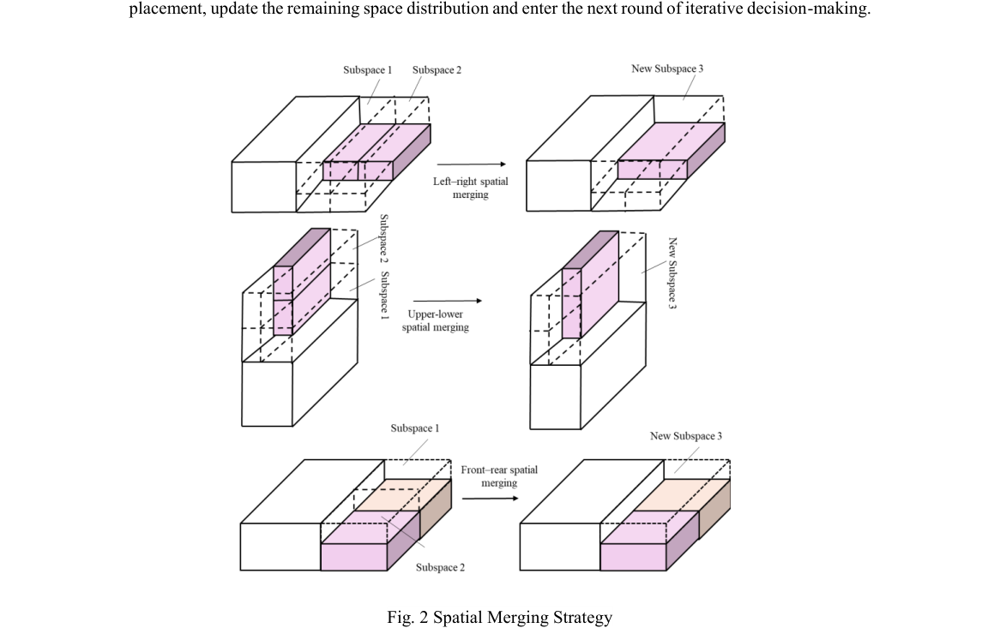

**Why this ranks #5**: 把经典启发式规则当先验塞进扩散 RL：动作空间先筛、空间结构交给 GNN、奖励里加平整度。

---

### 6. Fast and Useful: Adapting Distilled Generators for Visual Learning

⚠️ **[wild-card=yes]** — 本批真正「RL / 偏好优化生成模型」的论文只有 4 篇（ACWM-RM、ImageRSI、ViT-H、扩散 RL 装箱）。本文是对**蒸馏生成器本身**做后训练，使其输出更适合下游训练，属于生成模型后训练家族，与 RL 训练同源，作为最接近的 wild-card 补足。

**arXiv**: [2610.32512](https://arxiv.org/abs/2610.32512) | **Score**: 7.3 (relevance 7.0 x 0.7 + quality 8.0 x 0.3) | **Tags**: rl-aigc, T2I, distilled-generator, adapter, teacher-student, synthetic-data, ImageNet, wild-card | **Categories**: cs.CV | **Pages**: 30

**Authors**: Patryk Bartkowiak, Dominik Michels, Sören Pirk, Wojciech Pałubicki

**Affiliation**: Adam Mickiewicz University; Kiel University

**Abstract**

> Distilled text-to-image models generate images quickly, but classifiers trained on those images can perform substantially worse than classifiers trained on images from their slower base models. We adapt released distilled generators to produce better training data while retaining fast generation. We fit a low-rank update to the student's first prediction so that it reaches an intermediate state produced by its unguided base, then disable the update and let the unchanged student finish generation. The base supplies training targets and is absent at inference. Guided targets and shorter jumps give classifiers lower accuracy in our ablations, showing why the state used for supervision matters. Across three generator families, the adapted images train better classifiers than images from the released students. With class-name templates at full ImageNet-1k scale, ResNet-50 top-1 rises from 8.4% to 34.2% for FLUX.2-klein and from 12.7% to 32.1% for SD-Turbo, using two and three denoiser evaluations per image, respectively. Fixed adapters also improve results on additional classes, fine-grained datasets, and other learner architectures and training recipes. Template-based adaptation remains useful against richer-prompt alternatives, while the benefit of combining adaptation with LLM generation prompts depends on the generator. Adapting a single generation step makes fast generators substantially more useful for training visual models.

**Key findings**

- **Finding**: 指出蒸馏后的文生图模型生成很快，但用这些图训练的分类器**性能显著差于**用更慢的基座模型生成的图。
- **Finding**: 作者改造已发布的蒸馏生成器，让它产出更好的训练数据，同时保留快速生成。
- **Finding**: 做法是给学生的**第一次预测**拟合一个低秩更新，使其达到「未引导基座所产生的中间状态」，随后关闭该更新，让未改动的学生完成生成。
- **Finding**: 基座只提供训练目标，**推理时并不存在**。
- **Finding**: 消融显示：用引导后的目标、并缩短跳跃步数，反而让分类器准确率下降——说明**用于监督的那个状态本身很关键**。
- **Finding**: 在三个生成器家族上，适配后的图像比已发布学生生成的图像能训练出更好的分类器。
- **Finding**: 在完整 ImageNet-1k 规模、用类别名模板时：ResNet-50 top-1 从 8.4% 升到 **34.2%**（FLUX.2-klein）、从 12.7% 升到 **32.1%**（SD-Turbo），分别只需每图 2 次与 3 次 denoiser 前向。
- **Finding**: 固定适配器在额外类别、细粒度数据集、其他学习器架构与训练配方上同样有改善；模板式适配在富提示词替代方案面前仍然有效，而「适配 + LLM 生成提示」的收益则取决于生成器。
- **Finding**: 结论：**只适配一个生成步**，就能让快速生成器对训练视觉模型大幅有用。
- **Inference**: 「引导后的目标反而更差」这条消融很有启发：蒸馏不是越对齐基座越好，中间状态选错了会主动损害下游可用性。
- **Inference**: 本篇是生成模型后训练（而非 RL），按 wild-card 标注；它与 RL 训练共享同一套「生成器可被外部信号改造」的框架，故放在本线。
- **Recommendation**: 推荐（wild-card）。做蒸馏模型改造、合成数据生产、视觉模型训练数据的人必读。

**Key figures**

*Framework - A single adapted step substantially improves the training value of fast generators. Released and adapted students use the same prompts and seeds. Accuracy: ResNet-50 top-1 on real ImageNet-1*

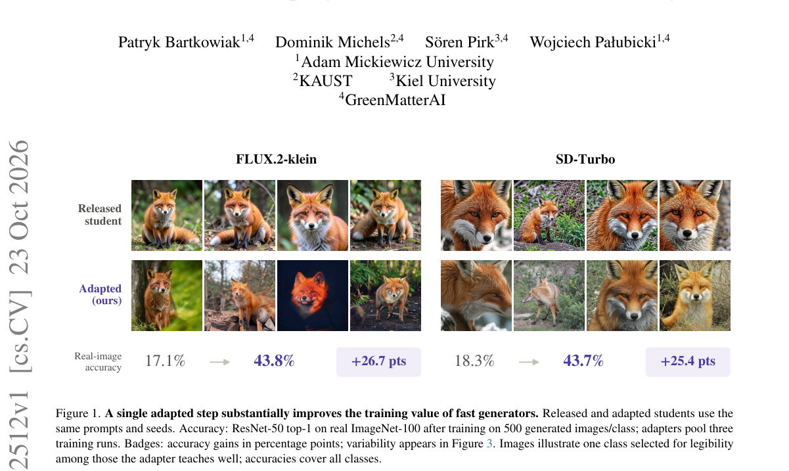

*Result - One adapted prediction followed by unchanged student sampling. Left: klein’s released four-step student (orange), its unguided base on a fine grid (blue), and the adapted sampler (violet). W*

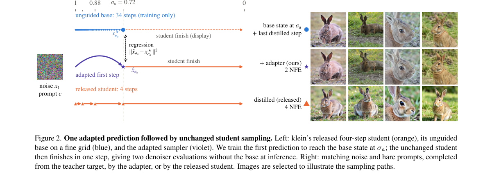

**Why this ranks #6**: 被蒸馏快的 T2I 生成的图不适合训分类器——只改**第一步**的预测，让它回到未引导基座的状态。  [wild-card]

---

### 7. Compatible Likelihoods for Flow Matching on Manifolds

⚠️ **[wild-card=yes]** — 流匹配似然目标的理论分析：它给出「似然型流匹配目标何时能恢复正确速度场」的条件，正是 RL / 偏好优化做流匹配时赖以成立的目标基础，本批无更多流匹配 RL 论文，按 wild-card 补足。

**arXiv**: [2610.31981](https://arxiv.org/abs/2610.31981) | **Score**: 7.3 (relevance 7.0 x 0.7 + quality 8.0 x 0.3) | **Tags**: rl-aigc, flow-matching, manifold, likelihood-objective, compatibility, velocity-field, wild-card | **Categories**: cs.LG | **Pages**: 30

**Authors**: Lucas Ng, Georgios Batzolis, Mark Girolami

**Affiliation**: University of Cambridge; Devotion AI Labs

**Abstract**

> On the simplest non-Euclidean manifold, the 1D flat torus, we exhibit a distribution where a recently proposed extension of Riemannian flow matching is globally optimized by a velocity field that pushes samples away from the data distribution. We trace this failure mode to a property we call compatibility; a likelihood-based flow matching objective is compatible if its population minimizer recovers the marginal velocity field induced by the data and coupling. We give a general condition for compatibility, apply it to existing methods, and bound the worst-case error in terms of a residual component vanishing under compatibility. Next, we note that existing compatible objectives put density on velocities that are infeasible on compact manifolds. We propose an objective built from an exponential family over endpoints, with the conditional velocity as sufficient statistic, which is both compatible and supported only on feasible velocities. This manifests as a reweighting of the flow matching loss which, on constant-curvature manifolds, treats errors in flow speed and direction differently. Empirically, our method recovers the correct velocity field on the test case, outperforms prior methods on high-dimensional product tori, and obtains substantial NLL improvements over prior work on two of four standard geospatial benchmarks on the sphere at moderate runtime overhead. On a large dataset of high-dimensional human poses, our method outperforms prior work according to sample-based metrics.

**Key findings**

- **Finding**: 在最简单的非欧流形（1 维平坦环面）上，作者**构造出一个分布**：某个新近提出的黎曼流匹配扩展被全局优化出的速度场，反而把样本推离数据分布。
- **Finding**: 作者把这一失效模式追溯到一个称为 **compatibility** 的性质：一个似然型流匹配目标是兼容的，当且仅当其总体极小元能恢复出由数据与耦合所诱导的边缘速度场。
- **Finding**: 给出了兼容性的一个一般条件，将其应用到既有方法上，并把最坏情形误差界定在一个在兼容性成立时消失的残差分量上。
- **Finding**: 进一步指出：既有的**兼容**目标在紧致流形上会把密度放在**不可行**的速度上。
- **Finding**: 提出的新目标建立在端点上的指数族之上，以条件速度为充分统计量，**既兼容又只支撑可行速度**。
- **Finding**: 这体现为对流匹配损失的一次重加权：在常曲率流形上，对流速误差与方向误差区别对待。
- **Finding**: 实证上，该方法在测试用例上恢复出正确的速度场，在高维乘积环面上优于既有方法，在球面上四个标准地理基准中的两个上取得显著 NLL 改善（运行时开销中等）。
- **Finding**: 在高维人体姿态大规模数据集上，按基于采样的指标也优于既有工作。
- **Inference**: 「兼容目标会把密度放到不可行速度上」是很反直觉的发现：在紧致流形上做流匹配，损失函数本身可能在奖励物理上无法实现的速度。
- **Inference**: 本篇是 RL / 偏好优化做流匹配时的**目标基础**——RL 只能在正确的似然目标上做才有意义，故按 wild-card 标注。
- **Recommendation**: 推荐（wild-card）。做流匹配、几何/流形生成、RL 微调流模型的人必读。

**Key figures**

*Framework - Example on T1 with τ = 1*

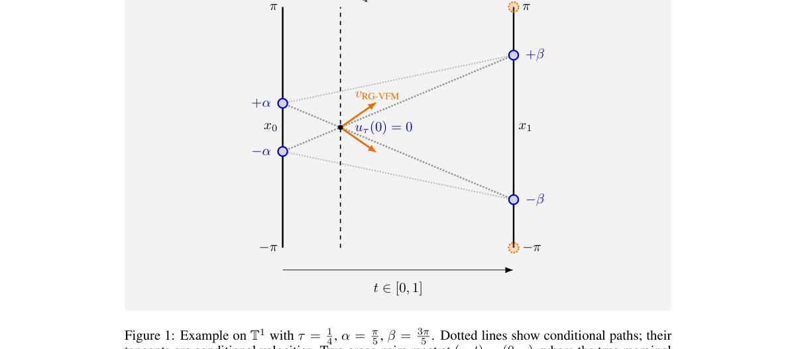

*Result - Velocity magnitude ∥vθ*

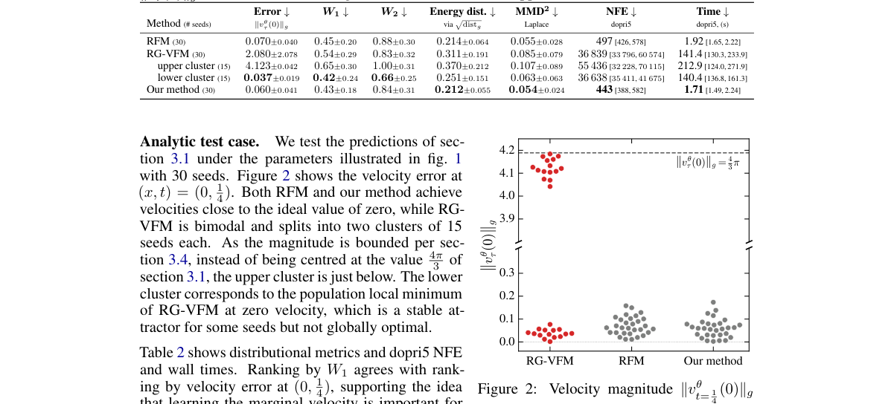

**Why this ranks #7**: 在平坦环面上，流匹配目标的最优速度场会把样本推离数据分布——这类「不兼容目标」是 RL 做流匹配时的暗雷。  [wild-card]

---

### 8. MDMR-Bench: A Multi-Dimensional Benchmark for Multi-Reference Image Generation

⚠️ **[wild-card=yes]** — 多参考图像生成的评测基准，与本线词表里的 GenEval / DrawBench 同属「生成模型质量度量」家族；本批没有更多 RL-for-generation 论文，按 wild-card 补足一个评测坐标。

**arXiv**: [2610.32459](https://arxiv.org/abs/2610.32459) | **Score**: 7.3 (relevance 7.0 x 0.7 + quality 8.0 x 0.3) | **Tags**: rl-aigc, generation-benchmark, multi-reference, checklist-protocol, entity-fusion, attribute-transfer, wild-card | **Categories**: cs.CV | **Pages**: 31

**Authors**: Bowen Zheng, Jintao Lin, Changheng Yi, Haoran Yang, Binxiao Huang, Chenyang Lei, Rui Liu, Xihui Liu

**Affiliation**: Nanjing University; The University of Hong Kong; Huawei Research

**Abstract**

> Image generation models have rapidly advanced, with many models now supporting generation conditioned on multiple reference images and textual instructions. Such models enable a wide range of applications, including entity fusion and attribute transfer across images. However, existing benchmarks for multi-reference image generation rely on limited evaluation dimensions and fail to capture the diverse challenges of the task. To address this limitation, we propose MDMR-Bench, a Multi-Dimensional benchmark for Multi-Reference image generation. MDMR-Bench is organized around representative capability settings and consists of multiple evaluation subsets spanning diverse dimensions of multi-reference image generation, including (1) common entity fusion and attribute transfer, (2) multi-element extraction from a single image, (3) infographic manipulation, and (4) visual reasoning-intensive generation. This design enables systematic analysis of model capabilities and failure modes across different challenge dimensions. Furthermore, to achieve more reliable and interpretable evaluation, we introduce a checklist-based evaluation protocol that decomposes generation quality into fine-grained evaluation aspects. Instead of relying solely on holistic scoring, our framework uses structured checklists composed of both global-level and atomic-level queries, enabling more diagnostic assessment of model performance. By benchmarking both open-source and proprietary models, we demonstrate that MDMR-Bench provides fine-grained insights into model performance across different dimensions. The dataset and code are publicly available.

**Key findings**

- **Finding**: 指出图像生成模型已支持多张参考图加文本指令的条件生成，可做实体融合与属性迁移，但既有多参考生成基准**评测维度有限**，无法覆盖任务的多样挑战。
- **Finding**: MDMR-Bench 是面向多参考图像生成的多维基准，围绕有代表性的能力设定组织，包含多个评测子集，覆盖四类挑战：(1) 常见实体融合与属性迁移；(2) 从单张图做多元素抽取；(3) 信息图操作；(4) 需要视觉推理的生成。
- **Finding**: 为获得更可靠、可解释的评测，提出**清单式评测协议**：把生成质量分解为细粒度的评估方面。
- **Finding**: 框架不只依赖整体打分，而是用结构化清单，由**全局级与原子级查询**组成，从而给出更具诊断性的模型评估。
- **Finding**: 在开源与专有模型上的评测表明，MDMR-Bench 能给出关于模型性能的多维度细粒度洞察。数据集与代码公开。
- **Inference**: 「清单式协议 + 原子级查询」比整体打分更可诊断，这是当前生成模型评测的主流方向——它把「模型不行」细化成「哪一维不行」。
- **Inference**: 本篇属生成模型评测（与本线词表里的 GenEval / DrawBench 同族），不是 RL 方法，按 wild-card 标注以补足本线。
- **Recommendation**: 推荐（wild-card）。做多参考生成、生成模型评测的人值得读。

**Key figures**

*Framework - The overview of MDMR-Bench. It covers diverse challenge dimensions for multi-reference image generation and introduces a checklist-based evaluation framework across five evaluation aspects w*

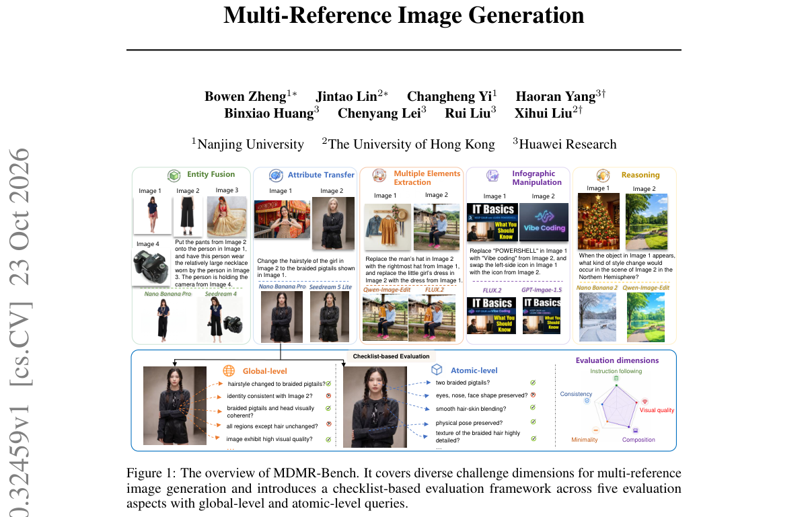

*Result - Inter-judge agreement measured by Krippendorff’s alpha. Settings are pro- vided in the Appx. A.1*

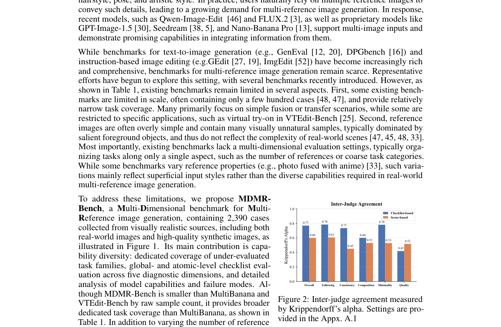

**Why this ranks #8**: 多参考图像生成终于有了一个分维度的评测基准——而且用清单式协议替代整体打分。  [wild-card]

---

### 9. ACVA-Bench: Beyond Prompt Following in Abstract Concept Visualization Ability for Text-to-Image Models

⚠️ **[wild-card=yes]** — 文生图「抽象概念可视化能力」基准，同样是生成模型能力评测；本批 RL-for-generation 论文数量不足 10 篇，按 wild-card 补足。

**arXiv**: [2610.32058](https://arxiv.org/abs/2610.32058) | **Score**: 7.0 (relevance 7.0 x 0.7 + quality 7.0 x 0.3) | **Tags**: rl-aigc, generation-benchmark, T2I, abstract-concept, psycholinguistic-norms, representational-diversity, wild-card | **Categories**: cs.AI, cs.CV | **Pages**: 20

**Authors**: Mengyan Wang, Jiyuan An, Yining Liu, YaoWen Zhang, Liner Yang ang Erhong Yang

**Affiliation**: Beijing Language and Culture University

**Abstract**

> Text-to-image (T2I) models have achieved remarkable progress in image quality and instruction following, prompting growing research interest in their capacity for deep understanding that goes beyond literal prompt matching. However, without an explicit visual scheme provided, it remains unclear and has not been systematically evaluated whether T2I models can autonomously translate abstract concepts lacking a fixed visual referent, such as "loyalty," into visual representations that are accurate, diverse, and distinguishable from closely related concepts. We define this capability as Abstract Concept Visualization Ability (ACVA) and introduce ACVA-Bench, a category-balanced benchmark grounded in psycholinguistic norms of abstract concepts, which examines models' ACVA along three dimensions semantic sufficiency, representational diversity, and conceptual distinctiveness under a low-intervention setting that withholds concrete objects, scenes, or visual metaphors. Since abstract concepts lack a unique reference image, conventional evaluation metrics that rely on reference-image matching are difficult to apply. To address this, we propose a fine-grained visual-semantic evaluation method constrained by concept semantics, which decomposes concept semantics into independently verifiable visual-semantic questions to assess the semantic representation quality of generated images, with its validity further confirmed by human evaluation. Benchmarking results on mainstream T2I models show that these models rely on a small set of prototypical visual patterns, leaving room for improvement in representational diversity and conceptual distinctiveness for abstract concepts, thereby providing an interpretable and reproducible evaluation foundation for future research.

**Key findings**

- **Finding**: 指出文生图模型在图像质量与指令遵循上进步显著，但其能否把**没有固定视觉指涉**的抽象概念（如「忠诚」）自主转成准确、多样、可区分的视觉表达，从未被系统评估。
- **Finding**: 作者把这一能力定义为 **Abstract Concept Visualization Ability (ACVA)**。
- **Finding**: ACVA-Bench 是类别平衡的基准，建立在抽象概念的**心理语言学规范**之上，在一种低干预设定下考察三个维度：**语义充分性、表征多样性、概念可区分性**。
- **Finding**: 低干预设定指不提供具体物体、场景或视觉隐喻。
- **Finding**: 由于抽象概念没有唯一参考图像，依赖参考图匹配的传统指标难以适用，因此提出受概念语义约束的**细粒度视觉-语义评测方法**：把概念语义分解成可独立验证的视觉-语义问题来评估生成图像的语义表征质量，并用人工评测确认其效度。
- **Finding**: 在主流 T2I 模型上的基准结果显示：这些模型依赖**一小套原型化视觉模式**，在表征多样性与概念可区分性上仍有明显改进空间。
- **Inference**: 「模型依赖一小套原型化视觉模式」是本篇最重要的诊断：抽象概念生成的问题不是画得不好，而是**所有模型画的是同一套模板**。
- **Inference**: 用心理语言学规范给抽象概念分类，这把「抽象」从主观感受变成了可操作的类别，是这类基准能复现的关键。
- **Recommendation**: 推荐（wild-card）。做 T2I 评测、概念表征、多样性度量的人值得读。

**Key figures**

*Framework - Motivation. Concrete concepts have fixed visual referents, whereas abstract concepts require models to autonomously select visual entities, relations, and metaphors, often resulting in diver*

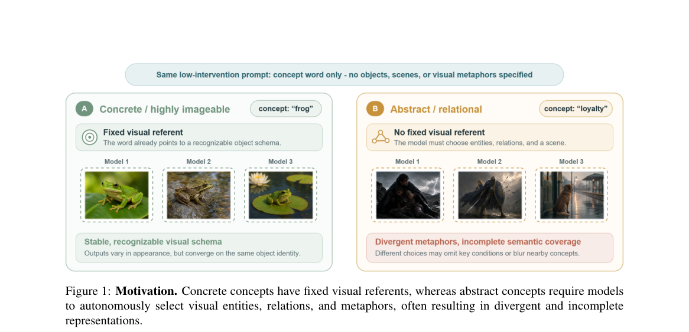

*Result - Overview of ACVA-Bench: concept sampling, rubric construction, low-intervention generation, and three evaluation axes, with human quality control.*

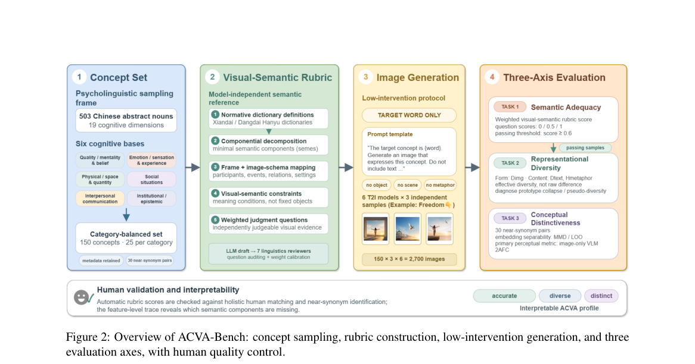

**Why this ranks #9**: 让 T2I 画「忠诚」这种没有标准视觉指涉的抽象概念——结果是所有模型都在画同一套陈词滥调。  [wild-card]

---

### 10. Concept Acupuncturist: An Efficient and Precise Concept Erasure Method for Diffusion Models via Sparse Autoencoders

⚠️ **[wild-card=yes]** — 扩散模型的概念擦除（机器遗忘）属于生成模型的后训练 / 安全对齐方向，与偏好对齐同属「改造生成模型行为」；本批 RL-for-generation 论文不足，按 wild-card 补足。

**arXiv**: [2610.32059](https://arxiv.org/abs/2610.32059) | **Score**: 7.0 (relevance 7.0 x 0.7 + quality 7.0 x 0.3) | **Tags**: rl-aigc, concept-erasure, machine-unlearning, sparse-autoencoder, cross-attention, SDXL-Turbo, wild-card | **Categories**: cs.AI, cs.CV, cs.LG | **Pages**: 21

**Authors**: Yiran Xiahou, Siliang Qin, Kai Chen, Shengzhi Zhang, Renyang Liu

**Affiliation**: Chinese Academy of Sciences; Boston University; National University of Singapore

**Abstract**

> Diffusion-based image generation models produce high-quality images but may generate harmful or policy-violating content, motivating machine unlearning (MU) to selectively remove target concepts while preserving general capabilities. However, existing MU approaches often struggle with the distributed and entangled nature of concept representations, leading to inefficient optimization and imprecise edits when applied through large-scale fine-tuning over full diffusion trajectories. To bridge this gap, we propose Concept Acupuncturist (ConceptACP), a novel MU framework that integrates interpretability-guided analysis with inference-free fine-tuning for efficient and precise concept removal. By establishing mappings between semantic concepts and cross-attention blocks in the U-Net denoiser and localizing the most concept-relevant block for targeted optimization, ConceptACP avoids full diffusion trajectory optimization, thereby improving fine-tuning efficiency. To mitigate concept entanglement, we propose a feature-level correction mechanism based on Sparse Autoencoders (SAEs), where SAE-derived sparse, semantically meaningful feature activations are manipulated to construct targeted correction signals, which are then projected back to the output space of the corresponding block and used as supervision for precise concept removal. Consequently, ConceptACP eliminates the need for external inference-time modules while achieving efficient and fine-grained unlearning. Instantiated on SDXL-Turbo, ConceptACP improves the forgetting success rate by 36.34 percentage points in the standard one-step generation setting on average over the best-performing baseline, while preserving image quality and prompt fidelity, and generalizes effectively across other Stable Diffusion backbones. Our code is available at https://github.com/Eran-Xia/ConceptACP.

**Key findings**

- **Finding**: 指出扩散图像生成模型可能产生有害或违反政策的内容，机器遗忘（MU）要选择性移除目标概念同时保住通用能力。
- **Finding**: 既有 MU 方法受困于概念表征的**分布式与纠缠性**，导致优化低效、编辑不精确。
- **Finding**: Concept Acupuncturist (ConceptACP) 结合可解释性引导的分析与**推理无关（inference-free）的微调**。
- **Finding**: 关键手法：在 U-Net 去噪器的 cross-attention 块之间建立语义概念映射，**定位最相关的那个块**，只对该块做定向优化，从而避免全扩散轨迹优化。
- **Finding**: 为缓解概念纠缠，提出基于**稀疏自编码器（SAE）**的特征级修正机制：操纵 SAE 导出的稀疏语义特征激活来构造定向修正信号，再投影回对应块的输出空间，用作精确概念移除的监督。
- **Finding**: 因此 ConceptACP **不需要任何外部推理期模块**，同时实现高效细粒度的遗忘。
- **Finding**: 在 SDXL-Turbo 上，标准一步生成设定下，遗忘成功率相对最好的基线平均提升 **36.34 个百分点**，同时保持图像质量与提示忠实度，并能泛化到其他 Stable Diffusion 骨干。代码公开。
- **Inference**: 「定位到具体的 cross-attention 块再动刀」是这个方法效率高的根源——把全轨迹微调缩成了一次局部手术。
- **Inference**: 本篇是生成模型的安全对齐/遗忘方向（与偏好对齐同族），按 wild-card 标注；它是本批生成模型后训练侧最有实用价值的一篇。
- **Recommendation**: 推荐（wild-card）。做扩散模型安全、机器遗忘、概念擦除的人必读。

**Key figures**

*Framework - Visualization of the top-6 activated SAE features across different cross-attention blocks. The black rectangle visually masks the region containing nudity.*

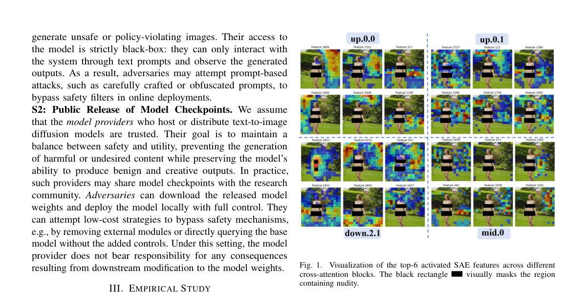

*Result - Discrepancy between classifier-based evaluation and human perception after concept unlearning.*

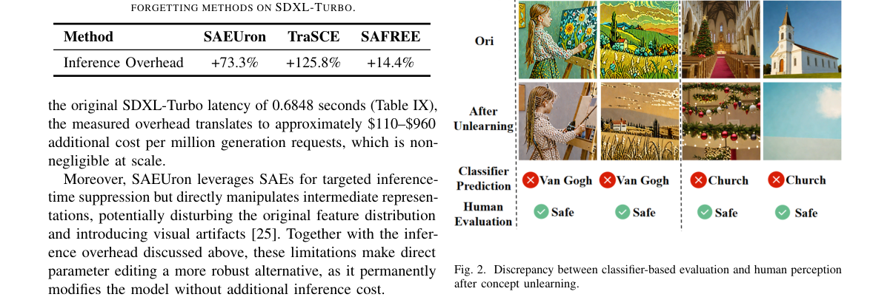

**Why this ranks #10**: 不做全轨迹微调：先定位「概念住在 U-Net 哪个 cross-attention 块」，再在那一块上做手术。  [wild-card]

---

## Footer

- Total papers scanned across all 7 tracks: 474（原始 663 条）
- rl_aigc track final top-10: 10
- Wild-cards in this track: 5
- Figure assets: 2026-10-26/res/

Generated by `mine-arxiv-daily-digest` skill. Sister file: `2026-10-26_rl_aigc_entry.md`.
