# ArXiv Daily Digest - 2026-10-26 (RL 算法与理论、多智能体 RL、Sim-to-Real, 10 papers)

**Generated**: 2026-10-26 17:00 CST

**Source**: arXiv cs.CV, cs.SD, eess.AS, cs.CL, cs.AI, cs.RO, cs.LG submissions, listing day 2026-10-23 (announced 2026-10-26 00:00 UTC)

**Batch window**: 2026-10-22T18:00:00Z .. 2026-10-23T18:00:00Z（arXiv 公告批次横跨两个 UTC 日：前一日 18:00 UTC 起算，当日 17:59:59 UTC 截止）

**Track**: rl_core (top 10 of 474 papers scanned, 70 full reads)

**Scope**: RL 算法与理论、探索、信用分配、MARL、sim-to-real 迁移

---

## Top 10 - RL 算法与理论、多智能体 RL、Sim-to-Real

### 1. Regularised RL improves sim-to-real transfer

**arXiv**: [2610.32855](https://arxiv.org/abs/2610.32855) | **Score**: 10.0 (relevance 10.0 x 0.7 + quality 10.0 x 0.3) | **Tags**: rl-algorithm, sim-to-real, robustness, soft-optimality, SAC, real-robot, PPO | **Categories**: cs.LG, cs.RO | **Pages**: 20

**Authors**: Danilo Vucetic, Mohamad H. Danesh, Florence Clerc, Hsiu-Chin Lin, Jonathan Tremblay

**Affiliation**: McGill University; Mila Quebec AI Institute; NVIDIA

**Abstract**

> Regularised reinforcement learning (RL) has provable robustness guarantees that should ease the transfer of policies from simulation to robots, known as sim-to-real. Yet, weakly regularised algorithms like Proximal Policy Optimisation (PPO) remain the de facto choice in sim-to-real pipelines, while the practical benefits of regularisation for transfer remain poorly characterised. In this work, we study the sim-to-real performance of commonly used RL algorithms, with the aim of characterising the effects of regularisation on robotic performance. To that end, we derive Soft MellowMax Actor-Critic (SMM-AC), a novel regularised RL algorithm based on the soft mellowmax value function, which carries strong robustness guarantees. On MuJoCo continuous control benchmarks, SMM-AC is competitive with baselines like Soft Actor-Critic (SAC). On real robots, SMM-AC achieves higher return, while exhibiting greater robustness to perturbations in observations, the environment, and dynamics than baselines. Together, these results demonstrate that regularised RL improves real-world policy deployment through better robustness to the sim-to-real gap, and changing real-world conditions.

**Key findings**

- **Finding**: 指出正则化 RL 具有可证明的鲁棒性保证，理论上应当有利于 sim-to-real；但弱正则算法（如 PPO）仍是 sim-to-real 流水线的事实默认，且正则化对迁移的实际收益**一直缺乏刻画**。
- **Finding**: 本文系统研究常用 RL 算法的 sim-to-real 表现，目标是刻画正则化对机器人性能的影响。
- **Finding**: 为此推导了 **Soft MellowMax Actor-Critic (SMM-AC)**：基于 soft mellowmax 价值函数的新型正则化 RL 算法，带有强鲁棒性保证。
- **Finding**: 在 MuJoCo 连续控制基准上，SMM-AC 与 Soft Actor-Critic (SAC) 等基线相当。
- **Finding**: 在**真实机器人**上，SMM-AC 取得更高回报，同时对观测扰动、环境扰动与动力学扰动表现出比基线更强的鲁棒性。
- **Finding**: 结论：正则化 RL 通过对 sim-to-real gap 与真实世界条件变化的更好鲁棒性，改进真实部署。
- **Inference**: 「PPO 是事实默认」这个观察本身就是结论的一半——它说明 sim-to-real 领域长期用了一个理论上最不划算的算法。
- **Inference**: 正则化的收益体现在**扰动鲁棒性**而非平均性能上，这个区分很重要：只报平均回报的话，SMM-AC 看起来只是「和 SAC 差不多」。
- **Recommendation**: 强烈推荐。做 sim-to-real、机器人 RL、算法选型的人必读。

**Key figures**

*Framework - Overview of the Sim-to-Real Robustness Evaluation. Top: Agents trained on the Franka Lift task in simulation are deployed with a cube with a different center-of-mass than the one seen during*

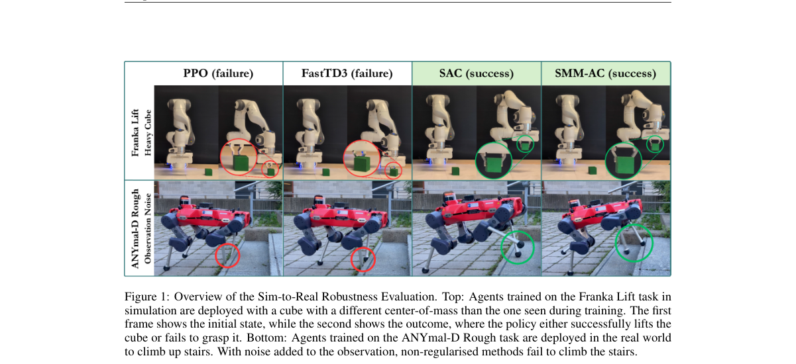

*Result - Smoothed episodic returns of SMM-AC, SAC, PPO, and TD3 over the number of steps taken in the environment. The best results were selected according to the performance of the algorithm at the*

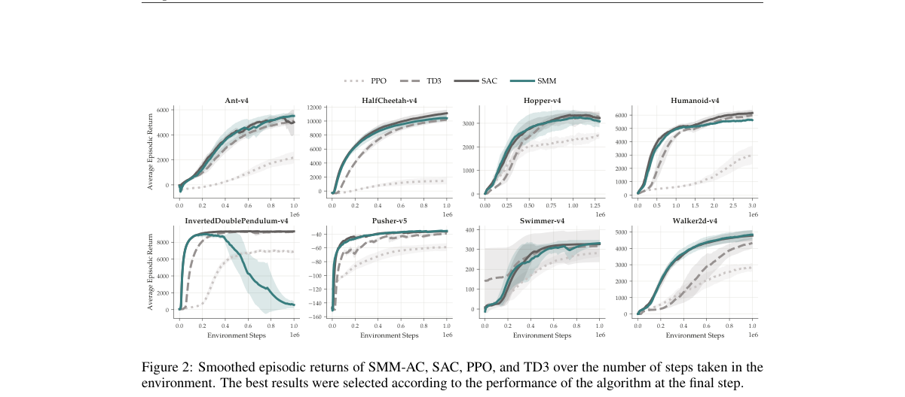

**Why this ranks #1**: 把 sim-to-real 从「调参」变成「算法性质」：正则化 RL 在真机上既更高回报，也更抗扰动。

---

### 2. Conditional Flow Models for Offline Maximum Entropy Reinforcement Learning

**arXiv**: [2610.32125](https://arxiv.org/abs/2610.32125) | **Score**: 9.7 (relevance 10.0 x 0.7 + quality 9.0 x 0.3) | **Tags**: rl-algorithm, offline-RL, maximum-entropy, diffusion, probability-flow-ODE, nonasymptotic-guarantee, theory | **Categories**: cs.LG | **Pages**: 68

**Authors**: Hao Cheng, Yuling Jiao, Lican Kang, Jerry Zhijian Yang, Chen Zhong

**Affiliation**: Wuhan University

**Abstract**

> Offline maximum entropy reinforcement learning seeks to estimate the optimal soft action-value function \(Q^*\) from a fixed dataset without further interaction with the environment. Although \(Q^*\) is characterized by the soft optimal Bellman equation, the corresponding Bellman operator cannot be evaluated directly because both the reward distribution and the transition kernel are unknown. Consequently, estimating \(Q^*\) requires the joint treatment of environment modeling and value function learning. We propose a framework that addresses these tasks separately. Conditional diffusion models based on probability flow ODEs estimate the conditional reward distribution and transition kernel. The resulting distributional estimators define a data driven approximation of the soft optimal Bellman operator, whose empirical Bellman residual is minimized over a class of deep neural networks to estimate \(Q^*\). We establish nonasymptotic guarantees for the proposed method. For operator learning, we derive total variation error bounds for the conditional flow estimators that account explicitly for score estimation, numerical discretization, and terminal smoothing. For soft value learning, we first use the soft Bellman equation to show that $Q^*$ inherits Hölder regularity from the conditional reward and transition densities. For any Hölder index $β$, the value learning stage achieves an excess Bellman residual risk bound of order $\widetilde{\mathcal O}\big(n^{-\frac{2β}{d+2β}}\big),$ where $d$ is the total dimension of the state and action spaces. In contrast to many existing theoretical analyses of deep reinforcement learning, our results do not require Bellman completeness. Numerical experiments support the theoretical findings and demonstrate the effectiveness of the proposed method.

**Key findings**

- **Finding**: 离线最大熵 RL 要从固定数据集估计最优软动作价值函数 Q*；虽然 Q* 由软最优 Bellman 方程刻画，但 Bellman 算子无法直接求值——奖励分布与转移核都未知。
- **Finding**: 因此估计 Q* 需要**同时处理环境建模与价值函数学习**，而多数方法把二者混在一起。
- **Finding**: 本文提出把两件事**分开处理**的框架：基于概率流 ODE 的条件扩散模型负责估计条件奖励分布与转移核。
- **Finding**: 由此得到的分布式估计子定义了数据驱动的软最优 Bellman 算子近似，其经验 Bellman 残差在深度神经网络上被最小化以估计 Q*。
- **Finding**: 为该方法建立了**非渐近**保证：算子学习部分给出条件流估计子的全变差误差界，显式计入 score 估计、数值离散化与终端平滑。
- **Finding**: 软价值学习部分先用软 Bellman 方程证明 Q* 从条件奖励与转移密度继承 Hölder 正则性；对任意 Hölder 指数 β，超额 Bellman 残差风险界为 Õ(n^(-2β/(d+2β)))，d 为状态与动作空间总维数。
- **Finding**: 与许多现有深度 RL 理论分析不同，作者的结果**不要求 Bellman 完备性**。数值实验支持了理论结论与方法的实际有效性。
- **Inference**: 「不要求 Bellman 完备性」是全文最有分量的一个理论声明——深度 RL 的绝大多数收敛结论都依赖这个假设，而它恰恰在真实函数类上最不成立。
- **Inference**: 把建模与值学习解耦成「扩散模型 + 神经算子」两层，是把现代生成模型工具引入 RL 理论的一条干净范式。
- **Recommendation**: 强烈推荐。做离线 RL、RL 理论、扩散模型与 RL 结合的人必读。

**Key figures**

本篇未提取到可用图（PDF 内无符合图注正则的 Figure 1/2）。

**Why this ranks #2**: 离线最大熵 RL 的完整理论方案：扩散模型估分布、神经算子学 Q，且不假设 Bellman 完备性。

---

### 3. When to Stop Penalizing Actions? Martingale GRPO for VLA Reinforcement Learning

**arXiv**: [2610.32431](https://arxiv.org/abs/2610.32431) | **Score**: 9.0 (relevance 9.0 x 0.7 + quality 9.0 x 0.3) | **Tags**: rl-algorithm, GRPO, advantage-assignment, martingale, stopping-criterion, VLA, OpenVLA-OFT, RoboTwin | **Categories**: cs.AI | **Pages**: 31

**Authors**: Zongyao Zhao, Cheng-Jie Zhao, Ruihang Jiang, Bing Zheng, Zhaolin Wang, Yuanwei Liu

**Affiliation**: The University of Hong Kong; Tsinghua University

**Abstract**

> A failed vision-language-action (VLA) rollout does not imply that every action contributed to failure. Yet in group-relative policy optimization (GRPO), a single trajectory-level advantage is assigned to all actions in a rollout. Potentially useful recovery attempts can thus be penalized alongside the errors they aim to correct. Ideal stopping conditions for failure feedback are characterized using success-probability and policy-score martingales. At these stops, the removed gradient contribution has zero conditional expectation given the retained information. Truncation therefore preserves the expectation of a reference GRPO group-gradient estimator and can reduce its covariance. One such stop occurs when the conditional probability of success is zero, motivating error and recovery cues for selecting candidate feedback boundaries. Martingale GRPO (MART-GRPO) is introduced with a vision-language model (VLM) for event-guided truncation. The VLM is fine-tuned on our annotated training set using low-rank adaptation (LoRA). The last visible error without observed recovery is localized by the frozen VLM in complete rollout videos. Failure feedback is retained through the selected error interval and removed afterward, while successful-rollout loss terms and original loss normalization are preserved. For retrospective boundaries, changes in expectation and variance are analyzed to assess departures from ideal stopping. Experiments with OpenVLA-OFT on RoboTwin 2.0 show that MART-GRPO improves success rates over full-trajectory GRPO across multiple tasks.

**Key findings**

- **Finding**: 指出一次失败的 VLA 轨迹并不意味着其中每个动作都对失败有责任；但在 GRPO 里，**单一轨迹级优势被分配给轨迹中的所有动作**。
- **Finding**: 因此可能有用的恢复尝试会与它们试图纠正的错误**一起被惩罚**。
- **Finding**: 理想的「停止施加失败反馈」的停止条件，用成功率鞅与策略分数鞅刻画；在这些停止点上，被移除的梯度贡献在给定保留信息的条件下条件期望为零。
- **Finding**: 因此截断**保持参考 GRPO 组梯度估计量的期望**，并可降低其协方差。
- **Finding**: 一个这样的停止点出现在条件成功概率为零时，这促使作者构造误差与恢复线索来选择候选的反馈边界。
- **Finding**: 提出 **Martingale GRPO (MART-GRPO)**：用一个 VLM 做事件引导的截断。该 VLM 在作者标注的训练集上用 LoRA 微调，在完整 rollout 视频中定位「最后一个可见错误且未见恢复」的位置。
- **Finding**: 失败反馈在选定的误差区间内保留、之后移除，成功轨迹的损失项与原始损失归一化保持不变；对回溯型边界分析了期望与方差的变化。
- **Finding**: 在 OpenVLA-OFT + RoboTwin 2.0 上，MART-GRPO 在多个任务上成功率高于全轨迹 GRPO。
- **Inference**: 「截断保持期望、降低协方差」是这个方法的理论骨架——它把一个看似启发式的裁剪变成有保证的方差缩减技巧。
- **Inference**: 用冻结 VLM 在视频里定位「最后一个可见错误」是巧妙的：它把一个时序信用分配问题变成了一个视觉定位问题。
- **Recommendation**: 强烈推荐。做 RL 微调机器人策略、GRPO 改进、信用分配的人必读。

**Key figures**

*Framework - Errors and recovery attempts within a failed rollout. Selected RoboTwin hammer frames from two scenes, a success (top) and a failure (bottom). The red outline marks the hammer after it is lo*

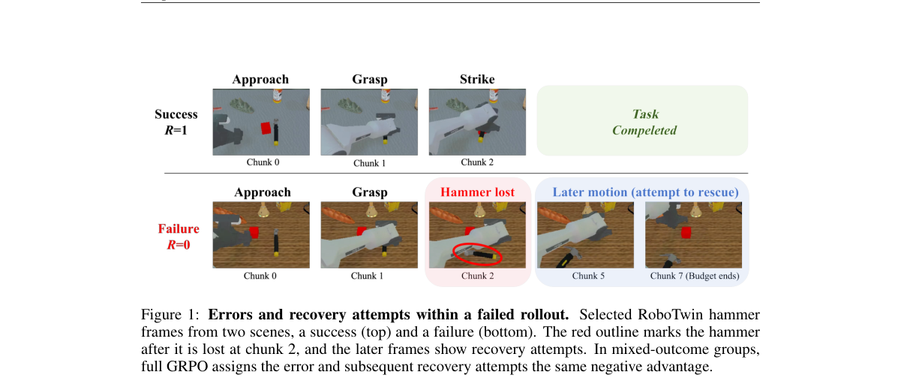

*Result - Feedback truncation and gradient estimation. Schematic views of (a) ideal conditional projection, (b) a finite-batch estimate before and after suffix masking, and (c) the trade-off between v*

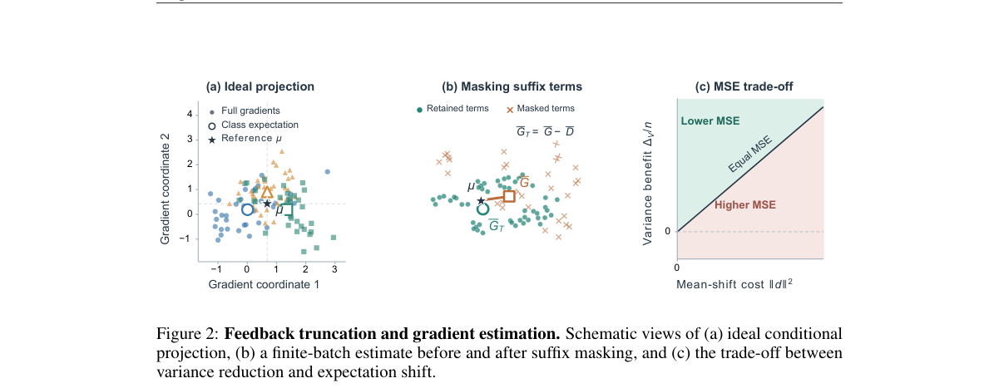

**Why this ranks #3**: GRPO 把整条轨迹的成败均摊给每个动作——包括那些「本来在纠错」的动作。作者用鞅给出了该何时停止惩罚的判据。

---

### 4. Reinforcement Learning with Multi-Step Transition Predictions: A Bellman Theory

**arXiv**: [2610.32887](https://arxiv.org/abs/2610.32887) | **Score**: 9.0 (relevance 9.0 x 0.7 + quality 9.0 x 0.3) | **Tags**: rl-algorithm, theory, Bellman-equation, multi-step-prediction, sample-complexity, BF-BOLA, offline-RL | **Categories**: cs.LG | **Pages**: 55

**Authors**: Chenbei Lu, Zaiwei Chen, Tongxin Li, Chenye Wu, Adam Wierman

**Affiliation**: Cornell University; Purdue University; Chinese University of Hong Kong Shenzhen

**Abstract**

> Multi-step predictions of future transition realizations can improve reinforcement learning, but their value remains difficult to quantify. Directly including these predictions in the state can lead to exponential state-space growth, making direct dynamic programming computationally expensive. We study discounted finite MDPs under a block-feedback protocol: at the start of each K-period block, the decision maker observes $K$-step probabilistic transition predictions for a subset of actions and adapts decisions to observed states within the block. We show that the optimal value satisfies a Bayesian Bellman equation on the original state space. This representation reveals that predictive information creates value by recursively changing the local order of maximization and expectation in the Bellman expansion. We formalize this effect through a Bellman--Jensen analysis and quantify the effects of prediction horizon, error, action coverage, and within-block feedback. We propose block-feedback Bayesian offline learning with online adaptation (BF--BOLA), a model-based algorithm for learning near-optimal policies, and establish upper and lower sample-complexity bounds that match up to logarithmic factors in the stated regimes. The results show that predictions can reduce transition learning to uncovered rows and that learning a near-optimal policy can require fewer prediction samples than estimating the Bayesian value function.

**Key findings**

- **Finding**: 多步转移预测有望提升 RL，但其价值难以量化；直接把预测放进状态会导致**状态空间指数增长**，使动态规划不可行。
- **Finding**: 本文在**块反馈协议**下研究折扣有限 MDP：每个 K 周期块开始时，决策者观察到某些动作的 K 步概率转移预测，并在块内根据观测到的状态调整决策。
- **Finding**: 证明最优值在**原状态空间**上满足一个贝叶斯 Bellman 方程。
- **Finding**: 这一表示揭示了预测信息创造价值的机制：它递归地改变了 Bellman 展开中「取最大」与「取期望」的局部顺序。
- **Finding**: 作者用 Bellman–Jensen 分析形式化这一效应，并量化预测视野、预测误差、动作覆盖与块内反馈的影响。
- **Finding**: 提出块反馈贝叶斯离线学习 + 在线适应算法 **BF–BOLA**，并建立上下界样本复杂度界（在所述情形下差一个对数因子）。
- **Finding**: 结果显示：预测可以把转移学习降到未被覆盖的行上，且学一个近最优策略所需的预测样本可以少于估计贝叶斯价值函数所需的量。
- **Inference**: 「预测可以减少转移学习量」这一结论把「多步预测」从建模技巧变成了可量化的样本效率增益，很实用。
- **Inference**: 「学策略比学价值函数更省预测样本」这个反直觉结论提示：在有预测的世界模型里，评估目标选错了会浪费数据。
- **Recommendation**: 推荐。做 RL 理论、预测式世界模型、离线 RL 的人必读。

**Key figures**

本篇未提取到可用图（PDF 内无符合图注正则的 Figure 1/2）。

**Why this ranks #4**: 在状态里塞多步预测会让状态空间爆炸——作者证明不需要：最优值在原状态空间上满足一个贝叶斯 Bellman 方程。

---

### 5. RobustRLlib: A Unified Library and Benchmark for Robust Reinforcement Learning Algorithms

**arXiv**: [2610.32971](https://arxiv.org/abs/2610.32971) | **Score**: 9.0 (relevance 9.0 x 0.7 + quality 9.0 x 0.3) | **Tags**: rl-algorithm, robust-RL, safe-RL, benchmark, humanoid, VLA, 273-perturbations, open-source | **Categories**: cs.AI, cs.LG, cs.RO | **Pages**: 48

**Authors**: Xi Chen, Fengqi Hu, Zeyu Shen, Jiaying Xu, Shangding Gu, Pan Xu, Anqi Liu, Laixi Shi

**Affiliation**: UC Berkeley; Johns Hopkins University; UC San Diego; Duke University

**Abstract**

> Robust reinforcement learning (RL) is critical for reliable real-world deployment, where policies may fail under diverse shifts and disruptions. Existing robust RL algorithms offer a rich set of mechanisms and principles, yet two major barriers limit their broader potential: limited algorithm reusability and an unclear empirical capability boundary. We introduce RobustRLlib, an algorithm-centric library and benchmark that addresses both challenges. It integrates 17 representative robust online, offline, and safe RL algorithms under a unified interface for substantially improved reusability, together with an enhanced evaluation platform spanning diverse real-world shifts and advanced humanoid and vision-language-action tasks. Systematic evaluation over 273 perturbation configurations provides an up-to-date capability map of current robust RL algorithms, revealing where they remain effective and where substantial robustness gaps persist. As an open-source, user-friendly platform, RobustRLlib offers a reproducible and extensible codebase for applying existing methods to new problems and developing new robust RL algorithms.

**Key findings**

- **Finding**: 指出鲁棒 RL 算法机制丰富，但有两个障碍限制其潜力：**算法复用性有限**、**经验能力边界不清**。
- **Finding**: RobustRLlib 是算法为中心的库与基准：把 17 个代表性的鲁棒在线、离线与安全 RL 算法整合到统一接口下，显著提升复用性。
- **Finding**: 配套的增强评测平台覆盖多样的真实世界偏移，以及进阶的人形机器人与视觉-语言-动作任务。
- **Finding**: 在 **273 种扰动配置**上的系统评测，给出当前鲁棒 RL 算法的最新能力地图，揭示它们在哪里仍然有效、在哪里仍存在显著的鲁棒性缺口。
- **Finding**: 作为开源、用户友好的平台，提供可复现、可扩展的代码库，便于把既有方法用到新问题上、并开发新的鲁棒 RL 算法。
- **Inference**: 「273 种扰动配置」这个规模是本篇的价值所在：单篇论文的鲁棒性结论往往只在作者挑的那几种扰动上成立。
- **Inference**: 把 VLA 与人形任务纳入评测，意味着这份能力地图能直接反映具身智能的鲁棒性现状，这对选型很有参考价值。
- **Recommendation**: 推荐。做鲁棒 RL、安全 RL，或要给 RL 算法选型的人值得读。

**Key figures**

*Framework - The overview of RobustRLlib.*

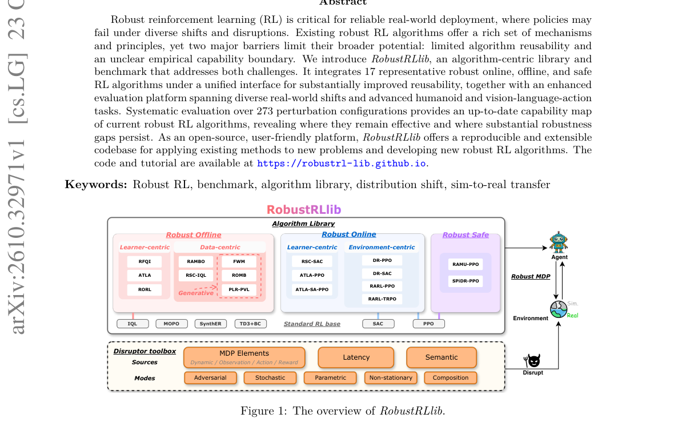

*Result - Shift sources covered in RobustRLlib. (a) Shifts of the MDP elements: dynamic, observation, action, and reward. (b) Latency between the policy’s and the executed time stamp. (c) Semantic shi*

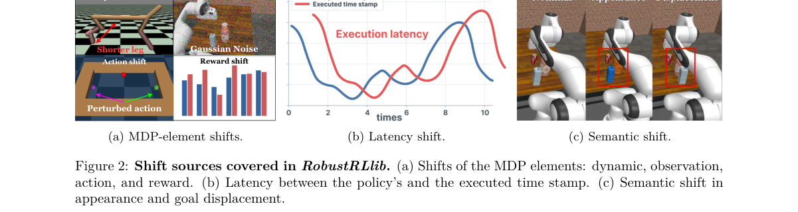

**Why this ranks #5**: 17 个鲁棒 RL 算法 × 273 种扰动配置——一张「什么算法在什么偏移下有效」的能力地图。

---

### 6. Dual-Adaptive Z-Score PPO: Dynamic Clipping Using Action Confidence and Normalized Advantage Magnitude

**arXiv**: [2610.32194](https://arxiv.org/abs/2610.32194) | **Score**: 8.7 (relevance 9.0 x 0.7 + quality 8.0 x 0.3) | **Tags**: rl-algorithm, PPO, adaptive-clipping, action-confidence, advantage-magnitude, control-benchmarks | **Categories**: cs.AI, cs.LG | **Pages**: 6

**Authors**: Taha M. Mahmoud, Naima Kaabouch

**Affiliation**: University of North Dakota

**Abstract**

> Proximal Policy Optimization (PPO) remains a popular on-policy reinforcement learning algorithm owing to its stability and ease of implementation. Its clipping threshold, however, is fixed, so every training sample receives the same trust-region width regardless of how reliable the corresponding policy update is. This work examines adaptive-clipping variants of PPO in which the constant clipping parameter is replaced by sample-dependent thresholds computed from policy and return statistics. The central method, Dual-Adaptive Z-Score PPO (PPO-DAZ3), sets the clipping interval for each sample from two signals: action confidence, given by the probability of the selected action under the current policy, and update confidence, given by the normalized advantage magnitude. The rest of the standard PPO training pipeline is left unchanged. Evaluation on three classic control benchmarks (LunarLander-v3, CartPole-v1, and Acrobot-v1) indicates that adaptive clipping improves learning in some settings but not all. PPO-DAZ3 performs best on LunarLander-v3, the smooth advantage-based variant PPO-AZ3S leads on Acrobot-v1, and standard PPO stays competitive on CartPole-v1, suggesting that adaptive clipping is most beneficial on harder control tasks.

**Key findings**

- **Finding**: 指出 PPO 之所以流行在于稳定与易实现，但其**裁剪阈值是固定的**——每个训练样本都得到相同的信任域宽度，无论对应的策略更新有多可靠。
- **Finding**: 本文考察 PPO 的自适应裁剪变体：用由策略与回报统计算出的**样本相关阈值**替换常数裁剪参数。
- **Finding**: 核心方法 PPO-DAZ3 用两个信号设定每个样本的裁剪区间：**动作置信度**（当前策略下被选动作的概率）与**更新置信度**（归一化优势幅度）。
- **Finding**: PPO 训练流水线的其余部分保持不变。
- **Finding**: 在三个经典控制基准（LunarLander-v3、CartPole-v1、Acrobot-v1）上：自适应裁剪**在部分设定下改善学习，但并非全部**。
- **Finding**: PPO-DAZ3 在 LunarLander-v3 上最好，优势型平滑变体 PPO-AZ3S 在 Acrobot-v1 上领先，标准 PPO 在 CartPole-v1 上仍然有竞争力。
- **Finding**: 作者的结论是：自适应裁剪在**较难的控制任务**上最有益。
- **Inference**: 这篇难得地**没有粉饰负面结果**——明确写出「部分设定改善、并非全部」，并给出逐基准的赢家分布，这让它比同类只报平均分的论文可信得多。
- **Inference**: 「固定信任域宽度对所有样本一视同仁」这个观察其实直指 PPO 的一个结构性问题：低置信度更新与高置信度更新被同等对待。
- **Recommendation**: 推荐。做 on-policy RL、PPO 改进、算法消融的人值得读。

**Key figures**

*Framework - Learning curves for Acrobot-v1. Shaded regions indicate variability across seeds. PPO-AZ3S achieves the strongest final performance on this task.*

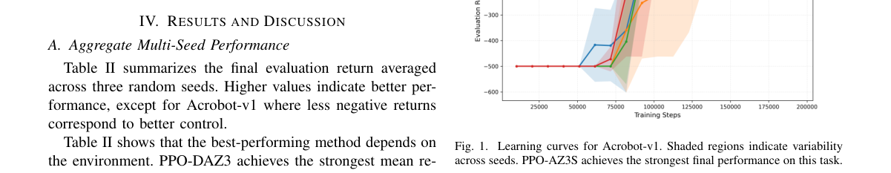

*Result - Learning curves for CartPole-v1. Standard PPO remains highly competitive on this saturated benchmark.*

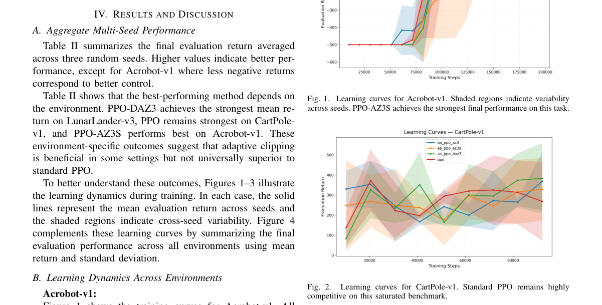

**Why this ranks #6**: PPO 的裁剪阈值是固定的——这篇让它随样本的「动作置信度」和「优势幅度」浮动，结果时好时坏，作者自己说清楚了。

---

### 7. Effectiveness of Curriculum Learning Depends on Reward Sparsity and Competing Optima

**arXiv**: [2610.31884](https://arxiv.org/abs/2610.31884) | **Score**: 8.3 (relevance 8.0 x 0.7 + quality 9.0 x 0.3) | **Tags**: rl-algorithm, curriculum-learning, reward-sparsity, local-optima, theory, REINFORCE, minimal-model | **Categories**: cs.AI, cs.LG | **Pages**: 30

**Authors**: John J. Vastola, Ann Huang, Satpreet H. Singh, Samuel J. Gershman, Kanaka Rajan

**Affiliation**: Harvard Medical School; Harvard University

**Abstract**

> While animals and people tend to learn a task more quickly and reliably when they first train on simpler versions of it, curriculum learning's effectiveness in artificial settings varies, and appears substantially greater in reinforcement learning than in supervised learning. In this work, we construct and analyze a minimal model of policy learning to better understand why. We consider an open-loop, episodic target interception task whose parameters---especially how close the agent must be to the target to receive an informative reward signal---can be chosen so that the agent either receives informative rewards frequently ('dense' rewards) or rarely ('sparse' rewards). We mathematically and numerically analyze the dynamics of REINFORCE-based policy learning in both cases. In the dense reward case, curricula have only marginal benefits; in the sparse case, curricula can be required for learning to occur at all. We find that this is especially true when the agent has the conflicting goals of minimizing effort and accumulating high reward, since this can produce distinct reward landscape optima which compete with one another. Our characterization of useful curricula in this setting indicates that they address two issues: they (i) make rewards less sparse to speed up learning, and (ii) shape the reward landscape to steer agents away from bad local optima.

**Key findings**

- **Finding**: 观察到动物与人倾向先在简单版本上训练，而课程学习在人工环境中的效果**变化很大**，且在 RL 中显著强于监督学习。
- **Finding**: 本文构造并分析一个**策略学习的最小模型**来解释原因。
- **Finding**: 模型是一个开环、回合制的目标拦截任务，其参数（尤其是智能体必须离目标多近才能拿到有信息量的奖励）可被选择为「稠密奖励」（频繁拿到有信息奖励）或「稀疏奖励」（罕见）。
- **Finding**: 在稠密奖励情形下，课程**只有边际收益**；在稀疏情形下，**课程可能是学习能否发生的前提**。
- **Finding**: 当智能体同时有「最小化努力」与「累积高奖励」这两个互相冲突的目标时，这一点尤其明显，因为会产出互相竞争的奖励地形极值。
- **Finding**: 对有用课程的刻画表明它们解决两个问题：(i) 让奖励不那么稀疏以加快学习；(ii) 塑造奖励地形，把智能体从坏的局部最优引开。
- **Inference**: 「课程是稀疏奖励下的学习前提」是一个相当强的论断——它意味着课程学习不是加速器而是可行性条件。
- **Inference**: 「努力 vs 奖励」的冲突目标会造出竞争极值，这解释了为什么很多具身任务里手工设计的奖励项会互相打架、必须课程化才收敛。
- **Recommendation**: 强烈推荐。做课程学习、奖励塑形、RL 理论的人必读。

**Key figures**

*Framework - Schematic of task and curriculum learning problem. a) During episode t, the agent receives an F-dimensional state vector zt as input and must generate a scalar action ut. The goal of the tas*

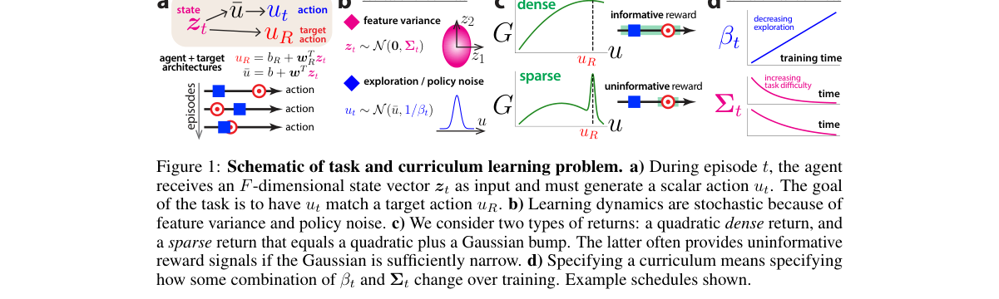

**Why this ranks #7**: 为什么课程学习在 RL 里有用、在监督学习里没用？答案：奖励稀疏 + 奖励地形上存在互相竞争的极值。

---

### 8. Emergent Cooperative Thermoregulation in Lunar Swarm Robotics

**arXiv**: [2610.31868](https://arxiv.org/abs/2610.31868) | **Score**: 8.0 (relevance 8.0 x 0.7 + quality 8.0 x 0.3) | **Tags**: rl-algorithm, multi-agent-RL, evolution-strategies, swarm-robotics, lunar-exploration, emergent-behavior | **Categories**: cs.RO | **Pages**: 7

**Authors**: Anais Jeger, Harry Holt, Lennart Puck

**Affiliation**: MIT Center for Bits and Atoms; ESA Planetary Robotics Laboratory

**Abstract**

> Swarms of small robots are an attractive way to survey lunar caves and lava tubes. Missions such as NASA's CADRE will fly cooperating rovers for distributed mapping, but only in daylight. The 354 h lunar night drops the surface towards 95 K, and the radioisotope heaters that let single rovers survive it cannot be supplied at swarm scale. In this study we investigate whether a swarm can instead use its own members as thermal shielding. We train one policy, shared by all twenty robots, by reinforcement learning with an evolution-strategies estimator. The policy receives a single reward, once, at the end of the night: the mean temperature of the five coldest robots. Nothing in that reward refers to position, spacing, exposure or motion. Two behaviors nonetheless emerge. The swarm aggregates, and robots circulate between the sheltered core and the exposed rim, the same pair of behaviors with which emperor penguins survive the Antarctic winter. We measure the survival threshold, the smallest stored energy per robot at which every robot is still alive at sunrise. Across ten runs it is 155.6 +/- 1.3 pcm-h, where one pcm-h is 7.2 kJ of stored heat. That is 37% below a motionless huddle and within 13% of a physics-based lower bound, and at a budget where the motionless huddle loses six robots, every robot survives. The behavior needs no shared spatial reference and no robot-robot contact, and transfers from twenty robots to forty without retraining.

**Key findings**

- **Finding**: 背景：NASA CADRE 等任务用多台协作 rover 在月面做分布式测绘，但只在白天作业；354 小时的月夜会把地表温度压到约 95 K。
- **Finding**: 单台 rover 赖以生存的放射性同位素加热器无法在集群规模上供应。
- **Finding**: 本文研究：集群能否**用自己的成员当彼此的热屏蔽**。
- **Finding**: 用强化学习 + 进化策略（ES）估计器训练**一个由全部 20 台机器人共享的策略**。
- **Finding**: 奖励只在夜晚结束时给一次：五台最冷机器人的平均温度。**奖励里不含任何关于位置、间距、暴露或运动的信息**。
- **Finding**: 即便如此，两种行为自发涌现：集群**聚集**，且机器人在遮蔽核心与暴露边缘之间**轮换流动**——与帝企鹅在南极越冬时的行为相同。
- **Finding**: 作者测量了存活阈值（每台仍存活的最小储存能量）：十次运行下为 **155.6 ± 1.3 pcm-h**（1 pcm-h = 7.2 kJ 储热）。
- **Finding**: 这比静止抱团低 **37%**，与基于物理的下界相差 13% 以内；在静止抱团会损失六台机器人的预算下，全部机器人存活。
- **Finding**: 该行为不需要共享空间参照，也不需要机器人间接触，并且**从 20 台迁移到 40 台无需重训**。
- **Inference**: 「奖励里没有任何空间信息却涌现出聚集+轮换」是极好的「奖励塑形」范例——一个标量足以撑起复杂的多机器人协同行为。
- **Inference**: 从 20 台零样本迁移到 40 台，说明涌现的是「相对拥挤度」这类尺度无关的行为，这是 emergent behavior 里很少见的可迁移性。
- **Recommendation**: 强烈推荐。做多智能体 RL、集群机器人、涌现行为的人必读。

**Key figures**

*Framework - Twenty simulated robots during the 354 h lunar night, from one rollout of the learned policy. Ring color is each robot’s sky exposure χ on the scale of Fig. 3. Top: the scattered start at hour*

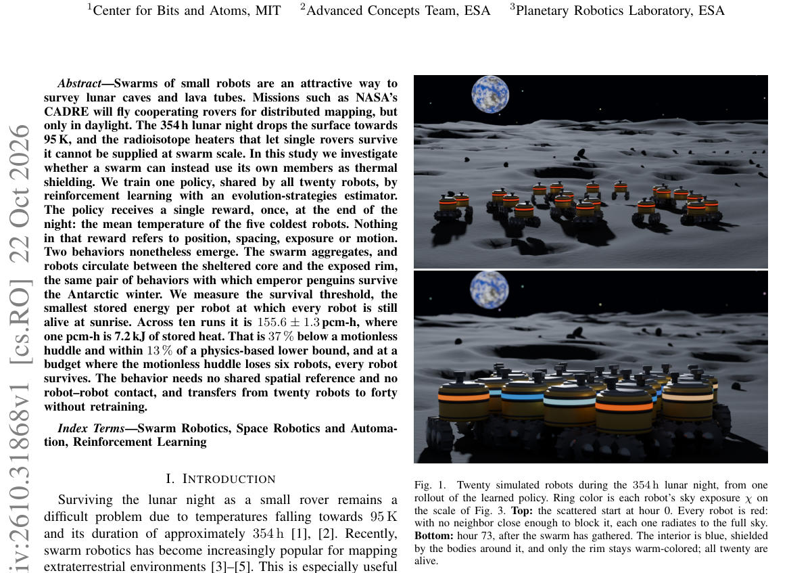

*Result - Overview of the learning system. Left: fourteen local observation channels enter a 64-unit LSTM whose state persists across thermal steps; a skip connection passes the input directly to the ou*

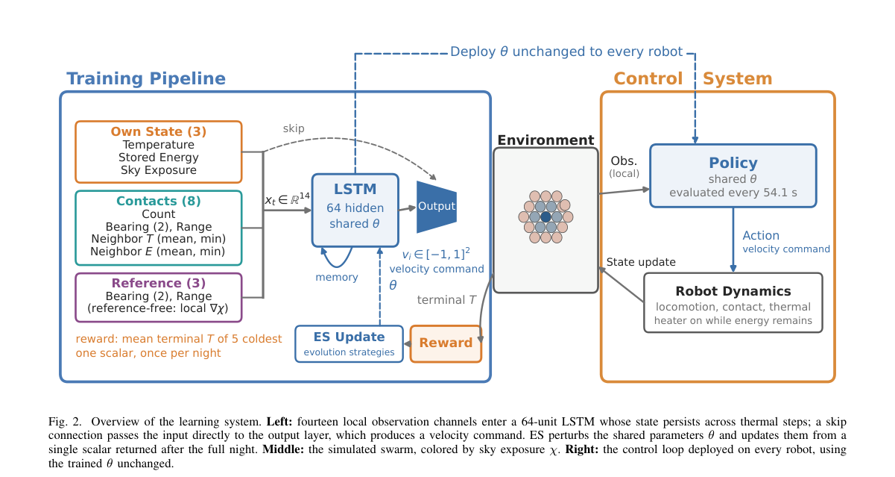

**Why this ranks #8**: 20 台机器人在月球黑夜中互相挡热——行为完全涌现，奖励里没有任何位置、间距或运动信息。

---

### 9. SEVI: Safe Evidential Real-World Reinforcement Learning

**arXiv**: [2610.31829](https://arxiv.org/abs/2610.31829) | **Score**: 8.0 (relevance 8.0 x 0.7 + quality 8.0 x 0.3) | **Tags**: rl-algorithm, safe-RL, real-robot-RL, evidential-deep-learning, safety-critic, USB-insertion, recovery-policy | **Categories**: cs.AI, cs.LG, cs.RO | **Pages**: 13

**Authors**: Shaekh Mohammad Shithil, Lantao Liu

**Affiliation**: Indiana University Luddy School of Informatics

**Abstract**

> Real-world reinforcement learning has enabled contact-rich manipulation tasks to be trained directly on physical robots, but unsafe interactions during online learning remain a key barrier to practical deployment. We propose Safe Evidential Real-World Reinforcement Learning (SEVI), a framework for reliability-aware safety intervention during real-world policy learning. SEVI introduces an Evidential Safety Critic that estimates both future constraint-violation risk and epistemic uncertainty in a single forward pass. During online learning, SEVI evaluates each task-policy action before execution; if the action is predicted to be unsafe or the prediction is insufficiently supported by evidence, SEVI overrides it with an offline-trained recovery policy that guides the robot toward a lower-risk region. We evaluate SEVI on two simulated manipulation tasks and a real-world USB insertion task under in-distribution and distribution-shifted conditions. Across task-learning and safety-critic baselines, SEVI achieves the strongest trajectory-level safety prediction, the highest final task success, and the lowest unsafe-event counts. SEVI also reduces unsafe events by 13.4 to 57.1 percent relative to recovery-based safe RL while preserving low-latency execution-time filtering. The project page is available at: https://sevi-safe.github.io/

**Key findings**

- **Finding**: 指出真实世界 RL 已能在物理机器人上直接训练接触密集操作任务，但在线学习中的**不安全交互**仍是落地的关键障碍。
- **Finding**: SEVI 提出面向可靠性感知安全干预的框架：引入 **Evidential Safety Critic**，在**一次前向**里同时估计未来的约束违反风险与认知不确定性。
- **Finding**: 在线学习时，SEVI 在执行前评估每个任务策略动作；若动作被预测为不安全，或预测缺乏证据支撑，SEVI 用一个离线训练的**恢复策略**覆盖它，把机器人引向更低风险区域。
- **Finding**: 在两个仿真操作任务与一个真实 USB 插入任务上评测，覆盖分布内与分布偏移条件。
- **Finding**: 相对任务学习与安全 critic 两类基线，SEVI 取得最强的轨迹级安全预测、最高的最终任务成功率与最低的不安全事件数。
- **Finding**: 相对基于恢复的安全 RL，SEVI 把不安全事件减少 **13.4%–57.1%**，同时保持低延迟的执行时过滤。
- **Inference**: 「证据不足时也拒绝执行」是这篇的核心设计——把「不确定性」本身当作拒绝理由，而不是只当作风险分数的一部分。
- **Inference**: 13.4%–57.1% 的安全事件下降幅度区间很宽，说明收益高度依赖任务的安全裕度，不能一概而论地外推。
- **Recommendation**: 推荐。做真机 RL、安全 RL、机器人部署的人必读。

**Key figures**

*Framework - Illustration of SEVI on the real-world USB insertion task. When the task policy attempts an unsafe insertion, SEVI detects elevated safety risk or epistemic uncertainty and triggers the recove*

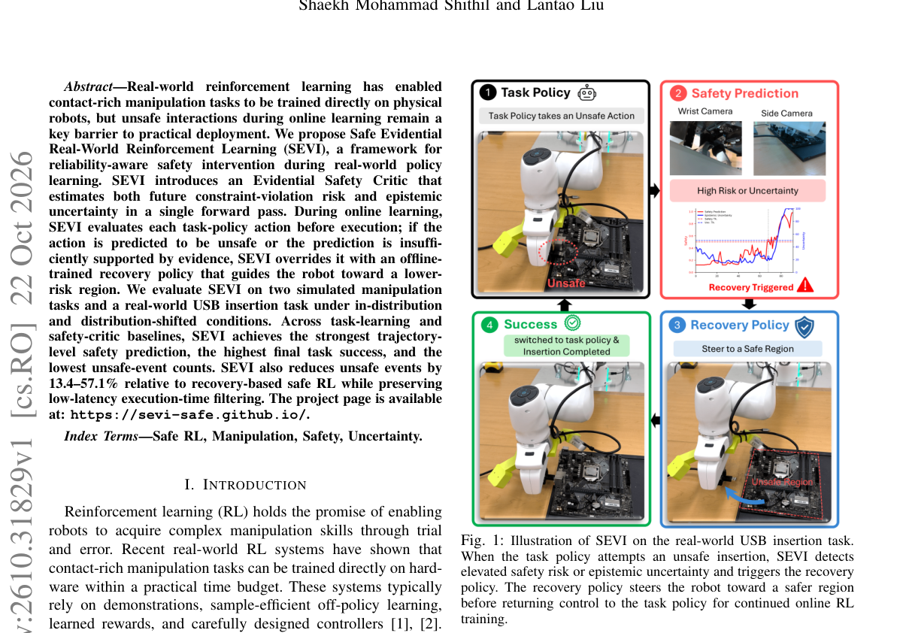

*Result - Overview of the SEVI framework. In offline training, failure and recovery demonstrations are used to train the Evidential Safety Critic and recovery policy. During the runtime pipeline, the ES*

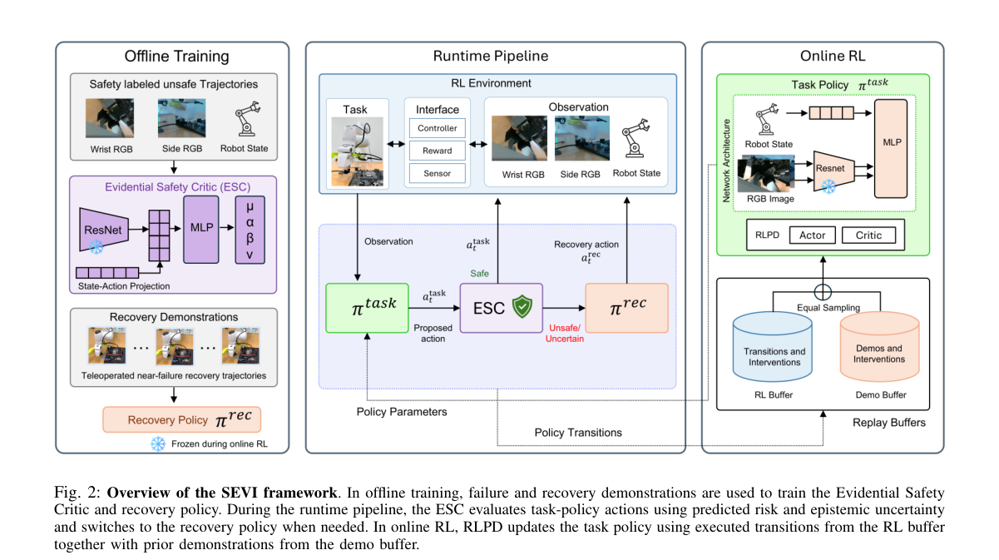

**Why this ranks #9**: 真机在线学习里，动作执行前的安全判断要同时给出「危险程度」和「这个判断有多可信」。

---

### 10. PrefO2O: Zero-Shot Preference-Based Reinforcement Learning via Offline-to-Online Latent Preference Transfer

**arXiv**: [2610.31812](https://arxiv.org/abs/2610.31812) | **Score**: 8.0 (relevance 8.0 x 0.7 + quality 8.0 x 0.3) | **Tags**: rl-algorithm, preference-based-RL, offline-to-online, latent-preference, zero-shot, cross-embodiment | **Categories**: cs.AI, cs.RO | **Pages**: 16

**Authors**: Ruiqi Wang, Dezhong Zhao, Xuesu Xiao, Erdem Biyik, Byung-Cheol Min, Guohua Chen

**Affiliation**: University of Southern California; Beijing University of Chemical Technology; George Mason University

**Abstract**

> Preference-based reinforcement learning (PbRL) has emerged as a promising paradigm for learning robot behaviors aligned with human intent. However, its scalability is fundamentally limited by the need to collect expensive human preference labels for every new task. In this work, we present PrefO2O, an offline-to-online latent preference transfer framework that enables zero-shot PbRL on unseen target tasks without requiring any human feedback. The core idea is to learn a task-invariant latent preference space from a small amount of offline preference data on source tasks, where transferable preference structures are disentangled from task-specific variations. This learned manifold allows PrefO2O to transfer preference structures and reward priors to new tasks under distribution shift, while confidence-weighted optimal transport alignment generates reliable pseudo-preference supervision for online reward adaptation. Extensive experiments on robotic manipulation and locomotion benchmarks demonstrate that PrefO2O substantially outperforms existing preference-transfer baselines and matches or exceeds PbRL methods trained with real human feedback, while generalizing across multi-to-one and one-to-one transfer settings as well as across different robot embodiments.

**Key findings**

- **Finding**: 指出偏好强化学习（PbRL）被认为能学到与人类意图对齐的机器人行为，但其可扩展性被一个根本限制卡住：**每个新任务都要采集昂贵的人类偏好标签**。
- **Finding**: PrefO2O 提出 offline-to-online 的隐式偏好迁移框架，让模型在**完全不需要人类反馈**的情况下对未见目标任务实现零样本 PbRL。
- **Finding**: 核心思想：从源任务上少量离线偏好数据里学一个**任务不变的隐式偏好空间**，把可迁移的偏好结构与任务特定变化解耦。
- **Finding**: 学到的流形允许 PrefO2O 在分布偏移下把偏好结构与奖励先验迁移到新任务；同时用**置信度加权的最优传输对齐**为在线奖励适应生成可靠的伪偏好监督。
- **Finding**: 在机器人操作与运动基准上，PrefO2O 显著优于既有偏好迁移基线，并达到或超过用**真实人类反馈**训练的 PbRL 方法。
- **Finding**: 泛化覆盖多对一与一对一迁移设定，以及不同机器人形态之间。
- **Inference**: 「匹配甚至超过真实人类反馈训练的 PbRL」是很强的结论——它说明人工偏好里可迁移的那部分（结构）比不可迁移的那部分（具体偏好）更重要。
- **Inference**: 用最优传输对齐来生成伪偏好监督，是把「没有标签」变成「有软标签」的通用手法，可迁移到其他偏好迁移设定。
- **Recommendation**: 强烈推荐。做偏好 RL、人类意图对齐、跨任务迁移的人必读。

**Key figures**

*Framework - Conceptual illustration of PrefO2O. Offline preference data from multiple source tasks are used to learn a task-invariant latent preference space that captures shared preference structures whi*

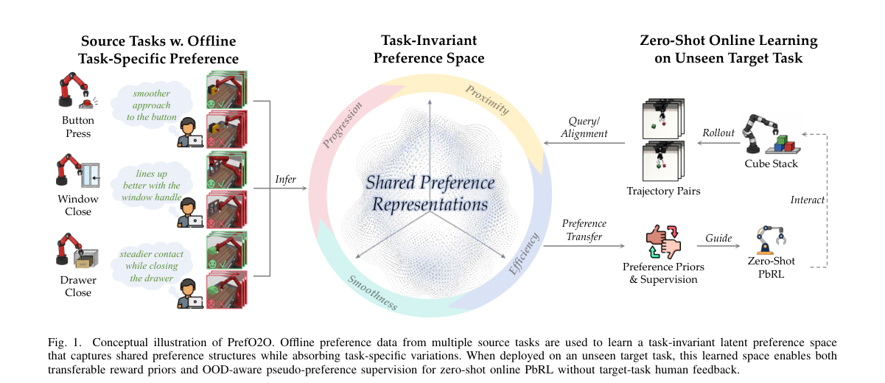

*Result - Overview of PrefO2O. The offline phase jointly learns a trajectory encoder, a preference VAE, and a meta reward model from source-task preference data. In the online phase, the pretrained enco*

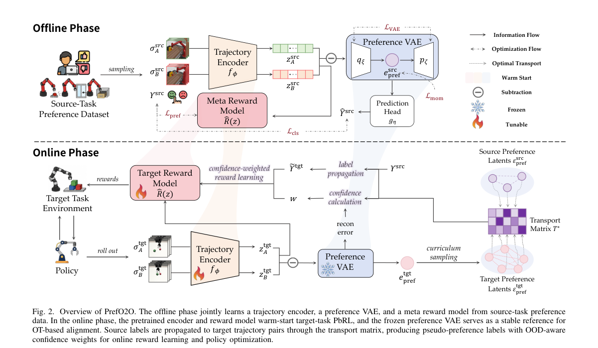

**Why this ranks #10**: 偏好强化学习被「每个新任务都要重新收人类标注」卡死——这里用一次性的源任务偏好迁移到完全没见过的目标任务。

---

## Footer

- Total papers scanned across all 7 tracks: 474（原始 663 条）
- rl_core track final top-10: 10
- Wild-cards in this track: 0
- Figure assets: 2026-10-26/res/

Generated by `mine-arxiv-daily-digest` skill. Sister file: `2026-10-26_rl_core_entry.md`.
