# ArXiv Daily Digest - 2026-10-26 (LLM 后训练的 RL（RLHF / DPO / GRPO / RLAIF / RLVR）, 10 papers)

**Generated**: 2026-10-26 17:00 CST

**Source**: arXiv cs.CV, cs.SD, eess.AS, cs.CL, cs.AI, cs.RO, cs.LG submissions, listing day 2026-10-23 (announced 2026-10-26 00:00 UTC)

**Batch window**: 2026-10-22T18:00:00Z .. 2026-10-23T18:00:00Z（arXiv 公告批次横跨两个 UTC 日：前一日 18:00 UTC 起算，当日 17:59:59 UTC 截止）

**Track**: rl_llm (top 10 of 474 papers scanned, 70 full reads)

**Scope**: 大语言模型后训练 RL：RLHF / DPO / GRPO / RLAIF / RLVR 与奖励建模

---

## Top 10 - LLM 后训练的 RL（RLHF / DPO / GRPO / RLAIF / RLVR）

### 1. Direction-Aware Token Credit Assignment with Reward-Model Gradients

**arXiv**: [2610.32772](https://arxiv.org/abs/2610.32772) | **Score**: 9.7 (relevance 10.0 x 0.7 + quality 9.0 x 0.3) | **Tags**: rlhf, GRPO, token-credit-assignment, reward-model-gradient, advantage-shaping, four-settings | **Categories**: cs.LG | **Pages**: 28

**Authors**: Yikuan Hu, Jifeng Zhu, Minle Su, Jiaqin Yue, Gujie Shao, Yanzhe Chen, Haoxuan Jia, Haoran Xu, Wangzhou Dai

**Affiliation**: Nanjing University; National University of Singapore; Tsinghua University; Nanyang Technological University

**Abstract**

> GRPO shares a response-level advantage across tokens, leaving unresolved how strongly each token should contribute to learning. Updates induced by the shared advantage reinforce or suppress the sampled token at each position, but these updates do not always point toward increasing reward at the token level. This motivates a work-based view of credit: just as work depends on the component of force along a displacement, token credit should reflect the local reward change along the policy update direction. We introduce Direction-Aware Token Credit Assignment (DATC), which maps frozen reward-model gradients into policy logit space and allocates weights by evaluating the alignment between the reward direction and GRPO's signed sampled-action update direction, while preserving the sign and mean of the response-level advantage. DATC outperforms GRPO in all four settings across two model families.

**Key findings**

- **Finding**: 指出 GRPO 把响应级优势共享给所有 token，留下「每个 token 到底该贡献多少」的未决问题。
- **Finding**: 更关键的是：共享优势诱导的更新**并不总是指向提高该 token 位置的奖励**。
- **Finding**: 作者提出「功（work）」视角的信用：正如功取决于力在位移方向上的分量，token 信用应当反映**沿策略更新方向的局部奖励变化**。
- **Finding**: DATC（Direction-Aware Token Credit Assignment）把**冻结奖励模型的梯度**映射到策略 logit 空间，并通过评估「奖励方向」与「GRPO 带符号采样动作更新方向」之间的对齐来分配权重。
- **Finding**: 同时**保持响应级优势的符号与均值不变**，因此不破坏原有的优势语义。
- **Finding**: 在两个模型家族的四个设定中，DATC 全面优于 GRPO。
- **Inference**: 「保持优势的符号与均值」这个约束很关键——它让 token 级加权变成一个纯粹的重分配，而不是偷偷改变了优化目标。
- **Inference**: 用冻结奖励模型的梯度当方向信号，是一条比训练专用 critic 更省的路子：既然奖励模型已经存在，梯度就是免费的结构信息。
- **Recommendation**: 强烈推荐。做 GRPO 改进、token 级信用分配、奖励模型的人必读。

**Key figures**

*Framework - A work-based view of token credit. DATC assigns larger weights to token updates with higher predicted local reward gains.*

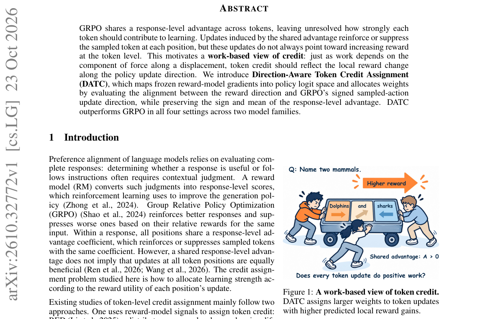

*Result - Overview of DATC. DATC combines the reward-improvement direction with the GRPO update direction to allocate token-level advantages, assigning larger weights to updates with higher predicted*

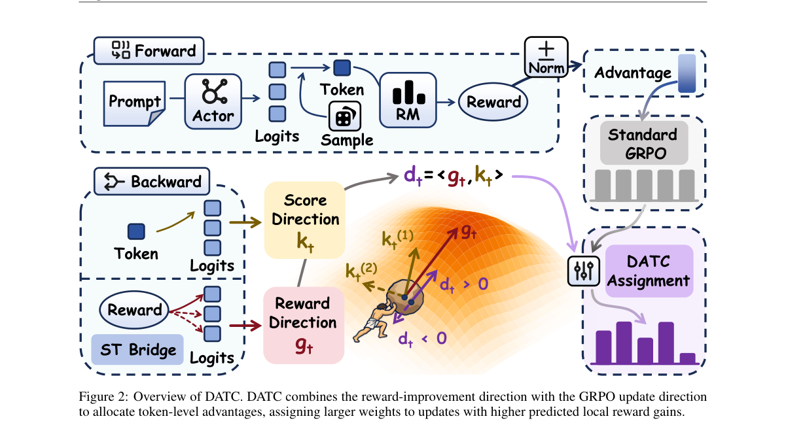

**Why this ranks #1**: 把奖励模型梯度映射到策略 logit 空间，用「方向对齐」给每个 token 分配信用——两个模型家族四个设定全面超过 GRPO。

---

### 2. SOPO: Socratic Guided Policy Optimization for Span-Level Hallucination Detection

**arXiv**: [2610.32212](https://arxiv.org/abs/2610.32212) | **Score**: 9.7 (relevance 10.0 x 0.7 + quality 9.0 x 0.3) | **Tags**: rlhf, RLVR, hallucination-detection, span-level, multi-turn-RL, teacher-guided-rollout, RAGTruth | **Categories**: cs.AI, cs.CL | **Pages**: 24

**Authors**: Jiawei Dong, Zilong Bai, Pengtian zhu, Peng Zhou

**Affiliation**: Patsnap Pte. Ltd.

**Abstract**

> Large Language Models (LLMs) have gained widespread adoption in various natural language processing tasks, but suffer from hallucination issues where they generate unfaithful or inconsistent content. While Reinforcement Learning with Verifiable Rewards (RLVR) has shown promising applications in reasoning tasks, its application to span-level hallucination detection is challenged by localization ambiguity, reward sparsity on hard examples, and uncontrolled length inflation. To address these issues, we introduce Socratic Guided Policy Optimization (SOPO), a multi-turn RL framework for robust hallucination detection. The key innovation of SOPO is a Socratic feedback mechanism, where a teacher model guides the reasoning trajectories during rollout by providing indirect hints inferred from the ground truth. This teacher-guided approach enables the model to generate more effective reasoning trajectories for hard examples, thus alleviating reward sparsity. Furthermore, we incorporate Turn-based Advantage Scaling to penalize verbosity bias, encouraging the model to develop efficient and autonomous reasoning capabilities. Empirical results on RAGTruth demonstrate that SOPO (4B) achieves state-of-the-art performance, surpassing leading proprietary models (e.g., GPT-5) and standard RL baselines, while obtaining higher reported mean scores than GRPO on four out-of-domain benchmarks, with mixed evidence against CAPO. We release our training and evaluation code alongside the 1.7B and 4B SOPO models at https://github.com/patsnap/SOPO.

**Key findings**

- **Finding**: 指出 RLVR 在推理任务上已有成功，但用在**跨度级幻觉检测**上面临三重困难：定位歧义、困难样本上的奖励稀疏、以及不受控的长度膨胀。
- **Finding**: SOPO（Socratic Guided Policy Optimization）是面向稳健幻觉检测的**多轮 RL** 框架。
- **Finding**: 关键创新是**苏格拉底式反馈机制**：一个教师模型在 rollout 期间根据真值给出**间接提示**，引导推理轨迹。
- **Finding**: 这种教师引导让模型在困难样本上能生成更有效的推理轨迹，从而缓解奖励稀疏。
- **Finding**: 另引入 **Turn-based Advantage Scaling** 来惩罚冗长偏置，鼓励模型发展更高效、更自主的推理能力。
- **Finding**: 在 RAGTruth 上，SOPO (4B) 达到 SOTA，超过 GPT-5 等领先商业模型与标准 RL 基线。
- **Finding**: 在四个域外基准上，SOPO 的平均分高于 GRPO（4 个中有更高），但对 CAPO 的对比证据是**混合的**。
- **Finding**: 训练与评测代码，以及 1.7B 与 4B 的 SOPO 模型一并开源。
- **Inference**: 「教师在 rollout 期给间接提示」是把 SFT 式的强监督偷偷塞进 RLVR 的一种实用做法——它绕开了奖励稀疏，却没有放弃 RL 的优化框架。
- **Inference**: 作者对 CAPO 的对比给出「证据混合」而非强行胜出，这种表述在 RL 论文里很少见，值得信任。
- **Recommendation**: 强烈推荐。做 RLVR、幻觉检测、多轮 RL 的人必读。

**Key figures**

*Framework - Overview of SOPO.*

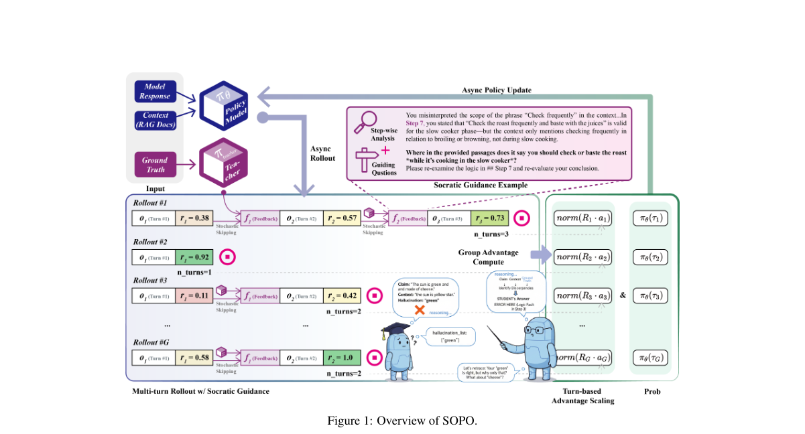

*Result - Mean task reward of RL over training steps.*

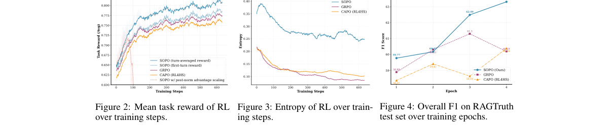

**Why this ranks #2**: 把「苏格拉底式提问」做成 rollout 期的教师干预，缓解奖励稀疏与长度膨胀——4B 模型在 RAGTruth 上超过 GPT-5。

---

### 3. From Visual Affinity to Learning Credit in Multimodal Reinforcement Learning

**arXiv**: [2610.32324](https://arxiv.org/abs/2610.32324) | **Score**: 9.0 (relevance 9.0 x 0.7 + quality 9.0 x 0.3) | **Tags**: rlhf, RLVR, multimodal-RL, token-credit, advantage-allocation, plug-in, six-benchmarks | **Categories**: cs.AI | **Pages**: 20

**Authors**: Yuhang Han, Dingning Liu, Yujie Chen, Yaojie Zhang, Jingwei Song, Zequn Yang, Xuanming Shang, Li Ding, Zhijiang Guo, Linfeng Zhang

**Affiliation**: HKUST Guangzhou; Shanghai Jiao Tong University; HKUST

**Abstract**

> Reinforcement learning with verifiable rewards (RLVR) improves multimodal reasoning, but uniformly assigning a single response-level advantage to all tokens overlooks the distinct roles of visual observations and subsequent reasoning. Visual affinity alone is insufficient: predictive states may align with both image and prompt-context representations, and upweighting valid visual observations can amplify their negative-advantage updates when later reasoning fails. To address this issue, we propose \textbf{Outcome-Conditioned Visual Credit (OVC)}, a plug-in framework that separates visual-association measurement from token-level credit assignment and is adaptable to policy-optimization methods with uniform response-level advantage allocation. Relative Visual Encoding constructs a context-relative visual coordinate by contrasting each predictive state's affinity to image and prompt-context representations. Outcome-conditioned Evidence Calibration combines this coordinate with uncertainty-scaled predictive features and calibrates their contributions to outcome-discriminative evidence through mean contrasts between positive- and negative-advantage responses, scaled by regularized within-side variation. Visual association thus informs credit through observed outcome differences rather than directly determining update priority. Normalized Credit Allocation conditions the calibrated evidence on the response's advantage sign to produce positive token weights with unit global mean. These detached weights preserve advantage signs while modulating individual token-gradient contributions. OVC reuses existing rollouts without auxiliary reward models, process annotations, or inference-time modules. Instantiated through GSPO-token, OVC retains sequence-level clipping and consistently improves six-benchmark mean accuracy over GSPO across three models, with gains of 1.86-2.39 percentage points.

**Key findings**

- **Finding**: 指出 RLVR 改善多模态推理，但把单一响应级优势均摊给所有 token，忽略了**视觉观察**与**后续推理**的不同角色。
- **Finding**: 而且**仅靠视觉亲和度是不够的**：预测状态可能同时与图像表征和 prompt 上下文表征对齐；给有效视觉观察加权，反而可能在后续推理失败时放大其负优势更新。
- **Finding**: 提出 OVC（Outcome-Conditioned Visual Credit）：一个**即插即用**框架，把「视觉关联测量」与「token 级信用分配」分开，且可适配任何采用统一响应级优势分配的策略优化方法。
- **Finding**: Relative Visual Encoding 通过对比每个预测状态对图像与 prompt 上下文表征的亲和度，构造**上下文相对的视觉坐标**。
- **Finding**: Outcome-conditioned Evidence Calibration 把该坐标与不确定性缩放的预测特征结合，用正优势与负优势响应之间的**均值对比**（按正则化的组内方差缩放）来标定其对结果判别性证据的贡献。
- **Finding**: 换言之，视觉关联是**通过观察到的结果差异**来影响信用，而不是直接决定更新优先级。
- **Finding**: Normalized Credit Allocation 按响应的优势符号对标定后的证据做条件化，产生全局均值为 1 的正 token 权重；这些**梯度分离**的权重保留优势符号，只调节单个 token 的梯度贡献。
- **Finding**: OVC **复用已有 rollout**，不需要辅助奖励模型、过程标注或推理期模块。
- **Finding**: 通过 GSPO-token 实例化，OVC 保留序列级裁剪，在三个模型上把六个基准的平均准确率相对 GSPO 提升 **1.86–2.39 个百分点**。
- **Inference**: 「视觉亲和度不足」这个论证是本篇最锋利的部分：它直接否定了当前多模态 RLVR 里最常见的一种直觉加权方式。
- **Inference**: 「用正负优势响应的均值对比做标定」把信用分配与结果证据挂钩，且不引入任何额外模型——这是很干净的自监督式设计。
- **Recommendation**: 强烈推荐。做多模态 RL、RLVR、token 信用分配的人必读。

**Key figures**

*Framework - Affinity and response correctness. We analyze 8 valid responses per randomly sampled question from a frozen Qwen3.5- 9B trained with GSPO on Math77K, without correctness filtering. Affinity*

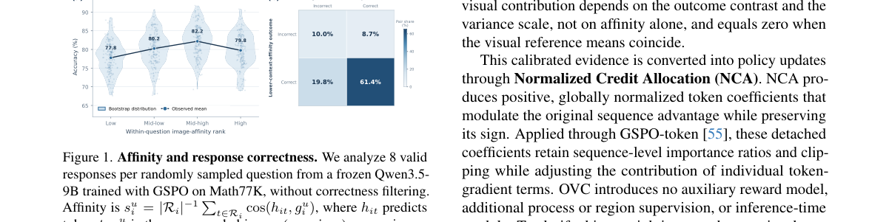

*Result - Overview of Outcome-Conditioned Visual Credit (OVC). An image–question pair produces a group of responses whose rewards yield group-relative advantages. For each response token, OVC combines*

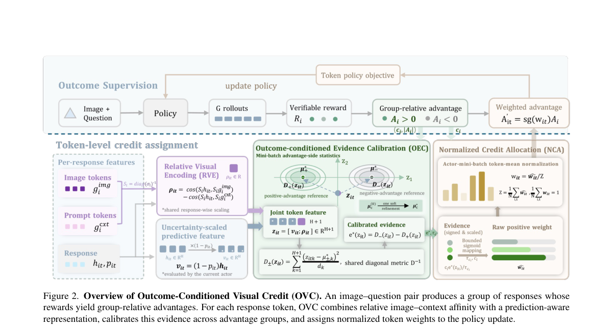

**Why this ranks #3**: 「视觉相关」不等于「该加权」——作者把视觉关联与 token 信用拆开，用结果差异（正负优势响应）来标定。

---

### 4. MS-TTRL: Breaking the Frequency Conflict in Multiple-Solution Test-Time Reinforcement Learning

**arXiv**: [2610.32234](https://arxiv.org/abs/2610.32234) | **Score**: 9.0 (relevance 9.0 x 0.7 + quality 9.0 x 0.3) | **Tags**: rlhf, RLVR, test-time-RL, multiple-solution, frequency-conflict, diversity, recovery-rate | **Categories**: cs.LG | **Pages**: 23

**Authors**: Zhixia Zhang, Binqian Xu, Huaiyang Wang, Yikun Ban, Dianbo Liu

**Affiliation**: Beihang University; National University of Singapore

**Abstract**

> Scientific, engineering, and mathematical reasoning tasks can admit multiple valid solutions, while exhaustive annotation of the full solution set is often prohibitively costly. Test-time reinforcement learning (TTRL) applies reinforcement learning to unlabeled test instances, offering a label-free approach to multiple-solution reasoning. In this setting, generation frequency serves two opposing objectives: correctness estimation favors frequent outcomes, whereas outcome-level diversity preservation favors less frequent outcomes. We term this tension the \textbf{Frequency Conflict}. To resolve this conflict, we propose MS-TTRL, which obtains frequency-independent correctness estimates through Outcome-Level Self-Verification while reserving generation frequency solely for diversity preservation. Three-State Outcome Cache and the Candidate State support verification reuse across repeated observations and confidence-aware handling of ambiguous outcomes, while Confidence-Gated Inverse Probability Scaling selectively strengthens the learning signals of rare, reliably verified outcomes. Experiments across two benchmarks, four multiple-solution tasks, and three backbone models, each evaluated with five random seeds, show that MS-TTRL improves Recovery Rate by 19.13 percentage points on average over the best-performing label-free baseline and approaches the performance of the supervised IPS-GRPO.

**Key findings**

- **Finding**: 指出科学、工程与数学推理任务常有多解，但穷举标注完整解集代价高昂；测试时 RL（TTRL）在无标签测试样本上做 RL，为多解推理提供了无标注路径。
- **Finding**: 在这一设定下，**生成频率服务于两个互相冲突的目标**：正确性估计偏好高频结果，而结果层面的多样性保留偏好低频结果。作者称之为 **Frequency Conflict**。
- **Finding**: MS-TTRL 通过**结果层面的自验证**获得与频率无关的正确性估计，把生成频率**只**用于多样性保留。
- **Finding**: Three-State Outcome Cache 与 Candidate State 支持跨重复观察的验证复用，以及对歧义结果的置信度感知处理。
- **Finding**: Confidence-Gated Inverse Probability Scaling 则选择性地**加强**罕见但被可靠验证结果的学习信号。
- **Finding**: 在两个基准、四项多解任务、三个骨干模型上，每个设定用 5 个随机种子：MS-TTRL 相对最好的无标签基线，Recovery Rate 平均提升 **19.13 个百分点**，并接近有监督 IPS-GRPO 的表现。
- **Inference**: 把「频率」这一信号的两种用途显式解耦，是本文最漂亮的一步——很多 TTRL 工作是在这两种用法之间隐性折中，结果两头都不讨好。
- **Inference**: 罕见但可靠的结果要被「选择性加强」，这正是 IPS 的经典结论；但要成立，前提是正确性估计与频率无关——这就是自验证那一环的作用。
- **Recommendation**: 强烈推荐。做测试时 RL、多解推理、多样性-正确性权衡的人必读。

**Key figures**

*Framework - Frequency conflict and signal decoupling in MS-TTRL. Left: Frequency-based cor- rectness estimation favors common outcomes, whereas diversity preservation favors rare ones. Mid- dle: Self-ve*

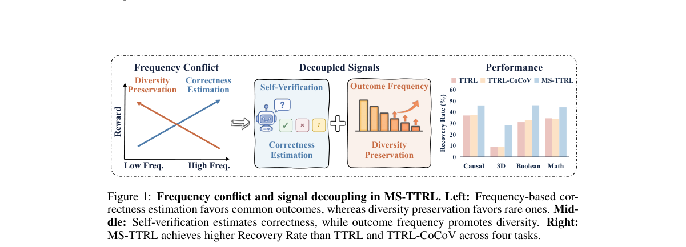

*Result - Overview of MS-TTRL. For each unlabeled problem, generated solution outcomes are self-verified and maintained in a three-state outcome cache. Their stored status is then combined with gated*

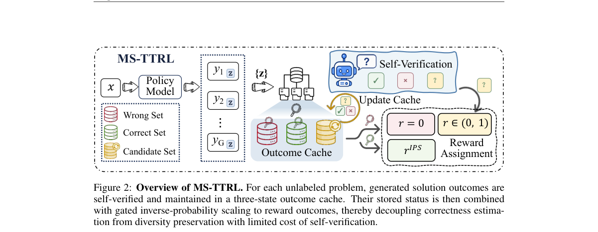

**Why this ranks #4**: 「生成频率」在多解任务里同时被用来估正确性和保多样性，二者天然打架——作者把两件事彻底分开。

---

### 5. Pseudo-Labels as Rewards, Not Targets: Group-Relative Policy Optimization for Semi-Supervised ASR

**arXiv**: [2610.32572](https://arxiv.org/abs/2610.32572) | **Score**: 8.7 (relevance 9.0 x 0.7 + quality 8.0 x 0.3) | **Tags**: rlhf, GRPO, ASR, semi-supervised, pseudo-labels, label-noise, WER, audio-LM | **Categories**: cs.CL, eess.AS | **Pages**: 5

**Authors**: Shashi Kumar, Yanis Labrak, Sergio Burdisso, Esaú Villatoro-Tello, Petr Motlicek, Kadri Hacioglu, Andreas Stolcke

**Affiliation**: Idiap Research Institute; EPFL; Brno University of Technology; Uniphore

**Abstract**

> Adapting ASR to a domain with only untranscribed audio typically relies on pseudo-labeling, a strong teacher transcribes the audio and a student is fine-tuned on it. Because supervised fine-tuning (SFT) treats every pseudo-label token as a target, the student inherits the teacher's errors. We show that using the same pseudo-labels as a reward reference for Group Relative Policy Optimization (GRPO) is more robust to label noise. In the banking domain, GRPO yields 29.3% to 56.2% relative WER improvements over SFT on Whisper-generated labels, and the advantage holds across four Whisper sizes, four teacher families, three domains and four languages. While SFT reproduces almost 100% of teacher errors verbatim, GRPO passes through only 27%. Rollout statistics explain why, erroneous pseudo-label words rarely appear in on-policy rollouts, so group-relative advantages stay aligned with the clean transcript, whereas SFT forces them into the policy's support and collapses the reward variance GRPO relies on.

**Key findings**

- **Finding**: 指出把 ASR 适配到只有无转写音频的领域通常靠伪标注：强教师转写，学生在其上微调。由于 SFT 把每个伪标签 token 当作**目标**，学生会继承教师的错误。
- **Finding**: 本文主张：**把同样的伪标签当作 GRPO 的奖励参考**，而不是监督目标，对标签噪声更鲁棒。
- **Finding**: 在银行领域，对 Whisper 生成的标签，GRPO 相对 SFT 取得 **29.3%–56.2% 的相对 WER 改善**；这一优势在 4 个 Whisper 规模、4 个教师家族、3 个领域与 4 种语言上都成立。
- **Finding**: 机制解释是关键：SFT 几乎 **100%** 原样复现教师的错误，而 GRPO 只传过去 **27%**。
- **Finding**: rollout 统计给出了原因：错误的伪标签词很少出现在 on-policy rollout 里，因此组相对优势仍与干净转写对齐；而 SFT 把它们强行塞进策略支撑集，压垮了 GRPO 所依赖的奖励方差。
- **Inference**: 「同一份伪标签，换个用法，错误传播率从 100% 降到 27%」是本批最实用的一条结论——它几乎零成本就能套到任何半监督设定上。
- **Inference**: 机制解释（错误词很少被 on-policy 采样到）也提示：GRPO 的抗噪能力来自它**只优化被采样到的部分**，这解释了为什么它在很多标签噪声场景下都优于 SFT。
- **Recommendation**: 强烈推荐。做半监督、伪标注、GRPO 应用的人必读。

**Key figures**

*Framework - Fraction of erroneous pseudo-label (PL) words that the student reproduces verbatim in its final output, as a function of the number of word errors in the utterance’s pseudo-label.*

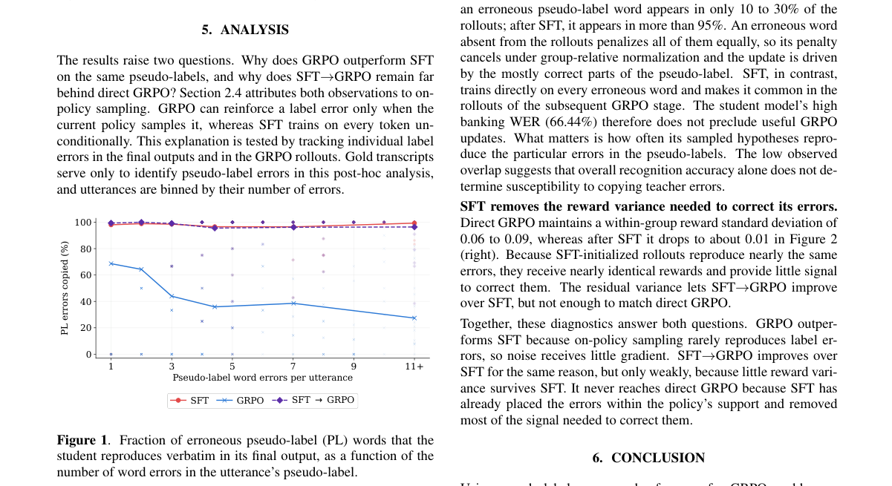

*Result - Rollout statistics as a function of the number of PL word errors per utterance. Left: fraction of the G=4 rollouts per utterance that contain the erroneous PL word. Right: within-group stand*

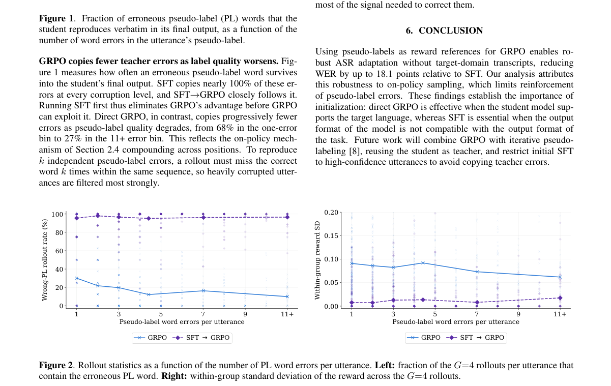

**Why this ranks #5**: 伪标签当目标会把老师傅的错误 100% 传给学生；当奖励只传 27%——同一个 GRPO，换个用法。

---

### 6. Where Rounding Happens Matters: Rounding-Location Alignment Stabilizes LLM Reinforcement Learning

**arXiv**: [2610.32951](https://arxiv.org/abs/2610.32951) | **Score**: 8.7 (relevance 9.0 x 0.7 + quality 8.0 x 0.3) | **Tags**: rlhf, GRPO, numerical-precision, BF16, on-policy, training-inference-alignment, Qwen | **Categories**: cs.LG | **Pages**: 17

**Authors**: Yijing Ke, Tianle Cai, Ruosong Wang

**Affiliation**: ByteDance Seed; Peking University

**Abstract**

> Reinforcement learning for large language models often uses separate systems for inference and training. Even with identical weights and BF16 tensors, implementation differences can make an intended on-policy update off-policy and destabilize training. Existing remedies align the entire inference and training stacks, change global precision, or modify the learning algorithm. We ask whether aligning selected parts of the execution stack can stabilize BF16 RL while other implementation differences remain. We align training-side rounding locations with inference in three regions---RoPE, SwiGLU, and residual RMSNorm---by retaining selected intermediates in FP32 until their BF16 outputs. Across four Qwen-family models, aligning all three regions prevents the collapse observed under the default BF16 baseline; RoPE-path alignment alone also suffices in the studied runs, despite remaining numerical discrepancies. The interventions keep the inference engine, matrix-multiplication and attention kernels, and learning objective unchanged.

**Key findings**

- **Finding**: 指出 LLM 的 RL 常用分离的推理与训练系统；即使权重与 BF16 张量完全相同，**实现差异**也会让本想 on-policy 的更新变成 off-policy，从而破坏训练稳定性。
- **Finding**: 既有补救是对齐整套推理/训练栈、改变全局精度，或修改学习算法。
- **Finding**: 本文问的是：只对齐执行栈的**选定部分**，能否在保留其他实现差异的情况下稳定 BF16 RL。
- **Finding**: 作者在三个区域把训练侧的**取整位置**与推理侧对齐——**RoPE、SwiGLU、residual RMSNorm**——具体做法是把选定中间量保留为 FP32 直到其 BF16 输出。
- **Finding**: 在四个 Qwen 系模型上，对齐全部三个区域可阻止默认 BF16 基线下观察到的**训练崩溃**；在所研究的运行中，**仅对齐 RoPE 路径也已足够**，尽管仍存在数值差异。
- **Finding**: 这些干预不改动推理引擎、矩阵乘法与注意力 kernel、以及学习目标。
- **Inference**: 「崩溃的根因可能只是取整位置」是一个极其反直觉但极其可操作的发现——它把一个玄学问题（BF16 RL 不稳定）变成了一个局部工程修复。
- **Inference**: 只对齐三处就够用，说明大多数「数值不一致」其实无害；反过来也提醒：一旦 RL 出问题，先查这三处，而不是推倒重来。
- **Recommendation**: 强烈推荐。做 RL 训练框架、数值精度、训练稳定性的人必读。

**Key figures**

*Framework - Training accuracy, AIME 2025 accuracy, and the inference–training discrepancy bDKL (Eq. 3) for the four execution-mode conditions. Observations are smoothed using causal trailing means over 2*

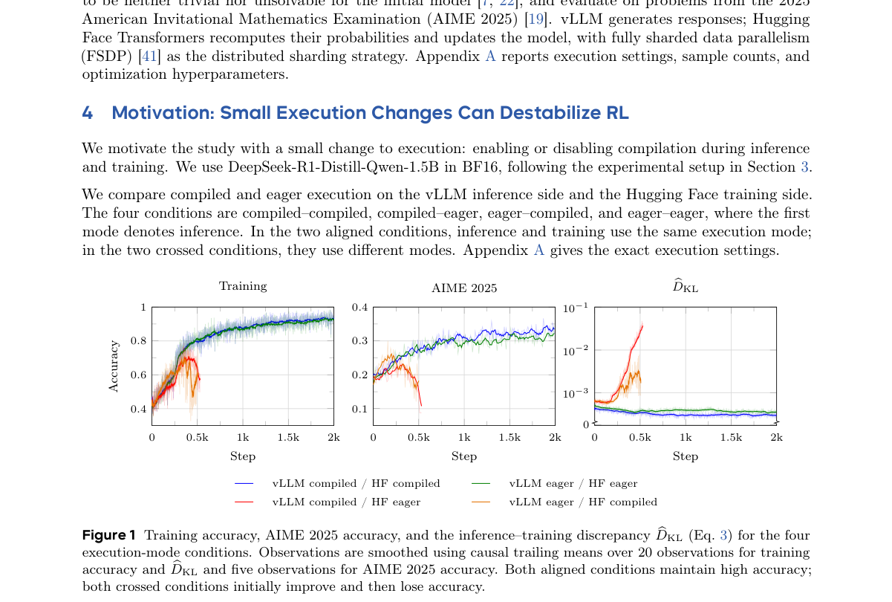

*Result - The three Qwen regions in which fusion changes rounding locations. Green arrows carry intermediates retained in FP32 under fusion and rounded to BF16 between separate operations. RoPE product*

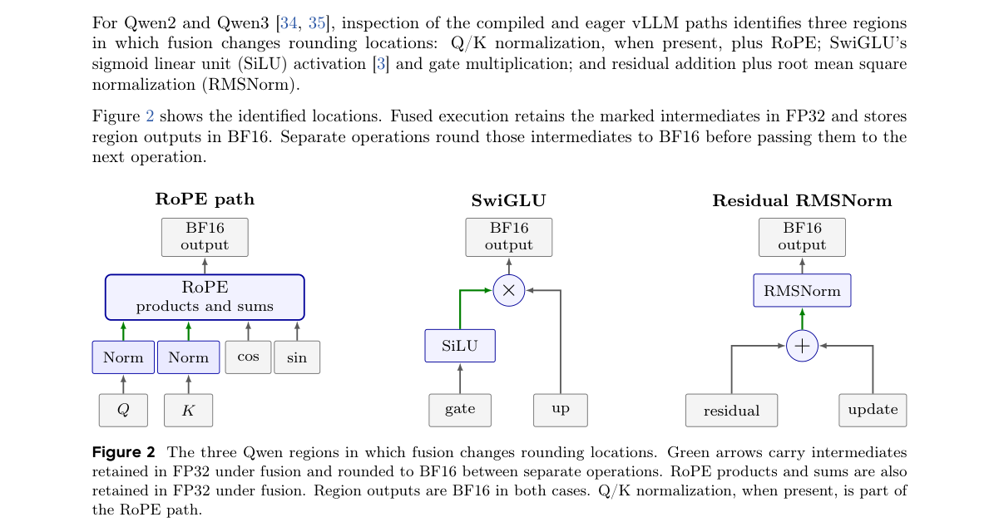

**Why this ranks #6**: 同一个权重、同一批 BF16 张量，只因为推理与训练端「在哪一步取整」不同，本来想做的 on-policy 更新就变成 off-policy。

---

### 7. PEAR: Adaptive Advantage Reshaping for Perception and Exploration in Large Vision-Language Models

**arXiv**: [2610.32216](https://arxiv.org/abs/2610.32216) | **Score**: 8.0 (relevance 8.0 x 0.7 + quality 8.0 x 0.3) | **Tags**: rlhf, GRPO, advantage-reshaping, entropy, visual-dependency, exploration, Qwen2.5-VL | **Categories**: cs.AI | **Pages**: 14

**Authors**: Junxin Wang, Yingfeng Luo, Xiangchen Song, Weiqiao Shan, Runsong Zhao, Xinyu Liu, Shunjie Xing, Yifu Huo, Dingyang Lin, Qiuyu Gu, Yongyu Mu, Chenglong Wang

**Affiliation**: Northeastern University Shenyang; University of Michigan; Kunming University of Science and Technology

**Abstract**

> Effective multimodal reasoning requires a model to reliably utilize visual information while sufficiently exploring diverse reasoning paths. To achieve this goal, prior work combines visual dependency and token entropy to reshape sequence-level advantages, but scaling the contribution of token entropy by visual dependency can leave high-entropy tokens with low visual dependency underweighted, despite their important role in reasoning exploration. To address this limitation, we propose PEAR, an adaptive advantage reshaping method for improving perception and exploration in multimodal reasoning. PEAR retains visual dependency as the base signal and adds an entropy-based exploration gain only at high-entropy positions, with lower visual dependency leading to a larger additional gain. The fused signal is then mapped to positive token-level weights that reshape the sequence-level advantage. Experiments on Qwen2.5-VL-3B/7B show that PEAR achieves the highest average performance among evaluated baselines across multimodal reasoning benchmarks, alongside leading results on textual reasoning and general multimodal benchmarks.

**Key findings**

- **Finding**: 指出多模态推理要可靠利用视觉信息，同时充分探索多样的推理路径；先前工作把**视觉依赖度**与 **token 熵**结合来重塑序列级优势。
- **Finding**: 问题在于：按视觉依赖度缩放 token 熵的贡献，会让**高熵但视觉依赖低**的 token 被低估，尽管它们对推理探索很重要。
- **Finding**: PEAR 是一种自适应的优势重塑方法：保留视觉依赖度作为基础信号，**只在高熵位置**加入基于熵的探索增益，且视觉依赖度越低、额外增益越大。
- **Finding**: 融合后的信号再被映射为正的 token 级权重，用于重塑序列级优势。
- **Finding**: 在 Qwen2.5-VL-3B/7B 上，PEAR 在多模态推理基准上取得被评测基线中的最高平均性能，并在文本推理与通用多模态基准上同样领先。
- **Inference**: 「只在高熵处加探索增益、且视觉依赖越低增益越大」是一个很精准的修正——它把探索预算集中到既不确定、又不能靠视觉判断的位置。
- **Inference**: 这个修正思路可推广：任何「两个信号相乘」的设计都要检查是不是把某一类 token 系统性地饿死了。
- **Recommendation**: 推荐。做多模态 RL、GRPO 优势重塑、探索-利用权衡的人必读。

**Key figures**

*Framework - Comparison of token-level credit assignment strategies. Left: GRPO assigns the same credit to all tokens within a response, despite their different contributions to reasoning. Prior work fus*

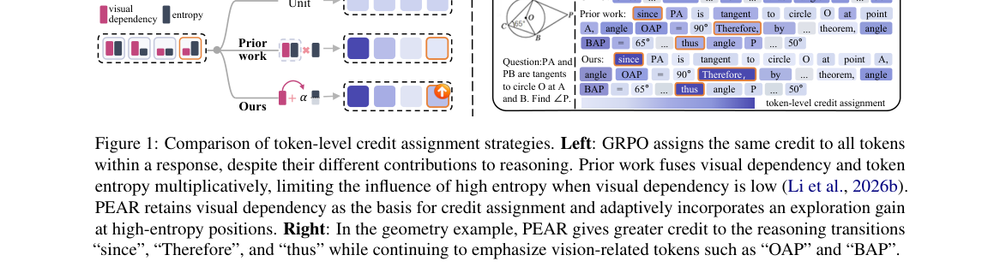

*Result - Overview of the proposed PEAR framework. Here, oi,t denotes the t-th token in response i, while Pi,t and P ′*

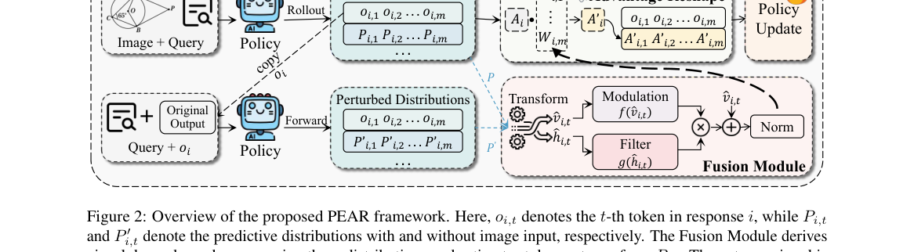

**Why this ranks #7**: 按视觉依赖度缩放 token 熵，会让「高熵但不看图」的 token 被压低——PEAR 改成只在高熵处加探索增益。

---

### 8. NgramRL: Accelerating RL Post-Training for Structured Generation via Rollout-Aware N-gram Speculative Decoding

**arXiv**: [2610.32881](https://arxiv.org/abs/2610.32881) | **Score**: 8.0 (relevance 8.0 x 0.7 + quality 8.0 x 0.3) | **Tags**: rlhf, GRPO, rollout-speedup, speculative-decoding, n-gram, prefetching, throughput | **Categories**: cs.AI | **Pages**: 7

**Authors**: Nilesh Prasad Pandey, Jangseon Park, Jason Kong, Onat Gungor, Tajana Rosing

**Affiliation**: University of California San Diego

**Abstract**

> Reinforcement learning (RL) post-training improves the reasoning capabilities of large language models, but its cost is dominated by autoregressive rollout generation, which can exceed 70% of training time. Existing speculative-decoding methods are poorly suited to this setting: model-based drafters consume scarce GPU memory and may become misaligned as the policy evolves, while existing model-free methods do not explicitly exploit repetition across training epochs. We observe that recent rollouts of the same prompt provide a high-quality, self-updating draft source. Based on this insight, we propose NgramRL, a per-prompt n-gram drafter constructed from bounded recent rollout history. NgramRL requires no auxiliary model, drafter training, or persistent GPU-resident drafter state, while target-model verification preserves the rollout distribution. To hide CPU cache lookup and scheduling, we further introduce an adaptive fan-out prefetcher that predicts likely verification outcomes (j, b), consisting of the accepted draft length j and target-emitted continuation token b. A causal budget allocator concentrates prefetches on high-probability outcomes, while uncovered outcomes fall back to sequential lookup without changing committed tokens. Across two model families and three reasoning and structured-generation workloads, NgramRL commits 3.60-7.77 tokens per target-model forward in the warm-cache regime, up to 1.99x more than SuffixDecoding and 7.0x more than prompt-lookup decoding. On Spider, the prefetcher covers 96.6% of Qwen3-8B outcomes at a candidate budget of 16 and improves measured rollout throughput by 1.38x over synchronous NgramRL, approaching its 1.40x overlap ceiling.

**Key findings**

- **Finding**: 指出 RL 后训练的成本主要来自自回归 rollout 生成，**可占训练时间的 70% 以上**；现有推测解码方法不适合这一设定：基于模型的 drafter 占用宝贵 GPU 显存，且会随策略演化而失配，而现有无模型方法没有显式利用训练轮次之间的重复性。
- **Finding**: 作者观察到：**同一 prompt 最近的 rollout 本身就是高质量、自更新的草稿源**。
- **Finding**: NgramRL 因此构造了一个**按 prompt** 的 n-gram drafter，取自有界的近期 rollout 历史。
- **Finding**: 它**不需要辅助模型、不需要训练 drafter、也不需要常驻 GPU 的 drafter 状态**；目标模型的验证保证 rollout 分布不变。
- **Finding**: 为隐藏 CPU 缓存查找与调度开销，引入自适应 fan-out 预取器，预测可能的验证结果 (j, b)——j 是被接受的草稿长度，b 是目标模型续写的 token。
- **Finding**: 因果预算分配器把预取集中在高概率结果上；未覆盖的结果回退到顺序查找，且不改变已提交 token。
- **Finding**: 在两个模型家族、三个推理与结构化生成负载上：warm-cache 模式下 NgramRL 每次目标模型前向提交 **3.60–7.77** 个 token，最多比 SuffixDecoding 多 **1.99×**、比 prompt-lookup 解码多 **7.0×**。
- **Finding**: 在 Spider 上，预算 16 时预取器覆盖 Qwen3-8B 96.6% 的结果，把实测 rollout 吞吐相对同步 NgramRL 提升 **1.38×**，接近其 1.40× 的重叠上限。
- **Inference**: 「把 rollout 历史当草稿」这个洞察非常实用：RL 训练本身就在制造可复用的草稿源，等于把训练过程的副产品变成了加速器。
- **Inference**: 「不需要 GPU 常驻 drafter」让这个方法在资源紧张的 RL 集群里特别友好——很多集群的瓶颈正是显存而非算力。
- **Recommendation**: 强烈推荐。做 RL 训练框架、rollout 加速、推测解码的人必读。

**Key figures**

*Framework - Overview of NgramRL’s CPU-GPU model-free spec- ulative decoding across training epochs.*

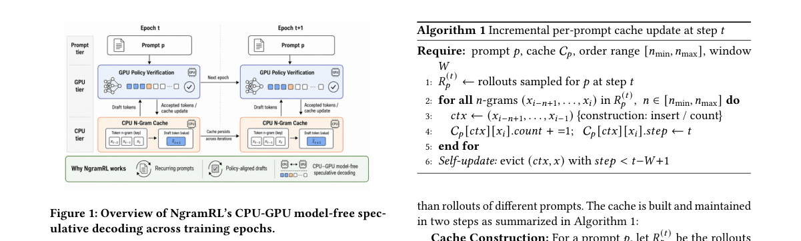

*Result - Same-prompt Spider rollouts one epoch apart (R1: earlier; R2: later). Shared spans are highlighted; overlap in- creases as training progresses.*

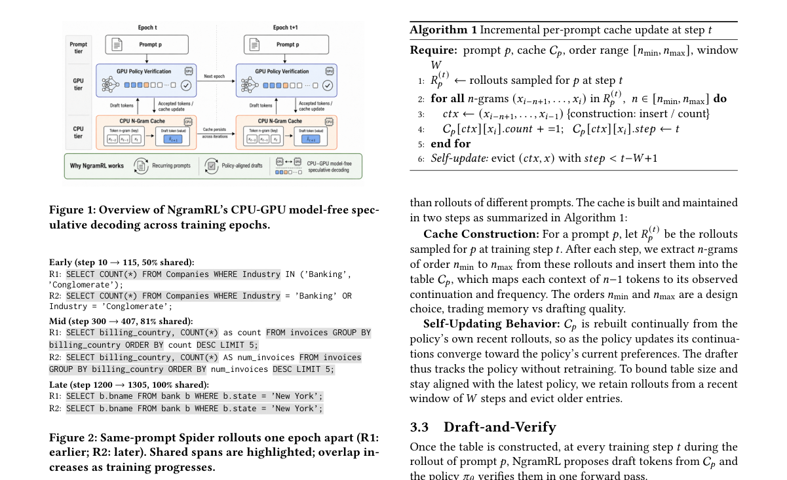

**Why this ranks #8**: 用同一 prompt 的历史 rollout 当草稿源——零辅助模型、零训练，把 RL 训练的 rollout 阶段提速最高 7 倍。

---

### 9. $R^2E:$ A Role-driven Reward Evolutionary Framework for Automated Reward Function Design

**arXiv**: [2610.32439](https://arxiv.org/abs/2610.32439) | **Score**: 8.0 (relevance 8.0 x 0.7 + quality 8.0 x 0.3) | **Tags**: rlhf, reward-design, automated-reward, LLM-agents, evolutionary-search, elite-pool, robotics | **Categories**: cs.RO | **Pages**: 38

**Authors**: Shouhao Chang, Xuan Liu, Hongye Zhu, Xinning Chen, Shigeng Zhang

**Affiliation**: Hunan University; Central South University

**Abstract**

> Designing effective reward functions is a critical challenge in Reinforcement Learning (RL), which traditionally requires costly manual trial-and-error. While Large Language Model (LLM)-based methods have shown promise in reward design, undifferentiated sampling and limited use of historical feedback often lead to insufficient exploration of the reward space and optimization instability. To address these challenges, we propose $R^2E$, a Role-driven Reward Evolutionary framework for automated reward function design that structures the process through explicit role specialization. $R^2E$ employs multiple LLM roles with complementary objectives: an Explorer that promotes novelty to expand the search space, a Guardian that performs conservative refinements to improve training stability, and an Evolver that recombines high-performing rewards via crossover and mutation to integrate effective structures. A dynamic scheduling strategy coordinates these roles, progressively shifting the search from broad exploration to focused exploitation. To mitigate optimization instability and provide a medium for cross-role collaboration, $R^2E$ incorporates a Global Elite Pool that retains the best-performing rewards to guide subsequent generations, thereby enabling coordinated interaction among roles and ensuring a reliable and consistent refinement process. Extensive experiments on multiple robotic tasks demonstrate the effectiveness of our method.

**Key findings**

- **Finding**: 指出奖励函数设计是 RL 的关键挑战，传统上依赖昂贵的手工试错；LLM 方法虽有前景，但**无差别采样**与**对历史反馈利用不足**会导致奖励空间探索不充分、优化不稳定。
- **Finding**: R²E（Role-driven Reward Evolutionary framework）通过**显式的角色分工**来结构化这一过程。
- **Finding**: 三个互补目标的 LLM 角色：**Explorer** 推动新颖性以扩展搜索空间；**Guardian** 做保守精修以提升训练稳定性；**Evolver** 通过交叉与变异重组高性能奖励，把有效结构整合进来。
- **Finding**: 一个动态调度策略协调这些角色，逐步把搜索从广域探索转向聚焦利用。
- **Finding**: 为缓解优化不稳定并提供跨角色协作的媒介，引入 **Global Elite Pool**，保留表现最好的奖励以指导后续世代。
- **Finding**: 在多个机器人任务上的大量实验验证了该方法的有效性。
- **Inference**: 「Explorer / Guardian / Evolver」三角色分工本质上是把探索-利用张力显式化了，而动态调度把它落成了一条时间轴上的策略。
- **Inference**: Global Elite Pool 同时承担精英保留与跨角色信息交换两个职能——这让三个 LLM 角色之间产生了真正的协作，而不是各自独立采样。
- **Recommendation**: 推荐。做奖励设计、自动化奖励、LLM 驱动的 RL 搜索的人必读。

**Key figures**

*Framework - Comparison of reward design paradigms. (Eureka) generates homogeneous rewards and lacks memory. If iteration T + 1 regresses, the LLM references only T + 1 for T + 2, discarding high-perform*

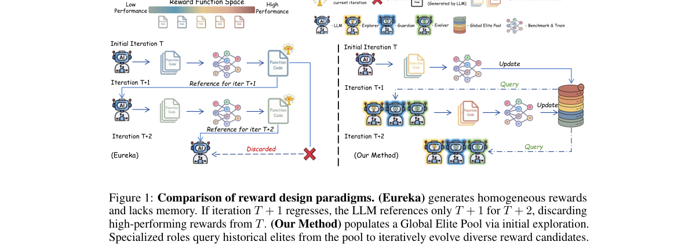

**Why this ranks #9**: 奖励函数设计交给三个分工明确的 LLM 角色：Explorer 拓边界、Guardian 求稳、Evolver 做重组。

---

### 10. Profile-Driven User Simulation via Reinforcement Learning with Hierarchical Rewards for Task-Oriented Dialogues

**arXiv**: [2610.32435](https://arxiv.org/abs/2610.32435) | **Score**: 7.3 (relevance 7.0 x 0.7 + quality 8.0 x 0.3) | **Tags**: rlhf, GRPO, user-simulation, task-oriented-dialogue, hierarchical-reward, financial-marketing, RAG-SOP | **Categories**: cs.CL | **Pages**: 20

**Authors**: Juan Li, Fangshu Chang, Xinyi Jiang, Ling Huang, Yunzhang Chen

**Affiliation**: Bairong Inc.

**Abstract**

> Building Task-Oriented Dialogue (TOD) systems for high-value scenarios such as financial marketing requires large volumes of domain-specific dialogue data, which privacy regulations, annotation costs, and the need for expert labor make hard to obtain. User simulation offers a remedy, but existing methods target general-domain dialogue and exhibit two key limitations: insufficient modeling of domain-specific business processes and compliance constraints, and inadequate capture of the colloquial, spoken-language character of voice interactions. We propose ProfileSim, a profile-driven user simulation framework for financial marketing outbound calls. It jointly models user profiles---demographics and Big Five personality traits---and business profiles---intents reverse-engineered from real call logs---enabling fine-grained control over simulated behavior. The base model is fine-tuned on real voice dialogue data and refined by Group Relative Policy Optimization (GRPO) with hierarchical rewards at the dialogue and utterance levels. Paired with a customer service agent integrating Standard Operating Procedure (SOP) constraints and Retrieval-Augmented Generation (RAG), ProfileSim achieves the highest colloquial naturalness, the strongest user profile adherence and the lowest agent score on long-tail intents among all evaluated user generators, while producing substantially shorter user utterances at comparable business compliance. The generated dialogue data is designed to support intent recognition training, agent evaluation, and rapid cold-start deployment.

**Key findings**

- **Finding**: 指出高价值场景（如金融营销）的任务型对话系统需要大量领域数据，而隐私法规、标注成本与专家工人都让获取困难；用户模拟是一个解法，但既有方法面向通用域，存在两个不足：领域业务流程与合规约束建模不足，以及口语化说话人特征捕捉不够。
- **Finding**: ProfileSim 同时建模**用户画像**（人口统计与 Big Five 人格）与**业务画像**（从真实通话日志反向工程出的意图），实现对模拟行为的细粒度控制。
- **Finding**: 基座模型在真实语音对话数据上微调，再用带**对话级与话语级分层奖励**的 GRPO 精修。
- **Finding**: 配合一个集成了 SOP（标准作业流程）约束与 RAG 的客服 agent，ProfileSim 在所有被评测的用户生成器中取得最高口语自然度、最强用户画像贴合度与最低 agent 得分（长尾意图上）。
- **Finding**: 同时在业务合规度相当的前提下，生成的用户话语**显著更短**。
- **Finding**: 生成的数据被设计用于意图识别训练、agent 评估与快速冷启动部署。
- **Inference**: 「更短的话语」与「更好的画像贴合」同时出现，说明分层奖励里的长度项确实在起作用，而不是靠稀释信息来骗分。
- **Inference**: 从真实通话日志反向工程意图来做画像，是一个很实用的「用存量数据造模拟器」路径，金融、客服、政务这类合规敏感场景都能复用。
- **Recommendation**: 推荐。做用户模拟、任务型对话、垂直领域 RLHF 的人必读。

**Key figures**

*Framework - PROFILESIM couples a profile-conditioned user simulator with an SOP- and RAG-constrained agent to generate closed-loop dialogue data. The User Simulator (left) is constructed through user/bu*

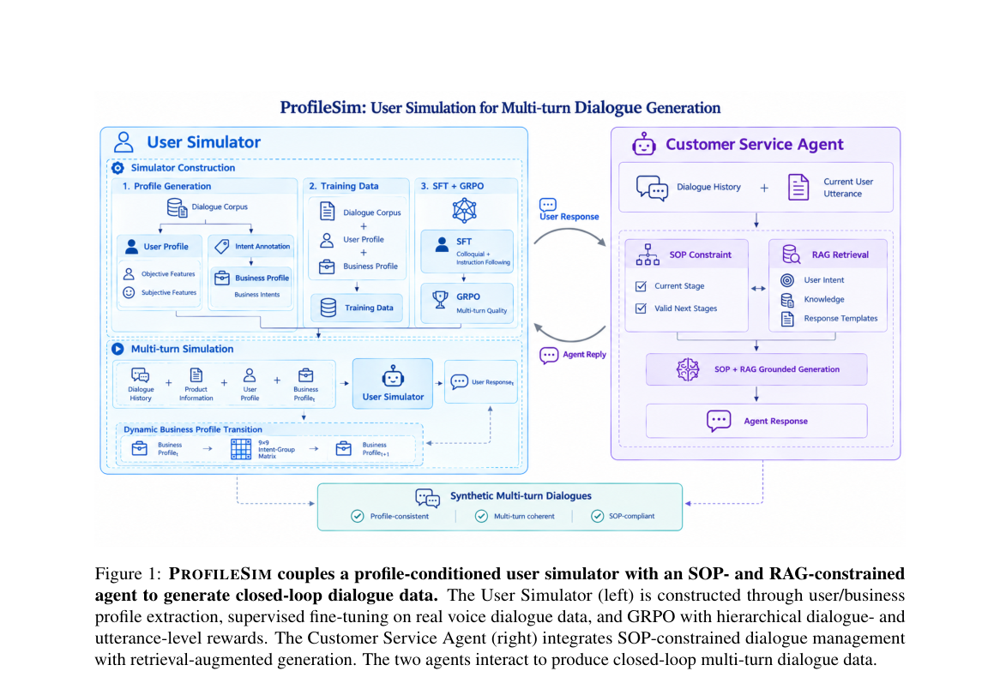

**Why this ranks #10**: 用 GRPO + 对话级/话语级分层奖励训用户模拟器，配合 SOP 约束的客服 agent，在长尾意图上最稳。

---

## Footer

- Total papers scanned across all 7 tracks: 474（原始 663 条）
- rl_llm track final top-10: 10
- Wild-cards in this track: 0
- Figure assets: 2026-10-26/res/

Generated by `mine-arxiv-daily-digest` skill. Sister file: `2026-10-26_rl_llm_entry.md`.
