# ArXiv Daily Digest - 2026-10-27 (AIGC 音频生成, 10 papers)

**Generated**: 2026-10-27 17:00 CST

**Source**: arXiv cs.CV, cs.SD, eess.AS, cs.CL, cs.AI, cs.RO, cs.LG submissions, listing day 2026-10-26 (announced 2026-10-27 00:00 UTC)

**Batch window**: 2026-10-25T18:00:00Z .. 2026-10-26T18:00:00Z（arXiv 公告批次横跨两个 UTC 日：前一日 18:00 UTC 起算，当日 17:59:59 UTC 截止）

**Track**: aigc_audio (top 10 of 546 papers scanned, 70 full reads)

**Scope**: 音频生成、TTS、音乐合成、音频增强与编辑（不含语音理解 / LM）

⚠️ **Wild-card**: 本批该线 4 篇为 wild-card 补足，已在正文逐条标注并给出理由。

---

## Top 10 - AIGC 音频生成

### 1. ImageTTS: Repurposing Pretrained Image Diffusion Transformers for Speech Synthesis

**arXiv**: [2610.34807](https://arxiv.org/abs/2610.34807) | **Score**: 9.7 (relevance 10.0 x 0.7 + quality 9.0 x 0.3) | **Tags**: AIGC-audio, TTS, image-VAE, flow-matching, zero-shot, voice-cloning | **Categories**: cs.MM, cs.SD | **Pages**: 19

**Authors**: Hanchen Pei, Shujie Liu, Yayue Deng, Fangyun Wei, Yanqing Liu, Jianwei Yu, Gongping Huang

**Affiliation**: Wuhan University; Microsoft Corporation; The Chinese University of Hong Kong

**Abstract**

> Pretrained image-generation models have been successfully repurposed for various downstream visual tasks. Whether their learned representations and generative priors can transfer beyond vision to other modalities remains largely unresolved, particularly for speech synthesis, which requires linguistic fidelity and preservation of speaker identity from a short reference. We present ImageTTS, which repurposes FLUX.2 for speech synthesis by encoding pseudo-RGB log-mel spectrograms with its frozen image VAE and adapting only its pretrained Diffusion Transformer (DiT) using conditional latent flow matching. This formulation disentangles two forms of vision-to-speech transfer: representation transfer through the image VAE and generative-prior transfer through DiT initialization. The frozen image VAE largely preserves intelligibility and speaker identity with 0.99 STOI and 0.95 speaker similarity, while image-pretrained DiT initialization accelerates convergence and improves linguistic accuracy, reducing WER from 4.2\% to 2.7\% at 100k matched updates relative to random initialization. The same framework supports both zero-shot and instruction-guided TTS and, when scaled to 100K hours of speech data, achieves 1.12\% WER on Seed-TTS test-en and a Style-ACC of 0.66 on CapSpeech, outperforming speech-native baselines trained on comparable data across both tasks. These results suggest that pretrained image models can transfer beyond architectural reuse, supplying useful latent representations and generative priors for intelligible and controllable speech synthesis.

**Key findings**

- **Finding**: 图像生成预训练模型已被反复复用到下游视觉任务，但其表示与生成先验能否跨出视觉迁到语音仍基本未解——语音合成还额外要求语言学保真与短参考下的说话人保持。
- **Finding**: ImageTTS 把 FLUX.2 改造成语音合成：用冻结的图像 VAE 编码伪 RGB 的 log-mel 频谱图，只微调预训练扩散 Transformer（DiT），训练方式是条件潜空间流匹配。
- **Finding**: 该形式把「视觉到语音」的迁移拆成两件事：经图像 VAE 的表示迁移，与经 DiT 初始化的生成先验迁移。
- **Finding**: 冻结的图像 VAE 在很大程度上保住了可懂度与说话人身份（STOI 0.99、说话人相似度 0.95）。
- **Finding**: 图像预训练的 DiT 初始化加速收敛并提升语言学准确度：同等 100k 匹配更新下 WER 从 4.2% 降到 2.7%（相对随机初始化）。
- **Finding**: 同一框架同时支持零样本与指令引导式 TTS；扩到 10 万小时语音数据后，Seed-TTS test-en 上 WER 1.12%、CapSpeech 上 Style-ACC 0.66，超过同等数据量的语音原生基线。
- **Inference**: 「图像 VAE 编码 log-mel」是个很讨巧的表示工程选择——不需要改造 VAE 就能吃进语音，等于免费拿到一个跨模态的强先验。
- **Inference**: WER 4.2%→2.7% 这一段差异来自 DiT 初始化而非架构，说明生成式预训练的价值主要在初始化而非结构。
- **Recommendation**: 推荐。做 TTS、语音生成或关心跨模态预训练迁移的必读。

**Key figures**

*Framework - Overview of ImageTTS. (a) FLUX.2 is pretrained on images and provides the DiT ini- tialization for speech generation. (b) Log-mel spectrograms are converted into pseudo-RGB inputs; the image*

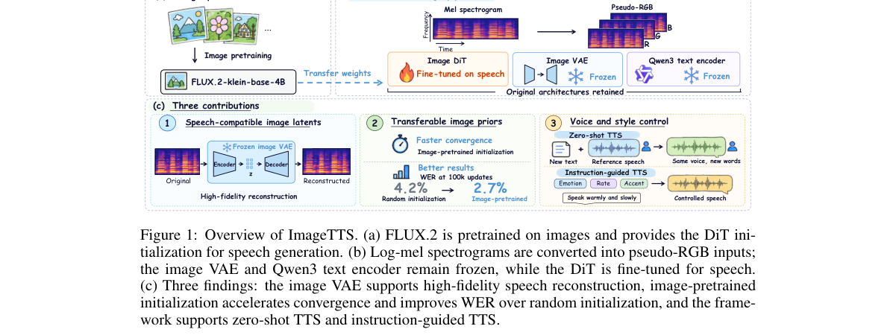

*Result - Architecture of ImageTTS-base. The framework adopts a Flow-Matching DiT backbone comprising double-stream blocks and single-stream blocks conditioned on timestep σ. High-fidelity speech is s*

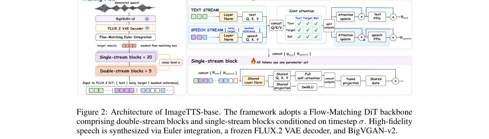

**Why this ranks #1**: 把 FLUX.2 的图像 VAE 与 DiT 直接改造成语音合成器，是「图像生成先验能否跨模态迁移」最干净的一次实验。

---

### 2. When the Persona Contradicts the Line: Diagnosing Plan-to-Synthesis Failures in Chain-of-Thought TTS

**arXiv**: [2610.35008](https://arxiv.org/abs/2610.35008) | **Score**: 8.7 (relevance 9.0 x 0.7 + quality 8.0 x 0.3) | **Tags**: AIGC-audio, TTS, chain-of-thought, persona, emotion-vector, diagnostic-benchmark | **Categories**: cs.CL, cs.SD, eess.AS | **Pages**: 5

**Authors**: Joonyong Park, Jerry Li

**Affiliation**: Spellbrush

**Abstract**

> Chain-of-thought TTS systems rely on language-model planners to translate persona and context into vocal delivery, but it is unclear where this intent is lost when the requested affect conflicts with lexical sentiment. We introduce a bilingual Japanese--English persona--line conflict benchmark in which each item pairs one line with congruent and conflicting personas and pre-declares the expected acoustic direction. We probe this direction in the planner-generated delivery phrase, the planner-written emotion vector, the QwenEmotion-generated vector, and the rendered waveform. Planner outputs are usually direction-correct, while downstream agreement can be substantially lower. Bypassing QwenEmotion provides only modest gains over the full planner-controlled Base. Supervising QwenEmotion raises the direction rate to 75% in Japanese and 84% in English. A learned text-to-latent interface reaches the highest English rate of 89% and the highest Japanese arousal rate of 88%. These results show that learned repair of the plan-to-synthesis interface can recover counter-textual delivery, although its effect differs across languages and acoustic axes.

**Key findings**

- **Finding**: 思维链 TTS 系统依赖语言模型规划器把人格与上下文转成演唱表达，但当请求的情感与台词字面情绪冲突时，意图究竟在哪一环丢失并不清楚。
- **Finding**: 提出日英双语人格-台词冲突基准：每条样本把一句台词分别配上一致与冲突的人格，并预先声明期望的声学变化方向。
- **Finding**: 作者沿链路逐级探测：规划器生成的 delivery phrase、规划器写的 emotion 向量、QwenEmotion 生成的向量、最终渲染波形。
- **Finding**: 规划器输出通常方向正确，但下游一致性明显更低——意图在 plan-to-synthesis 接口处流失。
- **Finding**: 绕过 QwenEmotion 相对完整的规划器控制 Base 只带来有限增益。
- **Finding**: 监督 QwenEmotion 把方向正确率提到日语 75%、英语 84%；学习式 text-to-latent 接口取得最高英语方向率 89%、最高日语唤醒度 88%。
- **Inference**: 这是一篇「接口诊断」式的工作——结论不是某个模块不行，而是 plan-to-synthesis 这一层接口才是瓶颈，修复收益（75%→89%）远大于换模块。
- **Inference**: 中英差异明显（89% vs 88% 但日语方向率只有 75%），提示跨语言情感表达的难点在情绪轴而非语言本身。
- **Recommendation**: 推荐。做 CoT-TTS、情感语音合成的值得读。

**Key figures**

*Framework - explains the whole pipeline. We use IndexTTS-2.5 [4] as a fixed synthesis backbone and place an external LLM planner Gemini 3.5 Flash-Lite in front of it. For each persona–line pair, the planne*

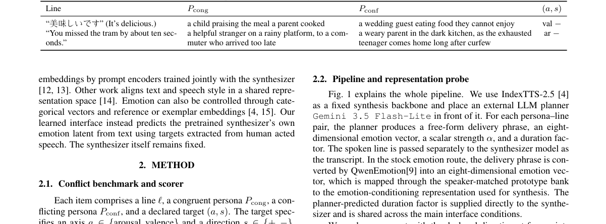

**Why this ranks #2**: 用日英双语「人格与台词冲突」基准定位 CoT-TTS 的意图丢失环节，测出规划器已经说对了、但下游合成仍会跑偏。

---

### 3. TIMUSE: Text-Initialized Masked Semantic Token Modeling for Universal Speech Enhancement

**arXiv**: [2610.34814](https://arxiv.org/abs/2610.34814) | **Score**: 8.7 (relevance 9.0 x 0.7 + quality 8.0 x 0.3) | **Tags**: AIGC-audio, speech-enhancement, diffusion-language-model, flow-matching, discrete-token, LoRA | **Categories**: eess.AS | **Pages**: 5

**Authors**: Yiwei Guo, Hao Qiu, Mohan Ye, Zhijie Deng, Zehua Chen, Kai Yu

**Affiliation**: Shanghai Jiao Tong University; Tsinghua University

**Abstract**

> Discrete-token-based universal speech enhancement (USE) enables strong sequence modeling but often suffers from a quality--fidelity trade-off, where perceptually plausible outputs may alter linguistic content or speaker characteristics. We present TIMUSE, a two-stage USE framework combining text-initialized masked semantic restoration with acoustic reconstruction. A pretrained diffusion language model (DLM) is adapted with LoRA to recover clean semantic tokens using masked generative modeling, while a conditional flow matching model reconstructs clean 24\,kHz speech from the recovered semantic tokens and original degraded speech. Both system-level and controlled comparisons show that TIMUSE achieves a better balance between perceptual quality and fidelity than existing discrete USE models. Ablations further show that text DLM initialization brings a targeted gain under severe degradations.

**Key findings**

- **Finding**: 离散 token 的通用语音增强（USE）序列建模能力强，但存在质量-保真权衡：听感上合理的输出可能改掉语言内容或说话人特征。
- **Finding**: TIMUSE 是两阶段 USE 框架，结合文本初始化的掩码语义恢复与声学重建。
- **Finding**: 第一阶段用 LoRA 适配一个预训练扩散语言模型（DLM），以掩码生成式建模恢复干净的语义 token；第二阶段用条件流匹配模型从恢复出的语义 token 与原始退化语音重建 24 kHz 干净语音。
- **Finding**: 系统级与受控对比都显示 TIMUSE 在感知质量与保真度之间取得比现有离散 USE 模型更好的平衡。
- **Finding**: 消融显示文本 DLM 初始化在严重退化情形下带来有针对性的增益。
- **Inference**: 用 DLM 当「语义字典」而非生成器，把表征学习与波形重建解耦，是语音增强里少见的干净分工——比端到端 GAN/扩散更可控。
- **Inference**: 「文本初始化」的作用点在严重退化场景，说明它补的是语义先验而非声学细节先验。
- **Recommendation**: 推荐。做语音增强或语音离散 token 的值得读。

**Key figures**

*Framework - Overview of TIMUSE.*

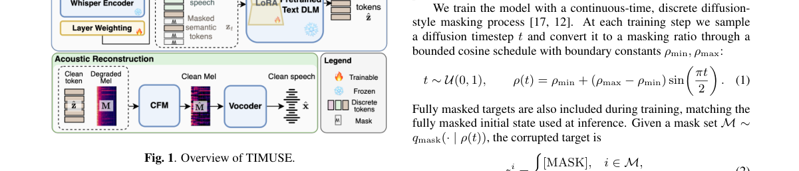

*Result - CER gains of text initialization across degradations and severities. Error bars denote 95% confidence intervals.*

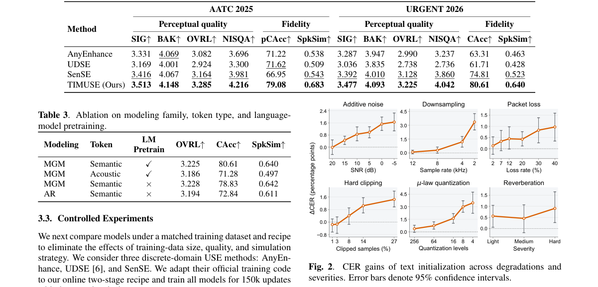

**Why this ranks #3**: 用预训练扩散语言模型做掩码语义恢复、条件流匹配做声学重建，给通用语音增强重开「质量-保真」这条路。

---

### 4. From Speech Tokens to Stolen Voices: Attacker-Chosen-Text Speaker Impersonation via Representation Inversion

**arXiv**: [2610.34688](https://arxiv.org/abs/2610.34688) | **Score**: 8.0 (relevance 8.0 x 0.7 + quality 8.0 x 0.3) | **Tags**: AIGC-audio, voice-cloning, privacy, speech-representation, flow-matching, attack | **Categories**: cs.AI, cs.CR, cs.CV, cs.MM, cs.SD | **Pages**: 14

**Authors**: Ye Lu, Shen Wang, Runze Liu, Zhitao Ou, Haonan Huang, Yihan Yan, Fanghui Sun, Zhaoyang Zhang

**Affiliation**: Harbin Institute of Technology

**Abstract**

> Speech interaction systems have gradually evolved from traditional cascaded systems that use text as intermediate information to end-to-end speech language models that directly process speech representations. In some applications, the speech frontend runs on the user's device and sends speech representations to a remote server for inference, while the original audio remains local. However, these representations may still contain speaker identity information. If an attacker obtains them, it may use this information to imitate the user's voice, threatening their voice privacy. To investigate this risk, we propose \stia, a Speech Token Inversion Attack that generates speech with attacker-specified text in a victim's voice using a single short leaked representation, without access to the original audio or its transcript. Specifically, \stia converts discrete, continuous, or mixed speech representations into conditioning sequences and trains a conditional flow-matching speech generation model using pairs of different utterances from the same speaker in public speech datasets. The model combines speaker characteristics contained in the leaked representation with the specified text to generate speech in the victim's voice. Experiments show that, with a Moshi representation leak corresponding to 3 seconds of speech, \stia achieves an average CAM++ speaker cosine similarity of 0.78 and a target-text word error rate of 3.80\%. These results show that speech frontend representations reveal reusable speaker identity information and highlight the need to consider privacy risks when designing speech frontend representation methods.

**Key findings**

- **Finding**: 端到端语音语言模型直接处理语音表示；在某些部署里前端跑在用户设备上、只把表示发往服务端，原始音频留在本地。
- **Finding**: 但这些表示仍可能携带说话人身份信息——攻击者拿到后可用它冒充用户声音，威胁语音隐私。
- **Finding**: 提出 Speech Token Inversion Attack (STIA)：仅用一段短泄漏表示、拿不到原始音频与转写，就能生成带攻击者指定文本的受害者语音。
- **Finding**: 具体做法是把离散、连续或混合的语音表示转成条件序列，用公开语音数据集中同一说话人的不同 utterance 配对，训练条件流匹配语音生成模型。
- **Finding**: 模型把泄漏表示中的说话人特征与指定文本结合，生成受害者音色。
- **Finding**: 在 Moshi 表示泄漏对应 3 秒语音的设定下，STIA 平均 CAM++ 说话人余弦相似度 0.78，目标文本 WER 3.80%。
- **Inference**: 3 秒 → 0.78 说话人相似度，泄露的「可用信息量」远超直觉；任何把语音表示发上云的端到端语音 LM 都应重新审视这条边界。
- **Inference**: 攻击用公开数据训练，这说明防护不能靠「数据不外流」，只能靠表示本身去标识化。
- **Recommendation**: 推荐。做端到端语音 LM、语音隐私或做 TTS 攻击评估的必读。

**Key figures**

*Framework - Split-deployment setting and STIA attack overview. The attacker combines leaked frontend representations with chosen text to generate speech; the boxes on the right state the attack objectiv*

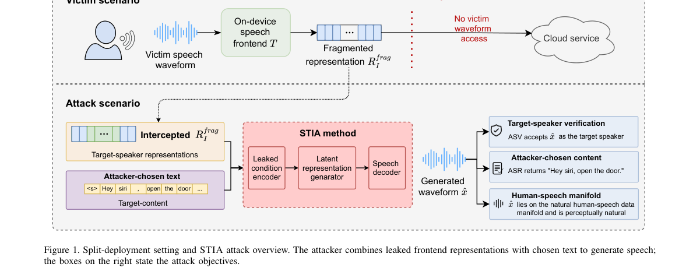

*Result - Overview of STIA. (a) Cross-utterance training with flow-matching, codec, and stopping losses. (b) Generation from leaked representations and chosen text via Euler sampling and codec decodin*

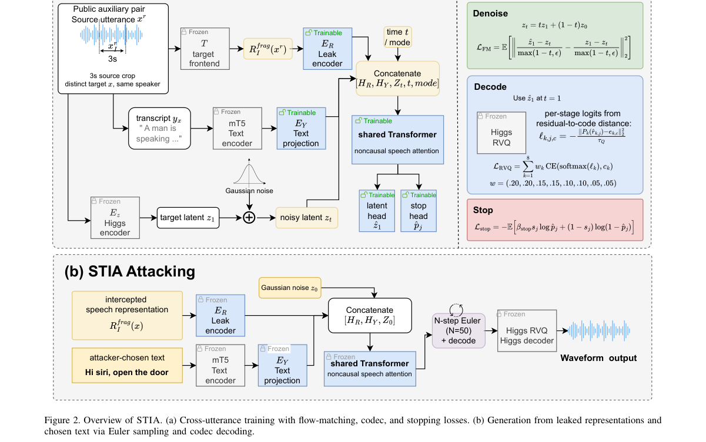

**Why this ranks #4**: 证明端到端语音 LM 的前端表示仍残留可复用的说话人身份，3 秒泄漏即可用攻击者指定文本生成受害者语音。

---

### 5. Realizing Low-Precision Storage and Sparse Execution in a Folded FPGA Speech Enhancer

**arXiv**: [2610.35144](https://arxiv.org/abs/2610.35144) | **Score**: 7.3 (relevance 7.0 x 0.7 + quality 8.0 x 0.3) | **Tags**: AIGC-audio, speech-enhancement, FPGA, mixed-precision, structured-sparsity, hardware-aware | **Categories**: cs.AR, cs.LG, eess.AS | **Pages**: 5

**Authors**: Clément Laroche

**Affiliation**: GN

**Abstract**

> Hardware-aware training often optimizes FPGA resources, latency, or bit operations, but folding changes what compression saves: shared arithmetic decouples precision, weight storage, and scheduled work. We derive training objectives from the measured costs of a folded streaming speech-enhancement accelerator. Mixed-precision weights reduce on-chip storage; structured channel sparsity removes entire operations from the engine schedule. We deploy a bit-exact implementation on the Kria KV260. The best sparse model eliminates 47.3% of convolution MACs, cutting frame time by 45% (1.86 to 1.03 ms) and dynamic energy by 60% (83 to 33 $μ$J/frame) against a storage-priced model measured in the same session, with higher speech quality. Relative to the most efficient dense build measured separately, frame time falls by 42% and energy by 48%. Reducing weight width from 8 to 6 bits lowers dynamic power by 27% but changes frame time by less than 5%. Plain channel group-lasso removes more work than cycle-cost-weighted lasso. Thus, folded-accelerator training should price storage and removable work separately, rather than rely on a single bit-operation metric.

**Key findings**

- **Finding**: 硬件感知训练通常优化 FPGA 资源、延迟或位运算，但折叠（folding）改变了压缩能省什么——共享算术把精度、权重存储与调度工作量解耦了。
- **Finding**: 作者直接从折叠式流式语音增强加速器的实测成本反推训练目标。
- **Finding**: 混合精度权重降低片上存储；结构化通道稀疏直接从引擎调度中移除整块运算。
- **Finding**: 在 Kria KV260 上部署位精确实现；最佳稀疏模型消除 47.3% 的卷积 MAC，把帧时间从 1.86 ms 降到 1.03 ms、动态能耗降低 60%（83 → 33 μJ/帧），且语音质量更高。
- **Finding**: 相对单独测得的最省 dense 构建，帧时间再降 42%、能耗再降 48%。
- **Finding**: 权重位宽从 8 bit 降到 6 bit 让动态功耗下降 27%，但帧时间变化不到 5%。
- **Finding**: 普通的通道 group-lasso 比按周期成本加权的 lasso 移除更多计算量。
- **Inference**: 「存储」与「可移除工作量」必须分开定价——本篇最实用的一条结论，是给所有折叠加速器训练的直接指引。
- **Inference**: 降位宽几乎不影响帧时间而显著降功耗，说明在折叠结构里存储与算力几乎解耦，位宽优化应优先瞄准能耗指标。
- **Recommendation**: 推荐。做语音增强部署、边缘推理或硬件感知训练的可读。

**Key figures**

*Framework - Conv-FSENet Network. The accelerator returns 257 logits, and the host applies σ.*

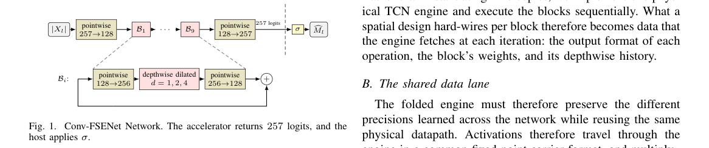

*Result - Conv-FSENet folded onto one time-shared engine. Block-specific weights arrive on the weight lane, block-specific history from the dconv ring, and the trained output format of every operation f*

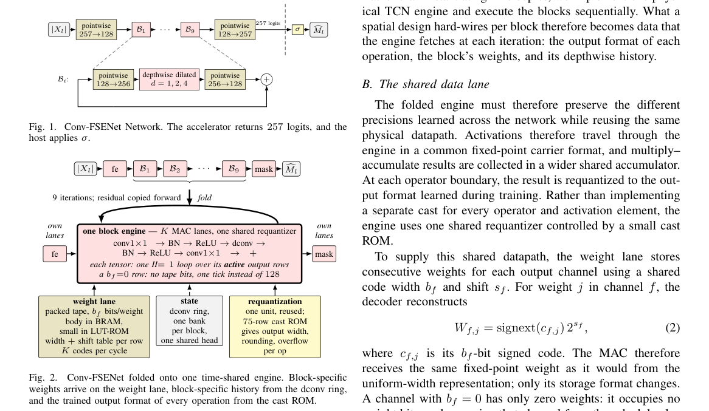

**Why this ranks #5**: 在折叠式 FPGA 加速器上分别给存储与可移除算力定价，稀疏模型砍掉 47.3% 卷积 MAC、帧时间降 45%。

---

### 6. The Voice on the Line

**arXiv**: [2610.35272](https://arxiv.org/abs/2610.35272) | **Score**: 8.0 (relevance 8.0 x 0.7 + quality 8.0 x 0.3) | **Tags**: AIGC-audio, voice-separation, causal-transformer, WavLM, livekit, CPU-inference | **Categories**: cs.CL, cs.SD | **Pages**: 48

**Authors**: Husein Zolkepli

**Affiliation**: Scicom

**Abstract**

> A transcriber listening through one microphone also hears everyone near it. We train causal voice isolators: masking transformers of 140M, 243M and 374M parameters, 20 ms of latency, enrolling the caller from the call itself. Short evaluation windows hide two failures that real calls expose: forgetting the caller when another voice talks alone for a while, and damaging a caller who is alone. Long calls with turns, memory beyond the attention window, real headset crosstalk and drifting caller levels address both, but each trades one against the other. WavLM-Large's own weights, made causal and trained with the model, move the trade: M with them (555M parameters) lowers the error on our development sets from 11.44% to 10.55%; a student trained from scratch to imitate WavLM does not, and w2v-BERT 2.0 and Whisper's encoder, pre-trained on far more audio, help less or not at all. A lone caller loses most at the start of a recording: no training call opened with someone already talking. Training on windows cut from longer calls lowers the error on clean development calls from 3.92% to 2.96%; this is our release. Live, the release makes 16.13% word errors on 60 s AMI windows, against 23.66% for VoxLock, the strongest open isolator, and 10.19% on its own AMI windows, against 11.71%; it is level on Krisp's benchmark (5.74% against 5.63%), and a caller who is alone still loses more words than with VoxLock (5.58% against 2.92% on clean test calls). Distilled into 22.1M parameters without WavLM, it runs live on one CPU thread inside a LiveKit agent, at 33% of a core per call in 20 ms frames, with 10.66% error on our development sets (the release 10.49%). We open-source the release and this CPU model, with a LiveKit plugin, at https://huggingface.co/collections/Scicom-intl/voice-isolator.

**Key findings**

- **Finding**: 用一支麦克风转写的人也会听到周围所有人——训练因果语音隔离器（masking transformer，140M/243M/374M 参数，20 ms 延迟），并从通话本身登记说话人。
- **Finding**: 短评测窗口掩盖了真实通话暴露的两种失败：另一个声音独白一段时间后忘记主叫，以及主叫独处时反而被损伤。
- **Finding**: 长通话、多轮、超出注意力窗口的记忆、真实耳机串音与漂移电平能缓解两者，但每个都带来另一侧的权衡。
- **Finding**: 把 WavLM-Large 自身权重改造成因果形式并与模型一同训练，能移动这一权衡：555M 的 M 版本把开发集错误率从 11.44% 降到 10.55%；从零训练模仿 WavLM 的学生模型没有这个效果。
- **Finding**: w2v-BERT 2.0 与 Whisper 编码器虽然预训练音频更多，帮助更小甚至无效。
- **Finding**: 独处主叫在录音开头损失最大——没有哪段训练通话是「一开始就有人在说话」。
- **Finding**: 用从更长通话切出的窗口训练，把干净开发通话错误率从 3.92% 降到 2.96%；这是发布的版本。
- **Finding**: 线上表现：AMI 60 s 窗口上 16.13% 词错误（VoxLock 23.66%），自有 AMI 窗口 10.19%（对 11.71%），Krisp 基准上持平（5.74% 对 5.63%）。
- **Finding**: 蒸馏到 22.1M 参数且不依赖 WavLM 后，可在一颗 CPU 线程上以 20 ms 帧实时运行（每通话占 33% 核），开发集错误率 10.66%。项目与 LiveKit 插件开源。
- **Inference**: 「预训练规模不等于下游有效」在这里被反复验证——WavLM 有效而 Whisper/w2v-BERT 无效，说明 isolation 更依赖表征的可因果化，而非数据量。
- **Inference**: 22.1M 的 CPU 可跑版本比任何大模型指标都更有落地价值，语音前端这条线上工程约束常常比学术指标更决定成败。
- **Recommendation**: 推荐。做语音前端、会议/通话增强或做实时部署的必读。

**Key figures**

*Framework - Krisp: word error rate against leaked words per minute of background-only speech, one point per system, our models live. A noise suppressor (DeepFilterNet3) keeps the other voices; isolators remove them.*

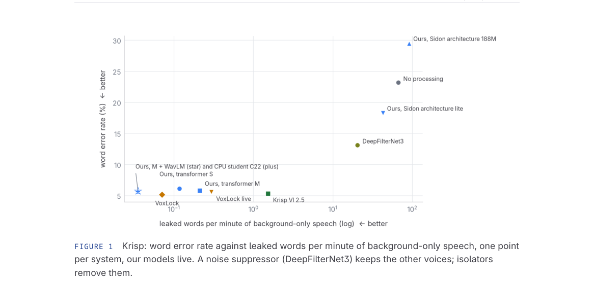

*Result - How a training example is made. Blue: the primary talker; amber: synthetic crosstalk; grey: noise; purple: the enrollment. The device filters and band limit act on mixture and target alike; µ-law, codecs and clipping on the mixture only. Ev*

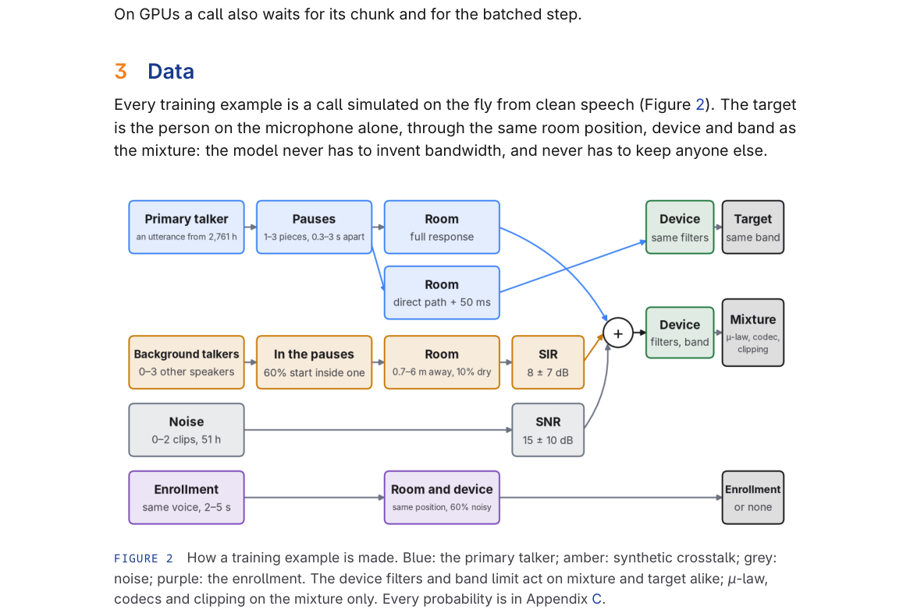

**Why this ranks #6**: 20 ms 延迟的因果语音隔离器，把电话转写场景下最容易被短评测窗口掩盖的两种失败（忘人、伤独语）暴露并解决。

---

### 7. Graph Neural Network for Wide-Area 6DoF Ambisonic Rendering

**arXiv**: [2610.35741](https://arxiv.org/abs/2610.35741) | **Score**: 6.6 (relevance 6.0 x 0.7 + quality 8.0 x 0.3) | **Tags**: AIGC-audio, spatial-audio, ambisonics, DirAC, graph-neural-network, 6DoF | **Categories**: cs.SD, eess.AS, eess.SP | **Pages**: 5

**Authors**: Gioele Greco, Filippo Marri, Mirco Pezzoli, Fabio Antonacci

**Affiliation**: Politecnico di Milano

**Abstract**

> Wide-area 6DoF rendering from sparse Ambisonic recordings is commonly addressed by interpolating parametric spatial descriptors rather than the waveforms themselves. This preserves the fidelity of a nearby measured signal and avoids phase artifacts caused by mixing distant arrays. However, existing DirAC-based approaches rely on geometric interpolation weights that do not depend on the acoustic scene observed by the microphones. We propose a lightweight Graph Neural Network (GNN) that refines only this interpolation stage. The known Ambisonic arrays and the query position are represented as a graph whose nodes contain local DirAC features and whose edges encode relative distance and directional relations. The network predicts positive query-conditioned weights over the measured arrays, while the target energy, diffuseness, and direction of arrival are reconstructed by an analytical DirAC layer. Experiments on unseen rooms, unseen speech signals, and unseen array configurations show that the proposed weighting improves energy reconstruction and radiation-pattern similarity with respect to baseline interpolation.

**Key findings**

- **Finding**: 稀疏 Ambisonic 录制的广域 6DoF 渲染通常靠插值参数化空间描述子而非波形本身，这能保住近处实测信号的保真度，也避免混录远阵造成的相位伪影。
- **Finding**: 但既有 DirAC 方法的插值权重是纯几何的，不依赖麦克风实际观察到的声学场景。
- **Finding**: 提出轻量 GNN 只精修这一插值阶段：已知 Ambisonic 阵列与查询位置构成图，节点携带局部 DirAC 特征，边编码相对距离与方向关系。
- **Finding**: 网络对实测阵元预测正的查询条件权重，而目标能量、扩散度与到达方向由解析 DirAC 层重建。
- **Finding**: 在未见房间、未见语音信号与未见阵列配置上，该加权相对基线插值改善了能量重建与辐射图相似度。
- **Inference**: 只改插值权重而不动 DirAC 重建层，是很克制的工程选择——空间声学里解析层已经足够稳，缺的是「该信哪个阵元」的判断。
- **Inference**: 图结构天然承载阵列的几何关系，比扁平 MLP 更适合这类问题；这套思路可迁到任意多麦克风融合。
- **Recommendation**: 推荐。做空间音频、Ambisonic 或阵列信号处理的值得读。

**Key figures**

*Framework - Spatial distribution of the improvement obtained by the proposed GNN with respect to baseline interpolation, averaged over the Monte-Carlo test set. The panels report ∆NMSEE for energy, ∆NMSEψ*

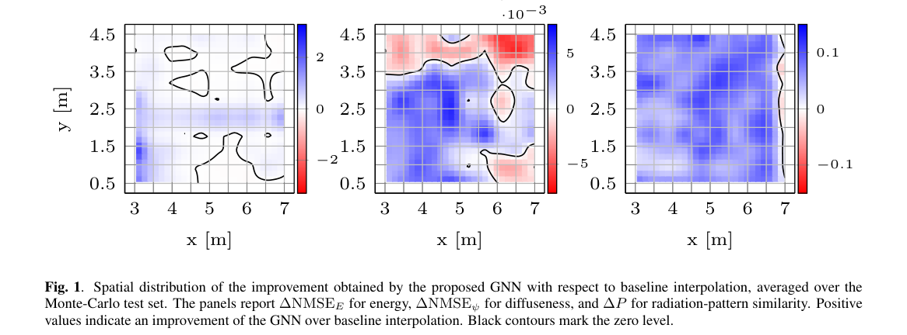

*Result - Example of reconstructed FOA radiation pattern at one query position and frequency band. The ground truth is compared with the baseline and the proposed GNN. Color represents normalized energy*

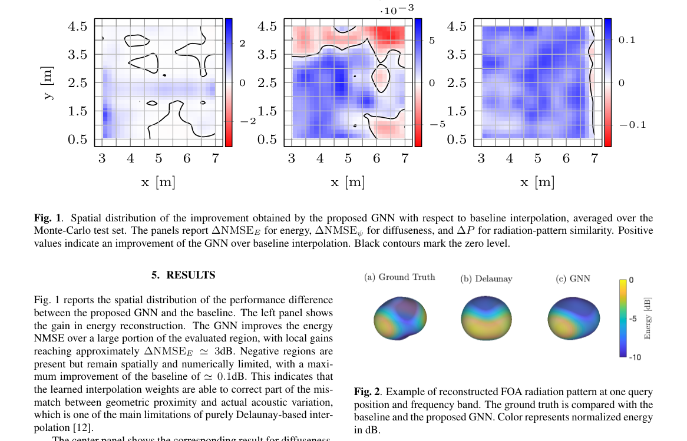

**Why this ranks #7**: 只在 Ambisonic 插值这一层加一个 GNN，用麦克风实际听见的声学场景来加权阵元，而不是纯几何距离插值。  [wild-card]

---

### 8. Gangqinpu: A Multi-Genre, Multi-Task Piano Dataset with Aligned Audio, MIDI, and Musical Scores

**arXiv**: [2610.34694](https://arxiv.org/abs/2610.34694) | **Score**: 6.6 (relevance 6.0 x 0.7 + quality 8.0 x 0.3) | **Tags**: AIGC-audio, music-generation, dataset, MIDI, score-alignment, expression-rendering | **Categories**: cs.AI, cs.SD, eess.AS | **Pages**: 9

**Authors**: Wei Zeng, Anvay Mathur, Ye Wang

**Affiliation**: National University of Singapore; Singapore American School

**Abstract**

> Aligned audio, performance MIDI, and musical scores provide valuable supervision for music analysis and performance modeling, yet datasets that jointly align all three modalities remain scarce and limited in scale and genre diversity. We introduce Gangqinpu, a multi-genre piano dataset containing 18,786 score-performance pairs and 1,007.1 hours of source audio, with automatic note-level alignments and derived beat/downbeat annotations. It spans diverse genres, including pop, classical, jazz, folk/traditional, rock, and blues. Our automated pipeline transcribes piano audio, aligns the resulting MIDI with musical scores, assigns genre labels, and filters out non-expressive performances with a score-informed binary classifier. We further construct joint splits with ASAP using conservative score-similarity grouping to reduce data leakage. We evaluate Gangqinpu on performance MIDI-to-score transcription, expressive performance rendering, and beat tracking. Downstream experiments demonstrate the value of Gangqinpu as complementary training data, with cross-dataset gains in beat tracking and primarily in-domain benefits for transcription and expressive performance rendering. The code and dataset are publicly available at https://github.com/wei-zeng98/gangqinpu.

**Key findings**

- **Finding**: 同时对齐音频、演奏 MIDI 与乐谱的监督很稀缺，规模与曲风多样性都受限。
- **Finding**: Gangqinpu 是多曲风、多任务钢琴数据集，含 18,786 条乐谱-演奏配对与 1,007.1 小时源音频，带自动音符级对齐与派生的节拍/强拍标注。
- **Finding**: 覆盖流行、古典、爵士、民谣/传统、摇滚与布鲁斯等曲风。
- **Finding**: 全自动管线转写钢琴音频、把 MIDI 与乐谱对齐、分配曲风标签，并用基于乐谱的二元分类器过滤掉缺乏表现力的演奏。
- **Finding**: 与 ASAP 构建联合划分时采用保守的乐谱相似度分组以减少数据泄漏。
- **Finding**: 在演奏 MIDI 到乐谱的转写、表现力演奏渲染与节拍跟踪三个任务上评测。
- **Finding**: 下游实验显示 Gangqinpu 作为补充训练数据有价值：节拍跟踪有跨数据集增益，转写与表现力渲染主要是域内收益。代码与数据集公开。
- **Inference**: 「用乐谱过滤无表现力的演奏」是这批数据最值钱的一步——它把「音色好不好听」的判断交给了结构化先验，而不是人工标注。
- **Inference**: 跨数据集增益只出现在节拍跟踪，说明不同演奏风格的声学统计分布差异很大，钢琴生成模型的数据迁移要按任务分别评估。
- **Recommendation**: 推荐。做音乐生成、演奏建模或需要钢琴数据的值得看。

**Key figures**

*Framework - Musical representations and associated tasks. Arrows indicate task input–output relationships; colors distinguish transcription (red), rendering (blue), and beat tracking (green).*

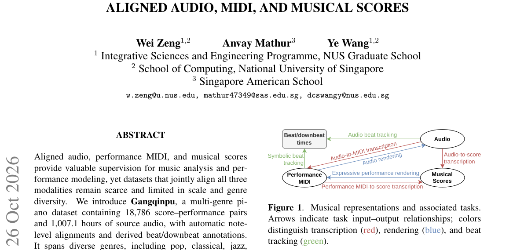

*Result - Overview of the Gangqinpu dataset construction pipeline.*

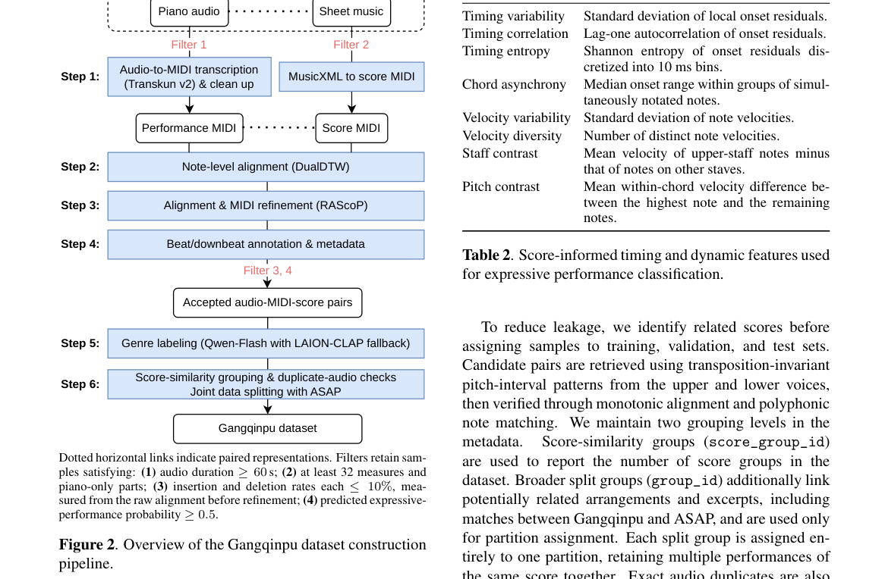

**Why this ranks #8**: 18,786 条对齐的乐谱-演奏对、1,007 小时音频，是钢琴生成与表现力建模少见的全模态监督底座。  [wild-card]

---

### 9. A Robust, Explainable, and Efficient Deep Metric for Speech and General Audio Quality

**arXiv**: [2610.35810](https://arxiv.org/abs/2610.35810) | **Score**: 6.3 (relevance 6.0 x 0.7 + quality 7.0 x 0.3) | **Tags**: AIGC-audio, quality-metric, no-reference, contrastive-learning, pseudo-labels, saliency-map | **Categories**: eess.AS | **Pages**: 5

**Authors**: Konstantin Schmidt, Pablo M. Delgado, Andreas Brendel

**Affiliation**: Fraunhofer Institute for Integrated Circuits (IIS)

**Abstract**

> We present a robust Speech and Audio Quality Metric (SAQM) that merges features of traditional quality metrics with a CNN trained on a large amount of data using contrastive learning methods. To overcome the problem of limited amounts of human-labeled training data, we propose two pretraining strategies relying on pseudo-labels. One uses an established objective metric PEAQ-2f (based on ITU-R BS.1387) as surrogate loss, the other is based on contrasting a wide range of coding modes by a rule-of-thumb ordering based on expected perceived quality. As a key novelty, our approach lets us generate saliency maps by propagating gradients to identify which feature has the greatest impact on the final metric outcome and enables our system to provide insights regarding the type and extent of distortions present in the tested audio signal. The resulting (SAQM) operates at low computational complexity, performs comparably to (SOTA) metrics on speech while still performing well on general audio content.

**Key findings**

- **Finding**: 提出 Speech and Audio Quality Metric (SAQM)，把传统质量度量的特征与一个在大规模数据上用对比学习训练的 CNN 融合。
- **Finding**: 为克服人工标注数据有限，提出两种依赖伪标签的预训练策略：一种以既有客观指标 PEAQ-2f（基于 ITU-R BS.1387）作代理损失，另一种按预期感知质量对多种编码模式做排序式对比。
- **Finding**: 关键新意是通过梯度回传生成显著性图，指出哪个特征对最终度量结果影响最大，从而给出失真类型与程度的解释。
- **Finding**: SAQM 计算复杂度低，在语音上表现与 SOTA 度量相当，在通用音频内容上表现也依然良好。
- **Inference**: 用 PEAQ-2f 当代理损失，是把「客观指标当教师」——在缺少主观 MOS 数据的场景下，这比直接弱监督更稳。
- **Inference**: 显著性归因让质量分从黑箱变成可诊断工具，对生成音频的迭代调优价值可能大于分数本身。
- **Recommendation**: 推荐。做生成音频评测、语音质量度量的值得读。

**Key figures**

*Framework - Proposed system consisting of precursor calculation pq(·), CNN e(·), embedding layer f(·) and prediction head mos(·).*

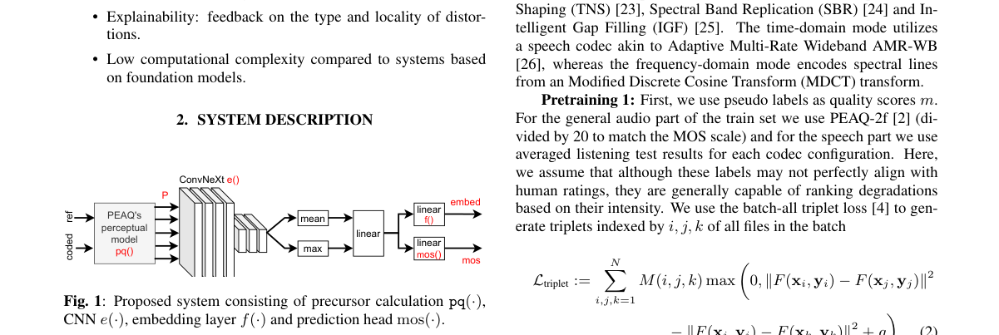

*Result - Spectrograms (top row) and activation maps of precursors (bottom row) for 4 different degradation types from the ODAQ dataset.*

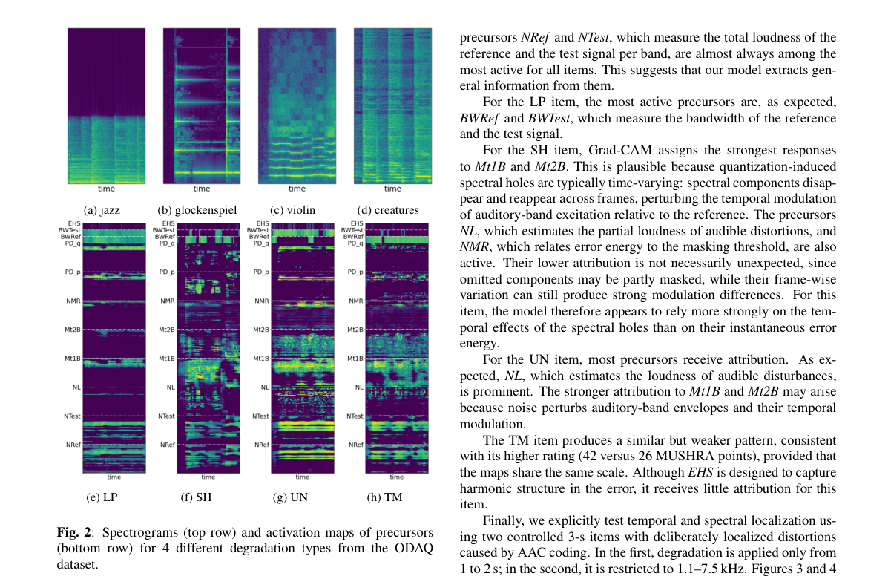

**Why this ranks #9**: 无参考语音/音频质量度量，靠伪标签预训练与可解释显著性归因，给生成音频的效果评估补上可解释的一环。  [wild-card]

---

### 10. Multimodal Concert Video Editing: System Design and Exploratory Evaluation

**arXiv**: [2610.35816](https://arxiv.org/abs/2610.35816) | **Score**: 6.3 (relevance 6.0 x 0.7 + quality 7.0 x 0.3) | **Tags**: AIGC-audio, AIGC-edit, multi-camera, beat-sync, interpretable-scoring, expert-study | **Categories**: cs.CV, cs.MM, cs.SD | **Pages**: 19

**Authors**: Lennart Schiweck, Adrian Kempf, Michelle Retig, Moritz Feucht, Tim Mangliers, Benjamin Himpel

**Affiliation**: Reutlingen University

**Abstract**

> Editing multi-camera concerts requires coordinated decisions about musical relevance, visual quality and cut timing. We present a modular framework that combines instrument activity from multitrack audio, visible instruments and image sharpness with beat-based timing and probabilistic camera selection. An interpretable scoring model links these components to the choice of views over complete shot intervals. Component tests and an exploratory expert study on a four-camera concert yield mixed assessments across the editing variants. The findings motivate extending local audiovisual relevance with contextual and sequence-level criteria. The architecture provides a basis for testing these extensions and studying how component behaviour affects the quality of complete edits.

**Key findings**

- **Finding**: 剪辑多机位演唱会需要同时协调音乐相关性、画面质量与切换时机三类决策。
- **Finding**: 作者提出模块化框架：结合多轨音频中的乐器活动、可见乐器与图像清晰度，配以基于节拍的时间轴与概率化机位选择。
- **Finding**: 一个可解释的打分模型把这些成分关联到整段镜头区间上的机位选择。
- **Finding**: 组件测试与一场四机位演唱会的探索性专家研究，对各编辑变体给出的是**混合评价**。
- **Finding**: 结论推动把局部视听相关性扩展到上下文与序列级准则。
- **Finding**: 该架构为测试这些扩展、研究组件行为如何影响完整成片质量提供了基础。
- **Inference**: 值得学的不是模型而是评测姿态——专家研究给出「混合评价」并据此调整设计方向，比报一个平均分诚实得多。
- **Inference**: 音乐相关性用多轨音频的乐器活动来判，是把「听觉先验」显式接入剪辑决策，比只用画面特征更贴近真实剪辑师判断。
- **Recommendation**: 推荐。做视频编辑或多模态剪辑系统的可读。

**Key figures**

*Framework - Modular concert-editing architecture. Named stems supply activity analysis and are mixed into a mono waveform for timing. Visual roles and sharpness combine with audible roles in a camera ut*

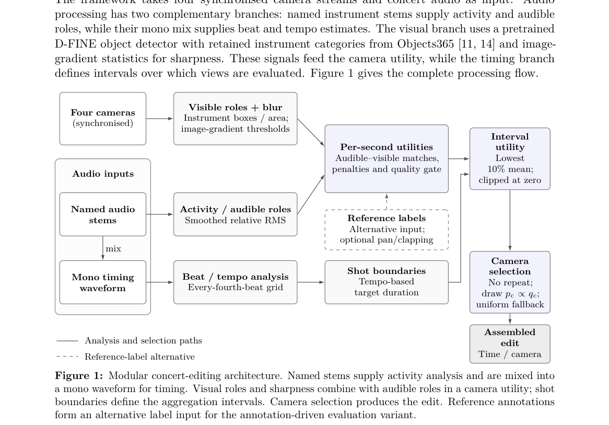

**Why this ranks #10**: 多机位演唱会剪辑系统，把乐器活动、画面清晰度与节拍时间统一进一个可解释打分模型，并诚实报告专家评估结果不一致。  [wild-card]

---

## Footer

- Total papers scanned across all 7 tracks: 546（原始 738 条）
- aigc_audio track final top-10: 10
- Wild-cards in this track: 4
- Figure assets: 2026-10-27/res/

Generated by `mine-arxiv-daily-digest` skill. Sister file: `2026-10-27_aigc_audio_entry.md`.
