# ArXiv Daily Digest - 2026-10-27 (AIGC 视觉生成与编辑, 10 papers)

**Generated**: 2026-10-27 17:00 CST

**Source**: arXiv cs.CV, cs.SD, eess.AS, cs.CL, cs.AI, cs.RO, cs.LG submissions, listing day 2026-10-26 (announced 2026-10-27 00:00 UTC)

**Batch window**: 2026-10-25T18:00:00Z .. 2026-10-26T18:00:00Z（arXiv 公告批次横跨两个 UTC 日：前一日 18:00 UTC 起算，当日 17:59:59 UTC 截止）

**Track**: aigc_visual (top 10 of 546 papers scanned, 70 full reads)

**Scope**: 图像 / 视频 / 3D / 4D 的生成与编辑，含少步蒸馏与推理加速

---

## Top 10 - AIGC 视觉生成与编辑

### 1. VidEdit3D: Flexible 3D Gaussian Editing with Video Diffusion

**arXiv**: [2610.35756](https://arxiv.org/abs/2610.35756) | **Score**: 9.7 (relevance 10.0 x 0.7 + quality 9.0 x 0.3) | **Tags**: AIGC-image, AIGC-video, AIGC-3D, AIGC-edit, video-diffusion, 3DGS, training-free, multi-view-consistency | **Categories**: cs.CV | **Pages**: 19

**Authors**: Yanming Yang, Chenxi Song, Tong Zhao, Juntao Xu, Wenhao Rao, Yiwen Chen, Yiwei Wang, Chi Zhang

**Affiliation**: Westlake University; University of Leeds; Nanyang Technological University; University of California Merced

**Abstract**

> Recent advancements in text-guided 3D editing, particularly with 3D Gaussian Splatting (3DGS), have shown promise but still lag behind the flexibility of 2D editing tools. Existing methods face a critical trade-off between preserving multi-view consistency and allowing structural modifications. Image-based editors can also struggle to apply the intended edit to objects viewed from unusual angles. To address these limitations, we introduce VidEdit3D, a framework that reformulates 3D scene editing as a trajectory-based video editing task. By drawing a parallel between camera movement in static 3D scenes and temporal dynamics in video, we leverage the robust spatiotemporal priors of pre-trained Video Diffusion Models (VDMs) to encourage semantic and structural coherence across views. Specifically, we propose Trajectory-Guided Rendering (TGR) to select informative keyframes and construct smooth video clips aligned with VDM input requirements. To propagate edits from an anchor view to these clips, we develop Flow-Aligned Video Editing (FAVE), a training-free framework incorporating an Editing Consistency Guidance (ECG) mechanism. ECG contrasts source and edited image conditions at a shared latent state, using scheduled source-image amplification to strengthen adherence to the edited reference while maintaining original scene context. Finally, we introduce Region-Selective 3DGS Refinement (RS-GS) to strictly confine geometric and appearance updates to target primitives, reducing background attribute leakage. Experiments demonstrate stronger instruction alignment and better multi-view consistency than the baselines.

**Key findings**

- **Finding**: 指出 3DGS 文本引导编辑的核心矛盾——多视角一致性与结构性修改难以兼得；基于图像的编辑器在异常视角下常常改不到目标物体。
- **Finding**: VidEdit3D 把 3D 场景编辑重述为「轨迹式视频编辑」，用相机运动类比时间动态，直接调用预训练视频扩散模型（VDM）的时空先验。
- **Finding**: Trajectory-Guided Rendering (TGR) 选取信息量大的关键帧，并拼出满足 VDM 输入要求的平滑视频片段。
- **Finding**: Flow-Aligned Video Editing (FAVE) 是免训练框架，其中的 Editing Consistency Guidance (ECG) 在共享隐状态上对比源图与编辑图条件，并按调度放大源图以加强编辑参考的服从度、同时保住原场景上下文。
- **Finding**: Region-Selective 3DGS Refinement (RS-GS) 把几何与外观更新严格限制在目标 primitive 上，减少背景属性泄漏。
- **Finding**: 实验显示指令对齐与多视角一致性均优于基线。
- **Inference**: 「把静态 3D 编辑转成视频编辑任务」是一笔划算的复用——视频扩散模型的多视角时序先验本来就是为一致性训出来的，等于白拿。
- **Inference**: ECG 用「共享隐状态对比源/编辑条件」实现免训练，思路与扩散模型里的 classifier-free guidance 几乎同构，只是把 guidance 形式迁移到了编辑一致性约束上。
- **Recommendation**: 推荐。做 3DGS 编辑、场景编辑，或想借视频扩散先验的人必读。

**Key figures**

*Framework - Flexible and consistent 3D editing with VidEdit3D. The baseline (left) shows inconsistent appearance, incomplete headset insertion and vase removal, and misplaced glasses. VidEdit3D (right) pr*

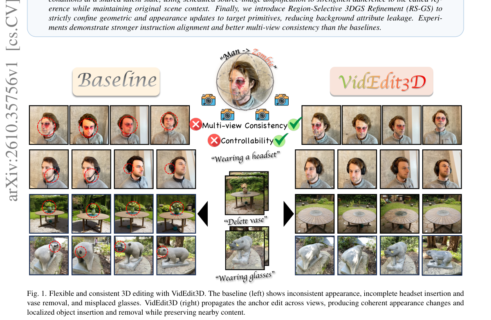

*Result - Overview of VidEdit3D. We reformulate 3D scene editing as a trajectory-based video editing task. The pipeline consists of three key stages: (1) TGR: We organize selected views into smooth vide*

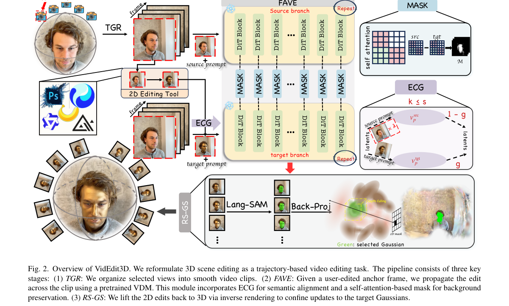

**Why this ranks #1**: 把 3D 场景编辑重构成轨迹式视频编辑，直接借用视频扩散的时空先验来解决 3DGS 编辑的多视角一致性难题。

---

### 2. FL4N: Feed-forward Latent Model for 4D Novel View Synthesis

**arXiv**: [2610.35854](https://arxiv.org/abs/2610.35854) | **Score**: 9.0 (relevance 9.0 x 0.7 + quality 9.0 x 0.3) | **Tags**: AIGC-image, AIGC-video, AIGC-3D, AIGC-edit, 4D, latent, feed-forward, novel-view-synthesis, real-time | **Categories**: cs.CV | **Pages**: 33

**Authors**: Eunbeen Hong, Hyeonseo Yu, Honggyu An, Jooho Son, Hyunah Ko, Soowon Son, Chaehyun Kim, Jahyeok Koo, Jisoo Kim, Junhwa Hur, Seungryong Kim

**Affiliation**: KAIST AI; Google DeepMind

**Abstract**

> 4D novel view synthesis (NVS) aims to render dynamic scenes across viewpoints and timestamps, which requires jointly inferring 3D structure and temporal dynamics. Existing monocular feed-forward methods often rely on explicit 4D Gaussian representations, which are prone to temporal inconsistency and severe rendering artifacts. We present FL4N, the first feed-forward latent 4D NVS model. Instead of relying on explicit 4D primitives, FL4N encodes a 4D scene prior into a unified latent representation across space and time. Our core insight is that learning temporal dynamics as residuals on top of a pretrained static latent prior enables effective 4D modeling with limited dynamic training data. To this end, we introduce a lightweight dynamic encoder that leverages static scene features to disentangle object motion from camera-induced parallax. Trained solely with an image synthesis objective, FL4N achieves state-of-the-art 4D NVS quality while rendering in real time. Its learned latent representation generalizes to real-world videos and disentangles viewpoint from time.

**Key findings**

- **Finding**: 现有单目前馈方法多依赖显式 4D Gaussian 表征，容易出现时间不一致与严重渲染伪影。
- **Finding**: FL4N 是首个前馈隐空间 4D NVS 模型，把 4D 场景先验编码进跨时空统一的隐表示。
- **Finding**: 核心洞察是把时间动态学成「预训练静态隐先验之上的残差」，从而在有限的动态训练数据下也能有效建模 4D。
- **Finding**: 轻量动态编码器利用静态场景特征，把物体运动与相机引起的视差解耦。
- **Finding**: 仅以图像合成目标训练即达到 SOTA 的 4D NVS 质量，并可实时渲染。
- **Finding**: 学到的隐表示可泛化到真实视频，并能 disentangle 视角与时间。
- **Inference**: 「静态先验 + 动态残差」把 4D 的数据饥渴从「需要大量动态视频」压到「只需少量动态数据」，这正是当前视频世界模型共同在找的解法。
- **Inference**: 只用图像合成目标却能拿到时间一致性，说明一致性更多来自表示结构而非额外时序损失——对做 latent 空间设计的人有直接启发。
- **Recommendation**: 推荐。做 4D 重建、动态新视角合成或世界模型表示的值得读。

**Key figures**

*Framework - Teaser. FL4N is the first feed-forward latent 4D novel view synthesis model. It models dynamics in a latent space to render temporally coherent frames, whereas Gaussian-based methods such as*

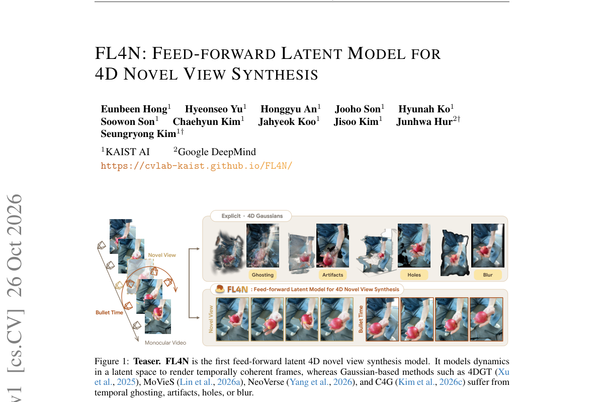

*Result - FL4N Overview. (Left) During training, context and target frames with varying views and timestamps are sampled from multi-view videos. (Right) A static encoder encodes static 3D structures (*

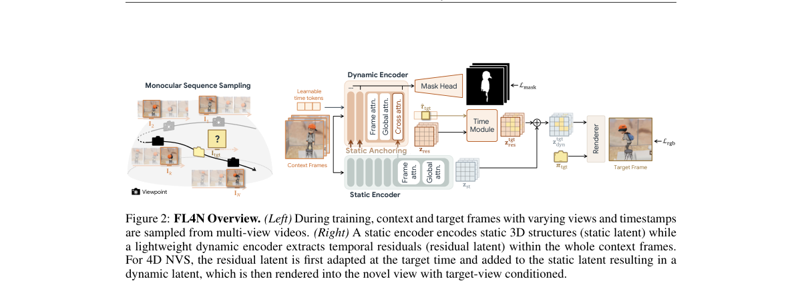

**Why this ranks #2**: 首个前馈式隐空间 4D 新视角合成模型，把动态建模从显式 4D Gaussian 换成隐空间残差，并做到实时渲染。

---

### 3. Generative Structure from Motion with Native 3D Diffusion

**arXiv**: [2610.35522](https://arxiv.org/abs/2610.35522) | **Score**: 8.7 (relevance 9.0 x 0.7 + quality 8.0 x 0.3) | **Tags**: AIGC-image, AIGC-video, AIGC-3D, AIGC-edit, diffusion, structure-from-motion, pose-latent, MMDiT, UV-volume-tokenization | **Categories**: cs.AI, cs.CV | **Pages**: 16

**Authors**: Haobin Duan, Binbin Huang, Mochu Xiang, Yiqun Zhao, Zibo Zhao, Yi Ma, Shenghua Gao

**Affiliation**: The University of Hong Kong; Transengram; Tencent

**Abstract**

> Recovering an object's 3D structure and camera motion from a few uncalibrated views is a fundamental problem in computer vision. Classical structure from motion methods recover 3D geometry consistent with the input images but cannot recover unseen regions; native generation methods produce plausible 3D objects which are related but not necessarily faithful to the input images. Methods simply concatenating reconstruction and generation allow error to cascade across the two stages, instead of producing a 3D object consistent with both the distribution and the input. We propose GenSfM, which integrates image-based 3D reconstruction with a native 3D diffusion model. In particular, we use a multi-modal diffusion transformer to jointly denoise the shape latent and per-view pose latents under shared self-attention, grounding generated geometry in the observed views while using object-level priors to infer unobserved regions. A compact 3D-native UV-volume tokenization keeps the joint sequence small as views are added, and a pose-aware stage refines geometry and texture by sampling per-voxel image features at the recovered camera poses. On Toys4k and GSO, for $4$ uncalibrated views, GenSfM improves novel-view PSNR by $3.2$-$4.5$ dB and reduces median Chamfer distance by $2.8$-$3.8\times$ over a strong native-3D generation baseline, while recovering input-view poses over $96\%$ Acc@$5^\circ$ without any external pose-estimation backbone, post-hoc optimization, or known intrinsics. Project page: https://dotb1ue.github.io/GenSfm/.

**Key findings**

- **Finding**: 经典 SfM 只恢复与输入一致的几何、看不见未观测区域；原生生成方法给出合理但未必忠于输入的 3D 物体；把重建与生成分阶段拼接则会让误差级联。
- **Finding**: GenSfM 把基于图像的 3D 重建与原生 3D 扩散模型整合进一个多模态扩散 Transformer，在共享 self-attention 下联合去噪形状隐与逐视角位姿隐。
- **Finding**: 紧凑的 3D-native UV-volume tokenization 让联合序列在视角数增加时仍保持小规模。
- **Finding**: 位姿感知阶段在恢复的相机位姿处采样逐体素图像特征，以细化几何与纹理。
- **Finding**: 在 Toys4k 与 GSO 上，4 个无标定视角时新视角 PSNR 相对强原生 3D 生成基线提升 3.2–4.5 dB，中位 Chamfer 距离降低 2.8–3.8 倍。
- **Finding**: 不依赖任何外部位姿估计骨干、后处理优化或已知内参，即可在 96% 以上样本上恢复输入视角位姿（Acc@5°）。项目页公开。
- **Inference**: 联合去噪「形状 + 位姿」是关键——把位姿当成生成变量而非前置估计，才能同时拿到一致性与泛化性。
- **Inference**: 96% Acc@5° 对「端到端 3D」方向是个强信号，说明几何与位姿的联合先验比级联 SfM 更稳。
- **Recommendation**: 推荐。做 3D 生成、SfM、端到端重建的必读。

**Key figures**

*Framework - Generative object shape and camera motion recovery. Given multiview input images, GENSFM recovers the object shape and camera poses in a unified 3D space. A diffusion transformer performs mu*

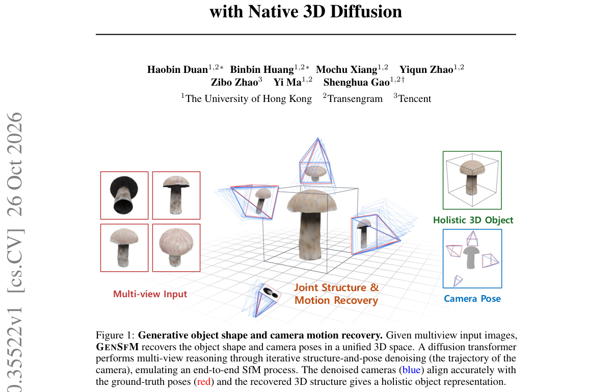

*Result - Overview of GENSFM. We cast pose-free multi-view 3D recovery as a single coarse-to- fine generative problem. The coarse stage (Sec. 4.1) jointly denoises the sparse-structure latent and per-*

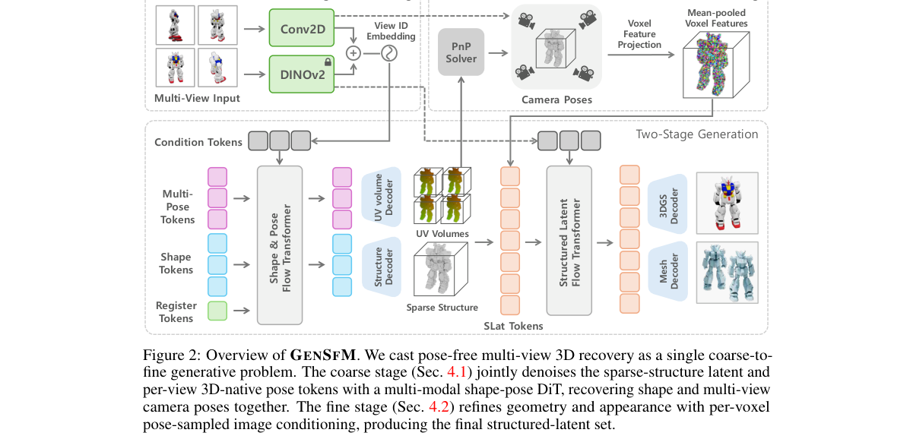

**Why this ranks #3**: 把图像 3D 重建与原生 3D 扩散接进同一个多模态 DiT，4 个无标定视角下新视角 PSNR 相对强基线提升 3.2–4.5 dB。

---

### 4. OmniShowcase: Omnidirectional Subject-Consistent Video Generation from Multi-View Images

**arXiv**: [2610.35684](https://arxiv.org/abs/2610.35684) | **Score**: 8.7 (relevance 9.0 x 0.7 + quality 8.0 x 0.3) | **Tags**: AIGC-image, AIGC-video, AIGC-3D, AIGC-edit, subject-to-video, multi-view, surface-normal, data-synthesis, 3D-consistency | **Categories**: cs.AI, cs.CV | **Pages**: 25

**Authors**: Junyeong Ahn, Geonwoo Kim, Kinam Kim, Gihwi Kim, Hoonjin Jung, Hyojin Jang, Jaegul Choo

**Affiliation**: KAIST AI; Inha University; FLIPTION

**Abstract**

> Generating videos of a specific subject from a few reference images remains challenging when the camera reveals surfaces that are not visible in the input. Early subject-to-video (S2V) methods condition on a single reference image and must therefore infer the subject's unseen appearance and geometry as the viewpoint changes. To address this limitation, recent methods extend S2V to multiple reference views, providing more information about the subject from different viewpoints. However, they do not explicitly specify the 3D structure that connects these observations. In addition, existing training data do not guarantee that viewpoint changes preserve the same underlying 3D subject. We present OmniShowcase, built on two components: (i) a fully automated data synthesis pipeline that produces training videos along diverse camera trajectories, with viewpoint variation driven by underlying subject geometry, even spanning full 360-degree orbits; and (ii) a geometry-conditioning method that provides the video model with a turntable of surface-normal maps reconstructed from the reference views without requiring temporal alignment with the generated frames. We construct Showcase-4K, a corpus of 3D-asset-based videos covering twelve camera motions across 88 trajectory configurations with reconstruction-derived surface-normal conditioning, and ShowcaseBench, a held-out evaluation set with the source meshes and camera parameters used to render each video. Experiments show state-of-the-art subject identity and 3D consistency while maintaining competitive video quality and motion. Project page: justin4ai.github.io/OmniShowcase

**Key findings**

- **Finding**: 早期 subject-to-video (S2V) 方法只用单张参考图，视角变化时必须凭空推断主体未见的 appearance 与 geometry。
- **Finding**: 后续方法扩展到多参考视角，但没有显式指定连接这些观测的 3D 结构；且训练数据不保证视角变化仍对应同一个 3D 主体。
- **Finding**: OmniShowcase 含两个组件：全自动数据合成管线（沿多样相机轨迹生成训练视频，视点变化由底层主体几何驱动，可覆盖完整 360 度环绕）与几何条件化方法。
- **Finding**: 几何条件化给视频模型提供由参考视角重建的表面法向图「转盘」，且不要求与生成帧做时间对齐。
- **Finding**: 构建 Showcase-4K 语料——基于 3D 资产的视频，覆盖 12 种相机运动、88 种轨迹配置并带重建导出的法向条件；另建 ShowcaseBench 留出评测集，含源网格与渲染每帧所用的相机参数。
- **Finding**: 实验显示主体身份与 3D 一致性达到 SOTA，同时保持有竞争力的视频质量与运动性。项目页公开。
- **Inference**: 用「3D 资产渲染出带真值几何的训练视频」补数据，本质是把生成模型的 3D 一致性问题转成数据工程问题——比在模型侧堆先验便宜得多。
- **Inference**: 法向图条件不必与生成帧时间对齐，是个实用的工程松绑，降低了整条管线对相机标定的依赖。
- **Recommendation**: 推荐。做 S2V、主体一致性视频生成的值得读。

**Key figures**

*Framework - OmniShowcase produces subject-driven videos that stay 3D-consistent across every re- vealed viewpoint.*

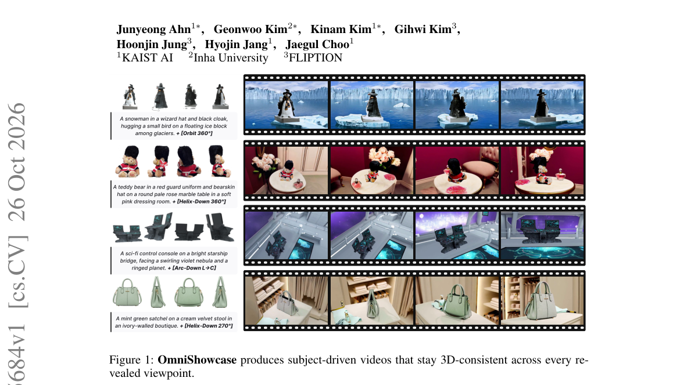

*Result - Automated 3D-consistent data synthesis pipeline. From a curated 3D asset (Deitke et al., 2023), Blender renders the target orbit and four reference views. (a) The target is composited into a*

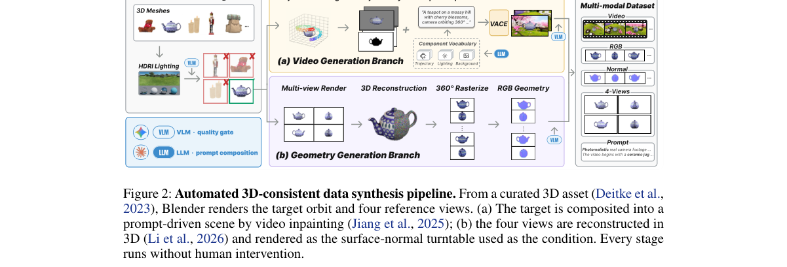

**Why this ranks #4**: 用全自动合成管线加法向图几何条件，解决多参考图主体一致性视频生成中「不可见表面」与「视角改变即身份漂移」两个痛点。

---

### 5. Triage: Skip, Skim, or Refine Attention Tiles in Video Diffusion Transformers

**arXiv**: [2610.35706](https://arxiv.org/abs/2610.35706) | **Score**: 8.3 (relevance 8.0 x 0.7 + quality 9.0 x 0.3) | **Tags**: AIGC-image, AIGC-video, AIGC-3D, AIGC-edit, DiT, attention-sparsity, quantization, NVFP4, router, inference-acceleration | **Categories**: cs.CV, cs.LG | **Pages**: 21

**Authors**: Yeonjae Kim, Omin Kwon, Seong Hoon Seo, Jae W. Lee

**Affiliation**: tional University, Seoul, Republic of Korea. Correspondence to:

**Abstract**

> Attention over tens of thousands of visual tokens dominates the inference of video diffusion transformers (DiTs). Existing methods reduce this cost through sparsity, low precision, or both, but use a single precision for all kept tiles. We observe that the output error introduced by approximation varies widely across tiles. Many tiles can be skipped with little error, others must be computed but gain little beyond low precision, and a few retain substantial error even at low precision. We present Triage, a training-free attention method that assigns each tile one of three approximation tiers: skipping it by replacing it with its block means, skimming it in NVFP4, or refining it with NVFP4 residual correction. A lightweight router predicts each tile's error under each tier from block statistics and moves a tile to a more accurate tier only when the predicted error reduction justifies the extra compute, with a single price setting this trade-off. A fused kernel executes all three tiers in a single pass on the FP4 tensor cores of RTX Blackwell GPUs. Across Wan2.2, HunyuanVideo, and LTX-2.5, Triage accelerates end-to-end generation by up to 2.32x over dense FlashAttention, and in each of five settings it runs faster than every baseline while reaching 0.3-3.0 dB higher PSNR than the highest-PSNR baseline.

**Key findings**

- **Finding**: 视频 DiT 里上万个视觉 token 的注意力主导推理开销；既有方法靠稀疏、低精度或两者，但所有保留的 tile 都用同一精度。
- **Finding**: Triage 的观察是近似引入的输出误差在不同 tile 上差异很大——许多 tile 可直接跳过，部分 tile 只需低精度，少数 tile 即使低精度仍留可观误差。
- **Finding**: 提出免训练的三级近似分配：跳过（用 block mean 替换）、粗读（NVFP4）、精修（NVFP4 残差校正）。
- **Finding**: 轻量 router 依据 block 统计量预测每个 tile 在各档位下的误差，只有当预测的误差下降足以抵偿额外算力时才升级档位，用单一价格参数设定这一权衡。
- **Finding**: 融合 kernel 在 RTX Blackwell 的 FP4 张量核上单遍执行三档。
- **Finding**: 在 Wan2.2、HunyuanVideo、LTX-2.5 上端到端最高加速 2.32x（相对 dense FlashAttention）；五种设定下均快于所有基线，同时 PSNR 比最高 PSNR 基线高 0.3–3.0 dB。
- **Inference**: 「按 tile 的误差敏感度分级」比全局稀疏或全局量化更细粒度，这也解释了它为什么能同时更快又更准。
- **Inference**: 实现依赖 Blackwell 的 FP4 张量核，短期可复现性受限；但分级思想本身与硬件无关，值得跟进。
- **Recommendation**: 推荐。做视频生成加速与量化推理的优先读。

**Key figures**

*Framework - Per-tile precision on sharp, intermediate, and diffuse*

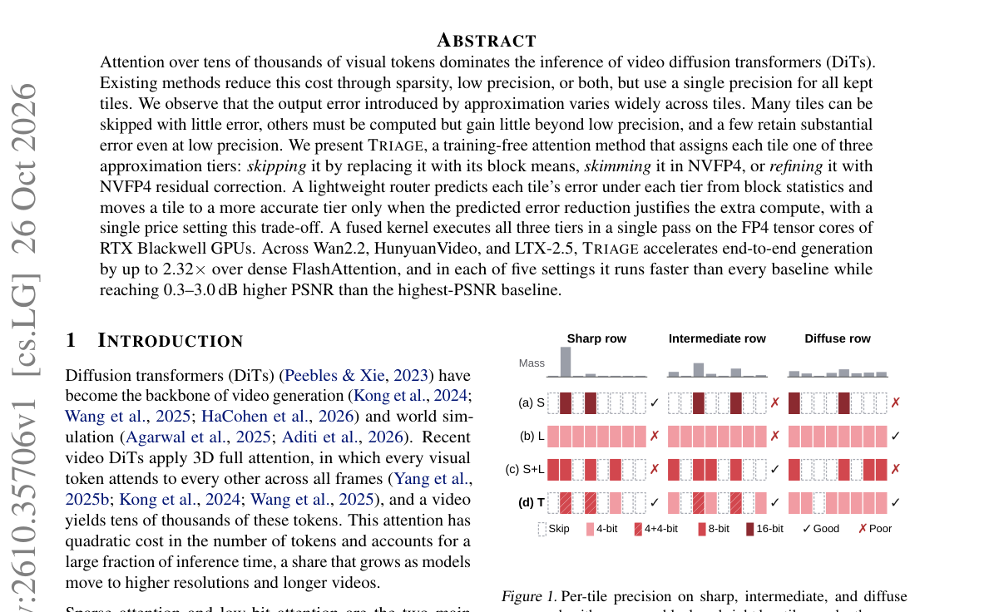

*Result - The 21st of 129 frames of the video that HunyuanVideo generates at 720p for the prompt “On the bed in the bedroom, a puppy*

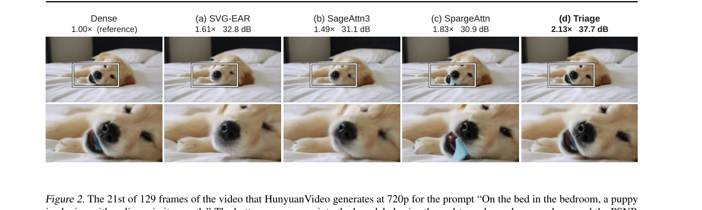

**Why this ranks #5**: 把视频 DiT 的注意力 tile 分成跳过、粗读、精修三档，配合 Blackwell FP4 张量核实现最高 2.32x 端到端加速。

---

### 6. More Memory, Better Videos? A Controlled Study of Visual Memory in Long-Video Generation

**arXiv**: [2610.35001](https://arxiv.org/abs/2610.35001) | **Score**: 8.7 (relevance 9.0 x 0.7 + quality 8.0 x 0.3) | **Tags**: AIGC-image, AIGC-video, AIGC-3D, AIGC-edit, long-video, memory-retrieval, benchmark, diagnosis, identity-drift | **Categories**: cs.CV | **Pages**: 27

**Authors**: Yuzhuo Chen, Huafeng Shi, Xinyu Wang, Yulong Xu, Yucheng Wang, Haoqin Hong, Guoxin Zhang, Zehua Ma, Weiming Zhang

**Affiliation**: University of Science and Technology of China; KlingAI Research; Tsinghua University; The Hong Kong University of Science and Technology; City University of Hong Kong

**Abstract**

> Long-video generators increasingly retrieve past visual observations to prevent identity drift. The intuition is compelling: more access to history should make future video more consistent. But an image can be faithful to the past and wrong for the present. Does visual memory always improve the generated story? We investigate this question through VMem-Bench, a two-track diagnostic study. Track-A measures which references are selected from 92 real films (16,548 segments), before generation and without generator confounds. Track-B compares four retrieval policies with no-memory and gold-informed last-seen controls on 30 causally generated stories (2,824 segments) using a shared generator. Retrieval increases entity recall from 0.559 to 0.628-0.693 and improves similarity to past appearances, but decreases precision from 0.977 to 0.915-0.938 and forbidden-entity avoidance from 0.968 to 0.845-0.898. It can also reinforce obsolete appearances after the story changes them. Conversely, high long-gap recall can arise without memory when the prompt itself supplies the appearance; an appearance-stripping analysis exposes this confound. These results distinguish historical fidelity from current-story correctness and show why retrieval relevance or final-video consistency alone does not establish memory utility.

**Key findings**

- **Finding**: 长视频生成器越来越多地检索过去视觉观测以抑制身份漂移；但一张图可能忠于过去却错误于当下。
- **Finding**: 提出 VMem-Bench 双轨诊断：Track-A 在生成前从 92 部真实影片（16,548 片段）测量参考被如何选中，排除生成器混淆；Track-B 用同一生成器比较四种检索策略，并设无记忆与「金标准最近一次出现」对照，覆盖 30 个因果生成故事、2,824 片段。
- **Finding**: 检索把实体召回从 0.559 提升到 0.628–0.693，并提升与过往 appearance 的相似度。
- **Finding**: 但精度从 0.977 降到 0.915–0.938，禁现实体规避从 0.968 降到 0.845–0.898。
- **Finding**: 检索还可能在故事已经改变了某个 appearance 之后继续强化旧 appearance。
- **Finding**: 反之，当 prompt 本身给出 appearance 时，即使没有记忆也能出现高 long-gap recall；一项「剥离 appearance」的消融暴露了这一混淆。
- **Finding**: 这些结果区分了「历史忠实度」与「当前故事正确性」，说明单看检索相关性或最终视频一致性并不能证明记忆有用。
- **Inference**: 这是典型的「用对照实验拆掉一个流行直觉」的样本：检索提升 recall 却同时降低 precision，说明记忆带来的是保守性偏差而非真正的条件化。
- **Inference**: 「prompt 供给 appearance 造成的高召回」这个混淆很关键——不少长视频系统的记忆能力评测其实测的是 prompt 泄漏。
- **Recommendation**: 推荐。做长视频生成与记忆机制评测的必读。

**Key figures**

*Framework - A relevant past can be wrong for the present. Three qualitative failures from earlier Track-B testbed rollouts (not the main quantitative rerun), showing previous appearances, retrieved fram*

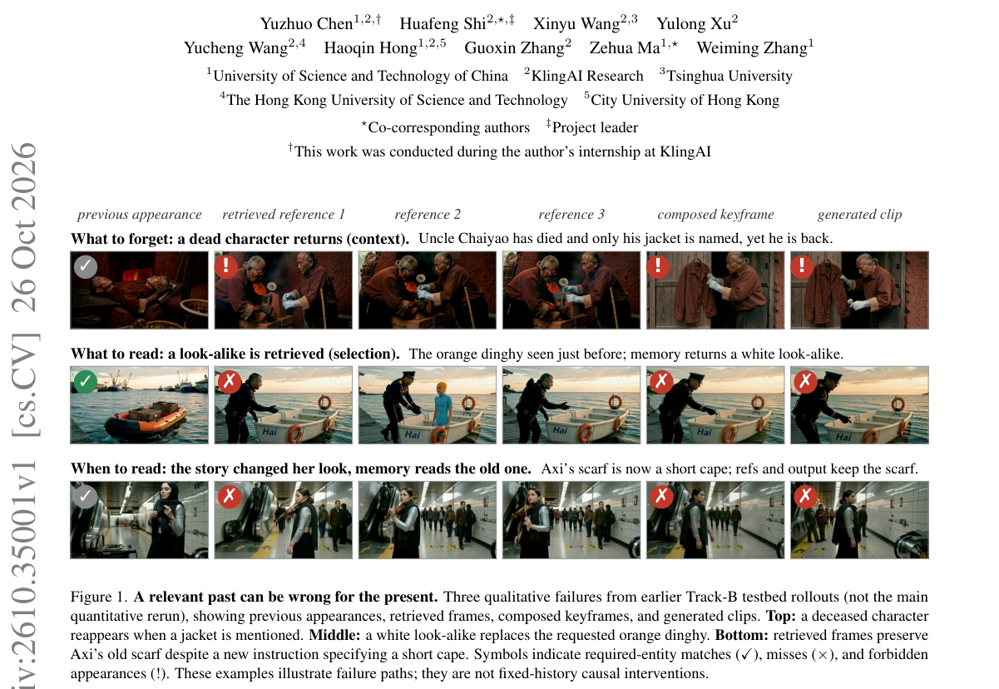

**Why this ranks #6**: 用两条诊断轨道证明长视频生成里的「视觉记忆」提升历史一致性却可能损害当前故事的正确性，是少见的一篇拆穿直觉的工作。

---

### 7. DUET4D: Self-Corrective Coupled Guidance for Sparse-View 4D Reconstruction

**arXiv**: [2610.35002](https://arxiv.org/abs/2610.35002) | **Score**: 8.0 (relevance 8.0 x 0.7 + quality 8.0 x 0.3) | **Tags**: AIGC-image, AIGC-video, AIGC-3D, AIGC-edit, 4D-GS, generative-prior, self-correction, sparse-view | **Categories**: cs.CG, cs.CV | **Pages**: 9

**Authors**: Beizhen Zhao, Nanjie Yao, Boyi Fu, Qingsong Yan, Haofan Ren, Kaiyong Zhao, Hao Wang

**Affiliation**: The Hong Kong University of Science and Technology (Guangzhou); XGRIDS

**Abstract**

> Sparse-view 4D reconstruction is highly under-constrained when only a few cameras are available. Generative priors can recover missing appearances, but video models are computationally impractical for iterative reconstruction, whereas single-view models produce temporally inconsistent pseudo-observations. Moreover, directly absorbing uncertain generative outputs into Gaussian optimization often creates redundant primitives and floating artifacts. To address these challenges, we propose DUET4D, a self-corrective coupled guidance framework for sparse-view 4D Gaussian splatting. The core of our approach is a self-corrective framework where the 4D representation guides generative prior for spatio-temporal consistent supervisions. We first construct sequential alignments from current Gaussian evidence to steer the latent restoration. Then we use Sequential Fidelity Resampling to lift generative supervisions into Gaussian space to selectively distinguish repeatedly supported primitives. The corrected representation then provides more reliable Gaussian evidence for the next restoration cycle. Extensive experiments demonstrate that DUET4D significantly improves rendering quality and rendering efficiency.

**Key findings**

- **Finding**: 稀疏视角 4D 重建高度欠约束；生成先验能补全缺失 appearance，但视频模型对迭代重建算力不现实，单视图模型又会产生时间不一致的伪观测。
- **Finding**: 直接把不确定的生成输出吸收进 Gaussian 优化，常造成冗余 primitive 与漂浮伪影。
- **Finding**: DUET4D 是自纠正的耦合引导框架：4D 表征反过来引导生成先验产生时空一致的监督。
- **Finding**: 先从当前 Gaussian 证据构造序列对齐来引导隐空间修复；再用 Sequential Fidelity Resampling 把生成监督提升到 Gaussian 空间，以区分被反复支持的 primitive。
- **Finding**: 修正后的表征再为下一轮修复提供更可靠的 Gaussian 证据，形成闭环。
- **Finding**: 实验显示渲染质量与渲染效率都显著提升。
- **Inference**: 「生成先验不直接进优化器，而是先经一次保真重采样筛掉不可靠部分」是关键设计——它把生成模型的幻觉挡在了几何更新之外。
- **Inference**: 这套「表征↔生成先验互为教师」的结构，本质与世界模型里的自改进闭环同源，可迁移到更一般的重建任务。
- **Recommendation**: 推荐。做稀疏视图重建与 4D GS 的值得读。

**Key figures**

*Framework - We present DUET4D, a self-corrective coupled guidance framework for Sparse-View 4D Reconstruction. Compared with existing methods, we achieve better rendering quality with substantially high*

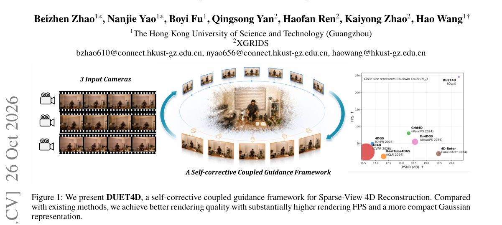

*Result - Overview of DUET4D. First, we construct sequential anchor alignment through Gaussian evidence to generate temporal anchor frames and confidence map. Then we design a training-free anchor-dri*

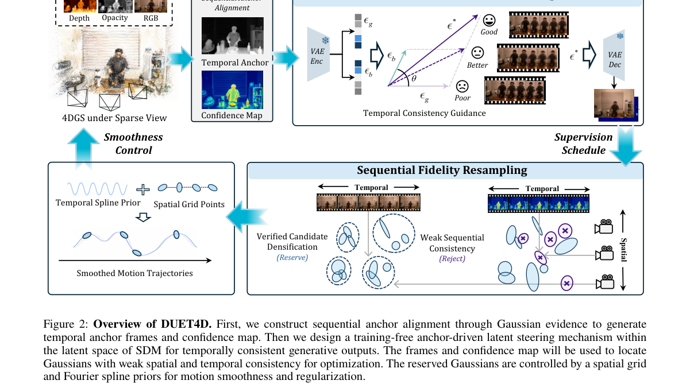

**Why this ranks #7**: 稀疏视角 4D 重建里让 4D 表征反过来指导生成先验、再用生成结果反过来修正表征，形成自纠正闭环。

---

### 8. ToDoPro: Faster and Better Reference-Based Generation: Early Token Reduction via Downsampled Self-Probing

**arXiv**: [2610.34782](https://arxiv.org/abs/2610.34782) | **Score**: 7.7 (relevance 8.0 x 0.7 + quality 7.0 x 0.3) | **Tags**: AIGC-image, AIGC-video, AIGC-3D, AIGC-edit, DiT, token-reduction, acceleration, VRAM, reference-based | **Categories**: cs.AI, cs.CV | **Pages**: 21

**Authors**: Caiyi Sun, Yujing Sun, Siu-Ming Yiu

**Affiliation**: The University of Hong Kong; Nanyang Technological University

**Abstract**

> Recent generic reference-based image generation models natively support multiple conditions by concatenating all reference image and text tokens into a joint sequence processed by a single Diffusion Transformer (DiT). However, this versatile paradigm comes at an efficiency cost: accommodating multiple references leads to a token explosion, incurring massive $\mathcal{O}(N^2)$ computational complexity. Most acceleration methods operate inside the DiT, showing limited capability in reducing spatial redundancy and failing to alleviate peak VRAM. While some pre-model token reduction alternatives exist, they inevitably introduce external models. This raises a question: Is it possible to achieve acceleration and memory savings while preserving compatibility with in-model techniques and requiring no additional parameters? In this work, we realize this goal by proposing the early Token reduction via Downsampled self-Probing (ToDoPro). By executing a few denoising steps on spatially $2\times$ downsampled reference images, this cheap probing stage utilizes the DiT model itself to effectively and efficiently extract reference token importance. Using the probed importance, we apply a hierarchical reduction before the main denoising stage: we completely discard low-importance tokens, substitute mid-importance tokens with their downsampled counterparts to cheaply preserve global context, and keep high-importance tokens. Experiments across three base models and two benchmarks demonstrate that our early reduction accelerates inference significantly and mitigates peak GPU memory. Furthermore, we can improve generation quality by safely filtering out noisy, uninformative reference tokens, enabling the model to concentrate its limited attention capacity on genuinely useful tokens. The code will be released at https://github.com/scy639/ToDoPro

**Key findings**

- **Finding**: 通用参考图生成模型把参考图与文本 token 拼成一条序列送进单个 DiT，多参考图带来 token 爆炸与 O(N²) 的算力开销。
- **Finding**: 多数加速方法在 DiT 内部做，难以消除空间冗余、也压不住峰值显存；已有的 pre-model token 削减方案又必然引入外部模型。
- **Finding**: ToDoPro 先在空间 2× 降采样的参考图上执行几步去噪，用这个廉价的 probing 阶段让 DiT 自己提取参考 token 的重要性。
- **Finding**: 据此做分层削减：完全丢弃低重要性 token，用其降采样副本替换中等重要性 token 以廉价保留全局上下文，保留高重要性 token。
- **Finding**: 跨三个基座模型与两个 benchmark，早期削减显著加速推理并缓解峰值 GPU 显存占用。
- **Finding**: 同一机制还能过滤掉噪声、无信息量的参考 token，让模型把有限注意力集中在真正有用的 token 上，从而提升生成质量。代码将公开。
- **Inference**: 「用模型自己探测自己的输入重要性」是本篇最漂亮的点：不引入外部模型，还顺带把低质量参考 token 本身变成质量提升手段。
- **Inference**: 多参考图场景下 token 数是平方级瓶颈，这套分层削减对任何多条件 DiT 都直接可用。
- **Recommendation**: 推荐。做参考图生成与 DiT 加速的值得读。

**Key figures**

*Framework - Compared to base model FLUX.2-klein-4B, our method reduces inference latency while improving generation quality.*

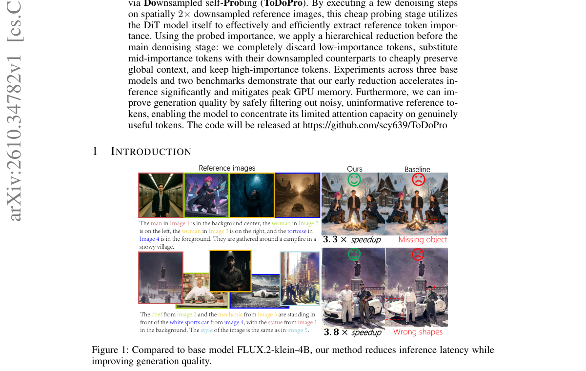

**Why this ranks #8**: 用 DiT 自己在降采样参考图上跑几步自探测来给参考 token 打重要性分，零额外参数实现加速与降显存。

---

### 9. GaussianSpline: Adaptive Bézier Splines for Highly Dynamic 4D Gaussian Splatting

**arXiv**: [2610.35224](https://arxiv.org/abs/2610.35224) | **Score**: 7.3 (relevance 7.0 x 0.7 + quality 8.0 x 0.3) | **Tags**: AIGC-image, AIGC-video, AIGC-3D, AIGC-edit, 4D-GS, bezier-spline, temporal-partition, G1-continuity, dynamic-scene | **Categories**: cs.CV, cs.GR | **Pages**: 8

**Authors**: Tom Yachil, Andrei Sharf

**Affiliation**: Ben-Gurion University of the Negev

**Abstract**

> We present GaussianSpline, a dynamic 4D Gaussian Splatting method that models per-Gaussian motion using adaptive, non-uniform piecewise cubic Bézier splines. Unlike approaches based on global deformations, fixed-order polynomials, or uniformly parameterized splines, GaussianSpline jointly learns the Bézier control points and the temporal partition of each Gaussian's trajectory. This adaptive representation allocates greater temporal capacity to highly dynamic regions while maintaining compact trajectories for near-static regions, enabling high-fidelity reconstruction of complex and rapidly changing motion. To jointly achieve globally smooth motion and local adaptivity, we enforce $G^1$ continuity between consecutive Bézier segments using a reflection-based constraint on their control points. This produces smooth, fully differentiable trajectories while preserving the flexibility of non-uniform temporal parameterization. Experiments on the Neural 3D Video benchmark, the Google Immersive dataset, as well as on synthetic scenes demonstrate that GaussianSpline substantially improves reconstruction quality in scenes with highly non-uniform and challenging dynamics, while maintaining competitive performance on general dynamic scenes compared with state-of-the-art 4D Gaussian Splatting methods.

**Key findings**

- **Finding**: 现有动态 4D GS 用全局形变、固定阶多项式或均匀参数化样条刻画每个 Gaussian 的运动。
- **Finding**: GaussianSpline 联合学习 Bézier 控制点与每个 Gaussian 轨迹的时间划分。
- **Finding**: 该自适应表示把更多时间容量分配给高动态区域，同时对近静态区域保持轨迹紧凑。
- **Finding**: 为兼顾全局平滑与局部自适应，用基于反射的控制点约束强制相邻 Bézier 段之间满足 G1 连续。
- **Finding**: 由此得到平滑且全可微的轨迹，同时保留非均匀时间参数化的灵活性。
- **Finding**: 在 Neural 3D Video、Google Immersive 与合成场景上，高度非均匀的挑战性动态场景重建质量显著提升，一般动态场景上与 SOTA 4D GS 保持竞争力。
- **Inference**: 「把时间划分也作为可学习参数」比单纯提高多项式阶数更省参数——阶数是全局开销，划分是局部的。
- **Inference**: G1 连续性的反射式约束是个很轻的工程解，比直接参数化速度连续性更稳定。
- **Recommendation**: 推荐。做 4D GS 与动态场景重建的值得读。

**Key figures**

*Framework - Demonstration of GaussianSpline on two highly dynamic 4D scenes (top and bottom rows). Left-to-right (columns) are the ground truth, reconstruction using splines with uniform-width control p*

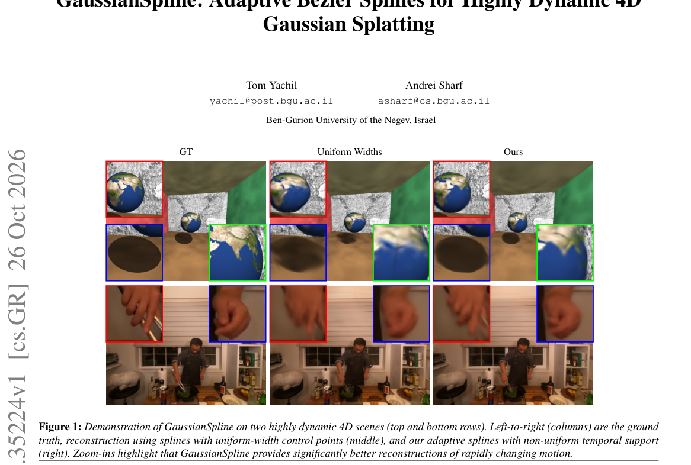

*Result - Pipeline overview. Left: multi-view video frames sampled at random timestamps and the initial SfM point cloud. Middle: three per- Gaussian piecewise cubic Bézier trajectories with learnable,*

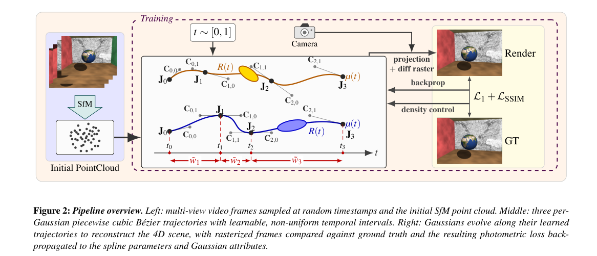

**Why this ranks #9**: 用自适应非均匀三次 Bézier 样条替代固定阶多项式，为高动态区域分配更多时间容量，同时用 G1 连续性保证全局平滑。

---

### 10. Copying As Defense: Protecting Images from Editing By Eliciting Model Copying

**arXiv**: [2610.35566](https://arxiv.org/abs/2610.35566) | **Score**: 8.0 (relevance 8.0 x 0.7 + quality 8.0 x 0.3) | **Tags**: AIGC-image, AIGC-video, AIGC-3D, AIGC-edit, DiT, proactive-defense, adversarial-perturbation, attention, Flux-Kontext | **Categories**: cs.CV | **Pages**: 14

**Authors**: Salma Abdel Magid, Sanghyuk Chun, Eric Slyman, Kushal Kafle, Olga Russakovsky

**Affiliation**: Princeton University; Adobe Research

**Abstract**

> Image editors built on diffusion transformers (DiTs), such as Flux Kontext, make it possible to turn a single photograph into a convincing manipulated image, including harmful and non-consensual edits. Proactive defenses aim to prevent such manipulations by adding an imperceptible perturbation before an image is shared. Existing defenses for DiT-based in-context editors make the output attend less to the protected reference image. But this leaves the model free to follow the edit instruction using the text and its own generated tokens, often producing a new, weakly grounded image rather than preventing the edit. We find that the opposite strategy is more effective: instead of leading the model to ignore the reference, we encourage it to copy it. Through controlled attention interventions, we show that concentrating target-token attention on the reference image in only a few early blocks is sufficient to collapse the editing behavior, causing the model to reproduce its input, often as a lossy copy, rather than execute the requested transformation. Based on this insight, we introduce Copying-as-Defense (CaD), which maximizes per-token target-to-reference attention mass in early transformer blocks. Since attention rows are normalized, increasing reference attention suppresses the attention allocated to the text and generated canvas. Restricting the objective to early blocks also lets us truncate the backpropagation path, keeping optimization cheap. Across editors and benchmarks, CaD reduces average edit success from 81.4% on unprotected images to 24.0%, a 70.6% relative reduction, and by a further 44.3% relative to DeContext, the strongest baseline (43.0%). CaD is also roughly 1.8-2.0x faster per optimization step than comparable methods.

**Key findings**

- **Finding**: DiT 编辑器（如 Flux Kontext）能把一张照片变成可信的伪造图像，包括有害与非自愿编辑；主动防御是在分享前加不可感知扰动。
- **Finding**: 既有 DiT in-context 编辑器的防御是让输出少关注受保护参考图，但这只是让模型还能靠文本和自己生成的 token 跟随编辑指令，往往产出一张与参考关联薄弱的新图而非阻止编辑。
- **Finding**: 本文发现相反策略更有效：不是让模型忽略参考，而是鼓励它复制参考。
- **Finding**: 受控注意力干预实验显示，只要在少数几个早期 block 把 target token 的注意力集中到参考图上，就足以让编辑行为崩塌——模型转而复现其输入（常是有损副本），而不是执行请求的变换。
- **Finding**: 提出 Copying-as-Defense (CaD)，最大化早期 transformer block 中 per-token 的 target-to-reference 注意力质量；由于注意力行归一化，提高参考注意力就抑制了分配给文本与生成画布的注意力。
- **Finding**: 把目标限制在早期 block 还允许截断反向传播路径，使优化开销保持低廉。
- **Finding**: 跨编辑器与 benchmark，CaD 把平均编辑成功率从 81.4% 降到 24.0%（相对下降 70.6%），并比最强基线 DeContext（43.0%）再降 44.3%；每步优化速度比同类方法快约 1.8–2.0 倍。
- **Inference**: 「反向利用注意力归一化」是个很漂亮的对称性攻击：防御方不必理解编辑语义，只要占住注意力预算就能让编辑失效。
- **Inference**: 只在早期 block 干预就够，说明 DiT 的编辑行为在网络浅层就被路由决定——这对做编辑器的人是个坏消息。
- **Recommendation**: 推荐。做图像编辑安全与主动防御的必读。

**Key figures**

*Framework - Reference suppression is less reliable when the protected subject occupies fewer image tokens. We overlay the Flux Kontext image-token grid on the protected inputs. Orange outlines mark majo*

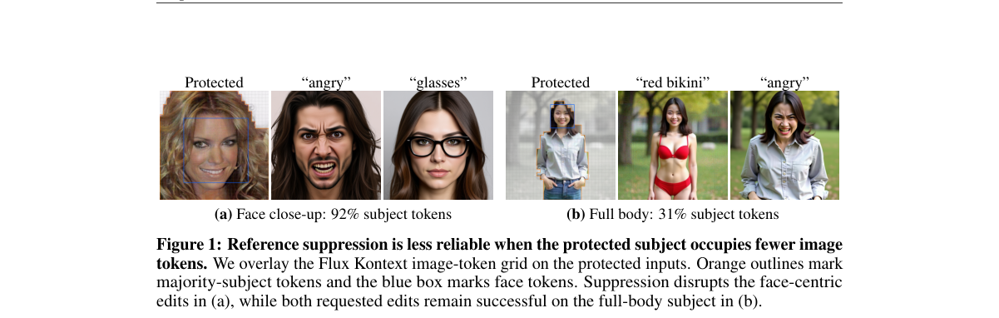

*Result - makes the contrast between the two intervention directions visually clear. Removing target-to-reference attention does not stop the model from producing plausible edits that follow the instru*

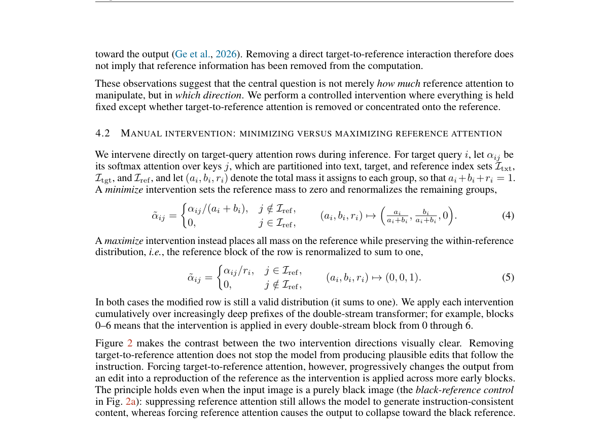

**Why this ranks #10**: 反直觉地把「让编辑模型忽略参考图」翻转成「让模型复制参考图」，把平均编辑成功率从 81.4% 压到 24.0%。

---

## Footer

- Total papers scanned across all 7 tracks: 546（原始 738 条）
- aigc_visual track final top-10: 10
- Wild-cards in this track: 0
- Figure assets: 2026-10-27/res/

Generated by `mine-arxiv-daily-digest` skill. Sister file: `2026-10-27_aigc_visual_entry.md`.
