# ArXiv Daily Digest - 2026-10-27 (音频与语音语言模型, 10 papers)

**Generated**: 2026-10-27 17:00 CST

**Source**: arXiv cs.CV, cs.SD, eess.AS, cs.CL, cs.AI, cs.RO, cs.LG submissions, listing day 2026-10-26 (announced 2026-10-27 00:00 UTC)

**Batch window**: 2026-10-25T18:00:00Z .. 2026-10-26T18:00:00Z（arXiv 公告批次横跨两个 UTC 日：前一日 18:00 UTC 起算，当日 17:59:59 UTC 截止）

**Track**: audio_lm (top 10 of 546 papers scanned, 70 full reads)

**Scope**: 音频 / 语音语言模型、全双工语音助手、语音理解与口语对话

⚠️ **Wild-card**: 本批该线 3 篇为 wild-card 补足，已在正文逐条标注并给出理由。

---

## Top 10 - 音频与语音语言模型

### 1. Heard Enough to Act: Early Tool Calling in Spoken Dialogue Systems

**arXiv**: [2610.34653](https://arxiv.org/abs/2610.34653) | **Score**: 9.7 (relevance 10.0 x 0.7 + quality 9.0 x 0.3) | **Tags**: audio-LM, duplex-voice, tool-calling, streaming, latency, omni-modal | **Categories**: cs.CL, eess.AS | **Pages**: 5

**Authors**: Yizhou Peng, Chen Chen, Donghang Wu, Hexin Liu, Eng Siong Chng

**Affiliation**: Nanyang Technological University; AI Singapore

**Abstract**

> Latency-sensitive spoken agents must know not only which tool to call, but also when they have heard enough to act. Waiting for the turn to complete delays execution even when the request is already actionable. However, neither existing spoken agents nor spoken dialogue corpora define the earliest point at which a request becomes actionable. We introduce a synthetic spoken-dialogue pipeline that provides earliest-actionable-point supervision, marking when the observed speech grounds a tool and its required arguments. Through controlled task generation, speech synthesis and alignment, and gated annotation, we construct 26,694 dialogues totaling 786 hours across 48 domains, with disjoint training and test argument values. We additionally create an audio rendering of $τ^2$-bench for external evaluation. We train an omni-modal language model on this corpus, enabling causal, chunk-level decisions and partial-transcript generation for downstream call completion. The model achieves tool-state macro-F1 scores of 0.48 and 0.47 on held-out dialogues and the external benchmark, respectively. For correct calls, the estimated mean lead over a turn-end cascade, using the same formatter, is 1.8-2.0 seconds in-domain and 1.1 seconds on $τ^2$-bench. These results demonstrate a data-driven path toward spoken agents that act while listening. We will open-source the pipeline and the training scripts.

**Key findings**

- **Finding**: 对延迟敏感的语音助手而言，关键不只是调哪个工具，而是何时已经听到足以行动的信息；等整轮说完会白白延迟那些本已可执行的请求。
- **Finding**: 现有语音助手与口语对话语料都没有定义「请求最早在何时变为可行动」。
- **Finding**: 作者引入合成口语对话管线，提供 earliest-actionable-point 监督，标出所听语音何时已能支撑某个工具及其所需参数。
- **Finding**: 通过受控任务生成、语音合成与对齐、门控标注，构建 26,694 段共 786 小时、覆盖 48 个领域的对话，训练/测试的参数取值互不重叠。
- **Finding**: 另外为外部评测渲染了 τ²-bench 的音频版本。
- **Finding**: 在该语料上训练一个 omni-modal 语言模型，实现因果的 chunk 级决策与部分转写生成，以支撑下游的通话补全。
- **Finding**: 工具状态 macro-F1 在留出对话与外部基准上分别为 0.48 与 0.47。
- **Finding**: 对正确调用而言，相对使用同一 formatter 的整轮结束级联，平均提前量为域内 1.8–2.0 秒、在 τ²-bench 上 1.1 秒。
- **Inference**: 把「早动作」问题化成一个标注问题而不是架构问题，是很务实的一步——先有数据，才有流式决策模型。
- **Inference**: macro-F1 只有 0.48 说明「听到多少就够」的判定本身很难，收益主要来自那 1.8–2.0 秒的提前量而非精度。
- **Recommendation**: 推荐。做语音助手、流式交互或关心端到端时延的必读。

**Key figures**

*Framework - Data pipeline. Typed task templates are instantiated by a deterministic entity sampler, simulated as text dialogues, rendered to aligned speech, and annotated with gated early-tool-call events*

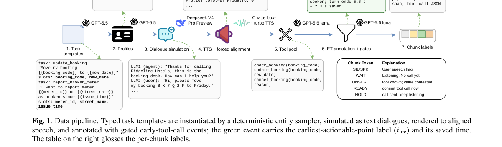

*Result - Single-stream model design. One autoregressive, KV-cached sequence interleaves injected audio chunks with emitted control tokens and payload blocks; one LM head decodes VAD, ET, ASR, and tool*

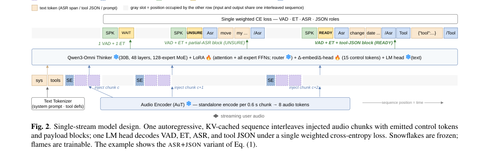

**Why this ranks #1**: 把「听到多少才够行动」变成可标注的数据问题，在留白 1.8–2.0 秒的前提下让语音助手边听边动手。

---

### 2. Diagnosing and Mitigating Long-Session Degradation in Full-Duplex Speech Models

**arXiv**: [2610.34991](https://arxiv.org/abs/2610.34991) | **Score**: 8.7 (relevance 9.0 x 0.7 + quality 8.0 x 0.3) | **Tags**: audio-LM, duplex-voice, long-session, LoRA, self-distillation, KV-cache, context-compression | **Categories**: cs.CL | **Pages**: 36

**Authors**: Junho Kim, CheHyun Lee, Donghun Kang, Youngho Cho, Dongwook Lee, Heeseung Kim, Sungroh Yoon

**Affiliation**: Seoul National University; University of Seoul

**Abstract**

> End-to-end full-duplex spoken dialogue models enable natural, real-time spoken interactions with interruptions, backchannels, and overlapping speech. Prior evaluations have assessed diverse interaction capabilities and identified some degradation patterns across conversational turns. However, how model behavior evolves over extended sessions remains insufficiently understood. In this work, we address this gap by systematically characterizing long-session degradation and developing efficient methods to mitigate it. We introduce a closed-loop evaluation framework for long-session stability and apply it to several publicly available full-duplex speech models, revealing degradation over time in responsiveness, spoken content quality, and voice consistency. To mitigate this degradation, we propose a self-distillation-based training framework for lightweight LoRA adaptation that improves long-session stability with a small amount of additional training. We further introduce a two-resolution context (TRC) architecture that preserves recent interactions in full detail while compressing older interaction history into key-value representations. We evaluate our methods on three models with distinct architectures, assessing long-session stability, information retention, and computational efficiency. Across all three models, we show that LoRA adaptation mitigates performance degradation over ten-minute sessions, while adding TRC extends these gains beyond the training session length and reduces KV-cache growth by more than 90%.

**Key findings**

- **Finding**: 端到端全双工口语对话模型支持打断、附和与重叠语音；既有评测已识别出若干随对话轮次出现的退化模式，但长时间会话中行为如何演化仍不清楚。
- **Finding**: 作者提出闭环的长会话稳定性评测框架，并应用到多个公开的全双工语音模型上，暴露出响应性、口语内容质量与声音一致性随时间的退化。
- **Finding**: 为缓解退化，提出基于自蒸馏的训练框架，用少量额外训练做轻量 LoRA 适配以改善长会话稳定性。
- **Finding**: 进一步提出双分辨率上下文（TRC）架构：完整保留近期交互，同时把更早的交互历史压缩成 key-value 表示。
- **Finding**: 在三个架构不同的模型上评估长会话稳定性、信息保持与计算效率。
- **Finding**: 三个模型上一致显示 LoRA 适配能缓解十分钟会话内的性能退化；加上 TRC 后增益可延伸到超出训练会话长度，并把 KV-cache 增长减少 90% 以上。
- **Inference**: 「双分辨率上下文」本质是给对话历史做分层压缩——和长上下文 LLM 的 KV 压缩是同一问题，但对话场景的压缩对象是话语而非 token。
- **Inference**: 把「长会话退化」当作一等公民来测，这一步比方法本身更有价值：它给全双工语音模型补上了一个此前没人系统测过的维度。
- **Recommendation**: 推荐。做全双工语音助手或长上下文语音系统的必读。

**Key figures**

*Framework - Closed-loop simulation protocol. Overview of the simulation loop, in which model responses are incorporated into the dialogue context to condition subsequent user turns.*

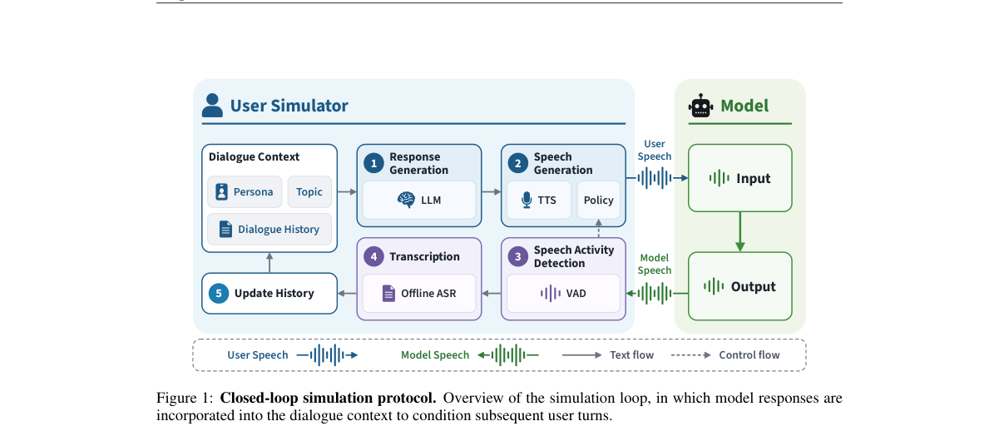

*Result - reveals distinct patterns of performance degradation across all four models as conversations progress. Moshi exhibits gradual declines in conversation quality and speaker similarity, followed*

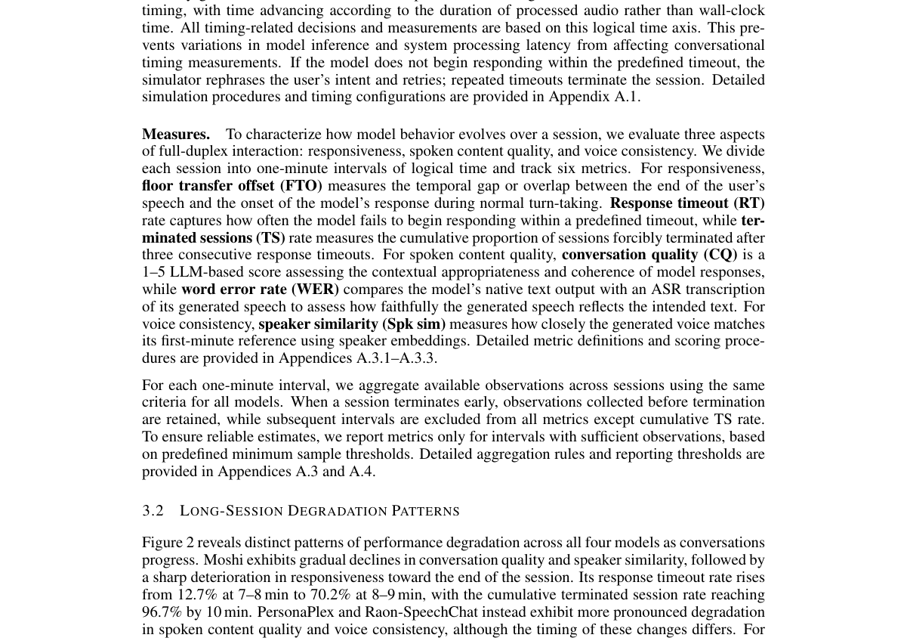

**Why this ranks #2**: 把全双工语音模型的「十分钟后会退化」量化出来，并用自蒸馏 LoRA 加双分辨率上下文把退化与 KV 增长一起压住。

---

### 3. Preserve to Expand: Source-Aware Adaptation and Model Merging for Multilingual LLM-Based ASR

**arXiv**: [2610.35846](https://arxiv.org/abs/2610.35846) | **Score**: 8.7 (relevance 9.0 x 0.7 + quality 8.0 x 0.3) | **Tags**: audio-LM, duplex-voice, Speech_LM, multilingual-ASR, connector, model-merging, TIES, catastrophic-forgetting | **Categories**: cs.CL | **Pages**: 21

**Authors**: Yuchen Zhang, Haralambos Mouratidis, Ravi Shekhar

**Affiliation**: University of Essex

**Abstract**

> Expanding multilingual ASR systems to new languages is challenging when adaptation must preserve previously supported languages without replaying source-language training data. We study this problem in connector-based Speech LLMs, where a trainable connector maps speech representations into a frozen large language model. We evaluate target-update construction and merging strategies for adapting the connector while preserving source-language performance. In single-target expansion, target-only fine-tuning and standard TIES merging learn new languages but cause severe source-language forgetting, while SSU-Wanda+TIES gives the best source-preserving trade-off. In multi-target expansion, update merging provides stable source retention, whereas recursive expansion can improve target adaptation under favorable orders but is highly order-sensitive. These results show that multilingual ASR expansion requires balancing target acquisition, source retention, and interactions among target-language updates.

**Key findings**

- **Finding**: 把多语种 ASR 扩展到新语言很难，因为适配必须保住已支持语言、又不能重放源语言训练数据。
- **Finding**: 作者研究连接器式 Speech LLM——一个可训练连接器把语音表示映射进冻结的大语言模型。
- **Finding**: 系统评估目标更新的构造方式与合并策略，在适配连接器的同时保住源语言性能。
- **Finding**: 单目标扩展下，只做目标语言微调与标准 TIES 合并能学到新语言但造成严重源语言遗忘，而 SSU-Wanda+TIES 给出最好的源语言保持权衡。
- **Finding**: 多目标扩展下，更新合并能稳定保持源语言；而递归扩展在有利的顺序下能改善目标适配，但对顺序极其敏感。
- **Finding**: 结论是多语种 ASR 扩展必须同时权衡目标获取、源语言保持与多个目标更新之间的相互作用。
- **Inference**: 「选择器 + 合并」比「继续训练」更抗遗忘，这个结论在连接器这种小参数空间里尤其明显——因为可合并的参数本来就少而干净。
- **Inference**: 递归扩展的顺序敏感性提示多语种扩展没有免费的午餐，任何顺序式流水线都要做顺序鲁棒性检查。
- **Recommendation**: 推荐。做多语种语音模型、模型合并或适配的值得读。

**Key figures**

*Framework - provides an overview of the connector- based ASR architecture and the single-target and multi-target expansion strategies studied in this work.*

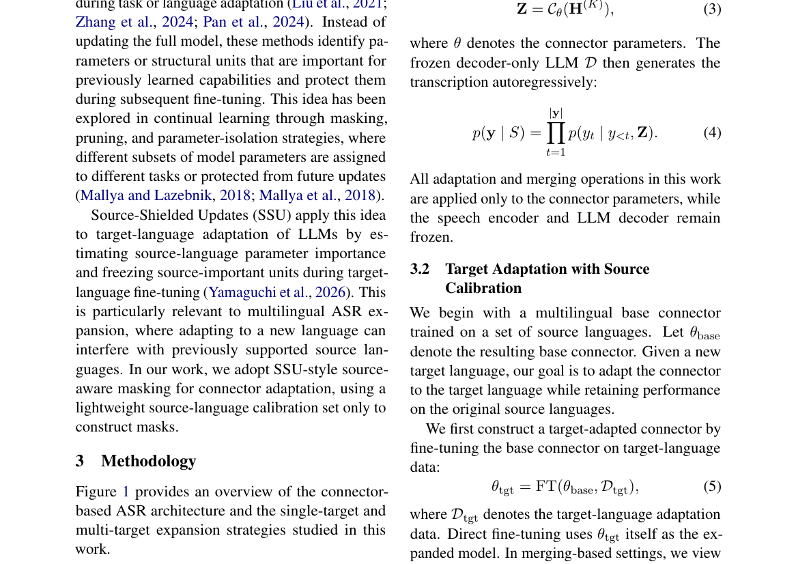

**Why this ranks #3**: 系统比较连接器式 Speech LLM 的多语种扩展策略，指出「只训目标语言」与「递归扩展」各有明确的失败模式。

---

### 4. DecisionTraceBench: Tracking Decision-Critical Information in Multi-Party Spoken Conversations

**arXiv**: [2610.34746](https://arxiv.org/abs/2610.34746) | **Score**: 8.0 (relevance 8.0 x 0.7 + quality 8.0 x 0.3) | **Tags**: audio-LM, duplex-voice, spoken-dialogue, multi-party, state-tracking, benchmark, provenance | **Categories**: cs.CL | **Pages**: 26

**Authors**: Wenchao Du, Fangxin Shang, Long Wu, Runze Cui, Qing Yang, Yehui Yang

**Affiliation**: Qifu Technology; University of Chinese Academy of Sciences

**Abstract**

> In high-stakes domains such as finance, critical information evolves through multi-party interaction. Recovering these changes and their sources is fundamental to reliable speech understanding. Existing speech benchmarks focus on transcription, local understanding, and turn-level state prediction, leaving joint decision evolution across speakers insufficiently evaluated. We introduce DecisionTraceBench, a speech state-tracking benchmark for Decision-Critical Information State Tracking (DCIST). It jointly evaluates decision event sequences, speaker attribution, scope, and temporal evidence, using trajectory-level F1 to measure complete event-chain recovery. Our dataset comprises Chinese financial dialogues involving two to four speakers, with 100.39 hours of synthetic audio and 8.61 hours of human-performed recordings. On a fixed cohort of human-performed recordings, five cascaded systems and two direct-audio models achieve DCIST scores of 5.73% to 21.35%. Ablations with speaker-labeled reference scripts and no temporal localization requirements yield a maximum score of only 38.72%. Audio perturbation experiments further show that overall transcription error rates do not adequately reflect complete trajectory recovery. These findings reveal limitations in jointly understanding information provenance and state evolution, providing a benchmark for evaluating decision-process understanding and decision traceability in high-stakes speech applications.

**Key findings**

- **Finding**: 在金融等高风险领域，关键信息随多人互动演化；如何还原这些变化及其来源，是可靠语音理解的基础。
- **Finding**: 既有语音基准关注转写、局部理解与轮次级状态预测，对跨说话人的联合决策演化覆盖不足。
- **Finding**: 提出语音状态跟踪基准 DecisionTraceBench，评测 Decision-Critical Information State Tracking (DCIST)。
- **Finding**: 联合评测决策事件序列、说话人归属、作用范围与时间证据，并用轨迹级 F1 度量完整事件链的还原度。
- **Finding**: 数据集为 2–4 说话人的中文金融对话，含 100.39 小时合成音频与 8.61 小时真人录音。
- **Finding**: 在固定的人类录音 cohort 上，五个级联系统与两个直接音频模型的 DCIST 分数仅为 5.73%–21.35%。
- **Finding**: 即使加上说话人标注的参考脚本、并取消时间定位要求，最高分也只到 38.72%。
- **Finding**: 音频扰动实验进一步显示整体转写错误率并不足以反映完整轨迹还原能力。
- **Inference**: 「转写错得少 ≠ 决策链还原得对」这个结论，对所有把 WER 当代理指标的语音评测都是提醒。
- **Inference**: 最高 38.72% 说明当前模型对多方对话的信息溯源基本无能，这是一个有明确改进空间的空档。
- **Recommendation**: 推荐。做口语理解、多方对话或高风险语音应用的必读。

**Key figures**

*Framework - Full-trajectory speech state tracking. Systems recover an event chain from audio without manual tran- scripts or gold speaker labels. Evaluation jointly checks required-event coverage, attri*

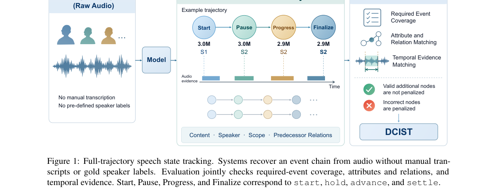

*Result - Minimum required chains and additional nodes. S1 handles documentation and S2 performs technical verification. Omitting a required suspension or resumption fails the trajectory despite the co*

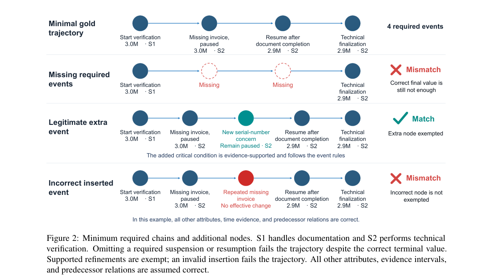

**Why this ranks #4**: 把「多方对话里关键信息怎么变、由谁说的」做成轨迹级评测，最高分组只有 38.72% 得分。

---

### 5. One Mean Log-Mel Vector per Phoneme: Simple and Fast Text Injection for Speech Recognition

**arXiv**: [2610.34623](https://arxiv.org/abs/2610.34623) | **Score**: 7.7 (relevance 8.0 x 0.7 + quality 7.0 x 0.3) | **Tags**: audio-LM, duplex-voice, ASR, text-injection, phoneme, WER, training-efficiency | **Categories**: cs.AI, cs.CL, cs.CV, cs.LG, cs.NE | **Pages**: 5

**Authors**: Albert Zeyer, Davyd Naveriani, Dorian Koch, Ralf Schlüter, Hermann Ney

**Affiliation**: RWTH Aachen University; AppTek GmbH

**Abstract**

> Text injection trains speech recognition models on unpaired text alongside paired audio. We feed the speech encoder synthetic input derived from text so the whole model learns from it. Previously, we synthesized this input with a frozen text-to-speech (TTS) model. Here, a simple lookup table replaces the TTS model: a mean log-mel vector (or one-hot encoding) per phoneme, repeated for a random duration drawn from alignment statistics, with silence between words. Training is 1.8 times faster than with the neural TTS, achieving comparable word error rates. With an external language model, our system reaches 1.36 / 2.90 / 1.52 / 3.24 % WER on LibriSpeech {dev,test}-{clean,other}, to our knowledge state-of-the-art using only LibriSpeech paired data, text, and lexicon. We analyze components of synthetic input (durations, acoustic features), compare different HMM aligners, evaluate scaling on the 25 000 h Loquacious dataset, and show that full-encoder injection yields strong relative improvements compared to partial-encoder and decoder methods. The code of the whole pipeline behind every number in this paper is public: github.com/rwth-i6/returnn-experiments/tree/master/2026-text-injection

**Key findings**

- **Finding**: 文本注入让语音识别模型能在训练时同时使用未配对文本与配对音频，方法是把从文本合成的输入喂给语音编码器。
- **Finding**: 此前是用冻结的 TTS 模型合成该输入；本文用一个简单查表取代 TTS 模型——每个音素对应一个平均 log-mel 向量（或 one-hot 编码），按对齐统计采样随机时长重复，词间插静音。
- **Finding**: 训练比神经 TTS 快 1.8 倍，词错误率相当。
- **Finding**: 配合外部语言模型，系统在 LibriSpeech {dev,test}-{clean,other} 上达到 1.36 / 2.90 / 1.52 / 3.24% WER；作者称这是仅用 LibriSpeech 配对数据、文本与词典达到的已知最好结果。
- **Finding**: 作者分析了合成输入的各组件（时长、声学特征），比较了不同 HMM 对齐器，在 25,000 小时的 Loquacious 数据集上评估了扩展性。
- **Finding**: 全编码器注入相对部分编码器与解码器方法有更强的相对改进。整条流水线的代码公开。
- **Inference**: 「用统计量代替生成模型」是本文最漂亮的一步——文本注入只需要的是文本侧的时长与音素结构，不需要声学真实感。
- **Inference**: 1.8 倍训练加速配上不降的 WER，说明此前 TTS 注入的算力开销几乎全是浪费的。
- **Recommendation**: 推荐。做 ASR、无监督/半监督语音训练或做数据合成的值得读。

**Key figures**

*Framework - Relative WER reduction vs. used text : audio ratio: ours (Tables 5 and 8) and the literature with in-domain text, against the same model without text [1–11]. Color: text enters the whole en- c*

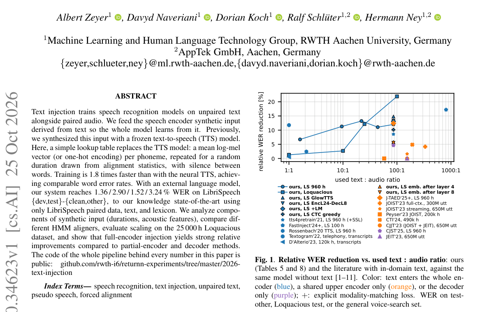

**Why this ranks #5**: 把 ASR 文本注入里的神经 TTS 换成「每音素一个平均 log-mel 向量」的查表，训练快 1.8 倍而 WER 不降。

---

### 6. Probing the phon* representations of the Mimi codebooks

**arXiv**: [2610.35432](https://arxiv.org/abs/2610.35432) | **Score**: 7.0 (relevance 7.0 x 0.7 + quality 7.0 x 0.3) | **Tags**: audio-LM, duplex-voice, audio-codec, Mimi, phoneme, mutual-information, tokenization | **Categories**: cs.CL | **Pages**: 10

**Authors**: Artem Saloev, Nicolas Ballier, Erin Pacquetet

**Affiliation**: Universite Paris Cite; SCIAM

**Abstract**

> Neural audio codecs are increasingly used to encode speech for integration with large language models. This paper investigates the phonetic representations in the first codebook (CB0) of the Mimi codec. ABX style evaluation is poorly suited to Mimi fixed 80 ms tokenization window, which often spans multiple phonemes; we instead use forced alignment, entropy analysis, and Phone-Normalized Mutual Information (PNMI). Using TIMIT speech (58/55 speakers, SA1/SA2), individual tokens are strongly associated with specific phonemes (PNMI = 0.84, above random), yet phonemes are realized by multiple competing tokens rather than a one-to-one mapping.

**Key findings**

- **Finding**: 神经音频编解码器被越来越多地用于把语音编码后接入大语言模型；本文研究 Mimi 编解码器第一层码本（CB0）的音素表征。
- **Finding**: ABX 式评测不适合 Mimi 固定的 80 ms tokenization 窗口——它常常横跨多个音素。
- **Finding**: 作者改用强制对齐、熵分析与音素归一化互信息（PNMI）作为评测手段。
- **Finding**: 在 TIMIT 语音（58/55 说话人，SA1/SA2）上，单个 token 与特定音素强相关（PNMI = 0.84，高于随机水平）。
- **Finding**: 但一个音素是由多个相互竞争的 token 共同实现的，而不是一对一映射。
- **Inference**: 「多 token 实现一个音素」意味着语音 token 序列到音素序列不是压缩关系而是多对多关系——做 speech-token 空间的 loss 设计时不能当作一对一。
- **Inference**: 这类 codec 分析在 speech-LM 训练里常被忽略，却是判断 token 预算是否浪费的廉价手段。
- **Recommendation**: 推荐。做语音 codec 或 speech-token 建模的值得看。

**Key figures**

*Framework - A schematic representation of the Mimi encoding-decoding pipeline*

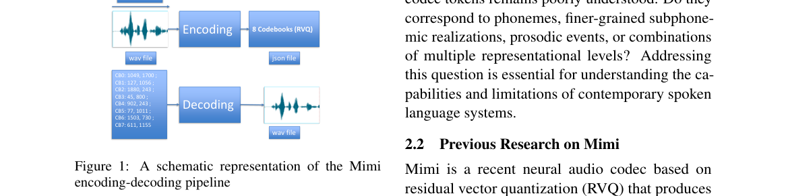

**Why this ranks #6**: 用强制对齐与 PNMI 量化 Mimi 第一层码本的音素承载力：token 与音素强相关但不是一对一映射。

---

### 7. S2SND-v2: Unified Online and Offline Speaker Diarization with Speaker-Adapted w2v-BERT 2.0

**arXiv**: [2610.34707](https://arxiv.org/abs/2610.34707) | **Score**: 6.6 (relevance 6.0 x 0.7 + quality 8.0 x 0.3) | **Tags**: audio-LM, duplex-voice, speaker-diarization, w2v-BERT, online-inference, overlap, pruning | **Categories**: cs.SD | **Pages**: 5

**Authors**: Jincheng Wang, Li Li, Weixin Zhu, Yannan Wang, Tao Yu, Juan Liu, Ming Li

**Affiliation**: Wuhan University; The Chinese University of Hong Kong Shenzhen; Tencent Ethereal Audio Lab

**Abstract**

> This paper presents S2SND-v2, a unified online and offline speaker diarization framework built on S2SND that improves acoustic feature extraction and the use of the resulting representations. For acoustic feature extraction, we introduce a speaker-adapted w2v-BERT 2.0 front end and compare full and pruned construction routes. To better use these features, overlap-aware activity-query masking improves speaker embedding extraction under overlap, while late-speaker training aligns unknown-speaker training with online inference conditions. Combining these improvements, the pruned system achieves competitive average diarization error rates of 14.52% online and 12.03% offline across eight test sets.

**Key findings**

- **Finding**: S2SND-v2 是 S2SND 的统一在线/离线说话人分离框架，在声学特征提取与特征使用两端同时改进。
- **Finding**: 声学特征端引入说话人自适应的 w2v-BERT 2.0 前端，并比较了完整与剪枝两条构建路线。
- **Finding**: 特征使用端用重叠感知的 activity-query 掩码改善重叠场景下的说话人嵌入提取。
- **Finding**: 晚说话人训练把未知说话人训练与在线推理条件对齐。
- **Finding**: 组合这些改进后，剪枝系统在八个测试集上取得在线平均 DER 14.52%、离线 12.03%。
- **Inference**: 「晚说话人训练」把训练分布向在线推理对齐，是流式 diarization 里少被强调但很有效的一招。
- **Inference**: 剪枝版仍保持竞争力，说明说话人分离的瓶颈更多在表征质量而非模型规模——这对边缘部署是好消息。
- **Recommendation**: 推荐。做说话人分离、流式音频或边缘部署的可读。

**Key figures**

*Framework - S2SND-v2 model framework.*

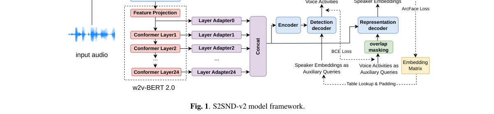

*Result - Three w2v-BERT front end construction routes. Blue ar- rows denote training with speaker-verification data; red arrows de- note training with diarization data.*

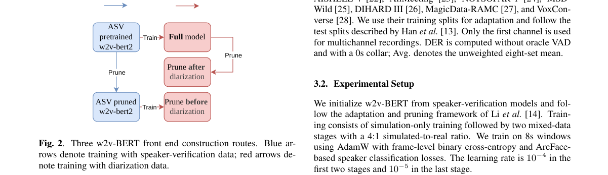

**Why this ranks #7**: 统一在线/离线说话人分离框架，用说话人自适应 w2v-BERT 2.0 前端与重叠感知的 query 掩码把 DER 压到 14.52%/12.03%。

---

### 8. Not One Belief: Answer Payloads, Persistence, and Dissociated Confidence Signals in Conversational Question Answering

**arXiv**: [2610.35694](https://arxiv.org/abs/2610.35694) | **Score**: 6.3 (relevance 6.0 x 0.7 + quality 7.0 x 0.3) | **Tags**: audio-LM, duplex-voice, conversational-QA, confidence, speech-act, persuasion, replication | **Categories**: cs.CL | **Pages**: 25

**Authors**: Duc-Vinh Tran

**Affiliation**: Hanoi University of Science and Technology

**Abstract**

> Conversational QA systems should fix errors when users push back and signal which answers to trust. We split each follow-up into its speech act (re-ask, agree, or challenge) and its payload (an answer string, correct or not), and measure four confidence signals on the same transcripts: verbalized confidence, length-normalized likelihood, a frozen hidden-state probe, and P(True). Answers change when the user supplies an answer string and almost never under the speech act alone: in every retained full-size cell, the correct answer converts at least four times as many wrong answers as re-asking or agreement. The four signals disagree. On Qwen2.5-7B the frozen probe rises with answer persistence rather than truth; this holds on held-out questions, with Llama-3-8B (cleaned answers) as support, but not on four other models. Among 81 Qwen2.5-7B errors that survive one re-ask, re-asking, a fresh chat, or abstain repair almost none, while a gold answer repairs 75-95%. In two preregistered replications, every repair rate without an answer string stays below 0.15; a larger post-hoc rerun excludes 0.15 except for the empty elicit. With BM25 TriviaQA evidence, sentences that contain the answer repair 67-76% of persistent errors versus at most 12% when they do not. An end-to-end contain-gate cuts harm on TriviaQA, but a deployable gate that does not know the gold answer repairs few errors.

**Key findings**

- **Finding**: 对话式 QA 系统在用户反驳时应当修正错误，并给出可信任的信号。
- **Finding**: 作者把每个追问拆成话语行为（重问、同意、质疑）与载荷（一个答案字符串，对或错），并在同一批转写上测量四种置信度信号：口头置信度、长度归一化似然、冻结隐状态探针与 P(True)。
- **Finding**: 答案在用户给出答案串时会发生改变，而在只有话语行为时几乎不变——在每个保留的满格单元里，正确答案转换的错误数至少是重问或同意的四倍。
- **Finding**: 四种置信度信号彼此不一致：在 Qwen2.5-7B 上冻结探针随答案「顽固程度」而非真实性上升；这一点在留出问题上成立，Llama-3-8B（清洗后答案）支持，但在另外四个模型上不成立。
- **Finding**: 在 81 个「重问一次仍存续」的 Qwen2.5-7B 错误里，重问、新开对话或弃答式修复几乎无效，而给出正确答案可修复 75%–95%。
- **Finding**: 两次预注册复现中，所有不含答案串的修复率都低于 0.15；更大规模的事后重跑除空 elicit 外也排除了 0.15。
- **Finding**: 配上 BM25 TriviaQA 证据后，包含答案的句子能修复 67%–76% 的顽固错误，而不含答案时最多只有 12%。
- **Finding**: 端到端的 contain-gate 能减少 TriviaQA 上的伤害，但一个不知道正确答案的可部署 gate 几乎修不好错误。
- **Inference**: 「只有答案载荷能修复错误」是一个很不直观的结论——它意味着对话式纠错的上限由系统能否获得正确事实决定，而非由追问策略决定。
- **Inference**: 探针置信度随顽固程度而非真实性上升，直接动摇了「用一个冻结探针做幻觉检测」的常见做法。
- **Recommendation**: 推荐。做对话式 QA、置信度估计或用户纠错设计的值得读。

**Key figures**

*Framework - Which part of the second user turn (T2) changes which quantity. Solid lines show what a controlled T2 message changes; dashed lines show which confidence measure attaches to it. Green boxes for*

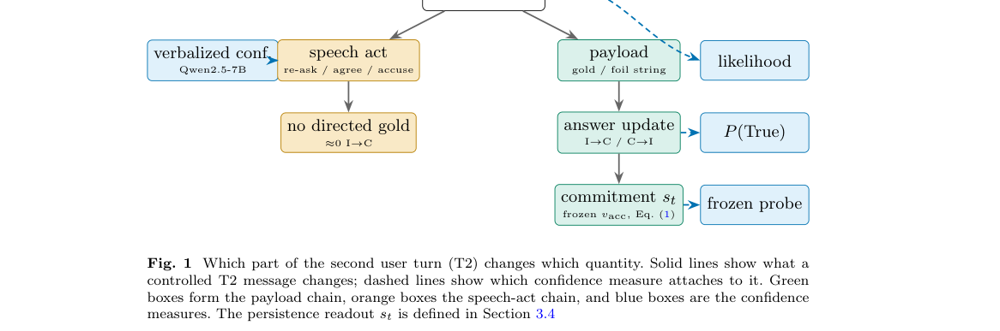

**Why this ranks #8**: 把口语 QA 的追问拆成「话语行为」与「答案载荷」两轴，实测显示只有给出答案串才能真正修复错误。  [wild-card]

---

### 9. Synthetic Child-Adult Interactions Are Not Developmentally Plausible

**arXiv**: [2610.35029](https://arxiv.org/abs/2610.35029) | **Score**: 5.6 (relevance 5.0 x 0.7 + quality 7.0 x 0.3) | **Tags**: audio-LM, duplex-voice, spoken-dialogue, synthetic-data, dialogue-naturalness, instruction-tuning, LoRA | **Categories**: cs.CL | **Pages**: 12

**Authors**: Bastian Bunzeck, Francesca Padovani

**Affiliation**: Bielefeld University; University of Groningen

**Abstract**

> Synthetic data has become a common resource for training language models, and this trend has spilled over into research on developmentally plausible language modeling. However, it remains unclear whether LM-generated child-adult interactions actually resemble natural ones. We compare the synthetic TinyDialogues dataset to natural dialogue across a broad range of linguistic measures. While synthetic data matches natural data on the lexical level, it drastically underestimates the messy, fragmented nature of spoken interaction. To mitigate this, we propose instruction-tuning with data created from real dialogues, and show in a pilot study that a small model approximates the statistical tendencies of natural data after moderate parameter-efficient fine-tuning.

**Key findings**

- **Finding**: 合成数据已成为训练语言模型的常用资源，这一趋势也蔓延到发展生理可行（developmentally plausible）的语言建模研究。
- **Finding**: 但 LM 生成的儿童-成人交互是否真的像自然交互并不清楚。
- **Finding**: 作者在广泛的语言学度量上把合成 TinyDialogues 数据集与自然对话做对比。
- **Finding**: 合成数据在词汇层面与自然数据匹配，却严重低估了口语交互中「破碎、碎片化」的真实形态。
- **Finding**: 为缓解这一点，作者提出用真实对话构造的数据做指令微调。
- **Finding**: 试点研究显示，小模型经过适度参数高效微调后能逼近自然数据的统计倾向。
- **Inference**: 「词汇像、结构不像」是合成口语数据的通病——对本项目关注的语音合成与合成语料工作，这是直接可用的检查清单。
- **Inference**: 用少量真实对话做参数高效微调就能矫正，说明差距主要在数据分布的「断句与打断」特征上，而非知识量。
- **Recommendation**: 推荐。做合成语音数据或对话数据工程的值得读。

**Key figures**

*Framework - Type-Token Ratio per dataset, computed over unigrams, bigrams, and trigrams.*

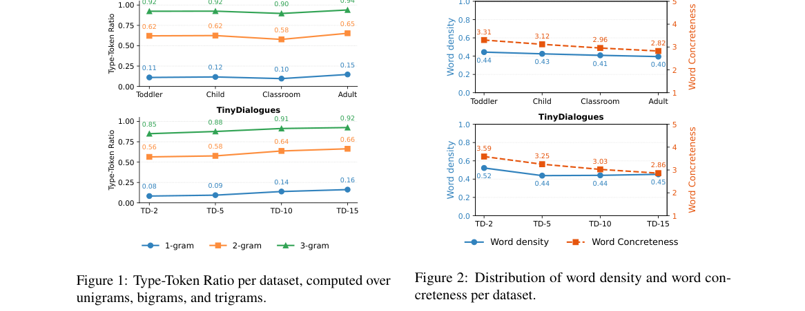

*Result - Distribution of word density and word con- creteness per dataset.*

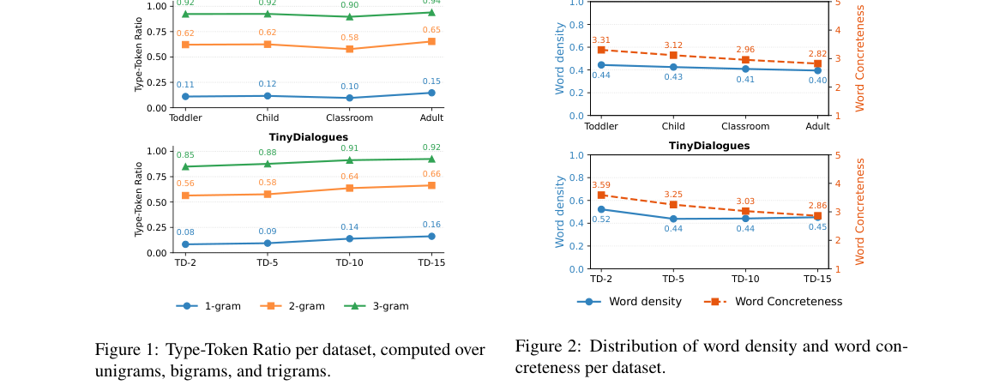

**Why this ranks #9**: 用一整套语言学度量证明合成的儿童-成人对话在词汇层面像自然对话、却在口语交互的「破碎感」上严重失真。  [wild-card]

---

### 10. When Fusion Order Matters: Insights on Progressive Multimodal Representation Learning for Cross-modal Retrieval

**arXiv**: [2610.35125](https://arxiv.org/abs/2610.35125) | **Score**: 5.6 (relevance 5.0 x 0.7 + quality 7.0 x 0.3) | **Tags**: audio-LM, duplex-voice, multimodal-retrieval, fusion-order, acoustic, modality-availability, text-to-video | **Categories**: cs.AI, cs.IR | **Pages**: 12

**Authors**: Haoxiang Zhao, Bin Wang, Yaofei Wang, Xiao Lan, Yunfeng Diao, Xu Wang

**Affiliation**: University of Science and Technology of China; Hefei University of Technology; Sichuan University

**Abstract**

> Multimodal video retrieval combines visual, acoustic, and speech information, yet how their fusion order should depend on the data and the retrieval query remains unclear. We introduce Unified Progressive Representation Learning for Order Analysis, or UniPRO, to investigate this question through configurable fusion schedules with matched model components and training settings. Starting from text-to-video retrieval, we find that the tested one-by-one schedules outperform stacked fusion, while changing the order within one-by-one fusion also changes performance. To guide order selection, we examine two complementary considerations: learning difficulty under unequal modality availability and preservation of information relevant to the query. Complete-modality controls show that missing inputs alone cannot explain order sensitivity. At R@1, text and audio retrieval favor schedules that introduce the modality matching the query last. Controlled speech missingness during training and testing reverses the preferred order in both R@1 and SumR, with different crossover points. These findings motivate balancing the two considerations when selecting a fusion path. We then use them to predict a visual-last schedule for image queries, which achieves 97.9 R@1, the highest among the evaluated orders on MSR-VTT-9k. Main experiments on four text-to-video benchmarks establish the effectiveness of UniPRO, with component ablations assessing its supporting design. Together, the results identify fusion order as a task-dependent choice that should account jointly for modality availability and the retrieval query.

**Key findings**

- **Finding**: 多模态视频检索融合视觉、声学与语音信息，但融合顺序应如何依赖数据与检索查询并不清楚。
- **Finding**: 作者提出 Unified Progressive Representation Learning for Order Analysis (UniPRO)，用可配置的融合调度配合匹配的模型组件与训练设置来研究这一问题。
- **Finding**: 从 text-to-video 检索出发，测试的「逐个引入」调度优于堆叠式融合，且逐个融合内部改变顺序也会改变性能。
- **Finding**: 为指导顺序选择，作者考察两个互补因素：模态可用性不均等时的学习难度，以及与查询相关信息的保持。
- **Finding**: 全模态对照实验显示，仅靠输入缺失无法解释顺序敏感性。
- **Finding**: 在 R@1 上，文本与音频检索偏好「把与查询匹配的模态放在最后」的调度。
- **Finding**: 训练与测试中受控的语音缺失会反转偏好的顺序，且在 R@1 与 SumR 上反转点不同。
- **Finding**: 依据这些发现预测图像查询偏好 visual-last 调度，在 MSR-VTT-9k 上取得 97.9 R@1，为评估过的顺序中最高。
- **Finding**: 主实验覆盖四个 text-to-video 基准，并以组件消融评估其支撑设计。
- **Inference**: 「把与查询匹配的模态放最后」是个反直觉但可操作的结论——先引入匹配的模态反而会让模型过早定型。
- **Inference**: 缺失模态会反转最优顺序，意味着任何多模态系统上线后模态可用性一变就要重调顺序，不能一套配置通吃。
- **Recommendation**: 推荐。做多模态检索或融合架构的值得读。

**Key figures**

*Framework - Fusion order matters: unordered fusion, an unsuit- able stacked order, and a preferred one-by-one order for text queries.*

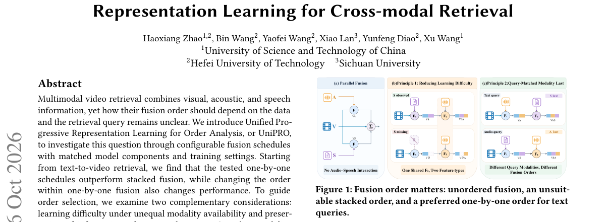

*Result - UniPRO instantiated for text-to-video retrieval. POSR condenses speech transcripts; REM enhances audio–speech relations; MFSA aligns the three feature spaces. Two gated stages first conditio*

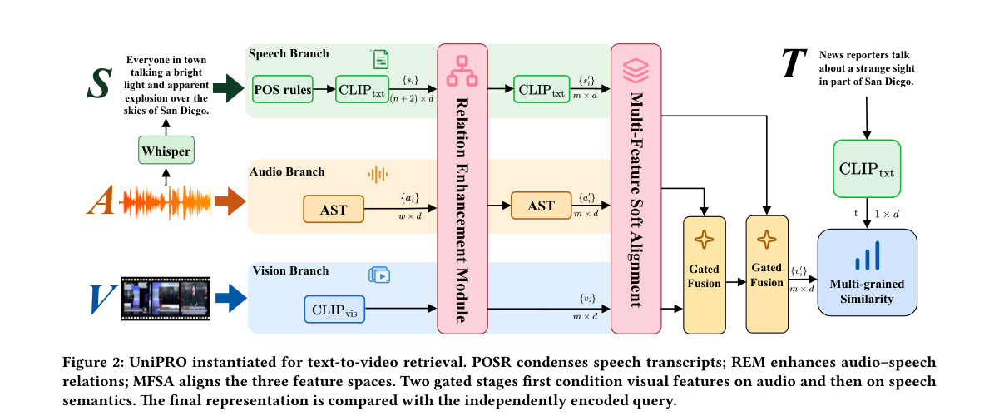

**Why this ranks #10**: 用受控实验证明多模态检索的融合顺序是任务相关的，且缺失模态会反转最优顺序。  [wild-card]

---

## Footer

- Total papers scanned across all 7 tracks: 546（原始 738 条）
- audio_lm track final top-10: 10
- Wild-cards in this track: 3
- Figure assets: 2026-10-27/res/

Generated by `mine-arxiv-daily-digest` skill. Sister file: `2026-10-27_audio_lm_entry.md`.
