# ArXiv Daily Digest - 2026-10-27 (具身智能与世界模型, 10 papers)

**Generated**: 2026-10-27 17:00 CST

**Source**: arXiv cs.CV, cs.SD, eess.AS, cs.CL, cs.AI, cs.RO, cs.LG submissions, listing day 2026-10-26 (announced 2026-10-27 00:00 UTC)

**Batch window**: 2026-10-25T18:00:00Z .. 2026-10-26T18:00:00Z（arXiv 公告批次横跨两个 UTC 日：前一日 18:00 UTC 起算，当日 17:59:59 UTC 截止）

**Track**: embodied (top 10 of 546 papers scanned, 70 full reads)

**Scope**: 具身智能、机器人操作与导航、世界模型 / 世界动作模型、sim-to-real

---

## Top 10 - 具身智能与世界模型

### 1. The Language of Deformation: Semantic Failure Analysis as a Prerequisite for Dexterous Manipulation of Deformable Objects

**arXiv**: [2610.35103](https://arxiv.org/abs/2610.35103) | **Score**: 9.7 (relevance 10.0 x 0.7 + quality 9.0 x 0.3) | **Tags**: embodied-ai, world-model, deformable-objects, failure-analysis, dexterous, position-paper | **Categories**: cs.RO | **Pages**: 9

**Authors**: Ignacio Cuiral-Zueco, David Hardman, Michele Pierallini, Erfan Shahriari

**Affiliation**: Clermont Auvergne INP; University of Cambridge; University of Pisa; RAI Institute

**Abstract**

> Dexterous manipulation of rigid objects has reached a level of maturity where grasp stability, control, and planning strategies are successfully applied in industry and logistics. In contrast, manipulating deformable objects (cables, plastic pieces, cloth) remains far more challenging, as rigid-object methods do not account for their additional complexity. This paper identifies semantic failure analysis as a key step toward mature deformable-object manipulation and supports this claim with proof-of-concept experiments. Unlike rigid-object manipulation, where goals are well-defined in terms of criteria such as force balance and slippage, deformable-object manipulation involves a broader variety of failure modes arising from differences in materials, geometry, and behaviour. Typical failures include buckling, plastic deformation, pressure variations, and tearing. These diverse and often hard-to-detect events require distinct corrective strategies, making semantic failure analysis necessary. We define its key components and challenges and present experimental results supporting its potential as a research direction.

**Key findings**

- **Finding**: 刚性物体的灵巧操作已足够成熟，抓取稳定性、控制与规划策略都能落地到工业与物流；可变形物体（线缆、塑料件、布料）则远未解决，因为刚性方法没有考虑其额外复杂性。
- **Finding**: 与刚性操作有明确判据（力平衡、防滑）不同，可变形操作的失效模式更宽——材料、几何与行为差异导致屈曲、塑性变形、压力变化与撕裂。
- **Finding**: 这些多样且常常难以检测的事件需要不同的纠正策略，因此语义失效分析是必需的。
- **Finding**: 本文定义了语义失效分析的关键组件与挑战，并给出支持其作为研究方向的概念验证实验。
- **Inference**: 把失效分析放在「操作之前」而非「失败之后」，是这类问题的正确工程顺序——可变形操作缺的不是又一个策略，而是可诊断的失败语义。
- **Inference**: 作者自述为概念验证，实验规模有限；它的价值在于给出了一个可被后续工作引用的问题定义。
- **Recommendation**: 推荐。做可变形物体操作、灵巧手或需要立项找方向的值得读。

**Key figures**

*Framework - Schematic representation of the SFA-DOM framework. Sensor observations yt and contextual history ht are processed by the semantic failure classifier Φ to infer a semantic failure label st, whi*

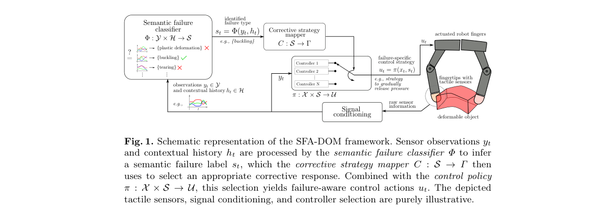

*Result - Experimental setup and tactile sensing results for interactions with deformable and fragile objects. (Top) Video frame sequences showing manipulation of a balloon, a clay piece, a thin paper s*

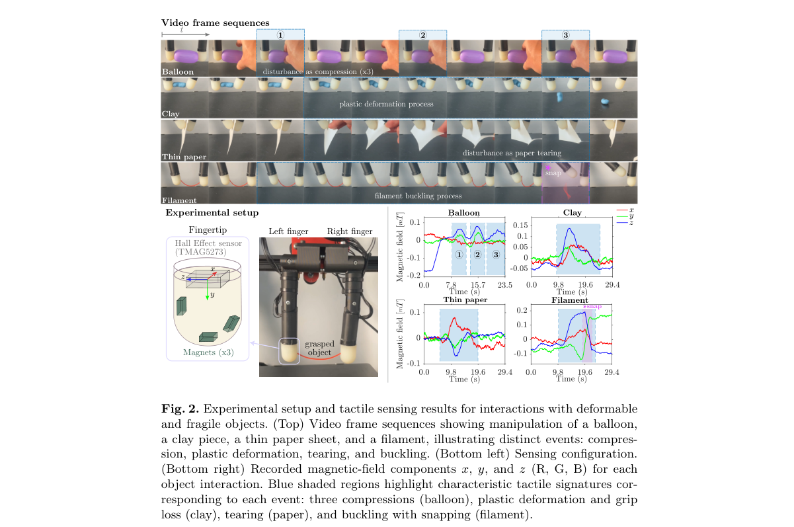

**Why this ranks #1**: 一篇立场论文：把「语义级失效分析」确立为可变形物体灵巧操作的前置条件，而非事后归因。

---

### 2. Learning Force-Reactive Humanoid Loco-Manipulation

**arXiv**: [2610.35862](https://arxiv.org/abs/2610.35862) | **Score**: 9.7 (relevance 10.0 x 0.7 + quality 9.0 x 0.3) | **Tags**: embodied-ai, world-model, humanoid, loco-manipulation, force-control, diffusion-policy, UMI | **Categories**: cs.AI, cs.LG, cs.RO, eess.SY | **Pages**: 9

**Authors**: Sihang Li, Xiaofeng Guo, Jinkun Cao, Charlie Cheng, Ruihan Yang, Chen Feng, Guanya Shi, Haozhi Qi

**Affiliation**: Amazon FAR; New York University; Carnegie Mellon University; University of Chicago

**Abstract**

> Many everyday tasks require controlling contact force as well as motion. On a humanoid, this force must often be coordinated across both hands and the whole body, and cannot be specified by kinematic trajectories alone. Therefore, we present FLORE, a framework for learning force-reactive humanoid loco-manipulation. We collect robot-free demonstrations using two force-sensing UMI-style handheld grippers for hand motion and contact wrenches, and wearable trackers for body motion. A force-reactive diffusion policy takes vision, proprioception, and measured wrenches as input, then predicts actions and per-hand force commands. A hybrid compliance whole-body controller with force tracking executes these commands while maintaining balance: an integral of the force error measured by real force/torque (F/T) sensors lets each hand track force accurately along the commanded direction and remain compliant along the others. In simulation, the controller tracks per-hand force commands of varied magnitude and direction, with little loss in whole-body motion accuracy. Across three contact-rich tasks on the robot, the force-reactive policy succeeds in 80% of rollouts, compared with 26.7% for a position-only policy trained on the same demonstrations and executed by the same controller. For more details, please visit our website: https://louis-leee.github.io/FLoRe/.

**Key findings**

- **Finding**: 许多日常任务需要同时控制接触力与运动；在人形机器人上，力还要跨双手与全身协同，无法仅靠运动学轨迹指定。
- **Finding**: 作者提出 FLORE 框架学习力反应式的人形 loco-manipulation。
- **Finding**: 用两把力感知 UMI 式手持夹爪采集无机器人演示，得到手部运动与接触扳手；用可穿戴追踪器采集身体运动。
- **Finding**: 力反应式扩散策略输入视觉、本体感知与实测扳手，输出动作与每只手的力指令。
- **Finding**: 混合柔顺的全身控制器执行这些指令并维持平衡：对实测 F/T 传感器的力误差做积分，使每只手沿指令方向精确跟踪力、其余方向保持柔顺。
- **Finding**: 在仿真中，控制器能跟踪不同量级与方向的每手力指令，且全身运动精度损失很小。
- **Finding**: 在机器人上三个富接触任务中，力反应式策略成功率 80%，同演示、同控制器训练的位置-only 策略只有 26.7%。
- **Inference**: 同一批演示、同一套控制器，仅因为输出多了力指令，成功率就差了三倍——说明之前失败的主因是「没告诉机器人该用多大力」。
- **Inference**: UMI 式手持夹柄 + 可穿戴追踪的采集方案，把昂贵的人形真机数据成本降到了「人手 + 两个夹爪」，可复制性强。
- **Recommendation**: 推荐。做人形、力控或接触丰富操作的必读。

**Key figures**

*Result - Overview of our FLORE framework. (B) Two handheld UMI-style grippers with F/T sensors and three additional trackers record images, motion, and contact force without a robot. (C) A force-reacti*

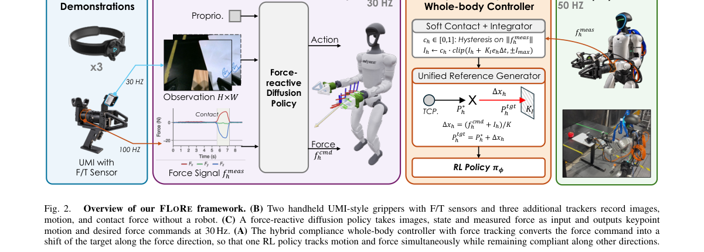

**Why this ranks #2**: 让策略同时输出动作与双手力指令，用力反应式扩散策略把人形机器人接触任务成功率从 26.7% 抬到 80%。

---

### 3. Zero-HLM: Generalizable Humanoid Loco-Manipulation without Real Robot Data

**arXiv**: [2610.35075](https://arxiv.org/abs/2610.35075) | **Score**: 9.0 (relevance 9.0 x 0.7 + quality 9.0 x 0.3) | **Tags**: embodied-ai, world-model, humanoid, real-to-sim, loco-manipulation, agentic-reconstruction, GR00T | **Categories**: cs.RO | **Pages**: 23

**Authors**: Dianyi Yang, Mengya Liu, Zhumei Wang, Yu Liu, Xiaochen Zhang, Yixuan Li, Le Ma, Yuhang Yang, Weiqi Huang, Wei Liang, Baoxiong Jia, Siyuan Huang

**Affiliation**: Beijing Institute of Technology; Tsinghua University; BIGAI; Delta Intelligence

**Abstract**

> Learning generalizable humanoid loco-manipulation remains bottlenecked by costly real-world demonstrations. Simulation provides a scalable alternative, but requires visually faithful, physics-ready scenes and executable whole-body motions. We present Zero-HLM, a real-to-sim-to-real framework that transforms smartphone captures and simulated source demonstrations into scalable training data for humanoid loco-manipulation. Gaussian-guided agentic real-to-sim reconstruction aligns visual and physical scenes; motion-environment co-adaptation uses rollout feedback to correct whole-body references and interaction geometry. We generate 4,800 physically validated demonstrations for zero-shot transfer across three Unitree G1 tasks. Simulation-trained GR00T N1.7 achieves 66.7% mean full-task success, versus 46.7% with real-data training. On generalized configurations, expanded simulation training raises pooled success from 23% for base-trained real-data policies to 69%, without additional real demonstrations. Project page: https://young-bit.github.io/zero-hlm/

**Key findings**

- **Finding**: 泛化的人形 loco-manipulation 一直受制于昂贵的真实世界演示；仿真可扩展，但需要视觉保真、物理就绪的场景与可执行的全身动作。
- **Finding**: Zero-HLM 是 real-to-sim-to-real 框架，把手机拍摄与仿真源演示转化为人形 loco-manipulation 的可扩展训练数据。
- **Finding**: 高斯引导的 agentic real-to-sim 重建负责对齐视觉与物理场景；运动-环境协同适应用 rollout 反馈纠正全身参考动作与交互几何。
- **Finding**: 生成 4,800 条经过物理验证的演示，用于三个 Unitree G1 任务的零样本迁移。
- **Finding**: 仿真训练的 GR00T N1.7 取得 66.7% 平均整任务成功率，优于用真实数据训练的 46.7%。
- **Finding**: 在泛化配置上，扩大仿真训练把汇总成功率从「基于真实数据训练的基线 23%」提到 69%，且不增加任何真实演示。项目页公开。
- **Inference**: 「用手机拍摄当源数据」是这套流程最省事的一环——它把采集门槛从「搭一套真机演示台」降到「拍段视频」。
- **Inference**: 泛化配置从 23% 到 69% 的提升完全来自仿真数据规模，说明之前的主要瓶颈是数据分布覆盖而非策略架构。
- **Recommendation**: 推荐。做人形、sim-to-real 或机器人数据合成的必读。

**Key figures**

*Framework - Top: Zero-HLM generates humanoid loco-manipulation data covering diverse whole-body skills in simulation. Bottom: Policies trained solely on these data achieve direct sim-to-real transfer on*

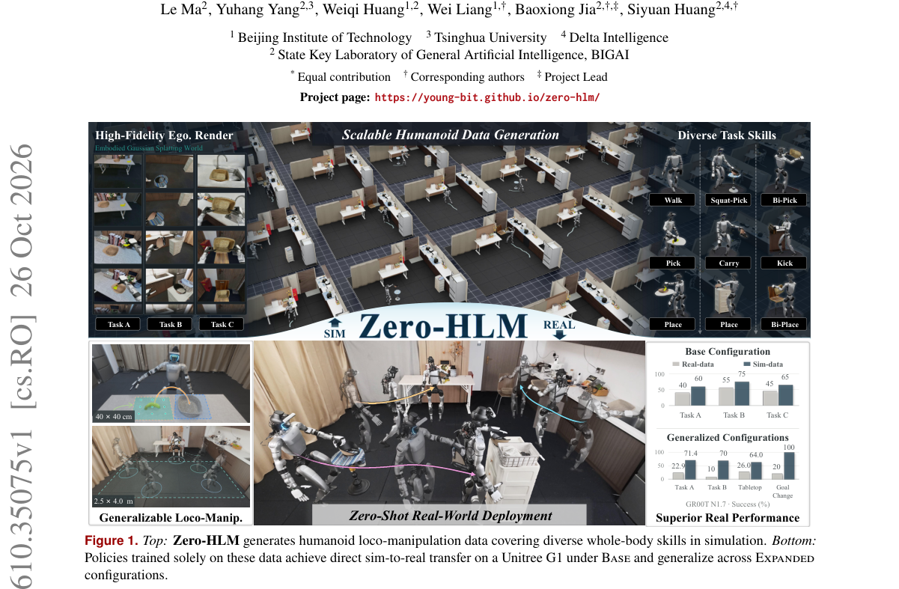

*Result - Overview of Zero-HLM. Left: Gaussian-guided agentic real-to-sim reconstruction aligns the physical scene with captured appearance and geometry. Middle: Motion–environment co-adaptation gener*

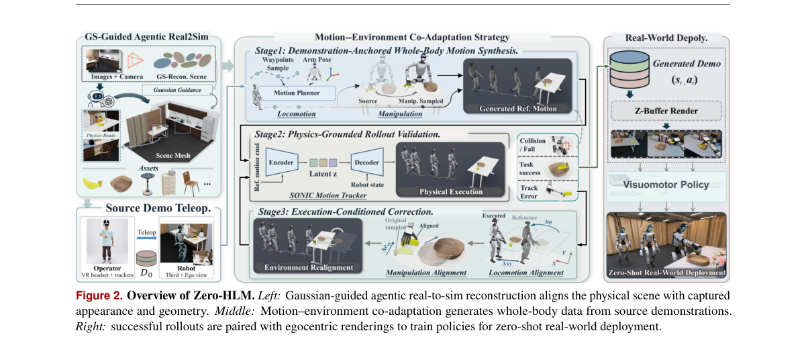

**Why this ranks #3**: 把手机拍摄 + 仿真源演示转成可规模化的训练数据，在没有新增真机演示的情况下把泛化配置成功率从 23% 拉到 69%。

---

### 4. Adapt for Planning, Not just Prediction: Optimistic Test-Time World Model Adaptation

**arXiv**: [2610.35636](https://arxiv.org/abs/2610.35636) | **Score**: 9.0 (relevance 9.0 x 0.7 + quality 9.0 x 0.3) | **Tags**: embodied-ai, world-model, test-time-adaptation, planning, JEPA, model-based-RL | **Categories**: cs.AI, cs.LG, cs.RO | **Pages**: 23

**Authors**: Akshay Mete, Dileep Kalathil, P. R. Kumar

**Affiliation**: Texas A&M University

**Abstract**

> Latent world models are typically pre-trained offline and kept frozen at test time, so planning with them can degrade under distribution shift. Test-time adaptation (TTA) can mitigate this degradation by updating the model during deployment. Unlike pre-training on fixed data, TTA for planning is closed-loop: the planner uses model rollouts to select actions, and the resulting transitions drive the next update. This raises the question: which objective should guide TTA for planning? Under a prediction-only objective, the model is fit only to the outcomes of its own actions, so it can remain wrong about the actions that would reach the goal, and low prediction error need not translate into better planning. Inspired by reward-biased maximum likelihood from adaptive control, we introduce Optimistic Test-Time Adaptation (OpTTA). Its objective has two terms, the prediction loss on observed transitions and the planner's goal-reaching cost on its candidate rollouts, both minimized over the model parameters. The planning term biases adaptation toward models that are optimistic about reaching the goal, without any additional environment interaction. Across visual and environment shifts on manipulation, reaching and navigation tasks, OpTTA raises final planning success over the frozen model by 13.5 percentage points on average, compared with 6.9 for the prediction-only objective (AdaJEPA), when only the predictor is adapted. When the encoder is adapted as well, the gains are 13.5 and 7.5 points. These experiments span three JEPA world models with different encoders and training objectives and, for temporal straightening, both CEM and gradient-based planners. Our results suggest that test-time adaptation of world models for planning benefits from an optimistic, task-aware term in addition to the prediction loss.

**Key findings**

- **Finding**: 潜空间世界模型通常离线预训练后冻结，分布偏移下规划质量会退化；测试时自适应（TTA）可以在部署期更新模型来缓解。
- **Finding**: 但用于规划的 TTA 是闭环的：规划器用模型 rollout 选动作，得到的转移又驱动下一次更新。
- **Finding**: 关键问题是「用什么目标引导规划用的 TTA」：纯预测目标只会把模型拟合到它自己动作的结果上，于是它可能「对动作的预测一直是对的、但对能到达目标的那些动作完全错」，低预测误差并不等于更好的规划。
- **Finding**: 受自适应控制中奖励偏置最大似然的启发，作者提出 Optimistic Test-Time Adaptation (OpTTA)。
- **Finding**: 其目标含两项并同时对模型参数最小化：观测转移上的预测损失，以及规划器在其候选 rollout 上的到达目标代价。
- **Finding**: 规划项把适应偏向「对到达目标持乐观态度」的模型，且不需要任何额外环境交互。
- **Finding**: 在操作、到达与导航任务的视觉与环境偏移上，仅适配预测器时 OpTTA 把最终规划成功率平均提高 13.5 个百分点，而纯预测目标（AdaJEPA）只有 6.9；连编码器一起适配时增益为 13.5 与 7.5。
- **Finding**: 实验覆盖三个不同编码器与训练目标的 JEPA 世界模型、临时性拉直，以及 CEM 与梯度式两类规划器。
- **Inference**: 「预测误差低 ≠ 能规划到目标」这个区分，是本领域长期把 TTA 只当分布对齐工具的根本原因；把规划代价写进自适应目标相当于让模型在部署期「为用而学」。
- **Inference**: 13.5 vs 6.9 的近两倍差距，且不需要额外交互，成本只有目标函数改动，实现门槛极低。
- **Recommendation**: 推荐。做世界模型、模型式 RL 或测试时适应的必读。

**Key figures**

*Framework - Gain in final planning success over the frozen model for prediction-only adaptation (Ada- JEPA) and optimistic adaptation (OpTTA), averaged over the visual corruptions or environment shifts*

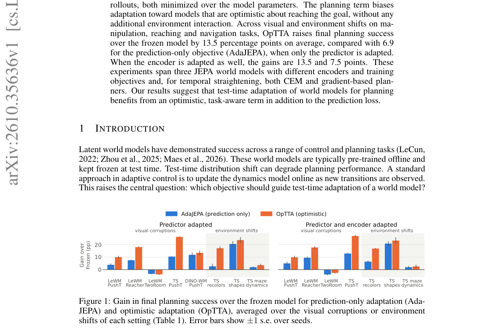

*Result - Optimistic Test-Time Adaptation. At every replanning step the world model is adapted on the observed transitions, using the prediction loss plus the task-aware optimistic loss evaluated on t*

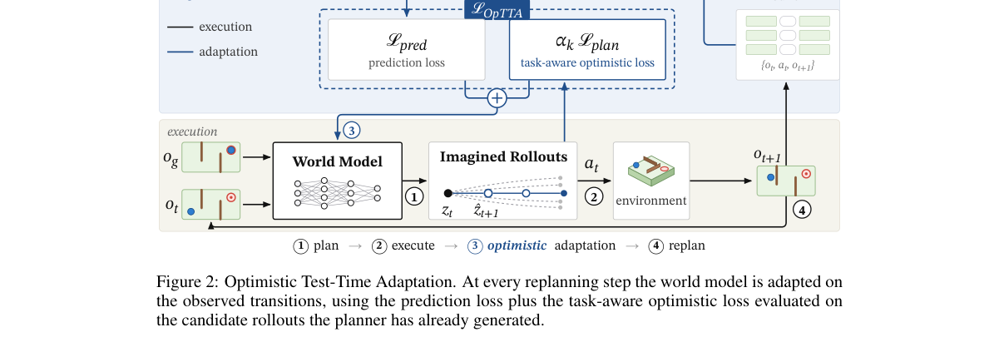

**Why this ranks #4**: 把「预测目标」换成「规划目标」做测试时自适应，规划成功率提升幅度翻倍（6.9 → 13.5 个百分点）。

---

### 5. Differentiable Contact Dynamics for Legged Locomotion: Policy Learning and Contact-Implicit Trajectory Optimization

**arXiv**: [2610.35852](https://arxiv.org/abs/2610.35852) | **Score**: 8.7 (relevance 9.0 x 0.7 + quality 8.0 x 0.3) | **Tags**: embodied-ai, world-model, contact-dynamics, differentiable-simulation, legged-locomotion, trajectory-optimization, hardware-transfer | **Categories**: cs.RO | **Pages**: 18

**Authors**: Gijeong Kim, Seungbin Oh, Dongyun Kang, Hae-Won Park

**Affiliation**: KAIST

**Abstract**

> This paper proposes a smooth analytic gradient for frictional contact and applies it to policy learning and contact-implicit trajectory optimization for legged locomotion. The exact contact sensitivity is available in closed form but describes changes within the current contact mode, providing no first-order information toward neighboring contact modes. The proposed gradient replaces this sensitivity only in the backward pass, leaving the hard-contact forward solve unchanged and the realized rollout feasible. A central-path relaxation of the de Saxcé-corrected second-order-cone complementarity problem for Coulomb friction smooths the conditions defining the separating, clamping, and sliding modes. The relaxed sensitivity is evaluated at a point on the central path obtained by a Newton iteration initialized from the hard-contact solution. The sensitivity remains continuous through contact-mode transitions and converges to the exact sensitivity as the relaxation vanishes. Using 100,000 samples and less than 2 min of training on a desktop PC, policy learning with the proposed gradient produces a policy that transfers to hardware without fine-tuning. On hardware, the robot under a trotting policy withstands pushes and traverses debris and slippery ground. In trajectory optimization, the proposed gradient reaches contact-rich solutions missed by exact and Signorini-relaxed gradients. Project page: https://diffcontact.github.io

**Key findings**

- **Finding**: 作者为摩擦接触提出光滑解析梯度，并同时用于策略学习与接触隐式的轨迹优化。
- **Finding**: 精确的接触敏感度其实有闭式解，但它只刻画当前接触模式内的变化，对邻近接触模式不提供一阶信息。
- **Finding**: 所提梯度只在反向传播时替换该敏感度，前向的硬接触求解保持不变，因此实际 rollout 仍然可行。
- **Finding**: 对 de Saxcé 修正的二阶锥互补问题做中心路径松弛，以平滑定义分离、夹持与滑动三种模式的条件。
- **Finding**: 松弛后的敏感度在由 Newton 迭代（以硬接触解初始化）得到的中心路径上求值。
- **Finding**: 该敏感度在接触模式切换处保持连续，并随松弛量趋零收敛到精确敏感度。
- **Finding**: 用 100,000 个样本、桌面 PC 上不到 2 分钟训练得到的策略，无需微调即可迁移到硬件；真机上，小跑策略能承受推挤、穿越碎石与湿滑地面。
- **Finding**: 在轨迹优化中，所提梯度能找到精确梯度与 Signorini 松弛梯度都错过的富接触解。项目页公开。
- **Inference**: 「只改反向、不改前向」是接触仿真里少见的干净设计——可行性由硬求解保证，梯度只负责提供优化方向，两者解耦。
- **Inference**: 2 分钟训练即上真机，说明腿足运动的瓶颈在梯度质量而非算力，这一点和主流「大规模仿真 RL」叙事相反。
- **Recommendation**: 推荐。做腿足运动、可微仿真或接触优化的必读。

**Key figures**

*Framework - Converged iLQR solutions for three CITO tasks over a 30-step horizon with hard-contact forward dynamics. The solutions differ only in the backward gradient: mode-dependent exact, Signorini-rel*

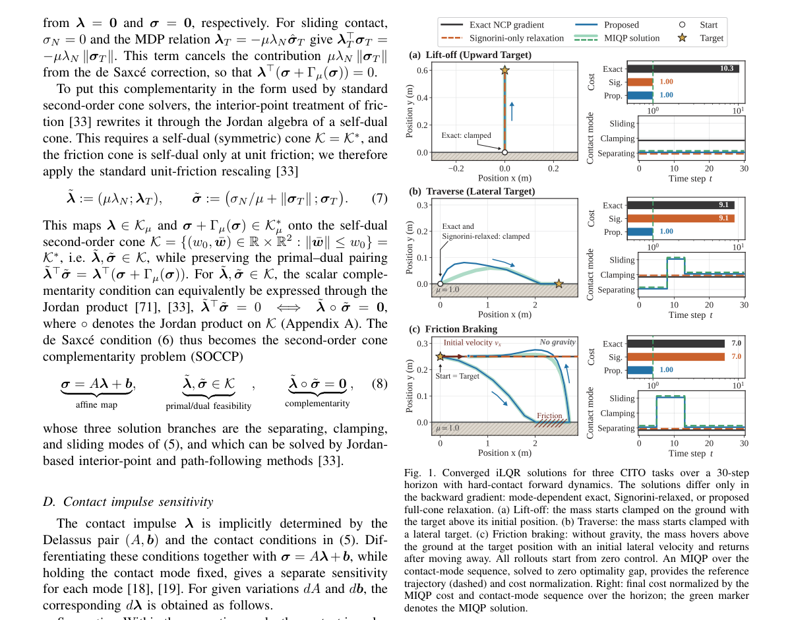

*Result - Central-path relaxation of the exact contact solutions in the clamping, separating, and sliding regimes for a two-dimensional contact with µ = 0.8. The top row shows the contact impulse λ ∈Kµ,*

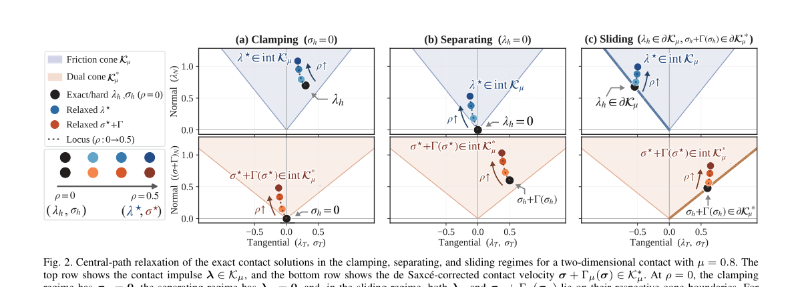

**Why this ranks #5**: 给摩擦接触补上跨接触模式连续的光滑解析梯度，2 分钟桌面训练得到的策略直接上真机且能抗推越障。

---

### 6. Benchmarking Obstacle-Conditioned Safety in Household Robot Navigation

**arXiv**: [2610.34674](https://arxiv.org/abs/2610.34674) | **Score**: 8.0 (relevance 8.0 x 0.7 + quality 8.0 x 0.3) | **Tags**: embodied-ai, world-model, navigation, safety, benchmark, VLA, semantic-grounding | **Categories**: cs.AI, cs.CV, cs.RO | **Pages**: 45

**Authors**: Hyunwoong Bae, Jisu Han, Jiyeon Choi, Dohoon Kim, Taesup Moon

**Affiliation**: Seoul National University

**Abstract**

> Safe household navigation requires robots to regulate clearance and speed according to what an obstacle is and how close it is, without unnecessary conservatism. Yet existing evaluations do not test whether semantic safety distinctions are reflected in continuous motion. To that end, we introduce OSMA-Bench, an Obstacle-Conditioned Safe Motion Adaptation Benchmark built on spatially matched scenario sets that differ only in obstacle type. We also propose the \emph{Semantic Sensitivity Index} (SSI), which measures whether clearance and distance-dependent speed and smoothness follow the caution ordering of obstacles. Evaluating VLM-based and vision-language-action (VLA) policies on the benchmark, we find that neither consistently adapts its motion to obstacle safety, even with explicit safety prompts. Our analysis shows that the policies can correctly distinguish obstacles by safety relevance but fail to reflect this distinction in the motion parameters or actions they produce. For VLM-based policies, which recognize the obstacle and then generate a navigation program, adding an explicit parameter-inference step between these two stages improves adaptation. These findings expose a gap in \emph{semantic-to-motion grounding}, highlighting the need to translate semantic caution into appropriately safe motion.

**Key findings**

- **Finding**: 安全的家庭导航要求机器人根据障碍物是什么、有多近来调节间距与速度，同时避免不必要的保守。
- **Finding**: 但既有评测不检验语义上的安全差异是否真的反映在连续运动里。
- **Finding**: 作者提出 OSMA-Bench（Obstacle-Conditioned Safe Motion Adaptation Benchmark），基于空间匹配的成组场景构建，各组只改障碍物类型。
- **Finding**: 同时提出 Semantic Sensitivity Index (SSI)，衡量间距与随距离变化的速度、平滑度是否遵循障碍物的谨慎次序。
- **Finding**: 在该基准上评测 VLM 与视觉-语言-动作（VLA）策略，发现即使给出显式安全提示，两者也不能稳定地让运动适配障碍物的安全性。
- **Finding**: 分析显示策略能正确区分障碍物的安全相关性，却无法把这一区分反映到运动参数或动作上。
- **Finding**: 对先生成导航程序的 VLM 类策略，在这两阶段之间插入显式的参数推断步骤可以改善适配。
- **Finding**: 结论是暴露了「语义到运动落地（semantic-to-motion grounding）」的断层，需要把语义谨慎转译为合适的运动参数。
- **Inference**: 「只改障碍物类型、其余空间匹配」的成对设计是本篇的方法论亮点，它把混淆变量压到最低，让结论站得住。
- **Inference**: 识别正确却执行错误，说明当前 VLA 的安全能力主要停留在语义层而未进入控制层——这是比「模型不够大」更具体的诊断。
- **Recommendation**: 推荐。做家居导航、VLA 安全或做能力评测的必读。

**Key figures**

*Framework - Obstacle-conditioned safe motion adaptation goes beyond task outcomes. The robot passes a trash bin (left, low caution) or a baby (right, high-caution) for a given route. Both reach the goal*

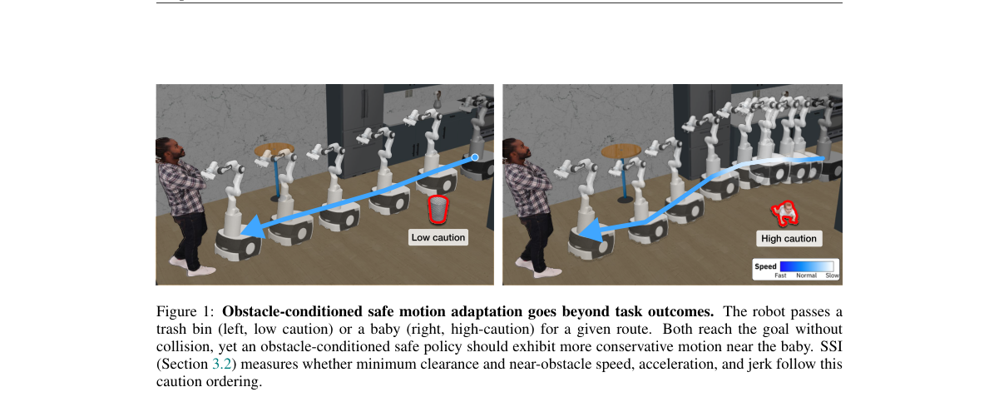

*Result - Illustrative example of proximity-normalized speed.*

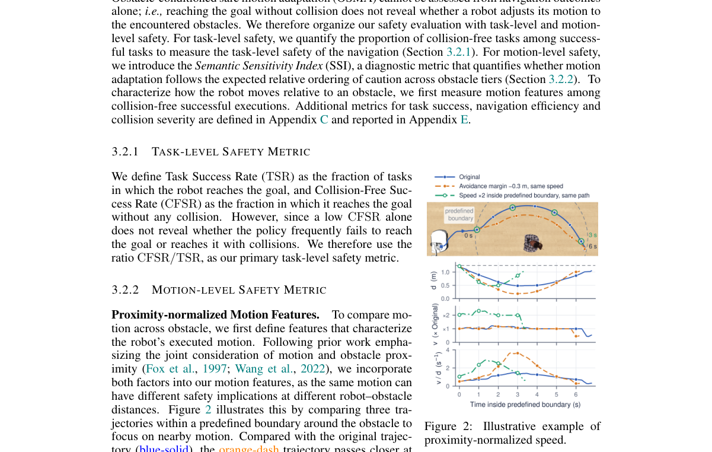

**Why this ranks #6**: 用只改障碍物类型的配对场景集，测出 VLM/VLA 策略「认得出危险却调不出安全运动」的语义-运动落地断层。

---

### 7. Robot-Aligned 3D Gaussian Splatting for Precise Reaching with Wrist-Camera VLA Policies

**arXiv**: [2610.35626](https://arxiv.org/abs/2610.35626) | **Score**: 8.0 (relevance 8.0 x 0.7 + quality 8.0 x 0.3) | **Tags**: embodied-ai, world-model, VLA, 3DGS, sim-to-real, data-generation, wrist-camera | **Categories**: cs.RO | **Pages**: 13

**Authors**: Zuoxu Wang, Xiao Liang

**Affiliation**: Texas A&M University

**Abstract**

> Efficient robotic data collection remains a major bottleneck for vision-language-action (VLA) policy learning, especially for tasks requiring accurate end-effector positioning and camera-action alignment. This challenge is particularly severe in electronic-waste disassembly, where robots operate in cluttered assemblies of densely packed, visually similar components. Full digital-twin simulation is difficult because many parts are thin, reflective, or mechanically complex, making accurate object-level meshes and contact models difficult to obtain. In this work, we focus on pre-contact reaching and propose a 3D Gaussian Splatting (3DGS)-based data generation pipeline for wrist-camera VLA adaptation. Our method reconstructs the real workspace with 3DGS and renders diverse wrist-camera observations from robot-aligned poses. These observations are paired with smooth, structured reaching trajectories to provide robot-aligned visual-action supervision for VLA fine-tuning. We further augment the VLA policy with an instruction-conditioned reach verifier that estimates target proximity and provides reliable termination before physical interaction. Experiments in motherboard disassembly demonstrate precise VLA-based reaching using wrist-camera observations alone, without an external side-view camera. With $π$0.5, 1,500 generated trajectories achieve 80.0\% precise-reaching success across three targets, compared with 58.7\% using 150 teleoperated demonstrations, while requiring less than 10 minutes of active human capture. Project website: https://001-wang.github.io/PrecisionReach-GS/

**Key findings**

- **Finding**: 高效的机器人数据采集是视觉-语言-动作（VLA）策略学习的主要瓶颈，尤其是需要准确末端定位与相机-动作对齐的任务。
- **Finding**: 在电子废弃物拆解这类场景中尤为严重：部件密集、外观相似，全数字孪生仿真很难做准，因为零件薄、反光或机械复杂，难以获得准确的物体级网格与接触模型。
- **Finding**: 本文聚焦接触前触及，提出面向腕部相机 VLA 适配的 3D 高斯泼溅（3DGS）数据生成管线。
- **Finding**: 方法用 3DGS 重建真实工作空间，并从机器人对齐的位姿渲染出多样的腕部相机观测。
- **Finding**: 这些观测与平滑、结构化的触及轨迹配对，构成机器人对齐的视觉-动作监督用于 VLA 微调。
- **Finding**: 还给 VLA 策略加了一个指令条件化的触及验证器，估计目标接近度并在物理交互前给出可靠终止信号。
- **Finding**: 在主板拆解实验中，仅凭腕部相机观测（无外部侧视相机）即可实现精确触及：π0.5 用 1,500 条生成轨迹在三个目标上取得 80.0% 精确触及成功率，而 150 条遥操作演示只有 58.7%，且所需人工主动采集不足 10 分钟。项目页公开。
- **Inference**: 10 倍数据量却换来更高成功率，说明瓶颈从来不是数据量而是「数据与部署时相机/位姿分布是否对齐」——这是 sim-to-real 里最常被忽略的细节。
- **Inference**: 验证器提供终止信号是另一个关键补丁：VLA 的失败往往不是抓不准而是不知道什么时候该停。
- **Recommendation**: 推荐。做 VLA、数据合成或 sim-to-real 的必读。

**Key figures**

*Framework - Overview of the proposed real-to-sim-to-real pipeline. The system first captures and calibrates the real workspace, then reconstructs and aligns a 3DGS scene for robot-feasible wrist-camera da*

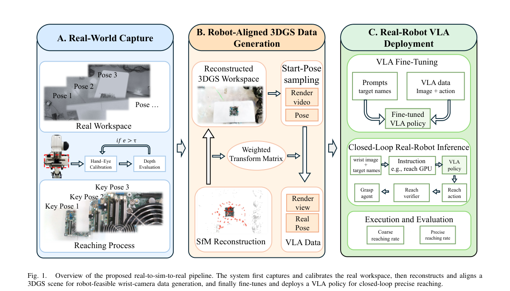

*Result - Rendering representations reconstructed from the same workspace capture. The 3DGS representation better preserves the appearance needed for wrist-camera policy observations.*

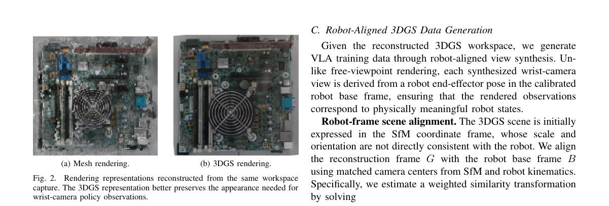

**Why this ranks #7**: 用 3DGS 重建真实工作空间并渲染腕部相机观测，1,500 条生成轨迹的精确触及成功率反超 150 条遥操作演示。

---

### 8. Video World Models Need Predictable Latents

**arXiv**: [2610.34663](https://arxiv.org/abs/2610.34663) | **Score**: 8.7 (relevance 9.0 x 0.7 + quality 8.0 x 0.3) | **Tags**: embodied-ai, world-model, video-generation, latent-space, autoencoder, efficiency | **Categories**: cs.AI, cs.CV, cs.LG, cs.RO | **Pages**: 54

**Authors**: Mattia Scardecchia, Sherry Yang

**Affiliation**: New York University

**Abstract**

> Video world models trained on large-scale robot data promise a safe and scalable approach for learning and evaluating policies that act in the physical world. However, they still struggle with long-horizon rollouts and out-of-distribution generalization, and they remain computationally demanding at inference time. Typically, video world models make predictions in the latent space of a reconstruction-trained autoencoder, which however is not directly optimized for dynamics modeling. On the other hand, world models designed for latent planning usually optimize latents to be predictable, but they forgo accurate prediction of observations in pixel space. In this paper, we show that it is possible to achieve the best of both worlds: a latent geometry optimized to make future prediction as simple as possible without sacrificing accurate prediction of future observations. More precisely, we find that temporal objectives for representation learning, paired with a past-conditioned decoder architecture, lead to consistent improvements in generative video world models at the same training budget. The gains include up to 5x cheaper inference, over 7x faster training, and 15-24% lower pixel and perceptual errors out of distribution and over long horizons. Our world models also agree more closely with real-world policy evaluation when using a vision-language model to judge task success from their pixel-space predictions. Overall, our study indicates that temporal predictability is an important design criterion for the latent space of video world models, and provides concrete guidance on how to incorporate it into the training of autoencoders.

**Key findings**

- **Finding**: 在大规模机器人数据上训练的视频世界模型有望安全可扩展地学习与评估物理世界中的策略，但仍难以处理长程 rollout 与分布外泛化，推理计算开销也大。
- **Finding**: 典型做法是在重建训练所得自编码器的隐空间里做预测，但该隐空间并未针对动力学建模直接优化。
- **Finding**: 为隐空间规划而设计的世界模型则会优化潜变量使其可预测，却放弃了在像素空间准确预测观测。
- **Finding**: 本文证明二者可以兼得：构造一种隐空间几何，让未来预测尽可能简单，同时不牺牲对未来观测的准确预测。
- **Finding**: 更具体地，时间性的表征学习目标配上过去条件化的解码器架构，在同等训练预算下持续改进生成式视频世界模型。
- **Finding**: 增益包括：推理最多便宜 5 倍、训练快 7 倍以上、分布外与长程场景下像素与感知误差降低 15%–24%。
- **Finding**: 当用视觉语言模型从像素空间预测中判断任务成功时，作者的世界模型与真实策略评估的一致性更高。
- **Inference**: 「隐空间几何要为动力学服务」这个结论，等于给 autoencoder 加了一条明确的设计准则：重建好不等于预测好。
- **Inference**: 5 倍推理加速与 7 倍训练加速同时出现，说明时间可预测性本身就是一种效率优化，而不只是质量技巧。
- **Recommendation**: 推荐。做视频世界模型、潜空间设计或机器人仿真的必读。

**Key figures**

*Framework - Method overview. (1) An autoencoder is fine-tuned on pairs of nearby video frames xt, xt+1, with a reconstruction loss and a temporal objective on the latents zt, zt+1 and the action at; the*

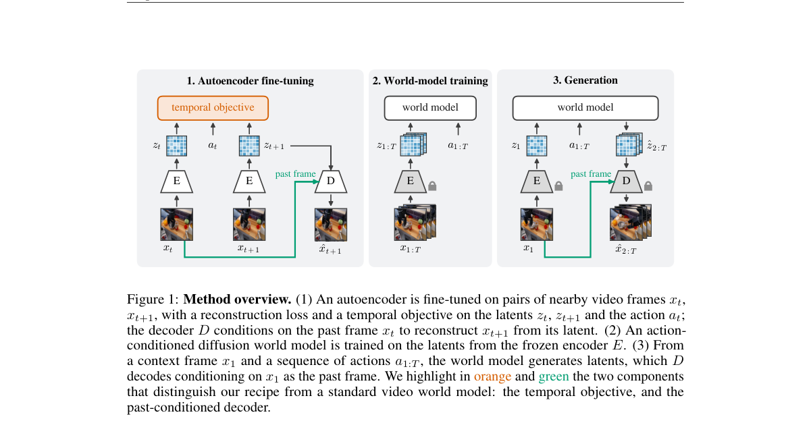

**Why this ranks #8**: 给视频世界模型的 autoencoder 加上时间可预测性目标，推理便宜 5 倍、训练快 7 倍，长程外推误差降 15–24%。

---

### 9. WorldPager: Zero-Stall Tiered Memory for Long-Horizon World Models on a Single Consumer GPU

**arXiv**: [2610.35529](https://arxiv.org/abs/2610.35529) | **Score**: 7.7 (relevance 8.0 x 0.7 + quality 7.0 x 0.3) | **Tags**: embodied-ai, world-model, KV-cache, memory-hierarchy, NVMe, long-horizon | **Categories**: cs.CV, cs.DC | **Pages**: 11

**Authors**: Bingnan Liu, Ruini Xue

**Affiliation**: University of Electronic Science and Technology of China

**Abstract**

> Interactive world models keep the KV of past chunks as retrieval memory so that revisited places stay consistent. On a single consumer machine (one RTX 4090, 32 GiB of host memory, one NVMe SSD), long sessions with such memory hit two walls. The first is capacity: the KV of Matrix-Game 2.0 exhausts host memory after 45 seconds of video in bf16 and after 2.8 minutes in int4. The second is the model's positional horizon of 4.3 minutes. We show that this memory is capacity-bound rather than bandwidth-bound and that its access set is known before compute, because the camera pose is an input. An analytical model built on these observations predicts spill points to within one chunk and classifies zero versus non-zero stalls correctly on held-out configurations. Guided by it, WorldPager stores int4 KV in a GPU/DRAM/NVMe hierarchy instead of recomputing it, prefetches each chunk's memory from the extrapolated pose, never waits on a miss, and writes back in the background; to our knowledge, it is the first to place the KV memory of an interactive world model on an NVMe tier with zero-stall prefetching. With training-free position handling, it generates 37.5 minutes of video continuously with zero stalls and constant host memory, at about 9.5 frames per second. On a sealed test set, int4 storage shows no measurable quality loss; on long-gap revisits it lowers image quality by about one MUSIQ point.

**Key findings**

- **Finding**: 交互式世界模型把过去片段的 KV 当作检索记忆保存，使重访地点保持一致；但在单台消费级机器（一张 RTX 4090、32 GiB 主机内存、一块 NVMe SSD）上，长会话会撞上两堵墙。
- **Finding**: 第一是容量：Matrix-Game 2.0 的 KV 在 bf16 下 45 秒视频即耗尽主机内存，int4 下为 2.8 分钟。
- **Finding**: 第二是模型自身的位姿视界只有 4.3 分钟。
- **Finding**: 作者证明该记忆是容量受限而非带宽受限，且其访问集合在计算之前就已知——因为相机位姿是输入。
- **Finding**: 基于这两点的解析模型能在误差一个片段内预测溢出点，并在留出配置上正确分类零停顿与非零停顿。
- **Finding**: WorldPager 据此把 int4 KV 存入 GPU/DRAM/NVMe 层级而不是重算，依据外推位姿预取每个片段的内存、miss 时绝不等待、后台回写；作者称这是首个把交互式世界模型的 KV 记忆放到带零停顿预取的 NVMe 层的工作。
- **Finding**: 配合免训练的位置处理，可连续生成 37.5 分钟视频、零停顿、主机内存恒定，约 9.5 FPS。
- **Finding**: 在封闭测试集上 int4 存储无可测质量损失；长间隔重访时图像质量下降约一个 MUSIQ 点。项目页公开。
- **Inference**: 「访问集合提前已知」是关键洞察——相机位姿作为输入让预取成为可能，从而把 KV 从「算力问题」改写成「存储层级问题」。
- **Inference**: 4.3 分钟的位姿视界说明长程世界模型的瓶颈正在从模型转向系统，KV 分层是绕不开的工程。
- **Recommendation**: 推荐。做长程世界模型或世界模型部署工程的必读。

**Key figures**

*Framework - Two walls for MG2 on one RTX 4090. Capacity stops every design without an NVMe tier early (chunk 21, 60, or 226 at 32 GiB), and without position handling every design stops by the positional w*

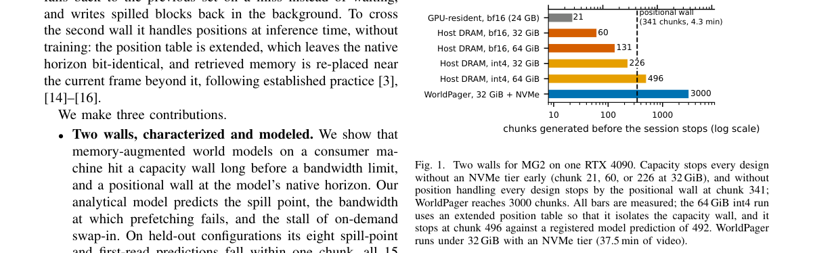

*Result - WorldPager overview. KV of past chunks is stored as int4 blocks (one block per layer and chunk) in a pinned DRAM pool and spills to NVMe. While chunk c is denoised, the retrieval set of chunk*

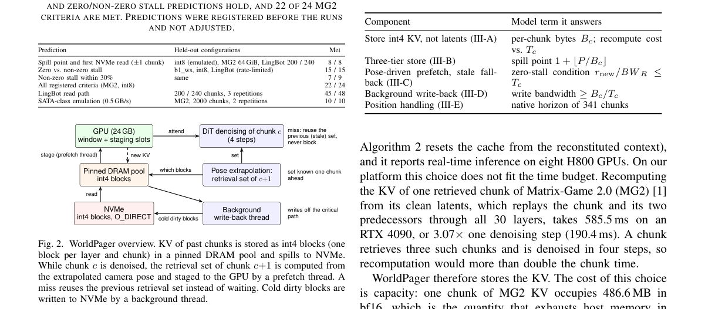

**Why this ranks #9**: 把交互式世界模型的 KV 记忆放到 GPU/DRAM/NVMe 三级存储上，单张 4090 上连续生成 37.5 分钟视频且零停顿。

---

### 10. Pretraining Knows What, Simulation Teaches How: Compositional Generalization in a Sim-Trained Robot Agent

**arXiv**: [2610.35817](https://arxiv.org/abs/2610.35817) | **Score**: 8.0 (relevance 8.0 x 0.7 + quality 8.0 x 0.3) | **Tags**: embodied-ai, world-model, VLA, sim-to-real, GRPO, tool-harness, compositional-generalization | **Categories**: cs.AI, cs.CV, cs.LG, cs.RO | **Pages**: 25

**Authors**: Benjamin Pikus, Daniel Saunders, Mircea Mironenco, Salman Mohammadi, Mathew Mathew, Sirou Zhu, Divya Makkar, Xuhua Huang, Qinbo Li, Supreeth Narasimhaswamy, Siyuan Cen, Thomas Neff

**Affiliation**: Luma AI

**Abstract**

> A robot policy needs to understand what a task is asking for in a scene, and how to move the robot to accomplish that task. To achieve these two skills, we introduce Zero-real Agent Policy (ZAP), a recipe that teaches a small off-the-shelf vision-language model to control a robot via a simple tool harness. We use a pretrained 27B parameter model to bootstrap world understanding and reasoning, followed by supervised fine-tuning and GRPO on simple simulated tasks to teach it how to move the robot. Without any real-world robot data during training, ZAP reaches 96.7% success on real-world tasks, matching GPT-6 Astra in our harness and outperforming the MolmoAct2 VLA (33.3%), while running 3x faster and 17x cheaper than GPT-6 Astra. We demonstrate that ZAP also generalizes to completely new objects, goals, strategies, and language by seating a test tube in a rack (and choosing a different hole in the rack when prompted), handing a test tube between arms mid-air, drawing an X on a tic-tac-toe board, and playing chess. These goals and types of manipulation don't appear in our training data. Furthermore, ZAP also transfers to an unseen embodiment. On a single-arm Franka, ZAP reaches 55.9% on RoboLab-120, 4.9 percentage points ahead of the leading VLA/WAM baseline.

**Key findings**

- **Finding**: 机器人策略需要两样能力：理解场景里任务在要什么，以及如何移动机器人去完成它。
- **Finding**: ZAP（Zero-real Agent Policy）用一套配方教会一个开箱即用的小型视觉语言模型通过简单工具 harness 控制机器人。
- **Finding**: 先用预训练 27B 模型引导世界理解与推理，再做监督微调，最后在简单仿真任务上用 GRPO 教会它如何移动机器人。
- **Finding**: 训练全程不使用任何真实机器人数据，ZAP 在真实任务上达到 96.7% 成功率，与同一 harness 下的 GPT-6 Astra 持平，并显著优于 MolmoAct2 VLA（33.3%）。
- **Finding**: 同时运行速度是 GPT-6 Astra 的 3 倍、成本是其 1/17。
- **Finding**: 作者展示 ZAP 能泛化到全新物体、目标、策略与语言：把试管插进试管架（并在被要求时选择架上另一个孔）、在空中双手传递试管、在井字棋上画 X、下国际象棋——这些目标与操作类型都不在训练数据中。
- **Finding**: ZAP 还能迁移到未见本体：在单臂 Franka 上，ZAP 在 RoboLab-120 上达到 55.9%，领先最优 VLA/WAM 基线 4.9 个百分点。
- **Inference**: 「预训练知道什么、仿真教会怎么做」这句话被数据兑现得很彻底——96.7% 真实成功率而零真机数据，说明当前的视觉语言模型底座已经足够强，缺的是把动作当工具用的训练。
- **Inference**: 相对 VLA 的压倒性优势提示一条路线：与其让小模型直接回归动作，不如让大模型用工具接口规划，再由仿真 RL 教它「怎么用工具」。
- **Recommendation**: 推荐。做机器人智能体、VLA 或 sim-to-real 的必读。

**Key figures**

*Framework - Motion learned in simulation carries over to new real tasks that need reasoning. Left: two of the simulated training tasks. These simple pick and place, stacking, and reorientation tasks wit*

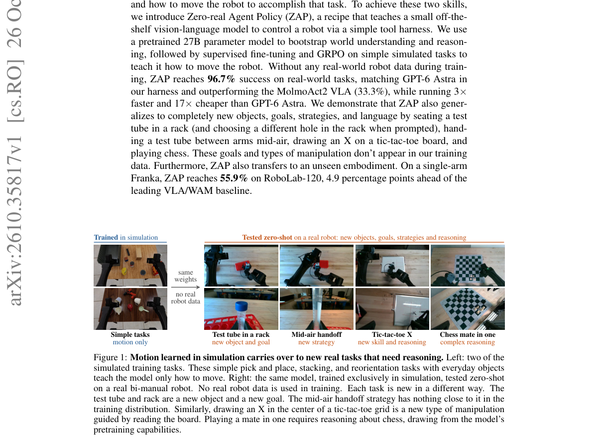

*Result - Three scenes, one shared interface. Left to right: separate banana-in-bowl episodes on the simulated bi-manual YAM, the real YAM, and a simulated single-arm Franka, an embodiment never seen*

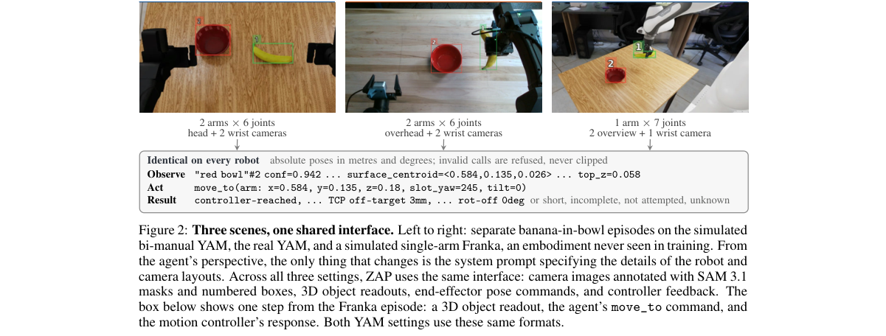

**Why this ranks #10**: 用 27B 预训练模型加仿真任务上的 SFT 与 GRPO，不碰任何真机数据就在真实任务上打到 96.7%，比 GPT-6 Astra 快 3 倍、便宜 17 倍。

---

## Footer

- Total papers scanned across all 7 tracks: 546（原始 738 条）
- embodied track final top-10: 10
- Wild-cards in this track: 0
- Figure assets: 2026-10-27/res/

Generated by `mine-arxiv-daily-digest` skill. Sister file: `2026-10-27_embodied_entry.md`.
