# ArXiv Daily Digest - 2026-10-27 (生成式内容模型的强化学习, 10 papers)

**Generated**: 2026-10-27 17:00 CST

**Source**: arXiv cs.CV, cs.SD, eess.AS, cs.CL, cs.AI, cs.RO, cs.LG submissions, listing day 2026-10-26 (announced 2026-10-27 00:00 UTC)

**Batch window**: 2026-10-25T18:00:00Z .. 2026-10-26T18:00:00Z（arXiv 公告批次横跨两个 UTC 日：前一日 18:00 UTC 起算，当日 17:59:59 UTC 截止）

**Track**: rl_aigc (top 10 of 546 papers scanned, 70 full reads)

**Scope**: 扩散 / 流匹配模型的 RL、奖励模型、偏好对齐、生成评测（方法学优先）

⚠️ **Wild-card**: 本批该线 2 篇为 wild-card 补足，已在正文逐条标注并给出理由。

---

## Top 10 - 生成式内容模型的强化学习

### 1. VaLoP: Value Gradient Lookahead and Pullback for Reward-Guided Diffusion

**arXiv**: [2610.35607](https://arxiv.org/abs/2610.35607) | **Score**: 9.7 (relevance 10.0 x 0.7 + quality 9.0 x 0.3) | **Tags**: rl-aigc, reward-model-gen, reward-guidance, value-function, diffusion, flow-matching, test-time | **Categories**: cs.AI | **Pages**: 35

**Authors**: Kwanyoung Kim

**Affiliation**: GIST

**Abstract**

> Reward guidance steers a pretrained diffusion or flow model toward images or actions that a reward model prefers, at sampling time and without retraining the model for each reward. It follows the gradient of a value function, the expected reward given the noisy state. The two common estimates of this gradient, gradients through a one-step denoised estimate and learned value models, are least accurate at high noise, where the coarse structure of the sample is decided. Interestingly, we find that both errors are posterior covariances, which grow with the uncertainty about the clean sample, and hence at higher noise. To reduce them, we evaluate the value at a less noisy state, one sampler step ahead, where this uncertainty is smaller, and pull its gradient back to the current state. This lookahead places both estimators at the two ends of one family and reveals that an intermediate lookahead requires one additional term, a correction through the generator. We therefore propose Value Gradient Lookahead and Pullback (VaLoP), which computes this correction with one vector-Jacobian product, and VaLoP-Fast, which amortizes it with a small head that, for text-to-image models, is trained with a single reward and reused for the others. Across various models, rewards, and benchmark datasets, both robustly outperform existing value-gradient guidance on the target reward, VaLoP-Fast at about the cost of learned-value guidance. Both extend to critic-guided robot policies, where VaLoP-Fast attains the highest success rates on LIBERO and RoboCasa.

**Key findings**

- **Finding**: 奖励引导把预训练扩散或流模型导向奖励模型更偏好的图像或动作，发生在采样期、无需为每个奖励重训模型。
- **Finding**: 它沿着价值函数（给定噪声状态下的期望奖励）的梯度前进。
- **Finding**: 两种常见梯度估计——透过一步去噪估计回传的梯度、以及学习到的价值模型——在高噪声处最不准，而恰恰是那里决定了样本的粗结构。
- **Finding**: 作者的关键发现是：这两种误差本质都是**后验协方差**，随对干净样本的不确定度增长，因而在高噪声处更大。
- **Finding**: 解决办法是在噪声更小的状态（向前一个采样步）评估价值，再把它的梯度拉回当前状态。
- **Finding**: 这种 lookahead 把两个估计量置于同一族的两个端点，并揭示了中间 lookahead 需要额外一项——穿过生成器的修正项。
- **Finding**: 因此提出 Value Gradient Lookahead and Pullback (VaLoP)，用一次向量-雅可比积计算该修正；以及 VaLoP-Fast，用一个小头摊销它——对文本到图像模型，只需用一个奖励训练即可复用到其他奖励。
- **Finding**: 在多种模型、奖励与基准数据集上，两者都稳定优于既有的价值梯度引导；VaLoP-Fast 的代价约等于学习式价值引导。
- **Finding**: 两者还延伸到 critic 引导的机器人策略，VaLoP-Fast 在 LIBERO 与 RoboCasa 上取得最高成功率。
- **Inference**: 「两种常用估计的误差是同一种后验协方差」是一个很深的观察——它解释了为什么两者在高噪声处一起失效，而不是各自有偏。
- **Inference**: VaLoP-Fast 的「一个奖励训一次、复用到所有奖励」是极强的实用性设计，避免了每个奖励都重训价值模型的成本。
- **Recommendation**: 推荐。做扩散/流匹配的奖励引导、test-time 对齐的必读。

**Key figures**

*Framework - Our proposed method guides both image generators and robot policies. It succeeds where the unguided model and StitchVM [19] miss the GenEval prompt, and, from the same initial state, where t*

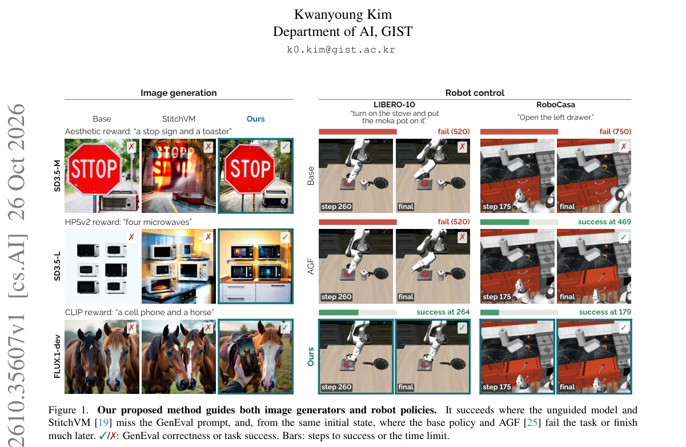

*Result - Comparison and pipeline overview. (a) Where the value is read: DPS [6] at the denoised estimate (s = 0), StitchVM [19] at zt (s = t), and VaLoP in between, at a lookahead state zs (❶), whose*

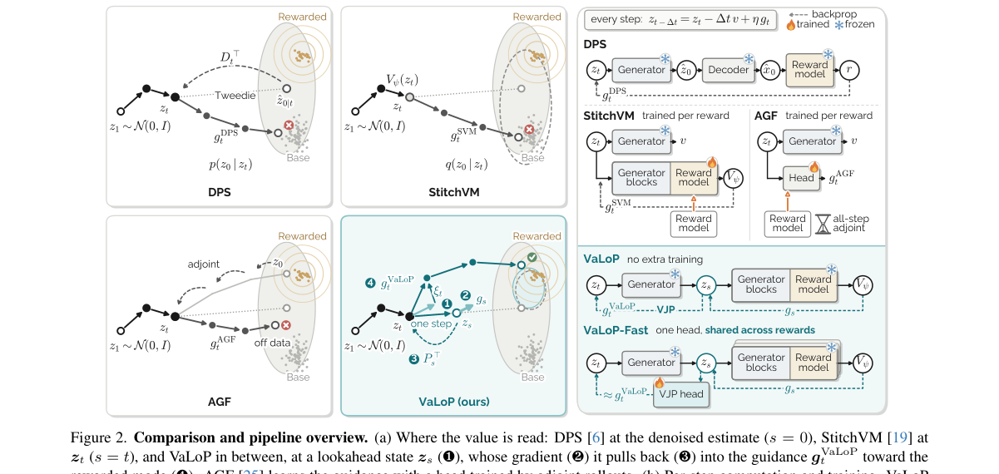

**Why this ranks #1**: 指出奖励引导扩散的两个梯度估计在高噪声处同源失效，用「向前看一步再拉回」修正，并把修正项摊销成一个轻量头。

---

### 2. DTCA: Denoising Token Credit Assignment for Reinforcement Learning in Diffusion Language Models

**arXiv**: [2610.35201](https://arxiv.org/abs/2610.35201) | **Score**: 9.7 (relevance 10.0 x 0.7 + quality 9.0 x 0.3) | **Tags**: rl-aigc, reward-model-gen, diffusion-language-model, token-credit, denoising, RLVR, MATH500 | **Categories**: cs.CL | **Pages**: 20

**Authors**: Hongze Chen, Miao Pan, Lizhou Liang, Qinfeng Li, Xinyin Ma, Yongliang Shen, Weishi Wang, Daniel Dahlmeier, Xuhong Zhang, Wenqi Zhang

**Affiliation**: Zhejiang University; National University of Singapore; SAP

**Abstract**

> Diffusion language models (DLMs) generate text through iterative denoising, enabling bidirectional context modeling and parallel token refinement. Recent studies have applied reinforcement learning (RL) to DLMs and improved their reasoning performance. However, the iterative denoising process makes credit assignment more challenging, as final outcome rewards provide limited information about how different tokens contribute to the final output. In this paper, we propose Denoising Token Credit Assignment (DTCA), a framework for token-level credit assignment in reinforcement learning for diffusion language models. DTCA estimates token contributions by measuring the improvement in prediction confidence of remaining masked positions after token commitment and groups these signals according to part-of-speech (POS) categories. These contribution weights are used to select informative denoising timesteps and assign token-level learning signals during RL training. DTCA further calibrates these learning signals according to token-level entropy changes induced by policy updates. Experiments on LLaDA-8B-Instruct show that DTCA consistently improves mathematical reasoning performance across different generation budgets, with gains of up to 9.0 points on MATH500 and 5.3 points on GSM8K over the base model.

**Key findings**

- **Finding**: 扩散语言模型（DLM）通过迭代去噪生成文本，支持双向上下文建模与并行 token 精修。
- **Finding**: 已有研究把 RL 用于 DLM 并提升其推理性能，但迭代去噪过程让信用分配更困难——最终的结果奖励无法说明不同 token 对最终输出的贡献。
- **Finding**: 作者提出 Denoising Token Credit Assignment (DTCA)，用于扩散语言模型 RL 的 token 级信用分配框架。
- **Finding**: DTCA 通过测量「提交某个 token 之后，剩余被掩位置的预测置信度改善了多少」来估计 token 贡献，并按词性（POS）类别对这些信号分组。
- **Finding**: 这些贡献权重被用于挑选信息量大的去噪时间步，并在 RL 训练中分配 token 级学习信号。
- **Finding**: DTCA 还按策略更新引起的 token 级熵变化进一步校准这些学习信号。
- **Finding**: 在 LLaDA-8B-Instruct 上，DTCA 在不同生成预算下都稳定提升数学推理性能，MATH500 最高提升 9.0 个百分点、GSM8K 提升 5.3 个百分点（相对基座模型）。
- **Inference**: 「提交 token 后剩余位置的置信度改善」是一个巧妙的代理——它利用了扩散模型特有的并行结构，比用结果奖励做归因自然得多。
- **Inference**: 按 POS 分组再选时间步，等于让不同词性的 token 在不同去噪阶段被监督，这是纯文本 RL 里没有的调度自由度。
- **Recommendation**: 推荐。做扩散 LM、RLVR 或 token 级信用分配的必读。

**Key figures**

*Framework - Preliminary analysis of POS-level differences in DLM denoising using rollouts generated from the GSM8K (Cobbe et al., 2021) training set. (a) Commitment timing of different POS categories acr*

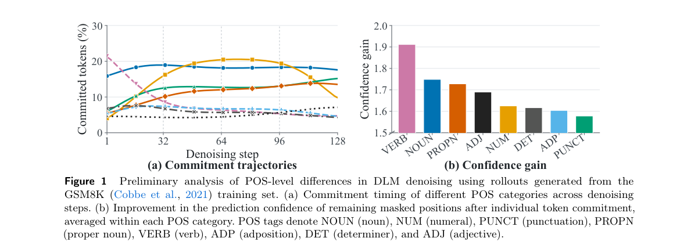

*Result - Overview of Denoising Token Credit Assignment (DTCA). DTCA estimates token contributions from denoising refinement dynamics and uses the resulting contribution weights for denoising state sel*

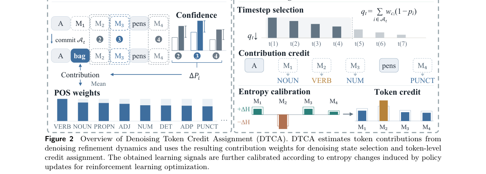

**Why this ranks #2**: 给扩散语言模型的 RL 配上 token 级信用分配：按提交 token 后剩余位置的预测置信度改善量估计贡献，MATH500 最高涨 9.0 分。

---

### 3. S$^2$-RL: Sample-Set Dual Reinforcement Learning for Generative Semantic Segmentation Dataset Distillation

**arXiv**: [2610.35491](https://arxiv.org/abs/2610.35491) | **Score**: 8.7 (relevance 9.0 x 0.7 + quality 8.0 x 0.3) | **Tags**: rl-aigc, reward-model-gen, dataset-distillation, GRPO, dual-reward, contextual-bandit, semantic-segmentation | **Categories**: cs.CV | **Pages**: 43

**Authors**: Haoyu Wang, Fei Zhou, Qingqing Qiu, Lei Zhang, Wei Wei, Chen Ding

**Affiliation**: Northwestern Polytechnical University; The Chinese University of Hong Kong; Zhejiang University; Xi'an University of Posts & Telecommunications

**Abstract**

> While dataset distillation has witnessed significant advances in image classification, its extension to dense prediction tasks such as semantic segmentation is plagued by two core bottlenecks: bi-level optimization-based approaches suffer from prohibitive computational costs stemming from pixel-wise gradient unrolling, whereas proxy-based generative methods merely infuse visual textures into fixed semantic masks derived from real data, thus failing to condense rich semantic knowledge into a compact set of informative, novel scene generations. To address both bottlenecks simultaneously, we propose a novel Sample-Set Reinforcement Learning (S$^2$-RL) framework for generative semantic segmentation dataset distillation (SSDD). Specifically, S$^2$-RL formulates SSDD as a diffusion model based text-to-image generation paradigm, enabling flexible generation of images with informative, novel semantic distributions via a concise text prompt. Furthermore, we fine-tune a diffusion policy via Group Relative Policy Optimization (GRPO), leveraging a sample-set dual reward paradigm: for individual samples, it enforces semantic alignment with input text prompts and intra-class feature diversity; for sample sets, it maximizes inter-sample semantic distribution diversity by solving a contextual multi-armed bandit problem. These design choices enable S$^2$-RL to distill large-scale semantic segmentation datasets into a compact set of generated samples that encapsulate diverse, informative semantic knowledge without the need of pixel-wise gradient unrolling. Extensive experiments on the ADE20K and COCO datasets demonstrate that S$^2$-RL achieves substantial and consistent improvements over state-of-the-art baselines, establishing a new benchmark for SSDD.

**Key findings**

- **Finding**: 数据集蒸馏在图像分类上进展显著，但其向语义分割等密集预测任务的扩展受两大瓶颈制约。
- **Finding**: 双层优化方法受限于逐像素梯度展开带来的高昂计算成本；基于代理的生成方法只是把视觉纹理注入真实数据导出的固定语义掩码，无法把丰富语义知识浓缩成一组紧凑且有信息量的新场景生成。
- **Finding**: 作者提出 Sample-Set Reinforcement Learning (S²-RL) 框架，用于生成式语义分割数据集蒸馏（SSDD）。
- **Finding**: S²-RL 把 SSDD 形式化为基于扩散模型的文本到图像生成范式，从而能通过简洁文本提示灵活生成具有信息量的新语义分布图像。
- **Finding**: 随后用 GRPO 微调一个扩散策略，并采用样本集双奖励范式。
- **Finding**: 对单个样本，奖励强制与输入文本提示的语义对齐以及类内特征多样性；对样本集，奖励通过求解一个上下文多臂老虎机问题来最大化样本间的语义分布多样性。
- **Finding**: 这些设计让 S²-RL 能把大规模语义分割数据集蒸馏成一组紧凑的生成样本，承载多样且有信息量的语义知识，且无需逐像素梯度展开。
- **Finding**: 在 ADE20K 与 COCO 上的实验显示相对 SOTA 基线有显著且一致的改进，为 SSDD 建立了新基准。
- **Inference**: 「把数据集蒸馏重写成文本到图像生成」是本篇的关键抽象——一旦生成任务形式化，RL 的奖励就能直接用在语义分布上。
- **Inference**: 样本级与样本集级双奖励分别管「单样本好不好」和「集合是否多样」，用多臂老虎机处理集合层目标是个干净的分解。
- **Recommendation**: 推荐。做数据集蒸馏、生成式数据合成或 GRPO 改造的值得读。

**Key figures**

*Result - The architecture of our proposed method. (A) The framework utilizes GRPO to finetune the diffusion policy with a dual reward evaluation system. (B) Sample-level reward ensures semantic alignm*

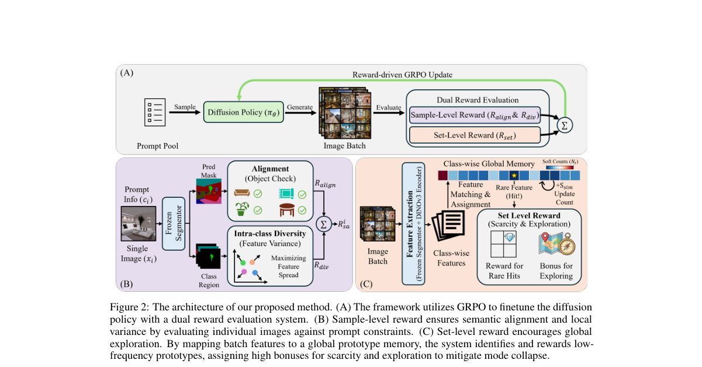

**Why this ranks #3**: 把语义分割数据集蒸馏改写成文本到图像生成 + GRPO，用样本级与样本集级双奖励同时管住语义对齐与多样性。

---

### 4. Beyond Distribution Matching: Self-Supervised Representation Forcing for Few-Step Video Generation

**arXiv**: [2610.35594](https://arxiv.org/abs/2610.35594) | **Score**: 8.0 (relevance 8.0 x 0.7 + quality 8.0 x 0.3) | **Tags**: rl-aigc, reward-model-gen, few-step, video-diffusion, DMD, self-supervised, representation-forcing | **Categories**: cs.CV | **Pages**: 19

**Authors**: Junyi Chen, Haiyu Zhang, Zhoujie Fu, Tengfei Wang, Chunchao Guo

**Affiliation**: Shanghai Jiao Tong University; Hunyuan Tencent; Nanyang Technological University

**Abstract**

> Few-step distillation is essential for deploying modern video diffusion models. Among existing approaches, Distribution Matching Distillation (DMD) has emerged as a highly promising paradigm by achieving strong output-space fidelity without adversarial training, while remaining flexible across various student architectures. We observe, however, that DMD fundamentally relies on an output-space objective, lacking explicit regularization on the model's internal representations. As the distillation step count aggressively shrinks, this output-only supervision becomes insufficient, causing the distilled student to degrade in both fine-grained spatial structures and coherent temporal dynamics. To address this limitation, we introduce Self Flow Forcing (SF$^2$), which incorporates a predictive representation loss into the DMD framework without altering its output objective. By providing the student and an Exponential Moving Average (EMA) teacher with heterogeneous noise levels, we establish an information asymmetry. This formulation forces the student to predict the teacher's internal representations from a more corrupted input, effectively integrating self-supervised representation alignment into distribution matching. Extensive experiments demonstrate that SF$^2$ effectively mitigates temporal flickering and consistently improves both spatial fidelity and motion quality. Furthermore, the proposed mechanism is architecture-agnostic - seamlessly supporting both bidirectional and causal models - and requires no external feature extractors, introducing minimal computational overhead.

**Key findings**

- **Finding**: 少步蒸馏是部署现代视频扩散模型的关键，其中分布匹配蒸馏（DMD）因无需对抗训练又有强输出空间保真而成为主流。
- **Finding**: 作者观察到 DMD 本质上依赖输出空间目标，缺少对模型内部表征的显式正则。
- **Finding**: 当蒸馏步数被激进压缩时，仅有输出空间的监督变得不足够，蒸馏后的学生在细粒度空间结构与连贯时间动态上都会退化。
- **Finding**: 提出 Self Flow Forcing (SF²)：在**不改变 DMD 输出目标**的前提下，把一个预测式表征损失加入 DMD 框架。
- **Finding**: 通过给学生与一个指数移动平均（EMA）教师异质的噪声水平，建立信息不对称。
- **Finding**: 该形式迫使学生从更受污染的输入去预测教师的内部表征，从而把自监督表征对齐整合进分布匹配。
- **Finding**: 实验显示 SF² 有效缓解时间闪烁，并持续改善空间保真与运动质量。
- **Finding**: 该机制与架构无关，可无缝支持双向与因果模型，且不需要外部特征提取器，计算开销极小。
- **Inference**: 「更脏输入 → 预测教师表征」本质是一个自监督的表征蒸馏，比直接加特征损失更省，因为教师表征就在同一网络里。
- **Inference**: 不改输出目标而只加表示约束，是少步蒸馏这类「输出空间已接近饱和」场景下的正确加法方向。
- **Recommendation**: 推荐。做少步视频生成、蒸馏或 DMD 改进的值得读。

**Key figures**

*Framework - Overview of SF2. From the student’s denoising trajectory, the cleanest prediction drives the standard DMD loss LDMD, while two intermediate states (xt, xs) with t > s feed the SF2 branch: a*

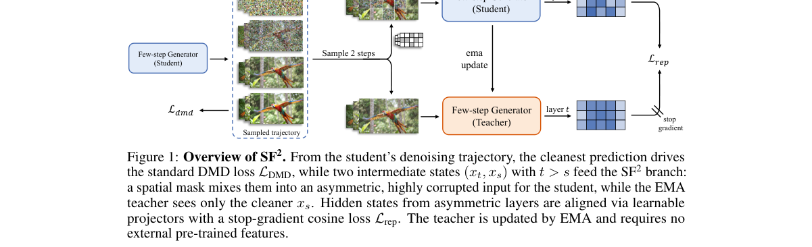

*Result - Qualitative comparison on causal few-step T2V generation. Top row: multi-step bidirectional Wan2.1 teacher. Rows 2–5: few-step distilled causal students (CausVid, Self-Forcing, Causal-Forcin*

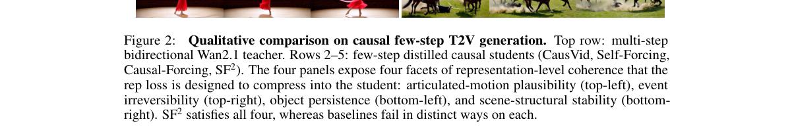

**Why this ranks #4**: 给 DMD 少步视频蒸馏补上表示层监督：让更脏输入去预测 EMA 教师的内部表征，缓解时空闪烁。

---

### 5. Cumulative Marginal Matching for One-Step Diffusion

**arXiv**: [2610.34575](https://arxiv.org/abs/2610.34575) | **Score**: 7.3 (relevance 7.0 x 0.7 + quality 8.0 x 0.3) | **Tags**: rl-aigc, reward-model-gen, one-step-generation, flow-matching, Wasserstein, distillation, theoretical-link | **Categories**: cs.LG | **Pages**: 14

**Authors**: Paribesh Regmi, Rui Li

**Affiliation**: Rochester Institute of Technology

**Abstract**

> The sampling procedures of diffusion and flow-matching models involve hundreds of denoising steps incurring substantial inference time, which has motivated a growing body of work on training schemes for few-step and one-step generation. Existing approaches primarily seek to align the generation trajectory of few-step and base models, yet their training objectives only involve discrepancies at a single point in the trajectory, encouraging only local \emph{point-level} alignment. While recent methods such as \emph{Shortcut-CSL} introduce cumulative objective that enforce alignment over the entire trajectory, this is suboptimal as they do not directly enforce alignment between the distributions induced by the two models throughout the generation process. We propose \emph{Cumulative Marginal Matching} (CMM), a principled objective for few-step generation: by viewing flow-matching as a sequence of intermediate marginal distributions connecting the prior and data distributions, CMM directly optimizes the cumulative discrepancy between the base and few-step marginal distributions over the entire sequence. Specifically, we formulate this discrepancy using the Wasserstein-2 distance. By exploiting the pushforward representation of flow-matching, we transform an intractable cumulative Wasserstein objective into a tractable surrogate that can be optimized using samples from the intermediate marginal, which are readily generated through the conditional interpolation process of flow-matching. Furthermore, we show that the existing \emph{Shortcut-CSL} objective arises as a first-order approximation of that of the CMM, establishing a theoretical connection between the two objectives. Experiments on standard benchmarks demonstrate improvement in generation quality over \emph{Shortcut-CSL} and other state-of-the-art one- and few-step baselines under identical training budgets.

**Key findings**

- **Finding**: 扩散与流匹配模型的采样需要数百个去噪步，这催生了大量少步与一步生成的训练方案。
- **Finding**: 既有方法主要寻求让少步模型与基座模型的生成轨迹对齐，但其训练目标只涉及轨迹上单点的差异，鼓励的只是局部**点级**对齐。
- **Finding**: 近期的 Shortcut-CSL 引入了累积目标来强制整条轨迹上的对齐，但这仍不够理想，因为它没有直接强制两个模型在整个生成过程中诱导出的**分布**之间对齐。
- **Finding**: 作者提出 Cumulative Marginal Matching (CMM)：把流匹配看作连接先验分布与数据分布的一串中间边际分布，CMM 直接优化基座与少步模型的边际分布之间的累积差异。
- **Finding**: 该差异用 Wasserstein-2 距离刻画；通过利用流匹配的 pushforward 表示，作者把难以处理的累积 Wasserstein 目标转化为可解的代理，可直接用流匹配条件插值过程生成的中间边际样本优化。
- **Finding**: 同时证明既有的 Shortcut-CSL 目标可视为 CMM 目标的一阶近似，建立了两者之间的理论联系。
- **Finding**: 在标准基准上，相同训练预算下生成质量优于 Shortcut-CSL 与其他 SOTA 一步/少步基线。
- **Inference**: 「Shortcut-CSL 是 CMM 的一阶近似」这个定理是本篇最有价值的部分——它把两条技术路线接成了一条谱系。
- **Inference**: 用中间边际的 pushforward 表示绕开累积 Wasserstein，是把不可解目标变成可解代理的漂亮技巧。
- **Recommendation**: 推荐。做少步/一步生成或流匹配蒸馏的值得读。

**Key figures**

*Framework - Samples generated from CMM model trained on CelebA-256 with 128, two and one-step sampling. The two- and one-step preserve the sample quality of the base 128-step model.*

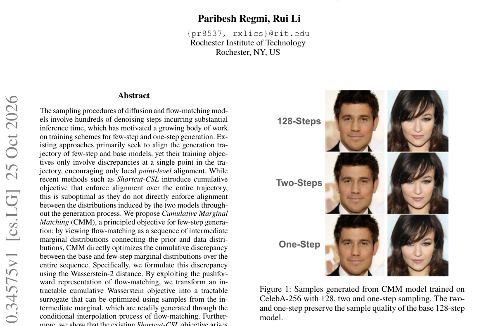

*Result - Illustration of the CSL (left) and CMM (right) losses (the illustration of CSL is recreated based on the original Shortcut-CSL paper). In the CSL loss, few-step model is unfolded in time and*

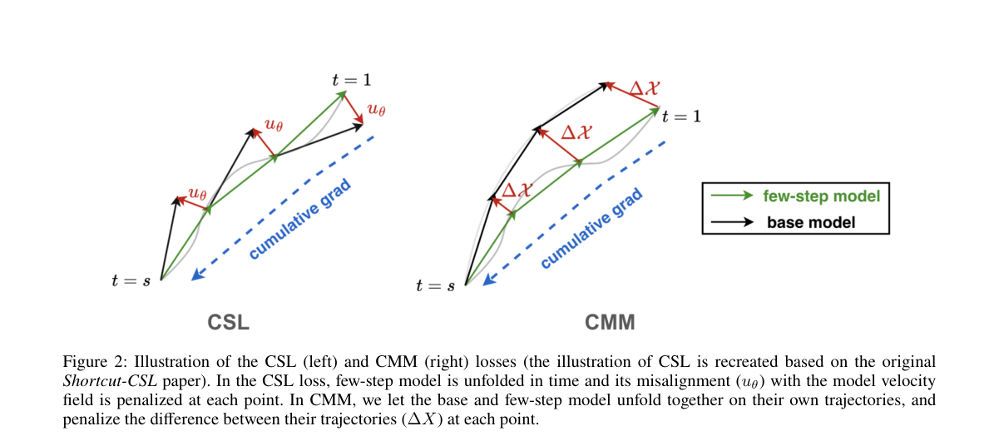

**Why this ranks #5**: 把一步生成的目标从「轨迹点对齐」换成「整条边际分布序列的累积匹配」，并证明 Shortcut-CSL 只是它的一阶近似。

---

### 6. Stable Continuous-Time Consistency Distillation: An Empirical Study with a Multistep Extension

**arXiv**: [2610.34704](https://arxiv.org/abs/2610.34704) | **Score**: 7.3 (relevance 7.0 x 0.7 + quality 8.0 x 0.3) | **Tags**: rl-aigc, reward-model-gen, consistency-distillation, continuous-time, TrigFlow, multistep, reproducibility | **Categories**: cs.LG | **Pages**: 19

**Authors**: Vinay Saji Mathew, Soundar R. Kumara, Gretta D Kellogg, William KM Lai

**Affiliation**: The Pennsylvania State University; State University of New York at Buffalo

**Abstract**

> Continuous-time consistency models are an attractive route to few-step generation. They remove the discretization error inherent to the timestep grid that discrete-time consistency models depend on. Until recently, however, training them was unstable. Lu & Song (2025) address this with the TrigFlow formulation and a coordinated set of architectural and training-objective changes. We conduct an independent empirical study of this framework on CIFAR-10 and ImageNet-64. No open-weight TrigFlow teachers exist at these scales, so we train them from scratch and then verify the consistency distillation (sCD) and consistency training (sCT) behavior of students initialized from these teachers. On CIFAR-10, our students reproduce the reported FID at one and two steps. On ImageNet-64, they fall short, a gap that appears related to our teacher and to architectural choices the paper leaves unspecified. We also report a parameter-count gap of about 5% between the model size stated in the paper and a faithful re-implementation, which we attribute to the scale-and-shift conditioning projections in Adaptive Double Normalization. We then propose Multistep sCD (MS-sCD), a continuous-time, segment-conditioned multistep generalization of sCD. The segment-conditioning idea is borrowed from the discrete-time multistep consistency distillation of Heek et al. (2024); we build on their preliminary continuous-time experiments within the TrigFlow/sCM framework. The rest of the algorithm follows sCD. MS-sCD replaces sCM's two-step intermediate time with a fixed segment-boundary schedule and recovers sCD at M = 1. We report FID at M = 2, 4, 8 and compare against the discrete-time MSCD baseline. Code, model weights, and training scripts are available on GitHub (Mathew et al., 2026).

**Key findings**

- **Finding**: 连续时间一致性模型是少步生成的有吸引力路线，它消除了离散时间一致性模型依赖的时间步网格带来的离散化误差。
- **Finding**: 但直到近期其训练仍不稳定；Lu & Song (2025) 用 TrigFlow 形式化加上一组架构与训练目标改动来解决。
- **Finding**: 作者在 CIFAR-10 与 ImageNet-64 上对该框架做独立实证研究。
- **Finding**: 这两个规模上没有现成的开源权重 TrigFlow 教师，因此作者从头训练教师，再验证由这些教师初始化的学生的一致性蒸馏（sCD）与一致性训练（sCT）行为。
- **Finding**: 在 CIFAR-10 上，学生的 1 步与 2 步 FID 复现了论文报告的数值。
- **Finding**: 在 ImageNet-64 上则未达到，差距似乎与作者自己训出的教师以及论文未明确说明的架构选择有关。
- **Finding**: 作者还报告了论文所述模型大小与忠实复现之间约 5% 的参数量差距，归因于 Adaptive Double Normalization 中的 scale-and-shift 条件投影。
- **Finding**: 随后提出 Multistep sCD (MS-sCD)，连续时间、分段条件的 sCD 多步推广。
- **Finding**: 分段条件的思路借鉴自离散时间多步一致性蒸馏（Heek et al., 2024），作者在 TrigFlow/sCM 框架内的初步连续时间实验上继续推进；算法其余部分沿用 sCD。
- **Finding**: MS-sCD 用固定的分段边界调度替换 sCM 的两步中间时间，并在 M = 1 时退化为 sCD。
- **Finding**: 报告 M = 2, 4, 8 的 FID，并与离散时间的 MSCD 基线比较。代码、模型权重与训练脚本已在 GitHub 开放。
- **Inference**: 「复现不出来 + 5% 参数量差异」这类诚实报告本身就是贡献——它提醒读者该类论文的复现门槛。
- **Inference**: MS-sCD 在 M=1 退化为 sCD 保证了与原方法的可比性，是设计多步推广时值得照抄的严谨做法。
- **Recommendation**: 推荐。做一致性蒸馏、少步生成或关心复现性的值得读。

**Key figures**

*Framework - Green arrows are PF-ODE trajectories (data ↔noise) and red arrows show the consistency map. (a) For M = 1 the segment CM equation 14 reduces to sCM: f(0)*

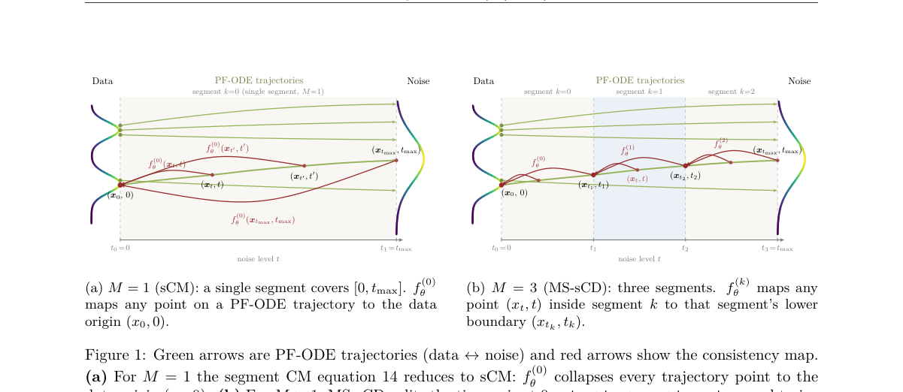

**Why this ranks #6**: 对 TrigFlow 做独立复现，CIFAR-10 上复现成功、ImageNet-64 上没复现，并给出多步一致性蒸馏的连续时间扩展。

---

### 7. Learning When to Commit: Schedule Distillation for Fast Diffusion Language Models

**arXiv**: [2610.35804](https://arxiv.org/abs/2610.35804) | **Score**: 7.3 (relevance 7.0 x 0.7 + quality 8.0 x 0.3) | **Tags**: rl-aigc, reward-model-gen, diffusion-language-model, schedule-distillation, parallel-decoding, KL-regularization, speedup | **Categories**: cs.AI, cs.CL, cs.LG | **Pages**: 20

**Authors**: Aidar Myrzakhan, Zhiqiang Shen

**Affiliation**: MBZUAI

**Abstract**

> Diffusion large language models (dLLMs) can generate multiple tokens in parallel, but often require many decoding rounds to complete a response. Efficient generation depends not only on which tokens are easy to predict, but also on how committing to them helps predict the remaining positions. A highly predictable token may provide little useful context, while revealing a less predictable token can help several other positions become predictable sooner. We propose dSpark, a new schedule distillation-based framework for learning when to commit tokens for faster diffusion language generation. To achieve this, we construct unmasking schedules that prioritize tokens whose reveal makes other positions easier to predict, reducing uncertainty earlier in decoding. We then distill these schedules into the model to enable faster parallel sampling, with a KL-divergence regularizer to help preserve generation quality. We extensively evaluate our approach across mathematical reasoning and code generation tasks. On GSM8K, our method achieves remarkable 10.12$\times$ and 5.12$\times$ speedups over the various baselines on LLaDA-8B-Instruct and Dream-7B-Instruct, respectively, while maintaining superior task performance. Our code is available at https://github.com/VILA-Lab/dSpark.

**Key findings**

- **Finding**: 扩散大语言模型（dLLM）能并行生成多个 token，但通常需要很多解码轮次才能完成一次回复。
- **Finding**: 高效生成不仅取决于哪些 token 容易预测，还取决于「提交它们」如何帮助预测其余位置。
- **Finding**: 一个高度可预测的 token 可能几乎不提供有用上下文，而揭示一个较难预测的 token 却能让多个其他位置更早变得可预测。
- **Finding**: 作者提出 dSpark，一个基于调度蒸馏的新框架，用于学习扩散语言生成中何时提交 token。
- **Finding**: 具体做法是构造 unmasking 调度，优先选择那些「揭示之后会让其他位置更容易预测」的 token，从而更早降低解码中的不确定性。
- **Finding**: 随后把这些调度蒸馏进模型以支持更快的并行采样，并用一个 KL 散度正则项帮助保持生成质量。
- **Finding**: 在数学推理与代码生成任务上充分评测。
- **Finding**: 在 GSM8K 上，相对各种基线，LLaDA-8B-Instruct 取得 10.12 倍加速、Dream-7B-Instruct 取得 5.12 倍加速，同时保持更优的任务表现。代码已公开。
- **Inference**: 「可预测性 ≠ 信息量」是本篇最关键的洞察——提交一个容易的 token 几乎不推进解码，提交一个难的反而能解锁多个位置。
- **Inference**: 把调度蒸馏成策略（而非硬编码启发式）让模型自己学会什么时候值得冒险，这是相对固定启发式的明显升级。
- **Recommendation**: 推荐。做扩散 LM、并行解码或推理加速的必读。

**Key figures**

*Framework - The most predictable token is not the most useful one to reveal. On correct GSM8K re- sponses from LLaDA, we reveal one masked token yi and measure its effect on the other masked po- sitions*

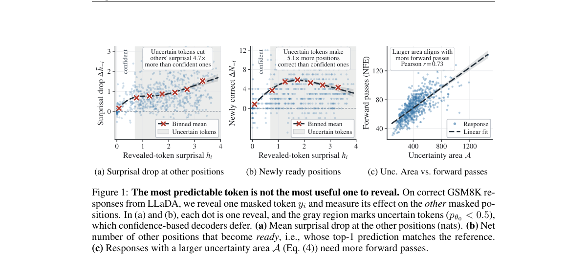

**Why this ranks #7**: 把「什么时候该提交 token」蒸馏进扩散语言模型，GSM8K 上相对基线加速 10.12 倍（8B）与 5.12 倍（7B）。

---

### 8. CounterFlow: Target-Conditioned Flow Matching for Visual Counterfactuals

**arXiv**: [2610.35679](https://arxiv.org/abs/2610.35679) | **Score**: 7.0 (relevance 7.0 x 0.7 + quality 7.0 x 0.3) | **Tags**: rl-aigc, reward-model-gen, flow-matching, counterfactual, explainable-AI, pixel-space, target-conditioned | **Categories**: cs.AI, cs.CV, cs.LG | **Pages**: 18

**Authors**: Paul Sevellec, Elisa Fromont, Romaric Gaudel, Laurence Roze, Paul Viallard, Laetitia Houeix

**Affiliation**: Inria IRISA Rennes; INSA Rennes; Stellantis

**Abstract**

> In eXplainable AI, counterfactual explanations have gained significant traction by offering users direct, intuitive, and actionable insights into model decisions. We introduce CounterFlow, a novel framework based on Conditional Flow Matching that generates visual counterfactual explanations by directly steering a source image toward a user-specified target class. By leveraging target-conditioned vector fields, CounterFlow identifies highly realistic semantic modifications while requiring substantially lower computational overhead than traditional GAN- or diffusion-based architectures. Empirical evaluations on standard benchmarks demonstrate that CounterFlow achieves state-of-the-art performance in both visual realism and target class switching. By working directly in the raw pixel space, CounterFlow offers a more practical solution for real-world deployment.

**Key findings**

- **Finding**: 在可解释 AI 中，反事实解释能给用户直接、直观且可操作的模型决策洞察。
- **Finding**: 作者提出 CounterFlow，一个基于条件流匹配的框架，通过目标条件化的向量场，直接把源图像导向用户指定的目标类别。
- **Finding**: 借助目标条件化的向量场，CounterFlow 能识别出高度逼真的语义修改，同时比传统 GAN 或扩散架构的算力开销低得多。
- **Finding**: 在标准基准上的实证评估显示，CounterFlow 在视觉真实感与目标类别切换两方面都达到 SOTA。
- **Finding**: 由于直接在原始像素空间工作，CounterFlow 为真实部署提供了更实用的方案。
- **Inference**: 「目标条件化的向量场」比扩散模型更省算力，是因为流匹配只需沿一条直线路径做一次积分，而扩散需要多步去噪。
- **Inference**: 用可解释 AI 的问题驱动生成模型设计是本篇的立意——它不是又一个生成架构，而是把解释需求写进了目标函数。
- **Recommendation**: 推荐。做流匹配、可解释生成或反事实解释的值得读。

**Key figures**

*Framework - Qualitative counterfactual explanations generated by CounterFlow on (a) MNIST and (b) CI- FAR10. We show five examples per dataset as source/counterfactual pairs (source on the left of each*

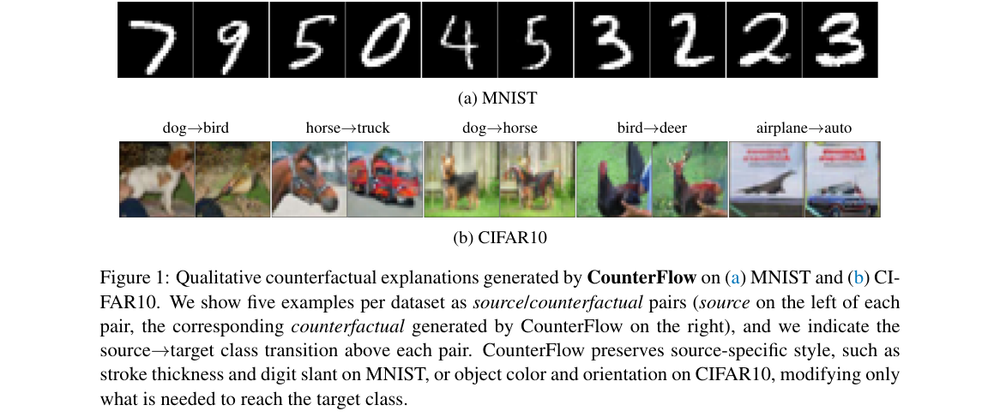

*Result - CounterFlow trajectories for five (MNIST) and six (CIFAR10) samples, from source to target class (labeled for CIFAR10). Border color indicates the classifier’s prediction along the path: red*

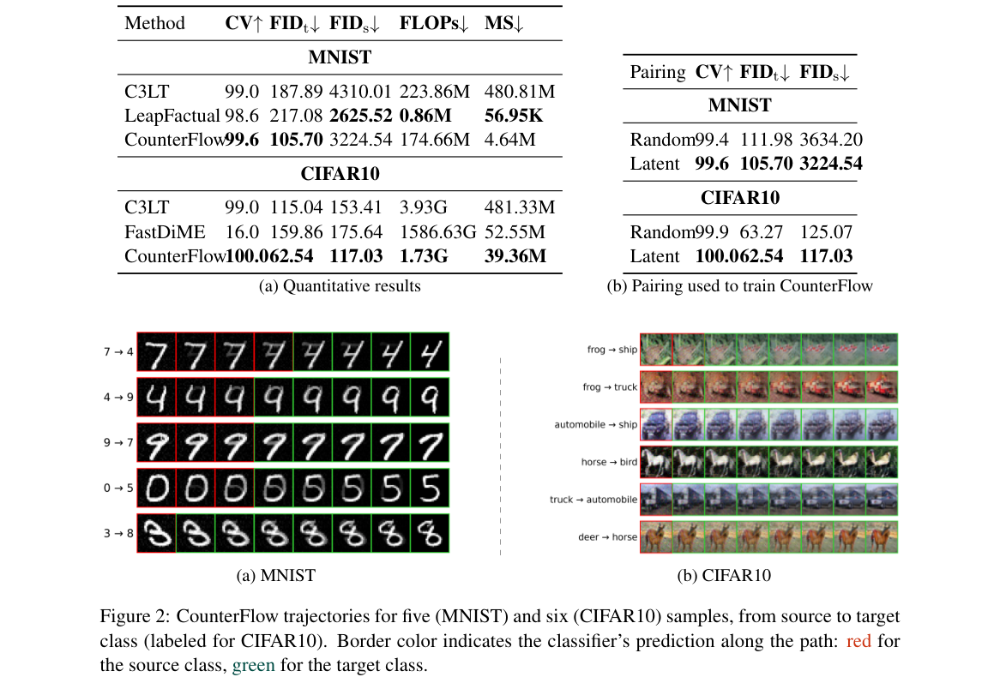

**Why this ranks #8**: 用目标条件化的流匹配直接把源图像推向指定类别生成视觉反事实解释，比 GAN/扩散架构省下大量算力。

---

### 9. From Denoising Dynamics to Endpoint Uncertainty in Diffusion Language Models

**arXiv**: [2610.35425](https://arxiv.org/abs/2610.35425) | **Score**: 6.6 (relevance 6.0 x 0.7 + quality 8.0 x 0.3) | **Tags**: rl-aigc, reward-model-gen, diffusion-language-model, uncertainty, sampling-dynamics, mutual-information, wild-card | **Categories**: cs.AI | **Pages**: 9

**Authors**: Julio C. Amador Diaz Lopez

**Affiliation**: SiftyML

**Abstract**

> Predictive uncertainty in stochastic language-model inference can be characterized by repeatedly sampling an input and measuring the distribution of outputs. This requires multiple complete generations. Masked diffusion language models expose another source of information: the evolution of the output during denoising. We ask whether convergence within diffusion trajectories is associated with uncertainty across their final outputs, or endpoints. We study four masked diffusion language models on four reasoning benchmarks, collecting 20 generations per question and 32,000 denoising trajectories in total. Within each trajectory, we measure within-run concentration as the area under the curve describing stable resolution of the eventual output. Across repeated trajectories, we measure endpoint-distribution uncertainty. Stronger within-run concentration is associated with lower endpoint entropy after accounting for model and dataset ($β=-0.222$, $p<10^{-25}$). This association persists for multi-token outputs and when reweighting positive-entropy cases. The relationship is asymmetric: high within-run concentration almost exclusively accompanies concentrated endpoint distributions, whereas lower concentration occurs under both concentrated and competing endpoint regimes. This relationship strengthens as denoising proceeds. Features from a single denoising run predict whether independent held-out runs will concentrate on a common endpoint or produce competing endpoints. These results connect dynamics within individual denoising runs to variability across repeated inference. Within-trajectory dynamics contain information about whether independent repetitions will concentrate on a common endpoint or produce competing endpoints, providing a route towards estimating endpoint-distribution properties with fewer complete generations.

**Key findings**

- **Finding**: 随机语言模型推理中的预测不确定性，通常靠重复采样同一输入并度量输出分布来刻画，但这需要多次完整生成。
- **Finding**: 掩码扩散语言模型提供了另一种信息源：去噪过程中输出的演化。
- **Finding**: 作者追问：轨迹内部的收敛是否与最终输出之间的不确定性相关。
- **Finding**: 在四个掩码扩散语言模型、四个推理基准上研究，每题采集 20 次生成、总共 32,000 条去噪轨迹。
- **Finding**: 轨迹内用「最终输出稳定解析程度的曲线下面积」度量集中度；跨轨迹则度量端点分布的不确定性。
- **Finding**: 在控制模型与数据集后，更强的轨迹内集中度与更低的端点熵相关（β = -0.222，p < 10⁻²⁵）。
- **Finding**: 该关联在多 token 输出下依然成立，在对正熵样本重新加权时也成立。
- **Finding**: 这种关系是不对称的：高轨迹内集中度几乎只伴随集中的端点分布，而低集中度则同时出现在集中与竞争的端点状态下。
- **Finding**: 该关系随着去噪推进而增强。
- **Finding**: 单条去噪运行的特征可以预测独立留出的运行会集中在同一端点还是产生竞争端点。
- **Inference**: 这是本批次唯一一篇严格命中「扩散模型 + 采样动力学」的论文，为「能否用一次生成估计多次生成的不确定性」给出了可用的答案。
- **Inference**: 不对称性是关键——高集中度可以作为「这次采样大概率收敛」的充分信号，而低集中度则几乎不可用，这在实际阈值设定时很重要。
- **Recommendation**: 推荐（wild-card）。做扩散 LM、不确定性估计或关心采样成本优化的值得读。

**Key figures**

*Framework - Held-out endpoint-multiplicity prediction as a function of the number k of observed denoising trajecto- ries. Bands show 95% intervals across random trajectory splits.*

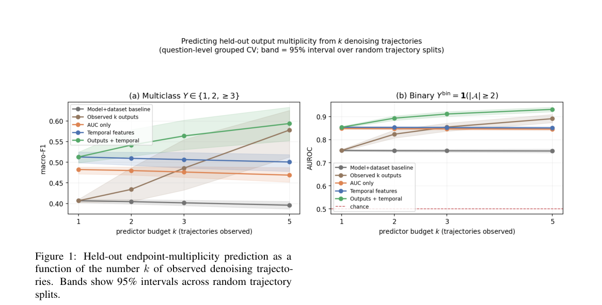

*Result - Balanced-bootstrap distribution of the cwithin coef- ficient under 50/50 balancing of zero- and positive-entropy observations within model–dataset cells. The dashed line de- notes zero and t*

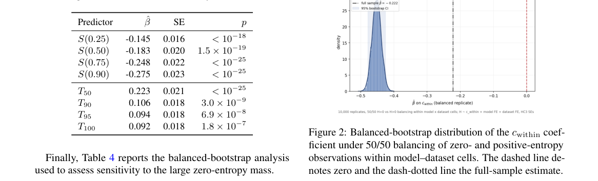

**Why this ranks #9**: 用单条去噪轨迹的内部收敛程度预测多次独立采样的端点分布，32,000 条轨迹给出 β=-0.222 的强相关。  [wild-card]

---

### 10. VibeVideoBench:Evaluating Multimodal Agents on Code-Driven Video Generation

**arXiv**: [2610.35864](https://arxiv.org/abs/2610.35864) | **Score**: 6.6 (relevance 6.0 x 0.7 + quality 8.0 x 0.3) | **Tags**: rl-aigc, reward-model-gen, benchmark, video-generation, agentic, evaluation, wild-card | **Categories**: cs.CV | **Pages**: 29

**Authors**: Muxi Diao, Wenbin Xu, Lele Yang, Xuyang Ma, Yuzhe Chen, Jiankang Chen, Kaiyu Jiang, Changyi Liu, Haoyu Zhang, Hongyi Fu, Jianxiong Wang, Tianke Zhang

**Affiliation**: Beijing University of Posts and Telecommunications; Zhongguancun Academy; Peking University; Jilin University

**Abstract**

> Diffusion video models produce striking clips, but they cannot reliably render an exact formula, a correct chart, a ruleconsistent game or narration synchronized to on-screen events. A different route is emerging: multimodal agents that write code to render every frame and synthesize every sound. We introduce VibeVideoBench, a benchmark for evaluating agents on code-driven video generation. Its 239 self-contained tasks in English and Chinese span 12 categories, from data stories and music-driven pieces to classroom lessons and paper explainers; each asks an agent, running in its native harness inside a sandbox, to deliver a finished MP4 with sound within one hour. Evaluation is hierarchical and evidence-based: program checks of the delivery spec, about 13k task-specific rubric checks traced to the requirements they enforce, and five quality dimensions anchored per task, judged by three VLM judge panels and validated with blind human preferences. Across nine frontier agent systems and 2,151 scored rollouts, the benchmark is far from solved: GPT-6 Astra and Claude Opus 5.5 lead clearly, yet even the best system fails a core requirement on about a quarter of tasks. Whether a video arrives at all matters as much as its quality, and three quarters of the lost videos are final renders started too late, run too slowly or never started. The judges agree with each other and with human preferences on system rankings, but only moderately on individual videos.

**Key findings**

- **Finding**: 扩散视频模型能生成惊艳片段，却无法可靠地渲染出正确的公式、图表、规则一致的游戏，或与画面事件同步的旁白。
- **Finding**: 另一条路线正在浮现：多模态智能体写代码来渲染每一帧并合成每一个声音。
- **Finding**: 作者提出 VibeVideoBench，用于评测智能体在代码驱动视频生成上的表现。
- **Finding**: 其 239 个自包含任务（中英双语）覆盖 12 个类别，从数据故事、音乐驱动作品到课堂讲解与论文解读。
- **Finding**: 每个任务要求智能体在自己的 harness 内、于沙箱中一小时内交付带声音的成品 MP4。
- **Finding**: 评测是分层且基于证据的：交付规格的程序化检查、约 13k 项可追溯到所强制需求的任务特定 rubric 检查，以及每任务锚定的五个质量维度——由三个 VLM 评判面板打分并用盲评人类偏好验证。
- **Finding**: 在九个前沿智能体系统、2,151 次计分 rollout 上，该基准远未解决：GPT-6 Astra 与 Claude Opus 5.5 明显领先，但即使最好的系统也在约四分之一的任务上失败于某项核心要求。
- **Finding**: 视频能否产出与视频质量同样重要，失去的视频中有四分之三源于最终渲染启动太晚、跑得太慢或从未启动。
- **Finding**: 评判面板之间以及与人类偏好在系统排序上保持一致，但在单个视频上只是一致性中等。
- **Inference**: 「写代码渲染视频」本质上是用确定性程序替代扩散采样来换取可控性——公式、图表、规则一致性这些恰好是扩散模型最不擅长的。
- **Inference**: 「四分之三的失败源于渲染太晚或从未启动」这一发现说明当前智能体的瓶颈在工程调度而非生成质量。
- **Recommendation**: 推荐（wild-card）。做视频生成评测或代码驱动生成方向的值得读。

**Key figures**

*Framework - VibeVideoBench asks a multimodal agent to turn a self-contained specification into a finished MP4 with sound, using only code. Each panel is one frame of an unedited delivery from our evalua*

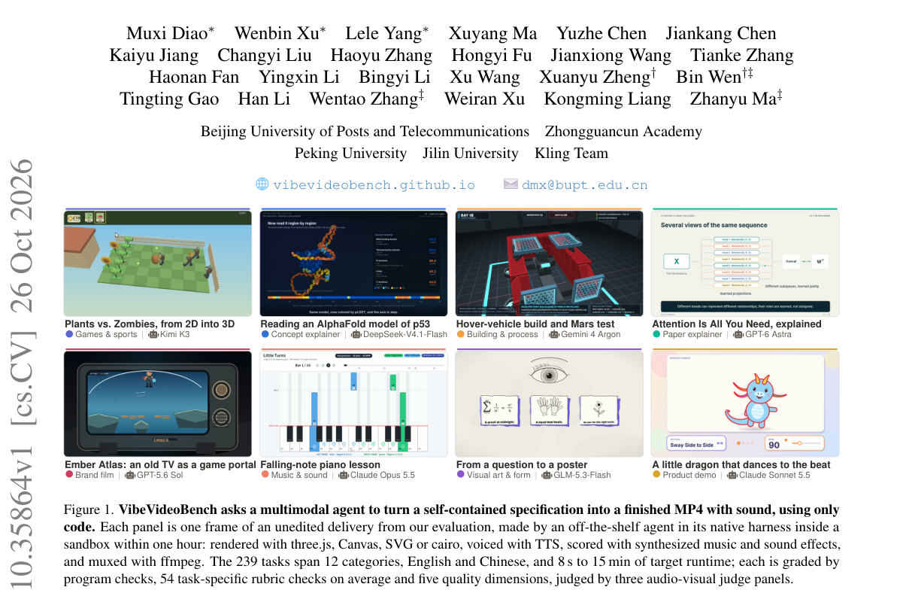

*Result - Overview of VibeVideoBench. (a) Requests from four kinds of real-world sources are drafted under a shared contract, given the assets they need (searched for or synthesized by an LLM), and cu*

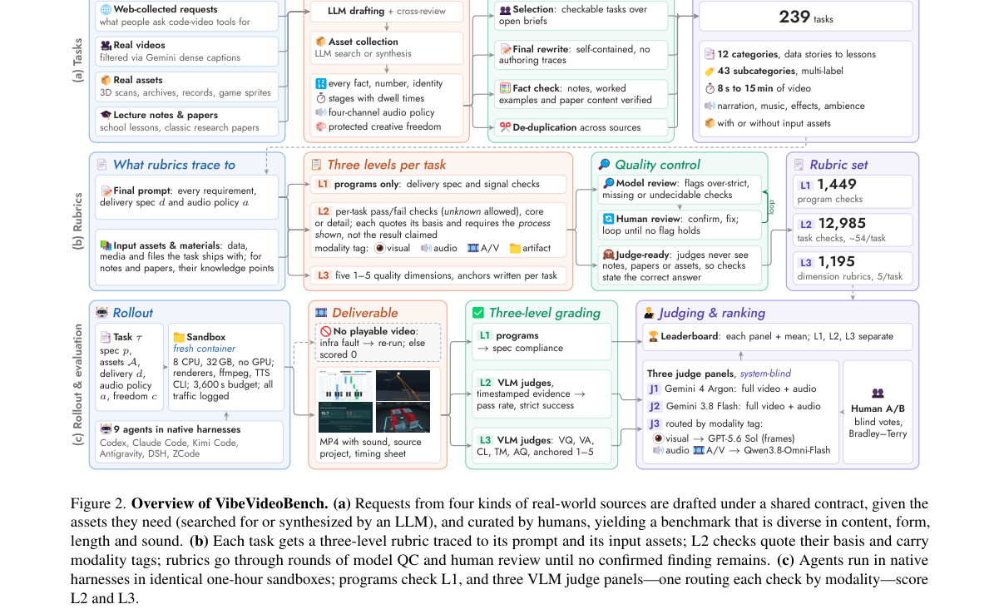

**Why this ranks #10**: 代码驱动视频生成的评测基准：239 个任务上最好的智能体仍有约四分之一在核心要求上失败。  [wild-card]

---

## Footer

- Total papers scanned across all 7 tracks: 546（原始 738 条）
- rl_aigc track final top-10: 10
- Wild-cards in this track: 2
- Figure assets: 2026-10-27/res/

Generated by `mine-arxiv-daily-digest` skill. Sister file: `2026-10-27_rl_aigc_entry.md`.
