# ArXiv Daily Digest - 2026-10-27 (强化学习核心算法与理论, 10 papers)

**Generated**: 2026-10-27 17:00 CST

**Source**: arXiv cs.CV, cs.SD, eess.AS, cs.CL, cs.AI, cs.RO, cs.LG submissions, listing day 2026-10-26 (announced 2026-10-27 00:00 UTC)

**Batch window**: 2026-10-25T18:00:00Z .. 2026-10-26T18:00:00Z（arXiv 公告批次横跨两个 UTC 日：前一日 18:00 UTC 起算，当日 17:59:59 UTC 截止）

**Track**: rl_core (top 10 of 546 papers scanned, 70 full reads)

**Scope**: RL 算法与理论、多智能体 RL、探索、sim-to-real（方法学优先）

---

## Top 10 - 强化学习核心算法与理论

### 1. Preference-Guided Cooperation in Multi-Objective Multi-Agent Reinforcement Learning

**arXiv**: [2610.35736](https://arxiv.org/abs/2610.35736) | **Score**: 9.7 (relevance 10.0 x 0.7 + quality 9.0 x 0.3) | **Tags**: rl-algorithm, multi-agent-rl, sim-to-real, multi-objective, meta-gradient, credit-assignment, pareto-front | **Categories**: cs.LG, cs.MA | **Pages**: 14

**Authors**: Qiyue Xia, J. Michael Herrmann

**Affiliation**: University of Edinburgh

**Abstract**

> Multi-objective multi-agent reinforcement learning (MOMARL) addresses agent coordination and objective trade-offs simultaneously while optimising overall system performance. Existing work tends to treat multi-agent cooperation and multi-objective optimisation as largely independent components of a learning problem, which amounts to an exorbitant complexity except in trivial cases. We study here whether the structure provided by multiple objectives can itself be exploited to facilitate cooperation, rather than being treated as an additional optimisation challenge. We formulate MOMARL at both the team and individual levels and introduce objective-wise counterfactual credit assignment to evaluate each agent's contribution across the team objectives. We propose Meta-Gradient Informed Multi-Objective Multi-Agent Reinforcement Learning (MIRL), with static (MIRL-S) and dynamic (MIRL-D) variants. By incorporating meta-gradient information, MIRL enables agents to learn how to prioritise objectives individually while collectively optimising the system-level objective, allowing the multi-objective structure to directly guide cooperation. Experiments on a multi-objective multiple particle environment show that our methods improve Pareto-front quality over baselines, with the dynamic variant achieving the strongest performance.

**Key findings**

- **Finding**: 多目标多智能体强化学习（MOMARL）同时处理智能体协作与目标权衡；既有工作倾向把两者当作相互独立的学习组件，复杂度高得离谱、只在平凡情形可行。
- **Finding**: 本文转而研究：多个目标提供的结构本身能否被利用来促进协作，而不是被当成额外优化挑战。
- **Finding**: 作者在团队级与个体级两个层次上形式化 MOMARL，并引入目标级反事实信用分配来评估每个智能体在团队各目标上的贡献。
- **Finding**: 提出 Meta-Gradient Informed Multi-Objective Multi-Agent Reinforcement Learning (MIRL)，含静态（MIRL-S）与动态（MIRL-D）两个变体。
- **Finding**: 引入元梯度信息后，MIRL 让智能体学会个体上如何排序目标，同时集体优化系统级目标，使多目标结构直接引导协作。
- **Finding**: 在多目标多粒子环境上，方法相对基线改善了 Pareto 前沿质量，动态变体表现最强。
- **Inference**: 「目标级反事实信用分配」是把多目标结构转成协作信号的关键接口——如果没有这一层，多目标只是奖励项的加权和。
- **Inference**: 评测环境偏简单（多粒子环境），Pareto 前沿的改善是否能在高维稀疏奖励任务上保持，是这篇的开放问题。
- **Recommendation**: 推荐。做多智能体 RL、多目标或信用分配研究的值得读。

**Key figures**

*Framework - Team-level and individual-level preference mod- elling in MOMARL. An externally specified team preference defines the desired system-level trade-off, while internally developed individual pr*

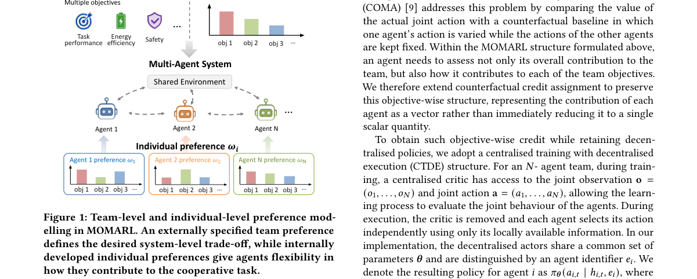

*Result - System overview for MIRL-S and MIRL-D.*

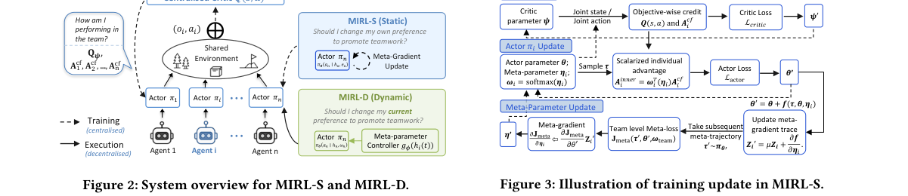

**Why this ranks #1**: 用目标级反事实信用分配把多目标结构本身变成协作的驱动力，而不是额外叠一个优化难题。

---

### 2. When Fine-Grained Credit Assignment Helps and Hurts: Multimodal Agentic Reinforcement Learning through Video Editing

**arXiv**: [2610.35497](https://arxiv.org/abs/2610.35497) | **Score**: 9.7 (relevance 10.0 x 0.7 + quality 9.0 x 0.3) | **Tags**: rl-algorithm, multi-agent-rl, sim-to-real, agentic-RL, process-reward, GRPO, reward-hacking, credit-assignment | **Categories**: cs.LG | **Pages**: 48

**Authors**: Lei Zhao, Zongheng Cao, Xinyu Hu

**Affiliation**: University of Pennsylvania; Philo Labs

**Abstract**

> Reinforcement learning (RL) has shown promise for training multimodal agents to reason and use tools. However, it remains unclear when fine-grained credit assignment improves learning and when it fails to improve task performance. Video editing provides a useful testbed for this question, combining multimodal perception, long-horizon planning, and tool use with delayed outcome feedback. We construct four movie-trailer editing task types---Content Selection, Narrative Sequencing, Rough Cut, and Fine Cut---that reflect real-world editing workflows and span different levels of task complexity and interaction horizon. Decaying process rewards provides the largest benefit on Fine Cut, with a 45.4% relative gain over outcome-only GRPO on tasks averaging more than 60 turns under outcome-only GRPO. On the three shorter-horizon task types averaging 30--40 turns under the same baseline, outcome-only GRPO remains competitive, with decaying process rewards yielding at most a 10.4% relative gain. Process rewards from an LLM judge initially improve tool use and encourage visual inspection. As training progresses, however, GRPO+PRM with a fixed process-reward weight increasingly exhibits excessive reasoning and redundant tool calls: process rewards continue to rise while task completion rates and outcome scores decline. Decaying the process-reward weight to zero mitigates this reward-hacking behavior while preserving the early gains. Despite dense token-level supervision, on-policy self-distillation (OPSD) yields little improvement or substantial degradation and is highly sensitive to the choice of privileged information. Our analysis reveals differences in teacher--student disagreement and gradient magnitudes, and suggests possible dilution of informative signals over long trajectories.

**Key findings**

- **Finding**: RL 在训练多模态智能体进行推理与工具使用上有前景，但细粒度信用分配何时提升学习、何时无助于任务表现一直不清楚。
- **Finding**: 作者用视频编辑作为测试床：它同时包含多模态感知、长程规划、工具使用与延迟的结果反馈。
- **Finding**: 构建四类电影预告片剪辑任务——内容选择、叙事排序、粗剪、精剪——对应真实剪辑工作流，覆盖不同任务复杂度与交互程长。
- **Finding**: 在结果-only GRPO 下平均超过 60 轮的任务上，衰减式过程奖励带来最大收益（相对提升 45.4%）。
- **Finding**: 在同样基线下平均 30–40 轮的三个更短程任务上，结果-only GRPO 依然有竞争力，衰减过程奖励最多只带来 10.4% 的相对提升。
- **Finding**: LLM 评判器给出的过程奖励初期改善工具使用并鼓励视觉检查；但随训练推进，固定过程奖励权重的 GRPO+PRM 出现过度推理与冗余工具调用——过程奖励持续上升而任务完成率与结果分下降。
- **Finding**: 把过程奖励权重衰减到零可缓解这种奖励黑客行为，同时保留早期收益。
- **Finding**: 尽管有密集的 token 级监督，在线自蒸馏（OPSD）几乎无提升甚至显著退化，且对特权信息的选择高度敏感。
- **Finding**: 分析揭示了师生分歧与梯度幅度的差异，并提示长程轨迹上可能存在信息稀释。
- **Inference**: 「过程奖励在长程任务上才划算」是本篇最可迁移的结论——短程任务加过程奖励只会引入额外噪声与被 hack 的空间。
- **Inference**: 过程奖励上升而任务分下降，是一个干净的奖励黑客观测；衰减权重这个解法简单到不该需要论文，但对工程实践很实用。
- **Recommendation**: 推荐。做 agentic RL、过程奖励或奖励设计的必读。

**Key figures**

*Framework - Task-dependent effects of process rewards for Qwen3.5-9B. (a) Independent task schematics, ordered by base-policy horizon. Turns and base scores are task-type averages, not example-specific*

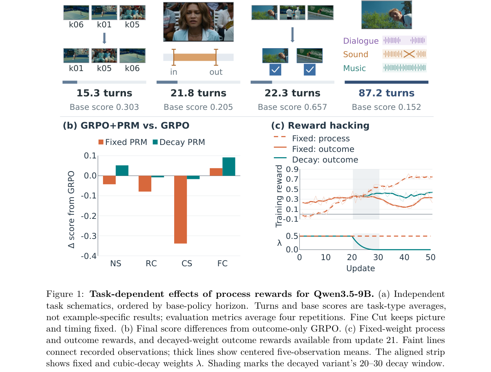

**Why this ranks #2**: 在视频编辑任务上实测「细粒度信用分配何时有用何时有害」：长程任务靠过程奖励，短程任务反而是纯结果奖励更稳。

---

### 3. Multi-Horizon Future Discovery for Physics-Informed Exploration

**arXiv**: [2610.35468](https://arxiv.org/abs/2610.35468) | **Score**: 8.7 (relevance 9.0 x 0.7 + quality 8.0 x 0.3) | **Tags**: rl-algorithm, multi-agent-rl, sim-to-real, exploration, intrinsic-motivation, contrastive, hamiltonian, SAC, PPO | **Categories**: cs.LG | **Pages**: 26

**Authors**: Shuwei Wang, Qiang Guan, Brian Qiu, Haoxiang Huang, Haoxi Wang, Chenyu Li, Bo Xu, Sen Cui

**Affiliation**: University of Chinese Academy of Sciences; Institute of Automation CAS; University of Science and Technology of China; Tsinghua University

**Abstract**

> Exploration in physical control environments requires agents to identify actions whose consequences reveal previously unexplored aspects of the underlying dynamics. However, many intrinsic motivation methods rely on immediate prediction errors, state novelty, or local physical changes, which may overlook informative outcomes that emerge across extended temporal horizons. We investigate whether learning structured representations of reachable futures can provide a more effective basis for exploration. To this end, we introduce Hamiltonian Temporal Contrastive Curiosity (HTC$^2$), a framework that combines multi-horizon temporal representation learning with Hamiltonian phase-space structure. A horizon-conditioned contrastive critic learns temporal relationships from future-state pairs sampled within the same episode. The distance between positive-pair representations is then used as an intrinsic reward, encouraging the agent to explore futures that remain insufficiently organized in the learned representation. To incorporate information about physical dynamics, we additionally modulate this reward using bounded multi-step Hamiltonian variation, rather than directly rewarding changes in the Hamiltonian itself. We integrate HTC$^2$ with both Soft Actor-Critic (SAC) and Proximal Policy Optimization (PPO), and evaluate it across six DeepMind Control Suite tasks. Comparisons with ICM, RIDE, E3B, Plan2Explore, and a single-step Hamiltonian curiosity baseline are complemented by state-coverage evaluations, component ablations, and phase-space diagnostics to characterize the contributions of temporal learning and physical structure to exploratory behavior.

**Key findings**

- **Finding**: 物理控制环境中的探索要求智能体找出那些能揭示未探索动力学的动作；许多内在动机方法依赖即时预测误差、状态新奇度或局部物理变化，可能忽略跨长时程才显现的信息性结果。
- **Finding**: 作者提出 Hamiltonian Temporal Contrastive Curiosity (HTC²)，结合多时程时序表征学习与哈密顿相空间结构。
- **Finding**: 一个时程条件化的对比 critic 从同一 episode 内采样的未来状态对中学习时序关系。
- **Finding**: 正样本对表征之间的距离被用作内在奖励，鼓励智能体去探索那些在所学表征中仍组织不足的未来。
- **Finding**: 为纳入物理动力学信息，奖励被有界的多步哈密顿变化所调制，而非直接奖励哈密顿量本身的变化。
- **Finding**: HTC² 与 SAC、PPO 两种算法集成，在六个 DeepMind Control Suite 任务上评测。
- **Finding**: 对比 ICM、RIDE、E3B、Plan2Explore 与单步哈密顿好奇心的比较，辅以状态覆盖评估、组件消融与相空间诊断。
- **Inference**: 「主动去探索那些在表征里还不够有序的未来」是一个从表征学习借来的探索定义——它和 E3B 的方差思路同源，但把对象从状态换成了未来。
- **Inference**: 用有界哈密顿变化而非哈密顿量本身做调制很关键：后者容易变成刷能量而非刷信息。
- **Recommendation**: 推荐。做探索、内在动机或物理控制的值得读。

**Key figures**

*Framework - Overview of Hamiltonian Temporal Contrastive Curiosity (HTC2). Observations are encoded into Hamiltonian phase states; same-episode future pairs train a horizon-conditioned temporal contrast*

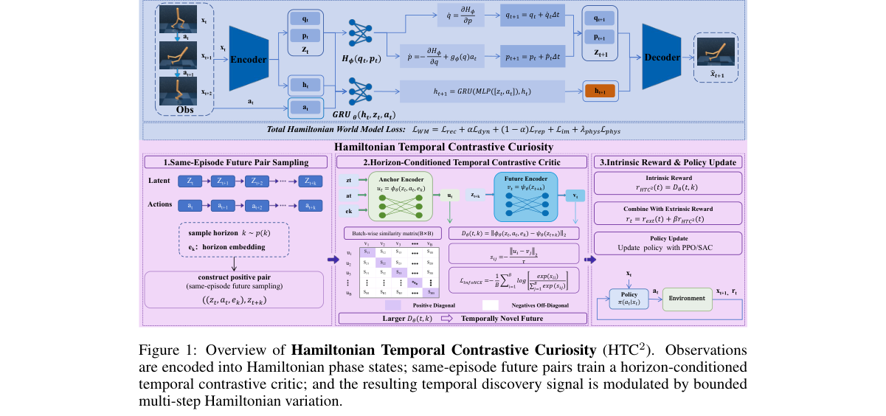

*Result - Control performance of HTC2 on six DMC tasks with SAC and PPO. The figure summarizes episode-return performance across five random seeds for ICM, RIDE, E3B, Plan2Explore, and HTC2. Numerical*

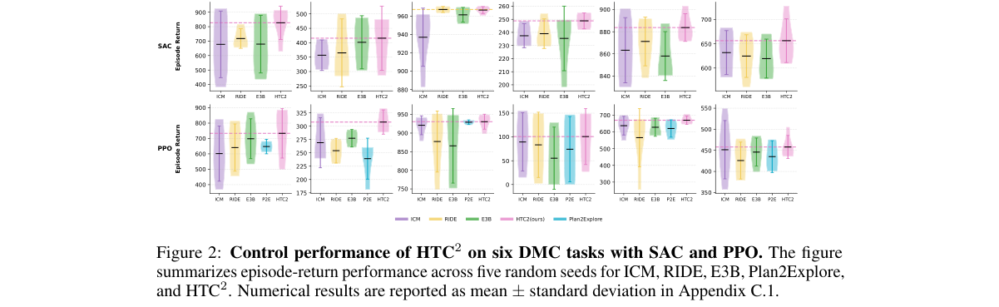

**Why this ranks #3**: 用多时程对比表征的距离当内在奖励，再用有界的哈密顿变化调制，把「物理上有信息量的未来」当作探索目标。

---

### 4. Reinforcement learning for constrained stochastic linear--quadratic control in continuous time

**arXiv**: [2610.34995](https://arxiv.org/abs/2610.34995) | **Score**: 9.0 (relevance 9.0 x 0.7 + quality 9.0 x 0.3) | **Tags**: rl-algorithm, multi-agent-rl, sim-to-real, RL_Theory, continuous-time, constrained-control, Riccati, actor-critic | **Categories**: cs.LG, math.OC | **Pages**: 49

**Authors**: Weiping Wu, Qitong Pan, Xun Li, Peng Wu

**Affiliation**: Fuzhou University; The Hong Kong Polytechnic University

**Abstract**

> We study continuous-time stochastic linear--quadratic control with a scalar state and nonnegative control constraints. With quadratic running costs, randomized exploration can change the optimal mean feedback. We introduce an auxiliary problem without entropy in which the conditional policy mean is nonnegative and the covariance is prescribed in proportion to the squared state. Moment reduction and state separation yield two regional Riccati equations and characterize the finite-horizon value function and optimal conditional mean. We give a sufficient control--cost compatibility condition under which this mean coincides with the optimal feedback of the original constrained problem. For time-invariant coefficients, we characterize the undiscounted infinite-horizon optimum and establish mean square asymptotic stability under the stated assumptions. For unknown dynamics, we develop model-free actor--critic schemes for finite and infinite horizons. Numerical experiments compare the learned policies with their analytical targets and examine the effect of exploration on the optimal mean.

**Key findings**

- **Finding**: 作者研究标量状态、非负控制约束下的连续时间随机线性-二次控制。
- **Finding**: 在二次运行代价下，随机化探索会改变最优的均值反馈——这与「探索只是噪声」的直觉相反。
- **Finding**: 作者引入一个不含熵的辅助问题，其中条件策略均值非负、协方差按状态平方比例给定。
- **Finding**: 矩约化与状态分离给出两个区域 Riccati 方程，并刻画了有限时域价值函数与最优条件均值。
- **Finding**: 给出控制-代价相容性的充分条件，在该条件下辅助问题的均值与原约束问题的最优反馈一致。
- **Finding**: 对时不变系数，刻画了无折扣无限时域最优解，并在所设假设下建立均方渐近稳定性。
- **Finding**: 对未知动力学，作者给出有限与无限时域的模型无关 actor-critic 方案。
- **Finding**: 数值实验把学到的策略与解析目标比较，并考察探索对最优均值的影响。
- **Inference**: 「探索会改变最优均值反馈」这一条对做低层控制的 RL 实践者很重要——意味着随机性策略的性能上限不只是方差惩罚。
- **Inference**: 给出解析目标再做 actor-critic 数值对照，是把理论做实的一种干净范式，比纯渐近分析更可检验。
- **Recommendation**: 推荐。做 RL 理论、连续时间控制或需要严格分析基础的值得读。

**Key figures**

*本篇未提取到可用图*

**Why this ranks #4**: 给连续时间随机 LQ 控制配上非负约束的精确刻画，并导出区域 Riccati 方程与模型无关 actor-critic 方案。

---

### 5. Centralized Critics for N-Agent Ad Hoc Teamwork

**arXiv**: [2610.34799](https://arxiv.org/abs/2610.34799) | **Score**: 8.7 (relevance 9.0 x 0.7 + quality 8.0 x 0.3) | **Tags**: rl-algorithm, multi-agent-rl, sim-to-real, CTDE, centralized-critic, ad-hoc-teamwork, variance, sample-efficiency | **Categories**: cs.AI, cs.LG | **Pages**: 16

**Authors**: Andrew McAlinden, Caroline Wang, Steven Shi, Arrasy Rahman, Elad Liebman, Peter Stone

**Affiliation**: [unverified]

**Abstract**

> Centralized training with decentralized execution (CTDE) has become the dominant paradigm in multi-agent reinforcement learning (MARL), motivating extensive study of what privileged information should be made available to the critic during training. While prior work has examined the role of global state in fully cooperative settings, the design of centralized critics for N-agent ad hoc teamwork - in which dynamically varying set of learning agents must coordinate with an arbitrary set of uncontrolled teammates drawn from an unknown distribution - remains poorly understood. We study this question by comparing two natural classes of advantage estimators: controlled history estimators, which condition only on the observation and action histories of the learner's own agents, and joint history estimators, which additionally condition on the histories of the uncontrolled teammates. We prove that both estimators are unbiased and characterize the conditions under which the joint history estimate attains strictly lower variance than its controlled counterpart. Empirically, joint history critics match or outperform controlled history critics across a range of NAHT tasks, yielding improved sample efficiency and final returns. Together, these results provide both a theoretical justification and an empirical recommendation for incorporating uncontrolled agent histories into centralized critics for N-agent ad hoc teamwork.

**Key findings**

- **Finding**: 集中训练分散执行（CTDE）已是多智能体 RL 的主流范式，也促使研究者不断追问训练时该给 critic 多少特权信息。
- **Finding**: 但针对 N 智能体临时协作（N-agent ad hoc teamwork）——一组动态变化的学习智能体须与来自未知分布的任意不受控队友协调——集中式 critic 的设计仍缺乏理解。
- **Finding**: 作者比较两类优势估计量：受控历史估计量只条件于学习智能体自身的观测与动作历史；联合历史估计量额外条件于不受控队友的历史。
- **Finding**: 论文证明两类估计量都是无偏的，并刻画了联合历史估计相对受控历史估计严格更低方差的条件。
- **Finding**: 实证上联合历史 critic 在一系列 NAHT 任务上匹配或超过受控历史 critic，带来更好的样本效率与最终回报。
- **Inference**: 把不受控队友的历史纳入 critic 是「免费的」特权信息——理论保证无偏、实践上降方差，这类结论在 CTDE 里不多见。
- **Inference**: 论文的适用面很清楚：只在队友不可控、且其历史可观测时成立；对完全同质的合作型 MARL 收益会小得多。
- **Recommendation**: 推荐。做 MARL、CTDE 或临时协作任务的必读。

**Key figures**

*本篇未提取到可用图*

**Why this ranks #5**: 证明 N 智能体临时团队中，把不受控队友的历史喂给集中式 critic 能严格降方差，并给出样本效率上的实证收益。

---

### 6. Provably Efficient Q-learning for Robust Reinforcement Learning

**arXiv**: [2610.35656](https://arxiv.org/abs/2610.35656) | **Score**: 8.3 (relevance 8.0 x 0.7 + quality 9.0 x 0.3) | **Tags**: rl-algorithm, multi-agent-rl, sim-to-real, RL_Theory, robust-RL, TV-uncertainty, sample-complexity | **Categories**: cs.AI, cs.LG, math.ST, stat.ML | **Pages**: 60

**Authors**: Yuchen Jiao, Gen Li

**Affiliation**: Chinese University of Hong Kong

**Abstract**

> Standard reinforcement learning (RL) algorithms based on Markov Decision Processes (MDPs) are vulnerable to sim-to-real gaps. To address this issue, distributionally robust RL algorithms based on robust MDPs (RMDPs) have been proposed, for ensuring that agents can perform reliably to unpredictable conditions in real-world environments. Despite of the rich literature, \revision{an efficient model-free method is still lacking} for robust RL, particularly for Markovian data, which is more relevant in practical applications. In this work, we take a step towards settling this problem by proposing a sample efficient (asynchronous Q-learning) algorithm for robust RL. In particular, consider a $γ$-discounted infinite-horizon RMDP with state space $\mathcal{S}$ and action space $\mathcal{A}$, where the uncertainty set is specified by the total variation (TV) distance with uncertainty level $σ$. Assuming access to a single trajectory of Markovian samples induced by a behavior policy and the nominal transition kernel, the sample complexity of the proposed Q-learning algorithm --- to achieve an entrywise $\varepsilon$-approximation of the optimal Q-function --- is bounded by $$ \frac{1}{μ_{\mathsf{min}}\varepsilon^2(1-γ)^3\max\{1-γ,σ\}} + \frac{t_{\mathsf{mix}}}{μ_{\mathsf{min}}(1-γ)} $$ up to logarithmic factors. Here, $t_{\mathsf{mix}}$ and $μ_{\mathsf{min}}$ denote the mixing time and the minimum state-action occupancy probability of the sample trajectory, respectively. This result is nearly minimax optimal, with an additional factor of $\frac{1}{1-γ}$. Moreover, it achieves a significant improvement over existing bounds.

**Key findings**

- **Finding**: 基于马尔可夫决策过程的 RL 算法对 sim-to-real 差距脆弱；为此人们提出了基于鲁棒 MDP（RMDP）的分布鲁棒 RL 算法，以保证在现实环境的不可预测条件下仍可靠。
- **Finding**: 尽管文献丰富，**高效的模型无关方法仍然缺失**，尤其在更贴近实际应用的马尔可夫数据情形下。
- **Finding**: 本文提出一个样本高效的（异步 Q-learning）鲁棒 RL 算法。
- **Finding**: 考虑 γ-折扣无限时域 RMDP，状态空间 S、动作空间 A，不确定集由总变差（TV）距离与不确定水平 σ 指定。
- **Finding**: 在只能获得行为策略诱导的单条马尔可夫样本轨迹与名义转移核的假设下，所提 Q-learning 算法达到逐元素 ε-逼近最优 Q 函数的样本复杂度为 1/(μ_min ε²(1-γ)³ max{1-γ, σ}) + t_mix/(μ_min (1-γ))（差对数因子）。
- **Finding**: 该结果几乎 minimax 最优，额外只带一个 1/(1-γ) 因子。
- **Finding**: 相比已有界有显著改进。
- **Inference**: 「模型无关 + 单条轨迹 + 马尔可夫数据」是相当苛刻的现实假设，这个界的意义在于说明在这种设定下鲁棒 RL 仍然可学。
- **Inference**: 额外那个 1/(1-γ) 因子正是无折扣鲁棒性的代价来源，说明「折扣假设」在鲁棒 RL 理论里承担了关键角色。
- **Recommendation**: 推荐。做鲁棒 RL、sim-to-real 理论或关心样本复杂度界的值得读。

**Key figures**

*本篇未提取到可用图*

**Why this ranks #6**: 给基于 MDP 的鲁棒 RL 补上高效的模型无关方法，样本复杂度几乎最优地逼近 minimax。

---

### 7. Multi-Objective Reinforcement Learning Using Routed Ensembles and Trajectory Attribution

**arXiv**: [2610.35733](https://arxiv.org/abs/2610.35733) | **Score**: 8.0 (relevance 8.0 x 0.7 + quality 8.0 x 0.3) | **Tags**: rl-algorithm, multi-agent-rl, sim-to-real, multi-objective, trajectory-attribution, routing, regret-bound, sample-efficiency | **Categories**: cs.AI, cs.LG, cs.MA, cs.RO, stat.ML | **Pages**: 30

**Authors**: Zhenshuo Zhang, Ruoxuan Xiong, Hongyang R. Zhang

**Affiliation**: Northeastern University; Emory University

**Abstract**

> Multi-objective reinforcement learning is a fundamental problem for modern AI, with applications spanning post-training, reasoning models, and robotic control. A central challenge is to learn policies that balance competing objectives, such as helpfulness versus honesty in safety and alignment, or speed versus energy in robotics. The optimal policy can vary sharply with objective-weighting combinations, and the extent of this variation depends crucially on the degree of conflict among objectives, making per-preference policy learning sample-inefficient. In this paper, we introduce objective-conflict coefficients and derive near-optimal regret bounds for online settings using this measure, thereby quantifying the impact of misalignment on learning efficiency. Then, we design routed ensemble policy learning, an algorithm that maintains a small set of basis policies and dynamically routes trajectories to the policy with the highest potential reward. Finally, we consider trajectory selection as another approach to mitigate objective conflict, and design a kernel surrogate trajectory attribution algorithm that estimates how feedback signals from a set of trajectories influence policy learning on other trajectories. The kernel can capture nonlinear interactions such as synergy and antagonism between trajectories. We evaluate our approach across diverse environments and benchmarks: routed ensembles improve average performance by 4.3% over baselines for online environments from Meta-World and MO-Gymnasium, and kernel surrogate attribution improves correlation with leave-one-out analysis over existing baselines by 50%. When applied to trajectory selection, kernel-based attribution yields a 27% improvement in reward over baseline attribution methods.

**Key findings**

- **Finding**: 多目标 RL 是现代 AI 的基础问题，应用于后训练、推理模型与机器人控制；核心挑战是学出在竞争目标间取得平衡的策略（如有用性与诚实性、速度与能耗）。
- **Finding**: 最优策略会随目标权重组合剧烈变化，而这一变化的幅度取决于目标之间的冲突程度，导致按偏好逐个学策略样本效率低下。
- **Finding**: 作者引入目标冲突系数，并据此推导在线设定下近乎最优的遗憾界，量化错配对学习效率的影响。
- **Finding**: 提出路由集成策略学习：维护一小组基策略，并把轨迹动态路由到当前潜在奖励最高的那个策略。
- **Finding**: 同时把轨迹选择作为缓解目标冲突的另一手段，设计核代理轨迹归因算法，估计一组轨迹的反馈信号如何影响其他轨迹上的策略学习；该核可捕捉协同与拮抗等非线性交互。
- **Finding**: 在 Meta-World 与 MO-Gymnasium 的在线环境上，路由集成相对基线平均提升 4.3%。
- **Finding**: 核代理归因与留一法分析的相关性比既有基线高 50%；用于轨迹选择时，基于核的归因相对基线归因方法带来 27% 的回报提升。
- **Inference**: 「用少数基策略 + 动态路由」代替按偏好训 N 个策略，是把 N 次训练压成一次训练换 N 倍多样性的思路，思路在个性化推荐与 agent 路由里同样成立。
- **Inference**: 轨迹之间的协同与拮抗被核函数显式建模，这比按独立样本估计归因更接近真实的多轨迹学习动力学。
- **Recommendation**: 推荐。做多目标 RL、偏好权衡或后训练奖励设计的值得读。

**Key figures**

*Framework - We visualize the objective space returns (r1, r2) for policies optimized under varying preference weights w ∈[0, 1] in three canonical regimes — clustered, linear and concave Pareto frontier*

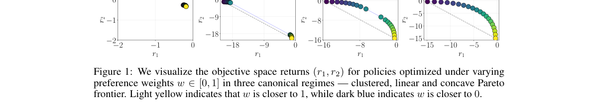

*Result - We compare the cumulative regret of routed ensembles (red) against MO-UCBVI (green dashed), uniform ensembles (yellow), and the best stationary policy (blue dotted).*

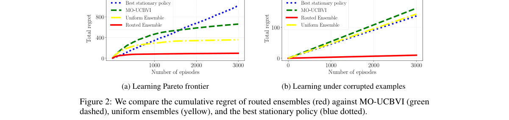

**Why this ranks #7**: 用「目标冲突系数」量化多目标 RL 的样本效率代价，并给出路由集成与核代理轨迹归因两套算法。

---

### 8. Best Policy Tracking in Reinforcement Learning

**arXiv**: [2610.34501](https://arxiv.org/abs/2610.34501) | **Score**: 7.3 (relevance 7.0 x 0.7 + quality 8.0 x 0.3) | **Tags**: rl-algorithm, multi-agent-rl, sim-to-real, evaluation, policy-selection, non-monotonicity, benchmarking | **Categories**: cs.LG | **Pages**: 40

**Authors**: Judith Echevarrieta, Etor Arza, Aritz Pérez, Josu Ceberio

**Affiliation**: University of the Basque Country; Basque Center for Applied Mathematics; Norwegian University of Science and Technology

**Abstract**

> Reinforcement learning commonly exhibits non-monotonic performance dynamics in single-task settings. During learning, a sequence of policies is generated whose true performance is unknown and may oscillate significantly across iterations. Despite this well-known phenomenon, standard experimental practice typically reports either the final visited policy or the best among periodically evaluated ones, implicitly assuming that these selection criteria reliably approximate the best-performing policy visited throughout the entire sequence. In this work, we present an empirical study on the implications of non-monotonicity for policy selection in single-task policy-based reinforcement learning. We introduce post-hoc diagnostic metrics to characterize performance degradation and assess the accuracy and efficiency of different selection criteria. These metrics allow us to evaluate commonly used selection strategies across standard continuous-control benchmarks using a well-established on-policy actor-critic method. Our results show that, in this representative experimental setting, widely adopted selection practices can deviate considerably from the best policy encountered during learning, leading to underperforming estimates and suboptimal use of computational resources. As an alternative, we recommend a validation-based policy selection strategy constrained by computational cost, which provides a more consistent and accurate approximation of the best visited policy while improving selection efficiency. Overall, our findings highlight policy selection as an underexplored factor in the evaluation protocols of reinforcement learning and motivate further study on explicit and standardized validation-based selection procedures.

**Key findings**

- **Finding**: RL 在单任务设定下常呈现非单调的性能动态——训练过程中产生一串策略，真实性能未知且可能大幅震荡。
- **Finding**: 尽管这是公认现象，标准实验实践通常只报告最终访问的策略，或定期评估过的策略里最好的那个，隐含假设这些选择标准能可靠逼近全程最优策略。
- **Finding**: 本文对单任务基于策略的 RL 中非单调性对策略选择的影响做实证研究。
- **Finding**: 提出事后诊断指标来刻画性能退化，并评估不同选择标准的准确性与效率。
- **Finding**: 这些指标让作者能在标准连续控制基准上、用一个成熟的 on-policy actor-critic 方法评估常见选择策略。
- **Finding**: 结果显示在这一代表性设定下，广泛采用的选策实践可能与学习全程遇到的最好策略相差甚远，导致性能被低估、算力被浪费。
- **Finding**: 作为替代，作者推荐受算力成本约束的、基于验证集的策略选择策略，它能给出更一致准确的最优策略近似，并提升选择效率。
- **Inference**: 这条结论影响面比它看起来大——大量 RL 论文的「最好结果」其实取决于选策口径，跨论文比较本身就不严谨。
- **Inference**: 「验证集也要算标注/训练成本」这一点在 RL 里被普遍忽略，而本文明确把它列进了选择成本。
- **Recommendation**: 推荐。做 RL 实验设计、复现别人结果或写论文的值得读。

**Key figures**

*Framework - The box on the left summarizes the well-known conditions of the learning processes resulting from interaction-based STPO, along with the open questions left by the black-box use of RL librar*

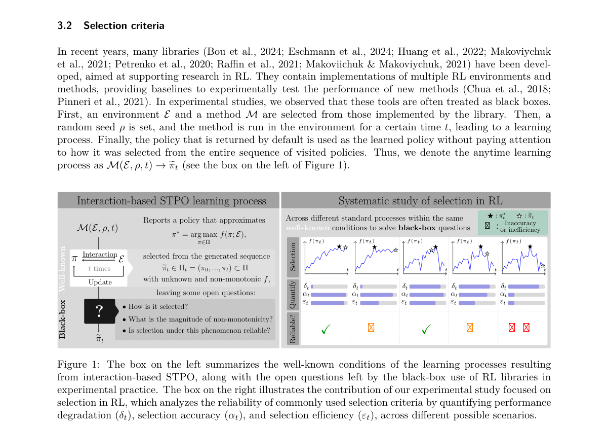

*Result - Examples of degradation δt (see Equa- tion 9) at different iterations, over 100 synthetic iterations of policy return.*

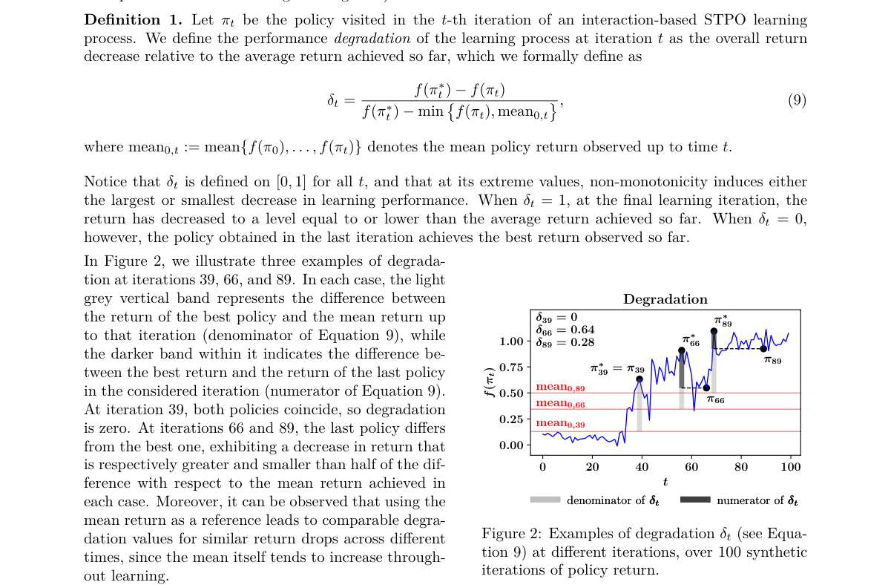

**Why this ranks #8**: 一篇方法学小文：RL 论文里「取最好的那个策略」这条惯例，可能跟真实最优策略差得很远。

---

### 9. Behavioural Quality Is Not Learning Utility: Objective Mismatch in Human Behaviour Models for Robot Learning

**arXiv**: [2610.34839](https://arxiv.org/abs/2610.34839) | **Score**: 8.0 (relevance 8.0 x 0.7 + quality 8.0 x 0.3) | **Tags**: rl-algorithm, multi-agent-rl, sim-to-real, human-behaviour-models, objective-mismatch, HRI, policy-training | **Categories**: cs.RO | **Pages**: 27

**Authors**: Haoyang Jiang, Dana Kulic, Michael Burke, Pamela Carreno-Medrano

**Affiliation**: Monash University

**Abstract**

> Human behaviour models are increasingly used to provide simulated human interactions for training robots via reinforcement learning (RL). Existing approaches primarily evaluate these models according to how closely their generated behaviours resemble real human data, while their usefulness as training partners is less commonly assessed. This creates a potential objective mismatch: a model that performs well according to behavioural evaluation metrics may not necessarily provide useful training experiences for downstream robot policy learning. Across two human-robot interaction (HRI) domains, highway driving and object handover, we evaluate different types of human behaviour models using common generative-model evaluation metrics. We consider multiple human trajectory representations and compare the resulting evaluations with the downstream performance of RL policies trained using the corresponding models. We find that existing behavioural evaluation metrics do not consistently predict downstream policy performance across domains and trajectory representations, while their evaluations are sensitive to the choice of trajectory representation. We also show that even when the true testing behaviour distribution is known, training against a different distribution may yield better downstream performance than training directly against the true distribution.

**Key findings**

- **Finding**: 人类行为模型越来越多地被用来提供模拟的人类交互，用于通过 RL 训练机器人。
- **Finding**: 既有做法主要用「生成行为与真人数据有多像」来评估这些模型，而它们作为训练伙伴是否有用很少被评估。
- **Finding**: 这造成一种潜在的目标错配：在行为评测指标上表现好的模型，未必能给下游机器人策略学习提供有用的训练经验。
- **Finding**: 作者在两个 HRI 领域（高速驾驶与物体交接）上，用常见的生成模型评测指标评估不同类型的人类行为模型。
- **Finding**: 考察了多种人类轨迹表示，并把评测结果与用对应模型训练的 RL 策略的下游表现做对比。
- **Finding**: 发现既有行为评测指标并不能一致地预测跨领域、跨轨迹表示的下游策略性能，且其评测对轨迹表示的选择很敏感。
- **Finding**: 还表明即便真实的测试行为分布已知，用另一个分布训练反而可能比直接用真实分布训练带来更好的下游性能。
- **Inference**: 「用假数据训出来的策略比用真数据训的更好」是一个反直觉但很有商业价值的结论——它意味着仿真器的「不真实」可以被当成一种正则化。
- **Inference**: 这篇实际上是在呼吁一个新的评测方向：人类行为模型应该用「下游效用」而非「分布相似度」来评。
- **Recommendation**: 推荐。做仿真到真实、人类建模或 RL 训练数据设计的值得读。

**Key figures**

*本篇未提取到可用图*

**Why this ranks #9**: 用「像不像真人」的指标评人类行为模型，往往与「拿来训策略好不好用」完全脱节，甚至真分布反而更差。

---

### 10. Enhancing Deep Reinforcement Learning for Robotic Motion Planning via Task Decomposition

**arXiv**: [2610.35494](https://arxiv.org/abs/2610.35494) | **Score**: 7.0 (relevance 7.0 x 0.7 + quality 7.0 x 0.3) | **Tags**: rl-algorithm, multi-agent-rl, sim-to-real, transfer-learning, reward-redesign, manipulation, planning | **Categories**: cs.RO | **Pages**: 9

**Authors**: Yuanzhi He, Victor Romero-Cano, Jiayu Xu, Juan David Hernández, Gualtiero Colombo

**Affiliation**: Cardiff University

**Abstract**

> Training robotic manipulation policies in simulation is widely adopted due to safety and cost efficiency; however, tasks involving obstacles remain under-performing and often converge slowly under Deep Reinforcement Learning (DRL). To address this challenge, we propose a task decomposition framework for DRL that integrates Transfer Learning (TL) with Reward Redesign (RR) to improve learning efficiency and robustness in obstacle environments. The TL strategy selectively transfers only the first-layer critic parameters across structurally related tasks, since that layer captures general state--action representations while deeper layers encode reward- and obstacle-specific value geometry; RR decomposes tasks into staged sub-objectives to provide denser optimization signals. Experiments on the PyBullet Panda platform show consistent gains in obstacle settings. On Push with obstacle, our method achieves $0.83 \pm 0.05$, outperforming the strongest baseline (Truncated Quantile Critics (TQC), $0.77 \pm 0.06$) by approximately $7.8\%$. On Slide with obstacle, performance reaches $0.95 \pm 0.02$, exceeding Soft Actor-Critic (SAC) ($0.84 \pm 0.06$) by about $11\%$ success rates. In addition to higher final performance, forward transfer reduces convergence time by up to $70\%$ in obstacle tasks, and RR shortens sparse-reward Pick-and-Place training from roughly $0.75$M to $0.20$M steps ($\approx73\%$ reduction). The best policy is deployed on a real Franka Emika FR3 robot as a qualitative feasibility demonstration.

**Key findings**

- **Finding**: 在仿真里训练机器人操作策略因安全与成本优势被广泛采用，但涉及障碍物的任务仍表现不佳、收敛缓慢。
- **Finding**: 作者提出结合迁移学习（TL）与奖励重设计（RR）的任务分解框架，以提升障碍环境下的学习效率与鲁棒性。
- **Finding**: TL 策略在结构相关的任务间只迁移 critic 的第一层参数——因为该层捕捉通用状态-动作表示，而更深的层编码奖励与障碍物特有的价值几何。
- **Finding**: RR 把任务分解为分阶段的子目标，提供更稠密的优化信号。
- **Finding**: 在 PyBullet Panda 平台上，障碍设定下取得一致增益：Push with obstacle 上 0.83 ± 0.05，比最强基线 TQC（0.77 ± 0.06）高约 7.8%。
- **Finding**: Slide with obstacle 上达到 0.95 ± 0.02，超过 SAC（0.84 ± 0.06）约 11% 成功率。
- **Finding**: 除了最终性能更高，前向迁移在障碍任务中把收敛时间最多缩短 70%，RR 把稀疏奖励 Pick-and-Place 的训练量从约 0.75M 步降到 0.20M 步（约减少 73%）。
- **Finding**: 最佳策略在真实 Franka Emika FR3 机器人上做了定性可行性演示。
- **Inference**: 「只迁移 critic 第一层」是个很节俭的迁移策略，也符合直觉：浅层学表示、深层学价值几何，跨任务复用的恰是前者。
- **Inference**: 稀疏奖励训练量降 73% 说明 reward redesign 的性价比往往高于换算法，对预算有限的团队更实用。
- **Recommendation**: 推荐。做操作策略、稀疏奖励或迁移学习的可读。

**Key figures**

*Framework - Reach (1st), Push (2nd), Pick&Place (3rd) and Slide (4th) in PyBullet Panda simulation, each with one red cube obstacle.*

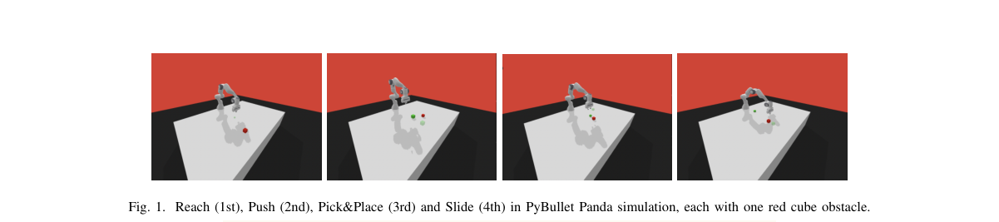

*Result - Transfer learning workflow with forward and reverse transfer across manipulation tasks in obstacle-free and obstacle environments. Weights and biases of the first layer of critic networks are*

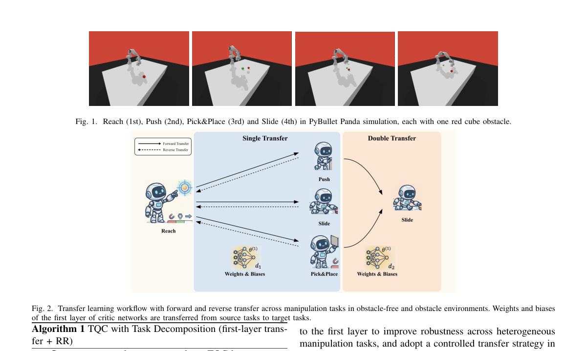

**Why this ranks #10**: 只迁移 critic 第一层参数 + 把任务拆成分阶段子目标，障碍场景成功率提升 7.8–11%，稀疏奖励训练量减少约 73%。

---

## Footer

- Total papers scanned across all 7 tracks: 546（原始 738 条）
- rl_core track final top-10: 10
- Wild-cards in this track: 0
- Figure assets: 2026-10-27/res/

Generated by `mine-arxiv-daily-digest` skill. Sister file: `2026-10-27_rl_core_entry.md`.
