# ArXiv Daily Digest - 2026-10-27 (LLM 后训练的强化学习, 10 papers)

**Generated**: 2026-10-27 17:00 CST

**Source**: arXiv cs.CV, cs.SD, eess.AS, cs.CL, cs.AI, cs.RO, cs.LG submissions, listing day 2026-10-26 (announced 2026-10-27 00:00 UTC)

**Batch window**: 2026-10-25T18:00:00Z .. 2026-10-26T18:00:00Z（arXiv 公告批次横跨两个 UTC 日：前一日 18:00 UTC 起算，当日 17:59:59 UTC 截止）

**Track**: rl_llm (top 10 of 546 papers scanned, 70 full reads)

**Scope**: RLHF / DPO / GRPO / RLAIF / RLVR 与 LLM 后训练（方法学优先）

---

## Top 10 - LLM 后训练的强化学习

### 1. S3AC: Stabilized, Selective, and Scalable Actor-Critic for LLM Reasoning

**arXiv**: [2610.35518](https://arxiv.org/abs/2610.35518) | **Score**: 9.7 (relevance 10.0 x 0.7 + quality 9.0 x 0.3) | **Tags**: rlhf, actor-critic, critic-training, token-level-credit, difficulty-aware-sampling, MoE | **Categories**: cs.CL, cs.LG | **Pages**: 17

**Authors**: Shuo Shen, Guangran Cheng, Chengqi Lyu, Xiangsen Wang, Yanan Sun, Wenwei Zhang

**Affiliation**: Shanghai AI Laboratory

**Abstract**

> Critic-free methods are widely used in reinforcement learning with verifiable rewards (RLVR) for long chain-of-thought (CoT) reasoning, avoiding difficult and costly critic training. Common alternatives lack token-level credit assignment and typically rely on grouped rollouts to estimate prompt-specific baselines. A critic can address both limitations, but long-CoT critic training is hindered by insufficient coverage of trajectories with diverse lengths and early gradients dominated by the newly initialized value head. We introduce S3AC (Stabilized, Selective, and Scalable Actor-Critic) for LLM reasoning, built around a practical critic-training recipe. The trained critic provides token-specific advantages and prompt-specific baselines. Using the prompt-level baseline to estimate difficulty, we propose Difficulty-Aware Prompt Sampling (DAPS). DAPS combines this estimate with outcome history to select prompts before generation, reducing rollout waste without offline difficulty initialization. S3AC improves group-rollout performance across dense and mixture-of-experts models from 1.5B to 397B parameters, outperforming a modern GRPO variant (GRPO-X). At 35B, it sustains single-rollout training while tested critic-free baselines deteriorate after initial gains.

**Key findings**

- **Finding**: RLVR 里 critic-free 方法（GRPO 一类）被广泛使用，避免了困难且昂贵的 critic 训练。
- **Finding**: 但这些替代方案缺乏 token 级信用分配，且通常依赖成组 rollout 来估计 prompt 级基线。
- **Finding**: critic 理论上能同时解决这两个问题，但长链 CoT 的 critic 训练受两点阻碍：轨迹长度多样导致覆盖不足，以及新初始化的 value head 让早期梯度被主导。
- **Finding**: 作者提出 S3AC（Stabilized, Selective, and Scalable Actor-Critic），围绕一套实用的 critic 训练配方构建。
- **Finding**: 训练出的 critic 提供 token 级优势与 prompt 级基线。
- **Finding**: 用 prompt 级基线估计难度，进而提出 Difficulty-Aware Prompt Sampling (DAPS)：把该估计与结果历史结合，在生成前选 prompt，减少 rollout 浪费且无需离线难度初始化。
- **Finding**: S3AC 在 1.5B 到 397B 的稠密模型与 MoE 模型上均优于组 rollout 方法，并超过一个现代 GRPO 变体（GRPO-X）。
- **Finding**: 在 35B 规模上，它能持续用单条 rollout 训练，而被测的 critic-free 基线在初期收益后退化。
- **Inference**: 「用 prompt 级基线顺便估计难度，再反过来选 prompt」是一个免费午餐：同一个 critic 既做信用分配又做采样策略，无需额外的难度标注。
- **Inference**: 单 rollout 在 35B 上仍能训练，说明 critic 的价值主要在降方差而非提样本量——这对预算受限的后训练是好消息。
- **Recommendation**: 推荐。做 RLVR、GRPO 改进或 LLM 后训练的必读。

**Key figures**

*Framework - Overview of S3AC for long-CoT RLVR. (a) Critic value pretraining and online updates (§3.3). (b) DAPS selects prompts using critic values and outcome history (§3.4). (c) S3AC uses token-level*

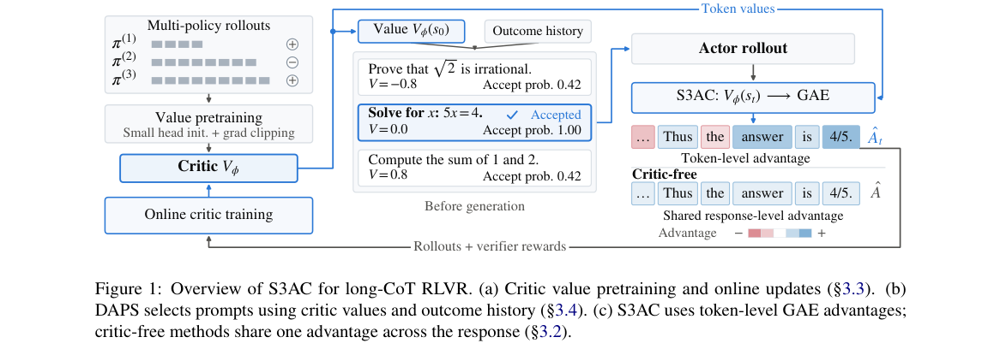

*Result - Prompt-conditioned values and advantages (35B single rollout). (a) Initial value versus held-out return. (b) Long failures (> 20K tokens), using length- adaptive GAE with α = 1.5.*

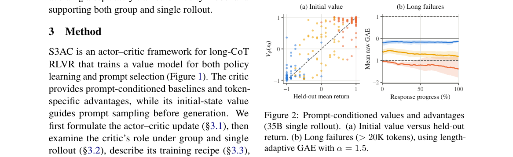

**Why this ranks #1**: 给 RLVR 补回被弃用的 critic，并在 397B 规模上同时解决长链 CoT 的信用分配与 rollout 浪费。

---

### 2. Audit Where Hacks Pay: Budgeted Strong-Verifier Audits Against Reward Hacking in GRPO

**arXiv**: [2610.35716](https://arxiv.org/abs/2610.35716) | **Score**: 9.7 (relevance 10.0 x 0.7 + quality 9.0 x 0.3) | **Tags**: rlhf, reward-hacking, GRPO, strong-verifier, budgeted-audit, IPW | **Categories**: cs.AI, cs.LG | **Pages**: 27

**Authors**: Shurun Li, Michael Hua Wang, Haibo Zeng, Long Wang

**Affiliation**: Tsinghua University

**Abstract**

> Reinforcement learning with verifiable rewards trains on cheap checks, such as unit tests, that a policy can learn to game, while a stronger check is too expensive to run on every rollout. We study how to spend a limited strong-verifier budget in GRPO, separating which weakly passing rollouts to audit from what reward a caught hack receives. At a fixed policy state with centered advantages, the expected update depends on a design only through each rollout's marginal audit probability and correction; reflecting a caught hack's reward about the failure reward negates the advantages of an all-hack group; and auditing whole groups with the fewest weak passes first (low-pass budgeted audits, LB) minimizes the advantage mass left on hacks among pass-count designs with a fixed correction when a label's value falls with the pass count. We tested this analysis in actual LLM training: from each run's starting state, the sign of this mass on a frozen panel predicted whether hacking would be suppressed in 33 of 39 runs, including 13 of 16 preregistered ones. In LeetCode (Wong et al., 2026) and Countdown-Code (Khalifa et al., 2026), LB drives hacking to near zero, while random audits with the same penalty and budget do not and use more labels. We also find that the randomness of the update affects training: in Countdown-Code, two unbiased corrections, per-item reward-level IPW and a group-level advantage correction, bring hacking down too but end 6.1-11.8 and 8.0-11.5 points lower in held-out accuracy than LB at the same budget. A full audit, which the group-level correction reproduces in expectation, stays within about two points of LB in three seeds, while LB uses 28% of its labels, and allocating the same correction by pass count recovers most of the loss (one seed). Training outcomes thus depend not only on the expected update but also on the randomness of its estimate.

**Key findings**

- **Finding**: RLVR 训练在廉价检查（如单元测试）上，策略会学会钻这些检查的空子；而更强的检查太贵，无法对每次 rollout 都跑。
- **Finding**: 作者研究在 GRPO 中如何花掉有限的强验证器预算，区分「审计哪些弱通过 rollout」与「被抓到的黑客该得多少奖励」两个设计。
- **Finding**: 在固定策略状态与中心化优势下，期望更新只通过每个 rollout 的边际审计概率与修正量依赖这两项设计。
- **Finding**: 把被抓到黑客的奖励围绕失败奖励做反射会抵消「全组都是黑客」情形的优势。
- **Finding**: 在标签价值随通过数下降时，优先审计弱通过数最少的组（low-pass budgeted audits，LB）能在固定修正量下最小化留在黑客身上的优势质量。
- **Finding**: 在真实 LLM 训练中验证：从每次运行的起始状态出发，一个冻结面板上该优势质量的符号在 39 次运行中的 33 次预测了奖励黑客会被压制，其中包含 16 次预注册运行中的 13 次。
- **Finding**: 在 LeetCode 与 Countdown-Code 上，LB 把黑客压到接近零，而同惩罚同预算的随机审计做不到，且用掉更多标签。
- **Finding**: 更新的随机性本身也影响训练：Countdown-Code 上两种无偏修正（逐样本奖励级 IPW 与组级优势修正）同样压下黑客，但留出准确率比 LB 低 6.1–11.8 与 8.0–11.5 个百分点。
- **Finding**: 全量审计（组级修正在期望上复现它）在三个种子上与 LB 相差约两个百分点，而 LB 只用了其 28% 的标签；按通过数分配同样修正可挽回大部分损失（一个种子）。
- **Finding**: 结论是训练结果不仅取决于期望更新，还取决于其估计的随机性。
- **Inference**: 这是本批次最扎实的一篇 RL 论文——它把「奖励黑客」从工程试错变成了一个有最优解的预算分配问题。
- **Inference**: 「组级修正在期望上等于全量审计」这一等价关系让「要不要全审」变成了一个纯粹的预算问题，非常实用。
- **Recommendation**: 推荐。做 RLVR、奖励建模或要防奖励黑客的必读。

**Key figures**

*Framework - Low-pass budgeted audits (LB). (a) Groups of a batch sorted by their number of weak passes 𝑘: LB audits whole groups, fewest weak passes first, until a fraction 𝑝of the weak passes has been*

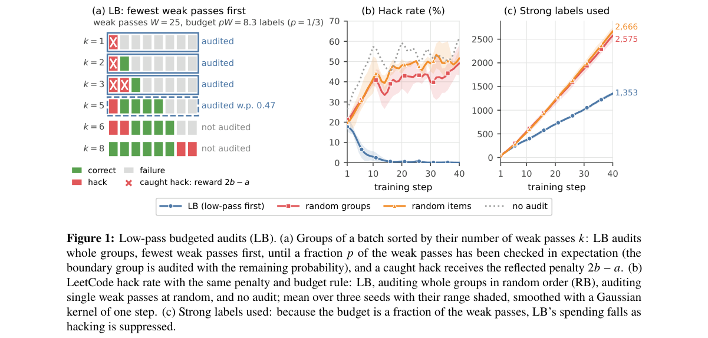

*Result - The two mechanisms behind LB, for a group of 𝐾= 16 responses with LeetCode rewards (𝑎= 3.5, 𝑏= 0.5, normalized advantages). (a) The advantage of an uncaught hack among 𝑘weak passes,*

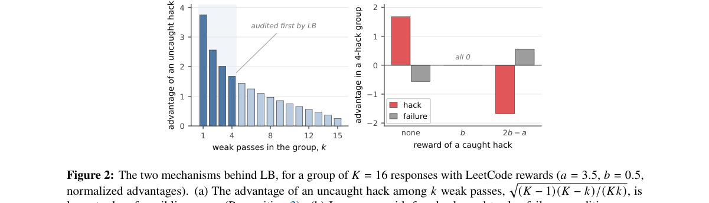

**Why this ranks #2**: 把「强验证器预算怎么花」变成可推导的最优问题：优先审计弱通过数最少的组，能把 GRPO 的奖励黑客压到接近零。

---

### 3. FOCUS: Active Critic Learning for Long-Horizon Language Model Agents

**arXiv**: [2610.35801](https://arxiv.org/abs/2610.35801) | **Score**: 9.0 (relevance 9.0 x 0.7 + quality 9.0 x 0.3) | **Tags**: rlhf, agentic-RL, active-learning, critic, TD-lambda, long-horizon | **Categories**: cs.LG | **Pages**: 32

**Authors**: Zhengping Jiang, William Jurayj, Liaoyaqi Wang, Chunsheng Zuo, Anqi Liu, Benjamin Van Durme

**Affiliation**: Johns Hopkins University

**Abstract**

> Sparse outcome rewards make it difficult for long-horizon language-model agents to assign credit to earlier actions. Learned critics provide value estimates for intermediate states, but these estimates can be inaccurate, while estimating intermediate values with repetitive continuation samples from points within a trajectory incurs substantial costs. To mitigate these issues, we introduce FOCUS, an RL method that uses selective branching to help the critic network learn its value estimator. The rollout controller facilitates active learning for the critic by sampling continuations from states that are expected to most reduce the critic's estimation error. These refined value estimates then score the segment between consecutive states with a TD($λ$) advantage, while the sampled evidence supplies training targets for the critic. FOCUS supports long-horizon agentic reinforcement learning through a modular context-management interface that decouples context management from rollout allocation. Our experiments show that using compaction-induced segment boundaries for value estimation and credit assignment, FOCUS outperforms GRPO and VinePPO with matched per-step generation budgets on legal reasoning, deep search, and code localization benchmarks, improving held-out accuracy at Qwen3.5-9B scale by 7.2 points over the strongest baseline on BrowseComp-Plus (55.4 vs. 48.2) and by 4.1 points on DeonticBench (56.5 vs. 52.4).

**Key findings**

- **Finding**: 稀疏结果奖励让长程语言模型智能体难以把信用分配给更早的动作。
- **Finding**: 学习到的 critic 能给出中间状态的价值估计，但这些估计可能不准；而用重复的续写采样去估计中间价值代价高昂。
- **Finding**: 作者提出 FOCUS，一种用选择性分支帮助 critic 学习其价值估计器的 RL 方法。
- **Finding**: rollout 控制器从「预期最能降低 critic 估计误差」的状态出发采样续写，实现对 critic 的主动学习。
- **Finding**: 这些精化后的价值估计用 TD(λ) 优势为相邻状态之间的片段打分，而采样到的证据同时作为 critic 的训练目标。
- **Finding**: FOCUS 通过一个模块化的上下文管理接口支持长程智能体 RL，把上下文管理与 rollout 分配解耦。
- **Finding**: 用压缩引起的片段边界做价值估计与信用分配时，FOCUS 在相同每步生成预算下优于 GRPO 与 VinePPO。
- **Finding**: 在法律推理、深度搜索与代码定位基准上，Qwen3.5-9B 规模的留出准确率在 BrowseComp-Plus 上比最强基线高 7.2 个百分点（55.4 vs 48.2），在 DeonticBench 上高 4.1 个百分点（56.5 vs 52.4）。
- **Inference**: 「让 critic 主动选采样点」把 critic 从被动打分器变成主动的实验者——这是把主动学习搬进 RL 内部的一次漂亮迁移。
- **Inference**: 复用压缩边界作为片段边界是个极低成本的工程复用：上下文压缩本来就要做，顺带给了信用分配自然的分段。
- **Recommendation**: 推荐。做 agentic RL、critic 训练或长程智能体的必读。

**Key figures**

*Framework - Overview of the proposed FOCUS rollout scheduler for a deep-research-style problem. FOCUS continues working on a rollout tree. At each iteration, FOCUS STEP 1: takes an expanded tree; STEP 2*

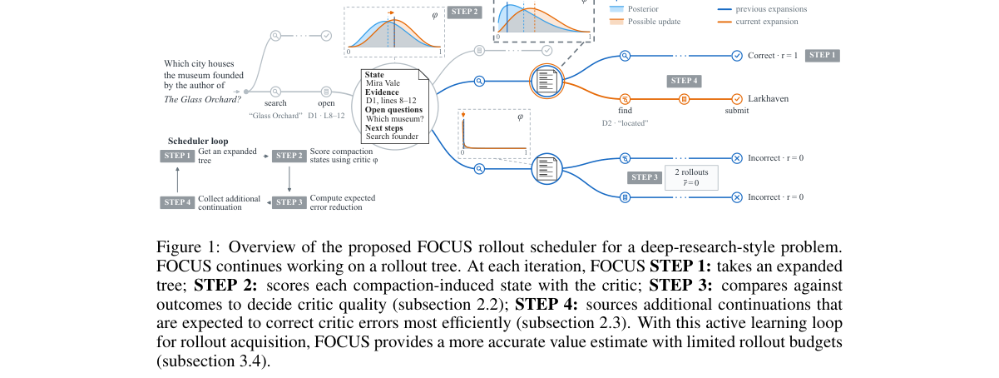

*Result - Preliminary evaluation with Qwen3.5-4B on MATH Level 4–5. Accuracy and the mean number of generated tokens per evaluation question are shown at the base checkpoint (update 0) and after 8, 16*

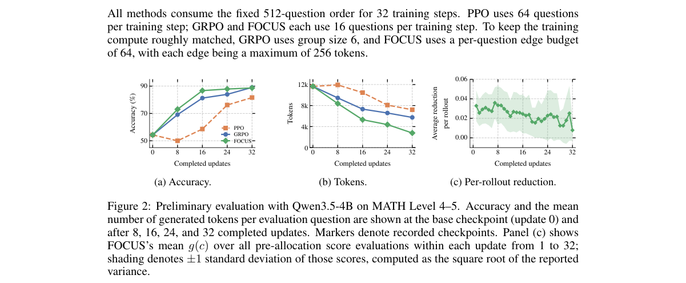

**Why this ranks #3**: 让 critic 自己决定去哪采样续写，把长程智能体的价值估计误差降下来，BrowseComp-Plus 上领先最强基线 7.2 分。

---

### 4. Audio-R1: Audio Reasoning through Reinforcement Learning on Self-Supervised Tasks

**arXiv**: [2610.34609](https://arxiv.org/abs/2610.34609) | **Score**: 9.0 (relevance 9.0 x 0.7 + quality 9.0 x 0.3) | **Tags**: rlhf, audio-LM, RLVR, verifiable-reward, self-supervised-tasks, audio-reasoning | **Categories**: cs.AI, cs.SD, eess.AS | **Pages**: 12

**Authors**: Jihoon Jeong, Mirco Ravanelli, Zhepei Wang, Cem Subakan

**Affiliation**: Mila-Quebec AI Institute; Universite Laval; Concordia University; Adobe Research

**Abstract**

> Reasoning is increasingly important for large audio-language models (LALMs), yet remains relatively underexplored compared with text-only and vision-language models. We introduce Audio-R1, a reinforcement learning (RL) post-training framework that revisits audio self-supervised learning as a source of verifiable rewards for improving audio understanding and reasoning task performance. Audio-R1 uses answers automatically determined during the construction of self-supervised tasks to verify model responses and compute rewards. Experiments across multiple LALMs and diverse audio benchmarks show consistent performance gains, while ablations demonstrate the benefits of each self-supervised task and additional gains from joint training. While both supervised fine-tuning and Audio-R1 improve self-supervised task accuracy, Audio-R1 further improves performance on downstream tasks distinct from the training tasks. These results highlight the potential of RL post-training with self-supervised audio tasks to improve downstream performance and reasoning-trace quality.

**Key findings**

- **Finding**: 推理对大音频语言模型（LALM）越来越重要，但相较纯文本与视觉语言模型仍明显欠探索。
- **Finding**: 作者提出 Audio-R1，一个 RL 后训练框架，重新审视音频自监督学习作为可验证奖励的来源。
- **Finding**: Audio-R1 使用自监督任务构造过程中就已确定的答案来验证模型响应并计算奖励。
- **Finding**: 在多个 LALM 与多个音频基准上实验，取得一致的性能提升；消融显示各自监督任务各有贡献，联合训练带来额外增益。
- **Finding**: 监督微调与 Audio-R1 都能提升自监督任务准确率，但 Audio-R1 还能进一步提升与训练任务不同的下游任务。
- **Finding**: 结论是「用自监督音频任务做 RL 后训练」有提升下游表现与推理轨迹质量的潜力。
- **Inference**: 「自监督任务自带答案」是 RLVR 里最理想的奖励来源——天然可验证、零标注成本、且答案在构造时即被确定。
- **Inference**: 下游任务（不同于训练任务）也涨这一点比自监督任务本身涨更有说服力，说明学到的是可迁移的推理能力而非任务记忆。
- **Recommendation**: 推荐。做音频 LM、RLVR 或多模态后训练的必读。

**Key figures**

*Framework - Audio-R1 framework and self-supervised task construction. Left: Raw audio is transformed into task instances with answers known by construction, which are used to verify model responses and co*

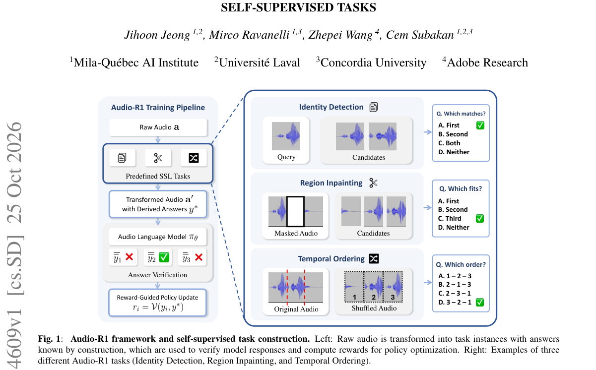

*Result - Accuracy comparison before and after Audio-R1 across different LALMs. Radar plots show performance on three self- supervised tasks and three downstream benchmarks.*

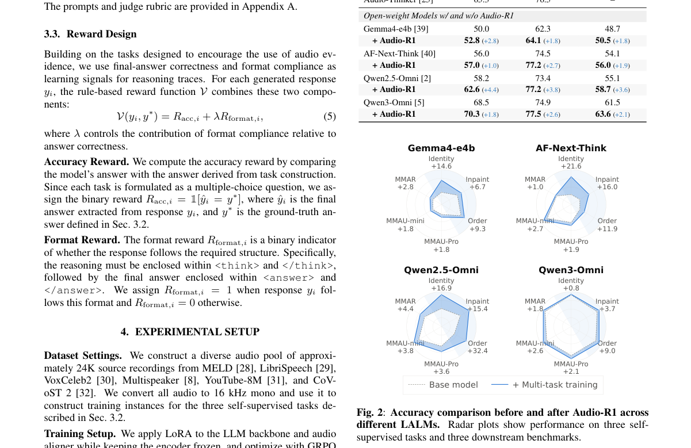

**Why this ranks #4**: 把音频自监督任务里天然已知的答案当成可验证奖励，Audio-R1 无需额外标注就能提升 LALM 的推理与迁移。

---

### 5. Improving Reasoning with Rollout Agreement for Group-Based Policy Optimization

**arXiv**: [2610.34951](https://arxiv.org/abs/2610.34951) | **Score**: 8.7 (relevance 9.0 x 0.7 + quality 8.0 x 0.3) | **Tags**: rlhf, GRPO, RLVR, rollout-diversity, reasoning-validity, process-reward | **Categories**: cs.CL, cs.LG | **Pages**: 21

**Authors**: Sohyun Son, Yerim Hong, Jaeyun Park, Mujeen Sung

**Affiliation**: Kyung Hee University

**Abstract**

> Recent methods for Reinforcement Learning with Verifiable Rewards (RLVR) use rollout diversity to improve reasoning performance or training efficiency. Despite these gains, the extent to which differences among correct-answer rollouts reflect useful alternative reasoning or unresolved errors remains poorly understood. We investigate this question through a blind paired analysis of a model trained with Group Relative Policy Optimization (GRPO), comparing the highest- and lowest-agreement correct-answer traces for the same problem. Across 126 pairs, low-agreement traces have more spurious reasoning than high-agreement traces (35% vs. 22%), including internal inconsistencies and misuse of problem conditions. Based on these findings, we propose RoAR (Rollout-Agreement Reward), which adds reasoning-level agreement to GRPO's rewards for verified-correct rollouts. RoAR computes this signal from existing on-policy rollout groups, requiring no human-written rationales, additional sampling, or separately trained process evaluator. On five mathematical reasoning benchmarks, the 1.5B GRPO-RoAR model reaches 55.5% mean pass@1 under zero-shot evaluation using 7K training examples, exceeding GRPO and GRPO-CARE by 6.0 and 5.5 percentage points. A separate blind audit of 100 problems answered correctly by all four 1.5B models finds spurious rates of 18% for GRPO-RoAR, 32% for GRPO, 27% for GRPO-CARE, and 37% for DRA-GRPO. Our findings identify reasoning validity as an important consideration when using rollout differences to guide learning. Our code is available at https://github.com/ldi-kyunghee/RoAR.

**Key findings**

- **Finding**: 近期 RLVR 方法用 rollout 多样性来提升推理性能或训练效率，但正确答案 rollout 之间的差异究竟反映有用的替代推理还是未解决的错误，仍不清楚。
- **Finding**: 作者用 GRPO 训练的模型做盲审配对分析，比较同一道题下最高与最低一致度的正确解答轨迹。
- **Finding**: 在 126 对样本中，低一致度轨迹的虚假推理明显多于高一致度轨迹（35% vs 22%），包括内部矛盾与对题目条件的误用。
- **Finding**: 基于此提出 RoAR（Rollout-Agreement Reward），在已验证正确的 rollout 的奖励中加入推理层的一致度。
- **Finding**: RoAR 从既有的 on-policy rollout 分组计算该信号，不需要人工书写的理由、额外采样或单独训练的流程评估器。
- **Finding**: 在五个数学推理基准上，1.5B 的 GRPO-RoAR 模型用 7K 条训练样本零样本评估达到 55.5% 平均 pass@1，比 GRPO 与 GRPO-CARE 高 6.0 与 5.5 个百分点。
- **Finding**: 对四个 1.5B 模型全部答对的 100 道题做独立盲审，虚假推理率为 GRPO-RoAR 18%、GRPO 32%、GRPO-CARE 27%、DRA-GRPO 37%。
- **Finding**: 结论是推理有效性是用 rollout 差异指导学习时必须考虑的重要维度。代码开源。
- **Inference**: 「一致度」这个信号完全来自已有的 rollout 分组，零额外成本——这是本篇最有工程价值的一点。
- **Inference**: 盲审里 GRPO-RoAR 的虚假推理率最低（18%），说明奖励不仅提分还提质，方向对了。
- **Recommendation**: 推荐。做 GRPO、推理后训练或 RLVR 奖励设计的必读。

**Key figures**

*Framework - Different traces can reach the same correct answer. Blind paired analysis of the highest- and lowest- agreement verified-correct traces for each of 126 prob- lems from a GRPO-trained 1.5B mo*

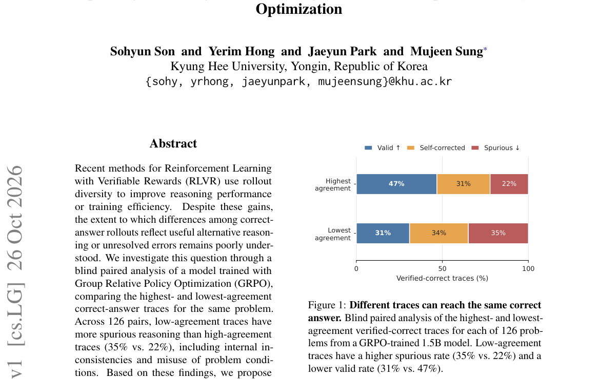

*Result - Internal inconsistency shows the largest error-rate gap between agreement groups. Error-rate differences in the 126 paired comparisons are computed as lowest agreement minus highest agreemen*

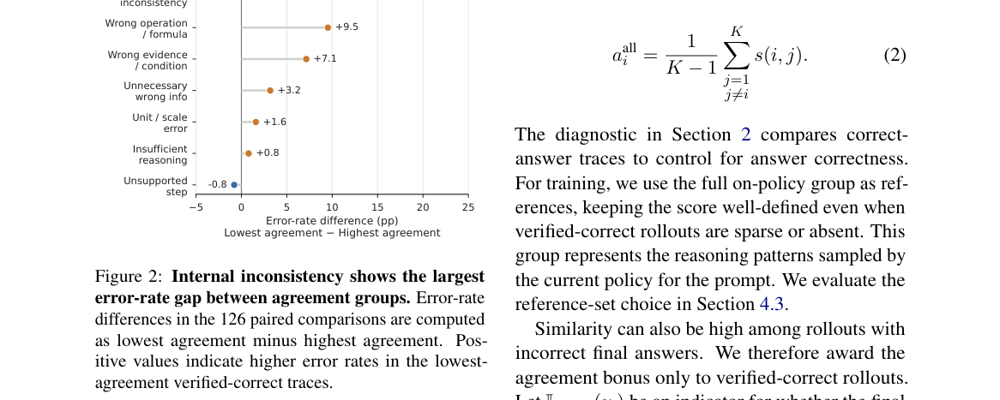

**Why this ranks #5**: 用现成的 rollout 分组算出「同题不同解的一致度」当奖励，1.5B 模型零样本 pass@1 就到 55.5%，盲审虚假推理率反而最低。

---

### 6. Correlation-Aware Exploration for Long-Trace Reasoning

**arXiv**: [2610.34949](https://arxiv.org/abs/2610.34949) | **Score**: 8.7 (relevance 9.0 x 0.7 + quality 8.0 x 0.3) | **Tags**: rlhf, GRPO, entropy-regularization, exploration, long-trace, policy-collapse | **Categories**: cs.AI, cs.CL, cs.LG | **Pages**: 28

**Authors**: Junxing Hu, Zicheng Zhang, Zhiqian Zhang, Ai Han, Yifeng Zhang, Pengzhang Liu, Ling Li

**Affiliation**: JD.com; Microsoft

**Abstract**

> Reasoning models trained with Group Relative Policy Optimization (GRPO) now produce chains of thought thousands of tokens long, and recent studies reveal that such training is prone to policy collapse. Entropy regularization is the standard remedy, but it works by pushing probability mass away from the few tokens that carry it and toward the vast low-probability tail of the vocabulary, and it applies this force once for every token of the reasoning trace. This puts the bonus in direct conflict with the entropy decay that convergence requires, and makes its coefficient difficult to set in the long-trace regime. To resolve this tension, we propose Info-GRPO, an information-theoretic framework that cultivates correlation between the policy and a latent prior. Rather than raising entropy everywhere, Info-GRPO builds on the mutual information between a latent variable and the trajectory it induces: augmenting prompts with latent seeds during training lets the model explore diverse policies correlated with the prior, while the seed-conditioned entropy is guided toward convergence. Diversity is therefore carried across whole reasoning traces rather than by per-token randomness, and exploration no longer fights entropy reduction. Experiments show that Info-GRPO outperforms vanilla GRPO and entropy-regularized GRPO across diverse reasoning benchmarks. On AIME24, it improves $Avg@8$ over GRPO by 3.75%, 1.66%, 4.16%, and 4.17% on four backbones, and it reaches the same majority-vote accuracy with $8\times$ fewer samples. Code and models will be publicly released.

**Key findings**

- **Finding**: 用 GRPO 训练的推理模型现在能产生数千 token 的思维链，而研究表明这种训练容易导致策略崩塌。
- **Finding**: 熵正则化是标准补救，但它把概率质量从少数承载信息的 token 推向词表里庞大的低概率尾部，并且对推理轨迹的每个 token 都施加一次这个力。
- **Finding**: 这让熵奖励与收敛所需的熵衰减直接冲突，在长轨迹设定下系数也很难调。
- **Finding**: 为化解这一张力，作者提出 Info-GRPO，一个信息论框架，培养策略与一个隐式先验之间的相关性。
- **Finding**: Info-GRPO 基于隐变量与其诱导轨迹之间的互信息：训练时用隐式种子增广 prompt，让模型探索与先验相关联的 diverse 策略，同时把种子条件熵引向收敛。
- **Finding**: 多样性因此由整条推理轨迹承载，而非逐 token 的随机性，探索不再与熵缩减相冲突。
- **Finding**: 在多个推理基准上优于 vanilla GRPO 与熵正则化 GRPO；AIME24 上相对 GRPO 的 Avg@8 在四个骨干上分别提升 3.75%、1.66%、4.16%、4.17%。
- **Finding**: 用 8 倍更少的采样即可达到相同的多数投票准确率。代码与模型将公开。
- **Inference**: 把熵奖励从「逐 token 推动」改成「整轨迹层面的隐变量条件化」，绕开了与收敛的根本冲突——这是本篇最漂亮的转换。
- **Inference**: 「8 倍更少采样达到同等多数投票准确率」意味着同样算力下可以跑更多独立轨迹，对需要长推理的模型是实打实的收益。
- **Recommendation**: 推荐。做 GRPO、推理训练或长轨迹稳定性问题的必读。

**Key figures**

*本篇未提取到可用图*

**Why this ranks #6**: 不再给每个 token 加熵，而是让整条推理轨迹朝一个隐变量先验去探索，AIME24 上 Avg@8 提升 3.75–4.17%。

---

### 7. Integrate the Reward, Don't Sample It: Window Likelihood for Interruptions and Backchannels in Full-Duplex Speech Models

**arXiv**: [2610.35581](https://arxiv.org/abs/2610.35581) | **Score**: 9.0 (relevance 9.0 x 0.7 + quality 9.0 x 0.3) | **Tags**: rlhf, GRPO, audio-LM, duplex-voice, credit-assignment, turn-taking | **Categories**: cs.CL, cs.SD, eess.AS | **Pages**: 14

**Authors**: Guoqiang Hu, Lichao Zhang, Yizhou Peng, Yuhao Luo, Haifeng Hu, Sallen Sun, Will Yang, Eng Siong Chng

**Affiliation**: Nanyang Technological University; Tencent

**Abstract**

> A full-duplex spoken dialogue model must yield when the user cuts in and hold when the user merely backchannels. Sequence-level RL with a timing reward (GRPO) is the usual recipe; we test its whole-rollout form on four open models and find two failures. A binary window reward gives zero advantage on exactly the windows that most need learning (a zero-gradient trap), and the one score per rollout is spread over listening-state decisions the reward is not written in terms of (credit leakage), so the model talks into silence or stops answering. Both come from sampling a reward that is a known function of a few binary control decisions. We propose \emph{window likelihood} (\WL): sample a continuation per window, but integrate in closed form over the stop decisions it visits and maximise the log-probability of acting correctly---a noisy-OR for yielding, a survival product for holding. On HumDial-FDBench, \WL\ gives the best yield/hold F1 on all six structurally different open models we post-train, exceeds Kyutai's released GRPO checkpoints (trained on different data), and adds no re-opening of the floor on any model.

**Key findings**

- **Finding**: 全双工口语对话模型必须在用户打断时让出话权、在用户只是附和时保持话权。
- **Finding**: 带时序奖励的序列级 RL（GRPO）是常见配方；作者在四个开源模型上测试其 whole-rollout 形式，发现两处失败。
- **Finding**: 第一是二值窗口奖励在**最需要学习**的窗口上给出零优势——零梯度陷阱。
- **Finding**: 第二是每条 rollout 只打一个分，被摊到奖励本身并未针对的听音状态决策上——信用泄漏，导致模型要么对着沉默说话、要么停止作答。
- **Finding**: 两者都源于「采样一个已知是少数几个二值控制决策的函数的奖励」。
- **Finding**: 作者提出 window likelihood (WL)：每个窗口采样一个续写，但对其经过的停止决策做闭式积分，并最大化「正确行动」的对数似然——让出用 noisy-OR，保持用生存乘积。
- **Finding**: 在 HumDial-FDBench 上，WL 在所后训练的六个结构各异的开源模型上都取得最好的 yield/hold F1。
- **Finding**: 超过 Kyutai 发布的 GRPO 检查点（训练数据不同），且在任何模型上都不额外重开话权。
- **Inference**: 「奖励是少数离散决策的已知函数，就不该采样它而该积分它」是一个可以推广到任何离散决策型 RL 的原则，零梯度陷阱在很多场景都有影子。
- **Inference**: 这篇与 Info-GRPO 恰好是同一问题的两面：前者是奖励形式设计，后者是探索机制设计，共同指向「RLVR 里的离散信号被当成连续信号处理」的通病。
- **Recommendation**: 推荐。做全双工语音 RL、GRPO 改造或离散决策奖励设计的必读。

**Key figures**

*Framework - One event window, two ways to learn from it. Top: the user interjects while the model is speaking; inside the 2-s window the model makes a few binary stop decisions p1, . . . , pK, and the w*

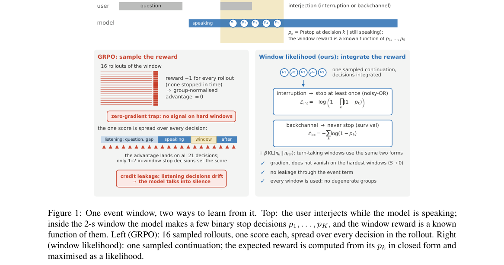

*Result - Learning signal on one window against its stop probability S under the current policy. Top: probability that a GRPO group of G rollouts is informative. Mid- dle: WL gradient magnitude P*

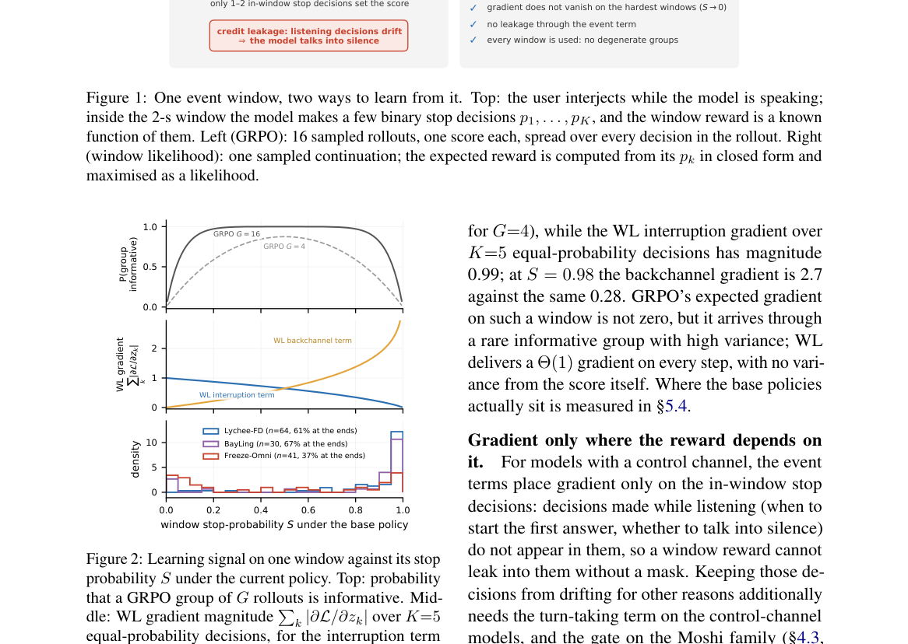

**Why this ranks #7**: 指出全双工语音模型上 GRPO 的两种结构性失败，把「采样奖励」换成「对奖励做闭式积分」，在六个模型上改进 yield/hold F1。

---

### 8. Multiscale Policy Optimization for Long-Horizon LLM Agents

**arXiv**: [2610.35013](https://arxiv.org/abs/2610.35013) | **Score**: 8.0 (relevance 8.0 x 0.7 + quality 8.0 x 0.3) | **Tags**: rlhf, GRPO, agentic-RL, long-horizon, advantage-estimation, turn-level | **Categories**: cs.AI | **Pages**: 37

**Authors**: Tao Ren, Hui Yang, Jia Deng, Tingyang Chen, Qiyao Wang, Shuo Tang, Ziyang Zeng, Yuhua Jiang, Guanghao Li, Huatong Song, Yining Li, Yifan Luo

**Affiliation**: Peking University; IQuest Research; Tsinghua University; Renmin University of China; The University of Hong Kong

**Abstract**

> Long-horizon LLM agents interact with their environments through complete assistant turns while generating each action token by token. We observe that critic values vary primarily across turns, motivating optimization anchored at turns with finer credit allocation among tokens. We propose Multiscale Policy Optimization (MPO), combining Multiscale Advantage Estimation (MAE) and turn-level importance sampling to align credit assignment and policy updates at the turn scale. Extensive experiments across search, tool-use, and automation tasks with 4B and 30B-A3B models demonstrate consistent gains over strong RL baselines.

**Key findings**

- **Finding**: 长程 LLM 智能体通过完整的助手轮次与环境交互，同时在每个动作上逐 token 生成。
- **Finding**: 作者观察到 critic 的价值主要在轮之间变化，这促使把优化锚定在轮上，同时在 token 之间做更细的信用分配。
- **Finding**: 提出 Multiscale Policy Optimization (MPO)，结合 Multiscale Advantage Estimation (MAE) 与轮级重要性采样，让信用分配与策略更新在轮尺度上对齐。
- **Finding**: 在搜索、工具使用与自动化任务上，用 4B 与 30B-A3B 模型做大量实验，相对强 RL 基线取得一致增益。
- **Inference**: 「critic 值主要跨轮变化」这个观察意味着 critic 其实是个粗粒度模块，硬要它做 token 级价值估计是错配的。
- **Inference**: 轮尺度锚定 + token 级细分配的双尺度设计，比单纯的 turn-level 或 token-level 任一单一尺度都更贴合实际。
- **Recommendation**: 推荐。做 agentic RL 或长程智能体 credit assignment 的值得读。

**Key figures**

*Framework - Overview of Multiscale Policy Optimization (MPO). Agents interact through complete assistant turns while generating actions token by token. MAE refines shared turn advantages into token-leve*

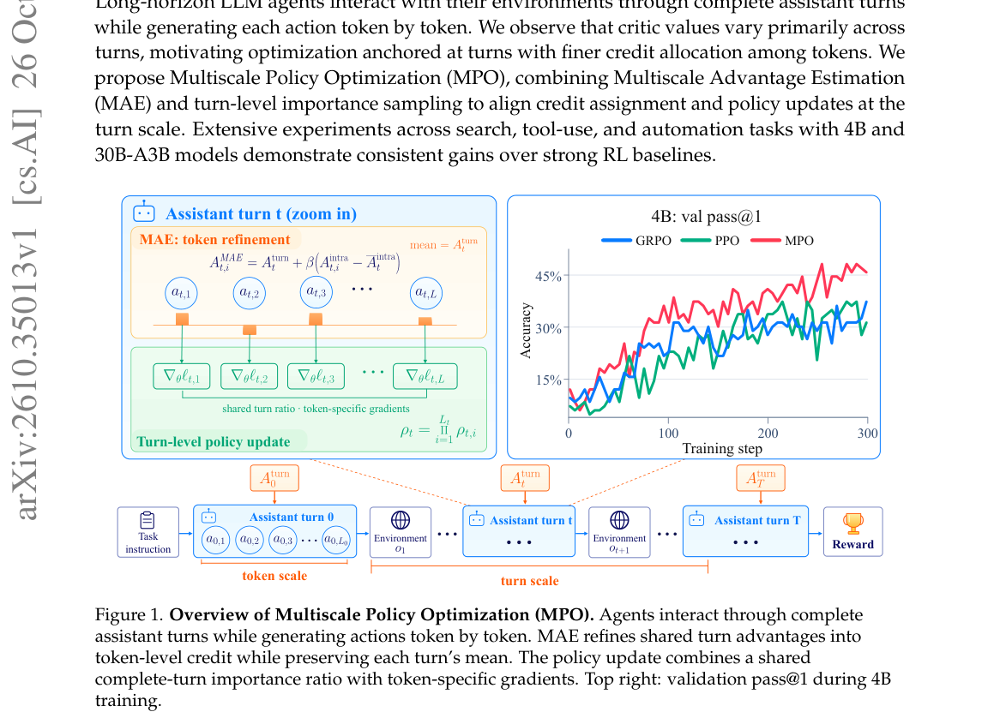

*Result - Critic values exhibit structure at the turn scale. A failed trajectory (a) and a successful trajectory (b) both exhibit relatively stable values within turns and pronounced changes across tu*

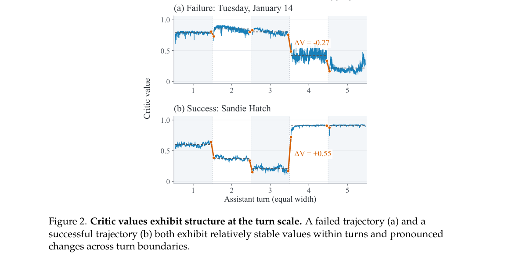

**Why this ranks #8**: 发现 critic 的价值主要在「轮」之间变化，于是把优化锚定在轮尺度、token 间再做细粒度分配。

---

### 9. End-to-End MXFP8 Reinforcement Learning on Blackwell: What Matching Buys, When It Pays Off, and How It Fails

**arXiv**: [2610.34915](https://arxiv.org/abs/2610.34915) | **Score**: 8.0 (relevance 8.0 x 0.7 + quality 8.0 x 0.3) | **Tags**: rlhf, systems, FP8, low-precision, Blackwell, sampler-learner-mismatch | **Categories**: cs.LG | **Pages**: 36

**Authors**: Wengee Zhang

**Affiliation**: wengeezhang@gmail.com

**Abstract**

> Low-precision arithmetic can make reinforcement learning (RL) for large language models cheaper, but RL requires the sampler and the learner to agree. Several frameworks now run FP8 on both sides. We implement end-to-end MXFP8 RL in verl (Megatron/Transformer Engine training; vLLM and SGLang rollout; dense and MoE models) and measure on B200 GPUs, with Qwen3-8B and Qwen3-30B-A3B, what this design buys, when it is faster, and how it fails. (1) Matching. For an MXFP8 learner, a sampler on the learner's grid is more consistent than a higher-precision BF16 sampler: in one engine at fixed weights, train-rollout KL is 11% lower with half of the sampler's linear layers on the grid and 16% lower with all of them, and the synchronized weights we checked equal the learner's FP8 forward weights byte for byte. On the MoE model, an FP8 pipeline whose sampler uses another grid has twice the shared-grid pipeline's KL from the first step. Without a quantized KV cache, BF16 end to end remains 2.5-10x more consistent. (2) Speed. MXFP8 training adds a fixed cost per micro-batch and saves a per-token cost, so in our dense setting it pays off only above about 4.5k tokens per micro-batch; a micro-batch sweep on identical data confirms the per-micro-batch cost, and a trace shows the GPU waiting for the host for most of the added time. End to end, MXFP8 cuts MoE step time by 10.7% and generation time by 24%, and slows a short-sequence dense workload by 5%. (3) Correctness. We state seven conditions every weight synchronization must preserve and checks that test them against the live engine. Each of the seven failures we met on hardware broke one condition, five silently; the checks caught two at their first opportunity, each missed by the other checks, and CPU fault-injection tests reproduce five. All runs are single-seed and at most 60 steps long; we make no claim about final model quality.

**Key findings**

- **Finding**: 低精度算术能让 LLM 的 RL 更便宜，但 RL 要求采样器与学习器保持一致；当前多个框架在两侧都跑 FP8。
- **Finding**: 作者在 verl（Megatron/Transformer Engine 训练、vLLM 与 SGLang rollout）上实现端到端 MXFP8 RL，在 B200 GPU 上用 Qwen3-8B 与 Qwen3-30B-A3B 测量收益、适用条件与失败模式。
- **Finding**: 匹配方面：对 MXFP8 学习器而言，采样器跑在学习器的网格上比更高精度的 BF16 采样器更一致——同一引擎、权重固定时，采样器一半线性层落在网格上使 train-rollout KL 降低 11%，全部落在网格上降低 16%；检查的同步权重与学习器的 FP8 前向权重逐字节相同。
- **Finding**: 在 MoE 模型上，使用另一网格的 FP8 管线从第一步起就有同网格管线两倍的 KL。
- **Finding**: 若不量化 KV cache，BF16 端到端仍一致性高 2.5–10 倍。
- **Finding**: 速度方面：MXFP8 训练每个 micro-batch 增加固定成本、每 token 节省成本，在其稠密设定下只有当每 micro-batch 超过约 4.5k token 才划算；同数据的 micro-batch 扫描证实了每 micro-batch 成本，trace 显示 GPU 大部分新增时间在等主机。
- **Finding**: 端到端上，MXFP8 把 MoE 的 step 时间削减 10.7%、生成时间削减 24%，但让短序列稠密负载变慢 5%。
- **Finding**: 正确性方面，作者陈述了每次权重同步必须满足的七个条件，并写检查在活引擎上测试它们。
- **Finding**: 在硬件上遇到的七个失败各破坏其中一个条件，其中五个是静默的；检查在第一次机会抓到两个（每个都被其他检查漏掉），CPU 故障注入测试复现了其中五个。
- **Finding**: 所有运行均为单种子、最长 60 步，作者声明不对最终模型质量作任何主张。
- **Inference**: 「学习器网格 > 更高精度」这个结论反直觉但很有用：在 RL 里数值一致性比数值精度更重要。
- **Inference**: 七个同步条件加静默失败检查表，是可以直接抄进自己 RL 基础设施的工程清单。
- **Recommendation**: 推荐。做 RL 系统工程、低精度训练或自建 RL 管线的值得读。

**Key figures**

*Framework - End-to-end MXFP8 RL. The learner computes with MXFP8 GEMMs over BF16 master weights. At every synchronization the weights are quantized with the learner’s own TE quantizer, so the sampler re*

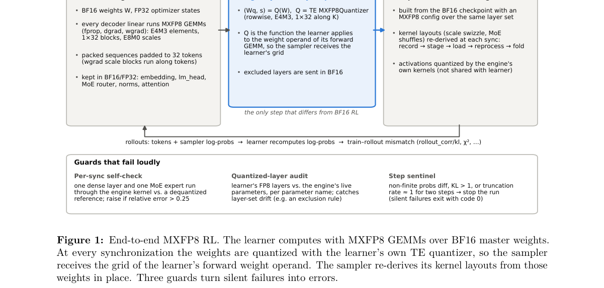

*Result - Train–rollout KL per step (log scale). In (a) and (b) the vLLM MXFP8 / MXFP8 sampler kept gate_up_proj in BF16 (F2); the SGLang sampler in (a) and the MoE sampler in (c) put every decoder li*

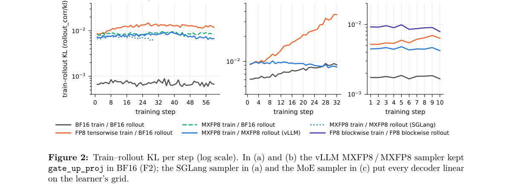

**Why this ranks #9**: 端到端 MXFP8 RL 的工程实证：采样器与学习器必须用同一数值网格，并给出七条权重同步必须满足的条件。

---

### 10. Selective Tie Learning: Mitigating Spurious Correlations in Preference Optimization

**arXiv**: [2610.35787](https://arxiv.org/abs/2610.35787) | **Score**: 8.0 (relevance 8.0 x 0.7 + quality 8.0 x 0.3) | **Tags**: rlhf, DPO, preference-optimization, spurious-correlation, tie-augmentation, influence-function | **Categories**: cs.LG | **Pages**: 33

**Authors**: Christian Moya, Purav Matlia, Elliott Thornley, Guang Lin

**Affiliation**: Purdue University; National University of Singapore

**Abstract**

> Preference optimization can learn spurious correlations, and augmenting the preference data with ties (equally preferred responses) can reduce spurious reliance. However, ties differ in their corrective effect, making their selection for augmentation important. For log-linear policies, we derive each tie's influence on spurious reliance and show that taking the largest predicted reductions is first-order optimal among subsets of equal size. Computing these influences requires knowledge of the spurious features and the curvature of the training objective, which is often unavailable or expensive to estimate. To this end, we explore using the magnitude of a tie's implicit reward margin and characterize the conditions under which it is a useful proxy for predicted influence. To test the theory and its qualitative transfer to neural models, we estimate influence with a counterfactual proxy for spurious reliance and use a generalized Gauss--Newton approximation to curvature for language models. Across log-linear policies, neural models, and large language models, our selection rules consistently achieve comparable reductions in spurious reliance with fewer ties than uniform selection.

**Key findings**

- **Finding**: 偏好优化会学到伪相关，而用平局（等偏好响应）增广偏好数据可以减少对伪相关的依赖。
- **Finding**: 但不同 tie 的纠正效果不同，因此增广时的选择很重要。
- **Finding**: 对 log-linear 策略，作者推导每个 tie 对伪相关依赖的影响，并证明在同等大小的子集中取「预测下降最大」的那些是一阶最优的。
- **Finding**: 计算这些影响需要知道伪特征与训练目标的曲率，而后者往往不可得或估计昂贵。
- **Finding**: 为此作者探索用 tie 的隐式奖励边际幅度作为代理，并刻画它在何种条件下是有用的代理。
- **Finding**: 为检验理论及其向神经模型的可迁移性，作者用伪相关的反事实代理估计影响，并用广义 Gauss-Newton 近似计算语言模型的曲率。
- **Finding**: 在 log-linear 策略、神经模型与大语言模型上，作者的选择规则一致地以更少的 tie 达到与均匀选择相当的去伪相关效果。
- **Inference**: 「用隐式奖励边际代理影响」是把一个需要曲率信息的问题降级成只需模型输出的近似，工程上友好得多。
- **Inference**: 这篇把「数据增广怎么选」这一在实践中常被随便对待的问题，给出了有理论支撑的选择规则。
- **Recommendation**: 推荐。做 DPO、偏好数据构造或关心去伪相关的值得读。

**Key figures**

*Framework - Log-linear validation. (a) Predicted versus observed reductions in population spurious energy after perturbing the objective with one symmetric tie. (b) Observed reductions from ties with sa*

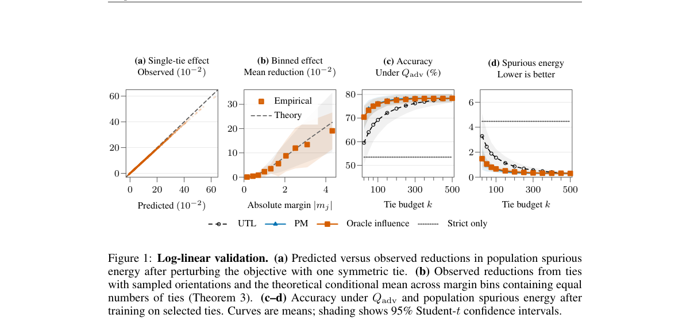

*Result - Selection beyond the log-linear setting. Qadv accuracy for a nonlinear reward model (a) and LoRA-DPO on hotel (b) and emoji (c) tasks. Practical influence uses a sampled GGN and solves the d*

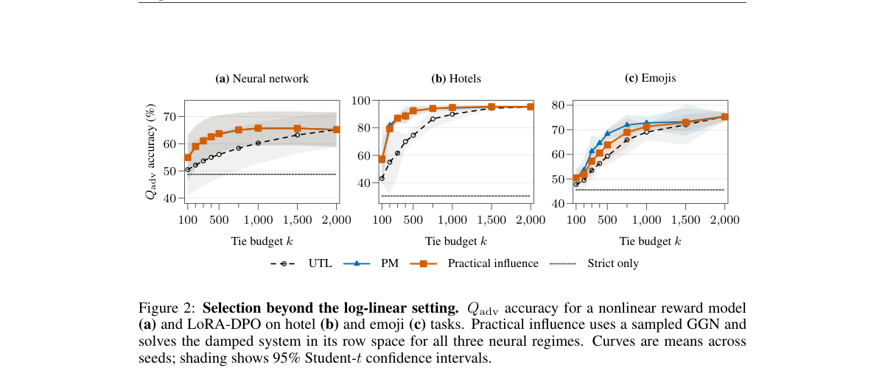

**Why this ranks #10**: 给「哪些平局样本该补进偏好数据」一个理论上可解的选择准则，用更少的 tie 达到同等去伪相关效果。

---

## Footer

- Total papers scanned across all 7 tracks: 546（原始 738 条）
- rl_llm track final top-10: 10
- Wild-cards in this track: 0
- Figure assets: 2026-10-27/res/

Generated by `mine-arxiv-daily-digest` skill. Sister file: `2026-10-27_rl_llm_entry.md`.
