# ArXiv Daily Digest - 2026-10-28 (AIGC 音频生成, 10 papers)

**Generated**: 2026-10-28 17:00 CST

**Source**: arXiv cs.CV, cs.SD, eess.AS, cs.CL, cs.AI, cs.RO, cs.LG submissions, listing day 2026-10-27 (announced 2026-10-28 00:00 UTC)

**Batch window**: 2026-10-26T18:00:00Z .. 2026-10-27T18:00:00Z（arXiv 公告批次横跨两个 UTC 日：前一日 18:00 UTC 起算，当日 17:59:59 UTC 截止）

**Track**: aigc_audio (top 10 of 578 papers scanned, 70 full reads)

**Scope**: 音频 / 音乐 / 语音的生成、编辑与质量评测，不含语音理解与语音大模型

⚠️ **Wild-card**: 本批该线 2 篇为 wild-card 补足，已在正文逐条标注并给出理由。

补足原因：该批次 eess.AS / cs.SD 全站仅 20 篇，纯音频生成方向不足 10 篇；TAC2 以文本到音频生成的成对监督与零样本控制计入生成侧，EEG 音乐调式解码作为音乐向延伸阅读补位。

---

## Top 10 - AIGC 音频生成

### 1. Expressive Guitar Synthesis via Controllable Latent Flow Matching

**arXiv**: [2610.36786](https://arxiv.org/abs/2610.36786) | **Score**: 8.7 (relevance 9.0 x 0.7 + quality 8.0 x 0.3) | **Tags**: AIGC-audio, music-generation, flow-matching, guitar, controllable-synthesis | **Categories**: cs.SD | **Pages**: 5

**Authors**: Hsueh-Wei Fu; Yen-Tung Yeh; Yi-Hsuan Yang

**Affiliation**: National Taiwan University

**Abstract**

> Realistic guitar synthesis requires both audio fidelity and interpretable control over how notes are performed. The input timed MIDI events decide what is played but not how, leaving the continuous within-note decisions of guitar performance--such as pitch inflection and per-string articulation--unspecified. A model that directly maps MIDI to audio must therefore realize the performance implicitly, and users are left with limited control over the synthesized performance. We therefore propose a two-stage guitar synthesis pipeline that predicts editable, per-string $f_0$ and amplitude trajectories from timed note events and note-level dynamics, and renders them into audio using latent flow matching. Experimental results show that the proposed system outperforms a matched single-stage counterpart and DDSP-Guitar in control fidelity and perceived quality, while keeping the controls editable. Sound examples can be found online.

**Key findings**

- **Finding**: 论文指出定时 MIDI 事件只决定弹什么，不决定怎么弹——音高起伏、每弦发音方式等连续决策在单阶段映射里被隐式吞掉。
- **Finding**: 提出两阶段框架：性能预测器从符号输入推断逐弦的 f0 与幅度轨迹，潜空间流匹配合成器再把这些轨迹渲染成音频。
- **Finding**: 因为吉他数据集没有类似钢琴的力度符号，速度需从真值音频反推，作者额外设计了伪速度预测器以降低用户逐音符调节的负担。
- **Finding**: 两阶段均采用轴向 transformer：时间轴上自注意力，弦轴上带门控的跨弦注意力。
- **Finding**: 在控制保真度与听感质量上优于匹配的单阶段对照与 DDSP-Guitar，同时保持控制参数可编辑。
- **Inference**: 把「演奏决策」显式做成可编辑中间量，是这条线最有价值的抽象——它把「音色像」和「弹法可控」解耦，用户能只改演奏不改乐谱。
- **Inference**: 论文是 5 页短文，评测维度（听感主观测试规模、跨乐器泛化）尚未充分展开，宜作为方法起点而非结论。
- **Recommendation**: 推荐。做可控乐器合成、DDS P 类建模或音高轨迹条件化的读者值得读。

**Key figures**

*Framework - The architecture of the performance predictor. The purple circles represent the learned string identity embed- dings.*

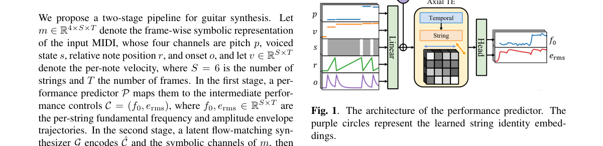

*Result - The architecture of the synthesizer. Each output sin- gle string audio will then be mixed by learned string-specific impulse responses.*

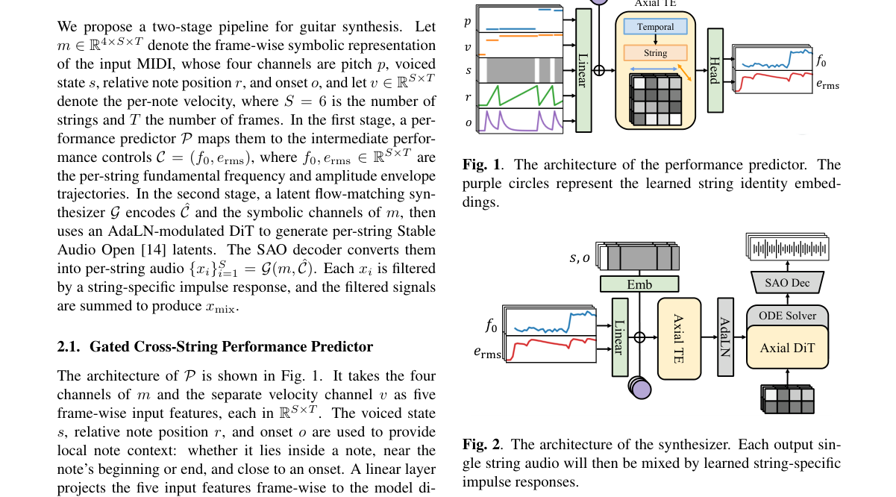

**Why this ranks #1**: 吉他的「怎么弹」和「弹什么」必须拆开，否则 MIDI 到音频的映射里全是隐式演奏。

---

### 2. StreamSE: Neural Audio Codec-based Streaming Speech Enhancement for On-device Inference

**arXiv**: [2610.37024](https://arxiv.org/abs/2610.37024) | **Score**: 8.7 (relevance 9.0 x 0.7 + quality 8.0 x 0.3) | **Tags**: AIGC-audio, speech-enhancement, neural-audio-codec, streaming, on-device | **Categories**: eess.AS | **Pages**: 5

**Authors**: Hyunjin Choi; Zinu Kim; Junwon Moon; Jeongyun Chae; Seungbeom Kim; Kyuhong Shim

**Affiliation**: Sungkyunkwan University

**Abstract**

> Recent generative speech enhancement (SE) models achieve high perceptual quality, but their non-causal processing and expensive computation make them difficult to use for streaming, on-device inference. We propose StreamSE, a 20M-parameter streaming SE model that operates in the latent space of a frozen pretrained neural audio codec. At each frame, StreamSE directly regresses a clean continuous latent from the noisy continuous latent while conditioning on its own predictions from previous frames. Enhancement therefore requires a single forward pass per frame and no iterative sampling or look-ahead. We further truncate the codec's residual vector quantizer (RVQ) to its coarse levels, halving the number of tokens per frame while improving robustness to reverberation. StreamSE is the only streaming generative model in our comparison, yet it matches or exceeds the perceptual quality of the offline generative baselines. Furthermore, the complete StreamSE pipeline runs in real time on a single smartphone CPU core. Our results show that continuous latent regression provides a practical route to generative SE under fully causal, on-device streaming constraints.

**Key findings**

- **Finding**: StreamSE 是一个 2000 万参数的流式语音增强模型，运行在冻结预训练神经音频编解码器的潜空间里。
- **Finding**: 每帧直接从带噪连续潜变量回归出干净连续潜变量，并条件于自己此前的预测，因此每帧只需一次前向、无需迭代采样与前瞻。
- **Finding**: 作者截断编解码器的残差向量量化器到粗层级，把每帧 token 数减半，同时提升对混响的鲁棒性。
- **Finding**: 这是对比中唯一的流式生成式模型，感知质量却持平甚至超过离线生成式基线。
- **Finding**: 完整流水线在单颗手机 CPU 核心上实时运行（Galaxy S22，ONNX Runtime，动态 int8 权重，k=8）。
- **Inference**: 「生成式」在这里被重新定义为「在 codec 潜空间里做回归」而非「扩散/流匹配采样」——连续潜变量的单次回归天然是因果的，这绕开了自回归采样在流式场景下的延迟瓶颈。
- **Inference**: 依赖冻结 codec 意味着增强上限被 codec 的重建质量锁死，对超出 codec 训练分布的噪声类型（音乐噪声、非语音）泛化未知。
- **Recommendation**: 推荐。做端侧语音增强、神经音频 codec 或流式音频前端的读者值得读，20M 的体量很实用。

**Key figures**

*Framework - Overview of StreamSE during training (top) and inference (bottom). C⃝denotes concatenation, and Q-DQ denotes QDQk, quantization followed by dequantization, which maps a continuous latent onto*

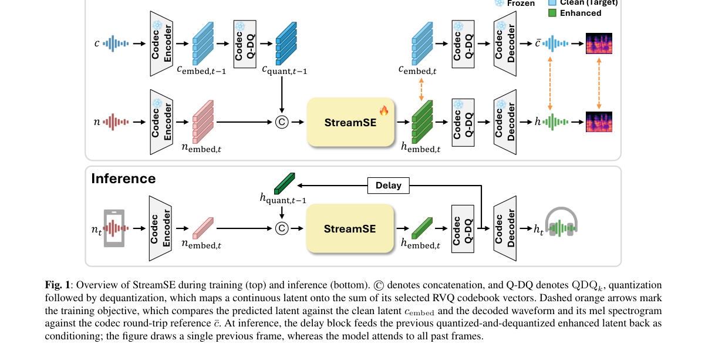

*Result - Per-frame runtime breakdown of the streaming pipeline on a Galaxy S22 (single big core, ONNX Runtime CPU backend, dynamic int8 weights, k=8). Runtime is reported as the p95 per frame and shown*

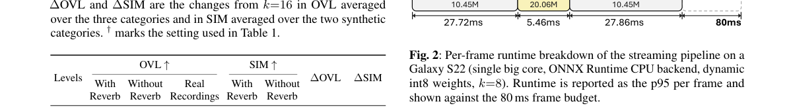

**Why this ranks #2**: 生成式语音增强要上手机，就不能每帧跑迭代采样——改成潜空间的单次回归。

---

### 3. SMEBENCH: Benchmarking Neural Music Editing with Synthetized MIDI Edits

**arXiv**: [2610.36715](https://arxiv.org/abs/2610.36715) | **Score**: 8.0 (relevance 8.0 x 0.7 + quality 8.0 x 0.3) | **Tags**: AIGC-audio, music-editing, benchmark, MIDI, Mila, paired-target | **Categories**: cs.LG, cs.SD, eess.AS | **Pages**: 24

**Authors**: Matthieu Cervera; Francesco Paissan; Micael Antunes; Mirco Ravanelli; Ricard Marxer; Cem Subakan

**Affiliation**: Mila - Quebec Artificial Intelligence Institute; Universite Laval; National University of Ireland Maynooth; Concordia University; Univ Toulon

**Abstract**

> Neural music editing requires a system to perform a requested change while preserving the musical content that should remain unchanged. Existing evaluations often lack a paired target edit, making these requirements difficult to measure separately. We introduce SMEBench, a large-scale benchmark of controlled music edits constructed by modifying symbolic MIDI performances and rendering matched source and target audio. Each example contains a source, an instruction, a paired target, edit metadata, and complementary descriptions. The benchmark covers twelve instrumentation, articulation, dynamics, and pitch operations and includes a balanced 3,600-example test set together with a smaller real-audio complement derived from multitrack recordings. The paired targets allow source preservation, target agreement, and textual compatibility to be evaluated independently. We use these references to diagnose common audio-editing metrics and benchmark six representative editing systems, showing that the metric used to rank a system can materially change the conclusion. The dataset is available at our repository.

**Key findings**

- **Finding**: SMEBench 用「修改符号化 MIDI 演奏并渲染出配对的源/目标音频」来构造受控音乐编辑基准，共 11,160 条配对样本。
- **Finding**: 每条样本含源音频、编辑指令、配对目标、编辑元数据与互补文本描述；覆盖十二类乐器、发音、力度与音高操作。
- **Finding**: 测试集为平衡的 3,600 条，另有一个源自多轨录音的真实音频补充集。
- **Finding**: 配对目标让「源保持」「目标一致」「文本兼容」三个维度可以被独立评测。
- **Finding**: 论文用这些参考诊断常见音频编辑指标，并横向评测六个代表性编辑系统，发现排名指标不同会实质改变结论。
- **Inference**: 「指标选择会翻转排名」这个发现比基准本身更重要——它说明音乐编辑领域当前缺少公认的度量协议，任何基于单一指标的 SOTA 声明都应谨慎对待。
- **Inference**: 合成 MIDI 配对天然干净，但也因此回避了真实录音里的噪声、混响与演奏自由度，作为真实场景的上限参考而非终点。
- **Recommendation**: 推荐。做音乐编辑评测或需要训练/验证编辑系统的读者强烈建议读，数据与指标诊断都很实用。

**Key figures**

*Framework - Overview of the SMEBench construction recipe. A 10-second MIDI excerpt is analyzed to determine which edits and targets are applicable. The selected intervention is applied to the symbolic p*

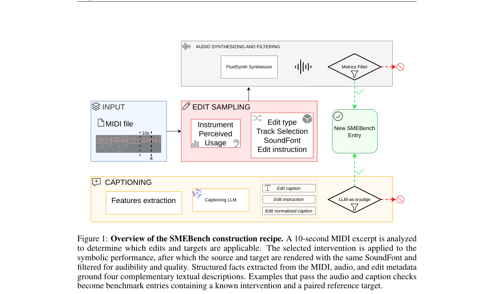

*Result - SMEBench edit taxonomy. Each of the twelve operations is sampled only when the excerpt contains an eligible target. Instrument-level dynamics and pitch operations may target one instrument o*

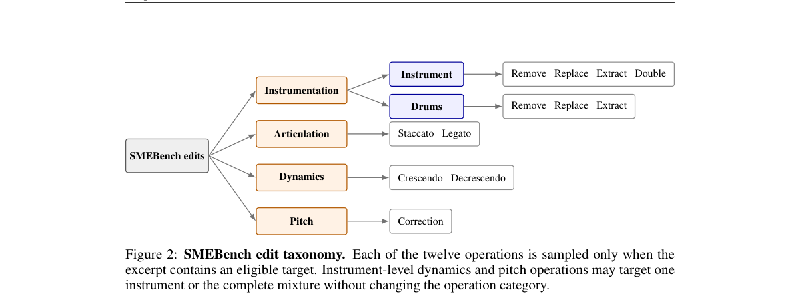

**Why this ranks #3**: 音乐编辑评测最难的是没有配对目标，合成 MIDI 正好能补上这一对。

---

### 4. Partially Edited Audio: Generation, Defense, and Open Problems

**arXiv**: [2610.37640](https://arxiv.org/abs/2610.37640) | **Score**: 7.7 (relevance 8.0 x 0.7 + quality 7.0 x 0.3) | **Tags**: AIGC-audio, audio-editing, survey, forensics, detection, privacy | **Categories**: cs.SD, eess.AS | **Pages**: 5

**Authors**: Lin Zhang; You Zhang; Nicholas Evans; Xin Wang; David Harwath; Abhinav Dhall; Bowen Shi; Chengzhe Sun; Siwei Lyu; Sanjeev Khudanpur

**Affiliation**: Independent Researcher; Telecom Paris; EURECOM; National Institute of Informatics; The University of Texas at Austin; Monash University; University at Buffalo; Johns Hopkins University

**Abstract**

> Recent advances in generative audio models facilitate increasingly flexible and selective editing of linguistic content and paralinguistic, extralinguistic, and other attributes. This paradigm, named partially edited audio, differs from full audio generation as only portions of the real recording are edited. This technique can serve both beneficial and harmful applications. We therefore present a concise survey from both generation and defense perspectives, focusing on audio, as a contribution to the ICASSP 2027 special session entitled "Partially Edited Media: Perspectives from Synthesis and Defense." We first define partially edited audio and argue that what counts as ``fake'' or harmful is an application-dependent judgment, not a fixed property of the edit. We then survey audio editing by editing target, approaches, and evaluation, and then defense methods by detection, localization, diarization, and interpretability, summarizing representative benchmarks and toolkits. Finally, we discuss future directions and open problems.

**Key findings**

- **Finding**: 论文定义「partially edited audio」范式：只有真实录音的部分被编辑，而非整段重新生成。
- **Finding**: 核心立场是「什么算伪造、有害与否取决于应用场景，而不是编辑本身的固定属性」。
- **Finding**: 从生成视角按编辑目标、方法与评测分类，再从防御视角按检测、定位、说话人分离与可解释性梳理，并汇总代表性基准与工具包。
- **Finding**: 论文是 ICASSP 2027 special session 的贡献，定位为面向音频的综述。
- **Inference**: 「有害性是应用相关的」这一论点对做音频水印/溯源的人尤其重要——检测器的评测目标必须显式声明它守护的是哪一类应用。
- **Inference**: 综述的价值取决于分类法是否被后续工作接受；读者更适合当作检索式索引而非结论性读物。
- **Recommendation**: 推荐。做音频编辑检测、说话人保护或需要快速摸清「局部编辑音频」版图的读者值得翻一遍。

**Key figures**

*该论文正文未提取到可用图（图表为纯文本/表格排版）。*

**Why this ranks #4**: 只改一部分的音频算不算「假」，是应用相关的判断，而不是音频的固有属性。

---

### 5. TAC2: Timestamped Audio Captioning as composable functions

**arXiv**: [2610.36568](https://arxiv.org/abs/2610.36568) | **Score**: 7.3 (relevance 7.0 x 0.7 + quality 8.0 x 0.3) | **Tags**: AIGC-audio, audio-captioning, foundation-model, weak-teacher-fusion, text-to-audio, wild-card | **Categories**: cs.SD | **Pages**: 22

**Authors**: Swapnil Bhosale; Prem Seetharaman; Ke Chen; Haonan Chen; Justin Salamon; Zeyu Jin

**Affiliation**: University of Surrey; Adobe Research

**Abstract**

> Real-world audio applications require precise, queryable representations grounded in physical time. Yet modern Large Audio-Language Models (LALMs) increasingly favor conversational generation, producing free-form descriptions that conflate acoustic perception with higher-level reasoning and lack precise temporal grounding. We introduce TAC2, a foundation model that casts timestamped audio captioning as composable functions to construct granular, speaker-attributed acoustic timelines directly from in-the-wild audio. To avoid prohibitively expensive manual annotation, we programmatically fuse complementary predictions from specialized weak teachers through time-registered IoU matching. We model the resulting multi-granularity schema of timestamped events, speaker turns, and fine-grained speech attributes using an Instruction-Input-Output (IIO) completion format, in which each task is a function of the audio, an instruction, and an optional input. A single call decodes the full description autonomously, while composing calls lets earlier outputs or external priors, such as a reference transcript, condition later ones. We further extend TAC2 with expressive speech attributes to obtain TAC2-S, using parameter-efficient specialists to elicit latent paralinguistic capabilities from the pre-trained backbone and distill them into a unified model. We validate the resulting representation in two complementary settings. Paired with frozen text-only LLMs, it yields strong spoken audio understanding across diverse reasoning backends, demonstrating the utility of decoupling fine-grained acoustic perception from downstream reasoning. Used as paired supervision for text-to-audio generation, it supports semantically and temporally grounded reconstruction, together with explicit zero-shot control over event timing, speaker attributes, and word-level emphasis.

**Key findings**

- **Finding**: TAC2 是一个把带时间戳音频描述（事件、说话人轮次、细粒度语音属性）当作可组合函数的基础模型，直接从真实场景音频构建说话人归属的声学时间线。
- **Finding**: 为避免昂贵人工标注，作者用时间对齐的 IoU 匹配，程序化融合声音事件检测、说话人分离与字幕三个弱教师在真实语料上的互补预测。
- **Finding**: 模型采用 Instruction-Input-Output (IIO) 补全格式，把结构化字幕拆成「音频 + 指令 + 可选输入」的函数，一次调用即可自主解码完整描述，组合调用则允许前序输出条件化后续输出。
- **Finding**: 扩展版 TAC2-S 用参数高效专家激发骨干中潜在的副语言能力并蒸馏进统一模型。
- **Finding**: 与冻结纯文本 LLM 配合可在多种推理后端上取得强语音理解；作为成对监督用于文本到音频生成时，支持语义与时间对齐的重建，并对事件时序、说话人属性与词级重音实现零样本控制。
- **Inference**: 「弱教师时间对齐融合」是用廉价模型造高质量结构化监督的通用套路，对任何缺少密集标注的音频任务都可复用。
- **Inference**: 语音属性与词级重音的零样本控制是生成侧最有价值的部分，但控制精度依赖弱教师本身的属性标注质量，而声音事件检测器通常不带这类细属性。
- **Recommendation**: 推荐。做音频基础模型、文本到音频生成或需要时间戳级音频标注的读者值得读；本文以生成侧贡献计入本线。

**Key figures**

*Framework - Overview of the two-stage TAC2 / TAC2-S framework. (1) Perceptual Founda- tion (TAC2): Predictions from weak teachers (SED, Diarization, Captioner) are merged via time- registered IoU matchi*

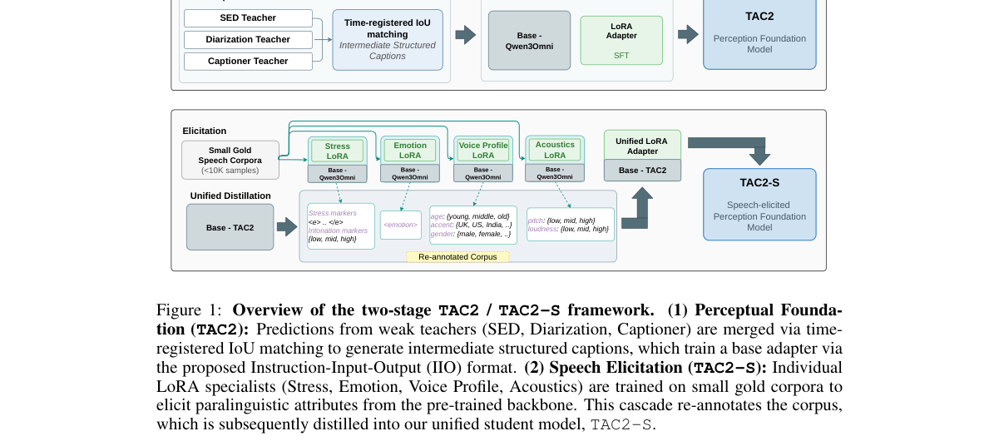

*Result - Programmatic data compilation via time-registered IoU matching. Predictions from three independent weak teachers (m1: audio captioner; m2: speaker diarizer; m3: sound event detector) are ali*

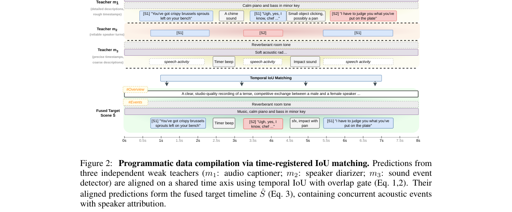

**Why this ranks #5**: 把带时间戳的音频描述拆成可组合函数，既是理解工具，也是文本到音频生成的监督信号。  [wild-card=yes] 该批次 eess.AS / cs.SD 全站仅 20 篇，纯音频生成方向不足 10 篇；TAC2 提供了文本到音频生成的成对监督与事件时序、说话人、词级重音的零样本控制，计入生成侧。

---

### 6. The Content Leash: Mitigating Degenerate Solutions in Invertible Speaker Anonymization

**arXiv**: [2610.36768](https://arxiv.org/abs/2610.36768) | **Score**: 7.3 (relevance 7.0 x 0.7 + quality 8.0 x 0.3) | **Tags**: AIGC-audio, voice-anonymization, privacy, speech-degradation, speaker-verification | **Categories**: cs.CR, cs.SD | **Pages**: 6

**Authors**: Nirjon Mobarak Talukder; Rafid Ahmed; Mohammad Ishrak Abedin; Abu Raihan Mostofa Kamal

**Affiliation**: Islamic University of Technology

**Abstract**

> Voice anonymization aims to protect a speaker's identity while preserving the linguistic content of speech, enabling voice data to be shared and processed with reduced privacy risk. This work focuses on reversible voice anonymization, where the original voice can be recovered by an authorized user rather than being permanently discarded. However, existing approaches can achieve apparent speaker anonymization by degrading the speech itself, while their effectiveness may also depend on the speaker-verification representation used during training. This creates a need for methods that protect speaker identity without sacrificing speech intelligibility and that remain effective against unseen speaker verifiers. We introduce content preserving training constraints to improve the privacy-utility trade-off by preventing anonymization from being achieved primarily through speech degradation. We further introduce a verifier-generalization strategy that incorporates a stronger speaker-verification representation during training, improving anonymization robustness beyond the verifier used in the original training setup. The resulting approach maintains intelligible speech, strengthens anonymization, and preserves reliable voice restoration, with evaluation on unseen speakers and held-out speaker verification models. On 38 unseen speakers, the approach raises the attacker's equal error rate from a measured floor of 2.8% to 26.3%, and to 27.9% against a held-out verifier, with 11.8% word error rate and 94.9% speaker similarity on key-based restoration. These improvements advance reversible voice anonymization toward practical privacy-preserving speech applications, where anonymized speech can be safely processed or shared while the original voice remains recoverable under authorized conditions.

**Key findings**

- **Finding**: 论文指出可逆语音匿名化存在退化解：三元组损失可以通过严重破坏频谱来满足，从而以牺牲可懂度换取「匿名」表象。
- **Finding**: 作者复现已发表训练目标时观测到这一退化，并发现训练所用说话人验证表征会左右方法的有效性。
- **Finding**: 提出的内容保持训练约束阻止匿名化主要靠语音退化实现；验证器泛化策略在训练时引入更强的说话人验证表征，以提升对未见验证器的鲁棒性。
- **Finding**: 在 38 个未见说话人上，攻击者等错误率从 2.8% 的地板抬升到 26.3%，对留出验证器达 27.9%，同时密钥恢复的词错误率 11.8%、说话人相似度 94.9%。
- **Inference**: 「退化解」这个视角很有用——隐私类方法必须显式论证它没有走「把信号毁掉」的捷径，否则 EER 提升可能只是可懂度崩塌的副作用。
- **Inference**: 把 EER 与 WER/说话人相似度并列报告是正确的评测姿态，但缺少与更强基线（含扩散式语音匿名化）在同数据上的对比。
- **Recommendation**: 推荐。做语音隐私、说话人保护或可逆匿名化的读者值得读，约束设计可直接借鉴。

**Key figures**

*Framework - The training objective viewed as constraints on the anonymized spectrogram Xa. The consistency loss acts on a second forward pass conditioned on the true speaker embedding s and never sees Xa.*

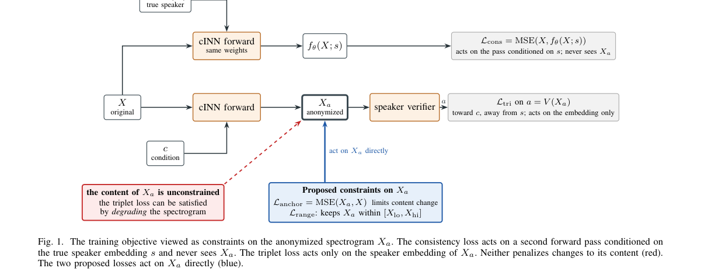

**Why this ranks #6**: 可逆匿名化最容易被「把声音毁掉」这条捷径糊弄过去，得加约束堵住。

---

### 7. ConformalMOS: Uncertainty-Aware MOS Prediction with Conformal Intervals and Ordinal Modeling

**arXiv**: [2610.36126](https://arxiv.org/abs/2610.36126) | **Score**: 7.0 (relevance 7.0 x 0.7 + quality 7.0 x 0.3) | **Tags**: AIGC-audio, MOS-prediction, conformal-prediction, TTS, voice-conversion, uncertainty | **Categories**: cs.CL, cs.SD | **Pages**: 5

**Authors**: Kehinde Elelu; Joshua E. Siegel; Mohammadali Saffary; Tashfain Ahmed; Simeon Babatunde; Ebuka Okpala

**Affiliation**: Michigan State University; Clemson University

**Abstract**

> Accurate prediction of human Mean Opinion Scores (MOS) is crucial for evaluating synthetic speech quality in text-to-speech (TTS) and voice conversion (VC). Most MOS predictors output only point estimates and ignore uncertainty, limiting reliability in model selection and deployment. We propose ConformalMOS, a framework that augments MOS prediction with conformal prediction to produce statistically valid prediction intervals with guaranteed coverage under exchangeability, alongside point estimates. During training, MOS labels are modeled in an ordinal-aware manner by converting one-hot targets into Gaussian-smoothed distributions, preserving score ordering. This improves uncertainty calibration, particularly when softmax confidence is overconfident on out-of-distribution speech. On BVCC datasets, ConformalMOS achieves competitive accuracy (MSE = 0.08) while delivering empirically validated coverage, enhancing reliability for real-world TTS and VC deployment.

**Key findings**

- **Finding**: ConformalMOS 把共形预测套到 MOS 预测上，在可交换性假设下给出有形式化覆盖率保证的预测区间，同时保留点估计。
- **Finding**: 训练时把 MOS 标签以序数感知的方式建模：把 one-hot 目标转成高斯平滑分布，以保留分数的次序信息。
- **Finding**: 这种建模改善了不确定性校准，尤其在 softmax 置信度在分布外语音上过度自信时。
- **Finding**: 在 BVCC 数据集上取得有竞争力的精度（MSE = 0.08），并给出经验验证的覆盖率。
- **Inference**: 把 MOS 当成序数标签而非无序分类，是一个被普遍忽略的细节——MOS 是有严格高低次序的，普通交叉熵会丢掉这份结构。
- **Inference**: 共形区间的有效性依赖可交换性，一旦部署分布与校准集不同（例如换 TTS 架构或内容类型），覆盖率保证就失效，论文没有讨论再校准流程。
- **Recommendation**: 推荐。做合成语音/音色转换评测、需要做模型选择或自动打分的读者值得读。

**Key figures**

*Framework - Overview of the proposed ConformalMOS framework. Input audio representations are first processed by a frozen upstream feature extractor. These features are fed into an ordinal prediction hea*

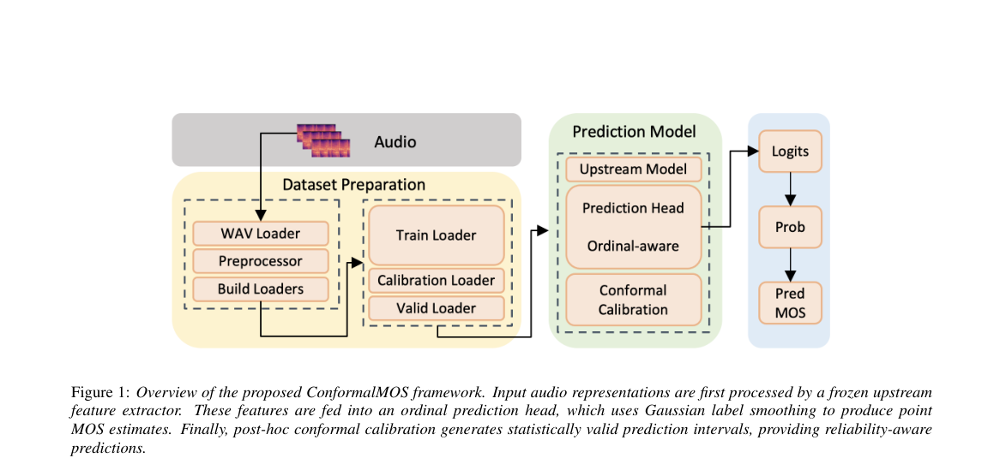

**Why this ranks #7**: 合成语音的质量预测只给一个分数是不够的，还要给一个覆盖率有保证的区间。

---

### 8. Physiology-Informed Audio Quality and Listening Effort Estimation

**arXiv**: [2610.36865](https://arxiv.org/abs/2610.36865) | **Score**: 7.0 (relevance 7.0 x 0.7 + quality 7.0 x 0.3) | **Tags**: AIGC-audio, MOS-estimation, neurophysiology, listening-effort, wearable, MSR | **Categories**: cs.NE, cs.SD | **Pages**: 5

**Authors**: Niall McGuire; Dimitra Emmanouilidou

**Affiliation**: University of Strathclyde; Microsoft Research

**Abstract**

> Audio systems aim to maximise the listener's perceived quality, traditionally evaluated through mean opinion scoring (MOS), a subjective process that is slow, costly, and collected only after playback. Machine learning now predicts MOS directly from the audio, but in generalising across participants it tends to discard the subject variance that defines individual perception. Neurophysiological measures may offer a complementary signal taken directly from the listener, objective, implicit, and continuous, though prior work has relied on laboratory-grade EEG and fNIRS. We ask how practical consumer-grade devices compare, and whether they might recover population-level audio-quality trends and, when calibrated per listener, track that listener's effort. Recording 32-channel laboratory EEG alongside wearable EEG, fNIRS, and eye tracking from thirty listeners, our results suggest commercial wearable and optical sensing can decode audio quality at statistically significant levels and recover listening effort per listener. These findings may point towards platforms tuned not only to perceived quality but to the effort a clip demands, read from the listener's own response as they listen.

**Key findings**

- **Finding**: 论文问的是消费级设备能否替代实验室级 EEG/fNIRS，成为音频质量与听觉努力估计的可行信号源。
- **Finding**: 实验同时记录 32 通道实验室 EEG、可穿戴 EEG、fNIRS 与眼动，30 名听众在分级质量音频下完成评估。
- **Finding**: 结果表明商用可穿戴与光学传感能以统计显著水平解码音频质量，并能逐听众恢复其听觉努力。
- **Finding**: 论文自我定位为「范围窄、以可行性为主」的贡献。
- **Inference**: 「质量」与「努力」被联合处理是这篇的亮点——只做 MOS 预测会丢掉个体差异，而个体差异恰恰是通用 MOS 模型泛化差的原因。
- **Inference**: 30 人样本与实验室 EEG 的成本意味着短期难落地，但消费级设备的结论（可穿戴 EEG 已够用）对做端侧质量评估的人是有用的信息。
- **Recommendation**: 推荐。做音频质量自动评估、个体化偏好建模或人机交互感知监测的读者值得读，思路可迁移到视频质量领域。

**Key figures**

*Framework - Behavioural validation against objective MOS. Left: sub- jective quality tracks MOS (r=0.75). Right: mental effort rises as quality falls (r=−0.57). Cells are rating counts, dashed line marks*

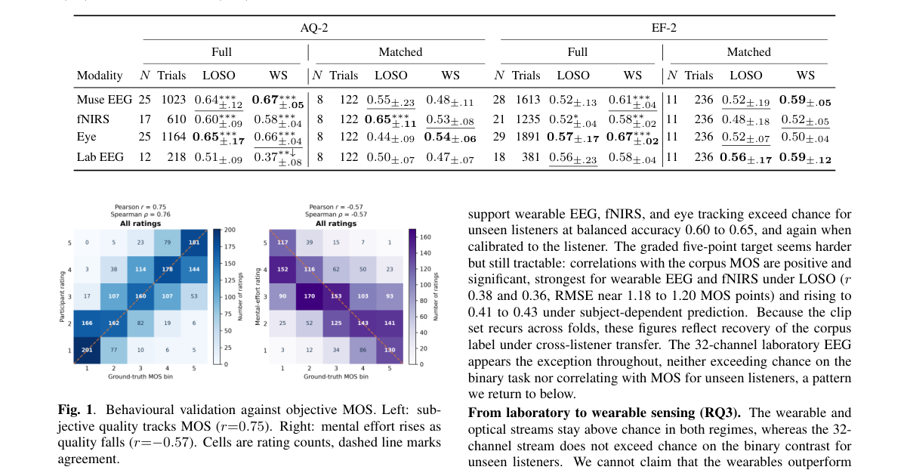

**Why this ranks #8**: 音频质量的主观打分又慢又贵，能不能在听的过程中直接读出来？

---

### 9. Perceptual Differences and Preferences in Speech Enhancement

**arXiv**: [2610.36892](https://arxiv.org/abs/2610.36892) | **Score**: 6.3 (relevance 6.0 x 0.7 + quality 7.0 x 0.3) | **Tags**: AIGC-audio, speech-enhancement, evaluation, crowdsourcing, perceptual, Aalborg | **Categories**: cs.SD, eess.AS | **Pages**: 5

**Authors**: Simon Dahl Jepsen; Jesper Rindom Jensen

**Affiliation**: Aalborg University

**Abstract**

> Speech enhancement (SE) systems are commonly evaluated with objective metrics, with and without references, and with categorical subjective listening tests, all measuring speech quality and intelligibility. So far, it is unclear from such evaluations whether the processed speech is perceptually different or is preferred by everyday listeners. We investigate discrimination and preference as complementary dimensions of SE evaluation through crowdsourced triangle and pairwise preference tests across four SE systems, with comparisons to clean references. Results show that both listeners' ability to distinguish and whether they exhibit systematic preference vary across systems and substantially across acoustic conditions. Pairwise evaluations of objective metrics showed variable correlation with both discriminability and preference, motivating further studies into these novel aspects in speech enhancement evaluation.

**Key findings**

- **Finding**: 论文把「可辨别性」与「偏好」作为语音增强评价的两个互补维度引入，二者都不被现有客观指标稳定预测。
- **Finding**: 研究通过众包的三角测试与成对偏好测试，覆盖四个语音增强系统并与干净参考对比。
- **Finding**: 结果显示听众的辨别能力和是否存在系统性偏好都随系统而异，并且在声学条件之间差异显著。
- **Finding**: 对客观指标的成对评测显示，其与可辨别性、偏好的相关性不稳定。
- **Inference**: 「指标与偏好的相关性随声学条件漂移」这个结论，对任何声称用客观指标替代主观听测的工作都是重要提醒。
- **Inference**: 三角测试与成对偏好的统计功效差异会影响结论强度，读者应关注各系统对的样本量设置。
- **Recommendation**: 推荐。做语音增强评测、或者关心「主观听测到底该测什么」的读者值得读。

**Key figures**

*Framework - Triangle test discrimination rate across system pairs. Each open dot is the empirically estimated discrimination rate of an utterance/system-pair condition as in 2. The filled dots represent t*

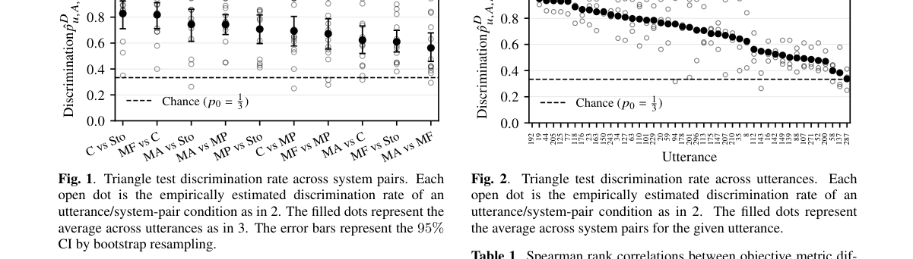

*Result - Triangle test discrimination rate across utterances. Each open dot is the empirically estimated discrimination rate of an utterance/system-pair condition as in 2. The filled dots represent the*

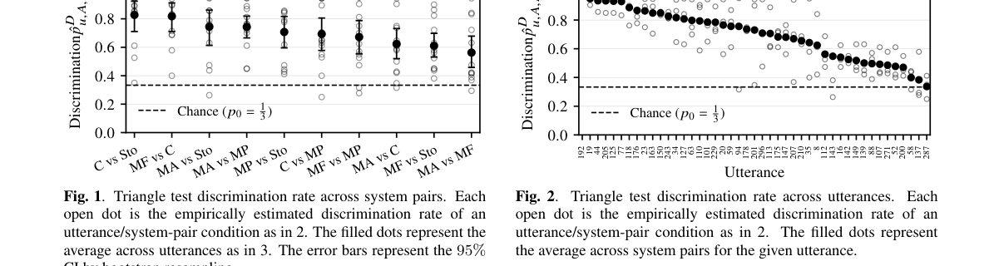

**Why this ranks #9**: 客观指标测不出的「听得出区别吗」和「更喜欢哪个」，是两个独立维度。

---

### 10. EEG-Based Decoding of Musical Mode and Melodic Direction Using Empirical Mode Decomposition

**arXiv**: [2610.37148](https://arxiv.org/abs/2610.37148) | **Score**: 5.3 (relevance 5.0 x 0.7 + quality 6.0 x 0.3) | **Tags**: AIGC-audio, music-perception, EEG, empirical-mode-decomposition, wild-card | **Categories**: cs.SD, eess.SP | **Pages**: 13

**Authors**: Sergio Guillén; Lorenzo J. Tardón; Ana M. Barbancho; Isabel Barbancho

**Affiliation**: Universidad de Malaga

**Abstract**

> Electroencephalography (EEG) has proven to be a powerful tool for decoding neural activity in real-life scenarios, including the perception and processing of emotions elicited by music. Among the various musical features that modulate these responses, musical mode and melodic direction (or contour) play a central role. This work proposes a novel EEG feature extraction framework based on Empirical Mode Decomposition (EMD) to decompose EEG signals recorded during active piano performance for the detection of these two musical features. Energy-based descriptors were computed from the first four Intrinsic Mode Functions (IMFs) obtained through EMD and used to train a Wide Neural Network classifier. The model performance was benchmarked against several standard classifiers commonly employed in EEG classification tasks. Two experimental scenarios were explored: intra-subject and intersubject. In the former case, the proposed framework achieved average accuracies of 84%, whereas in the inter-subject case, accuracies reached 81% on average using the first IMF, with AUC-ROC values of 0.9 on average in both cases. A frequency-domain analysis revealed a strong correspondence between the IMFs and conventional EEG sub-bands, except for certain specific frequency components that were not fully represented. Predominant activations were observed over the frontal, temporal, and parietooccipital regions, areas consistently associated with music processing. Furthermore, the proposed method demonstrated robustness to handedness, successfully classifying EEG data across participants regardless of their dominant hand. These findings highlight the potential of EMD-based feature extraction for identifying music-related neural patterns and contribute to advancing research in Music Information Retrieval (MIR), affective neuroscience, and the broader understanding of the neural encoding of musical structure.

**Key findings**

- **Finding**: 论文提出基于经验模态分解（EMD）的 EEG 特征框架，从主动钢琴演奏的脑电信号中检测音乐调式与旋律走向。
- **Finding**: 方法对前四个固有模态函数（IMF）计算能量型描述子，训练一个宽网络分类器做判别。
- **Finding**: 跨被试与被试内两种场景下平均准确率分别达到约 84% 与 81%，平均 AUC-ROC 约 0.9。
- **Finding**: 频域分析显示 IMF 与常见 EEG 子频带高度对应但不完全覆盖；结果对左右利手具有鲁棒性。
- **Inference**: 这是一篇音乐感知/神经解码论文，并非音乐生成；本批音频生成方向候选严重不足，作为音乐向延伸阅读补位。
- **Inference**: 方法本身（EMD + IMF 能量描述子 + 宽网络）是经典 EEG 分类流水线，创新点有限，价值在于其音乐属性解码的数据设置。
- **Recommendation**: 谨慎推荐。只在研究音乐-脑电解码或需要音乐调式标签的读者范围内读；作为生成方向的补位，不建议当主线。

**Key figures**

*该论文正文未提取到可用图（图表为纯文本/表格排版）。*

**Why this ranks #10**: 音乐方向补位：用脑电解码演奏中的调式与旋律走向，属于音乐感知而非音乐生成。  [wild-card=yes] 音频生成方向候选严重不足，用音乐感知方向的论文补位（解码音乐调式与旋律走向），仅作音乐向延伸阅读。

---

## Footer

- Total papers scanned across all 7 tracks: 578（原始 794 条）
- aigc_audio track final top-10: 10
- Wild-cards in this track: 2
- Figure assets: 2026-10-28/res/

Generated by `mine-arxiv-daily-digest` skill. Sister file: `2026-10-28_aigc_audio_entry.md`.
