# ArXiv Daily Digest - 2026-10-28 (AIGC 视觉生成, 10 papers)

**Generated**: 2026-10-28 17:00 CST

**Source**: arXiv cs.CV, cs.SD, eess.AS, cs.CL, cs.AI, cs.RO, cs.LG submissions, listing day 2026-10-27 (announced 2026-10-28 00:00 UTC)

**Batch window**: 2026-10-26T18:00:00Z .. 2026-10-27T18:00:00Z（arXiv 公告批次横跨两个 UTC 日：前一日 18:00 UTC 起算，当日 17:59:59 UTC 截止）

**Track**: aigc_visual (top 10 of 578 papers scanned, 70 full reads)

**Scope**: 图像 / 视频 / 3D 内容的生成与编辑，含扩散与流匹配模型的训练方法、加速、评测基准

---

## Top 10 - AIGC 视觉生成

### 1. FrameForge: Harnessing Priors of Video Foundation Models for Unified Image Generation

**arXiv**: [2610.36545](https://arxiv.org/abs/2610.36545) | **Score**: 9.0 (relevance 9.0 x 0.7 + quality 9.0 x 0.3) | **Tags**: AIGC-visual, image-generation, video-foundation-model, MoTE, RoPE, subject-driven | **Categories**: cs.AI, cs.CV | **Pages**: 17

**Authors**: Yijing Lin; Zhendong Mao; Mengqi Huang; Yuxin Wang; Yongdong Zhang

**Affiliation**: University of Science and Technology of China; FrameX.AI

**Abstract**

> Unified conditional image generation requires a single model to preserve different aspects of a visual input while producing a target image that follows textual guidance. Pretrained video models provide a promising foundation by encoding visual transformations across time, yet existing approaches typically assign the condition and target to fixed temporal positions. We observe that condition-target relationships vary substantially across generation tasks, while video models naturally encode visual transformations at different temporal scales. This motivates us to model conditional generation through input-adaptive virtual temporal relations. We propose FrameForge, which captures two complementary aspects of such relations. Mixture of Temporal Experts (MoTE) models how far the target lies from the condition by dynamically selecting temporal RoPE experts with different virtual intervals. Chain of Temporal Reasoning (CoTR) models how the condition is transformed into the target through a latent intermediate state, with a reasoning-bottleneck attention mask encouraging information propagation through this pathway. Experiments on DreamBench, COCO2017, and GEdit-Bench show that FrameForge achieves superior performance in subject-driven generation, canny-to-image generation, and image editing among the compared methods.

**Key findings**

- **Finding**: FrameForge 把异构条件图像生成统一重写成「目标帧预测」，直接以预训练视频扩散模型（MM-DiT）作为底座。
- **Finding**: Mixture of Temporal Experts (MoTE) 按输入动态挑选虚拟时间间隔不同的 RoPE 专家，用「条件与目标相隔多远」来调制注意力尺度。
- **Finding**: Chain of Temporal Reasoning (CoTR) 引入推理瓶颈注意力掩码，强制信息沿条件→中间潜状态→目标的路径传播。
- **Finding**: 动机实验显示，自然视频相邻帧对的 LPIPS 随时间间隔变化，证明视频模型确实在不同时间尺度上编码视觉变换。
- **Finding**: 在 DreamBench、COCO2017 与 GEdit-Bench 上，主体驱动生成、canny-to-image 与图像编辑三类任务均优于对比方法。
- **Inference**: 这篇最关键的抽象是「条件-目标关系 = 时间距离」——它没有新增条件编码器，而是复用 RoPE 的位置结构当作条件强度的旋钮，工程代价极低。
- **Inference**: 虚拟时间间隔的语义完全靠训练涌现，论文没有给出间隔与任务类型之间可解释的对应关系，跨任务泛化时缺少可调的旋钮。
- **Recommendation**: 推荐。做「一个模型统一多种条件生成」或复用视频先验的值得读，MoTE 的实现细节可以直接借鉴。

**Key figures**

*Framework - Motivation of FrameForge. Top: The LPIPS distances between frame pairs sampled from natural videos at different temporal intervals. Bottom: The condition‑to‑target LPIPS distances for image e*

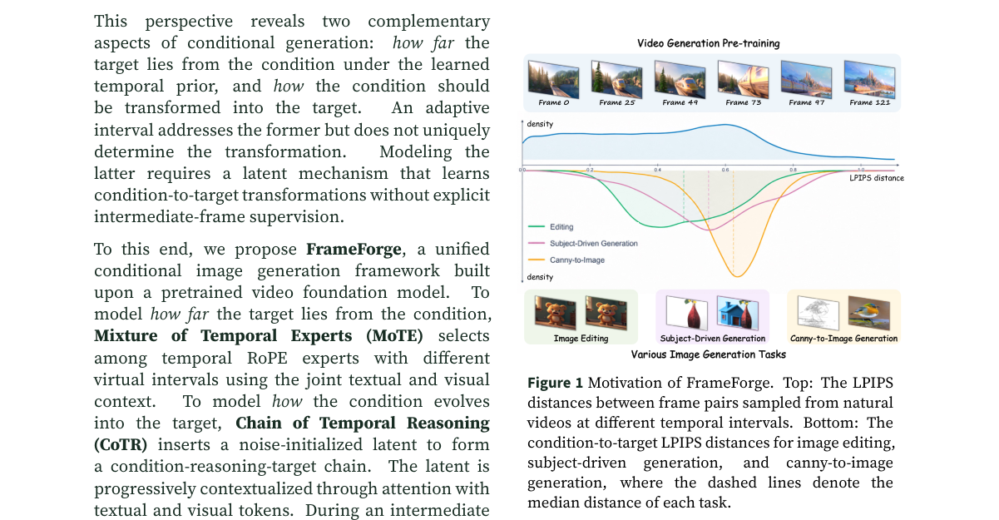

*Result - Overview of FrameForge. Heterogeneous conditional image generation is formulated as target‑frame prediction with a pretrained video diffusion model. The MM‑DiT backbone processes text, condit*

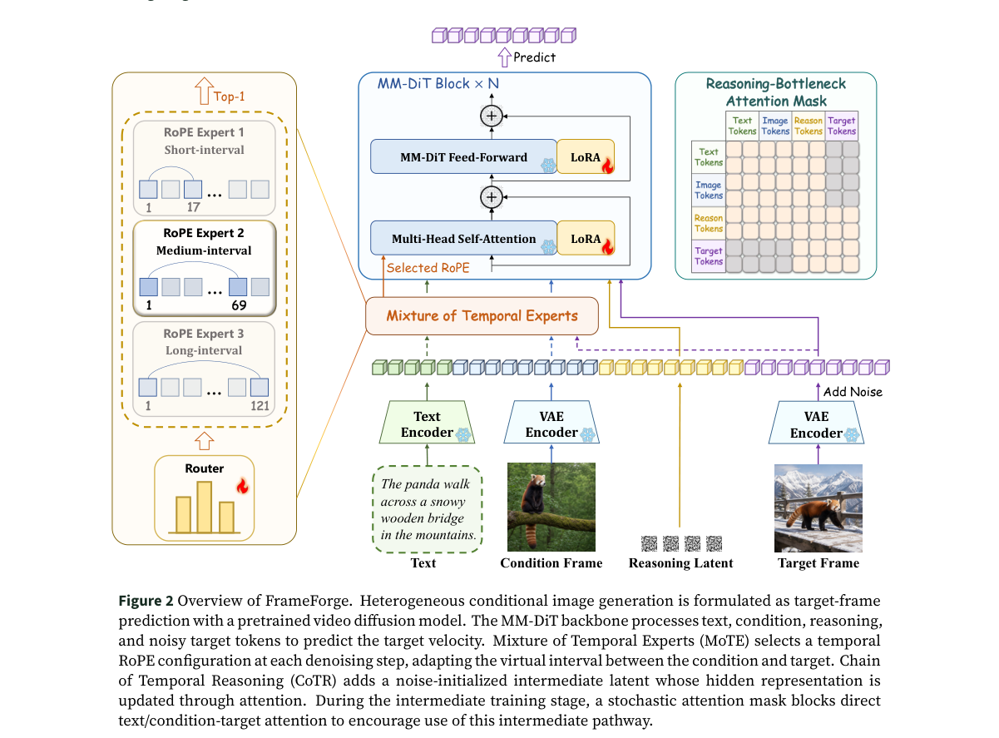

**Why this ranks #1**: 把「条件→目标」重写为虚拟时间关系，用视频模型自带的时序先验统一多种条件生成任务。

---

### 2. MoI-Bench: A Benchmark for Image Generation and Editing on Mobile Devices

**arXiv**: [2610.37599](https://arxiv.org/abs/2610.37599) | **Score**: 8.7 (relevance 9.0 x 0.7 + quality 8.0 x 0.3) | **Tags**: AIGC-visual, benchmark, mobile-deployment, image-editing, capability-map | **Categories**: cs.AI, cs.CV | **Pages**: 40

**Authors**: Kailai Feng; Haoxiang Rao; Yuxiang Wei; Bo Chen; Junsong Li; Yang Pan; Chengkun Cai; Jagmohan Chauhan

**Affiliation**: University College London; Nanjing University; The Hong Kong Polytechnic University; East China Normal University

**Abstract**

> Developing on-device image models requires considering practical user needs, task types and device resource constraints. However, existing benchmarks provide limited guidance on identifying capability gaps between on-device models and server-side models. We introduce MoI-Bench, a benchmark grounded in mobile user needs, comprising 64 subtasks and 1150 samples. It defines 16 operations, such as removal and replacement, and eight visual target categories covering content such as portraits and text. These form two orthogonal axes whose applicable combinations define specific tasks, such as removing facial makeup. To better guide model improvement, we further propose MoI-Eval, which introduces task-specific criteria covering instruction following, visual quality and detail preservation. We further construct sample-level evaluation questions and aggregate their scores into overall quality and capability profiles along the operation, target and criteria axes. We evaluate representative on-device and server-side models and measure mobile deployment costs. Results show that this decoupled Operation x Target design provides finer-grained guidance for improving compact models. For example, it highlights the need to prioritize specific capability gaps (e.g., text-replacement) over broad application-level goals (e.g., improving text editing). Unlike conventional benchmarks that rank models using a single score, we introduce a two-dimensional Quality-Deployability capability map to assess models for practical mobile use. The map shows that current on-device models can achieve efficient generation or editing but expanding their task coverage deserves greater attention than further improving deployment efficiency. Further progress requires improving editing quality, particularly identity preservation and text rendering, while broadening task coverage.

**Key findings**

- **Finding**: MoI-Bench 面向移动设备上的图像生成与编辑，提出二维「质量-可部署性」能力图，而不是用单一分数给模型排名。
- **Finding**: 配套的 MoI-Eval 把每个子任务绑定到适用准则（指令遵循、视觉质量、细节保持），构成稀疏的 Operation × Target × Criteria 评分立方。
- **Finding**: 评测题目按移动端真实用户需求设计，覆盖生成与编辑两类操作。
- **Finding**: 论文结论之一是：扩大任务覆盖面比继续优化移动端部署效率更值得投入。
- **Inference**: 「质量」与「可部署性」解耦是这个设计最有价值的部分——端侧模型的延迟/显存/模型体积常常和画质此消彼长，压成单一分数会掩盖这类权衡。
- **Inference**: 稀疏的评分立方意味着不同操作只评各自适用的准则，跨模型比较时需要小心「不可比格子」，解读排名要结合准则覆盖率。
- **Recommendation**: 推荐。做端侧生成模型、或者需要给客户讲清楚「快但糙 vs 慢但好」的读者值得看评分立方设计。

**Key figures**

*Framework - Overview of our benchmark and evaluation framework: (a) tasks grounded in mobile user needs; (b) structured capability evaluation along operation, target and criteria axes; and (c) model imp*

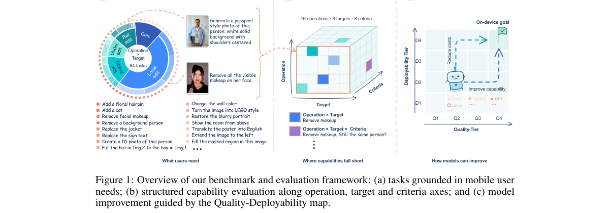

**Why this ranks #2**: 移动端图像生成评测不该只给一个分数，而应把「质量」与「可部署性」分成两个维度看。

---

### 3. SpeeDiff: Scalable Pixel-Anchored End-to-End Latent Diffusion Model

**arXiv**: [2610.36419](https://arxiv.org/abs/2610.36419) | **Score**: 8.3 (relevance 8.0 x 0.7 + quality 9.0 x 0.3) | **Tags**: AIGC-visual, latent-diffusion, end-to-end, VAE, TPR-loss, scaling | **Categories**: cs.CV | **Pages**: 29

**Authors**: Bingliang Zhang; Wenda Chu; Yizhuo Li; Linjie Yang; Yisong Yue; Katherine L. Bouman; Yang Song; Qiushan Guo

**Affiliation**: ByteDance Seed; California Institute of Technology; Meta

**Abstract**

> We present Scalable Pixel-anchored End-to-end Diffusion (SpeeDiff), a latent diffusion method that jointly trains the VAE and the diffusion model from scratch. In principle, joint training allows the diffusion loss gradient to directly guide the VAE encoder, encouraging the formation of a generation-friendly latent space and potentially yielding faster convergence than the conventional two-stage approach with a pretrained frozen VAE. However, a naive end-to-end implementation severely degrades performance, as unrestricted backpropagation of the diffusion loss leads to latent space collapse. Our main technical contribution is a simple yet effective Tweedie Pixel Reconstruction (TPR) loss, which provides additional pixel-level feedback by decoding a predicted clean latent from an intermediate noisy state using Tweedie's formula, thereby alleviating collapse. Furthermore, our method enables jointly scaling a fully transformer-based architecture and enhances representation alignment within the end-to-end framework. Our SpeeDiff-XL model achieves over 140x and 61x faster training compared to Vanilla SiT and REPA, respectively, while attaining an FID of 1.50 without guidance on ImageNet 256x256 generation. With a more efficient 32x compressed VAE, our model further reaches an FID of 1.53 without guidance on ImageNet 512x512 generation.

**Key findings**

- **Finding**: SpeeDiff 让 VAE 与扩散模型从零开始联合训练，期望扩散损失直接塑形出「对生成友好」的潜空间。
- **Finding**: 朴素实现会严重退化，原因是扩散损失的无约束反传会让潜空间坍缩成退化表征。
- **Finding**: 核心补救是 Tweedie Pixel Reconstruction (TPR) 损失——从中间噪声态用 Tweedie 公式解码出预测的干净潜变量，提供像素级反馈。
- **Finding**: SpeeDiff-XL 相对 Vanilla SiT 与 REPA 分别提速 140 倍与 61 倍训练，ImageNet 256×256 无引导 FID 达到 1.50，512×512 达到 1.53。
- **Inference**: 「端到端训 VAE」的诱惑在于省掉一整轮重建训练成本，但必须有一个锚点把潜空间拉回可解码区域——Tweedie 重建同时提供重建监督与生成监督，这是它比单纯像素重建更合适的原因。
- **Inference**: 140 倍训练加速是相对 SiT/REPA 这类需重训 VAE 的基线而言，端到端方案本身仍要付重建分支的成本，论文数字不应被直接当作「省了 140 倍」。
- **Recommendation**: 推荐。做潜空间建模、或者想把 VAE 与生成模型一起端到端训的读者值得读 TPR 损失的推导。

**Key figures**

*Framework - Overview of SpeeDiff for end-to-end joint training of VAE and diffusion model from scratch. (a) Conventional two-stage LDM training: a CNN-based VAE [28] is first trained and then frozen, af*

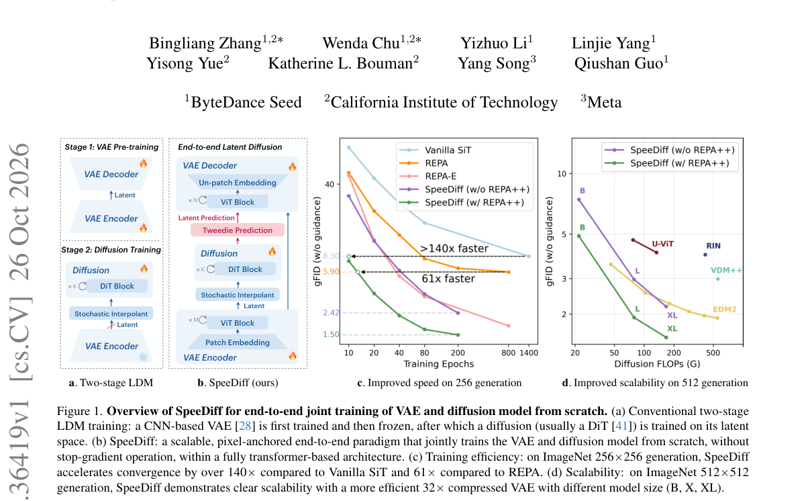

*Result - Detailed training pipeline of SpeeDiff. The forward pass consists of four major branches: (1) Reconstruction branch: LVAE is computed over reconstructions from the VAE encoder and decoder. (*

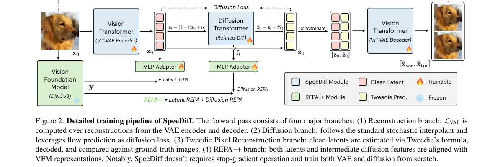

**Why this ranks #3**: 把 VAE 和扩散模型端到端联合训练，并用 Tweedie 像素重建挡住潜空间坍缩。

---

### 4. Repurposing Video Diffusion Transformers for Cross-View Temporal Object Correspondence

**arXiv**: [2610.37633](https://arxiv.org/abs/2610.37633) | **Score**: 8.0 (relevance 8.0 x 0.7 + quality 8.0 x 0.3) | **Tags**: AIGC-visual, video-diffusion, DiT, correspondence, cross-view, temporal-tracking | **Categories**: cs.CV | **Pages**: 31

**Authors**: Siyoon Jin; Dahyun Chung; Honggyu An; Sangbeom Lim; Wonjin Nam; Jaewoo Jung; WonJun Moon; Seungryong Kim

**Affiliation**: KAIST AI; Korea University

**Abstract**

> Cross-view object correspondence identifies the same object across views. However, existing methods often rely on frame-wise matching or sequential tracking, which can propagate correspondence errors under appearance changes or occlusions. Therefore, we introduce cross-view temporal object correspondence, which requires preserving object identity across both views and time from a query mask. To address this, we propose XTrack, a unified framework which repurposes a pretrained video DiT with semantic and spatiotemporal priors for RGB-to-mask latent transport, jointly modeling cross-view matching and temporal tracking. However, naive video DiTs do not guarantee accurate cross-view grounding and often attend to semantically similar yet incorrect objects across views. Thus, we introduce focal cross-view attention alignment, hard negative conditioning, and local context crop strategies to ensure reliable grounding. Finally, beyond these architectural enhancements, we also tackle the lack of dense annotation by introducing a pseudo-label curation pipeline that converts sparse Ego-Exo4D annotations into dense supervision to enable effective video-level training. Our results demonstrate the effectiveness of XTrack as a unified framework, ensuring robust temporal consistency and identity preservation.

**Key findings**

- **Finding**: 论文提出「跨视角时序物体对应」任务：给定一个查询掩码，需要同时跨视角保持物体身份、跨时间保持跟踪。
- **Finding**: 传统的「先在查询视角传播掩码再逐帧匹配」与「先匹配再逐视角跟踪」两种范式都无法同时满足两个一致性要求。
- **Finding**: XTrack 复用预训练视频 Diffusion Transformer 的语义与时空先验，在潜空间做 RGB 到掩码的传输，联合建模跨视角匹配与时序跟踪。
- **Finding**: 方法采用联合的视角-时间掩码预测形式化，把两个目标放进一个预测头里。
- **Inference**: 这条路子的价值在于「不训练」——直接征用一个视频生成模型的时空先验做下游视觉任务，和 S3-S2ST 里用 T2I 扩散做语音合成是同一种思路的镜像版本。
- **Inference**: 风险是掩码空间与 RGB 空间的潜变量分布差异大，论文若没有针对不同 DiT 预训练数据的消融，「先验可迁移」的结论会偏脆弱。
- **Recommendation**: 推荐。关注「生成模型先验的跨模态复用」这条线的读者值得读，和音频侧的 ImageTTS 可以对照看。

**Key figures**

*Framework - Comparison of cross-view temporal object correspondence paradigms. (Top) (a) propagates the mask in the query view and matches it per frame. (b) starts with initial match, then tracks in eac*

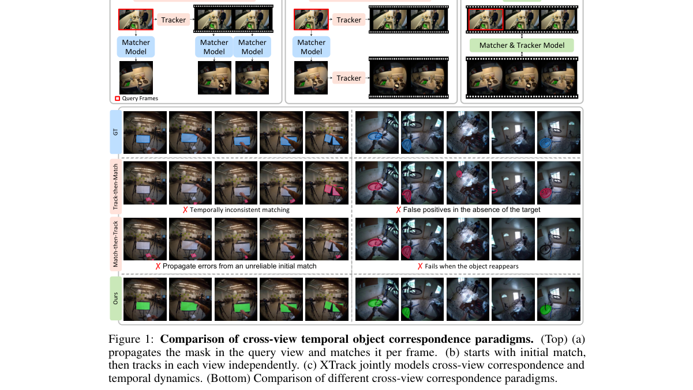

*Result - Overall architecture of XTrack.*

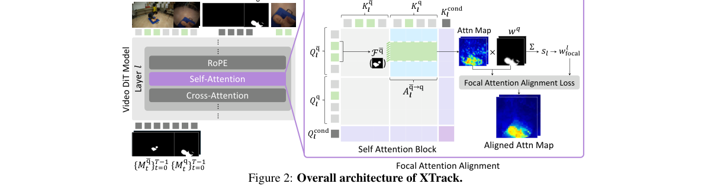

**Why this ranks #4**: 把预训练视频 DiT 当成通用跨视角时序对应先验，用 RGB→掩码 的潜变量传输同时做匹配与跟踪。

---

### 5. A First-Step Bias Restores Lost Diversity in Diffusion Model Distillation

**arXiv**: [2610.37110](https://arxiv.org/abs/2610.37110) | **Score**: 8.0 (relevance 8.0 x 0.7 + quality 8.0 x 0.3) | **Tags**: AIGC-visual, diffusion-distillation, few-step, diversity, bias-adapter | **Categories**: cs.AI, cs.CV | **Pages**: 31

**Authors**: Wenwu Tang; Dong Wang; Yun Cheng; Olga Saukh

**Affiliation**: Graz University of Technology; Complexity Science Hub Austria

**Abstract**

> Distribution-matching distillation enables high-quality image generation in only a few denoising steps. However, distilled student models often map different initial noise samples to similar outputs under the same prompt. To locate where diversity is lost, we compare the teacher and student along the sampling trajectory. The largest measured reduction in the response to different initial noises occurs during the first, high-noise step. When we replace the first step with the teacher's corresponding trajectory and leave the final three student steps unchanged, most of the output diversity returns. This suggests that the first step is a key point for restoring diversity. Motivated by this finding, we introduce \emph{ReSeed}, a post-distillation method that adds a seed-response bias adapter only to the first student step and aligns its velocity with the teacher's first-interval secant velocity. All student weights and later denoising steps remain unchanged. We evaluate ReSeed on three text-to-image models (SD3-Medium, SD3.5-Medium, and FLUX.1-dev) and one text-to-video model (Wan2.1-T2V-1.3B). For a distilled 4-step FLUX.1-dev model, \emph{ReSeed} requires only $0.00196\%$ additional trainable parameters relative to the base model and is trained on 8,000 prompt--noise pairs, while keeping the distilled student fully frozen and requiring no target images, perceptual losses, or adversarial losses. It improves DINO diversity by $48.3\%$ while maintaining competitive visual quality. These results show that substantial diversity can be recovered through a lightweight, data-efficient tuning of only the first denoising step, without finetuning the full student model.

**Key findings**

- **Finding**: 论文定位到一个具体现象：少步蒸馏模型的多样性损失绝大部分发生在第一个去噪步。
- **Finding**: 实验手段是「保持学生第 2–4 步不变、只把第 1 步换成教师的」，在 SD3-Medium 上有 98/100 个 prompt 的多样性立刻回升。
- **Finding**: ReSeed 只在学生第一步插入一个很小的 bias adapter，并把它的速度对齐到教师第一区间的割线速度。
- **Finding**: 冻结的后续步骤并没有丧失多样性能力，问题只出在起手的那一步。
- **Inference**: 「第一步偏差」给出了一个几乎零成本的修复路径——不需要重训整个蒸馏模型，只需要训练一个极小的适配器并只作用在第一步。
- **Inference**: 这类「归因到单步」的诊断思路可迁移：把多步生成管线的每个中间量单独替换成教师版本，是定位蒸馏损伤的通用手段。
- **Recommendation**: 推荐。做少步扩散蒸馏、又关心输出多样性的读者强烈建议读，方法本身几乎可以直接用。

**Key figures**

*Framework - ReSeed recovers visible same-prompt diversity. All panels use the prompt “A smiling woman with long dark brown hair, hazel eyes, and a warm expression” and the same 25 fixed initial noises,*

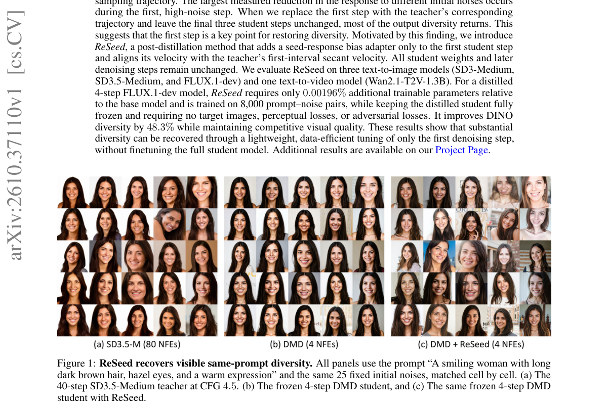

*Result - First-step replacement on SD3-Medium. (a) With student steps 2–4 fixed, replacing step 1 by the teacher raises diversity for 98/100 prompts; ReSeed moves them toward the teacher-prefix resul*

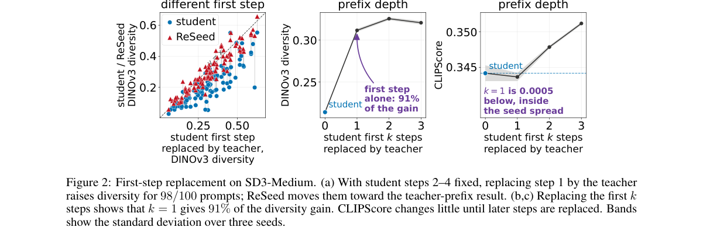

**Why this ranks #5**: 少步蒸馏丢的多样性几乎全发生在第一个去噪步，只修这一步就够。

---

### 6. GraftRay: Physically Based Mesh Insertion into Gaussian Splatting Scenes via Path Tracing

**arXiv**: [2610.37036](https://arxiv.org/abs/2610.37036) | **Score**: 8.0 (relevance 8.0 x 0.7 + quality 8.0 x 0.3) | **Tags**: AIGC-visual, 3DGS, scene-composition, path-tracing, relighting, content-creation | **Categories**: cs.CV, cs.GR | **Pages**: 11

**Authors**: Jinxin Ai; Matthias Niessner

**Affiliation**: Technical University of Munich

**Abstract**

> Inserting virtual objects into scenes reconstructed via 2D or 3D Gaussian Splatting (2DGS/3DGS) is a key capability for content creation, AR, and synthetic data generation. However, realistic insertion requires the object to be seamlessly lit by the scene and, conversely, to cast physically plausible shadows onto it. Existing approaches either harmonize appearance in image space, sacrificing multi-view consistency, or approximate scene illumination with an environment map at the insertion point, which cannot represent near-field area lights such as windows and lamps that dominate indoor lighting. To address this, we present GraftRay, a unified method for physically consistent insertion of mesh objects into indoor scenes represented by either 2D or 3D Gaussians. We recover scene materials and surface normals with diffusion-based priors, and explicitly model spatially-extended emitters, solving their radiance in closed form. A hybrid renderer then jointly path-traces the scene Gaussians and inserted meshes, producing view-consistent shading, interreflections, and soft shadows. On FIPT, GraftRay sets a new state of the art, outperforming recent baselines such as ComGS and EAG-PT in rendering fidelity and shadow accuracy, while maintaining highly competitive rendering efficiency.

**Key findings**

- **Finding**: GraftRay 解决 3D/2D 高斯场景中的物体插入，强调物理一致的光照与阴影，而非图像空间的外观调和。
- **Finding**: 既有方法在图像空间做外观调和，牺牲多视角一致性；或用插入点处的环境贴图近似光照，无法表达窗口、台灯这类近场面光源。
- **Finding**: 方法用扩散先验恢复材质与法向，并显式建模空间延展的光源，其辐射度可解析求解。
- **Finding**: 混合渲染器联合对场景高斯与插入网格做路径追踪，产生视角一致的着色、互反射与软阴影。
- **Finding**: 在 FIPT 基准上，渲染保真度与阴影精度均优于 ComGS、EAG-PT 等近期方法，同时保持有竞争力的渲染效率。
- **Inference**: 这篇的技术含量集中在「面光源的闭式辐射求解 + 混合路径追踪」这一层，把几何光照做对了，插入物体的合成感才会真正消失。
- **Inference**: 依赖扩散先验做材质/法向恢复意味着恢复质量决定上限，在材质反光复杂的场景里可能仍是瓶颈。
- **Recommendation**: 推荐。做场景合成、AR 内容插入或数字孪生场景编辑的读者值得看光传输部分的建模。

**Key figures**

*Framework - GraftRay inserts mesh objects into a 3D Gaussian Splatting scene with physically consistent shading and shadows.*

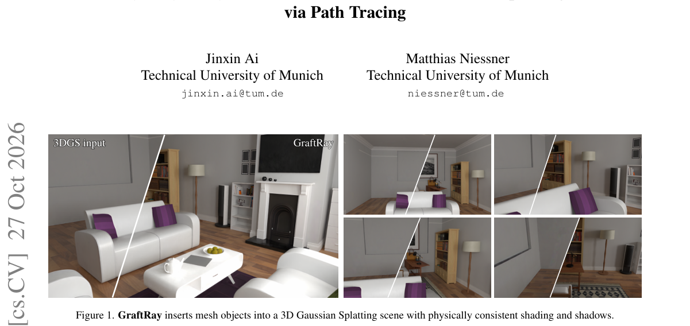

*Result - Overview of GraftRay. From LDR photographs we reconstruct a 3DGS scene (tiles: Gaussians as feature-coloured ellipsoids | render) and lift materials and normals onto it (Sec. 3.1). SAM-marke*

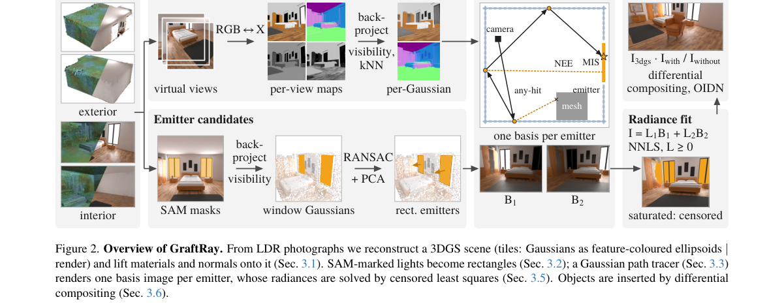

**Why this ranks #6**: 往 3D 高斯场景里插物体，不能靠贴图调和，得让物体真正被场景的光照到并投出影子。

---

### 7. Haste Makes Waste? Towards Safe Few-Step Text-to-Image Models

**arXiv**: [2610.36665](https://arxiv.org/abs/2610.36665) | **Score**: 8.0 (relevance 8.0 x 0.7 + quality 8.0 x 0.3) | **Tags**: AIGC-visual, few-step, concept-erasure, safety, T2I, distillation | **Categories**: cs.CR, cs.CV | **Pages**: 20

**Authors**: Lior Ziv; Mahmood Sharif

**Affiliation**: Tel Aviv University

**Abstract**

> While few-step distilled text-to-image models have gained traction due to their fast generation times, the speed-up implications on their unsafe generation rates remain unknown. We uncover an inherent tension between speed and safety: few-step models are often more unsafe than their teachers, and reducing the number of inference steps consistently raises unsafe generation rates. We further find that acceleration makes unsafe concepts harder to erase in few-step models, with existing concept-erasure methods markedly less effective than in teachers. We offer a mechanistic diagnosis for why erasure methods fail on few-step models, finding that the fragility of few-step models' generation process and the way generation guidance is usually distilled into those models may hinder established concept-erasure methods. To address the speed-safety trade-off, we propose DICE (Distillation-Integrated Concept Erasure), a post-distillation erasure method tailored for few-step models. DICE aligns both its latent construction and its generation-preservation loss with the distillation method that produced the model, keeping erasure faithful to few-step models. DICE demonstrates strong results in our evaluation. For example, on FLUX Schnell, DICE reduces unsafe-generation rate to 0.046 (vs. at least 0.161 for prior erasure methods we test), while mostly preserving benign generation quality.

**Key findings**

- **Finding**: 论文发现少步蒸馏模型往往比其教师更不安全，且减少推理步数会持续抬高不安全内容生成率。
- **Finding**: 加速还会让不安全概念更难被擦除——现有概念擦除方法在少步模型上明显不如在教师模型上有效。
- **Finding**: 机制诊断指出，少步模型生成过程的脆弱性、以及生成引导通常被蒸馏进模型的方式，共同阻碍了既有擦除方法。
- **Finding**: DICE（Distillation-Integrated Concept Erasure）让擦除的潜变量构造与生成保持损失都对齐产生该模型的蒸馏方法，从而保持擦除对少步模型的忠实度。
- **Finding**: 在 FLUX Schnell 上，DICE 把不安全生成率压到 0.046，而对比的既有擦除方法均不低于 0.161，同时基本保留良性生成质量。
- **Inference**: 「加速与安全是权衡而非中性」这个结论有部署意义——把采样步数当作纯效率旋钮会静默改变安全画像，评测时应同时报告步数与不安全率。
- **Inference**: DICE 的关键设计是「擦除损失必须尊重蒸馏的生成路径」，本质上是用生成方式的知识去约束擦除，这是个通用思路：任何针对压缩/加速模型的安全方法都该重新对齐其训练动力学。
- **Recommendation**: 推荐。做少步 T2I 部署或模型安全对齐的读者强烈建议读，注意论文含 NSFW 示例。

**Key figures**

*Framework - SD-Checker severity distribution for SD3.5 Large vs. SD3.5 Turbo, with a box-plot summary.*

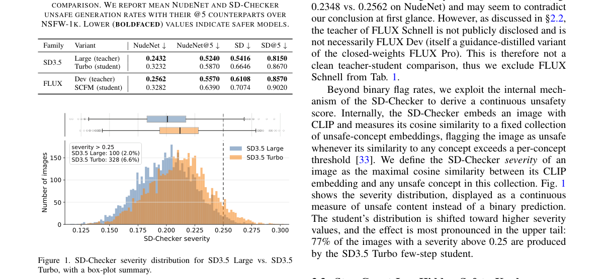

*Result - CLIP similarity of generated images to “nudity”, by number of inference steps. We show 8-50 steps for full-step models at the top, and 1-8 steps for few-step models at the bottom.*

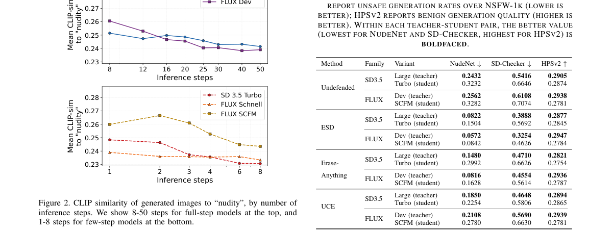

**Why this ranks #7**: 少步模型不是「更快」，而是「更不安全」，而且更难被抹掉不安全概念。

---

### 8. Know, then Draw: A New Learning Paradigm for Visual Generation

**arXiv**: [2610.37626](https://arxiv.org/abs/2610.37626) | **Score**: 8.0 (relevance 8.0 x 0.7 + quality 8.0 x 0.3) | **Tags**: AIGC-visual, autoregressive-pretraining, diffusion-post-training, scaling-law, tokenizer | **Categories**: cs.CV | **Pages**: 27

**Authors**: Yucheng Mao; Chongjian Ge; Zhuowen Tu; Hao Tan; Hanwen Jiang

**Affiliation**: University of California, San Diego; Adobe Research

**Abstract**

> Visual generation requires both high-level semantic knowledge and fine-grained pixel details. We propose a learning paradigm that assigns these roles to autoregressive pretraining for knowledge acquisition and diffusion post-training for high-fidelity rendering. Within this framework, we study the objective, representation, and scaling of knowledge acquisition and rendering. Controlled comparisons identify autoregression as the stronger pretraining objective for downstream rendering, improving both learning efficiency and final generation quality. We further find that AR-only generation quality does not necessarily correlate with final performance; semantic quality matters more. This motivates a purely semantic tokenizer trained with language supervision alone, without an image decoder or reconstruction loss. We establish compute-optimal scaling laws for knowledge acquisition and rendering, and find that autoregressive pretraining lowers the fitted asymptotic rendering loss compared with pixel diffusion models trained from scratch. Guided by the laws, we train a 3B-parameter text-to-image model with only 6,600 H100 GPU-hours, achieving 86 on GenEval and 87 on DPG-Bench and validating the proposed paradigm at scale.

**Key findings**

- **Finding**: 论文提出把「高层语义知识」与「细粒度像素渲染」分给两种训练范式：自回归预训练负责知识获取，扩散后训练负责高保真渲染。
- **Finding**: 受控对比确认自回归更适合知识获取、扩散更适合渲染，两者并不互相取代。
- **Finding**: 一个反直觉发现：纯自回归的生成质量与最终表现并不必然相关，语义质量的影响更大。
- **Finding**: 据此提出只用语言监督训练、且不带图像解码器或重建损失的纯语义 tokenizer。
- **Finding**: 建立了知识获取与渲染两条 compute-optimal 缩放律；3B 参数文生图模型只用 6,600 H100 GPU 小时，GenEval 86、DPG-Bench 87。
- **Inference**: 「先 AR 后 diffusion」实质是把两种训练目标当成互补的先验来源：AR 提供语义与结构，扩散提供像素级保真，这与多模态统一模型近期的「理解用 AR、生成用扩散」思路同源。
- **Inference**: 6,600 H100 换 GenEval 86 的成本优势，一部分来自纯语义 tokenizer 省掉了重建损失，但论文同时指出 AR-only 质量与最终成绩不必然相关，读者不应把 tokenizer 的作用单独夸大。
- **Recommendation**: 推荐。关注生成模型训练范式与缩放律的读者值得读，论文的 compute-optimal 拟合方法可直接复用。

**Key figures**

*Framework - Strong visual generation with compute-efficient training. Left: DPG-Bench versus training compute; marker size denotes model size. Our 3B model achieves competitive performance with only 6,6*

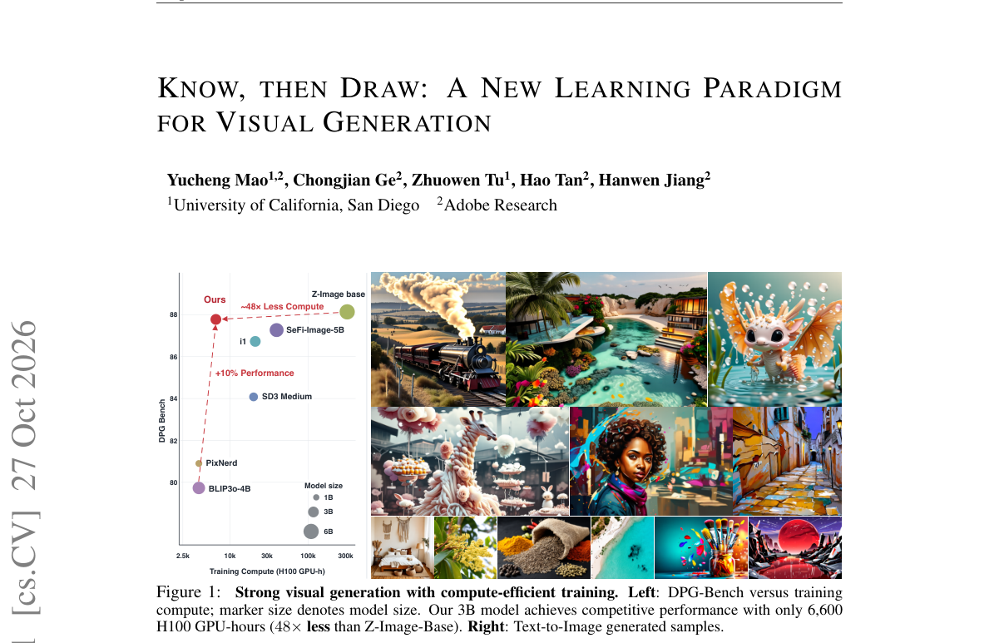

*Result - Overview of our learning paradigm. Autoregressive pretraining acquires visual knowledge through discrete token prediction. The pretrained backbone is then frozen and augmented with diffusion*

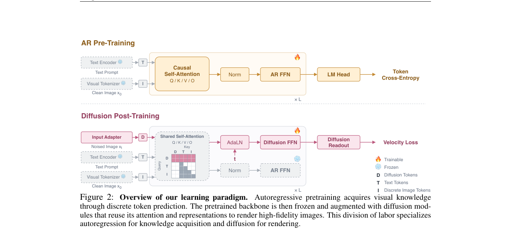

**Why this ranks #8**: 知识用自回归学、渲染用扩散画，两件事分开训练反而更省算力。

---

### 9. LociArt: A Unified Paradigm for Free-Style Local Video Stylization

**arXiv**: [2610.36456](https://arxiv.org/abs/2610.36456) | **Score**: 7.0 (relevance 7.0 x 0.7 + quality 7.0 x 0.3) | **Tags**: AIGC-visual, video-stylization, local-editing, dataset, matting, MiLM | **Categories**: cs.AI, cs.CV, cs.MM | **Pages**: 35

**Authors**: Yuxuan Chen; Feng Xie; Jiagao Hu; Fuhao Li; Zepeng Wang; Fei Wang; Daiguo Zhou

**Affiliation**: MiLM Plus, Xiaomi Inc.; Xi'an University of Electronic Science and Technology

**Abstract**

> Video stylization typically transforms entire scenes, while local artistic editing requires precise region--style association, spatial control, and temporal consistency. We introduce LociArt, a unified paradigm for free-style local video stylization that explicitly specifies where to stylize and what style to apply while preserving non-target content. At its core, GRNStyle builds on Generative Refinement Networks (GRN) and introduces a polar style-aware mask that embeds style identities as equal-norm directions within selected regions. Complementary representation--geometry conditioning combines encoded mask features with raw-mask spatial support, integrating spatiotemporal context with geometric control. To provide paired supervision, we develop an automated pipeline combining global stylization, video object removal, matting, and compositing, and construct the LociArt-100K Dataset with 100K local stylization pairs. We further establish the LociArt Benchmark, comprising 80 source videos and 84 target masks covering 168 foreground/background stylization cases, with a Style Prototype Similarity (SPS) evaluation scheme for regional style quality and complementary measures of non-target preservation and temporal consistency. Experiments show that GRNStyle outperforms existing methods in regional style quality and spatial control while maintaining strong temporal consistency. Qualitative examples further illustrate joint stylization of multiple regions with the same or different learned styles, despite training only on single-region, single-style pairs. Together, these components provide a unified foundation for learning and evaluating controllable local video stylization. Project page: https://higherhu.github.io/lociart/.

**Key findings**

- **Finding**: LociArt 把自由风格的局部视频风格化形式化为两个显式输入：指定要风格化的位置，以及要施加的风格，同时保持非目标内容不变。
- **Finding**: 为了构造成对监督，作者搭了一条自动化流水线：全局风格化 → 视频目标移除 → 抠像 → 合成，并据此构建 10 万条局部风格化配对数据 LociArt-100K。
- **Finding**: 模型为 GRNStyle，支持局部或全局编辑、多区域共享或各自不同的风格、以及无需组合式训练的风格组合。
- **Finding**: 同时发布 LociArt Benchmark 作为配套评测。
- **Inference**: 用「全局风格化 + 目标移除 + 抠像」反推局部配对，是把局部编辑的监督问题转成可自动化生成的关键技巧，思路可复用到任何局部生成式编辑任务。
- **Inference**: 数据是合成的，风格化伪影与目标边缘的抠像误差会在训练时被当成真值，真实场景的多目标/遮挡情况可能超出分布。
- **Recommendation**: 推荐。做局部视频编辑或需要构造局部编辑数据的读者值得看 GRNStyle 与流水线设计。

**Key figures**

*Framework - Examples of free-style local video stylization. LociArt supports local or global editing, shared or distinct styles across multiple regions, and style composition without compositional traini*

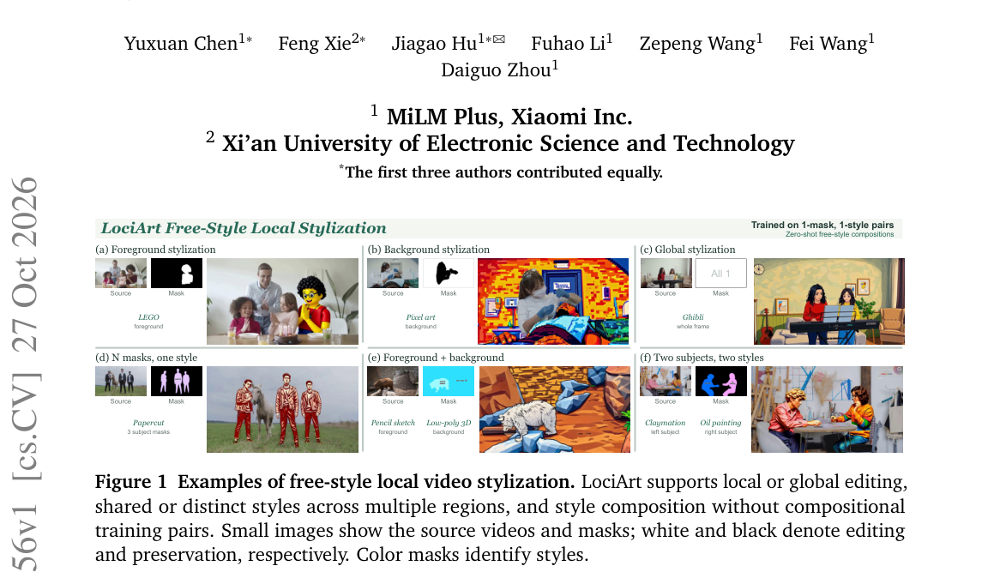

*Result - Overview of the data construction pipeline. Source and object-removed videos are globally stylized and filtered, then combined through mask-guided matting to produce foreground- and backgroun*

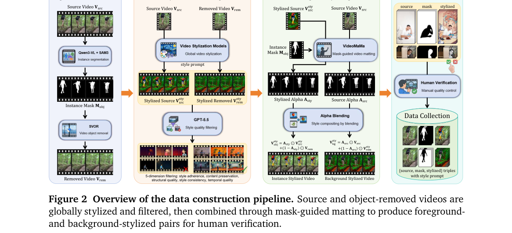

**Why this ranks #9**: 「哪里改」和「改成什么样」必须分开指定，才能保住不该动的部分。

---

### 10. ReferStream: Interactive Subject Injection for Streaming Video Generation

**arXiv**: [2610.37566](https://arxiv.org/abs/2610.37566) | **Score**: 7.0 (relevance 7.0 x 0.7 + quality 7.0 x 0.3) | **Tags**: AIGC-visual, streaming-video, subject-injection, reference-image, training-free | **Categories**: cs.CV | **Pages**: 18

**Authors**: Shuolin Xu; Guanyuan Li; Boyu Li; Kelu Yao; Xiaogang Xu; Hongchuan Yu; Shuicheng Yan; Xiaobin Hu

**Affiliation**: Bournemouth University; National University of Singapore; Zhejiang University; HKUST; Zhejiang Lab

**Abstract**

> Injecting new subjects naturally during streaming video generation requires integrating newly supplied visual references into the existing video while preserving established subjects and the scene. Encoding references independently of the current scene provides little guidance for this integration, while keeping their features in persistent memory can interfere with established context. We propose ReferStream, a framework that requires no additional training and combines reference construction using the current scene with transient cache injection. Joint Latent places reference latents in target regions of the latest scene latent, allowing reference features to be extracted in context. Cache Restoration uses these features to condition the injection chunk, then restores the overwritten global cache entries while retaining the newly generated history. This procedure incorporates new visual conditions without retraining the generator or revising emitted frames. We further introduce ReferStream Bench, a new benchmark with scheduled reference arrivals, evolving instructions, and explicit annotations of subject presence for InShot and MultiShot generation. Evaluation follows the event schedule and measures both the fidelity of new subjects and the preservation of established subjects, alongside video quality, text adherence, and count accuracy. Experiments on ReferStream Bench show higher scores for text adherence, subject similarity, and count accuracy than the compared baselines, including offline methods given all references in advance. Project page: https://xushuolin.github.io/ReferStream/.

**Key findings**

- **Finding**: ReferStream 面向流式视频生成中的交互式主体注入，核心是免训练地把参考主体在中途接入已建立好的场景。
- **Finding**: 两个关键机制是参考构造（用当前场景自行构造参考）与瞬态缓存注入（transient cache injection）。
- **Finding**: 实现建立在冻结的 LongLive2 骨干之上，配合 Joint Latent 与 Cache Restoration 两类操作。
- **Finding**: 作者新提出 ReferStream Bench，包含参考到达时序、演化的指令与预期主体是否在场。
- **Finding**: 在该基准上，文本贴合度、主体相似度与计数准确率均高于对比基线，其中包含「一开始就拿到全部参考」的离线方法。
- **Inference**: 「用当前场景自己构造参考」很聪明——把外部参考图转成与当前帧同分布的输入，从而避免流式模型因分布外参考而崩坏。
- **Inference**: 免训练是这篇最大的实用价值，但也意味着能力上限受冻结骨干约束，参考图质量与场景复杂度的组合仍是风险点。
- **Recommendation**: 推荐。做流式视频生成、个性化或免训练适配的读者值得读，工程实现可参考。

**Key figures**

*Framework - Interactive subject injection during streaming generation. A new cat reference is supplied after the umbrella scene is established. The cat enters while the umbrella remains and previously em*

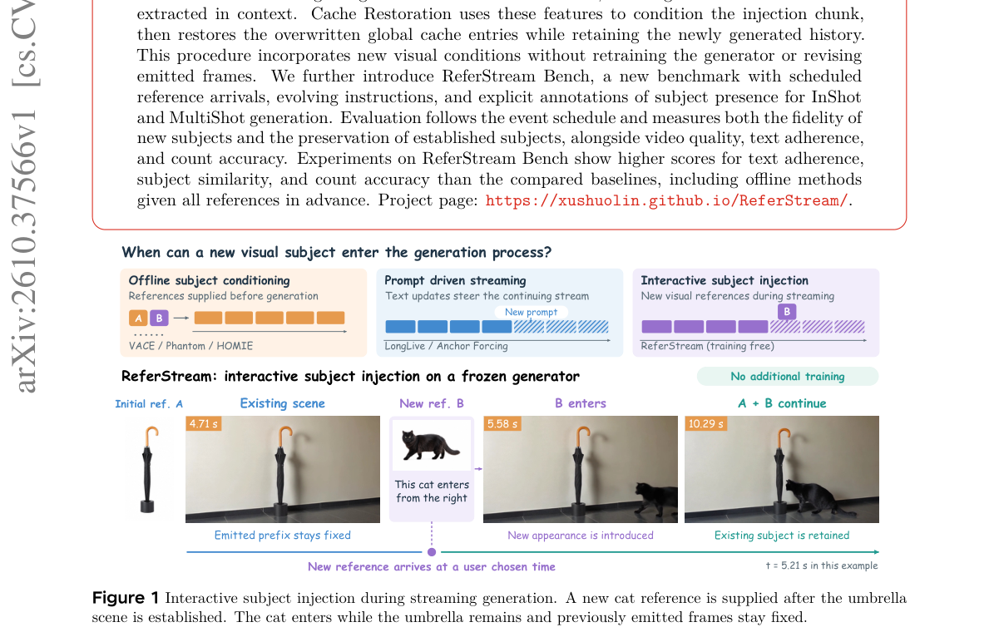

*Result - Overview of ReferStream, illustrated for an InShot event. Top: reference B arrives after subject A is established and conditions the next chunk. Middle: (A) Joint Latent composes the referenc*

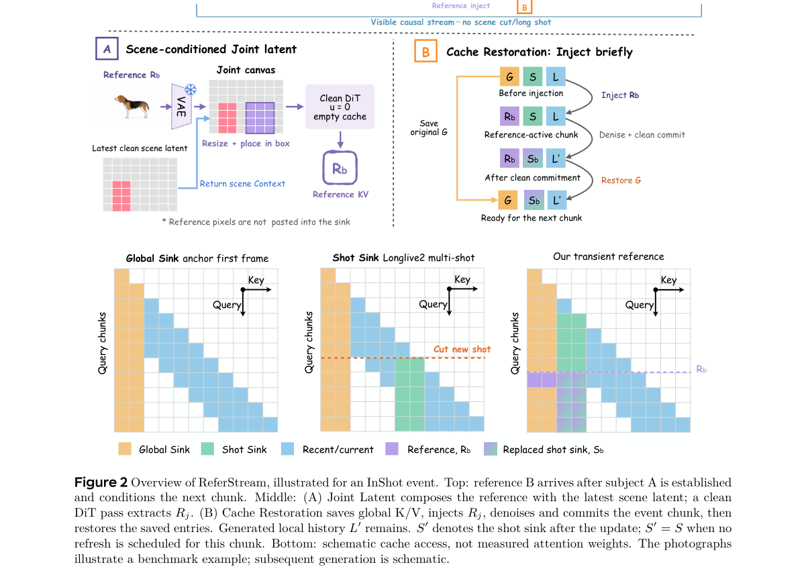

**Why this ranks #10**: 流式生成里主体是中途才出现的，参考图得在生成过程中「插进来」而不是开局就给全。

---

## Footer

- Total papers scanned across all 7 tracks: 578（原始 794 条）
- aigc_visual track final top-10: 10
- Wild-cards in this track: 0
- Figure assets: 2026-10-28/res/

Generated by `mine-arxiv-daily-digest` skill. Sister file: `2026-10-28_aigc_visual_entry.md`.
