# ArXiv Daily Digest - 2026-10-28 (音频与语音语言模型, 10 papers)

**Generated**: 2026-10-28 17:00 CST

**Source**: arXiv cs.CV, cs.SD, eess.AS, cs.CL, cs.AI, cs.RO, cs.LG submissions, listing day 2026-10-27 (announced 2026-10-28 00:00 UTC)

**Batch window**: 2026-10-26T18:00:00Z .. 2026-10-27T18:00:00Z（arXiv 公告批次横跨两个 UTC 日：前一日 18:00 UTC 起算，当日 17:59:59 UTC 截止）

**Track**: audio_lm (top 10 of 578 papers scanned, 70 full reads)

**Scope**: 语音 / 音频语言模型、流式语音交互、说话人建模、多语种与低资源语音

⚠️ **Wild-card**: 本批该线 1 篇为 wild-card 补足，已在正文逐条标注并给出理由。

补足原因：该批次语音语言模型方向的纯正候选不足 10 篇；EmbeddingGemma 2 是覆盖音频的统一多模态表征模型，作为语音多模态表征方向补位。

---

## Top 10 - 音频与语音语言模型

### 1. S3-S2ST: Semantically Supervised Streaming Speech-to-Speech Translation

**arXiv**: [2610.36777](https://arxiv.org/abs/2610.36777) | **Score**: 8.7 (relevance 9.0 x 0.7 + quality 8.0 x 0.3) | **Tags**: audio-lm, speech-to-speech, streaming, commit-policy, X-LANCE, translation | **Categories**: cs.SD | **Pages**: 16

**Authors**: Yuxiang Zhao; Zhiyun Fan; Yu Pu; Yanjie An; Yushen Chen; Wenrui Liang; Baiji Liu; Yunchong Xiao; Zhaoci Liu; Keqi Deng; Kai Yu; Zhifu Gao

**Affiliation**: Shanghai Jiao Tong University; Shanghai Innovation Institute; Alibaba Token Foundry; Independent Researcher

**Abstract**

> Streaming speech-to-speech translation requires timely decisions about when partial input is sufficient for accurate translation. We present S3-S2ST, a model that learns to translate and speak from semantically aligned streaming supervision. By converting utterance-level speech pairs into incremental training examples, we teach a learned policy when to commit translations. Its adjustable threshold controls the quality--latency tradeoff on a fixed 640\,ms input grid. S3-S2ST delivers competitive English--Chinese translation on FLEURS and leads the evaluated streaming systems in translation quality on the internal 9-pair test set. On RealSI, adapting the threshold to buffered speech further improves quality over a low fixed threshold with little change in first-audio latency. We plan to release the model and code.

**Key findings**

- **Finding**: S3-S2ST 从语义对齐的流式监督中同时学习增量翻译与「何时提交」的决策。
- **Finding**: 做法是把话语级语音对转换成增量训练样例，让学到的策略自行决定何时提交翻译。
- **Finding**: 架构上分块声学特征与已提交文本共同构成 Thinker 上下文，其末态同时支撑文本生成与一个 MLP 的 READ/WRITE 提交策略，语音输出由独立的加权流式解码器承担。
- **Finding**: 可调阈值在固定 640 ms 输入网格上控制质量-延迟权衡。
- **Finding**: 在 FLEURS 上取得有竞争力的英译中结果，在内部 9 语言对测试集上翻译质量领先被测流式系统；在 RealSI 上按缓冲语音调整阈值能进一步提升质量且首包延迟变化很小。
- **Inference**: 把「什么时候说」变成一个可学习的 READ/WRITE 策略而非固定阈值，是流式语音系统从「能流式」到「用起来自然」的关键一步。
- **Inference**: 内部 9 语言对测试集是自建数据，跨语言泛化能力仍需外部基准验证；模型与代码计划发布但当前不可得。
- **Recommendation**: 推荐。做流式语音翻译、双工语音交互或端到端语音模型的读者值得读。

**Key figures**

*Framework - Application overview of S3-S2ST. The system listens to partial source speech, decides when to commit, and produces translated speech while the source continues. The timeline is illustrative,*

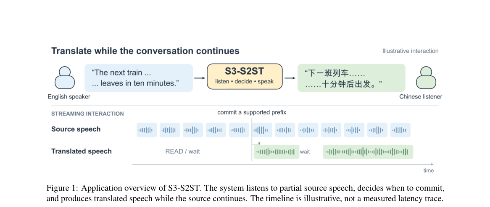

*Result - Architecture of S3-S2ST. Chunkwise acoustic features and committed text form the Thinker context. Its final state supports text generation and an MLP READ/WRITE policy; a separate weighted f*

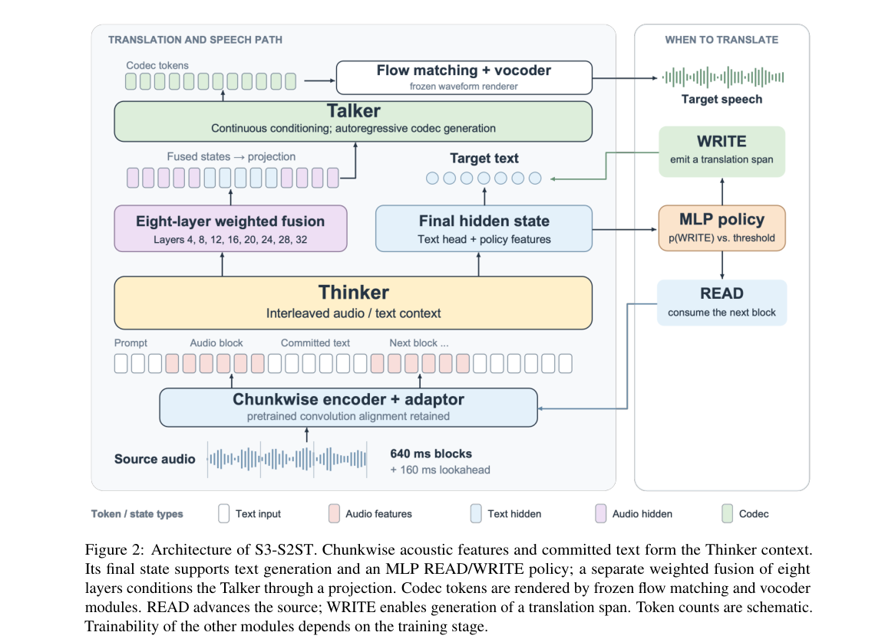

**Why this ranks #1**: 流式语音翻译真正的难点不是翻译，是「什么时候该开口」。

---

### 2. Tap2Listen: Instant Target Switching for Streaming Audio-Visual Speaker Extraction

**arXiv**: [2610.36643](https://arxiv.org/abs/2610.36643) | **Score**: 8.0 (relevance 8.0 x 0.7 + quality 8.0 x 0.3) | **Tags**: audio-lm, speaker-extraction, streaming, audio-visual, on-device, SKKU | **Categories**: cs.AI, cs.SD | **Pages**: 8

**Authors**: Hansol Park; Minkyung Song; Zinu Kim; Yujun Lee; Hoseong Ahn; Hyunjin Choi; Kyuhong Shim

**Affiliation**: Sungkyunkwan University

**Abstract**

> Streaming audio-visual target speaker extraction (AV-TSE) uses a target speaker's face to extract the speaker's speech from an input audio mixture in real time. However, existing systems fix the target speaker for an entire clip, while conversation demands frequent and immediate target switches. To address this problem, we propose Tap2Listen, a streaming AV-TSE model designed for instant response to target switches. The model separates computation by modality: the target-agnostic audio encoder processes only the mixture, while the target-specific visual cues of the selected face condition only the decoder. A switch requires only a 0.12ms re-projection and takes effect immediately. We also design component-wise losses: a prediction loss for the encoder and a supervised extraction loss for the decoder. For evaluation, we measure how quickly output quality recovers after a switch. On the standard LRS3-2mix test set, Tap2Listen improves SI-SNRi from 8.85 to 9.68 dB at a comparable parameter count. After a switch to a known face, the model produces full-quality output from the first frame, whereas the baseline needs about 1 second to recover. Finally, we show that the proposed streaming AV-TSE model runs in real time on a single CPU core.

**Key findings**

- **Finding**: Tap2Listen 针对流式音视频目标说话人抽取（AV-TSE）中「目标切换必须立刻响应」的需求设计。
- **Finding**: 架构按模态分离计算：与目标无关的音频编码器只处理混合信号，目标相关的视觉线索只条件化解码器。
- **Finding**: 一次切换只需 0.12 ms 的重投影即可立即生效。
- **Finding**: 训练采用分组件损失：编码器用预测损失，解码器用有监督抽取损失。
- **Finding**: 在 LRS3-2mix 上以相当的参数量把 SI-SNRi 从 8.85 提升到 9.68 dB；切到已知人脸后模型从第一帧即输出满质量，而基线约需 1 秒恢复；整套模型在单 CPU 核上实时运行。
- **Inference**: 「目标无关计算复用 + 目标相关计算缓存」的切分，是把交互式多目标场景做成实时系统的通用工程范式。
- **Inference**: 视觉线索只条件化解码器意味着切换时必须重新跑解码器，作者报告的 0.12 ms 重投影是前提，真正的端到端切换延迟还需看解码器开销。
- **Recommendation**: 推荐。做可穿戴听音设备、实时说话人抽取或端侧多模态交互的读者值得读。

**Key figures**

*Framework - Tap2Listen interaction. Two speakers are present in the same mixture; tapping face A or B immediately switches the output to the selected speaker.*

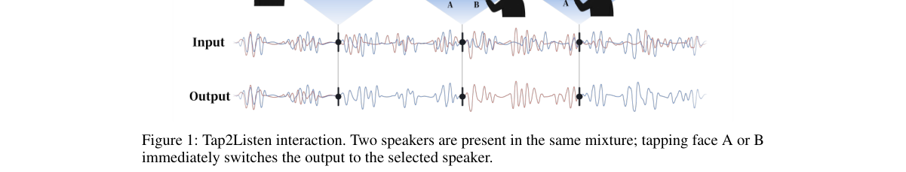

*Result - Tap2Listen architecture. Blue denotes target-agnostic computation that is retained across target switches. Orange indicates target-specific computation recomputed at each switch. Gray blocks*

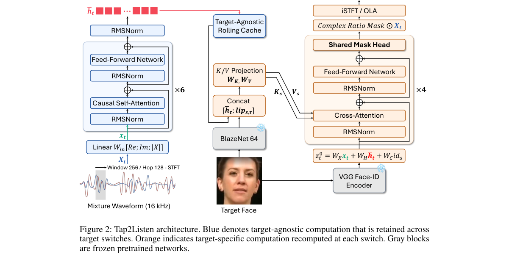

**Why this ranks #2**: 要切换要听谁，就不能让人脸相关的计算留在整条推理链路上。

---

### 3. From Voiceprints to User Entities: Online Speaker-Memory Construction for Multi-User Spoken Agents

**arXiv**: [2610.36713](https://arxiv.org/abs/2610.36713) | **Score**: 8.0 (relevance 8.0 x 0.7 + quality 8.0 x 0.3) | **Tags**: audio-lm, spoken-agents, speaker-memory, privacy, memory, identity | **Categories**: cs.AI, cs.SD, eess.AS | **Pages**: 22

**Authors**: Yucong Zhang; Cancan Li; Bo Xiao; Ke Zeng; Ming Li

**Affiliation**: The Chinese University of Hong Kong, Shenzhen; Meituan; Wuhan University

**Abstract**

> Personalized spoken agents must identify speakers before accessing user-specific memory, yet memory benchmarks typically assume correctly attributed histories. We argue that voiceprints are observations of identity, not identities themselves, and formulate online speaker-memory construction to maintain persistent user entities as acoustic evidence evolves. We introduce EvoSpeakerMem, a training-free layer for causal speaker routing, selective acoustic-state updates, and identity-partitioned memory writes and retrieval through a replaceable text-memory backend. We also construct LoCoMo-ID, a spoken-memory benchmark with hidden speaker identities, speaker-sensitive queries, simulated recording-condition shifts, and four-speaker identity-confusion tests. On longitudinal SMIIP-TV, genuine-probe rejection under a frozen near-enrollment threshold rises from 29.8% to 55.6% over approximately one year. On LoCoMo-ID speaker-sensitive queries, gated updating improves identity-gated QA over fixed representations by 3.86 and 11.62 percentage points under clean and shifted conditions, respectively, with no wrong-user authorizations. The advantage persists in the four-speaker test. Yet reducing fragmentation and improving QA can coexist with incorrect cross-user links, revealing a fragmentation--contamination trade-off that QA alone cannot capture.

**Key findings**

- **Finding**: 论文主张 voiceprint 是身份的观测而非身份本身，并据此提出在线说话人记忆构建（online speaker-memory construction），在声学证据持续变化时维护持久的用户实体。
- **Finding**: EvoSpeakerMem 是一个免训练层，包含因果说话人路由、选择性声学状态更新，以及通过可替换文本记忆后端实现的按身份分区写入与检索。
- **Finding**: 作者另建 LoCoMo-ID 语音记忆基准，含隐藏说话人身份、说话人敏感查询、模拟录音条件漂移与四说话人身份混淆测试。
- **Finding**: 在纵向 SMIIP-TV 数据上，冻结近注册阈值下的真实探针拒识率一年内从 29.8% 升到 55.6%；LoCoMo-ID 上门控更新在干净与漂移条件下分别把身份门控 QA 提升 3.86 与 11.62 个百分点，且无错误跨用户授权。
- **Finding**: 作者同时指出「碎片化减少与 QA 提升可并存于错误的跨用户链接」，构成 QA 指标本身捕捉不到的碎片化-污染权衡。
- **Inference**: 「声纹是观测不是身份」是个正确的建模起点——它直接推出「记忆写入必须先做身份归属判定」这一架构要求，也解释了为何要单独建 LoCoMo-ID 这类隐藏身份基准。
- **Inference**: 主动暴露「QA 指标捕捉不到跨用户污染」这一负面结果，是这篇最有分量的部分，说明该领域的评测还远远不够。
- **Recommendation**: 推荐。做语音助手、长期记忆、多用户系统或关心语音隐私的读者强烈建议读。

**Key figures**

*Framework - Overview of EvoSpeakerMem as a speech support layer for replaceable textual-memory backends. Acoustic routing assigns each turn to a persistent user entity before its content is written to m*

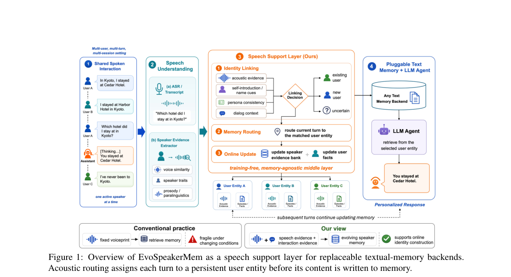

**Why this ranks #3**: 声纹只是「关于身份的观测」，不是身份本身——这个区分决定了记忆系统怎么建。

---

### 4. Developing a Speech Language Model for Basque

**arXiv**: [2610.36911](https://arxiv.org/abs/2610.36911) | **Score**: 7.7 (relevance 8.0 x 0.7 + quality 7.0 x 0.3) | **Tags**: audio-lm, speech-language-model, low-resource, Basque, synthetic-data, HiTZ | **Categories**: cs.AI, cs.CL, eess.AS | **Pages**: 5

**Authors**: Andoni Sudupe; Inma Hernaez; Ander Arriandiaga; Christoforos Souganidis; Ibon Saratxaga; Eva Navas

**Affiliation**: University of the Basque Country (UPV/EHU)

**Abstract**

> Although the recent development of LLMs has paved the way for multi-modal interaction, minority languages face difficulties keeping pace. This work presents the first open Speech Language Model for Basque, designed for low-latency, end-to-end spoken interaction. Based on the LLaMA-Omni architecture, the system integrates a Latxa model as its backbone, transferring its Basque capabilities to the spoken modality by fine-tuning several modules. To address data scarcity, the English VoiceAssistant-400K corpus was translated into Basque, and the audio was synthesized using a Basque TTS. Evaluation results confirm the system's viability, achieving 3.86/5 in content quality, a 9.94% WER for spoken intelligibility, and a 3.07 UTMOS for audio quality. This work demonstrates that advanced spoken interaction systems can be developed using modular architectures and synthetic data even in low-resource languages.

**Key findings**

- **Finding**: 这是首个公开的巴斯克语语音语言模型，基于 LLaMA-Omni 架构，以 Latxa 为骨干并微调多个模块把语言能力迁移到语音模态。
- **Finding**: 为解决数据稀缺，作者把英文 VoiceAssistant-400K 语料翻译成巴斯克语，再用巴斯克语 TTS 合成音频。
- **Finding**: 评测取得内容质量 3.86/5、语音可懂度 9.94% WER、音频质量 3.07 UTMOS。
- **Finding**: 作者的结论是：模块化架构 + 合成数据足以在低资源语言上做出可用的口语交互系统。
- **Inference**: 「翻译 + TTS 合成」是低资源语音 LM 最经济的冷启动路径，它把语音数据瓶颈换成了文本翻译质量问题。
- **Inference**: WER 9.94% 相对英文同类系统仍偏高，且巴斯克语 TTS 的合成腔会被 SLM 学进去，低资源语言的真实对话体验仍待验证。
- **Recommendation**: 推荐。做低资源语音、多语种语音 LM 或想找冷启动路线的读者值得读，是一份诚实且可复现的工作。

**Key figures**

*Framework - Left: Model architecture of our SLM, based on LLaMA-Omni. Right: Illustration of the two-stage training strategy.*

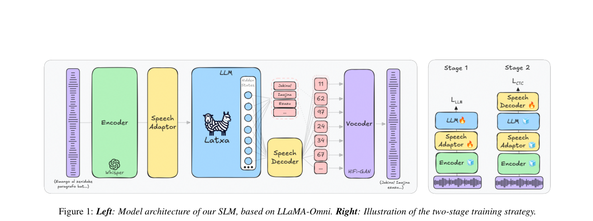

**Why this ranks #4**: 低资源语言没有语音数据，就用 TTS 把它翻译版的文本语料「念」出来。

---

### 5. Beyond Answer Changes: Matched Same-Class Controls for Local Audio Evidence

**arXiv**: [2610.37605](https://arxiv.org/abs/2610.37605) | **Score**: 7.3 (relevance 7.0 x 0.7 + quality 8.0 x 0.3) | **Tags**: audio-lm, audio-understanding, probing, controlled-intervention, sound-events, HKUST | **Categories**: cs.AI, cs.SD | **Pages**: 5

**Authors**: Yunuo Wang; Maoyuan Chen; Yuanjin Huang; Xing Liu

**Affiliation**: The Hong Kong University of Science and Technology (Guangzhou); Wuhan University; National University of Singapore; Northeastern University

**Abstract**

> For audio-language models, an answer change after a local sound-event edit can reflect a response to the event's class, sensitivity to waveform rewriting, or both. We compare matched same-class and different-class replacements of a queried event. Both use the same interval, level estimate, donor fitting, and crossfade, while the same-class replacement preserves the correct answer. Across 600 synthetic soundscapes and three models from two architecture families, different-class replacements produce 49.7 to 60.9 percentage points more answer changes than same-class replacements. Same-class accuracy remains within 5.2 percentage points of original accuracy. Among trials with correct original and same-class answers, soundscape-weighted selective accuracy for the inserted class is 73.7 to 81.9%, averaging eligible trials within each soundscape and then weighting eligible soundscapes equally. This protocol tests how model answers respond to local changes in event class.

**Key findings**

- **Finding**: 论文指出音频-语言模型在局部声音事件被编辑后答案改变，可能源于对事件类别的响应、对波形重写的敏感，或两者兼有。
- **Finding**: 作者设计配对的同类与异类替换对照：两者使用相同的时间区间、电平估计、供体拟合与交叉淡入淡出，只有类别不同；同类替换保持正确答案不变。
- **Finding**: 在 600 个合成声景、来自两个架构家族的三个模型上，异类替换引发的答案变化比同类替换多 49.7 到 60.9 个百分点。
- **Finding**: 同类替换下的准确率与原始准确率相差不超过 5.2 个百分点。
- **Finding**: 在原答案与同类答案均正确的试验中，按声景加权的选择性准确率为插入类别的 73.7% 到 81.9%。
- **Inference**: 这套「同类/异类配对替换」是给多模态模型做因果探针的通用协议，能把「真的听懂了」与「只是对波形扰动敏感」干净地分开。
- **Inference**: 依赖合成声景与受控编辑，结论能否外推到真实录音中的事件混淆与重叠语音仍是开放问题。
- **Recommendation**: 推荐。做多模态音频理解评测、模型可信度分析或设计鲁棒性测试的读者值得读，协议可迁移到视觉。

**Key figures**

*Framework - Changing the queried event’s class elicits more answer change than rewriting the same interval with another recording of that class. Nuisance and sham edits produce smaller responses. The righ*

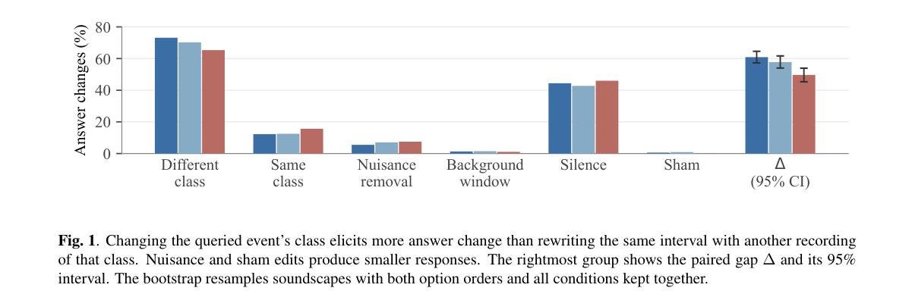

*Result - Class-level original accuracy versus the different-class minus same-class answer-change gap. Each point represents one of 33 query classes for one model. Both quantities use the same evaluatio*

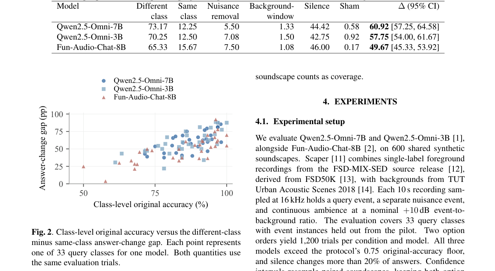

**Why this ranks #5**: 模型答变了，是真的听到了新事件，还是只是波形被改写了？用同类替换做对照就能分辨。

---

### 6. A Lightweight Dual-Branch Visual Front-End for Efficient Audio-Visual Target Speaker Extraction

**arXiv**: [2610.36834](https://arxiv.org/abs/2610.36834) | **Score**: 7.0 (relevance 7.0 x 0.7 + quality 7.0 x 0.3) | **Tags**: audio-lm, speaker-extraction, efficiency, visual-front-end, landmark, Wuhan | **Categories**: eess.AS | **Pages**: 15

**Authors**: Zhan Jin; Peijun Yang; Juan Liu; Ming Li

**Affiliation**: Wuhan University; The Chinese University of Hong Kong, Shenzhen

**Abstract**

> Audio-Visual Target Speaker Extraction (AVTSE) uses face-related visual cues to extract a target speaker from a speech mixture. In many AVTSE systems, visual features are obtained from convolutional image encoders, and their computation may become a non-negligible part of the overall system when lightweight separation backbones are used. This work proposes a dual-branch visual front-end that reorganizes visual information according to its spatial characteristics. A compact lip region of interest is used to model local articulation cues through convolutional processing, while facial landmark coordinates are used to represent global geometric motion with a lightweight temporal convolutional network. The two representations are integrated into IIANet and SpatialNet with limited fusion overhead. Experiments on LRS3-2mix under a unified reduced training protocol show that the proposed method achieves a performance-computation trade-off close to the lightweight image-based baseline. Compared with the ResNet18-based visual encoder, it reduces the module-level visual encoding computation by more than 90% across both evaluated separation backbones, with a moderate performance gap. This comparison excludes face detection and landmark estimation and therefore applies to systems where landmark coordinates are already available from preprocessing. Demos are available at https://anonymous.4open.science/r/Lightweight-Visual-Frontend-E46E.

**Key findings**

- **Finding**: 论文观察到在轻量级分离骨干上，图像卷积编码器的视觉特征计算会占到系统相当比例。
- **Finding**: 提出的双分支视觉前端按空间特性重排视觉信息：紧凑的唇部 ROI 用卷积建模局部发音线索，面部关键点坐标用轻量时序卷积网络表示全局几何运动。
- **Finding**: 两种表征在 IIANet 与 SpatialNet 上以有限的融合开销整合。
- **Finding**: 在 LRS3-2mix 的统一缩减训练协议下，取得接近轻量图像基线的性能-计算折中；相对 ResNet18 视觉编码器，模块级视觉编码计算量降低 90% 以上，代价是适度性能差距。
- **Inference**: 「按空间特性分工」是这条线的通用思路——高频局部细节交给高分辨率卷积，稀疏结构信息交给低维几何坐标，避免用昂贵 CNN 去解本不需要空间推理的部分。
- **Inference**: 性能差距是「适度」的，论文未给出具体数值分布，落地时要自行权衡算力与质量的交换点。
- **Recommendation**: 推荐。做音视频说话人抽取、端侧音频前端或关注视觉侧算力占用的读者值得读。

**Key figures**

*Framework - Spatial attention maps from four attention heads. The 11 × 11 feature maps are bilinearly upsampled to the original 88 × 88 lip ROI for visualization.*

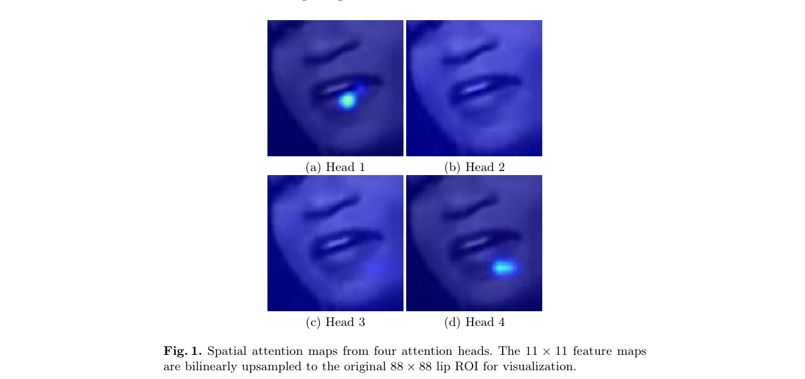

*Result - Architecture of the Lip Encoder*

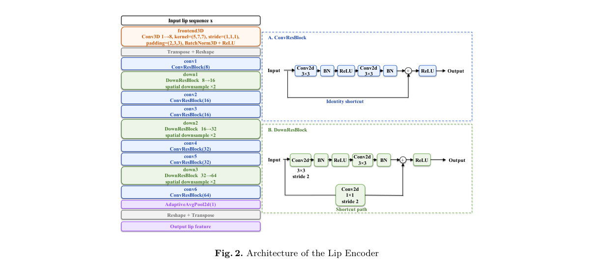

**Why this ranks #6**: 轻量分离骨干下，视觉编码反而成了大头——那就按空间特性重排视觉信息。

---

### 7. Agentic Data Sampling Framework for Multilingual ASR via Linguistic-Aware Error-Driven Optimization

**arXiv**: [2610.36538](https://arxiv.org/abs/2610.36538) | **Score**: 7.0 (relevance 7.0 x 0.7 + quality 7.0 x 0.3) | **Tags**: audio-lm, ASR, data-sampling, agent, multilingual, SJTU | **Categories**: cs.CL | **Pages**: 18

**Authors**: Zhiheng Qian; Junhao Du; Jing Peng; Hanqi Li; Kunyang Peng; Feng Xue; Lu Chen; Shuai Wang; Kai Yu

**Affiliation**: Shanghai Jiao Tong University; AISpeech; Nanjing University

**Abstract**

> Multilingual automatic speech recognition (ASR) has achieved rapid progress with large-scale pretrained models and multilingual speech corpora. Previous studies have proved the pivotal role of data sampling in multilingual ASR performance. However, existing sampling strategies largely rely on time-consuming manual, heuristic-based designs. To address this, we propose a linguistic-aware agentic data sampling framework that introduces a data sampling LLM agent into the multilingual ASR training loop. The agent is driven by a linguistically grounded rubric that analyzes ASR errors from phonological, morphological, and syntactic perspectives, and uses the resulting feedback together with training statistics, budget constraints, and algorithm profiles to select domain-level, sample-level, and token-level sampling strategies. This design turns evaluation results into adaptive data-selection decisions rather than treating WER/CER as final endpoints only. We conduct experiments on twelve Common Voice languages using Whisper-medium as the ASR backbone. The results show that our method achieves performance better than full-data training while using less training data and lower computational resources, and substantially accelerates training convergence compared to conventional sampling strategies.

**Key findings**

- **Finding**: 论文把一个数据采样 LLM agent 引入多语种 ASR 训练循环，形成「语言学感知的智能体数据采样」框架。
- **Finding**: 采样 agent 依据当前模型的错误分布决定下一批该训练什么语言、什么数据，从而闭合采样-训练回路。
- **Finding**: 结果显示该方法用更少训练数据和更低计算资源取得了优于全量数据训练的表现，并相对常规采样策略显著加快收敛。
- **Finding**: 在 12 个 Common Voice 语言上的实验表明，在相同累积训练预算下，平均多语种识别性能优于不采样与随机采样基线，并在多数评测语言上取得最佳结果。
- **Inference**: 这是「把数据选择交给 LLM agent」的一个干净实例，亮点在于采样预算固定，因此结论不是「算力换效果」而是「同样的算力换个花法」。
- **Inference**: 成本被推给了推理期的 agent 调用，论文以相同累积训练预算作比较，读者应确认 agent 自身的推理开销是否计入。
- **Recommendation**: 推荐。做多语种 ASR、数据选择或训练效率优化的读者值得读。

**Key figures**

*Framework - Overview of the proposed agentic data sampling framework. The blue nodes show the common ASR model training pipeline, while the purple nodes belong to our agentic data sampling workflow.*

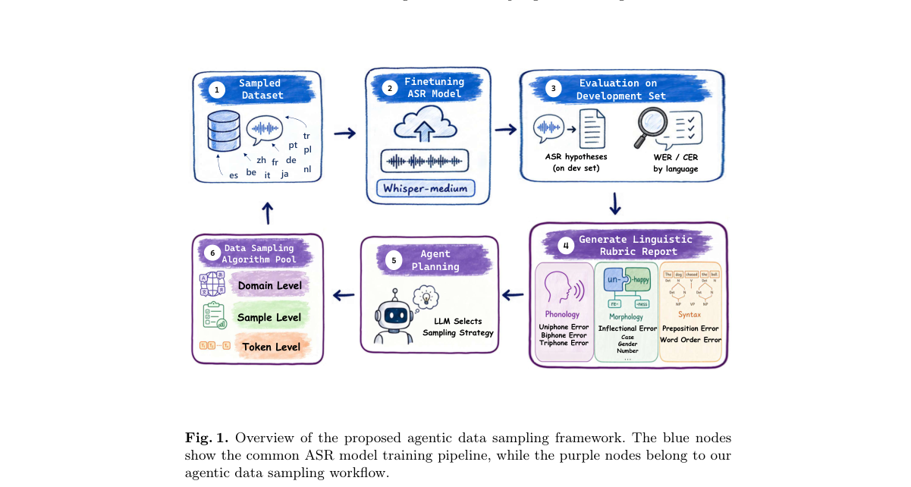

*Result - Comparison of overall test WER over training time under no sampling, random sampling, and agentic sampling. The sampling batch of random and agentic method is 300 hours.*

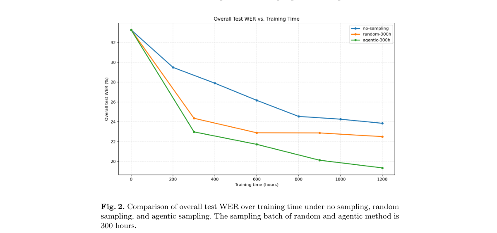

**Why this ranks #7**: 与其全量训练多语种 ASR，不如让一个 agent 挑该训哪批数据。

---

### 8. Lipi-Ghor: A Large-Scale, Diarized, Multi-Domain Bengali Speech Corpus and a Scalable Pipeline for Building It

**arXiv**: [2610.36184](https://arxiv.org/abs/2610.36184) | **Score**: 7.0 (relevance 7.0 x 0.7 + quality 7.0 x 0.3) | **Tags**: audio-lm, speech-corpus, Bengali, diarization, low-resource, CC-BY | **Categories**: cs.CL | **Pages**: 12

**Authors**: Sanjid Hasan; A H M Fuad; Risalat Labib; Bayazid Hasan Simon

**Affiliation**: Khulna University of Engineering & Technology; Bangladesh University of Engineering & Technology

**Abstract**

> Bengali, spoken by over 230 million people, remains severely under-resourced in spoken language research. Existing open Bengali ASR corpora are confined to short, read or crowd-sourced speech and lack speaker diarization and long-form audio. We present Lipi-Ghor, a large-scale weakly-supervised Bengali speech corpus comprising 885 hours of audio sourced from 998 YouTube videos across 596 unique channels, spanning 17 diverse domains including audiobooks, drama, religious sermons, news, and regional dialects. Each recording is annotated in SSTT format (Speaker, Speech, Transcription, Timestamp), which combines automated diarization with Bengali YouTube caption tracks. To our knowledge, Lipi-Ghor is the first Bengali speech corpus to pair large-scale coverage with speaker-diarized, long-form audio annotations, both of which are absent from existing open Bengali resources. We also present the construction methodology as a replicable pipeline for any language with a sufficient captioned YouTube presence. Targeted channel curation across a handful of rich domains yields corpus scales that were previously out of reach for low-resource languages. We benchmark four widely-used ASR models under zero-shot and fine-tuned conditions. All four degrade consistently on emotive, dialectal, and long-form content. Because caption targets are noisy, we also release a human-annotated gold evaluation split, verified by 17 volunteer annotators over 30 hours of human-in-the-loop correction and stratified across all 17 domains. We release our original contributions (video-ID lists, diarization output, pipeline code, and the gold annotations) under CC-BY-4.0, and distribute caption-derived transcripts for research use only; no raw audio is redistributed.

**Key findings**

- **Finding**: Lipi-Ghor 是一个弱监督的孟加拉语语音语料，含 885 小时音频，来自 998 个 YouTube 视频、596 个频道，覆盖 17 个领域。
- **Finding**: 每条录音以 SSTT 格式（说话人、语音、转写、时间戳）标注，结合自动说话人分离与孟加拉语 YouTube 字幕轨。
- **Finding**: 作者称这是首个同时具备大规模覆盖与带说话人分离的长音频标注的孟加拉语语料。
- **Finding**: 流水线本身对语言无关，只要某语言在 YouTube 上有足够字幕覆盖即可复现。
- **Finding**: 四个常用 ASR 模型在零样本与微调条件下均一致地在意情化、方言与长音频内容上退化。
- **Finding**: 另发布 17 名志愿标注者、30 小时人机协同修正的黄金评测划分，覆盖全部 17 个领域；视频 ID 列表、分离输出、流水线代码与黄金标注以 CC-BY-4.0 发布。
- **Inference**: 「YouTube 字幕 + 商用分离模型」组合出了低资源语料的可行配方，同时把分离输出随附发布，绕开了 Precision-2 这类 API 门控模型不可复现的问题。
- **Inference**: 字幕本身噪声大，作者用黄金划分缓解但没有完全消除；语料只做研究用途分发、不再分发原始音频，限制了直接复现实验的便利性。
- **Recommendation**: 推荐。做低资源语音、孟加拉语或需要构造大规模语音语料的读者值得读，流水线可直接借用。

**Key figures**

*Framework - The Lipi-Ghor construction pipeline. Four stages turn a curated set of Bengali YouTube channels into a speaker-diarized, SSTT-annotated corpus. The methodology is language-agnostic; only Sta*

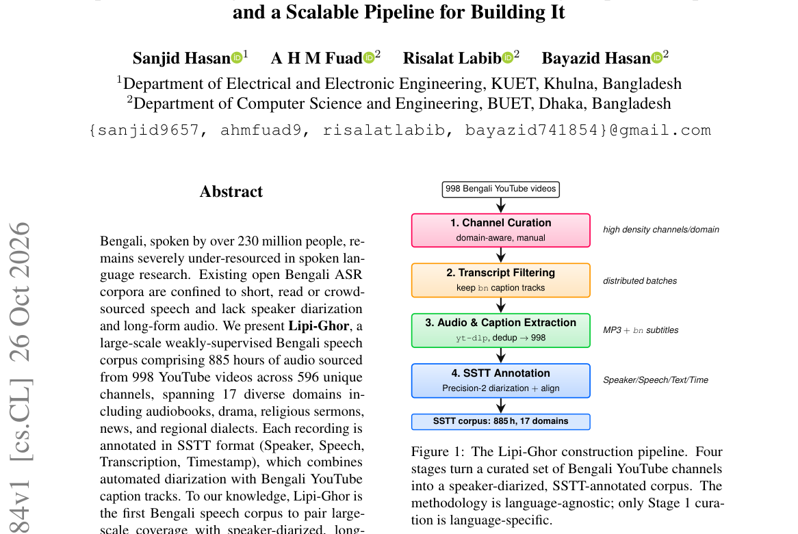

*Result - Pareto view of audio duration by domain. Seven of the seventeen domains account for roughly 83% of the corpus, reflecting where Bengali caption coverage is densest on YouTube.*

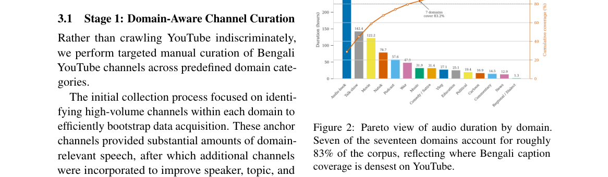

**Why this ranks #8**: 公开 Bengali 语音语料的缺口不在时长，而在长音频加说话人标注。

---

### 9. EmbeddingGemma 2: Unified and Efficient Multimodal Representations

**arXiv**: [2610.37364](https://arxiv.org/abs/2610.37364) | **Score**: 6.6 (relevance 6.0 x 0.7 + quality 8.0 x 0.3) | **Tags**: audio-lm, multimodal-embedding, audio-representation, Google, wild-card | **Categories**: cs.CL, cs.CV, cs.LG, cs.SD | **Pages**: 28

**Authors**: Henrique Schechter Vera; Sahil Dua; Jovan Andonov; Sara Smoot; Sebastian Russo; Ivan Llanos; Max Matveev; Jae Hyeon Yoo; Kat Black; Shih-Cheng Huang; Josiah Aklilu; Maarten Grootendorst

**Affiliation**: Google DeepMind

**Abstract**

> We present EmbeddingGemma 2, an open multimodal embedding model which natively represents text, images, audio, video, and combinations thereof in a unified space. Our approach introduces improvements such as simplified per-layer embeddings and a multi-stage curriculum with modality and objective progression which ensure strong quality across unimodal, cross-modal, and mixed-modal evaluations. Notably, in comprehensive embedding benchmarks across all modalities, EmbeddingGemma 2 establishes a new Pareto frontier, outperforming both specialist models and models two to twelve times larger. Furthermore, our design offers flexibility for resource-constrained environments, supporting selective modality encoder loading, adjustable vision token budgets, truncatable embedding dimensions, and quantized weights. We present ablations analyzing key decisions and release EmbeddingGemma 2 to promote further research.

**Key findings**

- **Finding**: EmbeddingGemma 2 是一个 7.44 亿参数的通用多模态嵌入模型，把文本、图像、视频、音频及其任意交错组合映射到同一语义对齐的向量空间。
- **Finding**: 关键设计包括简化的逐层嵌入，以及带模态与目标递进的多阶段课程训练。
- **Finding**: 在覆盖代码、图像、视频、视觉文档与音频的基准上建立了新的帕累托前沿，性能超过专用模型以及大 2 到 12 倍的模型。
- **Finding**: 工程上支持按需加载部分模态编码器、可调视觉 token 预算、可截断嵌入维度与量化权重，以适配资源受限环境。
- **Finding**: 论文附有消融分析解释架构与训练选择，并公开发布模型。
- **Inference**: 「逐层嵌入简化 + 模态课程」这套配方对做多模态检索与统一表征的人有直接参考价值，音频只是它覆盖的一个模态。
- **Inference**: 本文以音频/语音多模态表征方向计入本线属补位——它不是语音语言模型，也不是音频生成模型，读者应按「通用多模态嵌入」来定位它。
- **Recommendation**: 推荐（作为多模态嵌入参考）。做跨模态检索、音频表征或统一向量空间的读者值得读；只关心语音对话系统的可略读。

**Key figures**

*Framework - EmbeddingGemma 2 natively maps text, images, video, audio, and combinations thereof into a unified, semantically-aligned vector space.*

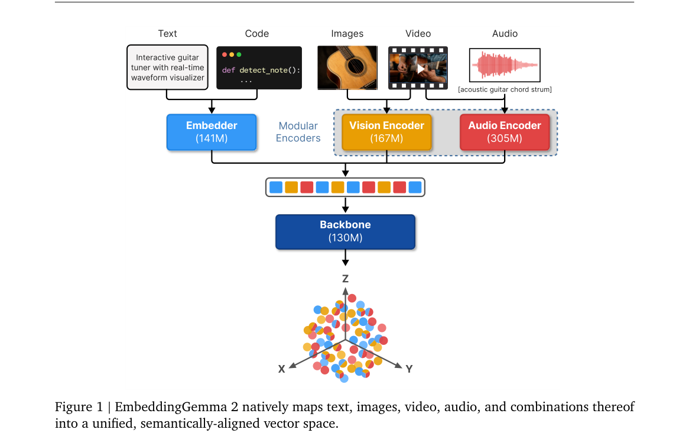

*Result - EmbeddingGemma 2 establishes a new Pareto frontier across benchmarks covering code, image, video, visual documents, and audio. Methods and detailed results in Section 4. ∗Mean(Task) for MTE*

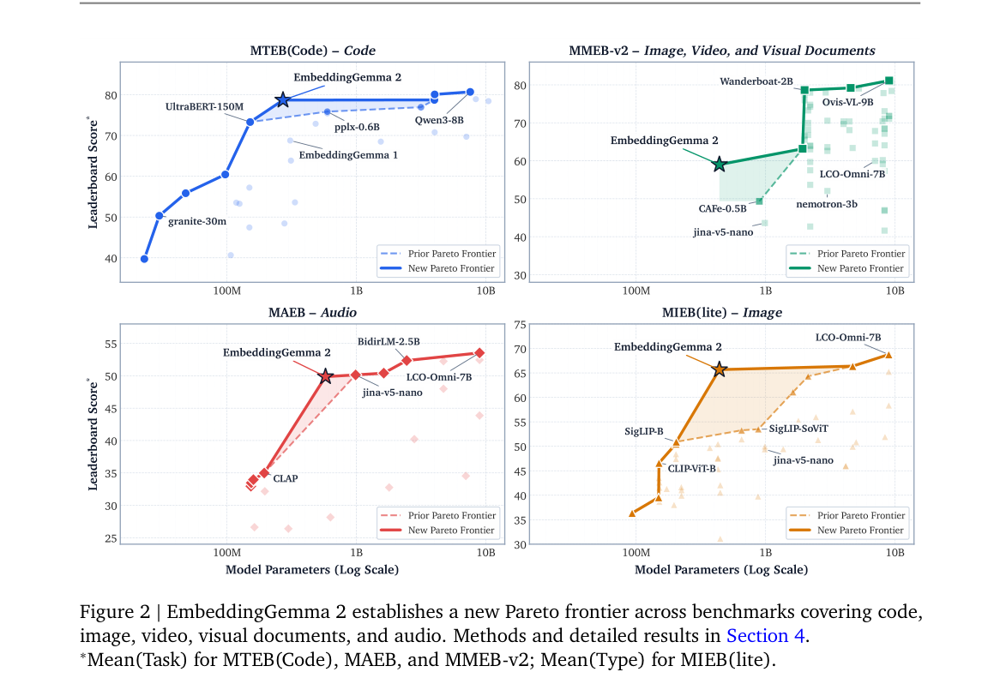

**Why this ranks #9**: 把音频、视频、文本塞进一个向量空间，真正考验的是混合模态下的对齐质量。  [wild-card=yes] 该批次音频语言模型方向纯正候选不足 10 篇；EmbeddingGemma 2 是覆盖音频的统一多模态表征模型，计入语音多模态表征方向。

---

### 10. Understanding Everyday Communication Patterns, Stress, and Productivity in Hybrid Work through Egocentric Wearable Audio Sensing

**arXiv**: [2610.37270](https://arxiv.org/abs/2610.37270) | **Score**: 6.3 (relevance 6.0 x 0.7 + quality 7.0 x 0.3) | **Tags**: audio-lm, diarization, wearable, knowledge-distillation, SLT, USC | **Categories**: cs.SD | **Pages**: 7

**Authors**: Tiantian Feng; Aditya Kommineni; Emily Zhou; Burcin Becerik-Gerber; Gale Lucas; Shawn C. Roll; Shrikanth Narayanan

**Affiliation**: University of Southern California

**Abstract**

> The hybrid work trend in the post-COVID period has transformed how people communicate while at work. However, there is a lack of quantitative understanding of how home and office environments shape communicative behavior and affective well-being. To study this, as a part of a larger study of the role of work environment on stress, we designed an egocentric wearable audio sensing system that captured interpersonal communication across both working locations. The system extracts real-time acoustic features on a wearable audio sensor and performs offline foreground speaker diarization to derive speaking load and activeness features. To improve diarization performance under low-dimensional feature constraints, we apply a teacher-student knowledge distillation framework that transfers knowledge from large-scale speech foundation models into a compact ResNet-based model, achieving consistent improvements in diarization performance over the baseline across three public egocentric speech datasets. In a four-month longitudinal deployment with 16 participants, our system revealed location-dependent differences in work communication patterns. Moreover, the mixed linear model analyses showed that office-based speaking load was significantly associated with higher self-reported stress and lower self-reported productivity, while speaking activeness during home-based work amplified both productivity and affective load in this cohort.

**Key findings**

- **Finding**: 论文设计可穿戴音频感知系统捕捉居家与办公两种环境下的 interpersonal 沟通，并用离线前景说话人分离导出说话负荷与活跃度特征。
- **Finding**: 为在低维特征约束下提升分离性能，作者用教师-学生知识蒸馏把大规模语音基础模型的知识迁移进紧凑的 ResNet 模型，在三个公开的第一人称语音数据集上稳定优于基线。
- **Finding**: 系统在设备端处理原始音频信号，提取低层声学特征，并用定制 Android 应用集成 openSMILE 完成特征提取。
- **Finding**: 四个月、16 名参与者的纵向部署揭示了工作地点依赖的沟通模式差异。
- **Finding**: 混合线性模型显示，办公室场景的说话负荷与更高的自报压力、更低自报生产力显著相关；居家场景的说话活跃度则放大生产力与情感负荷。
- **Inference**: 「语音基础模型做教师 + 紧凑模型做学生」是端侧说话人处理的标准配方，方法论价值高于结论本身。
- **Inference**: 这是一条偏 HCI 的应用研究，模型方法较常规，但把沟通模式与压力/生产力的纵向关联做实了，数据价值不低。
- **Recommendation**: 推荐。做端侧语音处理、说话人分离蒸馏或可穿戴健康感知的读者值得读。

**Key figures**

*Framework - Overview of the study protocol. EMAs were distributed via text message four times daily, with the first and last surveys aligned to each participant’s self-reported work start and end times. C*

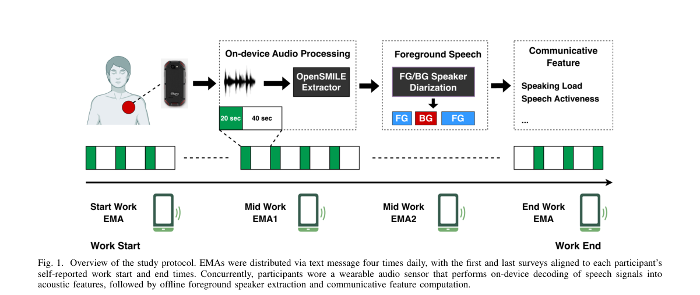

*Result - Overview of the FG/BG speaker diarization modeling that relies on teacher–student learning for improved FG/BG speaker diarization. Specifi- cally, a teacher network based on a speech foundatio*

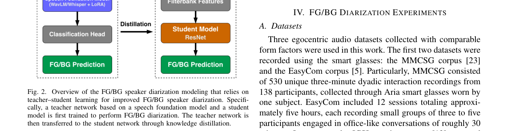

**Why this ranks #10**: 把语音基础模型压进手机，才能在真实工作场景里持续做前景/背景说话人分离。

---

## Footer

- Total papers scanned across all 7 tracks: 578（原始 794 条）
- audio_lm track final top-10: 10
- Wild-cards in this track: 1
- Figure assets: 2026-10-28/res/

Generated by `mine-arxiv-daily-digest` skill. Sister file: `2026-10-28_audio_lm_entry.md`.
