# ArXiv Daily Digest - 2026-10-28 (具身智能与世界模型, 10 papers)

**Generated**: 2026-10-28 17:00 CST

**Source**: arXiv cs.CV, cs.SD, eess.AS, cs.CL, cs.AI, cs.RO, cs.LG submissions, listing day 2026-10-27 (announced 2026-10-28 00:00 UTC)

**Batch window**: 2026-10-26T18:00:00Z .. 2026-10-27T18:00:00Z（arXiv 公告批次横跨两个 UTC 日：前一日 18:00 UTC 起算，当日 17:59:59 UTC 截止）

**Track**: embodied (top 10 of 578 papers scanned, 70 full reads)

**Scope**: 机器人操作与导航、VLA 策略、动作世界模型、灵巧手与人形机器人硬件

---

## Top 10 - 具身智能与世界模型

### 1. CARD: Contact-Anchored Retargeting for Dexterous Manipulation

**arXiv**: [2610.36539](https://arxiv.org/abs/2610.36539) | **Score**: 9.0 (relevance 9.0 x 0.7 + quality 9.0 x 0.3) | **Tags**: embodied, dexterous-manipulation, contact-force, tactile, retargeting, CMU | **Categories**: cs.RO | **Pages**: 20

**Authors**: Cunxi Dai; Botao He; Francois R Hogan; Wei Pan; Rao Fu; Wen-Han Hsieh; Ruoshi Liu; Jitendra Malik; Guanya Shi; Akash Sharma

**Affiliation**: Carnegie Mellon University; Amazon Frontier AI & Robotics; University of Maryland, College Park; UC Berkeley

**Abstract**

> Humans are dexterous, but traditional data collection paradigms such as teleoperation, kinesthetic teaching, and wearable exoskeletons force humans to act through the robot embodiment, bottlenecking their dexterity. Retargeting can avoid this. However, existing methods purely translate kinematics and ignore the real-world contact dynamics essential for task success. We present CARD: Contact-Anchored Retargeting for Dexterous Manipulation, a simulator and object-free framework that retargets human demonstrations to robot actions by explicitly preserving contact force targets. CARD unifies human data sources including video, motion capture, and tactile gloves via a shared hand--contact representation and generates explicit contact force targets in addition to kinematics. To maintain these contact targets during hardware open-loop replay, CARD also introduces a tactile tracking controller. For video which does not contain an explicit tactile source, we present Vid-HACO, our video-to-contact model that sets a new state of the art. Across our video, glove, motion-capture data and the GRAB dataset, CARD maintains contact on $43$--$78\%$ of contact frames, while kinematic and object-aware retargeting methods maintain contact on $<10\%$ and $22.5\%$ of the frames respectively. Further, integrating our formulation into physics-based retargeting improves strict task success from 12\% to 32\% on GRAB dataset. Finally, we show that our tactile tracker is critical to reproduce demonstrated forces during hardware replay. These results establish that contact preservation via CARD is a scalable interface for transferring human dexterity to robots.

**Key findings**

- **Finding**: CARD 提出一个重定向框架，把接触力目标当作一等公民处理，而不是只对齐末端轨迹。
- **Finding**: 作者定义统一的「手-接触」表征，把单目视频（经其视频到接触模型 Vid-HACO）、触觉手套与动捕都转换成同一接口：一个 MANO 网格序列，每个手部语义区域带一个接触力目标。
- **Finding**: Vid-HACO 面向没有显式触觉源的视频提出视频到接触模型，并取得新的最优水平。
- **Finding**: 消融显示触觉追踪器对在硬件回放中复现所演示的力是必需的。
- **Inference**: 「统一接口 + 显式力目标」让异构数据源真正可互换，这是这类工作能否规模化采集数据的关键设计，比具体模型结构更值得借鉴。
- **Inference**: 整套流程依赖可靠的接触力估计，Vid-HACO 的力预测误差会直接传导到重定向结果，论文对该误差传播的量化程度有限。
- **Recommendation**: 推荐。做灵巧操作、触觉数据采集或人形手力控的读者强烈建议读。

**Key figures**

*Result - CARD overview. Video, glove, and motion capture are converted into a unified hand–contact representation, a MANO mesh with one contact force target per semantic link (Sec. 3.1). Geometric in*

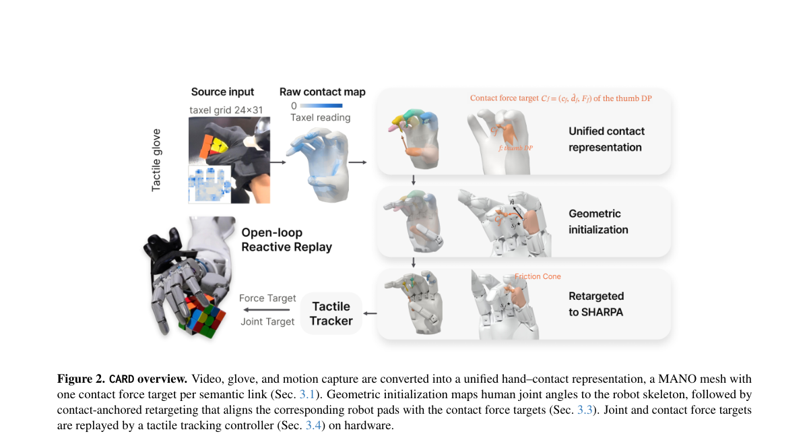

**Why this ranks #1**: 把接触力当成一等公民，而不是重定向完动作再祈祷硬件能复现力。

---

### 2. GAWM: A Compact Latent World-Action Model for Multi-Task Robot Manipulation

**arXiv**: [2610.37091](https://arxiv.org/abs/2610.37091) | **Score**: 9.0 (relevance 9.0 x 0.7 + quality 9.0 x 0.3) | **Tags**: embodied, world-action-model, latent-prediction, DINOv3, compact, Genisom | **Categories**: cs.RO | **Pages**: 9

**Authors**: Yang Liu; Xiaoli Liu; Liuzhao Li; Yuduo Song; Muyuan Liu; Xiang Gao

**Affiliation**: Genisom AI

**Abstract**

> World-action models (WAMs) incorporate the prediction of future observations into robot policy learning. However, most WAMs build on billion-parameter vision-language or video-generation backbones, which incur high training cost and inference latency. In this letter, we present GAWM (Geometry-Aware World Model), a compact multi-task WAM that predicts future observations in the latent space of a frozen DINOv3 encoder. GAWM compresses the features of each camera view into a small set of tokens. A lightweight predictor, conditioned on the task rather than on actions, forecasts these tokens at two future horizons. The forecast is supervised with the dense patch features of future frames, which requires it to encode the spatial layout of the future scene. An action decoder directly regresses a chunk of future actions from the current and predicted tokens. With fewer than 100M parameters and no robot or video pretraining, GAWM outperforms billion-parameter WAMs on RoboTwin 2.0 and performs comparably to billion-parameter VLAs on LIBERO. On a dual-arm robot, it achieves lower action-prediction error on held-out demonstrations than a fine-tuned billion-parameter VLA, with substantially lower inference latency. Ablation studies show that the latent world model substantially improves performance when training data or training time is limited. Code is available at https://github.com/gaoxiang12/ga-wm.

**Key findings**

- **Finding**: GAWM（Geometry-Aware World Model）是一个紧凑的多任务世界动作模型，在冻结 DINOv3 编码器的潜空间里预测未来观测。
- **Finding**: 每个相机视角的特征被压成少量 token；一个轻量预测器以任务码（而非动作）为条件，在两个未来时间跨度上预测这些 token。
- **Finding**: 预测目标用的是未来帧的密集 patch 特征，从而迫使预测器编码未来场景的空间布局。
- **Finding**: 动作解码器直接从当前与预测出的 token 回归出一段未来动作。
- **Finding**: 参数量不足 1 亿且不做机器人或视频预训练，但在 RoboTwin 2.0 上超过十亿参数级 WAM，在 LIBERO 上与十亿参数 VLA 相当；双臂机器人上留出演示的动作预测误差低于微调后的十亿参数 VLA，推理延迟显著更低。
- **Inference**: 「以任务而非动作为条件」是关键简化——它把动作解耦到动作解码器，让世界模型可以跨任务共享，这是多任务泛化的重要一步。
- **Inference**: 冻结 DINOv3 提供的是视觉语义先验而非动力学先验，预测目标又特意避开了动作，因此「几何感知」更多来自密集 patch 特征的监督而非显式几何建模。
- **Recommendation**: 推荐。做世界动作模型、机器人数据效率或小模型 VLA 的读者值得读，1 亿参数的性价比很突出。

**Key figures**

*Framework - Success rate versus model size on LIBERO (left; GAWM-S with additional in-domain data) and on the clean (middle) and randomized (right) settings of RoboTwin 2.0. Top: success rate versus size.*

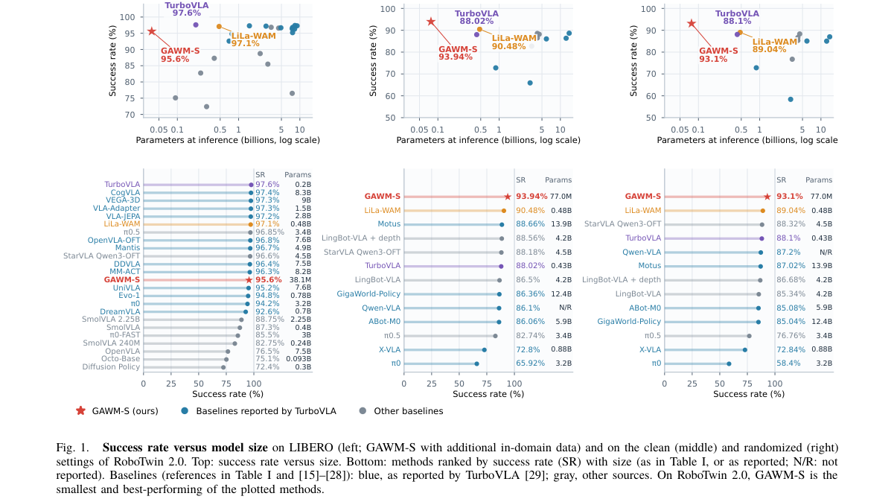

*Result - Overview of GAWM. A frozen DINOv3 encoder and a query adapter encode each camera view into 64 visual tokens, stacked into zt. The latent predictor, conditioned on the task code gk, forecasts t*

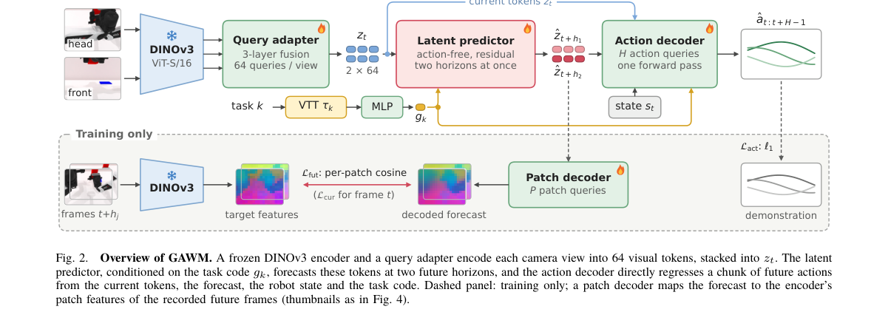

**Why this ranks #2**: 世界动作模型不一定要十亿参数，用冻结 DINOv3 潜空间预测就够。

---

### 3. Tokens of Motion: Primitive Motion Learning for Human-Humanoid Skill Transfer

**arXiv**: [2610.37330](https://arxiv.org/abs/2610.37330) | **Score**: 8.7 (relevance 9.0 x 0.7 + quality 8.0 x 0.3) | **Tags**: embodied, human-to-robot, motion-primitives, skill-transfer, Purdue | **Categories**: cs.RO | **Pages**: 12

**Authors**: Hanwen Ren; Meng Zheng; Wenzhe Cui; Benjamin Planche; Zhongpai Gao; Anwesa Choudhuri; Terrence Chen; Ziyan Wu

**Affiliation**: Purdue University

**Abstract**

> Vision-language-action (VLA) models provide a promising paradigm for scalable robotic manipulation, yet their reliance on success-only behavioral cloning leaves them brittle; lacking corrective training signals, minor execution errors rapidly compound into unrecoverable, out-of-distribution failures. To address this limitation, we propose Adaptive Failure-Informed Learning (AFIL), an end-to-end framework that leverages failure trajectories as adaptive negative guidance for diffusion- and flow-based VLA policies. AFIL uses a pretrained VLA to generate failure rollouts online, avoiding the need for handcrafted failure-mode design or human-in-the-loop recovery. It then jointly trains Dual Action Generators (DAGs) for successful and failed behaviors while sharing a common vision-language backbone, enabling efficient failure-aware policy learning with limited parameter overhead. During sampling, the failure generator adaptively steers action generation away from failure-prone regions and toward more reliable success modes, with guidance strength determined by the per-diffusion-step distance between success and failure distributions. Experiments across in-domain and out-of-domain robotic manipulation tasks, covering both short- and long-horizon settings, show that AFIL consistently improves task success rates and robustness over existing VLA baselines, demonstrating its effectiveness, efficiency, and generality.

**Key findings**

- **Finding**: 论文提出 M-PACT（Motion Primitives for Action Composition and Transfer），把「可迁移的交互结构」与「场景/本体相关的具体实现」在原语运动层面因子化。
- **Finding**: 原语运动从人类视频中学习，用局部的、与实现无关的运动片段表达，从而减少对昂贵机器人演示的依赖。
- **Finding**: 分离可复用的运动结构、任务特定上下文与机器人特定控制，显著降低了标注成本并提升了跨任务与跨场景泛化。
- **Finding**: 贡献归纳为三部分，其中包含人类到人形机器人的技能迁移与可复用技能发现。
- **Inference**: 「结构 vs 实现」的因子化是模仿学习里的老问题，但在人形机器人语境下重新提出来很有现实意义——本体差异让端到端模仿的样本效率极低。
- **Inference**: 从视频学原语运动避开了机器人数据，但也继承了视频与真实动力学之间的差距，论文需要靠少量机器人演示补齐，读者应关注这部分的代价。
- **Recommendation**: 推荐。做人形机器人技能迁移、从人类视频学习或数据受限的模仿学习读者值得读。

**Key figures**

*Framework - Proposed Motion Primitives for Action Composition and Transfer (M-PACT) pipeline.*

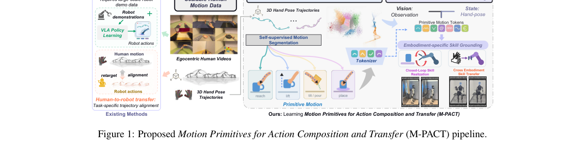

*Result - Overview of Motion Primitives for Action Composition and Transfer (M-PACT) pipeline.*

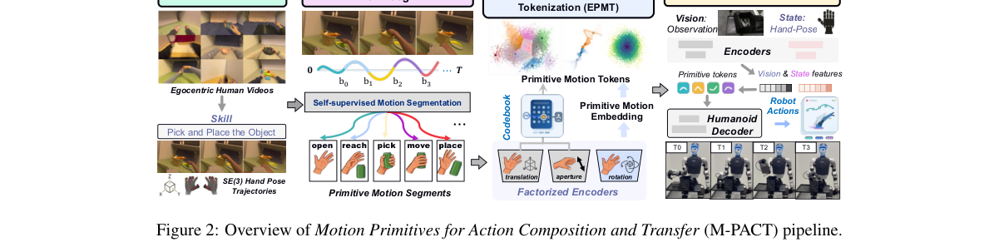

**Why this ranks #3**: 把人视频里的可迁移结构与具体身体实现拆开，才不必为每个机器人重新标注。

---

### 4. World Dreamer v5-lite: A Multi-Robot World Action Model with One Dreamer

**arXiv**: [2610.37518](https://arxiv.org/abs/2610.37518) | **Score**: 8.3 (relevance 8.0 x 0.7 + quality 9.0 x 0.3) | **Tags**: embodied, multi-robot, world-action-model, shared-world-state, masked-view, World-Agents | **Categories**: cs.RO | **Pages**: 10

**Authors**: Guoning Wu; Zijian Cai; Yuhang Zhang; Ying Liu; Yongbin Zheng

**Affiliation**: World Agents

**Abstract**

> Multi-robot control requires integrating distributed camera views while predicting separate action sequences. Most vision-language-action and world-action models target one robot. Combining multiple views alone does not establish spatial correspondence between them. World Dreamer v5-lite is a multi-robot world-action model built around a shared world state for robot-specific action prediction. Calibrated features from a pretrained video encoder populate this state in workspace coordinates; its spatial size remains fixed as views are added. A vision-language model provides scene context and one query per robot. The queries read the shared state and exchange pose-aware information, while their action streams remain separate. Masked-view cooperative training withholds selected camera views from both visual branches while retaining all action targets. This encourages the use of observations shared by other robots. Pretraining uses more than 10,000 hours of trajectories from 20 simulated robot types, RoboFactory, and real robots. On RoboFactory, World Dreamer v5-lite achieves 74.0% mean success, 23.7 percentage points above the strongest evaluated baseline. Across four real-robot tasks, it reaches 78.8% mean success, a margin of 13.8 points. It also reaches 58.08% overall on RoboCasa365.

**Key findings**

- **Finding**: World Dreamer v5-lite 是多机器人世界动作模型，围绕一个共享世界状态为各机器人预测动作序列。
- **Finding**: 预训练视频编码器的校准特征以工作空间坐标填充共享状态，其空间尺寸在增加视角时保持不变。
- **Finding**: 视觉语言模型提供场景上下文与每机器人一个 query；query 读取共享状态并交换带位姿的信息，而动作流彼此独立。
- **Finding**: 掩码视角协同训练同时遮住两个视觉分支的选定相机视角但保留全部动作目标，鼓励使用其他机器人共享的观测。
- **Finding**: 预训练使用来自 20 种仿真机器人、RoboFactory 与真实机器人的逾 1 万小时轨迹。
- **Finding**: RoboFactory 上平均成功率 74.0%，比最强对比基线高 23.7 个百分点；四个真实机器人任务上平均成功率 78.8%（+13.8）；RoboCasa365 总体 58.08%。
- **Inference**: 「掩码视角协同训练」是多机器人场景下一个很实用的小 trick——它强迫模型使用跨机器人共享的信息，而不是各自独立看画面。
- **Inference**: 共享世界状态以工作空间坐标构建，依赖相机标定与位姿估计，标定误差会直接污染状态构造。
- **Recommendation**: 推荐。做多机器人协同、世界动作模型或共享工作空间任务的读者值得读。

**Key figures**

*Framework - Overall architecture of World Dreamer v5-lite. Multi-robot images and language tokens enter the vision–language model (VLM) before the learnable agent queries, yielding a scene-prefix key/va*

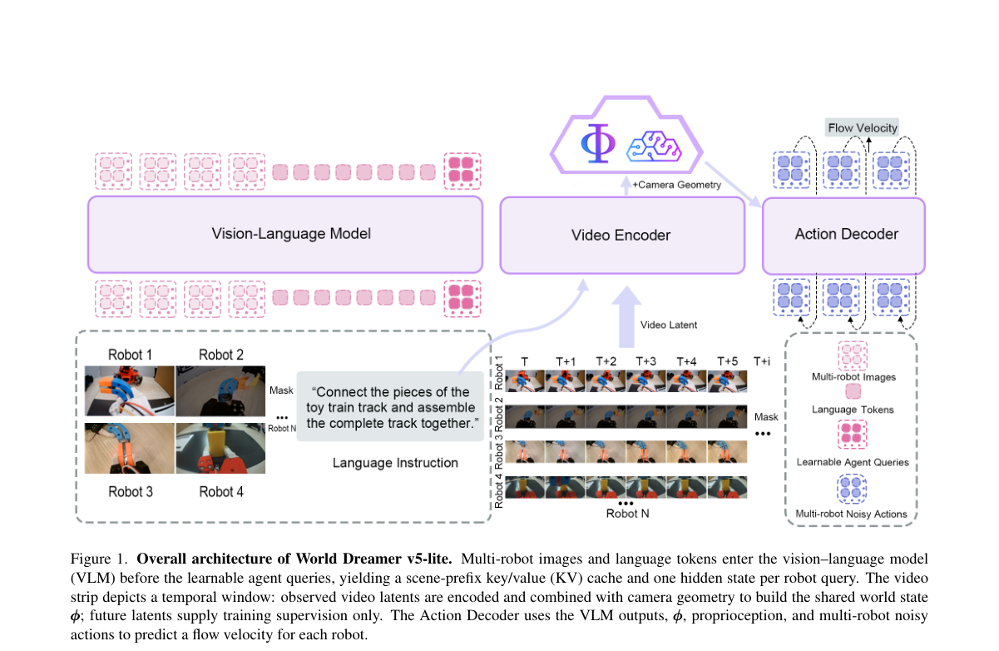

*Result - Constructing the shared world state ϕ. Observed video tokens from available views are placed in 3D using the intrinsics K, the extrinsics, and optional depth. Each token is fused with its ge*

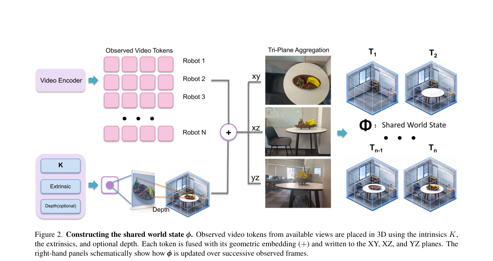

**Why this ranks #4**: 多机器人共处一室，光有多视角还不够，得建立视角之间的空间对应。

---

### 5. Rollback: Experience Backtracking in World Models for Policy Improvement

**arXiv**: [2610.36068](https://arxiv.org/abs/2610.36068) | **Score**: 8.3 (relevance 8.0 x 0.7 + quality 9.0 x 0.3) | **Tags**: embodied, world-model, counterfactual, policy-improvement, real-robot, AgiBot | **Categories**: cs.AI, cs.LG, cs.RO | **Pages**: 25

**Authors**: Jiayi Luo; Yang Zhang; Liliang Chen; Nan Wang; Chen Gao; Boxiang Qiu; Zhuoxuan Li; Baorui Peng; Chuankang Li; Yuxiang Yan; Si Liu; Qingyun Sun

**Affiliation**: AgiBot; Beihang University; National University of Singapore

**Abstract**

> Action-conditioned world models offer a scalable alternative to costly real-world interaction for improving robot policies. However, existing world-model-based methods largely treat world models as forward-only surrogates of the physical environment, leaving untapped a capability no physical environment affords: rewinding to past decision points to explore counterfactual futures. We introduce Rollback, a policy improvement paradigm that turns world models from passive simulators into counterfactual engines: it rolls back to critical decision points, branches into alternative actions, and contrasts their outcomes to attribute success to individual decisions. This concentrates imagination where it matters most and distills counterfactual outcomes into fine-grained, action-level supervision without a separately learned value model. We build a scalable training system that unifies distributed world-model search with asynchronous real-robot execution, forming a self-reinforcing cycle: real-world experience continually sharpens the world model, and a sharper world model in turn drives further policy improvement. We term the world-model side of this cycle test-time physics grounding, a capability that hand-built physics simulators lack: while the world model serves as the training environment, real transitions from the policy it trains correct its dynamics through a lightweight LoRA pipeline. Experiments on three challenging real-world tasks show that Rollback improves success rates over the strongest baseline by an absolute 10.67%, 11.11%, and 11.85% on block extraction, ball tossing, and tabletop curling, respectively, while achieving more stable improvement throughout training. Although initialized from teleoperated demonstrations far below human level, Rollback surpasses the average success rate of human players on both ball tossing and tabletop curling within 8 hours of training.

**Key findings**

- **Finding**: 论文指出动作条件世界模型多被当作物理环境的单向替身，浪费了「回到过去决策点探索反事实未来」这一物理世界不具备的能力。
- **Finding**: Rollback 把世界模型从被动模拟器变成反事实引擎：回滚到关键决策点、分叉出替代动作、对比其结果以把成功归因到单个决策。
- **Finding**: 训练系统把分布式世界模型搜索与异步真实机器人执行统一起来，形成自强化循环——真实经验持续锐化世界模型，更锐的世界模型再驱动策略改进。
- **Finding**: 作者把循环中的世界模型一侧称为「测试时物理接地」，并用轻量 LoRA 管线让真实转移修正世界模型动力学。
- **Finding**: 三个真实任务上相对最强基线的绝对成功率提升为 10.67%、11.11%、11.85%（取物、抛球、桌上冰壶），且训练全程更稳定。
- **Finding**: 尽管从远低于人类水平的遥操作演示初始化，Rollback 在 8 小时训练内于抛球与桌上冰壶上超过人类玩家的平均成功率。
- **Inference**: 「回滚 + 分叉」把世界模型从轨迹生成器变成反事实实验台，这是本批具身方向最有方法论野心的一篇。
- **Inference**: 成功归因依赖回滚时的动作扰动设计，扰动幅度与覆盖度决定反事实信号的质量，论文给出最多 16 点可选裕度的分析但依赖特定 WAM。
- **Recommendation**: 推荐。做世界模型、真实机器人策略提升或反事实规划的读者强烈建议读。

**Key figures**

*Framework - From real-world interaction to learning in world models. (a) Real-world RL incurs costly physical interaction. (b) Forward-rollout world-model RL spends much of its interaction budget on les*

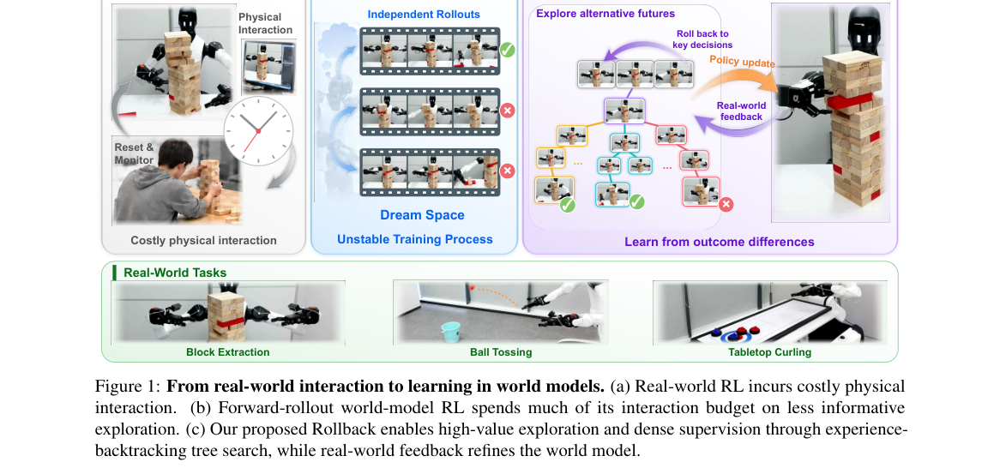

*Result - Overview of Rollback. (a) Experience-backtracking tree search restores cached world-model contexts to explore informative branches without regenerating shared prefixes. The world model predi*

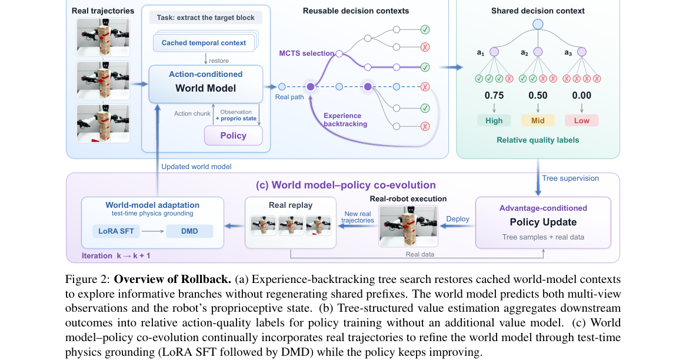

**Why this ranks #5**: 世界模型最大的特权是物理世界给不了的那一个：能把时间倒回去。

---

### 6. Keeping Contact: Task-Adaptive Friction Margins for Bimanual Non-Prehensile Manipulation

**arXiv**: [2610.36961](https://arxiv.org/abs/2610.36961) | **Score**: 8.0 (relevance 8.0 x 0.7 + quality 8.0 x 0.3) | **Tags**: embodied, non-prehensile, bimanual, friction-cone, SOCP, NTU | **Categories**: cs.RO | **Pages**: 8

**Authors**: Qian Ying Lee; Lin Yang; Domenico Campolo

**Affiliation**: Nanyang Technological University; R3 Institute Singapore

**Abstract**

> Maintaining contact in non-prehensile manipulation requires more than nominal friction cone feasibility: a force barely inside the cone and one well inside it are both feasible, but they provide different margins against slip and contact loss. This paper uses signed friction distance to measure friction margin in force space and derives a task-adaptive margin from the force correction needed to balance pivot moment deviations in bimanual tilting. The resulting contact margins are embedded in a sequence of second-order cone programs (SOCPs), each giving a globally optimal contact force solution at a tilt angle. The optimizer balances the object about an environmental pivot while keeping robot and pivot contact forces away from the nominal friction boundary. Optimizer-level results show interpretable force redistribution and adaptation to object property changes. Real-world experiments demonstrate successful execution under object property variations and model mismatch, while fixed margin and no-margin comparisons illustrate the importance of adapting the margin to task demand. These results support signed friction distance margins as a force planning mechanism for maintaining contact in bimanual non-prehensile manipulation. Project page: https://keeping-contact.github.io/

**Key findings**

- **Finding**: 论文指出非抓取操作中，维持接触需要的远不止名义上的摩擦锥可行性：锥内边缘的力与锥内深处的力都可行，但对滑移与失接触的裕度完全不同。
- **Finding**: 作者用带符号的摩擦距离在力空间度量裕度，并从平衡倾转枢轴力矩偏差所需的力修正导出任务自适应裕度。
- **Finding**: 最终接触裕度被嵌入一串二阶锥规划（SOCP）中，每个 SOCP 在给定倾转角上给出全局最优的接触力解。
- **Finding**: 论文被 RA-L 接收。
- **Inference**: 把「裕度」显式写进优化问题而不是事后看是否打滑，是这类操作从「能做」到「稳做」的关键一步，且带符号距离天然允许保守裕度与激进裕度之间的连续调节。
- **Inference**: 裕度由力矩平衡导出，依赖倾转过程中力分布可观测，若存在未知外力或接触点漂移，裕度估计会偏乐观。
- **Recommendation**: 推荐。做非抓取/双臂操作、接触力学建模的读者值得读，SOCP 建模方式可直接复用。

**Key figures**

*Framework - Bimanual non-prehensile tilting. Inset illustrates two feasible contact forces in the local force plane. Translucent circles show equal force perturba- tions around each force tip: a near boun*

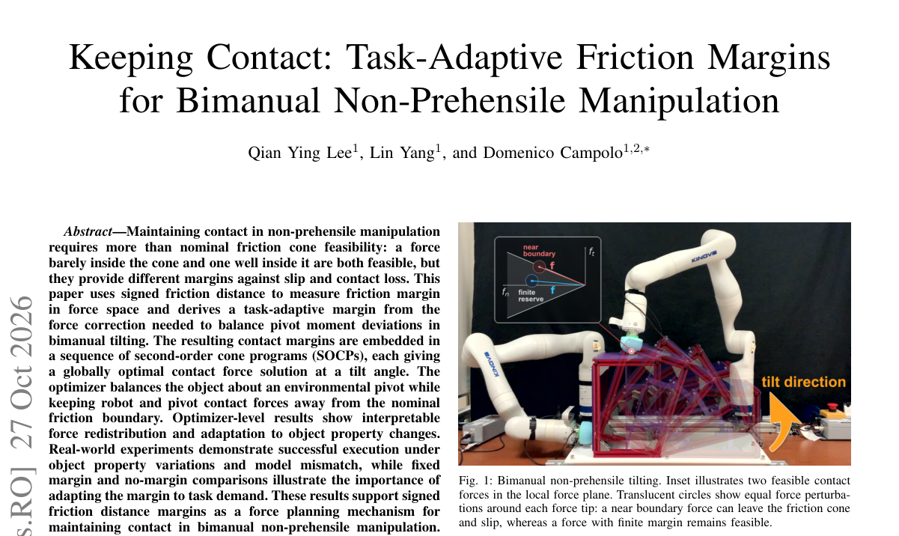

*Result - Signed friction distance in the contact force plane. The nominal boundary ψµ(f) = 0 is the friction limit, while ψµ(f) ≥ρ keeps the planned force a finite signed distance inside the cone. When*

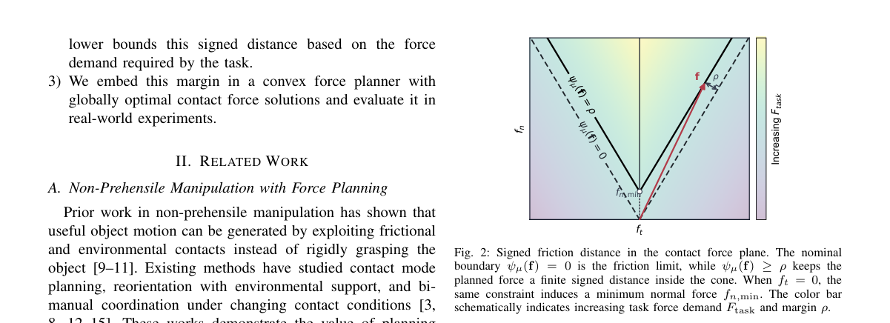

**Why this ranks #6**: 「可行」不等于「稳」，摩擦裕度要按任务自适应地要。

---

### 7. A fully articulated humanoid dexterous hand with human-level joint structure enabled by linkage-based actuation

**arXiv**: [2610.36789](https://arxiv.org/abs/2610.36789) | **Score**: 8.0 (relevance 8.0 x 0.7 + quality 8.0 x 0.3) | **Tags**: embodied, dexterous-hand, hardware, linkage-actuation, humanoid, Zhejiang | **Categories**: cs.RO | **Pages**: 40

**Authors**: Jihao Li; Jianguo Wang; Haotian Guo; Yanzhe Wang; Guodong Lu; Huixu Dong

**Affiliation**: Zhejiang University

**Abstract**

> Humanoid dexterous hands are a core component of embodied intelligence, enabling robots to translate high-level intent into rich and adaptive physical interaction. However, existing designs remain constrained by a persistent trade-off among anthropomorphic kinematic complexity, mechanical robustness, load capacity and control simplicity, limiting dexterous manipulation in unstructured environments. Here we present Torch-Hand, a fully articulated humanoid dexterous hand that replicates the joint structure and motion hierarchy of the human hand with 21 degrees of freedom (DOF), comprising a highly articulated five-DOF thumb and four DOF in each of the remaining fingers. The differentiated thumb integrates multi-axis CMC motion to provide broad opposition and flexible contact orientation relative to the four fingers. Unlike tendon-driven or hybrid actuation approaches, Torch-Hand adopts an entirely linkage-based transmission architecture. By integrating screw-linkage actuation, the hand achieves high grasping force and substantial payload capacity while maintaining a compact anthropomorphic form. Its actuation architecture is optimized for control tractability, with all actuators integrated within the palm and arranged in a serial-robot-like configuration that establishes a direct correspondence between motor motion and joint kinematics. This architecture mechanically decouples functional DOF to reduce unintended inter-joint motion propagation, while allowing independently addressable DOF to be actively coordinated into coupled multi-joint motion patterns during complex manipulation. Comprehensive experiments assess reachable workspace, coordinated fingertip trajectories, thumb opposition, 33-grasp taxonomy coverage, grasping force, payload capacity and task-level manipulation. These results establish Torch-Hand as a robust hardware foundation for dexterous embodied manipulation.

**Key findings**

- **Finding**: 论文提出 Torch-Hand，一款完全铰接的人形灵巧手，复刻人手关节结构与动作层级，达到 21 个自由度（拇指五自由度、其余每指四自由度）。
- **Finding**: 设计动机是规避灵巧操作中的「灵巧-精度-负载」三角难题，方法是采用紧凑的、全连杆驱动的拟人架构。
- **Finding**: 核心技术与解耦机械架构分开呈现，区分四指与拇指模块。
- **Finding**: 论文为 40 页的硬件与实验报告。
- **Inference**: 纯连杆驱动用机械传动换取更小的体积与更高的负载能力，代价是控制带宽与摩擦回差，这是结构与控制必须一起设计的典型例子。
- **Inference**: 硬件论文的评价重心应是可复现性（CAD、驱动参数、控制接口是否公开），读者应据此判断后续可用性。
- **Recommendation**: 推荐。关注灵巧手硬件、人形机器人本体或需要低成本多自由度手的读者值得读。

**Key figures**

*Framework - Torch-Hand: a fully linkage-driven humanoid hand for dexterous embodied manipulation. (A and B) Structural and morphological correspondence between the human hand and Torch-Hand. (C) Core te*

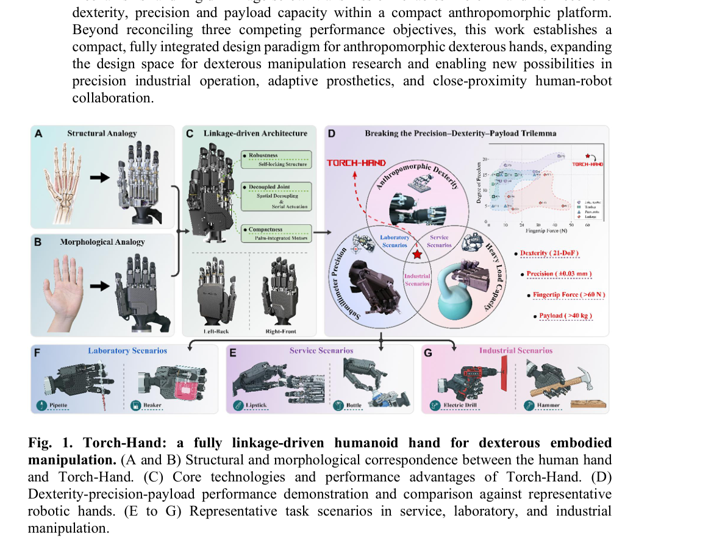

*Result - Decoupled mechanical architecture of the Torch-Hand. (A) Overall structural organization of Torch-Hand, showing the differentiated design of the four fingers and the thumb module. (B) Decoup*

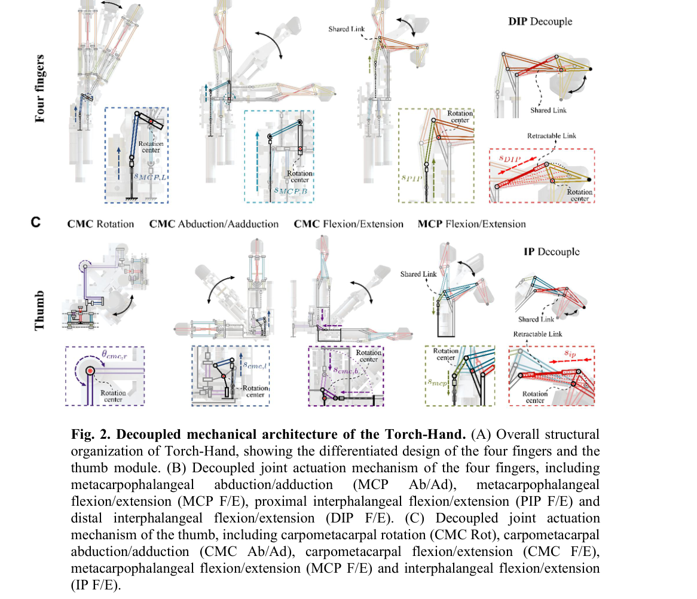

**Why this ranks #7**: 灵巧手的自由度-精度-负载三者不可兼得，连杆驱动用结构换空间。

---

### 8. PDRVLA: A Vision-Language-Action Model with Physical Dynamics Representations

**arXiv**: [2610.37381](https://arxiv.org/abs/2610.37381) | **Score**: 8.0 (relevance 8.0 x 0.7 + quality 8.0 x 0.3) | **Tags**: embodied, VLA, physical-dynamics, world-model-supervision, JD.com, Peking | **Categories**: cs.CV, cs.LG, cs.RO | **Pages**: 25

**Authors**: Hanqing Wang; Zhaotian Cai; Ruichuan An; Bohan Zeng; Tao Zhang; Yilin Chen; Xu Jiang; Kaiquan Chen; Chongyang Wu; Haoran Li; Fan Yang; Mingan Lin

**Affiliation**: Peking University; JD.com

**Abstract**

> Vision--Language--Action (VLA) models generate robot actions from visual observations and language instructions, but their understanding of physical dynamics remains limited. Video world models can capture scene dynamics, yet generating future videos introduces high latency into the control loop. We introduce PDRVLA, whose lightweight Physical Dynamics Module extracts physical tokens from vision--language features to condition action generation without online video generation. The module learns through direct prediction of future RGB, depth, and optical-flow features, with auxiliary supervision through a frozen pretrained video world model. Training relies entirely on publicly available data, expanded through human-to-robot synthesis, subtask annotation, and embodied chain-of-thought (ECoT) annotation. Across four simulation benchmarks, PDRVLA achieves success rates of 99.3% on LIBERO, 89.9% on LIBERO-Plus, 93.6% on RoboTwin~2.0, and 81.5% on SimplerEnv. Ablations show improved future prediction with world-model supervision and evaluate how subtask conditioning, future object-pose supervision, and ECoT training affect action success.

**Key findings**

- **Finding**: PDRVLA 用轻量的物理动力学模块从视觉语言特征中抽取物理 token，用于条件化动作生成，而无需在线生成未来视频。
- **Finding**: 该模块通过直接预测未来的 RGB、深度与光流特征来学习，并额外接受冻结预训练视频世界模型的辅助监督。
- **Finding**: 训练完全依赖公开数据，并通过人机合成、子任务标注与具身思维链（ECoT）标注扩充。
- **Finding**: 在四个仿真基准上取得 LIBERO 99.3%、LIBERO-Plus 89.9%、RoboTwin 2.0 93.6%、SimplerEnv 81.5%。
- **Finding**: 消融显示世界模型监督改善了未来预测，并评估了子任务条件、未来物体位姿监督与 ECoT 训练对动作成功率的影响。
- **Inference**: 「训练时用视频世界模型、推理时不生成」是绕开世界动作模型推理延迟的一条清晰路线，与 GAWM 的紧凑潜预测属于同一趋势的两端。
- **Inference**: 性能领先幅度很小（例如 LIBERO 上 99.3% vs 96.9%），主要数字的差异更可能来自训练数据与标注扩充而非架构本身，读者应看消融中的模块单独贡献。
- **Recommendation**: 推荐。做 VLA、物理先验注入或关心视频世界模型推理成本的读者值得读。

**Key figures**

*Framework - PDRVLA overview. (a) Simplified architecture. (b) Success rates on four simulation benchmarks.*

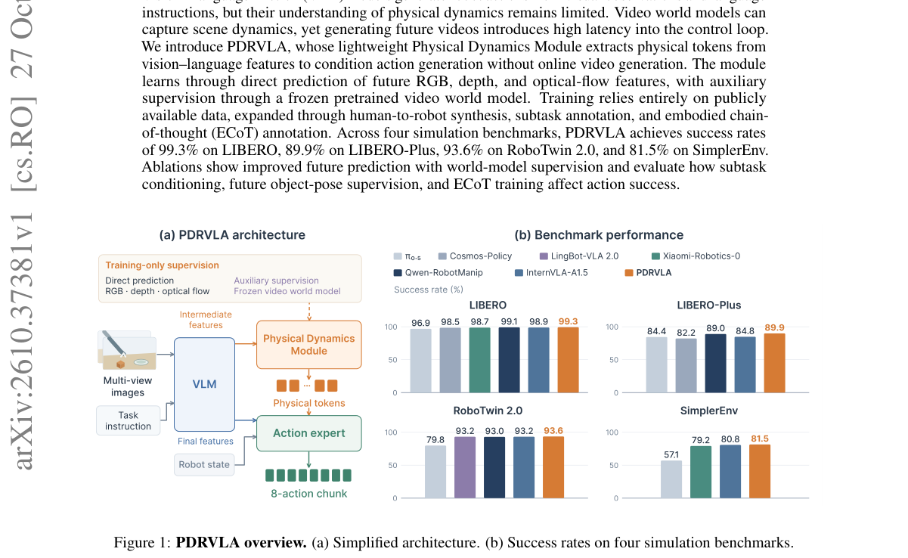

*Result - Six types of subtask VL examples, differing in query timing, answer content, and subtask-history context. No observations after the query frame are provided.*

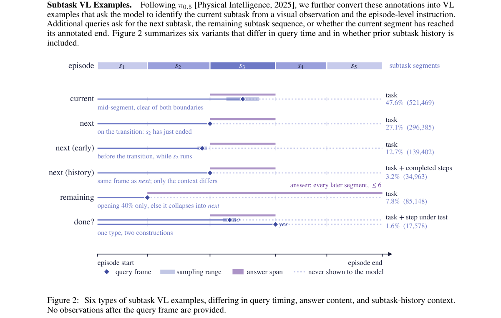

**Why this ranks #8**: 在线生成视频太慢，那就在训练时用视频世界模型做监督、推理时不生成。

---

### 9. ActiveAlign: Aligning Egocentric Manipulation via Active Perception

**arXiv**: [2610.36859](https://arxiv.org/abs/2610.36859) | **Score**: 8.0 (relevance 8.0 x 0.7 + quality 8.0 x 0.3) | **Tags**: embodied, real2sim2real, active-perception, hand-eye-calibration, NVIDIA, millimeter-precision | **Categories**: cs.AI, cs.CV, cs.RO | **Pages**: 8

**Authors**: Ri-Zhao Qiu; Bowen Wen; Yifeng Jiang; Chen Tessler; Eric Heiden; Xue Bin Peng; Xiaolong Wang; Stan Birchfield; Erwin Coumans

**Affiliation**: NVIDIA

**Abstract**

> Real-to-Sim-to-Real (Real2Sim2Real) enables structured world representations for planning, interpretability, and safe execution. Most existing approaches rely on passive perception, which creates real2sim gaps due to imperfect observation. Inspired by how humans perceive actively through actions, we propose ActiveAlign, a framework that leverages active perception to align the Real2Sim2Real gap from interactions. ActiveAlign introduces two complementary modules: (i) ActiveAlign-Waving, which performs hand-eye calibration by exploiting active hand motions and differentiable rendering, and (ii) ActiveAlign-Touching, which refines object alignment through tactile feedback to achieve millimeter-level precision. Together, these capabilities enable strong real2sim alignment. We demonstrate that ActiveAlign-Waving can be used to curate simulation environments for open-sourced uncalibrated robot manipulation datasets, and demonstrate on a real Unitree G1 robot that ActiveAlign enables fine manipulation of millimeter-scale objects such as pressing buttons and moving sliders.

**Key findings**

- **Finding**: ActiveAlign 用主动感知来弥合 Real2Sim2Real 的差距，核心洞察是：在静态图像上做感知不足以完成真实到仿真的对齐。
- **Finding**: 两个互补模块：ActiveAlign-Waving 利用主动手部运动与可微渲染完成手眼标定；ActiveAlign-Touching 通过触觉反馈精修物体对齐达到毫米级精度。
- **Finding**: 离线阶段收集静态场景与物体重建，在线（实时）阶段通过主动动作提供反馈，形成闭环。
- **Finding**: ActiveAlign-Waving 可用于为开源的未标定机器人操作数据集筛选仿真环境；在真实 Unitree G1 上可完成按按钮、推动滑块等毫米级精细操作。
- **Inference**: 「主动标定 + 主动触摸」把 real2sim 的误差来源从「被动感知不够准」转成「补一次主动测量」，思路对任何需要毫米级对齐的仿真资产构建都适用。
- **Inference**: 依赖可微渲染与可操作的机械臂/人体，成本不低；对完全未知材质或不可接触的目标（如热源、流体）不适用。
- **Recommendation**: 推荐。做 sim-to-real、数据采集管线或需要高保真仿真资产的读者值得读。

**Key figures**

*Framework - ActiveAlign uses active perception to provide feedback in real2sim2real. By integrating human-like motions such as waving hands and actively touching objects, ActiveAlign is capable of creat*

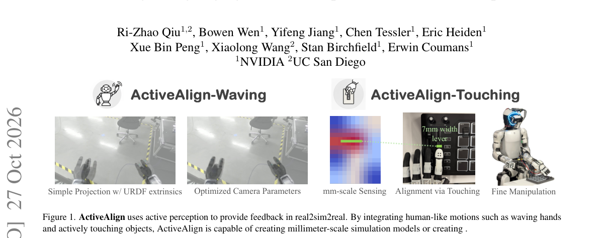

*Result - Method Overview. The pipeline is separated into two stages. During the offline stage, static scene and object reconstructions are collected. During inference-time (online, real time), variou*

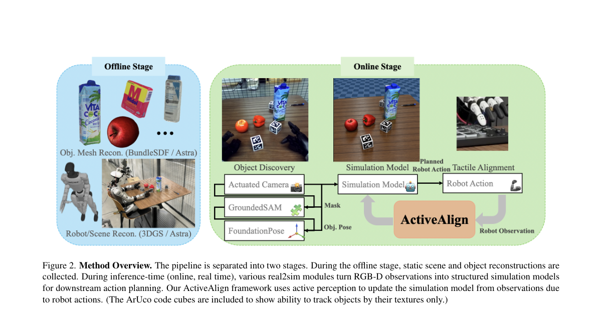

**Why this ranks #9**: 被动看不够，人要动手摸一摸才能把仿真对齐到毫米级。

---

### 10. MLE-World: Predicting Machine Learning Experiment Outcomes with a Learned World Model

**arXiv**: [2610.37175](https://arxiv.org/abs/2610.37175) | **Score**: 8.0 (relevance 8.0 x 0.7 + quality 8.0 x 0.3) | **Tags**: embodied, world-model, test-time-scaling, best-of-n, UCB, LLM-agents | **Categories**: cs.AI, cs.LG | **Pages**: 41

**Authors**: Brian Ko; Han Wang; Hejia Geng; Li Erran Li; Sherry Yang

**Affiliation**: University of Washington; University of Illinois at Urbana-Champaign; University of Oxford; Columbia University; New York University

**Abstract**

> AI research agents can propose, execute, and improve programs that solve machine learning tasks. However, executing each candidate program requires training and evaluating ML models, limiting how many candidates an agent can explore at each step. We introduce MLE-World, a world model finetuned from Qwen3.5-4B that predicts a program's terminal output (error traces, training logs, and validation scores) from its code and data description without executing it, together with a confidence score estimating the prediction's correctness. Because a prediction costs one inference call rather than a training run, MLE-World makes test time scaling (TTS) affordable for these agents. We build five TTS policies, guided by MLE-World, that compare several candidates per step by their predicted outputs: Sequential revision, Best-of-N, Pairwise judging, Fusion, and a UCB style rule that also adds an exploration bonus from this confidence score. Since predictions can be wrong, we run a candidate for real only when its confidence score is low. On 17 MLE-bench Lite tasks, MLE-World matches the real terminal output on 77.9% of held out programs, versus 41.1% for much larger prompted models. MLE-World guided TTS achieves up to 22.1% higher observed mean performance than the agent without a world model, with less real execution. Project webpage: https://mle-world.github.io/.

**Key findings**

- **Finding**: MLE-World 是从 Qwen3.5-4B 微调而来的世界模型，能在不执行程序的情况下预测其终端输出（错误栈、训练日志、验证分数），并给出估计预测正确性的置信度。
- **Finding**: 由于一次预测只需一次推理调用而非一次训练，测试时扩展（TTS）对这些智能体变得可负担。
- **Finding**: 作者构建五种由世界模型引导的 TTS 策略来比较候选：顺序修订、Best-of-N、成对评判、融合，以及带探索奖励的 UCB 规则。
- **Finding**: 由于预测可能出错，只有置信度低时才真正执行候选程序。
- **Finding**: 在 17 个 MLE-bench Lite 任务上，对留出程序的真实终端输出匹配率为 77.9%，远高于大得多的提示模型的 41.1%。
- **Finding**: 世界模型引导的 TTS 相比无世界模型的智能体最高提升 22.1% 的观测平均性能，且真实执行次数更少。
- **Inference**: 「用世界模型替代执行」把测试时扩展的瓶颈从算力转到推理成本，这是 agentic 领域少见的把「仿真」直接用于决策闭环的范式。
- **Inference**: 77.9% 的匹配率意味着约四分之一场景下会误导选择；置信度门控是关键补救，但论文没有给出置信度校准的评估。
- **Recommendation**: 推荐。做 AI 研究智能体、测试时扩展或代码/实验类 agent 的读者值得读。

**Key figures**

*Framework - Fast, cheap feedback with MLE-World. (a) Real execution. (b) Predict terminal output per candi- date, select/combine, then gate. (c) World model guided policies have higher observed mean per*

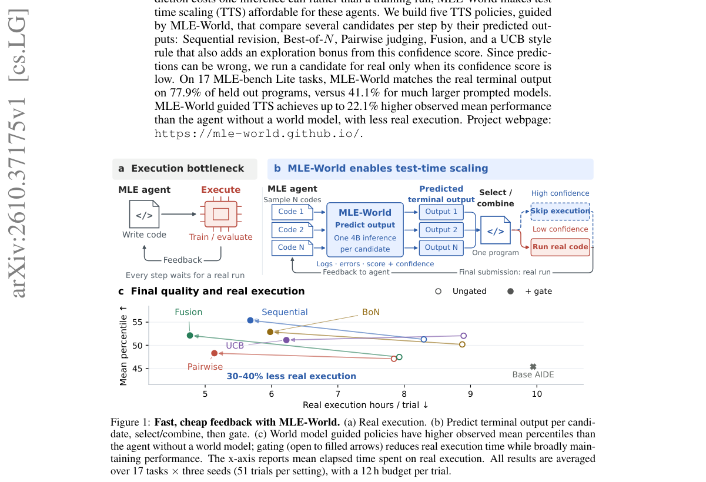

*Result - Five ways to search with MLE-World. Each tile pairs a candidate program with its predicted execution output. Sequential revises programs using predicted feedback; Best-of-N selects the candi*

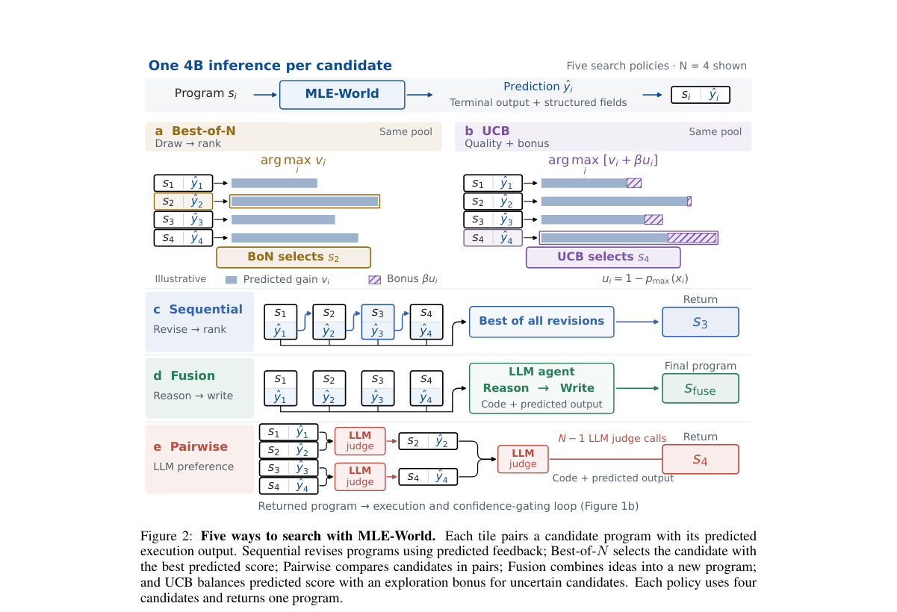

**Why this ranks #10**: 候选方案要不要真跑一遍？先让世界模型预测跑完的结果再决定。

---

## Footer

- Total papers scanned across all 7 tracks: 578（原始 794 条）
- embodied track final top-10: 10
- Wild-cards in this track: 0
- Figure assets: 2026-10-28/res/

Generated by `mine-arxiv-daily-digest` skill. Sister file: `2026-10-28_embodied_entry.md`.
