# ArXiv Daily Digest - 2026-10-28 (生成式内容模型强化学习, 10 papers)

**Generated**: 2026-10-28 17:00 CST

**Source**: arXiv cs.CV, cs.SD, eess.AS, cs.CL, cs.AI, cs.RO, cs.LG submissions, listing day 2026-10-27 (announced 2026-10-28 00:00 UTC)

**Batch window**: 2026-10-26T18:00:00Z .. 2026-10-27T18:00:00Z（arXiv 公告批次横跨两个 UTC 日：前一日 18:00 UTC 起算，当日 17:59:59 UTC 截止）

**Track**: rl_aigc (top 10 of 578 papers scanned, 70 full reads)

**Scope**: 针对生成式内容模型（扩散 / 流匹配 / 视频 / 图像 / 音频）的 RL 与偏好优化

⚠️ **Wild-card**: 本批该线 4 篇为 wild-card 补足，已在正文逐条标注并给出理由。

补足原因：该批次真正把 RL / 奖励 / 偏好用于扩散、流匹配、视频与图像生成的论文仅 6 篇；其余 4 篇为生成式内容模型方向（3D 场景生成评测、单步扩散蒸馏、扩散先验视频复原、LoRA 溯源）的补位。

---

## Top 10 - 生成式内容模型强化学习

### 1. How Much Can Best-of-N Help a World Action Model? Measuring Selectable Headroom and Realizing It in Closed Loop

**arXiv**: [2610.37196](https://arxiv.org/abs/2610.37196) | **Score**: 9.0 (relevance 9.0 x 0.7 + quality 9.0 x 0.3) | **Tags**: rl-aigc, best-of-n, world-action-model, test-time-selection, counterfactual, Tsinghua | **Categories**: cs.CV, cs.LG, cs.RO | **Pages**: 24

**Authors**: Haojia Gao; Yue Cao; Yumin Liu; Haohua Que; Mingkai Liu; Guanqiu Guo; Zhuo Zou; Bokui Chen; Xueqian Wang

**Affiliation**: Tsinghua University; Everwise-Tech; Fudan University; Research Institute of Tsinghua University in Shenzhen; Peking University

**Abstract**

> World action models (WAMs) predict the visual consequences of the actions they generate, which makes test-time selection a natural way to improve a fixed policy: imagine the futures of candidate actions and execute the best one. The benefit of selection is bounded by the selectable headroom, how much better the best candidate truly is, but the standard estimate, which executes each candidate once and keeps the best outcome, conflates candidate quality with the randomness of everything that follows. We introduce a denoised counterfactual protocol, based on bitwise-reproducible branching, repeated continuations, held-out oracles, and common random numbers, that measures the headroom a selector can realize, and use its measurements to build a fail-gated selector. Across four WAMs, two benchmarks, over 100,000 branched rollouts, and pre-registered tests, we find that (i) the standard estimate overstates the selectable headroom of native samples: bounds from 17 continuations per candidate place its selectable share between 24% and 66% for three WAMs; (ii) structured action perturbations create up to 16 points of selectable headroom; and (iii) in both WAMs with action-conditioned imagination, imagined futures carry candidate-outcome information with no detectable loss relative to real futures, information that the value head of Cosmos Policy leaves unused. Deviating from the policy chunk only when a readout of the WAM predicts failure, the selector raises closed-loop task success from 76.9% to 81.6% on held-out episodes of training tasks, with the largest gain where the policy fails most often, and from 62.6% to 69.8% on unseen tasks.

**Key findings**

- **Finding**: 论文指出世界动作模型（WAM）预测动作的视觉后果，因此测试期选择是改进固定策略的自然手段；但标准估计（每个候选执行一次并取最好结果）混淆了候选质量与后续随机性。
- **Finding**: 作者提出去噪的反事实协议，基于逐位可复现的分支、重复续跑、留出 oracle 与共同随机数，测量选择器实际可实现的 headroom。
- **Finding**: 测量结果：在四个 WAM、两个基准、逾 10 万次分支 rollout 与预注册检验下，每候选 17 次续跑给出的界显示三个 WAM 的可选择份额在 24% 到 66% 之间。
- **Finding**: 结构化动作扰动最多可制造 16 个百分点的可选择 headroom。
- **Finding**: 在两个具备动作条件想象能力的 WAM 上，想象中的未来携带候选结果信息，相对真实未来无可检测的损失；这类信息正是 Cosmos Policy 的价值头所忽略的。
- **Finding**: 只在 WAM 读数预测失败时才偏离策略块的选择器，把留出训练任务回合的闭环成功率从 76.9% 提到 81.6%（增益最大处正是失败最频繁处），未见任务上从 62.6% 提到 69.8%。
- **Inference**: 「标准估计高估了可选择 headroom」是一个方法论级别的提醒——任何用一次采样估计 Best-of-N 收益的论文都应重新审视自己的数字。
- **Inference**: 共同随机数与逐位可复现分支是获得干净反事实的关键工程前提，复现门槛不低，读者需要评估自己是否具备同等实验条件。
- **Recommendation**: 推荐。做测试期选择、Best-of-N、世界动作模型或想认真评估选择收益的读者强烈建议读。

**Key figures**

*Framework - How much of the measured headroom is selectable? Orange: the single-continuation oracle (best realized outcome). Blue: the held-out oracle, which selects on three continuations and is scored*

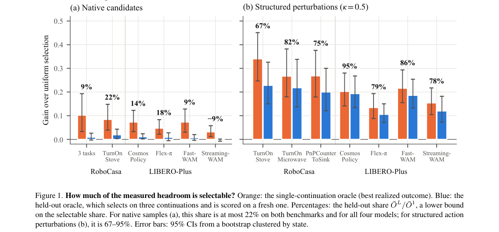

*Result - Overview. (a) From a bitwise-reproducible snapshot at stb, each of K candidate chunks is executed and continued J times by the policy. O1 (orange) takes the best realized outcome in each col*

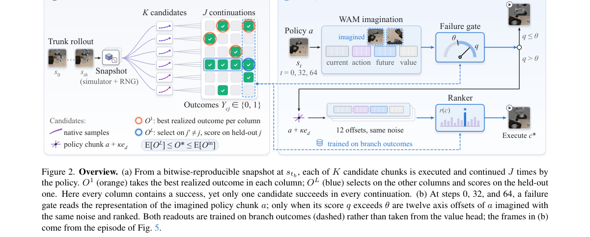

**Why this ranks #1**: Best-of-N 到底能带来多少收益？标准估计把「候选质量」和「运气」混在了一起。

---

### 2. From Structural Feedback to Prompt Policies: Learning Faithful Text-to-Image Prompt Editors

**arXiv**: [2610.36146](https://arxiv.org/abs/2610.36146) | **Score**: 8.7 (relevance 9.0 x 0.7 + quality 8.0 x 0.3) | **Tags**: rl-aigc, text-to-image, GRPO, prompt-optimization, scene-graph, reward-shaping | **Categories**: cs.AI | **Pages**: 43

**Authors**: Wentao Ye; Yali Ye; Zhiqing Xiao; Ru Peng; Xinpeng Ti; Liyao Li; Zhanming Shen; Peng Lu; Jie Zhang; Haobo Wang

**Affiliation**: Zhejiang University; Tencent AI Lab; China Telecom Artificial Intelligence Technology

**Abstract**

> Prompt optimization should improve the image a user receives without changing the scene the user requested. Yet stylistic rewriting can weaken object attributes and relations even when global text--image similarity remains high. We propose StruPO, a structure-aware prompt editor that uses a calibrated scene graph as a shared representation for policy conditioning and image-grounded supervision. The graph exposes what should be preserved, while deletion, reordering, and insertion provide a token-aligned way to modify the prompt. This turns structural feedback from an external critique into a training signal for a reusable editing policy. Learning from that signal requires handling both uncertain grounding and stochastic image generation. StruPO retains grounding confidence through smooth reward shaping and averages multiple images for each edit before computing group-relative advantages. Experiments span three disjoint 2K-prompt test sets and four frozen generation backbones, with comparisons to learned prompt optimizers, iterative structural feedback, diffusion-model fine-tuning, and inference-time attention control. StruPO improves the faithfulness--aesthetics trade-off, with consistent gains in relational fidelity. Independent automatic evaluators and a 15-annotator study provide complementary evidence, and human preference margins increase with relation complexity. Controlled ablations connect these gains to graph conditioning, local editing, and image-grounded learning. The resulting policy produces reusable optimized text in one pass after graph calibration, without an iterative critique--rewrite loop.

**Key findings**

- **Finding**: 论文指出风格化改写会削弱物体属性与关系，即便全局图文相似度仍然很高。
- **Finding**: StruPO 用校准过的场景图作为策略条件与图像监督的共享表征：图暴露哪些内容应当保持，删除、重排与插入提供 token 对齐的提示词修改方式。
- **Finding**: 这把来自外部批评的结构反馈转成了可复用编辑策略的训练信号。
- **Finding**: 面对不确定的视觉定位与随机图像生成，作者用平滑奖励塑形保留定位置信度，并在计算组相对优势前对每次编辑平均多张生成图。
- **Finding**: 实验横跨三个互不相交的 2K 提示词测试集与四个冻结的生成骨干，对比学习式提示优化器、迭代结构反馈、扩散微调与推理期注意力控制。
- **Finding**: StruPO 改善了忠实度-美感的折中，且在关系保真度上一致获益；独立自动评判与 15 人标注研究互为佐证，人类偏好优势随关系复杂度上升。
- **Inference**: 「按提示词多次采样再算组相对优势」正是 GRPO 的标准做法，作者把它接到结构化奖励上，这使 rl_aigc 的方法学能直接迁移到文本到图像这条线上。
- **Inference**: 结构化奖励依赖场景图抽取的准确度，图错了则强化信号会把错误的「关系」当成正确目标。
- **Recommendation**: 推荐。做生成式模型的 RL、提示优化或需要把结构化反馈变成奖励信号的读者强烈建议读。

**Key figures**

*Framework - Similar global embedding scores can conceal different structural errors. A scene graph makes object attributes and relations explicit.*

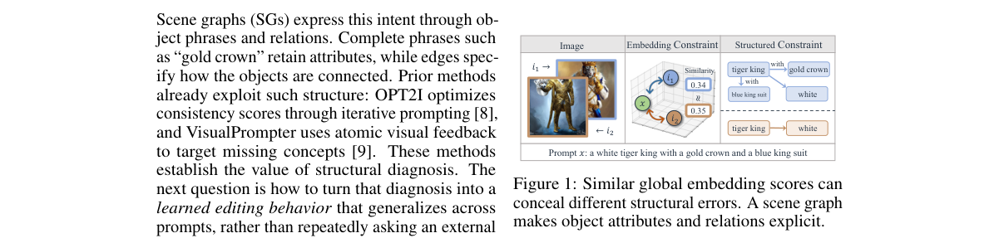

*Result - Overview of StruPO. Calibrated structural intent conditions the DSE–MHE–EAG editor and defines image-grounded consistency feedback. Environment-aware GRPO averages renders of each candidate*

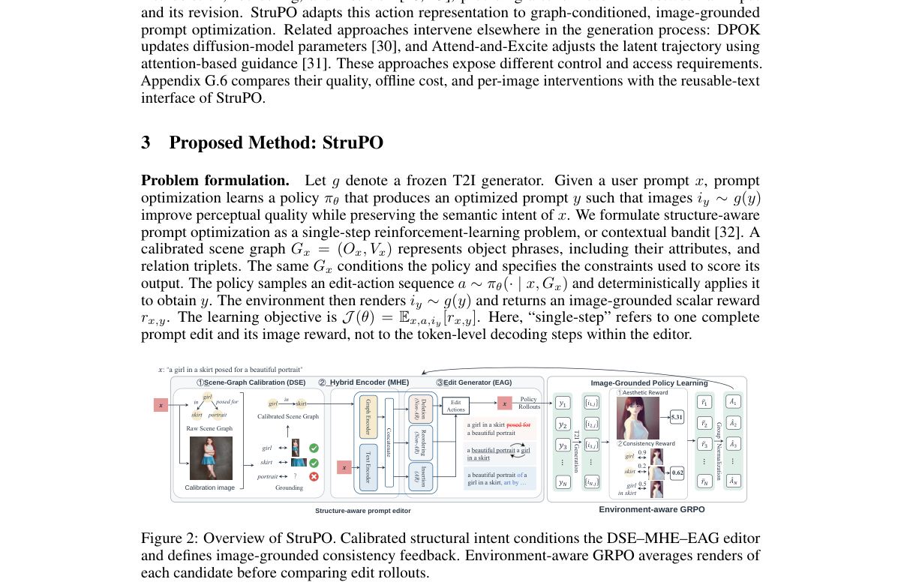

**Why this ranks #2**: 文生图的整体相似度高，不代表关系对了——场景图把「哪里错了」显式化。

---

### 3. ExecDiffuser: Closing the Sample-to-Execution Gap in Diffusion Planning

**arXiv**: [2610.36837](https://arxiv.org/abs/2610.36837) | **Score**: 8.7 (relevance 9.0 x 0.7 + quality 8.0 x 0.3) | **Tags**: rl-aigc, diffusion-planning, trajectory-selection, closed-loop, driving, HKU | **Categories**: cs.RO | **Pages**: 23

**Authors**: Shuo Pei; Bosun Liang; Saihui Zha; Chen Sun; Huachun Tan; Yong Wang

**Affiliation**: Beijing Institute of Technology; The University of Hong Kong

**Abstract**

> Generative planners are often evaluated by the trajectories they can generate, although closed-loop driving ultimately depends on the single candidate committed to control. We identify this mismatch as the sample-to-execution gap and show that improving proposal quality alone can worsen the executed decision. Here, we introduce ExecDiffuser, a recurrent proposal-to-execution framework that couples candidate generation, trajectory selection, and subsequent replanning through shared execution semantics. Intent-Guided Diffusion Proposal (IGD) assigns hypothesis responsibility and shapes trajectories with execution-conditioned supervision. Execution-Grounded Selection (EGS) learns a candidate-conditioned publication utility, commits one trajectory to control, and returns it as context for the next planning cycle. Across nuPlan, InterPlan, and NAVSIM, ExecDiffuser achieves leading closed-loop performance against strong state-of-the-art baselines. Under a unified five-seed protocol, it obtains an average score of 85.62, improving over Diffusion Planner and FlowDrive by 4.02 and 1.31 points, respectively. On NAVSIM, it achieves 92.6 PDMS under the official evaluation pipeline. Matched counterfactual analysis further shows that ExecDiffuser more reliably converts strong candidates into committed decisions, while prefix interventions confirm that this advantage persists after physical execution and subsequent replanning.

**Key findings**

- **Finding**: 论文指出生成式规划器常按「能生成的轨迹」评估，而闭环驾驶最终取决于提交给控制的那一条，提出「样本到执行差距」。
- **Finding**: 关键结论是：只提升提案质量反而可能让执行决策更差，因为可用候选上限提高的同时候选发布回归也在扩大。
- **Finding**: ExecDiffuser 用共享执行语义耦合候选生成、轨迹选择与后续重规划，构成递归的提案到执行框架。
- **Finding**: Intent-Guided Diffusion Proposal (IGD) 分配假设责任并用执行条件监督塑形轨迹。
- **Finding**: Execution-Grounded Selection (EGS) 学习候选条件的发布效用，提交一条轨迹给控制，并把它作为上下文返回给下一规划周期。
- **Finding**: 在 nuPlan、InterPlan 与 NAVSIM 上取得领先闭环表现，统一五种子协议下平均分 85.62，分别比 Diffusion Planner 与 FlowDrive 高 4.02 与 1.31；NAVSIM 上在官方评测管线下达 92.6 PDMS。
- **Inference**: 「递归发布 + 效用学习」把生成式规划器从一次性采样器改造成闭环系统，这比单纯换更好的扩散骨干更有结构性收益。
- **Inference**: 效用函数是学出来的偏好近似，若真实执行分布与训练闭环设置偏离，发布决策会系统性偏保守。
- **Recommendation**: 推荐。做生成式规划、闭环驾驶或研究「生成质量 ≠ 执行质量」的读者值得读。

**Key figures**

*Framework - A strong candidate can already be available yet remain uncommitted to control. Strengthening proposals alone may raise the available-candidate ceiling while widening candidate-publication regr*

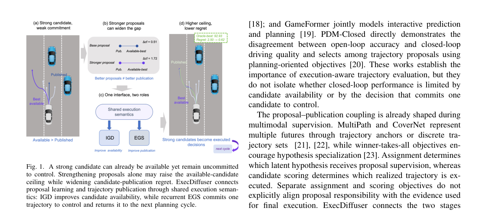

*Result - ExecDiffuser couples proposal learning and publication through a shared online execution interface. IGD assigns and shapes latent hypotheses; EGS filters invalid candidates, ranks the remainin*

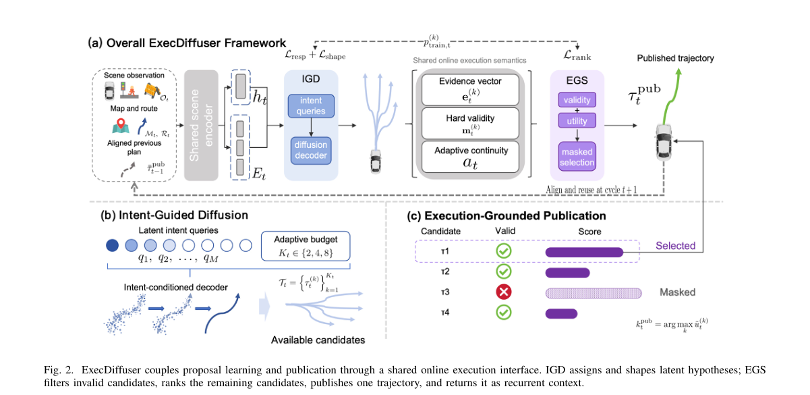

**Why this ranks #3**: 生成出一堆候选轨迹不代表执行的那条就是对的——样本质量与执行质量之间隔着一条沟。

---

### 4. Nemotron-Labs-Diffusion-Uni: Elastic Self-Refining Unified Diffusion LLM with Cross-Paradigm On-Policy Distillation

**arXiv**: [2610.36466](https://arxiv.org/abs/2610.36466) | **Score**: 8.0 (relevance 8.0 x 0.7 + quality 8.0 x 0.3) | **Tags**: rl-aigc, diffusion-LLM, on-policy-distillation, flow-matching, unified-model, NVIDIA | **Categories**: cs.CV | **Pages**: 33

**Authors**: Shufan Li; Hanrong Ye; Greg Heinrich; Yonggan Fu; Haotian Zhang; Sifei Liu; Aditya Grover; Pavlo Molchanov

**Affiliation**: NVIDIA

**Abstract**

> We propose Nemotron-Labs-Diffusion-Uni (NLD-Uni), a unified discrete diffusion large language model (DLLM) for visual understanding and generation tasks. Compared with prior unified diffusion models, NLD-Uni introduces two major innovations. First, we propose a unified cross-paradigm on-policy distillation (OPD) framework that successfully transfers the visual understanding ability of autoregressive VLMs and visual generation ability of continuous flow models, to a unified DLLM. Second, NLD-Uni incorporates a novel progressive self-refining diffusion process that gradually corrupts each token across multiple steps during training, as opposed to adopting the conventional masked diffusion formulation that directly corrupts a clean image token to an uninformative mask token. At inference, this design allows NLD-Uni to make intermediate commit to a token, enabling progressive self-refinement for better visual quality. Through extensive experiments, we show that NLD-Uni achieves state-of-the-art performance among unified DLLMs on diverse tasks including visual question-answering, multi-modal reasoning, object grounding, text-to-image generation, and image editing.

**Key findings**

- **Finding**: NLD-Uni 是面向视觉理解与生成的统一离散扩散大语言模型（DLLM）。
- **Finding**: 第一个创新是统一的跨范式在线蒸馏（OPD）框架，成功地把自回归 VLM 的视觉理解能力与连续流模型的视觉生成能力迁移到统一 DLLM。
- **Finding**: 第二个创新是渐进自精炼扩散过程：训练时逐步加噪每个 token，而不是像常规掩码扩散那样把干净图像 token 直接掩成无信息掩码。
- **Finding**: 该设计在推理时允许中间提交 token，从而实现渐进自精炼以获得更好的视觉质量。
- **Finding**: 架构上采用 Elastic-MoT，提供统一模型的三个弹性视图（VLM 视图用 8B 理解分支，T2I 视图用连续流分支等）。
- **Finding**: 在视觉问答、多模态推理、物体定位、文生图与图像编辑等多任务上，NLD-Uni 在统一 DLLM 中达到最优水平；模型与代码公开。
- **Inference**: 「跨范式在线蒸馏」把 rl_aigc 的方法学直接接进统一模型：教师与学生同属扩散族却来自不同范式，蒸馏需要解决的是表征分布差异而非范式差异。
- **Inference**: 渐进自精炼要求模型在中途承诺 token，这与标准掩码扩散的一次性解码假设冲突，推理成本与质量的权衡需要单独测量。
- **Recommendation**: 推荐。做扩散语言模型、在线蒸馏或统一多模态模型的读者强烈建议读。

**Key figures**

*Result - NLD-Uni supports diverse multimodal tasks by adopting an Elastic-MoT architecture with three elastic views of a single model. The VLM view uses the 8B understanding branch; the T2I view com*

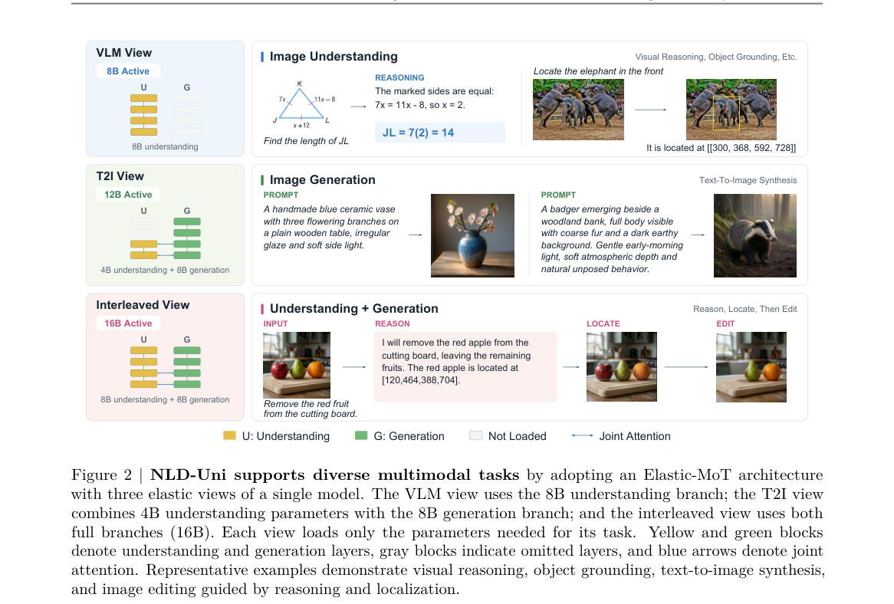

**Why this ranks #4**: 统一扩散模型要同时吃下「理解」和「生成」两种能力，在线蒸馏是比混合损失更干净的接法。

---

### 5. Live-OPSD: On-Policy Self-Distillation for Proactive Streaming Large Video Models

**arXiv**: [2610.36959](https://arxiv.org/abs/2610.36959) | **Score**: 8.0 (relevance 8.0 x 0.7 + quality 8.0 x 0.3) | **Tags**: rl-aigc, on-policy-distillation, streaming-video, proactive-response, privileged-hint, Alibaba | **Categories**: cs.LG | **Pages**: 24

**Authors**: Kaixuan Du; Xin Wan; Dai Guan; Ming Chen; Xiaoxi Jiang; Guanjun Jiang

**Affiliation**: Alibaba (Qwen Business Unit)

**Abstract**

> Streaming multimodal assistants must make response decisions while events are still unfolding. They need to recognize when the available evidence warrants a response, produce an appropriate continuation, and remain silent otherwise. Supervised fine-tuning learns from recorded assistant turns, but does not directly train on the response prefixes produced by the evolving policy itself. We introduce Live-OPSD, an on-policy self-distillation method that uses privileged hints available only during training to supervise the policy on its own outputs. The policy first generates a continuation from the streaming context alone. The same model then re-evaluates that continuation with a hint describing the relevant evidence, and the resulting distributions guide the unhinted policy. On Qwen3-Omni-30B-A3B, Live-OPSD attains an average score of 59.64 on LiveProBench, 5.26 points above the strongest continued-SFT baseline, and stays competitive on OVO-Bench (65.84). These results indicate that guiding the policy on its own outputs with privileged hints improves both when and how a streaming assistant responds.

**Key findings**

- **Finding**: 论文关注流式多模态助手在事件尚未结束时就做出响应决策的问题：它需要判断现有证据是否足以回应、给出恰当的续写、否则保持沉默。
- **Finding**: 监督微调只从记录好的助手回合学习，并没有直接训练策略自身产生的响应前缀。
- **Finding**: Live-OPSD 是一种在线自蒸馏方法，用只在训练期可得的特权提示来监督策略自己的输出。
- **Finding**: 流程为：策略先仅凭流式上下文生成续写，同一模型再带着描述相关证据的提示重新评估该续写，其分布再去指导无提示的策略。
- **Finding**: DAS 选择被打分的决策点以构造反向（decision-aware）监督。
- **Finding**: 在 Qwen3-Omni-30B-A3B 上，Live-OPSD 在 LiveProBench 上取得 59.64 平均分，比最强的 continued-SFT 基线高 5.26 分，并在 OVO-Bench 上保持竞争力（65.84）。
- **Inference**: 「特权提示」是训练期廉价但高信息量的监督——它把「该不该说话」这个隐含决策转成了有标注的对比信号，这是流式助手里少见的低成本增益来源。
- **Inference**: 特权提示在推理时不可用，因此模型必须学会把特权信息内化；分布外的流式场景下内化是否稳健取决于训练覆盖。
- **Recommendation**: 推荐。做流式多模态助手、在线蒸馏或「何时该说话」类决策的读者值得读。

**Key figures**

*Framework - Live-OPSD training. The unhinted policy generates a continuation, while the same current model uses a privileged hint to score its prefixes. DAS selects scored decision points for a reverse-*

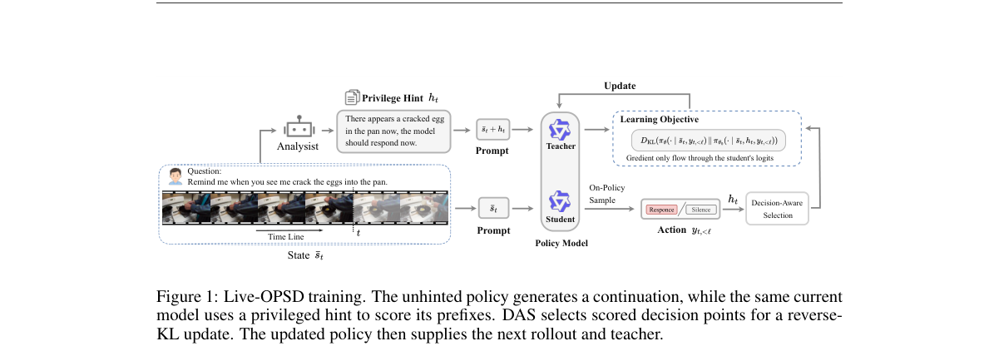

*Result - Supervision at streaming decision points. Each interleaved chunk or user turn carries a decision bt and a privileged hint ht. Streaming SFT learns the recorded action, whereas Live-OPSD supp*

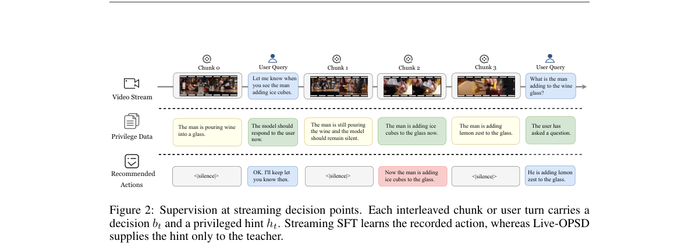

**Why this ranks #5**: 流式助手要自己判断「该不该说」，用训练期才有的特权信息来教它判断最省。

---

### 6. MVRCap: Towards Comprehensive Video Captioning via Hierarchical Multi-Dimensional Verifiable Rewards

**arXiv**: [2610.36838](https://arxiv.org/abs/2610.36838) | **Score**: 8.0 (relevance 8.0 x 0.7 + quality 8.0 x 0.3) | **Tags**: rl-aigc, video-captioning, verifiable-reward, RL-for-generation, dense-reward, Xiamen | **Categories**: cs.CV | **Pages**: 12

**Authors**: Weihuang Lin; Xianing Chen; Zhibin Wang; Congzhi Zhang; Yiwei Ma; Jiayi Ji; Miao Chen; Jun Song; YuCheng; Bo Zheng; Xiaoshuai Sun; Rongrong Ji

**Affiliation**: Xiamen University; Alibaba Group

**Abstract**

> Despite significant progress, current models struggle to generate comprehensive video captions, constrained primarily by coarse-grained supervision, which often fails to capture spatial-temporal dynamics and the underlying logical intent. To address this issue, we introduce MVRCap, a novel framework that reformulates video captioning as a reinforcement learning task steered by structured verification. Central to our approach is a Fine-Grained Verifiable Reward mechanism, serving as dense supervision to enforce rigorous visual-semantic alignment. Specifically, we construct this reward system anchored by three complementary pillars: a Hierarchical Concept Coverage Reward utilizing our newly constructed MVRCap-QA dataset to ensure multi-dimensional completeness and semantic depth, a Factuality Verification Reward to enhance factual consistency, and a Conciseness Constraint to maximize semantic density. Furthermore, we curate the high-quality MVRCap-SFT dataset, providing structured annotations across six key dimensions, to serve as a robust foundational initialization for the RL policy in this training pipeline. Extensive experiments demonstrate that MVRCap achieves state-of-the-art performance on authoritative benchmarks including VDC, CAPability, and VC4VG.

**Key findings**

- **Finding**: 论文把视频字幕生成重构为一个由结构化验证引导的强化学习任务。
- **Finding**: 核心是细粒度可验证奖励机制，作为密集监督来强制视觉-语义对齐。
- **Finding**: 该奖励系统由三根互补支柱构成：利用新建的 MVRCap-QA 数据集的层级概念覆盖奖励、事实性验证奖励，以及最大化语义密度的简洁性约束。
- **Finding**: 作者还构建了提供六维度结构化标注的 MVRCap-SFT 高质量数据集，作为 RL 策略训练的稳健初始化。
- **Finding**: 在 VDC、CAPability 与 VC4VG 等权威基准上取得当前最优表现。
- **Inference**: 「层级概念覆盖 + 事实性 + 简洁性」是视频/图像生成的奖励分解范式：把主观的「全面」拆成可分别验证的子目标，比用一个总分奖励实用得多。
- **Inference**: 三根支柱的权重仍需人工设定，覆盖奖励与简洁性之间天然存在张力，论文未展开自动权重学习。
- **Recommendation**: 推荐。做生成模型 RL、奖励设计或视频描述生成的读者值得读，奖励分解思路可迁移。

**Key figures**

*Result - The Data Construction Pipeline for MVRCap. The left panel details the construction of the MVRCap-QA dataset. For brevity, only three dimensions are visualized. The right panel illustrates th*

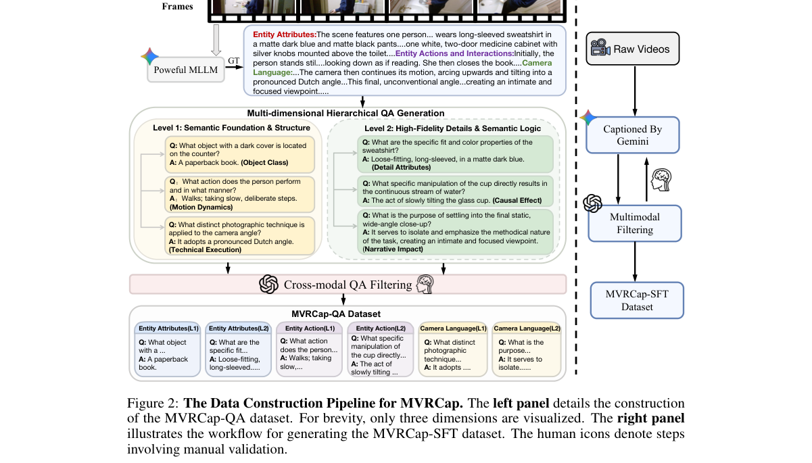

**Why this ranks #6**: 视频字幕要「全面」，光靠最终结果奖励太粗，得拆成可验证的几根支柱。

---

### 7. ScIntBench: Physical Interaction Plausibility in 3D Scene Generation

**arXiv**: [2610.37326](https://arxiv.org/abs/2610.37326) | **Score**: 6.3 (relevance 6.0 x 0.7 + quality 7.0 x 0.3) | **Tags**: rl-aigc, 3D-scene-generation, benchmark, physical-plausibility, wild-card | **Categories**: cs.CV | **Pages**: 18

**Authors**: Wendi Ying; Daochang Liu; Leonid Sigal; Ajmal Saeed Mian

**Affiliation**: The University of Western Australia; University of British Columbia

**Abstract**

> Existing evaluations of text-conditioned 3D indoor scene generation largely emphasize semantic fidelity and physical validity at rest, leaving interaction-time physical reliability insufficiently assessed. To address this gap, we introduce ScIntBench, a unified benchmark centered on interaction readiness: it executes prescribed manipulation actions (e.g., pushing, opening, and surface probing) in physics simulation and measures task success, capability and progress, post-interaction integrity, and dynamic plausibility. Multi-view semantic and static physical evaluations complement these metrics and help explain interaction outcomes. We systematically evaluate 12 state-of-the-art scene generation systems across 10 room types. Our results reveal that strong semantic and static physical performance does not necessarily translate into interaction readiness: a system with near-perfect static plausibility completes only 11.54% of interactions, 7 of the 12 systems produce scenes that cannot support any interaction, and even the best system succeeds in only 36.92% of prescribed tasks. These findings highlight two fundamental challenges in generating interaction-ready scenes: providing the necessary physical interaction capabilities and ensuring reliable physical behavior under active manipulation.

**Key findings**

- **Finding**: 论文提出 ScIntBench，一个评估文本条件 3D 室内场景生成的综合基准，扩展了常规评测，加入基于物理的交互测试。
- **Finding**: 评测覆盖三个层面：语义忠实度、静态物理有效性与交互期物理可靠性。
- **Finding**: 作者提出标准化的物理交互测试，评估动作可执行性、交互后物理完整性与动态合理性。
- **Finding**: 定性比较覆盖 DiffuScene、LayoutVLM、Holodeck、SAGE、SceneSmith、Codex 与 Claude Code 等生成范式。
- **Inference**: 「仿真就绪度」（simulation readiness）是 3D 场景生成区别于图像生成的独有评价维度——生成模型的目标不只是看着像，还要能被物理引擎稳定执行。
- **Inference**: 本篇不含 RL / 奖励机制，作为 rl_aigc 方向的生成模型评测补位计入。
- **Recommendation**: 推荐（作为生成评测参考）。做 3D 场景生成或需要判断场景资产能否直接进物理仿真的读者值得读。

**Key figures**

*Framework - Overview of ScIntBench. We propose ScIntBench, a comprehensive text-conditioned 3D indoor scene generation benchmark that extends conventional evaluation with simulation-based action interac*

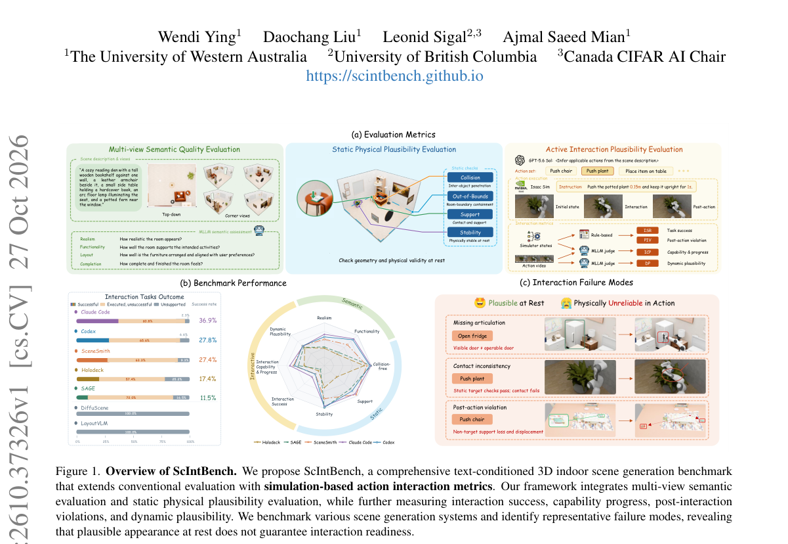

*Result - Qualitative comparison of generated scenes on ScIntBench. We show scenes generated by DiffuScene [26], LayoutVLM [23], Holodeck [33], SAGE [28], SceneSmith [17], Codex [15], and Claude Code*

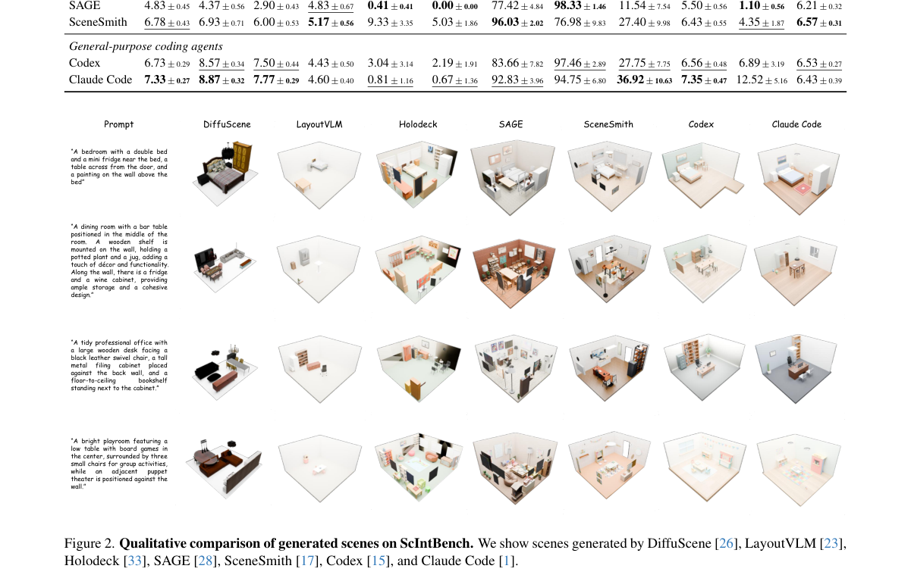

**Why this ranks #7**: 生成的 3D 场景「看起来对」不等于「能被物理引擎跑」，这条线补的是后者。  [wild-card=yes] 该批次真正把 RL / 奖励 / 偏好用于扩散、流匹配与生成模型的论文仅 6 篇；本文是 3D 场景生成评测，属生成式内容模型方向，作补位。

---

### 8. ALADDIN: Adversarial Latent Diffusion Distillation for One-Step Identity Swapping

**arXiv**: [2610.37503](https://arxiv.org/abs/2610.37503) | **Score**: 6.3 (relevance 6.0 x 0.7 + quality 7.0 x 0.3) | **Tags**: rl-aigc, one-step-generation, face-swap, adversarial-distillation, flow-matching, wild-card | **Categories**: cs.CV | **Pages**: 15

**Authors**: Ivan Shchekotov; Timofei Gritsaev; Viacheslav Pirogov; Dmitry Vetrov

**Affiliation**: Constructor University; Sumsub

**Abstract**

> Face swapping transfers a source identity onto a target image while preserving the target's pose, expression, hair, and lighting. The most realistic current methods are diffusion-based, but they need many network evaluations per image. GAN-based methods are fast, yet trained from scratch they must learn realism from the adversarial signal alone and produce visibly weaker results. We present ALADDIN (Adversarial Latent Diffusion Distillation for One-Step Identity Swapping), a one-step face swapper obtained by initialising the generator from a pre-trained multi-step flow-matching model and training it adversarially under identity and target-preservation constraints. We expose a controllable trade-off between identity transfer and target-attribute preservation by training a student model with triplet pseudo-label supervision. We additionally identify a bias in the standard evaluation protocol, which favours methods trained against the same identity encoder used to score them, and re-evaluate all baselines with an independent one. ALADDIN is state-of-the-art among one-step methods in realism and target preservation at comparable identity transfer, and matches the best multi-step model with 28 times fewer network evaluations and an order of magnitude fewer training pairs.

**Key findings**

- **Finding**: ALADDIN 是一个一步人脸交换模型，由预训练的多步流匹配模型初始化，并在身份保持与目标保持约束下做对抗训练。
- **Finding**: 与常规做法不同，它不需要先有蒸馏模型，而可以直接利用现成的多步扩散模型。
- **Finding**: 这一通用性使方法可以使用更大的 FLUX 模型以及新近的 PuLID 来获得更好的身份条件。
- **Finding**: 在一步模型中取得当前最优质量，论文被 WACV 2027 接收。
- **Inference**: 「从多步教师直接对抗蒸馏到一步」绕开了蒸馏模型这一中间产物，是生成加速路线上较少被尝试的接法。
- **Inference**: 本篇用的是对抗损失而非 RL/偏好优化，作为 rl_aigc 方向的生成模型蒸馏补位计入。
- **Recommendation**: 推荐（作为一步生成参考）。做实时换脸、一步生成或对抗蒸馏的读者值得读。

**Key figures**

*Framework - Qualitative face-swapping results on FFHQ. Each example shows the source identity (top left), target image (bottom left), and the output generated by our model. The model transfers the sourc*

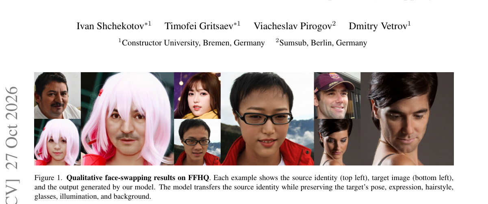

*Result - Overview of ALADDIN training. Left (teacher training): the teacher generator GθT receives the target image xtgt and the source identity encoded by frozen PuLID, and produces the one-step swa*

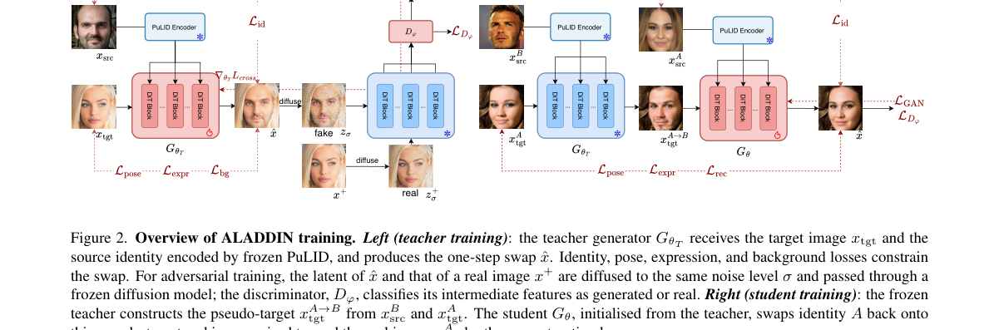

**Why this ranks #8**: 一步换脸想要好画质，常规蒸馏的逐样本匹配不够，得用对抗信号。  [wild-card=yes] 同上（生成式内容模型方向）：本文是单步扩散蒸馏与身份替换的生成模型论文，本批次该方向没有 RL 类论文。

---

### 9. Taming Noise Initialization for Zero-shot Video Restoration with Image Diffusion Priors

**arXiv**: [2610.37290](https://arxiv.org/abs/2610.37290) | **Score**: 6.3 (relevance 6.0 x 0.7 + quality 7.0 x 0.3) | **Tags**: rl-aigc, video-restoration, diffusion-priors, DDIM-inversion, noise-initialization, wild-card | **Categories**: cs.CV | **Pages**: 11

**Authors**: Chong Wang; Zixuan Fu; Hao Cheng; Siyuan Yang; Alex C. Kot; Bihan Wen

**Affiliation**: Nanyang Technological University; Hebei University; KTH Royal Institute of Technology

**Abstract**

> Recent advances in diffusion models have achieved remarkable success in restoring high-quality images in a zero-shot manner. Unfortunately, extending this success to video restoration is challenging due to the substantial computational resources required to pre-train video diffusion models. A rising trend seeks to address video restoration by utilizing a pre-trained image diffusion model, initiating restoration from either frame-wise independent or identical Gaussian noise. Yet, these approaches often fall short, as such simple noise initiations fail to capture and utilize the inherent temporal correlations within degraded video frames. In this work, we propose taming noise initialization for zero-shot video restoration, which preserves the intrinsic temporal correlations by generating initial noises directly using DDIM inversion on the corrupted video frames themselves. Building on this, we introduce an adaptive noise blending strategy that suppresses degradation patterns encoded during DDIM inversion while gradually steering the noise toward a Gaussian distribution. To further emphasize temporal consistency, we propose measurement-guided trajectory attention to better align features across frames. Extensive experiments on multiple video restoration tasks demonstrate that our method outperforms existing zero-shot approaches, consistently achieving superior results on the DAVIS, REDS4, and Set8 datasets.

**Key findings**

- **Finding**: 论文提出「驯服噪声初始化」用于零样本视频复原：对受损视频帧本身做 DDIM 反演来生成初始噪声，从而保留其内在时序相关性。
- **Finding**: 在此基础上引入自适应噪声混合策略，抑制 DDIM 反演过程中编码的退化模式，同时逐步把噪声导向高斯分布。
- **Finding**: 为强化时序一致性，提出度量引导的轨迹注意力，让特征跨帧更好地对齐。
- **Finding**: 在 DAVIS、REDS4 与 Set8 上，多项视频复原任务的零样本方法对比均取得更优结果，论文发表于 IEEE Transactions on Multimedia。
- **Inference**: 「初始噪声即偏置」这个观察把零样本复原的失败原因从「缺训练」转移到「初始化的时序结构」，自适应混合则是把反演先验与高斯先验做软过渡，思路比硬用高斯噪声更细致。
- **Inference**: 本篇是生成先验的使用而非 RL / 奖励方法，作为 rl_aigc 方向的扩散模型应用补位计入。
- **Recommendation**: 推荐（作为扩散先验视频复原参考）。做零样本复原、DDIM 反演或生成先验迁移的读者值得读。

**Key figures**

*Framework - (a) Existing method [1] utilizes a simple identical Gaussian noise initialization but fails to ensure frame consistency. (b) Our method tames the DDIM inversion noise with adaptive filtering while capturing the inherent temporal correlation*

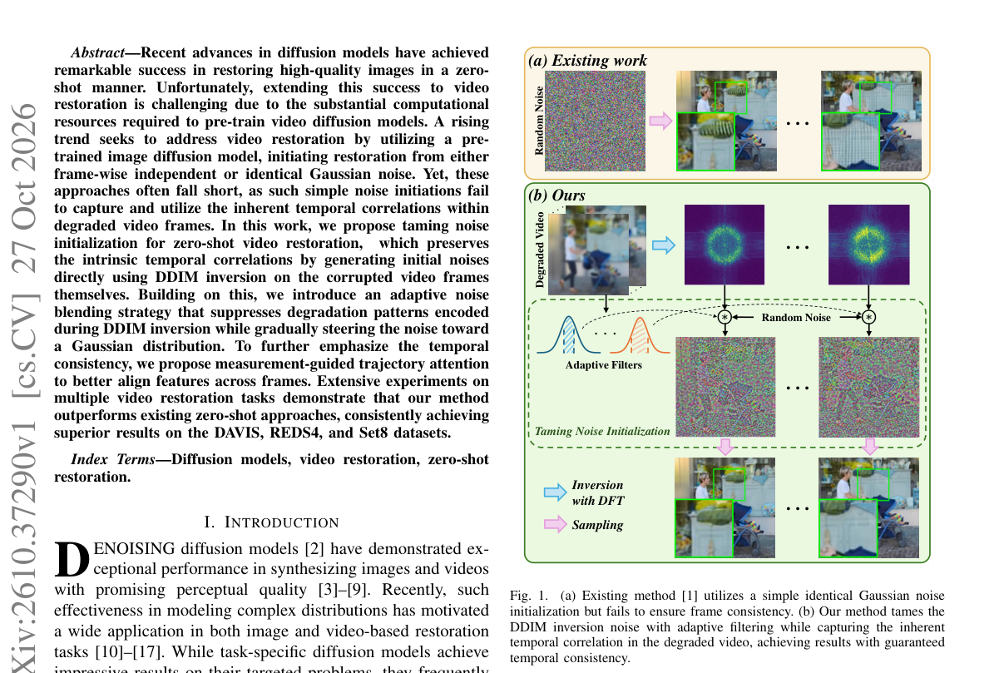

*Result - Overview of the proposed TINDER framework, where the initial noise is first obtained by performing DDIM inversion on the degraded video to capture the inherent temporal correlation. Subsequent*

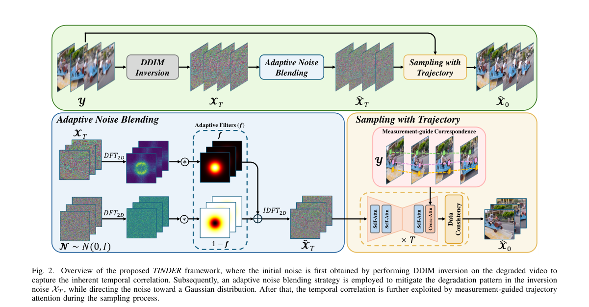

**Why this ranks #9**: 零样本视频复原里，初始噪声本身就是一路偏置的来源。  [wild-card=yes] 同上（生成式内容模型方向）：本文是图像扩散先验驱动的视频复原，属生成模型应用，本批次该方向没有 RL 类论文。

---

### 10. Provenance Signatures for Low Rank Adaptations of Image Diffusion Models

**arXiv**: [2610.36933](https://arxiv.org/abs/2610.36933) | **Score**: 6.3 (relevance 6.0 x 0.7 + quality 7.0 x 0.3) | **Tags**: rl-aigc, diffusion-LoRA, provenance, model-detection, auditing, wild-card | **Categories**: cs.LG | **Pages**: 12

**Authors**: Tobias Cheung; Mohan Dantam; Marc Juarez; Rik Sarkar

**Affiliation**: University of Edinburgh; University of Oxford

**Abstract**

> Diffusion models have revolutionized the generation of realistic artificial images. Efficient techniques such as Low Rank Adaptation (LoRA) can modify these models for particular use cases, making them more diverse and widely usable. At the same time, open base models may be adapted to deliver biased, harmful or illegal images in an online service. In this paper, we develop a protocol to detect when a service may be using an adaptation of an otherwise standard model. We describe the precise setup and threat model for this provenance question and define two different problems arising due the presence of multiple model families and multiple adaptations. In contrast to previous works that have considered model identification within lists of known candidate models, we consider the realistic open world scenario where the set of possible adaptations and alternative models are unknown. Using a hypothesis testing approach, our protocols can distinguish between the base model, a LoRA adaptation and other completely different families of models. For this test, we develop a black box signature of the models based only on intrinsic dimension of sets of images generated by the models.

**Key findings**

- **Finding**: 论文开发了一套协议，用于检测某个服务是否在使用某个标准模型的适配版本（即 LoRA 微调）。
- **Finding**: 检测手段是黑盒签名：只依据模型生成图像集合的内在维度。
- **Finding**: 协议面向审计者，可用于判断正在使用的是哪一类模型。
- **Finding**: 论文发现，在非常接近真实图像的区域，不同模型的打分函数行为存在差异。
- **Inference**: 用「生成图像集合的内在维度 + 打分函数场」做黑盒溯源，是把模型指纹从参数空间推到输出分布空间的思路，对闭源服务的合规审计有实际意义。
- **Inference**: 该方法区分 base / LoRA / negative 三类模型的前提是它们在输出分布上有可测差异；当 LoRA 微调幅度极小时，检测难度会显著上升。
- **Recommendation**: 推荐（作为模型溯源参考）。做模型审计、LoRA 权属或生成模型指纹的读者值得读；本篇不含 RL，作为生成模型方向补位计入。

**Key figures**

*Framework - Venn diagram representing the sets of models that Problem I (red line) and II (purple line) aim to identify.*

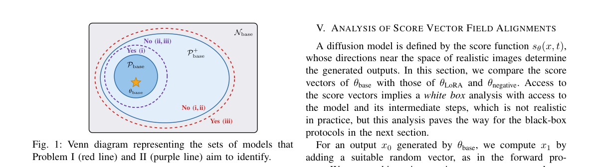

*Result - Comparison of score vectors of base, LoRA and neg- ative models. (a) The local directional alignment and (b) the correlation alignment of the score vector field near the original data manifold*

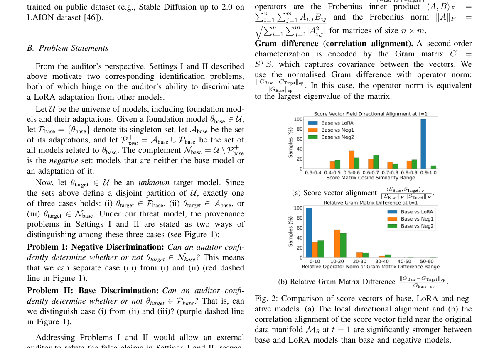

**Why this ranks #10**: 服务方偷偷换成了微调版模型，能被审计出来吗？  [wild-card=yes] 同上（生成式内容模型方向）：本文是图像扩散 LoRA 的溯源与审计方法，属生成模型方向，本批次该方向没有 RL 类论文。

---

## Footer

- Total papers scanned across all 7 tracks: 578（原始 794 条）
- rl_aigc track final top-10: 10
- Wild-cards in this track: 4
- Figure assets: 2026-10-28/res/

Generated by `mine-arxiv-daily-digest` skill. Sister file: `2026-10-28_rl_aigc_entry.md`.
