# ArXiv Daily Digest - 2026-10-28 (强化学习核心, 10 papers)

**Generated**: 2026-10-28 17:00 CST

**Source**: arXiv cs.CV, cs.SD, eess.AS, cs.CL, cs.AI, cs.RO, cs.LG submissions, listing day 2026-10-27 (announced 2026-10-28 00:00 UTC)

**Batch window**: 2026-10-26T18:00:00Z .. 2026-10-27T18:00:00Z（arXiv 公告批次横跨两个 UTC 日：前一日 18:00 UTC 起算，当日 17:59:59 UTC 截止）

**Track**: rl_core (top 10 of 578 papers scanned, 70 full reads)

**Scope**: RL 算法与理论、多智能体 RL、探索与可塑性、sim-to-real 与 RL 系统实现

---

## Top 10 - 强化学习核心

### 1. Learning Multi-Phase Robot Loco-Manipulation via Phase-Conditioned Policy Optimization

**arXiv**: [2610.36270](https://arxiv.org/abs/2610.36270) | **Score**: 8.7 (relevance 9.0 x 0.7 + quality 8.0 x 0.3) | **Tags**: rl-core, PPO, robot-policy, phase-conditioning, curriculum, ETH-Zurich | **Categories**: cs.RO | **Pages**: 8

**Authors**: Simone Manni; Annika Wollschläger; Dario Bellicoso; Abel Gawel; Marco Hutter; Simon Le Cleac'h; Jan Brüdigam

**Affiliation**: ETH Zurich; Robotics and AI Institute

**Abstract**

> Complex whole-body loco-manipulation requires executing diverse maneuvers, such as crouching, grasping, and locomotion, within a single long-horizon task. While performing simple pick-and-place behaviors is well-established, scaling to complex, long-horizon tasks remains difficult. Currently, this challenge is addressed by relying on human motion data and correspondingly humanoid platforms, which limits platform independence and introduces substantial data processing overhead. Instead, we extend proximal policy optimization (PPO) to train a single policy for multi-phase tasks across diverse robotic hardware, leveraging prior task structure to shape behavior. Our method adapts PPO using a phase-conditioned critic, phase-gated reward functions, and a multi-phase reset curriculum to guide exploration. To support varied hardware, we employ a decoupled hierarchical control architecture that separates lower-level balancing dynamics from high-level phase execution. We demonstrate multi-stage loco-manipulation skills on hardware on both the Unitree G1 and a Boston Dynamics Spot equipped with a manipulator arm, and validate our design choices through ablations. Our approach enables the acquisition of complex loco-manipulation behaviors purely through environment interaction while directly incorporating high-level task structure into policy learning.

**Key findings**

- **Finding**: 论文改编 PPO 引入任务的序性：提出相位条件化 critic 与相位门控奖励函数，配合多相位重置课程来引导探索。
- **Finding**: 目标是通过环境交互本身获取复杂 loco-操作行为，同时把高层任务结构直接纳入策略学习。
- **Finding**: 在两个平台上评测多个任务，包括 Spot 四足机器人操纵轮胎与 Unitree G1 人形机器人搬箱子。
- **Finding**: 每个环境产出单一统一策略，可执行复杂的多阶段 loco-操作行为（搬箱子等）。
- **Inference**: 相位门控奖励等于把任务分解假设写进了优化目标，比让网络从稀疏奖励里自行发现阶段结构高效得多——这是「把领域知识编码进 RL 结构」的典型例子。
- **Inference**: 前提是任务阶段可被人工标注，开放式或阶段边界模糊的任务并不适用这一配方。
- **Recommendation**: 推荐。做机器人策略学习、多阶段任务或需要把任务结构注入 RL 的读者值得读。

**Key figures**

*Framework - Multi-Phase Loco-Manipulation. Our framework synthesizes a single, unified policy per environment capable of executing complex, multi-phase loco-manipulation behaviors, including: (a) a box pi*

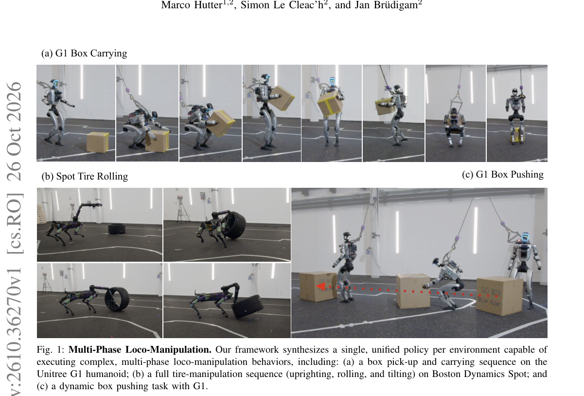

*Result - Overview of the low-level whole-body policy. The policy commands leg and waist joints to execute stable locomotion, low crouching, and crouch-walking. Training stability is achieved via invers*

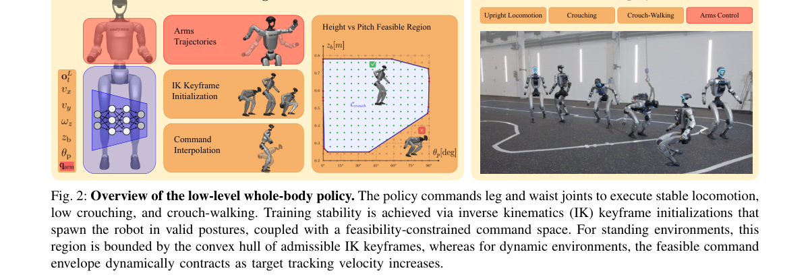

**Why this ranks #1**: 任务有阶段，就把阶段写进 critic，而不是指望奖励自己学出阶段结构。

---

### 2. VLA-Stem: A Lightweight Safety Mechanism for Vision-Language-Action Models via Reinforcement Learning

**arXiv**: [2610.37378](https://arxiv.org/abs/2610.37378) | **Score**: 8.7 (relevance 9.0 x 0.7 + quality 8.0 x 0.3) | **Tags**: rl-core, VLA-safety, reinforcement-learning, reflex, curriculum, USTC | **Categories**: cs.RO | **Pages**: 12

**Authors**: Bojun Zou; Wenhao Yu; Jiaohao Li; Jiaxuan Lin; Guanting Ye; Haohan Geng; Weihao Yu; Yanyong Zhang; Jianmin Ji

**Affiliation**: University of Science and Technology of China; Peking University; University of Macau

**Abstract**

> Vision-Language-Action (VLA) models integrate high-level reasoning with low-level action execution for end-to-end robotic control. However, most VLA models target static manipulation in unconstrained environments, overlooking spatial constraints and dynamic obstacles. Fine-tuning VLAs on obstacle-avoidance data is a straightforward solution, but collecting such data is costly, especially for dynamic scenarios, and may degrade their original task capabilities. To address these limitations, we propose VLA-Stem, a lightweight, reinforcement-learning-based safety mechanism for VLA systems. Without fine-tuning the underlying VLA policy, VLA-Stem converts its action chunks into motion references and uses trajectory-level guidance to preserve their spatial intent while allowing flexible motion and timing adjustments. Conditioned on these references, robot proprioception, and local obstacle information, the Stem policy adaptively modifies execution at inference time, preserving the original task intent while enabling responsive adaptation to spatial constraints and dynamic obstacles. For robust and sample-efficient training, we combine teacher-student distillation with curriculum learning. We evaluate VLA-Stem on reference following, static spatial constraints, and dynamic obstacle avoidance. Across six constrained simulation settings, VLA-Stem achieves 52.8% average collision-free task success versus 23.7% for the strongest safety baseline, while preserving base-policy performance in obstacle-free settings; real-world experiments further show consistent collision reductions under static and dynamic obstacles. These results demonstrate that VLA-Stem couples high-level VLA task intent with rapid, reflex-like responses to immediate physical risks, providing a brainstem-inspired mechanism for robust robot execution.

**Key findings**

- **Finding**: 论文指出 VLA 系统的安全设计多以「筛选动作」为主，忽略了生物智能中维持姿态与快速反射这类基础生理与感觉运动功能。
- **Finding**: VLA-Stem 提出一个受脑干启发的轻量 RL 安全机制，把 VLA 的任务意图与对物理风险的快速响应耦合起来。
- **Finding**: 机制上采用双通路结构——逻辑推理与运动协调走大脑皮层通路，反射与安全走脑干通路，最终动作由二者汇合。
- **Finding**: 教师模型通过课程学习训练，依次从参考轨迹跟随到静态避障再到动态避障。
- **Inference**: 「安全不由主策略自证、而由独立轻量模块承担」是更工程化的选择——主模型可以按训练目标优化，安全模块则可以用便宜的在线 RL 快速迭代。
- **Inference**: 两通路耦合会引入额外延迟，且安全模块与主策略的接口定义决定了它能否泛化到未见风险类型。
- **Recommendation**: 推荐。做 VLA 安全、具身实时控制的读者值得读，脑干式分层是值得借鉴的架构抽象。

**Key figures**

*Framework - This figure illustrates the biological motivation behind our method. The left side depicts the interaction between higher-level motor control and lower-level sensorimotor regulation: task-dire*

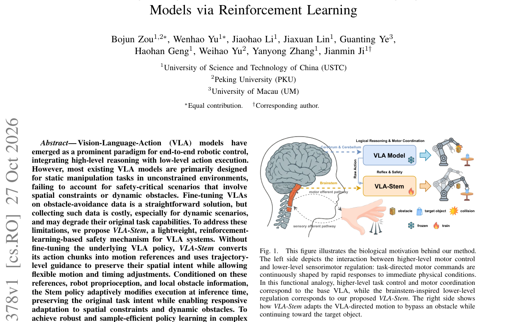

*Result - VLA-Stem pipeline. The teacher is trained using curriculum learning, progressing from reference trajectory following to static obstacle avoidance and then to dynamic obstacle avoidance, with g*

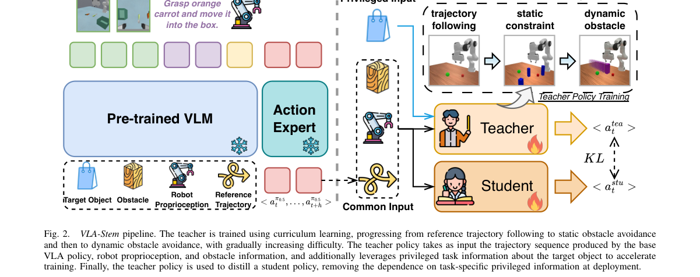

**Why this ranks #2**: 大脑干负责反射、小脑负责协调——VLA 安全就该另开一路而不是指望大模型自己注意。

---

### 3. Multi-Agent Reinforcement Learning of Co-Adaptive Hip Exoskeleton Control (MARL-Exo) for Metabolic Energy Reduction

**arXiv**: [2610.37441](https://arxiv.org/abs/2610.37441) | **Score**: 8.7 (relevance 9.0 x 0.7 + quality 8.0 x 0.3) | **Tags**: rl-core, multi-agent-rl, exoskeleton, human-robot-co-adaptation, biomechanics, NJIT | **Categories**: cs.LG, cs.RO | **Pages**: 14

**Authors**: Yifei Yuan; Jakob Wolf; Ghaith Androwis; Xianlian Zhou

**Affiliation**: New Jersey Institute of Technology

**Abstract**

> Objective: This study aims to determine whether a hip-exoskeleton policy trained in simulation, by co-adapting with a musculoskeletal human model under a metabolic-energy reward, reduces the metabolic cost of walking in new users without per-user tuning, and how mechanical-power shaping affects the learned assistance. Methods: We developed MARL-Exo, a multi-agent reinforcement learning framework in which a full-body human model (304 muscle actuators; randomized anatomy, gait, and speed) and a bilateral hip-exoskeleton policy are trained concurrently in two stages. The exoskeleton observes only delayed hip kinematics and its past commands; its reward includes muscle metabolic power from a physiologically based energetics model, alone (Metabolic) or with mechanical-power shaping (Metabolic + Power). The Metabolic policy was deployed and tested without retraining in eight healthy adults walking at 1.25 m/s, using indirect calorimetry. Results: In simulation, the Metabolic policy reduced modeled muscle metabolic power by 13.8% relative to no-device walking, versus 8.8% for Metabolic + Power. On hardware, MARL-Exo reduced net metabolic rate by 18.3 $\pm$ 6.6% relative to Passive in all eight participants. Relative to No-Exo, the mean reduction was 7.4 $\pm$ 10.0%; six participants more than offset the 13.1% device-wearing penalty, walking up to 24.2% below their No-Exo cost. Conclusion: A metabolically informed policy co-adapted in simulation transferred to users without per-user tuning and consistently reduced the metabolic cost of walking with the device, while explicit power shaping reduced the simulated benefit. Significance: Unlike per-user human-in-the-loop optimization, this approach yields a single population-level controller and allows assistance objectives to be screened in simulation before human testing.

**Key findings**

- **Finding**: MARL-Exo 是一个多智能体 RL 框架，人体模型（304 个肌肉驱动，随机化解剖、步态与速度）与双侧髋部外骨骼策略在共享物理仿真中并发训练，分两个阶段进行。
- **Finding**: 人体动作通过稳定的比例-微分（PD）控制器传递给物理环境。
- **Finding**: 训练目标包含代谢能耗降低，且在人体研究阶段获批伦理审查。
- **Finding**: 实验协议为每位参与者完成站立休息、无外骨骼步行、被动步行，再以随机化顺序测试两个主动控制器（MARL-Exo 与 SMAT）。
- **Inference**: 把「人」建模成 304 肌肉的主动智能体、而不是被动的被控对象，是这篇的核心设计——它才可能真正实现 co-adaptive 控制而不是把外骨骼当增益器。
- **Inference**: 仿真到人的迁移是这个方向的老问题，论文提供了人体验证，但受试者规模与仿真肌肉模型的准确性决定了结论外推性。
- **Recommendation**: 推荐。做人机协作控制、外骨骼、可穿戴机器人的读者值得读。

**Key figures**

*Framework - Overview of MARL-Exo. (a) Training in simulation: a human policy πH and an exoskeleton policy πE act on a shared physics simulation; human actions pass through stable proportional-derivative (*

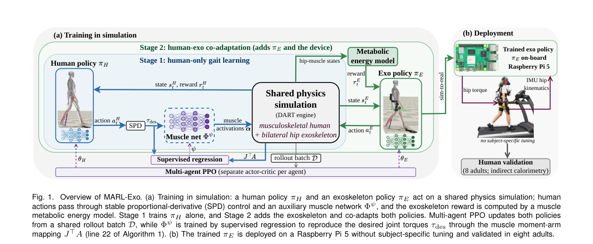

*Result - Experimental protocol. Each participant completed standing rest, no-exoskeleton walking (No-Exo), and passive walking (Passive), then the two active controllers (MARL-Exo and SMAT) in randomiz*

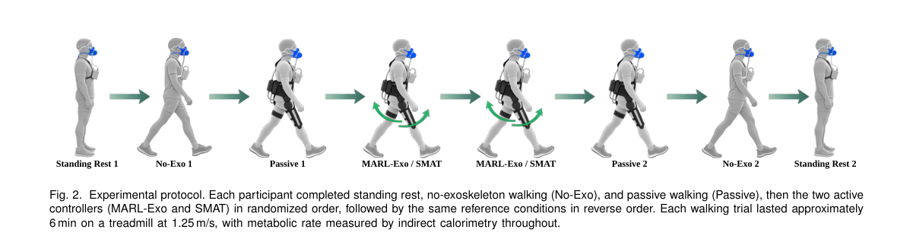

**Why this ranks #3**: 人和外骨骼同时学，关键是让它们互相适应而不是各自最优。

---

### 4. Bridging Exploration and Loss of Plasticity in On-Policy Reinforcement Learning

**arXiv**: [2610.36309](https://arxiv.org/abs/2610.36309) | **Score**: 8.3 (relevance 8.0 x 0.7 + quality 9.0 x 0.3) | **Tags**: rl-core, loss-of-plasticity, PPO, isotropic-Gaussian, theory, IIT | **Categories**: cs.LG, cs.RO | **Pages**: 23

**Authors**: Andrea Vasco Grieco; Evelyn D'Elia; Edoardo Caldarelli; Raffaello Camoriano

**Affiliation**: Politecnico di Torino; Istituto Italiano di Tecnologia

**Abstract**

> Deep reinforcement learning (RL) algorithms have been observed to lose the ability to adaptively learn from new data, a phenomenon termed Loss of Plasticity (LoP). While many metrics have been shown to correlate with it, the causal mechanisms and the geometric conditions from which it can arise have not been clearly identified. We analyze LoP in Proximal Policy Optimization with isotropic Gaussian policies, the state-of-the-art formulation for many continuous action spaces in RL. We report multiple metrics which characterize the effect that the policy standard deviation $σ$ has on LoP, and we also suggest related explanations for the effectiveness of widely adopted LoP mitigation techniques. We observe a significant effect of $σ$ on the extent of LoP, and accompany this with both theoretical and experimental supporting arguments. Our experimental validation consists of LoP benchmark evaluations against standard baselines as well as real-world policy deployment on a 7-DoF robotic arm.

**Key findings**

- **Finding**: 论文分析 PPO 配各向同性高斯策略时的「可塑性丧失」（LoP），报告多个刻画策略标准差 σ 对 LoP 影响的指标。
- **Finding**: 作者观察到 σ 对 LoP 程度有显著影响，并给出理论与实验两方面的论证。
- **Finding**: 分析对象是策略诱导出的两个概率分布：状态空间上的 ρ_π 与状态-动作空间上的 ν_π。
- **Finding**: 论文还解释了若干被广泛采用的 LoP 缓解技术为何有效。
- **Finding**: 实验验证包括与标准基线的 LoP 基准评测，以及在 7 自由度机械臂上的真实策略部署。
- **Inference**: 把 σ 与 LoP 联系起来很有价值——σ 常被当作可以随手调的超参，实际却可能是决定 on-policy 方法长期学习能力的结构性变量。
- **Inference**: 各向同性高斯的假设限定了结论外推，状态相关的非高斯策略下 σ 的角色是否类似仍是开放问题。
- **Recommendation**: 推荐。做 PPO 调参、长期训练稳定性或可塑性问题的读者值得读。

**Key figures**

*Framework - Results of fitting α1 and α2 for the gradient norm and Hessian sharpness.*

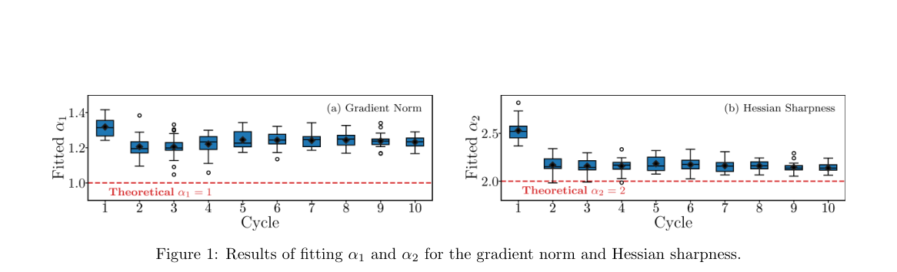

*Result - Empirical measurements of ˜κθ and ˜Kθ, smoothed over a window of 30 iterations.*

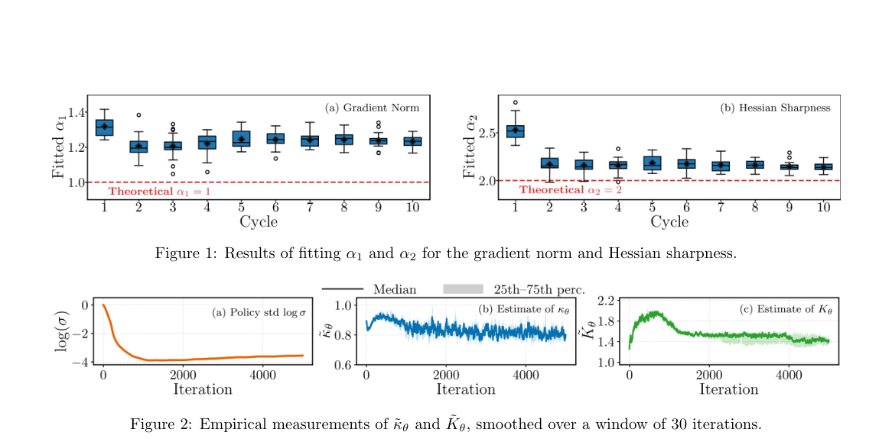

**Why this ranks #4**: 策略标准差 σ 悄悄决定了 PPO 还能不能继续学。

---

### 5. Repulsive Population Policy Gradients for Behaviorally Diverse Reinforcement Learning

**arXiv**: [2610.36425](https://arxiv.org/abs/2610.36425) | **Score**: 8.0 (relevance 8.0 x 0.7 + quality 8.0 x 0.3) | **Tags**: rl-core, quality-diversity, PPO, population, language-model-fine-tuning, USC | **Categories**: cs.AI, cs.LG | **Pages**: 45

**Authors**: Saeed Hedayatian; Harsh Shah; Celine Mneimneh; Stefanos Nikolaidis

**Affiliation**: University of Southern California; Independent Researcher

**Abstract**

> The goal of Quality-Diversity Reinforcement Learning (QD-RL) is to find a population of high-performing policies that solve a decision-making problem in diverse ways. Despite recent progress, QD-RL methods predominantly rely on evolutionary operators--including black-box optimizers, mutations, and crossovers--to facilitate exploration and induce diversity. Scaling these methods becomes increasingly costly as policies and behavior spaces grow larger. Building on the Soft QD view of quality-diversity optimization, we introduce \textbf{Re}pulsive \textbf{P}opulation \textbf{P}olicy \textbf{O}ptimization (\textbf{RePPO}), which adapts PPO to jointly optimize a compact population of diverse, high-quality policies using a population-dependent, dynamically shaped reward. On standard continuous-control tasks, RePPO achieves a strong quality-diversity tradeoff compared with state-of-the-art QD-RL methods. Ablations further characterize this tradeoff by examining how each component affects individual quality and collective diversity. To assess RePPO's scalability, we extend our evaluation to learning from pixels and fine-tuning large language models. In pixel-based tasks, where large policies make most traditional QD-RL methods infeasible, RePPO maintains quality on par with standard PPO while achieving substantially higher diversity. Its successful application to language model fine-tuning further demonstrates, for the first time, that QD-RL methods can scale to this domain. Together, these results show that directly optimizing compact populations with RePPO provides a scalable approach to QD-RL across increasingly complex domains.

**Key findings**

- **Finding**: 论文基于 Soft QD 视角提出 RePPO，用群体依赖、动态塑形的奖励把 PPO 改造为联合优化一组紧凑的高质量多样策略。
- **Finding**: RePPO 不需要行为空间离散化，也不需要进化算子（黑盒优化、变异、交叉）。
- **Finding**: 作者给出稳定群体训练的控制项，并消融它们在质量与多样性平衡中的作用。
- **Finding**: 在标准连续控制任务上取得强质量-多样性折中；在像素任务上保持与标准 PPO 相当的质量同时多样性显著更高。
- **Finding**: 作者首次把 QD-RL 扩展到大语言模型微调域，验证了该族方法的可扩展性。
- **Inference**: 「用当前群体塑形奖励」把多样性变成目标函数的一部分而非外挂机制，这绕开了 QD-RL 长期以来的规模瓶颈。
- **Inference**: 语言模型微调上的成功说明该方法可迁移到高维输出空间，但奖励塑形的稳定性对超参敏感，论文的消融正是为此。
- **Recommendation**: 推荐。做质量-多样性 RL、策略种群或想把多样性引入 LLM 微调的读者值得读。

**Key figures**

*Framework - Quality and diversity of the final populations in continuous control (top) and Atari (bottom). Large markers show the mean over*

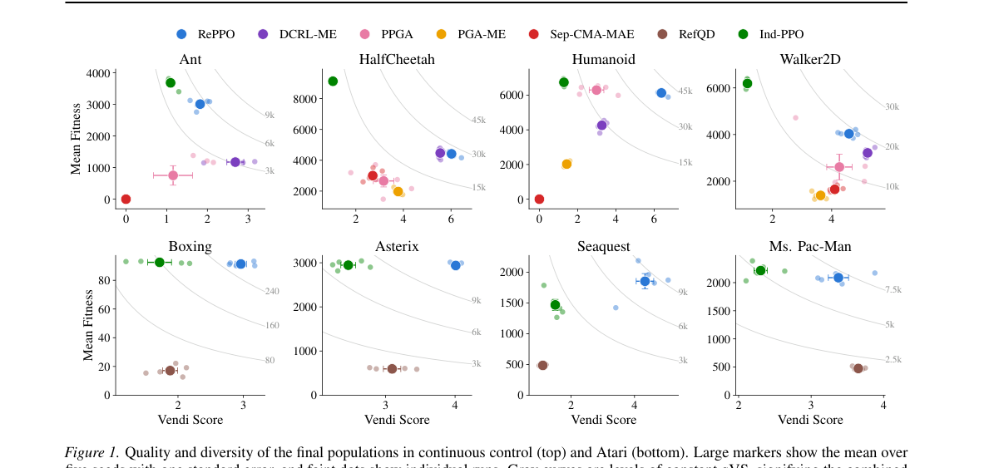

*Result - Score and mean depth of every Seaquest policy over*

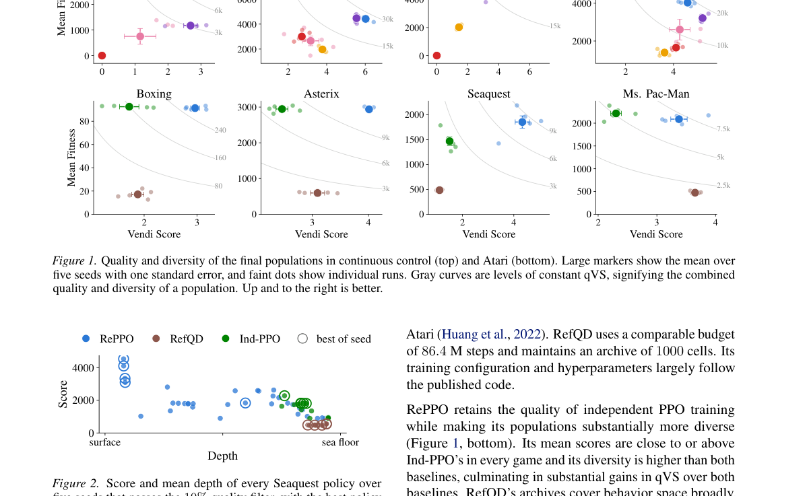

**Why this ranks #5**: 多样性不必靠进化算子，策略梯度本身就能训出一群行为不同的策略。

---

### 6. Action-Value Calibration via Continuation Sharing for Long-Horizon Agentic Reinforcement Learning

**arXiv**: [2610.37195](https://arxiv.org/abs/2610.37195) | **Score**: 8.0 (relevance 8.0 x 0.7 + quality 8.0 x 0.3) | **Tags**: rl-core, agentic-RL, credit-assignment, advantage-estimation, GiGPO, long-horizon | **Categories**: cs.AI, cs.LG | **Pages**: 19

**Authors**: Yingjian Chen; Lang Zhou; Zixin Zhao; Pingfan Li; Weishi Zheng; Zhilin Zhao

**Affiliation**: Sun Yat-sen University; Shenzhen Loop Area Institute

**Abstract**

> Reinforcement learning for long-horizon agents relies on feedback from sequences of interactions, making credit assignment to individual actions difficult. Existing methods such as GiGPO compare actions at shared states to compute relative advantages, but estimate each action's value from a single sampled continuation. The resulting local credit remains sensitive to decisions made later in the trajectory. To address this problem, we propose ConCal (Continuation Calibration), a recursive continuation-value estimator that incorporates continuation evidence already present in a rollout batch. ConCal matches visits from the same task by their incoming state-action-state transitions, combines shared continuation evidence with each visit's own transition estimate, and propagates calibrated values backward to refine earlier action-value estimates. This reduces dependence on individual sampled continuations and mitigates local credit distortions without additional rollouts. Held-out return diagnostics show lower error in within-group value differences and higher agreement with reference action orderings than estimates based on individual continuations. With Qwen2.5-1.5B-Instruct, ConCal improves success rates over GiGPO by 3.39 and 5.86 percentage points on ALFWorld and WebShop, respectively. Our code is available at https://github.com/Yingjian-Chen/ConCal.

**Key findings**

- **Finding**: 论文指出长时程智能体的 RL 依赖交互序列反馈，单个动作的信用分配很难；GiGPO 这类方法在共享状态上比较动作算相对优势，但每个动作的价值只由一次采样续跑估计。
- **Finding**: 这种局部信用因此对轨迹后续做出的决策高度敏感。
- **Finding**: ConCal（Continuation Calibration）提出递归的续跑价值估计器，把 rollout 批次中已有的续跑证据纳入计算。
- **Finding**: 具体做法是按入边的状态-动作-状态转移匹配同一任务的不同访问点，把共享的续跑证据与各访问点自身的转移估计结合，再把校准后的价值向后传播以修正更早的动作价值估计。
- **Finding**: 该方法减少了对单次采样续跑的依赖、缓解了局部信用扭曲，且不需要额外 rollout。
- **Finding**: 留出回报诊断显示，组内价值差的误差更低、与参考动作排序的一致性更高。
- **Finding**: 在 Qwen2.5-1.5B-Instruct 上，ConCal 在 ALFWorld 与 WebShop 上分别比 GiGPO 提升 3.39 与 5.86 个百分点；代码已开源。
- **Inference**: 「同一任务的多次访问共享续跑证据」本质上是把组内相对优势估计从「同状态比较」扩展到「同任务比较」，这是在不增加采样预算下提升信用分配质量的通用做法。
- **Inference**: 递归向后传播的价值校准依赖访问点匹配的准确度，任务内访问分布过窄时校准信号会退化；论文的诊断在 ALFWorld/WebShop 上给出，跨更长时程的稳定性仍待验证。
- **Recommendation**: 推荐。做 agentic RL、信用分配或 GiGPO/GRPO 系方法的读者强烈建议读，改动可直接套到现有训练循环上。

**Key figures**

*Framework - Comparison of credit assignment strategies. (a) GRPO assigns the same trajectory-level credit to all actions. (b) GiGPO compares actions at shared state anchors based on their own sampled re*

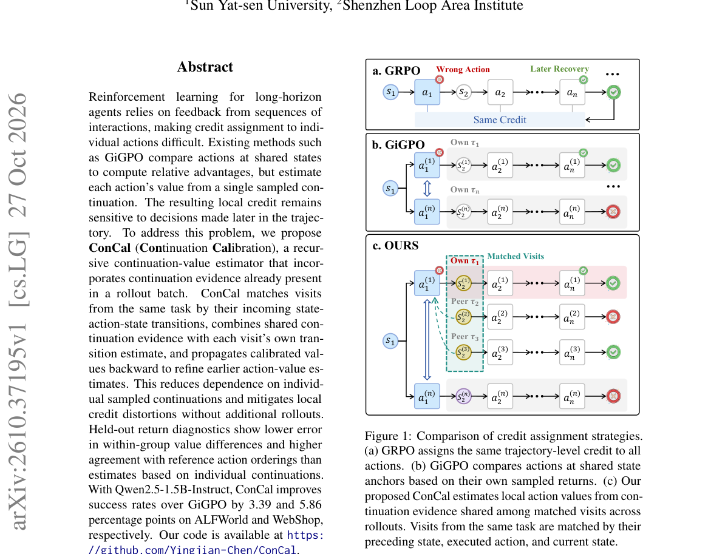

*Result - Credit-conflict rates and centered-value MSE on WebShop and ALFWorld. Credit conflict (%) mea- sures the proportion of repeated-decision groups in which the same recorded decision receives b*

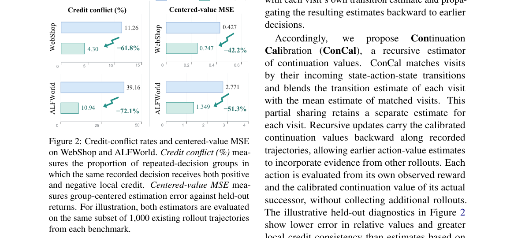

**Why this ranks #6**: 同状态比较动作的价值估计只靠一次续跑，太容易被后续决策带偏——把同任务的续跑证据共享起来。

---

### 7. Rendering-Free Event Frame Simulation for Fast Reinforcement Learning of Autonomous Robot Navigation

**arXiv**: [2610.37543](https://arxiv.org/abs/2610.37543) | **Score**: 8.0 (relevance 8.0 x 0.7 + quality 8.0 x 0.3) | **Tags**: rl-core, event-camera, simulation, navigation, Delft, rendering-free | **Categories**: cs.RO | **Pages**: 9

**Authors**: Dequan Ou; Austin Lopez; Quentin Missinne; Christophe De Wagter; Guido C. H. E. de Croon

**Affiliation**: Delft University of Technology

**Abstract**

> Event cameras offer low latency, high dynamic range, and milliwatt-level power consumption, making them ideal for agile robots such as tiny drones navigating through cluttered environments. However, existing simulators generally render photorealistic images before converting them into events, making large-scale reinforcement learning prohibitively slow. We propose an analytic event simulator that exploits what event cameras fundamentally measure - moving contrast edges - to synthesize event streams directly from scene geometry and ego-motion without visual rendering. Our simulator generates a 64x64 event observation in 17 microseconds on a single GPU - over 400x faster than a state-of-the-art rendering pipeline - enabling end-to-end reinforcement learning for goal-directed obstacle avoidance to converge in under 30 minutes - three orders of magnitude faster than training on rendered events. Policies transfer zero-shot to physically based event simulations (ray-traced Isaac Sim). Our policy reaches 83% success in cluttered courses unseen during training (mid-difficulty, traversability probability approx. 0.57), at 2.4 m/s average goal velocity, and retains 70% in a simulated texture-dense indoor hall. Furthermore, we quantized the policy to a 1.2 MB int8 network running fully onboard a 56-gram Crazyflie equipped with a Prophesee GenX320 event camera and an OpenMV N6 microcontroller board. Without any fine-tuning, external processing, or positioning, the policy achieves an average success rate of 82% (5/5, 5/6, 4/6 flights) across three real-world obstacle courses of increasing difficulty. Code: https://github.com/tudelft/rendering-free-event-nav

**Key findings**

- **Finding**: 论文提出解析式事件模拟器，直接从场景几何与自运动合成事件流，完全绕过视觉渲染。
- **Finding**: 动机来自事件相机的物理特性：它本质上只测量移动的对比边缘。
- **Finding**: 该事件代理用场景中的 3D 边缘点（树干、墙面、道具）与自运动共同生成事件。
- **Finding**: 目标是以极低算力支撑自主机器人导航的快速 RL 训练，作者还讨论了边缘部署的重量与算力约束。
- **Inference**: 「解析式事件代理」在训练期替代渲染器，是把 RL 训练成本压下来的典型做法，对事件相机这类专用传感器尤其有效，因为渲染器对事件的仿真既慢又不准。
- **Inference**: 代理保真是用物理近似换来的，真实事件流包含阈值噪声、时间戳抖动与照明变化，这些在训练中缺失会影响 sim-to-real 迁移，论文需靠真实机器人实验兜底。
- **Recommendation**: 推荐。做事件相机导航、快速 RL 训练基础设施或仿真代理建模的读者值得读。

**Key figures**

*Result - The rendering-free event-proxy pipeline: one obstacle (orange) is traced through every stage. (a) A scene is only 3D edge points on depth discontinuities (trunks brown, walls gray, props green*

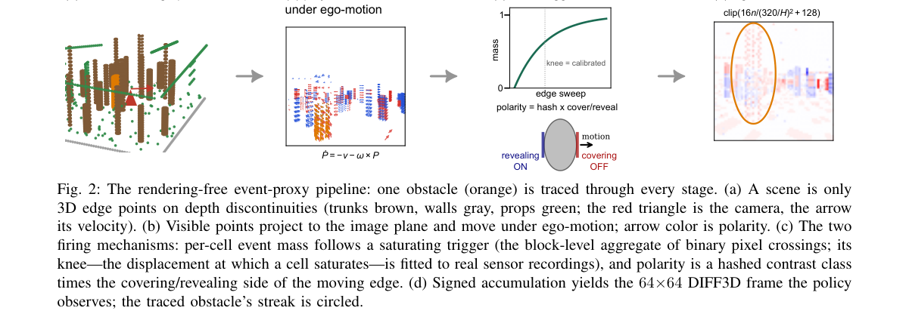

**Why this ranks #7**: 事件相机只对运动边缘有反应，那就照着边缘直接造事件流，不用渲染。

---

### 8. Freeze, Don't Clone: Fine-Tuning with Expressive Policies Without Retaining Offline Data

**arXiv**: [2610.36247](https://arxiv.org/abs/2610.36247) | **Score**: 8.0 (relevance 8.0 x 0.7 + quality 8.0 x 0.3) | **Tags**: rl-core, offline-to-online, offline-rl, behavior-cloning, Mila, critic-recalibration | **Categories**: cs.AI, cs.LG | **Pages**: 22

**Authors**: Sami Nur Islam; Johan Obando-Ceron; Doina Precup; Aaron Courville; Pablo Samuel Castro

**Affiliation**: Mila - Quebec AI Institute; McGill University; Universite de Montreal

**Abstract**

> Offline-to-online reinforcement learning uses offline pretraining to accelerate subsequent online learning. While many methods assume the offline dataset remains available throughout fine-tuning, there are many settings where this is not the case. Prior work attributes failures in this setting primarily to critic recalibration under distribution shift. We identify a complementary actor-side failure: once the offline data disappears, continued behavioral cloning (BC) no longer preserves the offline behavior distribution and instead refits the behavioral model to the agent's limited, and nonstationary, online experience. We demonstrate that stopping online behavioral fitting while preserving the pretrained expressive prior substantially improves no-retention fine-tuning across implicit flow Q-learning (IFQL), flow Q-learning (FQL), and action-chunked RL (QC) on seven OGBench domains. We trace this failure to a behavioral feedback loop: continuing online behavioral cloning rapidly erases the pretrained prior, inducing representational collapse and action diversity loss that starves the critic of useful exploration. Freezing the prior breaks this cycle, preserving offline coverage while allowing value learning to drive continuous improvement.

**Key findings**

- **Finding**: 论文研究离线到在线的强化学习，指出许多方法默认离线数据集在微调全程可用，而现实中常常并非如此。
- **Finding**: 既有工作把该设定下的失败主要归因于分布漂移下的 critic 重校准问题。
- **Finding**: 论文的方案是「Freeze, Don't Clone」：离线预训练后冻结行为先验，在线阶段只用在线数据继续更新 critic。
- **Finding**: 消融考察了 BC 损失权重从 0.1 倍到 10 倍默认值的敏感性，显示在无离线数据留存条件下在线微调性能对权重不敏感。
- **Inference**: 该结论与传统做法（每步都混入 BC 损失以防遗忘）相反，说明「防遗忘」这个直觉在无数据留存场景下可能不成立，值得注意。
- **Inference**: 冻结行为先验意味着策略的上限被离线预训练锁死，若离线数据覆盖不足则无从补救；论文的价值在于说明 critic 才是需要在线适配的那一半。
- **Recommendation**: 推荐。做 offline-to-online、数据受限微调或理解 critic 重校准的读者值得读。

**Key figures**

*Framework - Stopping BC enables no-retention fine-tuning. Left: After offline pretraining, we freeze the behavioral prior and continue updating the critic using online data. Right: Aggregate performance*

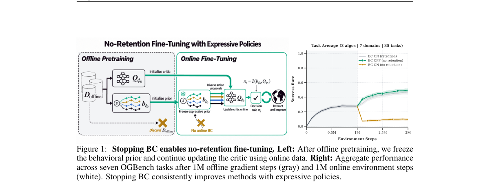

*Result - Sensitivity to the BC loss weight. Online fine-tuning performance across vary- ing BC loss weights (0.1× to 10× default) without offline data retention. Scaling the BC weight up or down (yel*

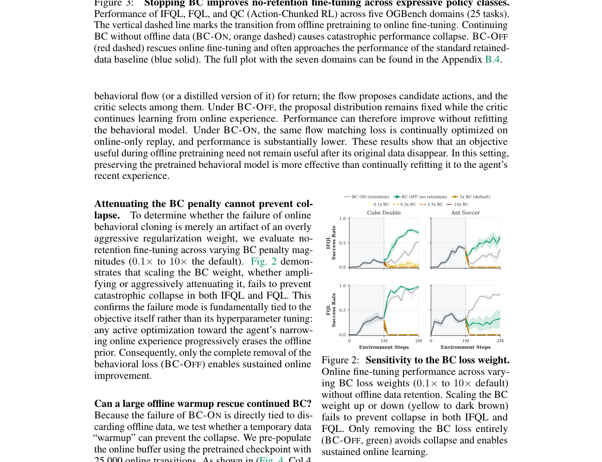

**Why this ranks #8**: 离线数据不能一直留着时，别冻结也别克隆——冻住行为先验，只让 critic 跟着在线数据走。

---

### 9. Frequency-Uniform Log-Regret Reinforcement Learning for Diffusions

**arXiv**: [2610.36758](https://arxiv.org/abs/2610.36758) | **Score**: 7.3 (relevance 7.0 x 0.7 + quality 8.0 x 0.3) | **Tags**: rl-core, RL-theory, regret, continuous-control, diffusion-processes, Stanford | **Categories**: cs.LG, math.OC | **Pages**: 64

**Authors**: Jose Blanchet; Lutong Hao; Renyuan Xu

**Affiliation**: Stanford University

**Abstract**

> High-frequency control problems are often studied through time discretization, but refining the timestep $δ$ increases the discrete horizon $H=T/δ$ and can make standard finite-horizon regret guarantees deteriorate even when the physical horizon $T$ is fixed. We study episodic value-based reinforcement learning for Euler discretizations of controlled diffusions. The performance is measured as the cumulative regret over $K$ episodes relative to the optimal policy of the corresponding Euler model. Under stability and regularity conditions on value function gradients, Bellman residual derivatives, and fitted critics, we prove an $\mathcal{O}(\log K)$ regret bound with constants uniform in $δ$. For dynamics with drift linear in unknown parameters and unknown constant diffusion covariance, we verify localized versions of these conditions for a constrained, model-based controlled-diffusion fitted-$Q$ algorithm (CD-FQ) and obtain high-probability $\mathcal{O}(\log K\log\log K)$ regret for fixed and finite $T$, again with constants uniform in $δ$.

**Key findings**

- **Finding**: 论文研究受控扩散过程的回合式值型 RL：性能以 K 回合累计遗憾衡量，参照对应 Euler 模型的最优策略。
- **Finding**: 核心问题是高频控制通常通过时间离散化研究，而细化步长 δ 会增大离散视界 H = T/δ，使标准有限视界遗憾界在物理视界 T 固定时反而恶化。
- **Finding**: 在值函数梯度、Bellman 残差导数与拟合 critic 的稳定性与正则性条件下，作者证明 O(log K) 的遗憾界，且常数对 δ 均匀。
- **Finding**: 对漂移对未知参数线性、扩散协方差为未知常量的动力学，作者验证了这些条件的局部版本，并给出高概率的 O(log K log log K) 遗憾界（固定与有限 T），常数同样对 δ 均匀。
- **Finding**: 配套提出受约束的模型基拟合 Q 算法 CD-FQ，允许有限多个分离的最优分支点。
- **Inference**: 「常数对离散步长均匀」是把连续控制与离散化 RL 理论打通的关键性质，否则数值步长一调，所有理论保证都要重推。
- **Inference**: 该框架针对受控扩散（连续时间随机过程）而非生成模型的训练，方法论可迁移到其他高频控制问题，但结论不直接适用于扩散模型的 RL 微调。
- **Recommendation**: 推荐。做连续控制 RL 理论、高频控制或关心离散化误差对理论保证影响的读者值得读。

**Key figures**

*该论文正文未提取到可用图（图表为纯文本/表格排版）。*

**Why this ranks #9**: 时间离散步长一变，RL 的遗憾界就跟着退化——除非把频率做均匀。

---

### 10. CONCUR: Concordant Auxiliary Rewards for Multi-Task, Multi-Reward Reinforcement Learning

**arXiv**: [2610.36437](https://arxiv.org/abs/2610.36437) | **Score**: 7.0 (relevance 7.0 x 0.7 + quality 7.0 x 0.3) | **Tags**: rl-core, multi-task-rl, reward-shaping, advantage-estimation, auxiliary-reward, Google-DeepMind | **Categories**: cs.CL | **Pages**: 20

**Authors**: Jixuan Leng; Si Si; Fei Wang; Cho-Jui Hsieh; Jiong Zhang; Hsiang-Fu Yu; Inderjit S. Dhillon

**Affiliation**: Google DeepMind

**Abstract**

> When a Large Language Model (LLM) is trained with Reinforcement Learning (RL) on multiple tasks, a task's primary reward can gate auxiliary rewards such as a length reward: on a failing response, an auxiliary cannot exceed the primary. However, group-relative advantage estimators treat a gated auxiliary like any other component, so it can reverse the primary's order, and at the primary's ceiling only auxiliaries order responses. Keeping gated auxiliaries hurts some tasks, while dropping them hurts others. We propose CONCUR, an advantage estimator that replaces the standardized scores of each gated auxiliary with the closest scores that satisfy two conditions: responses with higher primary rewards cannot receive lower scores, and responses at the primary's ceiling receive equal scores. CONCUR-T applies both conditions throughout training, and CONCUR-A lifts the second for an auxiliary that agrees with the primary's order more often than it reverses it among passing responses. On three models from two families and across math, code, instruction following, and writing, both variants score higher on average than all baselines and than when all the gated auxiliaries are dropped.

**Key findings**

- **Finding**: CONCUR 是一个优势估计器，替换掉每个门控辅助奖励的标准化分数。
- **Finding**: 新分数取「满足两个条件的最近分数」：主奖励更高的响应不可能拿到更低分，且达到主奖励上限的响应获得相等分数。
- **Finding**: 论文指出 GDPO 的做法是把组内各奖励分量标准化后按声明权重求和，而辅助分量可能在某些位置偏离其主奖励。
- **Finding**: 实验在 Qwen3-4B-Base 上按门控配对逐条绘制辅助奖励与主奖励的余弦、其在排序中的能量占比以及触顶占比等诊断量。
- **Inference**: 「投影到一致集合」是处理多奖励 RL 里辅助信号越权的通用手段，比调权重更结构化——权重是全局标量，投影是逐样本约束。
- **Inference**: 「最近一致分数」依赖主奖励分数量纲，多奖励尺度差异大时投影结果对主奖励的归一化方式敏感，论文需说明尺度处理。
- **Recommendation**: 推荐。做多奖励/多任务 RL、辅助奖励设计或想理解多分量奖励归一化陷阱的读者值得读。

**Key figures**

*Framework - Left: GDPO standardizes reward components in a group and sums them at the declared weights, and the insets show where an auxiliary departs from its primary. Right: CONCUR projects each gated*

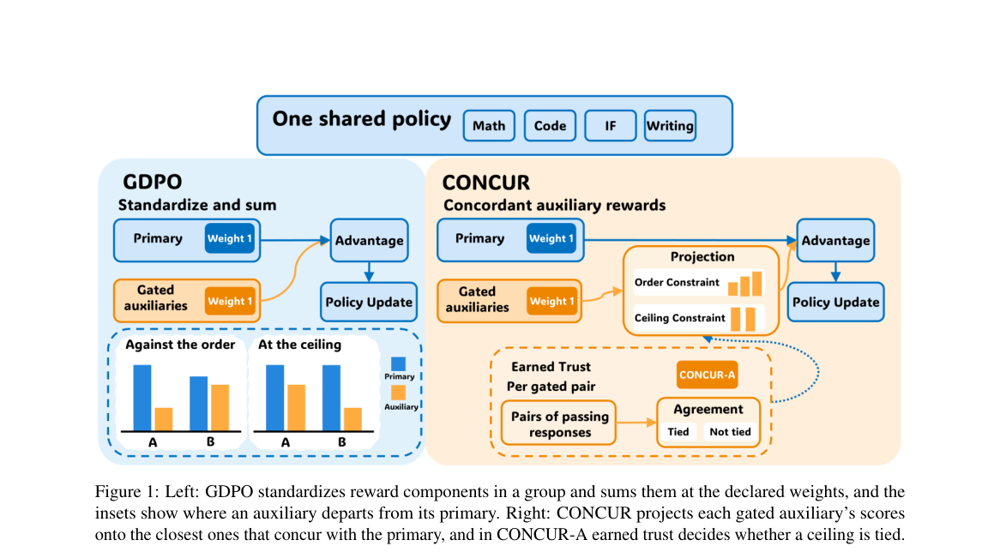

*Result - GDPO at the declared weights on Qwen3-4B-Base, one line per gated pair. The panels show the auxiliary’s cosine with its primary, its shares of energy against the order and at the ceiling fro*

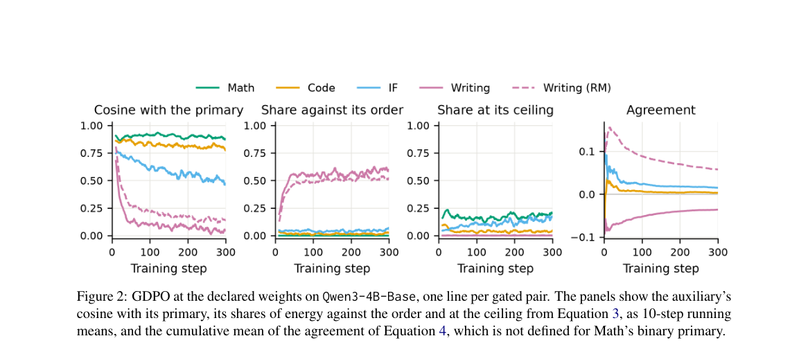

**Why this ranks #10**: 辅助奖励一旦超过主奖励的排序能力，就会把策略带偏——得投影回一致的方向。

---

## Footer

- Total papers scanned across all 7 tracks: 578（原始 794 条）
- rl_core track final top-10: 10
- Wild-cards in this track: 0
- Figure assets: 2026-10-28/res/

Generated by `mine-arxiv-daily-digest` skill. Sister file: `2026-10-28_rl_core_entry.md`.
