# ArXiv Daily Digest - 2026-10-28 (LLM 后训练强化学习, 10 papers)

**Generated**: 2026-10-28 17:00 CST

**Source**: arXiv cs.CV, cs.SD, eess.AS, cs.CL, cs.AI, cs.RO, cs.LG submissions, listing day 2026-10-27 (announced 2026-10-28 00:00 UTC)

**Batch window**: 2026-10-26T18:00:00Z .. 2026-10-27T18:00:00Z（arXiv 公告批次横跨两个 UTC 日：前一日 18:00 UTC 起算，当日 17:59:59 UTC 截止）

**Track**: rl_llm (top 10 of 578 papers scanned, 70 full reads)

**Scope**: 大模型后训练阶段的 RL：RLHF / DPO / GRPO / RLVR / RLAIF，含奖励建模与可验证奖励

---

## Top 10 - LLM 后训练强化学习

### 1. AudioRSI: Recursively Self-Improving Audio Reasoners

**arXiv**: [2610.36578](https://arxiv.org/abs/2610.36578) | **Score**: 9.0 (relevance 9.0 x 0.7 + quality 9.0 x 0.3) | **Tags**: rl-llm, audio-LLM, self-improvement, recursive-critic, process-reward, UIUC | **Categories**: cs.SD | **Pages**: 45

**Authors**: Jiajun Fan; Roger Ren; Jingyuan Li; Rahul Pandey; Prashanth Gurunath Shivakumar; Ankur Gandhe; Yile Gu; Ge Liu; Ivan Bulyko

**Affiliation**: University of Illinois Urbana-Champaign

**Abstract**

> Reinforcement learning has made Audio Large Language Models (Audio LLMs) better reasoners, but the reward that drives it still comes from outside the model: a final-answer check, a hand-crafted process score, or an external LLM judge that stays fixed while the policy improves. We show that an Audio LLM can supply this reward itself, and can do so recursively: each improved model becomes the critic that trains its successor, so the training signal improves along with the model. We introduce AudioRSI (Recursively Self-Improving Audio Reasoners), a reinforcement learning framework in which a single model plays two roles: as an actor it generates reasoning paths, and as a critic it compares them pairwise, turning its own judgments into a process-level reward. The critic is periodically replaced by the current policy, which closes the recursive loop. Because the critic hears the same recording as the actor, it can reject reasoning that cites acoustic evidence the audio does not contain, rather than reward reasoning that merely sounds plausible. The recursion is what sustains progress: under a frozen external judge, out-of-distribution accuracy plateaus during training, while a critic refreshed from the improving policy keeps it rising. Across four out-of-distribution benchmarks, all disjoint from the AVQA training distribution, AudioRSI outperforms strong baselines including Audio Flamingo 3 and Gemini 2.5 Pro on MMAU test-mini, ranks first on MMSU, achieves a clear lead on the challenging Multi-Audio split of MMAU-Pro, and leads the 7B open-source tier on MMAR among methods without external reward models. With no reward specifying how to reason, AudioRSI also develops structured reasoning behaviors (logical reasoning, perception-aware analysis, and reduced hallucination), corroborated by an external LLM-as-Judge evaluation and a keyword-based behavior analysis.

**Key findings**

- **Finding**: 论文指出驱动音频 LLM 变强的奖励通常来自模型之外：最终答案检查、手工过程分或固定的外部 LLM 评判，而评判在策略变强的过程中始终不变。
- **Finding**: AudioRSI 让一个音频 LLM 同时扮演两个角色：actor 生成推理路径，critic 成对比较这些路径，把自己的判断转成过程级奖励。
- **Finding**: critic 会被当前策略周期性替换，从而闭合递归回路。
- **Finding**: 因为 critic 听到的是同一段录音，它可以拒绝那些引用了音频中并不存在的声学证据的推理，而不是奖励「听起来合理」的推理。
- **Finding**: 递归是关键：外部评判冻结时，分布外准确率在训练中进入平台期，而从改进中策略刷新出来的 critic 能让它持续上升。
- **Finding**: 在四个与 AVQA 训练分布不相交的数据集上，AudioRSI 在 MMAU test-mini 上超过 Audio Flamingo 3 与 Gemini 2.5 Pro，在 MMSU 上排名第一，在 MMAU-Pro 的多音频划分上明显领先，并在无外部奖励模型的 7B 开源档位中于 MMAR 上领先。
- **Finding**: 在没有指定推理方式的奖励下，AudioRSI 自发发展出结构化推理行为（逻辑推理、感知导向分析、幻觉减少），并由外部 LLM 评判与关键词行为分析佐证。
- **Inference**: 「奖励随策略一起升级」是对固定奖励模型饱和问题的直接回答，也解释了为什么递归比换更强评判器更有效。
- **Inference**: 自评自判有把自我偏差放大的风险，论文用「冻结评判下会停滞」作为对照，说明递归确实在对抗而非加剧这一风险。
- **Recommendation**: 推荐。做音频大模型后训练、自改进系统或 RL 奖励设计饱和问题的读者强烈建议读。

**Key figures**

*Framework - Overview of AudioRSI. A single Audio LLM plays two roles: as an actor it generates K reasoning paths per audio question, and in critic mode the same model scores them by pairwise comparison i*

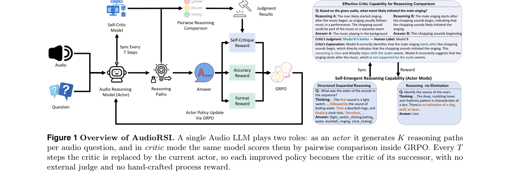

*Result - Domain and difficulty compar- ison on MMAU. Radii are normalized as (x −55)/(AudioRSI −55) (values below 55*

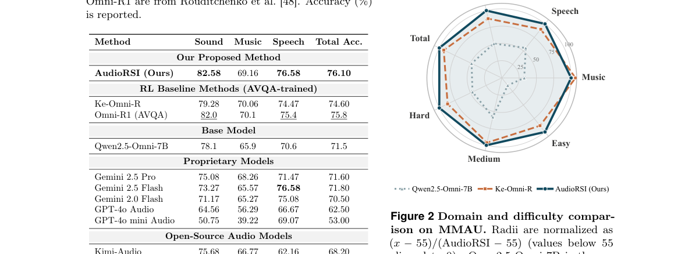

**Why this ranks #1**: 奖励信号该随策略一起变强，而不是永远停在那个固定的外部评判上。

---

### 2. Uncovering Shortcut Amplification in Video RLVR through the Lens of Perceptual Uncertainty Collapse

**arXiv**: [2610.37211](https://arxiv.org/abs/2610.37211) | **Score**: 9.0 (relevance 9.0 x 0.7 + quality 9.0 x 0.3) | **Tags**: rl-llm, RLVR, video-LLM, shortcut, perceptual-uncertainty, self-distillation | **Categories**: cs.CL, cs.CV | **Pages**: 11

**Authors**: Jiafeng Liang; Xianhao Ou; Tao Ren; Rongchuan Mu; Runxuan Liu; Dandan Tu; Ming Liu; See-Kiong Ng; Bing Qin

**Affiliation**: Harbin Institute of Technology; PengCheng Laboratory; National University of Singapore; Peking University; Huawei Technologies

**Abstract**

> Reinforcement learning with verifiable rewards (RLVR) has emerged as an effective post-training paradigm for enhancing the video reasoning capability of Large Multimodal Models (LMMs). Despite its empirical effectiveness, we show that outcome-level optimization can introduce an undesirable shortcut amplification effect, whereby models increasingly favor text-prior answers even when they are not supported by the visual evidence. To characterize this behavior, we investigate the training dynamics of video RLVR through the lens of perceptual uncertainty, analyzing how predictive uncertainty evolves under video-conditioned and text-only contexts. Our analysis identifies a perceptual uncertainty collapse phenomenon, in which RL training continuously sharpens the model's answer distribution while the uncertainty reduction attributable to visual evidence progressively diminishes. A further gradient-direction analysis reveals that such confidence enhancement becomes increasingly less aligned with visually grounded uncertainty reduction and is instead dominated by text-prior compression. Motivated by these findings, we propose Bifocal Self-distillation Policy Optimization (BSPO), a self-distillation framework that regulates policy updates with two complementary distributional signals. Specifically, BSPO derives empirical reasoning principles from intra-group correct and incorrect rollouts to identify reasoning-sensitive tokens, and introduces shortcut-aware visual perturbation to penalize predictions that remain invariant when task-relevant visual evidence is weakened. By adaptively reweighting the original RL advantage, BSPO preserves the task-solving benefits of RLVR while promoting updates that are both reasoning-sensitive and visually grounded. Extensive experiments validate the effectiveness of BSPO in improving video reasoning performance and strengthening visual faithfulness.

**Key findings**

- **Finding**: 论文发现结果级优化会引入「捷径放大」效应：模型越来越倾向选文本先验支持的答案，即使视觉证据并不支持。
- **Finding**: 作者论证这一现象并非模型固有，而是可以被 RL 训练诱导出来的。
- **Finding**: 分析框架基于感知不确定性：RL 训练降低了视频条件熵，同时视觉条件熵差距也随之下降，说明模型越来越不依赖视觉。
- **Finding**: 提出的 BSPO（Bifocal Self-distillation Policy Optimization）自蒸馏框架，目标是在保留 RLVR 推理收益的同时抑制捷径驱动的优化。
- **Finding**: 方法鼓励那些既对推理敏感、又有视觉依据的更新。
- **Inference**: 「视觉条件熵差距」提供了一个可测量的捷径指标，比看最终准确率更早暴露退化，对多模态 RLVR 的诊断价值大于方法本身。
- **Inference**: 自蒸馏用模型自身产生监督信号，若基座模型的视觉能力本就弱，抑制捷径的同时也可能压低可达上限。
- **Recommendation**: 推荐。做视频/多模态 RLVR 或关心 reward hacking 与捷径学习的读者强烈建议读。

**Key figures**

*Framework - Training dynamics observations of video RLVR. (a) The illustration of the two evaluation sets. (b) Accuracy of selecting the ground-truth (GT) answer on the faithful set and the shortcut ans*

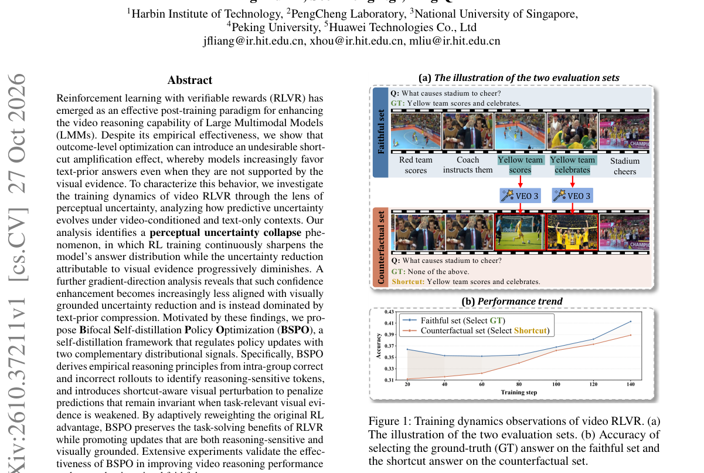

*Result - Perceptual uncertainty analysis of video RLVR. (a) RL training reduces the video-conditioned entropy ¯Hv, while the visual-conditioning entropy gap ¯G also decreases, indicating that increas*

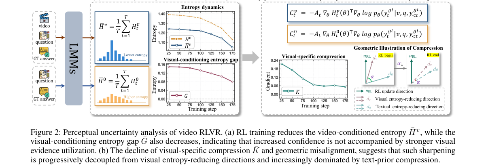

**Why this ranks #2**: 视频 RLVR 会偷偷学成「看文字猜答案」，感知不确定性塌缩就是它的指纹。

---

### 3. Guided-RLVR: Guided Exploration in Reinforcement Learning with Verifiable Rewards

**arXiv**: [2610.37041](https://arxiv.org/abs/2610.37041) | **Score**: 8.7 (relevance 9.0 x 0.7 + quality 8.0 x 0.3) | **Tags**: rl-llm, RLVR, guided-exploration, GRPO, DAPO, rollout-diversity | **Categories**: cs.AI, cs.CL | **Pages**: 14

**Authors**: Bo Yang; Zishuai Zhang; Weihua Li; Qinnan Zhang; Sijia Wen; Hainan Zhang

**Affiliation**: Beihang University

**Abstract**

> Reinforcement learning with verifiable rewards (RLVR) has shown strong empirical gains in improving the reasoning ability of large language models (LLMs) on tasks such as mathematics and programming. However, recent studies have shown that RLVR rollouts often collapse onto a narrow set of reasoning trajectories, limiting the explored reasoning space. Motivated by findings that thinking tokens at critical steps serve as critical structural elements in LLM reasoning pathways, we propose Guided-RLVR, a novel approach that augments RLVR with a lightweight controller. The controller strategically injects semantically meaningful steering tokens into the sampling distribution, encouraging the model to approach problems from multiple reasoning perspectives and thereby expanding the exploration space. Experiments on mathematical reasoning and code generation benchmarks show that Guided-RLVR consistently outperforms existing RLVR methods while producing more diverse reasoning trajectories.

**Key findings**

- **Finding**: 论文指出在有限 rollout 预算下，标准 RLVR 极少到达低先验（困难）轨迹，这是探索不足的结构性问题。
- **Finding**: 动机来自「思考 token 在推理路径的关键步骤上起结构性作用」的观察。
- **Finding**: Guided-RLVR 用一个轻量学得的 Logic Controller 增强 RLVR，在 GRPO 与 DAPO 两种算法、数学推理基准上观察到一致趋势。
- **Finding**: t-SNE 可视化显示引导转向后的末层 rollout 表征方差与标准 RLVR 形成对比。
- **Inference**: 把「引导」做成独立于主策略的轻量控制器，比在奖励里塞引导项更干净——它作用在采样分布上，因此能改变探索而不污染优化信号。
- **Inference**: 控制器本身要学，其训练是否依赖与主策略相同的奖励、以及是否引入额外超参，论文给出的消融表较多但控制器成本需自行评估。
- **Recommendation**: 推荐。做 RLVR 探索、数学推理后训练或想解决「rollout 都对但都是简单题」的读者值得读。

**Key figures**

*Framework - t-SNE (van der Maaten and Hinton 2008) visualiza- tion of final-layer rollout representations from vanilla RLVR and guided steering, with 32 rollouts per problem. Total vari- ance is compute*

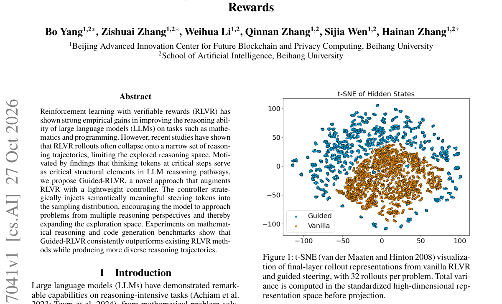

**Why this ranks #3**: RLVR 很少能采到低先验的正确轨迹，那就用一个轻量控制器把探索引过去。

---

### 4. Exploring the Limits of the Delta Learning Hypothesis: Single-Pair Generator Biases in Direct Preference Optimization

**arXiv**: [2610.37058](https://arxiv.org/abs/2610.37058) | **Score**: 8.7 (relevance 9.0 x 0.7 + quality 8.0 x 0.3) | **Tags**: rl-llm, DPO, preference-data, generator-bias, reward-hacking, judge-free | **Categories**: cs.AI, cs.CL, cs.LG | **Pages**: 15

**Authors**: Giuseppe Curci; Stefano Simonazzi; Andrea Molinari; Andrea Zugarini

**Affiliation**: Okkam; Villanova.ai; University of Trento

**Abstract**

> Direct Preference Optimization (DPO) typically relies on preference pairs generated from diverse model pools and ranked by an external LLM judge. The recently proposed delta-learning hypothesis suggests that comparable supervision can instead be obtained from a single pair of models by treating the larger model's response as preferred. We investigate the limits of this approach across model families and scales. We show, both theoretically and empirically, that fixed model pairs introduce systematic, generator-dependent biases that are predictive of the preference label independent of response quality. Consequently, DPO trained on single-pair data consistently underperforms multi-model preference data, despite the larger generator producing higher-quality responses, and we trace this gap to training dynamics consistent with reward hacking on these biases. We further show that simply increasing the number of generators, even without an external judge, is enough to partially mitigate this effect. Our results highlight generator diversity as a critical factor in preference-data construction.

**Key findings**

- **Finding**: 论文考察 delta learning 假说：与用多模型池加外部 LLM 评判构造偏好对相比，用单对模型并把更大模型的回答当作偏好回答是否等价。
- **Finding**: 理论与实证都显示：固定模型对会引入系统性的、依赖生成器的偏差，且该偏差独立于回答质量却能预测偏好标签。
- **Finding**: 因此用单对数据训练的 DPO 持续不如多模型偏好数据，尽管更大的生成器产出的回答质量更高；论文把这一差距追溯到与「对这些偏差做 reward hacking」一致的训练动力学。
- **Finding**: 作者进一步表明，仅增加生成器数量（即便没有外部评判）就足以部分缓解该效应。
- **Inference**: 这篇给出了一条容易被忽视的实践建议：偏好数据的「生成器多样性」本身就是一个独立变量，不能只当成数据规模的附属品。
- **Inference**: 结论外推到图像/音频等多模态偏好数据需要验证，论文的实验集中在文本基准上。
- **Recommendation**: 推荐。做 DPO、偏好数据构造或用大模型造偏好对的读者强烈建议读。

**Key figures**

*Framework - Delta learning underperforms multiple- models. Relative score changes across benchmarks and models using olmo2-1b-prefmix as base dataset. Per- formance is compared between data generated us*

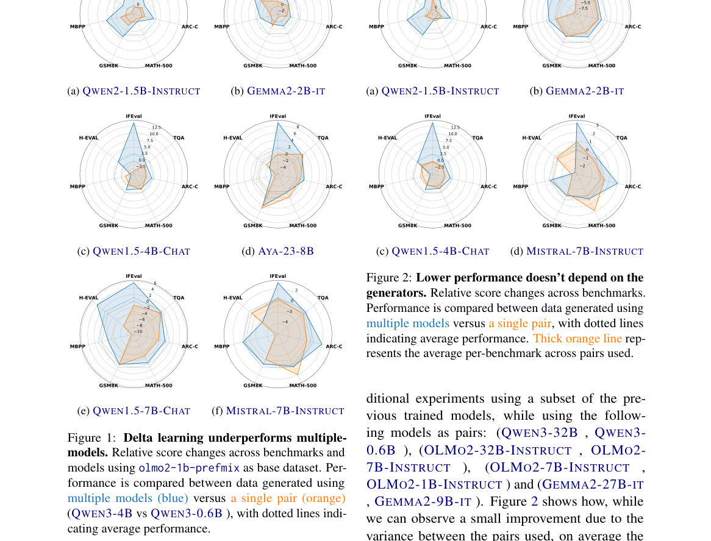

*Result - Lower performance doesn’t depend on the generators. Relative score changes across benchmarks. Performance is compared between data generated using multiple models versus a single pair, with*

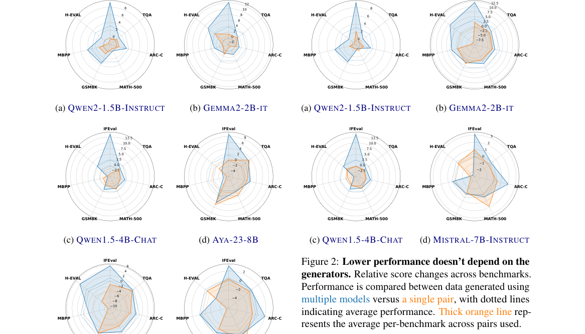

**Why this ranks #4**: 只用一个模型对造偏好数据，省下的算力换来的是与质量无关的偏差。

---

### 5. On the Sparsity of Direct Preference Optimization: Weight Disentanglement in the NTK Regime

**arXiv**: [2610.37085](https://arxiv.org/abs/2610.37085) | **Score**: 8.7 (relevance 9.0 x 0.7 + quality 8.0 x 0.3) | **Tags**: rl-llm, DPO, sparsity, NTK, weight-disentanglement, theory | **Categories**: cs.LG | **Pages**: 14

**Authors**: Kensuke Sasaki; Issei Sato

**Affiliation**: The University of Tokyo

**Abstract**

> Direct Preference Optimization (DPO) has been widely adopted for aligning language models with human preferences. Recent empirical work has revealed that DPO induces remarkably sparse parameter updates, yet no theoretical explanation for this phenomenon has been offered. We analyze DPO's optimization dynamics under a neural tangent kernel linearization and show that the logistic structure of the DPO loss gives rise to an implicit maximum-margin bias. Building on this observation, we introduce the concept of dual sparsity: the DPO update direction is a sparse linear combination (data-level sparsity, driven by support vectors) of sparse gradient feature vectors (parameter-level sparsity, arising from gradient cancellation between preferred and dispreferred responses). We formalize this structure in our main theorem, bound the number of support pairs by a margin-dependent spectral quantity, and present a framework relating dual sparsity to weight disentanglement---a condition favorable for model merging. Experiments on GPT-2 Small and Medium and on 7--9B instruction-tuned models (Llama-3-8B, Mistral-7B, Gemma-2-9B) with the Anthropic HH-RLHF and UltraFeedback datasets confirm both sources of sparsity, and experiments on GPT-2 show that DPO reduces cross-task interference by up to $35{\times}$ compared to supervised fine-tuning.

**Key findings**

- **Finding**: 论文在 NTK 线性化下把 DPO 归约为最大间隔分类，并引入「双重稀疏性」概念。
- **Finding**: 数据级稀疏由支持向量驱动，参数级稀疏来自偏好与非偏好回答之间梯度的相互抵消。
- **Finding**: 论文给出把双重稀疏性与权重解耦相联系的理论框架，并实证 DPO 产生的跨任务内积比 SFT 下小一个数量级。
- **Finding**: 元素级分析显示 GPT-2 Medium 上梯度特征向量的绝大多数分量接近零，确证参数级稀疏。
- **Finding**: 论文为预印本，14 页。
- **Inference**: 「DPO 的更新天然稀疏且跨任务干扰小」这个结论同时解释了 DPO 的两个经验现象：相对 SFT 更不易灾难性遗忘，以及在窄域偏好上更易过拟合。
- **Inference**: NTK 线性化是强假设，小模型/小数据下成立性更好，但把结论外推到大规模模型的谨慎程度应更高。
- **Recommendation**: 推荐。做 DPO 理论、灾难性遗忘或偏好微调行为解释的读者值得读。

**Key figures**

*Framework - visualizes Ai for GPT-2 Small and Medium on N = 100 pairs from HH-RLHF at 1, 100, and 1000 epochs. At early stages, the weights are distributed nearly uniformly. As training progresses, the d*

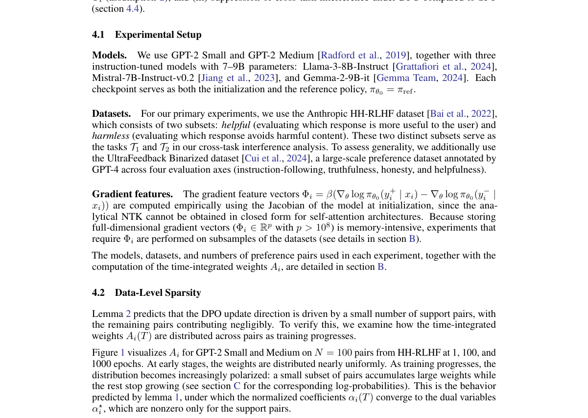

*Result - Element-wise distribution of gradient feature vectors on a logarithmic scale for GPT- 2 Medium on N = 100 pairs from HH-RLHF. (a) DPO: the vast majority of entries are near zero, confirming*

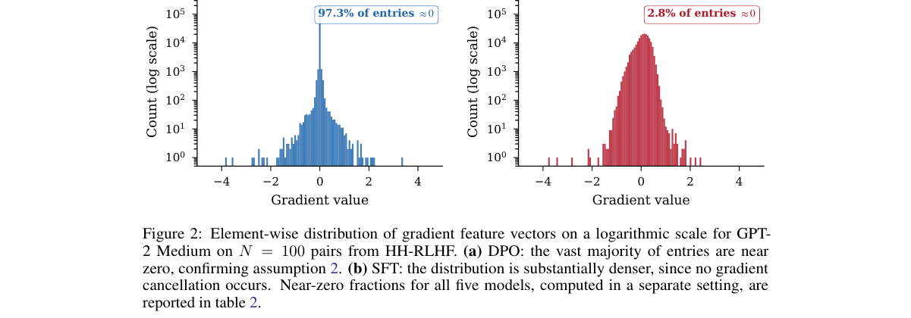

**Why this ranks #5**: DPO 改的权重比 SFT 稀疏得多——这既可能是优点，也可能是能力遗忘的原因。

---

### 6. Bayes-Adaptive MDPs for Rollout Allocation to Enhance GRPO Training

**arXiv**: [2610.37429](https://arxiv.org/abs/2610.37429) | **Score**: 8.0 (relevance 8.0 x 0.7 + quality 8.0 x 0.3) | **Tags**: rl-llm, GRPO, rollout-allocation, bayesian-mdp, difficulty-aware, GRPO | **Categories**: cs.AI, cs.LG | **Pages**: 22

**Authors**: Faeze Moradi Kalarde; Armin Toroghi; Nam Ho Koh; Doo Hwan Hwang; Seungjin Kim; Kee-Eung Kim; Scott Sanner

**Affiliation**: University of Toronto; Vector Institute of AI; Korea Advanced Institute of Science and Technology

**Abstract**

> Group Relative Policy Optimization (GRPO) has demonstrated strong performance in LLM post-training. However, it allocates a uniform rollout budget to every training question, ignoring variations in question difficulty. As a result, highly difficult questions may receive too few rollouts to generate informative positive reward signals, limiting their contribution to training, while moderately difficult questions often receive more rollouts than necessary. In this work, we formulate the problem of difficulty-aware rollout budget allocation to maximize training utility under the same total rollout budget as standard GRPO. We propose AdaRoll-GRPO, which reformulates rollout allocation as a sequential decision-making problem and leverages a Bayes-adaptive Markov decision process (MDP) to learn an adaptive allocation policy. The learned policy is computed offline and applied during GRPO training without introducing additional online optimization overhead. Extensive experiments on multiple reasoning datasets and LLM architectures demonstrate that AdaRoll-GRPO consistently improves GRPO training performance under a fixed rollout budget, highlighting the effectiveness of adaptive rollout allocation for GRPO in LLM post-training.

**Key findings**

- **Finding**: 论文把「难度感知的 rollout 预算分配」形式化为在标准 GRPO 相同总预算下最大化训练效用的问题。
- **Finding**: 动机数据给出 MATH 与 GSM8K 训练集上首次出现正确解答所需的 rollout 次数分布，显示难度差异显著。
- **Finding**: AdaRoll-GRPO 把 rollout 分配重写为序贯决策问题，用贝叶斯自适应 MDP 学习自适应分配策略。
- **Finding**: 示例说明中，vanilla GRPO 对 4 个问题各分 4 次 rollout，而 AdaRoll 会把更多预算给更容易成功的问题。
- **Inference**: 这个问题形式化本身可复用——任何「固定采样预算 + 组内相对优势」的方法都存在同样的分配自由度，是一条被低估的改进空间。
- **Inference**: 分配策略依赖对题目难度的在线估计，早期估计不准时会浪费预算；论文的示例是示意性的，实际收益要看不同难度分布下的稳健性。
- **Recommendation**: 推荐。做 GRPO 及其变体、关心采样预算利用率的读者值得读。

**Key figures**

*Framework - Question difficulty distributions for the MATH and GSM8K training datasets, measured by the number of rollout generations required to obtain the first correct solution.*

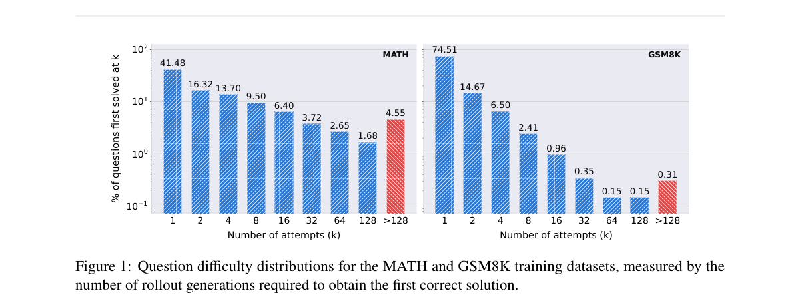

*Result - Illustration of AdaRoll-GRPO. In vanilla GRPO, for a batch of four questions with a total rollout budget of 16, four rollouts are uniformly allocated to each question. For some questions (e.*

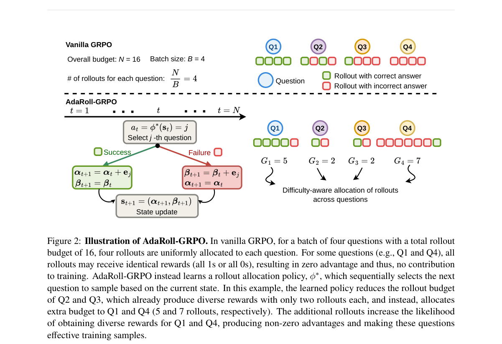

**Why this ranks #6**: rollout 预算固定时，把预算平均分给每个问题是最浪费的做法。

---

### 7. When All Rollouts Fail: Policy-Compatible Joint Decoding for Hard-Problem Reasoning

**arXiv**: [2610.36849](https://arxiv.org/abs/2610.36849) | **Score**: 8.0 (relevance 8.0 x 0.7 + quality 8.0 x 0.3) | **Tags**: rl-llm, RLVR, all-rollouts-fail, off-policy, teacher-guided-decoding, GRPO | **Categories**: cs.AI, cs.LG | **Pages**: 23

**Authors**: Zehao Wang; Hanzhu Chen; Runquan Gui; Zhe Wang; Lin Yang

**Affiliation**: University of Science and Technology of China; Tencent; Shanghai Artificial Intelligence Laboratory

**Abstract**

> Reinforcement Learning with Verifiable Rewards (RLVR) derives its learning signal from binary rewards via on-policy exploration and becomes a powerful paradigm for improving the reasoning of large language models. Yet it faces a learning cliff on problems beyond model's current ability: when every rollout fails, the samples reveal nothing about a correct solution, and group-relative estimators (e.g., GRPO, RLOO) collapse the update to zero advantage. Expert trajectories offer a remedy, but they are incompatible with the current policy and often lie in the student's low-probability regions, so the surviving updates demand large parameter shifts and decay into surface-level imitation rather than transferable reasoning. We argue that a useful learning signal on hard problems must be both verifiably correct and sufficiently compatible with the current policy. We propose Policy-Compatible Reinforcement Learning (PICO), which performs distribution-constrained joint decoding: expert data guides decoding at the token level while preserving the student's relative token probabilities, and a dynamic top-k mechanism confines the sampling distribution under a finite divergence budget, yielding trajectories that are verified and policy-compatible by construction. These trajectories are optimized jointly with on-policy rollouts under a mixed-behavior objective that mitigates their distribution mismatch via importance sampling. Experiments across reasoning diverse datasets and agentic benchmarks demonstrate that PICO consistently outperforms standard RLVR and prior off-policy baselines.

**Key findings**

- **Finding**: 论文主张难问题上的有用学习信号必须同时满足「可验证正确」与「与当前策略足够兼容」。
- **Finding**: PICO 用分布约束的联合解码从离策略轨迹中恢复正学习信号，同时显式控制由此引入的分布偏移。
- **Finding**: 专家数据在 token 级引导解码，同时保留学生模型的相对 token 概率。
- **Finding**: 动态 top-k 机制把联合采样分布限制在有限散度预算内，从而构造出既可验证又策略兼容的轨迹，替换掉全错 rollout 组中的一条失败 rollout。
- **Finding**: 训练动态在 Qwen3-4B-Base 与 Qwen3-8B-Base 上报告了训练奖励、solve-none 问题数与平均响应长度。
- **Inference**: 「solve-none 数量」比最终准确率更早暴露 GRPO 的训练僵局，这个诊断指标值得单独跟踪。
- **Inference**: 联合解码本质上是在用教师模型「造」正样本，与蒸馏的界限需要作者说清楚，否则容易被读成一种隐式蒸馏。
- **Recommendation**: 推荐。做 RLVR 难题、GRPO 训练僵局或 off-policy 修正的读者值得读。

**Key figures**

*Framework - Overview of PICO. Given an all-incorrect rollout group sampled from the student policy, PICO generates a verified joint trajectory to replace one failed rollout for mixed-behavior policy opt*

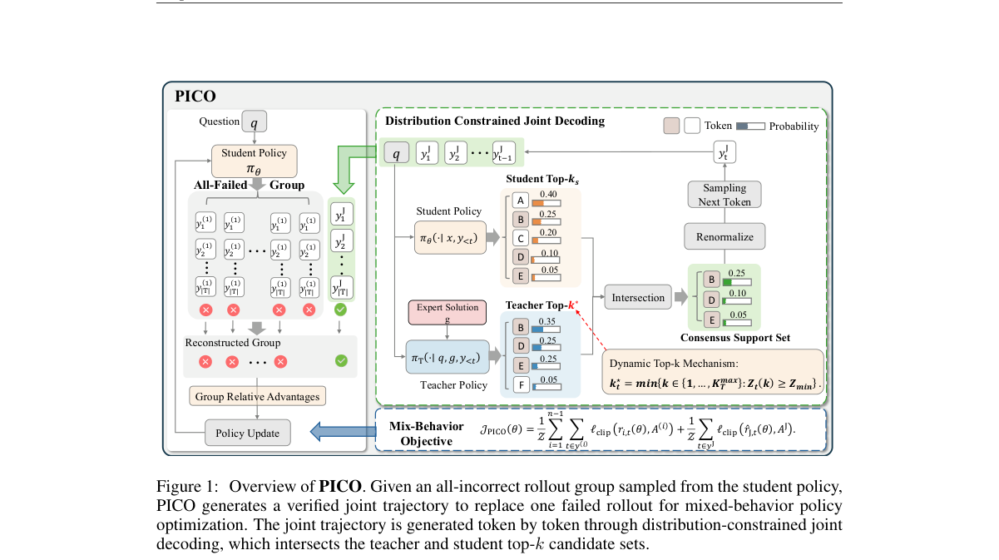

*Result - Training dynamics of Qwen3-4B-Base and Qwen3-8B-Base. We report the training reward, solve-none question number, and average response length throughout training.*

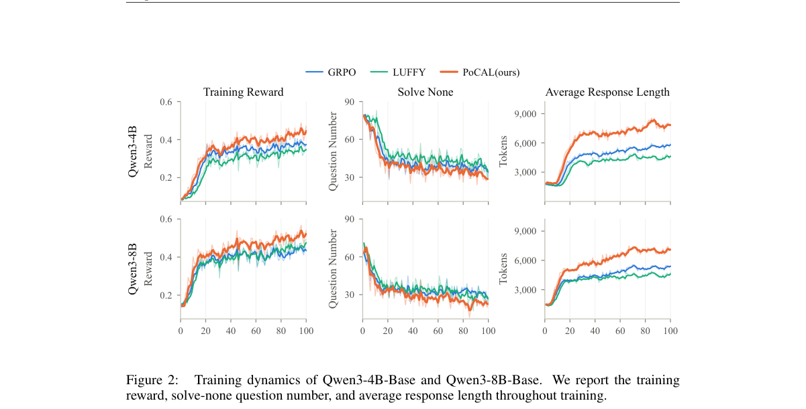

**Why this ranks #7**: 一组 rollout 全错时，标准 GRPO 就没有正样本了——但答案还在，只是离策略太远。

---

### 8. Collective Dynamics of Self-Reinforcement: How Cross-Task Coupling Drives Policy Collapse in Unsupervised RLVR

**arXiv**: [2610.37553](https://arxiv.org/abs/2610.37553) | **Score**: 8.0 (relevance 8.0 x 0.7 + quality 8.0 x 0.3) | **Tags**: rl-llm, RLVR, policy-collapse, cross-task-coupling, theory, Columbia | **Categories**: cs.LG | **Pages**: 20

**Authors**: Peize Ding

**Affiliation**: Columbia University

**Abstract**

> Label-free reinforcement learning with verifiable rewards (RLVR) rewards a language model for agreeing with its own majority vote. It improves reasoning at first but eventually collapses: the self-assessed reward goes to one while accuracy falls, often until the model gives the same answer to every problem. The collapse appears only when training uses many problems. We explain this dataset-size dependence as a collective instability. In a solvable many-problem model in which problems share parameters, a population whose problems prefer different answers amplifies any shared perturbation for as long as the population-averaged slope $\langle F'\rangle$ of the single-problem self-reinforcement drift $F$ is positive. This holds while problems are still uncertain about their answers. Per-problem sharpening, slowed by $1/N$ for $N$ training problems, races against the shared mode, which grows at a rate $\proptoλ^2$ independent of $N$, where $λ$ is the strength of the shared coupling. This yields a critical number of problems $N_c\simeq\ln(1/δ)/(λ^2G)$, where $δ$ seeds the shared mode and $G$ decreases with the initial confidence. Simulations of the model confirm the predictions: a sharp transition, $N_c\proptoλ^{-2}$ up to a logarithmic correction, a single critical amplification $λ^2NG$ across couplings, confidence profiles and training variants, a logarithmic dependence on batch size, and no collapse for confident initial models. A kernel version of the theory identifies a protective coupling (generalization of sharpening) and a marginal-entropy bonus that stabilizes the uniform collective mode. In label-free RL of a small Transformer, removing the shared direction prevents collapse entirely, restoring it causes collapse, and collapse grows with training-set size and base-model entropy.

**Key findings**

- **Finding**: 论文主张无监督 RLVR 中「数据集规模依赖的崩塌」本质是参数空间中某个共享方向的不稳定性。
- **Finding**: 作者给出一个极简模型，说明当问题尚未被判定时，平衡的群体会放大共享扰动。
- **Finding**: 论文从两个时间尺度的竞争推导出问题的临界数量，并推广到异质置信度与多答案情形。
- **Finding**: 实验给出七种耦合强度下的崩塌概率随 N 的变化，以及对初始置信度的扫描。
- **Inference**: 「共享方向 + 两个时间尺度竞争」这个框架把 RLVR 崩塌从玄学变成了可预测的临界现象，对做数据配比与课程设计有直接指导。
- **Inference**: 极简模型牺牲了具体架构细节，读者需自行判断临界数量结论在真实模型上的量级迁移是否成立。
- **Recommendation**: 推荐。做无监督 RLVR、RL 稳定性分析或数据配比设计的读者值得读。

**Key figures**

*Result - Critical number of problems. (a) Probability of collapse against N for seven coupling strengths (a=0.5). (b) The same data, together with a sweep over initial confidence a (orange, λ=0.1), p*

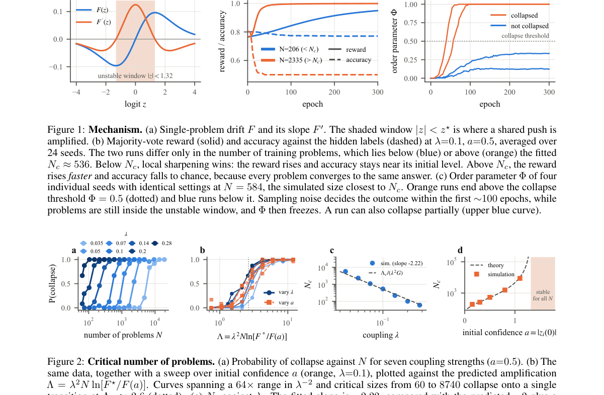

**Why this ranks #8**: 数据集变小就崩，不是因为数据不够，而是因为问题之间共享同一个方向。

---

### 9. SetGRPO: Calibrating Grader-Induced Policy Optimization

**arXiv**: [2610.36807](https://arxiv.org/abs/2610.36807) | **Score**: 8.0 (relevance 8.0 x 0.7 + quality 8.0 x 0.3) | **Tags**: rl-llm, GRPO, grader, uncertainty-set, response-group, calibration | **Categories**: cs.AI, cs.LG | **Pages**: 27

**Authors**: Jiale Huang; Zixu Li; Zhiwei Chen; Zhiheng Fu; Jinhe Bi; Yupeng Hu

**Affiliation**: Shandong University; National University of Singapore

**Abstract**

> Rubric-based reinforcement learning uses fine-grained grader feedback to train large language models on open-ended tasks, but grader randomness can alter GRPO updates in ways that score discrepancies alone cannot characterize. Because GRPO jointly normalizes rewards within each response group and combines the resulting training coefficients with response-level gradients, a scoring discrepancy can shift the coefficients of the entire group and induce policy-dependent update changes. Selective execution further affects the direction-reversal risk of retained updates. To address this, we propose Set-Valued Group Relative Policy Optimization (SetGRPO). It comprises three modules: (a) Joint Reward Set Calibration constructs a joint uncertainty set for the training coefficients; (b) Geometry-Guided Safe Recovery maps candidate coefficients into the current policy's local update geometry and determines the largest safe recovery ratio for each response group; and (c) Selective Risk-Gated Optimization selects a global threshold through independent risk calibration to control the conditional direction-reversal risk of accepted updates while preserving the original GRPO objective. Under exchangeability, SetGRPO provides finite-sample marginal coverage for the joint coefficient set and simultaneous risk control across candidate thresholds. On ten open-ended benchmarks spanning three domains, SetGRPO achieves the highest macro average among all compared training methods on both Qwen3.5 and Llama3.2 model families.

**Key findings**

- **Finding**: 论文指出 GRPO 的组内训练系数来自评分器打分，而评分器本身不可靠，因此该系数应被视为不确定量而非确定值。
- **Finding**: SetGRPO（Set-Valued GRPO）把 GRPO 的组内训练系数建模为一个联合不确定集，并用该集合来选择回答组、构造策略更新。
- **Finding**: 联合奖励集校准用同一回答组上的两个评分器分数构造联合系数不确定集。
- **Finding**: 方法还包含几何引导的安全恢复机制。
- **Inference**: 「把评分器噪声显式建模成不确定集」是比「改奖励聚合方式」更根本的修法——它承认了评判本身的不精确，而不是假装奖励是标量真值。
- **Inference**: 不确定集的构造依赖多次打分或多评分器可用性，算力与实现成本高于标准 GRPO。
- **Recommendation**: 推荐。做 GRPO 变体、奖励模型噪声或评判不可靠问题的读者值得读。

**Key figures**

*Result - Overview of SetGRPO. (a) Joint reward-set calibration uses two grader scores on the same response group to construct a joint coefficient uncertainty set. (b) Geometry-guided safe recovery ma*

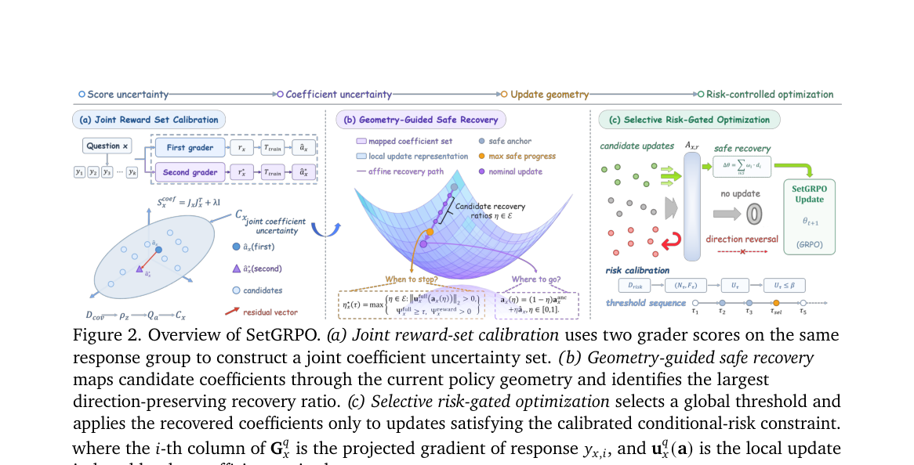

**Why this ranks #9**: 两个评分器对同一组回答打的分不一致时，GRPO 用的组内系数其实是个不确定量。

---

### 10. PerceptRL: Making Visual Perception Rewardable in MLLMs from Answers to Interactions

**arXiv**: [2610.37471](https://arxiv.org/abs/2610.37471) | **Score**: 8.0 (relevance 8.0 x 0.7 + quality 8.0 x 0.3) | **Tags**: rl-llm, MLLM, perception, reward-design, verifiable-data, SJTU | **Categories**: cs.AI, cs.CV | **Pages**: 13

**Authors**: Tongkun Guan; Zhibo Yang; Mingkun Yang; Haocheng Wang; Wei Shen; Xiaokang Yang

**Affiliation**: Shanghai Jiao Tong University

**Abstract**

> Fine-grained visual perception remains a bottleneck during post-training of multimodal large language models (MLLMs), as perceptual errors can constrain gains from reasoning-focused optimization. Although image-caption pre-training improves perception, its influence can weaken as subsequent stages change data mixtures and objectives. Continuing caption supervision during post-training is challenging because subjective, information-dense descriptions complicate verifiable reward design. We present PerceptRL, which strengthens perception at two complementary levels. Perception RL uses a multi-agent pipeline to extract verified errors from dense image captions and convert the corresponding visual facts into QA pairs with fixed answer labels and rule-based rewards. Chain QA links correlated errors, while multiple-choice QA combines unrelated errors. A specialized route targets high-error domains with tailored verification, and a domain-agnostic general route covers errors beyond these domains. Perception Agentic RL addresses fine-grained and dense cases unresolved by single-turn Perception RL through multi-turn inspection with visual tools. We observe coordinate drift even in models trained to use tools, where incorrect crops or annotations distort evidence and propagate errors. Coordinate Injection corrects spatial operations in cold-start trajectories, while a grounding-aware process reward supervises intermediate spatial fidelity alongside final-answer correctness. Training proceeds through shared cold-start SFT, single-turn Perception RL, and multi-turn Perception Agentic RL. Across seven benchmarks under a shared tool-use protocol, PerceptRL achieves 71.6% average accuracy, surpassing the base model with the same tools and the strongest evaluated frontier VLM by 15.7 and 5.2 percentage points, respectively.

**Key findings**

- **Finding**: PerceptRL 在 MLLM 后训练的两个互补层次上强化感知：单轮回答与多轮视觉交互。
- **Finding**: 核心洞察是基座模型自身的感知错误可以指导有针对性的可验证训练数据构造。
- **Finding**: 论文观察到即使在训练模型调用工具时仍存在坐标漂移——错误的裁剪或标注会扭曲后续证据并传播错误。
- **Finding**: 实现上用感知树构造：层级化能力图与模型探测揭示感知弱点，据此生成专门化数据。
- **Finding**: 作者同时报告从感知错误到可奖励问答的完整流程。
- **Inference**: 「用模型自己的错误造监督」把感知能力的提升从端到端 RL 的隐式奖励中显式拆了出来，数据效率与可解释性都更好。
- **Inference**: 能力图是人工设计的，覆盖范围决定了能修复哪些弱点，开放域感知缺陷仍可能落在树外。
- **Recommendation**: 推荐。做多模态模型感知能力后训练或需要构造可验证数据的读者值得读。

**Key figures**

*Result - Perception RL: from perceptual errors to rewardable QA. (01) Perception tree construction: A hierarchical capability map and model probing reveal perceptual weaknesses, guiding specialized and*

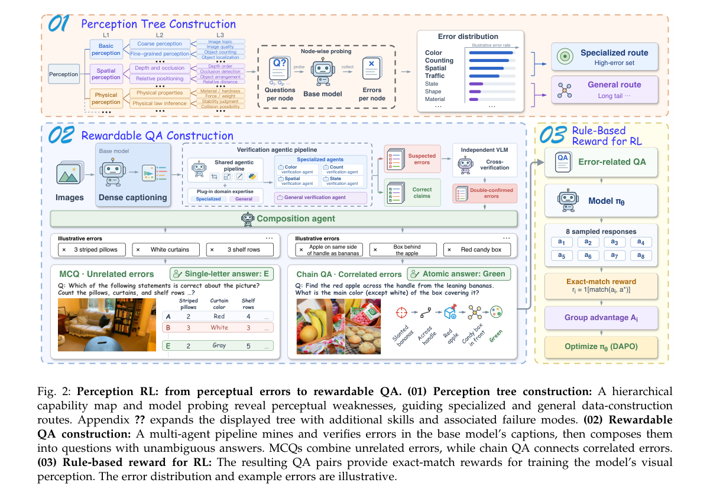

**Why this ranks #10**: 让模型自己暴露感知错误，再把这些错误变成可验证的训练数据。

---

## Footer

- Total papers scanned across all 7 tracks: 578（原始 794 条）
- rl_llm track final top-10: 10
- Wild-cards in this track: 0
- Figure assets: 2026-10-28/res/

Generated by `mine-arxiv-daily-digest` skill. Sister file: `2026-10-28_rl_llm_entry.md`.
