# ArXiv Daily Digest - 2026-10-29 (AIGC 音频生成, 10 papers)

**Generated**: 2026-10-31 17:30 CST

**Source**: arXiv cs.CV, cs.SD, eess.AS, cs.CL, cs.AI, cs.RO, cs.LG submissions, listing day 2026-10-28 (announced 2026-10-29 00:00 UTC)

**Batch window**: 2026-10-27T18:00:00Z .. 2026-10-28T18:00:00Z（arXiv 公告批次横跨两个 UTC 日：前一日 18:00 UTC 起算，当日 17:59:59 UTC 截止）

**Track**: aigc_audio (top 10 of 336 papers scanned, 70 full reads)

**Scope**: 音频 / 语音 / 音乐的生成、合成、编辑与生产工具链，含 TTS、神经音频编码与空间音频

⚠️ **Wild-card**: 本批该线 4 篇为 wild-card 补足，已在正文逐条标注并给出理由。

补足原因：该批次 eess.AS 仅 9 篇、cs.SD 仅 7 篇，真正属于「音频生成 / TTS / 音乐」的论文只有 6 篇，其余 4 篇为音频数据集、评测协议与 DSP 工具链方向的补位，已在正文逐条标注并给出理由。

---

## Top 10 - AIGC 音频生成

### 1. A Tutorial on Generative Models for Music Audio

**arXiv**: [2610.38252](https://arxiv.org/abs/2610.38252) | **Score**: 8.2 (relevance 8.5 x 0.7 + quality 7.5 x 0.3) | **Tags**: AIGC-audio, music-generation, neural-audio-codec, diffusion-flow-matching, preference-optimization, listening-test-protocol, Warsaw | **Categories**: cs.AI, cs.ET, cs.MM, cs.SD, eess.AS | **Pages**: 132

**Authors**: Mateusz Modrzejewski; Joanna Kurkowska; Dorien Herremans

**Affiliation**: Warsaw University of Technology; ZAiKS Lab; Singapore University of Technology and Design

**Abstract**

> Music audio generation spans instrumental clips, full songs with vocals, edits of existing recordings, and systems that play alongside a musician in real time. This monograph explains the methods behind these systems for readers familiar with neural-network training who are new to music generation. It introduces neural audio codecs and autoencoders, autoregressive and masked token models, diffusion and flow matching, sampling acceleration, and preference optimization in a shared notation. Worked examples connect training objectives and sampling procedures to published systems. The application sections relate the musical requirements of instrumental generation, songs, editing, and live performance to model design. Comparison tables record representations, methods, inputs, tasks, and release information documented in papers and official sources. Symbolic composition, speech, and sound effects are included where they connect to music audio. We explain how to interpret automatic metrics and learned judges, design and report listening tests, and assess evidence about data provenance, memorization, attribution, and output detection. Selected legal decisions and disputes illustrate the implications for training and release. The reviewed systems combine established generative paradigms with new representations, planning stages, and post-training procedures. Differences in data, scale, and evaluation limit what cross-system comparisons can establish about the sources of reported gains.

**Key findings**

- **Finding**: 这本 132 页的专著面向熟悉神经网络训练、但初次接触音乐生成的读者，覆盖器乐片段、带人声整曲、既有录音编辑与实时合奏四类系统。
- **Finding**: 全文用统一记号串起 neural audio codec 与 autoencoder、autoregressive 与 masked token 模型三类生成范式。
- **Finding**: 同一记号下还覆盖 diffusion 与 flow matching、采样加速以及 preference optimization 三类后训练手段。
- **Finding**: 实例部分把训练目标与采样流程对回已发表系统，应用章节再把器乐、成曲、编辑、现场的乐需求映射回模型设计选择。
- **Finding**: 评测部分讲解如何解读自动指标与 learned judge、如何设计和报告 listening test，并讨论数据来源、记忆化、归属与输出检测的证据。
- **Finding**: 论文还收录若干法律判决与争议，用来说明训练与发布环节的实际含义，并指出数据、规模与评测差异限制了跨系统比较的结论强度。
- **Inference**: 把怎么听、怎么测、怎么举证和模型方法放在同一层讲，正是生成式音乐最缺、也最容易被新论文忽略的一半。
- **Recommendation**: 推荐读。做音乐生成或音频研发的读者适合当入门与查表用，做评审类工作更该直接读它的评测与法律两章。

**Key figures**

该论文正文未提取到可用图（图表为纯文本/表格排版）。

**Why this ranks #1**: 把音乐生成的表征、采样与评测放进同一套记号里，是这条线上少见的一次系统性梳理。

---

### 2. Pronunciation-Supervised Text-to-Speech for Irish (Gaeilge)

**arXiv**: [2610.38384](https://arxiv.org/abs/2610.38384) | **Score**: 8.0 (relevance 8.0 x 0.7 + quality 8.0 x 0.3) | **Tags**: AIGC-audio, low-resource-tts, pronunciation-critic, rejection-finetuning, irish-gaeilge, character-error-rate, Laneguage | **Categories**: cs.CL | **Pages**: 11

**Authors**: William Lane

**Affiliation**: Laneguage; Trinity College Dublin

**Abstract**

> Speech technology for Irish must be built from very little transcribed speech, yet the language's pronunciation is thoroughly documented in dictionaries and dialect descriptions. We ask whether that documentation can supervise the adaptation of a large pretrained text-to-speech model to a language it was never trained on. We adapt Qwen3-TTS to Irish using 12.8 hours of crowdsourced Common Voice speech, correcting two defects in the vendor fine-tuning script that training loss does not reveal (Appendix A), and reach character error rate (CER) 0.225 on held-out cross-corpus text, against 0.397 for an exhaustively tuned from-scratch system and 0.437 for zero-shot cloning. We then compile the Wiktionary pronunciation record into a lexicon and a phoneme critic, and use that critic as the verifier in one round of rejection fine-tuning: CER 0.159 cross-corpus and 0.067 in-domain, with the voice still anonymous across all 202 training speakers. The same critic explains why the voice cannot yet be steered to a minority dialect: 229 of 12,311 training clips lean Ulster against 8,451 Munster. Pronunciation documentation, converted into a verifier, is a practical lever for low-resource speech synthesis, and a way to measure what the available data cannot support.

**Key findings**

- **Finding**: 论文用 12.8 小时众包 Common Voice 语音把 Qwen3-TTS 适配到爱尔兰语，并修正了厂商微调脚本中两个训练损失看不出来的缺陷。
- **Finding**: 在留出的跨语料文本上，改动后的系统 CER 为 0.225，优于从零穷调系统的 0.397 与 zero-shot cloning 的 0.437。
- **Finding**: 作者把 Wiktionary 发音记录编译成发音词典与 phoneme critic，用 critic 当作 verifier 做一轮 rejection fine-tuning。
- **Finding**: 这一轮把跨语料 CER 降到 0.159，域内 CER 降到 0.067。
- **Finding**: 全部 202 位训练说话人的音色仍保持匿名，说明改进来自发音监督而不是说话人泄漏。
- **Finding**: 同一个 critic 也解释了为什么音色还无法被操控到少数方言：12311 条训练音频里只有 229 条偏 Ulster，而 8451 条偏 Munster。
- **Inference**: 把词典这类外部结构化知识转成可判定的 verifier，比继续堆语音数据更贴近低资源语音的真实瓶颈。
- **Recommendation**: 推荐读。做低资源 TTS、多语种语音合成或想复用发音词典的读者，可直接参考它的 critic 构造与评测口径。

**Key figures**

*Framework - Cross-corpus intelligibility by system. Adap- tation, not further tuning of the from-scratch recipe, closes the gap.*

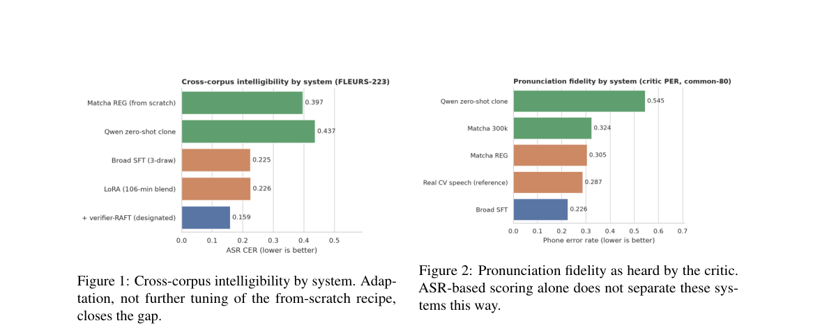

*Result - Pronunciation fidelity as heard by the critic. ASR-based scoring alone does not separate these sys- tems this way.*

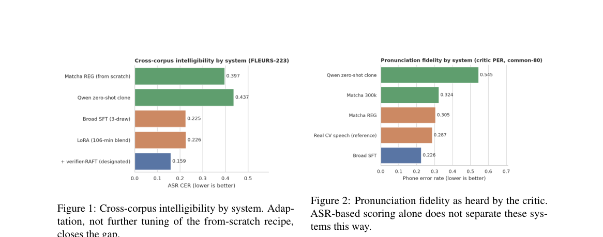

**Why this ranks #2**: 把 Wiktionary 发音文档转成 verifier 做一轮 rejection fine-tuning，用发音知识顶替大部分低资源语音数据。

---

### 3. DRC-TTS: A Dual-Resolution Codec-Based Architecture for Lexicon-Free Malay Speech Synthesis

**arXiv**: [2610.38316](https://arxiv.org/abs/2610.38316) | **Score**: 7.8 (relevance 8.0 x 0.7 + quality 7.5 x 0.3) | **Tags**: AIGC-audio, malay-tts, discrete-codec, dual-resolution, lexicon-free, length-regulation, Universiti Sains Malaysia | **Categories**: eess.AS | **Pages**: 27

**Authors**: Tianhui Su; Tien-Ping Tan

**Affiliation**: Universiti Sains Malaysia

**Abstract**

> Modern discrete neural audio codecs facilitate speech synthesis by replacing continuous acoustic representations with low-frame-rate discrete token sequences. For Malay speech synthesis, character-level input reduces reliance on pronunciation lexicons. However, combining character-level inputs with low-frame-rate discrete codecs introduces a temporal alignment challenge. When predicted character durations are quantized into frame counts at 12.5 Hz, durations shorter than one codec frame may be assigned zero frames. Consequently, the corresponding character representations may be lost during length regulation, potentially leading to pronunciation omissions. This study proposes DRC-TTS, a dual-resolution codec-based architecture for lexicon-free Malay speech synthesis. The model expands character representations at a temporal resolution of 50 Hz and subsequently downsamples them through strided convolution to 12.5 Hz for discrete codec-token prediction. Objective evaluations show that the proposed model reduces the character error rate (CER) from 27.11% for the baseline to 21.86%, an absolute reduction of 5.25 percentage points. The proposed model also achieves a mean opinion score (MOS) of 4.30, compared with 4.12 for the baseline. These results suggest that the dual-resolution design may improve character-level alignment and perceived speech naturalness under the evaluated conditions.

**Key findings**

- **Finding**: 论文指出字符级输入虽能减少对发音词典的依赖，但与低帧率离散 codec 组合会引入时间对齐难题。
- **Finding**: 当预测的字符时长被量化成 12.5 Hz 的帧数时，短于一帧的时长会被分配 0 帧，对应字符表征在 length regulation 中可能整体丢失。
- **Finding**: DRC-TTS 先在 50 Hz 时间分辨率上展开字符表征，再用 strided convolution 降到 12.5 Hz 做离散 codec token 预测。
- **Finding**: 客观评测显示 CER 从基线的 27.11% 降到 21.86%，绝对下降 5.25 个百分点。
- **Finding**: 主观评测方面，MOS 达到 4.30，高于基线的 4.12，自然度上有小幅提升。
- **Inference**: 这类问题只有把 codec 帧率当成一等公民时才会暴露，是离散语音 token 路线上容易被训练损失掩盖的系统性隐患。
- **Recommendation**: 选读。做离散 codec TTS 的读者值得看它对时长量化的分析，做词典无关语音合成的可直接复现其双分辨率结构。

**Key figures**

*Framework - Overview of TTS and codec pipeline*

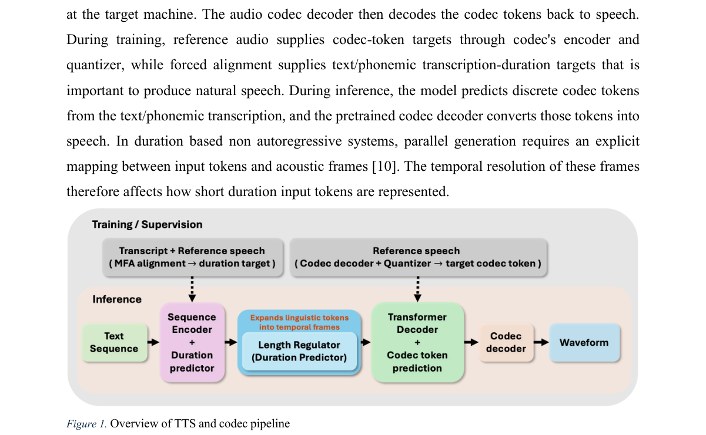

*Result - Figure 3. Figure 4. Figure 5. Figure 6. Figure 7.*

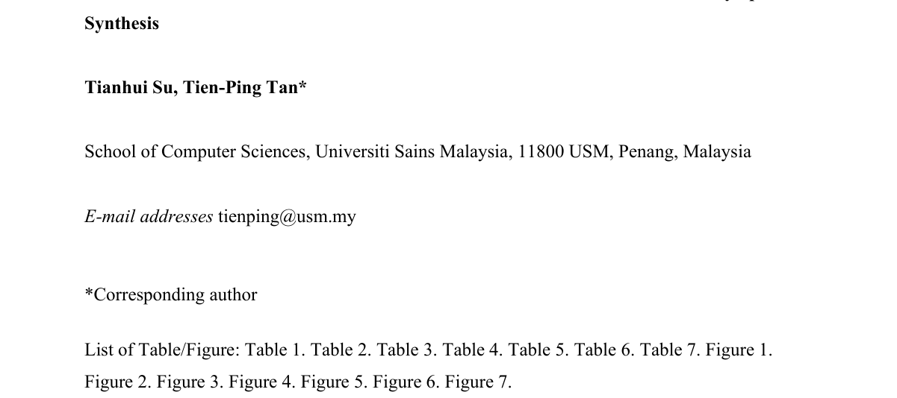

**Why this ranks #3**: 点明低帧率离散 codec 会把短字符时长量化成 0 帧，并用 50Hz 到 12.5Hz 的双分辨率接住被丢掉的字符。

---

### 4. Beyond Utterance-Level Speaker Similarity: Perception-Aligned Segmental Evaluation of Accent in Speech Generation

**arXiv**: [2610.37912](https://arxiv.org/abs/2610.37912) | **Score**: 7.5 (relevance 7.5 x 0.7 + quality 7.5 x 0.3) | **Tags**: AIGC-audio, accent-evaluation, listening-test, speaker-similarity, subword-annotation, objective-metrics, Centre for Speech Technology Research | **Categories**: cs.CL, cs.SD, eess.AS | **Pages**: 5

**Authors**: Jinzuomu Zhong; Alice Ross; Catherine Lai; Korin Richmond

**Affiliation**: Centre for Speech Technology Research, University of Edinburgh

**Abstract**

> Utterance-level similarity ratings do not reveal where perceived accent differences occur in generated speech. We introduce a segmental evaluation protocol combining speaker and accent similarity ratings with subword annotations of perceived accent differences provided by listeners from target accent regions. Using newly collected recordings, 47 retained listeners evaluate 200 content-matched reference--candidate pairs spanning four Scottish and Australian voices, two zero-shot TTS systems, and an articulation-based voice conversion system. Subword annotations locate salient pronunciation differences and sometimes yield different system rankings from similarity ratings. Speaker and accent ratings remain strongly associated ($ρ= 0.71$), highlighting the value of examining local perceptual evidence beyond these scores. Evaluation of seven objective distances reveals weak correspondence with subword selections, with correlations reaching at most $ρ= 0.22$. We release code, data, and an interactive demo to support the development of perceptually grounded segmental accent evaluation.

**Key findings**

- **Finding**: 作者提出分段评测协议，把说话人与口音相似度评分和目标口音地区听者给出的 subword 级差异标注结合起来。
- **Finding**: 新采集录音中保留 47 名听者，评测 200 对内容匹配的参考与候选样本，覆盖四个苏格兰与澳洲音色、两套 zero-shot TTS 系统和一套基于发音方式的 voice conversion 系统。
- **Finding**: subword 标注能定位显著的发音差异，有时给出与相似度评分不同的系统排序。
- **Finding**: 说话人评分与口音评分仍高度相关，rho = 0.71，说明局部感知证据与整体分数互补。
- **Finding**: 对七种客观距离的评测显示它们与 subword 选择对应很弱，相关性最高也只有 rho = 0.22。
- **Inference**: 现在的说话人相似度与口音相似度指标本质上只测整体像不像，恰好漏掉用户真正能听出的局部破绽。
- **Recommendation**: 推荐读。做 voice cloning 评测、听测设计与口音公平性研究的读者，建议照它的 subword 标注协议复现一轮。

**Key figures**

*Framework - Listening-test interface for speaker SMOS, accent SMOS,*

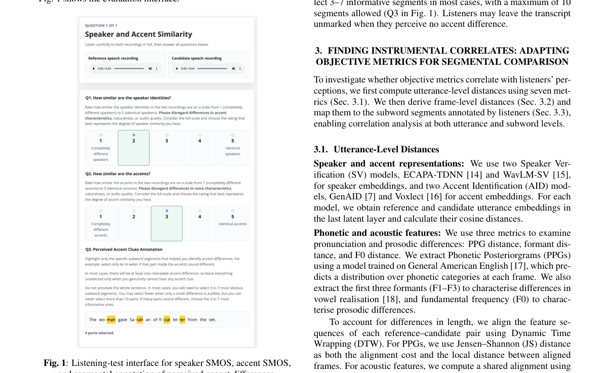

**Why this ranks #4**: 把口音差异发生在哪一段变成可标注的听测协议，同时证明现有客观距离几乎测不出这种局部差异。

---

### 5. MiDiff: MIDI-Conditioned Diffusion Models for Drum Audio Enhancement

**arXiv**: [2610.38619](https://arxiv.org/abs/2610.38619) | **Score**: 7.3 (relevance 7.5 x 0.7 + quality 7.0 x 0.3) | **Tags**: AIGC-audio, drum-enhancement, midi-conditioning, stft-diffusion, symbolic-prior, classifier-guidance, Bar-Ilan | **Categories**: eess.AS, eess.SP | **Pages**: 13

**Authors**: Elad Aspis; Sharon Gannot

**Affiliation**: Bar-Ilan University

**Abstract**

> Bridging the semantic gap between perfect symbolic musical structure and severely degraded acoustic signals offers a powerful paradigm for high-fidelity audio restoration. We introduce MiDiff, a diffusion-based generative model for drum audio enhancement that conditions the reverse process on temporally aligned Musical Instrument Digital Interface (MIDI) piano rolls. We extend the Score-Based Generative Models for Speech Enhancement (SGMSE) framework in the complex Short-Time Fourier Transform (STFT) domain by integrating a pretrained MIDI encoder, multi-scale temporal alignment, and three complementary conditioning strategies: early injection, Feature-wise Linear Modulation (FiLM), and cross-attention. We further show that providing the same piano roll only through classifier guidance, driven by an Automatic Drum Transcription (ADT) model on the audio-only score, yields no measurable gain: the symbolic prior is effective when it conditions the score network. To relax the requirement for ground-truth MIDI at inference, we further propose a hybrid reverse schedule that transcribes the diffusion state online with the same noise-aware ADT network and hands over from the audio-only score to MiDiff at a tunable switch time, cutting test FAD by 47% relative to the audio-only baseline without any symbolic input (switch time selected on the test set). We train our model on the StemGMD dataset using a non-additive degradation pipeline that simulates room reverberation with echo, electret capsule frequency response, and soft-clipping saturation with noise. MiDiff substantially outperforms the SGMSE baseline in terms of Fréchet Audio Distance (FAD) on both the validation and held-out test sets. Ablation studies demonstrate that combining all three conditioning strategies yields superior performance and that authentic MIDI velocity dynamics are critical for effective symbolic conditioning.

**Key findings**

- **Finding**: MiDiff 是一个基于 diffusion 的生成模型，用时间对齐的 MIDI piano roll 条件化反向过程，在复数 STFT 域做鼓组音频增强。
- **Finding**: 它在 SGMSE 框架上加入预训练 MIDI encoder、多尺度时间对齐，以及 early injection、FiLM、cross-attention 三种互补的条件注入方式。
- **Finding**: 论文验证若只用 classifier guidance、由基于纯音频的自动鼓转录模型驱动，同一份 piano roll 不会带来可测增益。
- **Finding**: 为放宽推理时对 ground-truth MIDI 的依赖，作者提出混合反向调度，用同一个 noise-aware ADT 网络在线转录扩散状态，并在可调的切换时刻从纯音频 score 交接给 MiDiff。
- **Finding**: 该调度在完全不使用符号输入的情况下把测试 FAD 相对纯音频基线削减 47%，但切换时刻是在测试集上选出的。
- **Finding**: 训练使用 StemGMD 数据集与非可加性退化管线，模拟带回声的房间混响、动圈麦频响与带噪软削波饱和，FAD 上持续优于 SGMSE 基线，消融显示三种条件方式组合最优、真实 MIDI velocity 动态至关重要。
- **Inference**: 这篇把符号先验什么时候真的有用做成了可操作的对照实验，对做音乐-音频联合模型的人比结论本身更有用。
- **Recommendation**: 推荐读。做音乐信号修复、符号条件生成或混音增强的读者，值得重点看它的条件注入消融与混合调度设计。

**Key figures**

*Framework - MIDI encoder-decoder architecture: The raw piano roll m is encoded by E(·) into a dense latent representation z, and decoded by D(·) to reconstruct ˆm. Pretraining minimizes the squared recons*

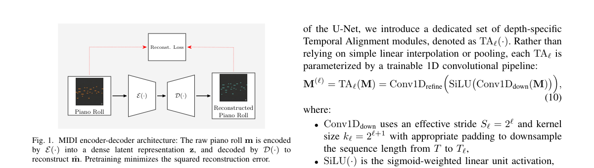

*Result - Left: Early Injection mechanism—encodes raw piano roll m, projects the embedding with a zero-initialized 1 × 1 convolution and adds it to the output of the first NCSN++ convolution applied to*

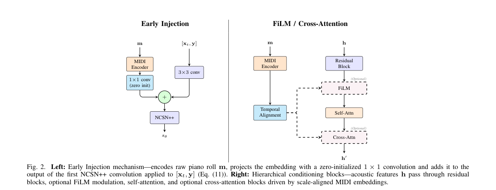

**Why this ranks #5**: 用 MIDI piano roll 条件化扩散反向过程修复鼓组，并证明符号先验只有条件 score 网络时才真正生效。

---

### 6. SelectSep: Target-Selective Video Queries for Audio Source Separation

**arXiv**: [2610.38624](https://arxiv.org/abs/2610.38624) | **Score**: 7.0 (relevance 7.0 x 0.7 + quality 7.0 x 0.3) | **Tags**: AIGC-audio, audio-source-separation, video-query, click-conditioning, target-selectivity, text-conditioning, Korea Advanced | **Categories**: cs.MM, cs.SD, eess.AS | **Pages**: 5

**Authors**: Suyeon Lee; Doyeop Kwak; Joon Son Chung

**Affiliation**: Korea Advanced Institute of Science and Technology

**Abstract**

> Video-queried sound separation (VQSS) aims to isolate a target sound from an audio mixture using its corresponding video as a query. However, scene-level video queries can become ambiguous when multiple sounding objects are visible, particularly when the target and interferer are semantically similar. We propose SelectSep, a target-selective VQSS framework that jointly uses text and a single click coordinate to specify the target source and instance without requiring segmentation at inference time. We adapt the visual encoder through target-feature distillation with text and click conditioning, and then fine-tune the separator using the adapted visual features. We also introduce an on-screen interference setting, where both the target and interferer are visible, to evaluate target selectivity. Experiments on standard benchmarks and the on-screen interference setting demonstrate consistent improvements in separation quality and target selectivity, particularly for mixtures containing semantically similar sources.

**Key findings**

- **Finding**: 论文指出 video-queried sound separation 的场景级视频查询在多个发声物体同时可见时会变得歧义，目标与干扰源语义相近时尤其严重。
- **Finding**: SelectSep 联合使用文本与单个 click 坐标来指定目标声源与其实例，推理时不需要任何分割。
- **Finding**: 模型先用带文本与点击条件的 target-feature distillation 适配视觉编码器，再用适配后的视觉特征微调分离器。
- **Finding**: 作者额外构造 on-screen interference 设定，让目标与干扰源同时出现在画面里，以专门检验目标选择性。
- **Finding**: 在标准基准与该设定上都取得一致提升，在语义相近声源的混合样本上改善尤其明显。
- **Inference**: 把指哪听哪的交互成本降到一个点击，比训练一个可靠的说话人分割器更贴近真实编辑工具的使用方式。
- **Recommendation**: 选读。做视频辅助声源分离或交互式音频编辑的读者可看其两阶段训练与注意图分析，做纯音乐分轨的不必优先。

**Key figures**

*Framework - Training pipeline of SelectSep. In stage 1, we fine-tune the visual encoder with text and click conditions for target selectivity at the video feature level. In stage 2, we freeze the student*

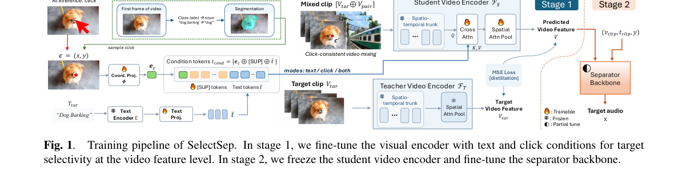

*Result - Attention maps of the visual encoder under each conditioning mode. The marker indicates the clicked position.*

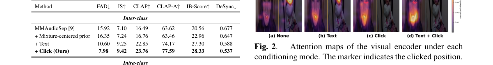

**Why this ranks #6**: 用文本加一次点击代替分割掩码，解决画面里多个发声体同时可见时的目标歧义。

---

### 7. Who Called? V33DA: A Physically Verified Multimodal Benchmark for Vocal Attribution in Zebra Finch Groups

**arXiv**: [2610.38109](https://arxiv.org/abs/2610.38109) | **Score**: 6.5 (relevance 6.5 x 0.7 + quality 6.5 x 0.3) | **Tags**: AIGC-audio, vocal-attribution, multimodal-benchmark, zebra-finch, accelerometer-verification, spatial-reasoning, Institute of Neuroinformatics | **Categories**: cs.CV, cs.LG, cs.SD, q-bio.QM | **Pages**: 43

**Authors**: Maris Basha; Yuhang Wang; Xiaoran Chen; Longbiao Cheng; Luca Yapura; Anja T. Zai; Mathieu Salzmann; Richard Hahnloser

**Affiliation**: Institute of Neuroinformatics, University of Zurich and ETH Zurich; Swiss Data Science Center and CVLab, EPFL

**Abstract**

> Deciding which member of an animal group produced a vocalization and where that vocalization was produced are central to studying social communication but are rarely evaluated with physically verified ground truth. Existing resources either localize sounds without identifying the caller, or recognize individuals from isolated vocalizations without reliance on the 3D candidate geometry. We close this gap with V33DA, a dataset-centered multimodal benchmark for spatial vocal attribution in social zebra finches: it comprises 33,625 verified events coupling 5-channel audio with three camera views, calibrated 3D pose for every visible candidate, and per-bird radio telemetry across 10 individuals and three experiments. Caller identity is verified from an on-body accelerometer-derived vibration signal; this channel is withheld from benchmark models and used only by an on-body reference ceiling. Given a detected vocalization and the visible candidate birds, the task is to select the caller. We evaluate it under three regimes: session-disjoint testing on familiar birds from held-out recording dates, held-out-experiment transfer to a new cohort, and leave-one-individual-out evaluation on a bird whose vocalizations are held out from training. Reference methods expose a consistent gap between in-domain accuracy and transfer to unseen individuals: methods that can exploit familiar vocal identity perform well on known callers but degrade sharply on unseen ones, whereas candidate-aware methods preserving explicit spatial reasoning transfer substantially better. The on-body reference stays near-perfect across regimes, confirming the internal consistency of the accelerometer-verified labels. We release V33DA with fixed protocols and code for the evaluated methods, and V33DA++, an unevaluated companion set of verified overlapping-call events and +/-2 s context windows.

**Key findings**

- **Finding**: V33DA 是一个以数据集为中心的多模态基准，面向社交斑胸草雀群体的空间性叫声归属，包含 33625 个经核验的事件。
- **Finding**: 每个事件耦合 5 通道音频与三个相机视角，并为每个可见候选鸟提供标定好的 3D 位姿，覆盖 10 个个体与三组实验的逐鸟无线电遥测。
- **Finding**: 说话人身份由佩戴在鸟身上的加速度计振动信号核验，该通道不提供给模型，只用于构造 on-body reference ceiling，任务则是给定检测到的叫声与画面中的候选鸟选出真正的发声者。
- **Finding**: 三种评测协议下参考方法都暴露同一问题，域内准确率与对未见个体的迁移之间存在明显落差。
- **Finding**: 能利用熟悉嗓音身份的方法在已知发声者上表现好，但换到未见个体时急剧退化，而保留显式空间推理的候选感知方法迁移明显更好。
- **Finding**: on-body reference 在各设定下都接近满分，佐证了加速度计核验标签的内部一致性。
- **Inference**: 这是声音归属而非声音生成的问题，与音频生成主线的距离在上游信号层，但它反过来给识别与评测提供了可信地基。
- **Recommendation**: 选读。做生物声学、多模态归属或需要真实空间真值的读者可看，只关心文本到音频生成的读者可以略过。

**Key figures**

该论文正文未提取到可用图（图表为纯文本/表格排版）。

**Why this ranks #7**: wild-card 补位：它不做生成，而是给群体里谁发出了这声配上物理验证的真值，落在声音层面而非生成主线。  [wild-card=yes] 斑马草雀鸣叫归属的多模态基准与物理验证数据集，评测的是发声者识别，属音频数据集方向的补位。

---

### 8. ODAQ-Collection: Expanding the Open Dataset of Audio Quality with a Focus on Spatial Distortions

**arXiv**: [2610.37959](https://arxiv.org/abs/2610.37959) | **Score**: 6.0 (relevance 6.0 x 0.7 + quality 6.0 x 0.3) | **Tags**: AIGC-audio, audio-quality-assessment, binaural-distortion, mushra, open-dataset, spatial-audio, Netflix | **Categories**: eess.AS | **Pages**: 5

**Authors**: Chih-Wei Wu; Matteo Torcoli; Mhd Modar Halimeh; Pablo M. Delgado; Sascha Dick; Christoph Thompson; Phillip A. Williams; Emanuël A. P. Habets

**Affiliation**: Netflix; Fraunhofer Institute for Integrated Circuits IIS; Ball State University

**Abstract**

> The Open Dataset of Audio Quality (ODAQ) is an expanding resource that addresses the scarcity of openly available data in audio quality assessment research. While previous contributions focused mainly on timbral distortions, with spatial processing limited to basic mid-side and left-right stereo conditions, we present a new contribution featuring high-quality music and speech recordings with diverse stereo images, controlled spatial distortions, and subjective listening test results from trained listeners in a laboratory setting. With 148 pairs of stereo audio samples processed by three different method classes, two applying controlled binaural cue distortions and one applying dialogue enhancement, this addition expands the collection to 688 pairs of processed and unprocessed audio signals spanning 17 processing method classes, along with 18,984 raw subjective ratings from listeners. All associated data and code are released as open resources to facilitate future expansions and research on objective audio quality metrics.

**Key findings**

- **Finding**: ODAQ 是面向音质评估的开放数据集，作者指出该方向的公开数据长期稀缺。
- **Finding**: 先前贡献主要聚焦音色失真，空间处理仅限基本的 mid-side 与左右声道条件，本次新增部分专门处理立体声空间失真。
- **Finding**: 新增子集包含高质量音乐与语音立体声录音、受控的双耳线索失真处理、对白增强处理，以及来自受训听者的实验室条件主观听测结果。
- **Finding**: 本次加入 148 对立体声样本，经三类不同方法处理，其中两类是受控双耳线索失真，一类是对白增强。
- **Finding**: 整个数据集因此扩充到 688 对处理与未处理音频，覆盖 17 种处理方法类别，并附带 18984 条原始主观评分。
- **Finding**: 全部数据与代码以开放资源形式发布，供后续扩展与客观音质指标研究使用。
- **Inference**: 它对生成线的意义在下游，只有用这种带 MUSHRA 打分的失真配对，才能判断增强模型是否真的修好了空间感而不只是更响。
- **Recommendation**: 选读。做音质评估、空间音频增强或需要听测配对数据的读者值得取用，做纯生成模型的读者可先看处理类别与评分设置。

**Key figures**

*Framework - Generation of spatial distortions using a modified Bin- aural Cue Codec [21] following [25].*

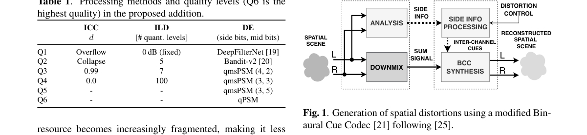

*Result - Mean BAQ (in MUSHRA points) with 95% confi- dence intervals across quality levels, reference, and anchor conditions. Scores are averaged over all items.*

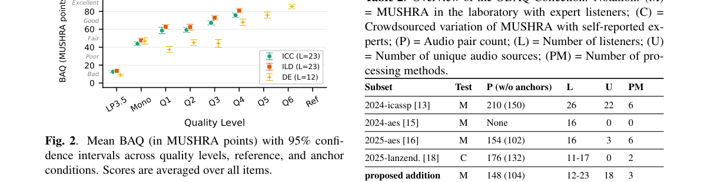

**Why this ranks #8**: wild-card 补位：它是评测资源而非生成方法，但把空间失真听不听得出来做成了带主观评分的公开语料。  [wild-card=yes] 开放音频质量数据集（含空间失真），属音频资源方向而非生成模型，补位计入。

---

### 9. Universal Short-Time Fourier Transform: Data-Adaptive Window-Length Selection for Time-Frequency Analysis

**arXiv**: [2610.37795](https://arxiv.org/abs/2610.37795) | **Score**: 5.8 (relevance 5.5 x 0.7 + quality 6.5 x 0.3) | **Tags**: AIGC-audio, stft, adaptive-window, renyi-entropy, overlap-add, time-frequency-analysis, Stony Brook | **Categories**: cs.IT, cs.SD, eess.AS, eess.SP, stat.ML | **Pages**: 12

**Authors**: Manan Mittal; Kanad Sarkar; Ryan M. Corey; John R. Buck; Andrew C. Singer

**Affiliation**: Stony Brook University; University of Illinois Urbana-Champaign; University of Illinois Chicago; University of Massachusetts Dartmouth

**Abstract**

> The short-time Fourier transform (STFT) characterizes the local frequency content of time-varying signals by evaluating the discrete Fourier transform over a sliding analysis window. The STFT is governed by a fundamental resolution trade-off: a short window localizes rapid transients in time at the cost of frequency resolution, whereas a long window resolves closely spaced harmonics at the expense of temporal resolution. The Universal Short-Time Fourier Transform (U-STFT) resolves this trade-off sequentially by modeling the analysis window duration as a data-adaptive state variable that indexes the number of hops included in the current observation interval. At each frame, a bank of candidate window durations is scored using normalized order-three Rényi entropy to quantify joint time-frequency concentration. A window length trellis aggregates the resulting $\mathcal{O}(3^M)$ candidate window schedules with linear complexity per frame, guaranteeing a cumulative mix-loss regret bound of $\mathcal{O}((k+1)\log M)$ relative to any hindsight window schedule with $k$ resolution changes over $M$ frames. By linearity of the Fourier transform, posterior expectation across the candidate bank yields a single spectrum equivalent to an STFT evaluated with a data-adaptive effective window, while an envelope-normalized synthesis stream guarantees exact overlap-add reconstruction. Evaluations on synthetic and marine bioacoustic signals demonstrate adaptive resolution tracking, enhanced spectral concentration, and exact time-domain invertibility.

**Key findings**

- **Finding**: 论文指出 STFT 存在根本的分辨率折中，短窗能定位快速瞬态但牺牲频率分辨率，长窗能分开邻近谐波但牺牲时间分辨率。
- **Finding**: U-STFT 把分析窗时长建模为数据自适应的状态变量，该状态索引当前观测区间所包含的 hop 数。
- **Finding**: 每帧用归一化三阶 Rényi entropy 给一组候选窗时长打分，以刻画时频联合集中度。
- **Finding**: 一个 window length trellis 以每帧线性复杂度聚合由此产生的 3 的 M 次方条候选窗调度方案，并给出相对任意 hindsight 窗调度的累积 mix-loss regret 上界。
- **Finding**: 借助傅里叶变换的线性性，对候选集取后验期望可得到等价于自适应有效窗的单一频谱，同时归一化包络的合成流保证精确的 overlap-add 重构。
- **Finding**: 在合成信号与海洋生物声信号上的评测显示出自适应分辨率跟踪、更强的频谱集中度与时域精确可逆。
- **Inference**: 它对音频生成线的意义是间接的，自适应时频分析可以作为 codec 与前端分析的一层，但论文本身不做任何生成或理解任务。
- **Recommendation**: 选读。做 STFT 分析、神经音频前端或需要自适应时频分辨率的读者可读其 trellis 与 regret 分析，其余可略过。

**Key figures**

*Framework - The STFT time-frequency resolution trade-off. A short analysis window provides fine temporal localization but coarse frequency resolution due to its wide spectral main lobe. A long analysis wi*

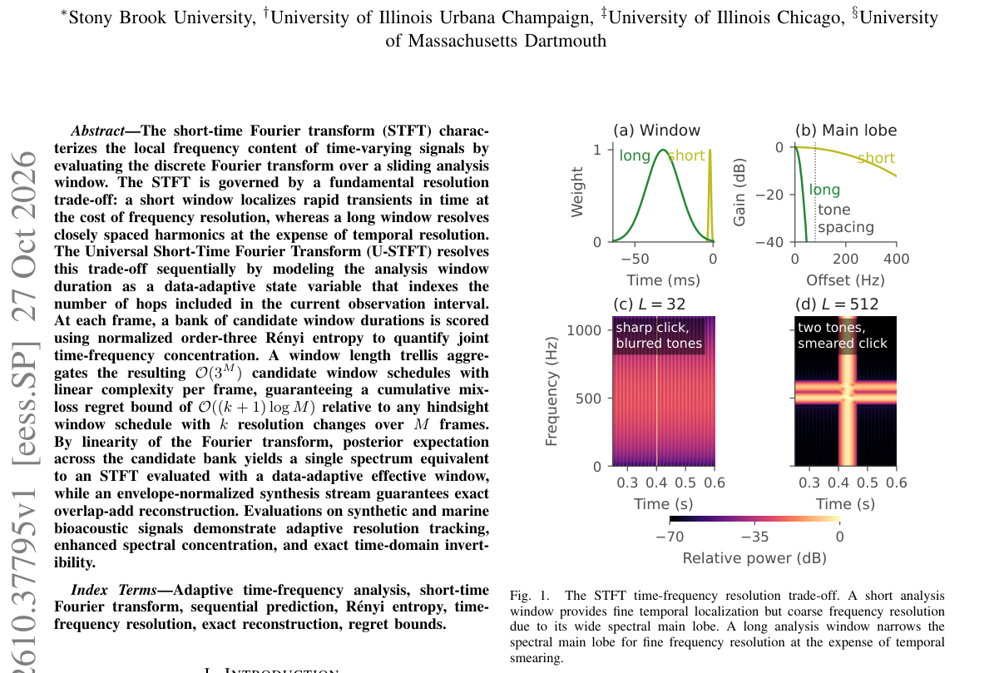

*Result - Causal window-length trellis. State s corresponds to a window duration Ls = (s+1)H. All trajectories arriving at state s at frame m share the same physical window wLs and candidate spectrum Xm*

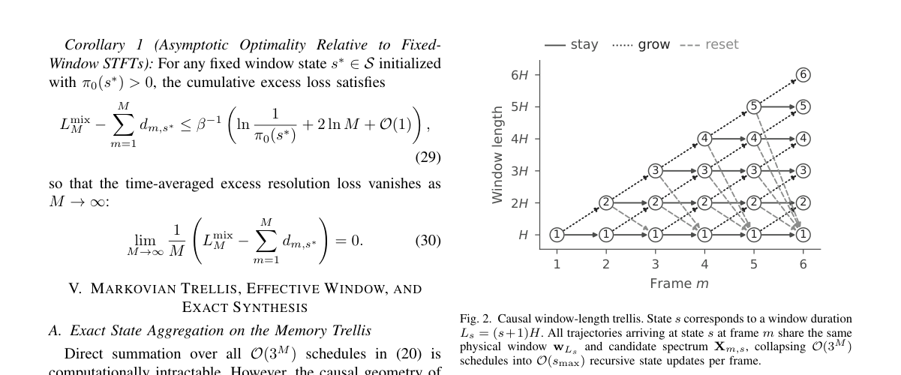

**Why this ranks #9**: wild-card 补位：这是信号处理底座而非生成模型，但它把 STFT 的时频折中做成了数据自适应的在线决策。  [wild-card=yes] 数据自适应窗长的时频分析变换，是音频制作工具链的基础件而非生成模型，补位计入。

---

### 10. Beyond Low-Pass Dynamics: Frequency-Selective Spiking Reservoirs with Resonant Neurons

**arXiv**: [2610.37906](https://arxiv.org/abs/2610.37906) | **Score**: 5.6 (relevance 5.5 x 0.7 + quality 6.0 x 0.3) | **Tags**: AIGC-audio, spiking-reservoir, liquid-state-machine, frequency-selectivity, energy-efficiency, neuromorphic, Delft | **Categories**: cs.AI | **Pages**: 30

**Authors**: Aurora Micheli; Claudio Gallicchio; Nergis Tomen

**Affiliation**: Delft University of Technology; University of Pisa

**Abstract**

> Spiking reservoir computing combines the training efficiency of fixed recurrent reservoirs with the energy efficiency of event-driven inference, where computation is triggered by sparse spikes rather than executed densely at every timestep. However, existing spiking reservoirs almost exclusively rely on Leaky Integrate-and-Fire (LIF) neurons, whose low-pass dynamics limit their ability to distinguish information encoded at different temporal frequencies. We introduce HRF-Res, a liquid state machine in which LIF neurons are replaced by a heterogeneous population of Harmonic Resonate-and-Fire (HRF) neurons. These neurons exhibit intrinsic oscillatory dynamics and selectively respond to input frequencies, enabling the reservoir to capture frequency-specific temporal patterns. The result is more discriminative representations and higher classification accuracy than LIF-based reservoirs, achieved without sacrificing the energy efficiency of spiking computation, with up to 19x lower energy consumption than an equivalent non-spiking oscillatory reservoir. Evaluated on ten benchmarks spanning time series, sequential images, audio spike trains, and neuromorphic vision, HRF-Res achieves state-of-the-art accuracy among spiking reservoir methods. These results demonstrate that introducing frequency-selective dynamics into spiking reservoirs improves representational quality and classification performance while preserving their inherent energy efficiency.

**Key findings**

- **Finding**: HRF-Res 是一种 liquid state machine，把储备池中占主导的 LIF 神经元换成异质的 Harmonic Resonate-and-Fire 神经元群。
- **Finding**: 论文指出 LIF 的低通动力学限制了对不同时间频率编码信息的区分能力，HRF 神经元则具备内禀振荡并对输入频率选择性响应。
- **Finding**: 实验显示储备池能捕获频率特异的时间模式，得到更可区分的表征与更高分类准确率。
- **Finding**: 在保留脉冲计算能效的同时，能耗相比等价的非脉冲振荡储备池最多降低 19 倍。
- **Finding**: 在覆盖时间序列、序列图像、音频脉冲列与神经形态视觉的十个基准上，HRF-Res 在脉冲储备池方法中达到领先准确率。
- **Inference**: 它在音频线上的意义是硬件侧的能效选项而不是建模方式的推进，目前还缺少把频率选择性接到语音任务上的证据。
- **Recommendation**: 选读。做神经形态硬件、脉冲计算或低功耗音频前端的读者可看，做语音语言模型的读者建议只作背景了解。

**Key figures**

*Framework - Architecture of our proposed HRF-Res. The external input ut is projected into a LIF encoder population (left, pink) via the fixed matrix U. LIF spikes sLIF*

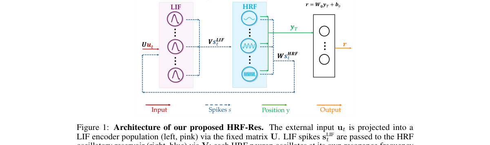

*Result - Band-pass properties of HRF-Res vs. LIF-Res. (A) Fraction of resonant neurons (Q > 0) per dataset. HRF-Res has 4–20× more resonant neurons than LIF-Res, confirming that band-pass dynamics su*

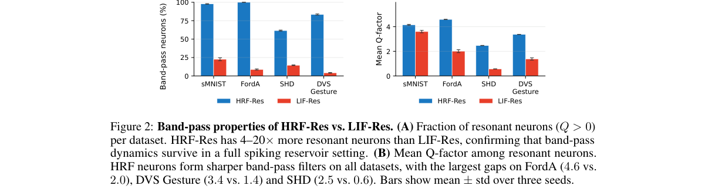

**Why this ranks #10**: wild-card 补位：它是一套低功耗脉冲储备池方法，音频只是其十个基准之一，与语音语言模型没有直接关系。  [wild-card=yes] 频率选择性脉冲储备池（含音频脉冲轨基准），属音频表征与分类方向，补位计入。

---

## Footer

- Total papers scanned across all 7 tracks: 336（原始 446 条）
- aigc_audio track final top-10: 10
- Wild-cards in this track: 4
- Figure assets: 2026-10-29/res/

Generated by `mine-arxiv-daily-digest` skill. Sister file: `2026-10-29_aigc_audio_entry.md`.
