# ArXiv Daily Digest - 2026-10-29 (AIGC 视觉生成, 10 papers)

**Generated**: 2026-10-31 17:30 CST

**Source**: arXiv cs.CV, cs.SD, eess.AS, cs.CL, cs.AI, cs.RO, cs.LG submissions, listing day 2026-10-28 (announced 2026-10-29 00:00 UTC)

**Batch window**: 2026-10-27T18:00:00Z .. 2026-10-28T18:00:00Z（arXiv 公告批次横跨两个 UTC 日：前一日 18:00 UTC 起算，当日 17:59:59 UTC 截止）

**Track**: aigc_visual (top 10 of 336 papers scanned, 70 full reads)

**Scope**: 图像 / 视频 / 3D 内容的生成与编辑，含扩散与流匹配模型的训练方法、加速、评测基准

---

## Top 10 - AIGC 视觉生成

### 1. Hierarchical Diffusion for Camera-controlled Autoregressive Video Generation

**arXiv**: [2610.37983](https://arxiv.org/abs/2610.37983) | **Score**: 9.2 (relevance 9.5 x 0.7 + quality 8.5 x 0.3) | **Tags**: AIGC-visual, camera-control, autoregressive-video, long-video, hierarchical-denoising, warping-inpainting, Carnegie Mellon | **Categories**: cs.CV | **Pages**: 17

**Authors**: Kaihua Chen; Yiming Gong; Deva Ramanan; Tarasha Khurana

**Affiliation**: Carnegie Mellon University; University of Oxford

**Abstract**

> We address the task of long-video, camera-controlled generation from a single image. The dominant autoregressive paradigm suffers from two key limitations: (1) error accumulation over time, as distant frames are conditioned on previously generated outputs rather than ground truth, leading to drift; and (2) ambiguity in how to incorporate camera control. Standard solutions to both--such as self-forcing and conditioning on explicit 6-DOF poses--either incur significant computational overhead or produce drifting scene geometries over time. We propose a simple and lightweight framework that combines autoregressive generation (WanAR) with hierarchical long-context denoising (FixAR). To enforce scene geometry remains consistent with input cameras, we draw from feed-forward novel-view synthesis and reformulate video generation as a warping-and-inpainting problem. To mitigate drift, we introduce a hierarchical denoising strategy in which different stages condition on different temporal histories. Specifically, we first generate frames conditioned on the immediate past, and then refine them using a second denoiser conditioned on a temporally subsampled long-range history to enforce global consistency. This fine-to-coarse scheme enables each generated frame to effectively condition on the full temporal context without incurring a prohibitive cost. Experiments on RealEstate10k and DL3DV demonstrate that WanAR+FixAR outperforms prior methods for camera-controlled long-video generation, producing results that are both temporally stable and consistent with input camera trajectories.

**Key findings**

- **Finding**: 论文研究从单张图像出发的长视频、相机可控生成，指出自回归范式有两处硬伤：远处帧以已生成输出而非真值为条件导致误差累积漂移，相机控制如何注入也存在歧义。
- **Finding**: 对应的常规解法，例如 self-forcing 与显式 6-DOF 位姿条件，要么带来显著计算开销，要么让场景几何随时间持续漂移。
- **Finding**: 方法把自回归生成（WanAR）与层次化长上下文去噪（FixAR）组合成一个简单轻量的框架。
- **Finding**: 为让场景几何与输入相机保持一致，作者借鉴前馈新视角合成，把视频生成重述为 warping-and-inpainting 问题。
- **Finding**: 去噪分两级：先用紧邻过去生成帧，再用第二个去噪器以时间抽稀的长程历史做精修，从而以可接受的代价让每帧都利用到完整时序上下文。
- **Finding**: 在 RealEstate10k 与 DL3DV 上，WanAR+FixAR 超过既有方法，生成结果既时间稳定，又与输入相机轨迹保持一致。
- **Inference**: 漂移的根源是条件窗口太短，用抽稀的长程历史做第二遍精修，比把完整历史塞进上下文或改用 self-forcing 重训要划算得多。
- **Recommendation**: 推荐。做长视频或相机可控生成、需要稳定时序一致性的读者建议读。

**Key figures**

*Framework - In this work, we consider the problem of camera-controlled video generation. Existing approaches condition on cameras represented as ray encodings or Plucker coordinates, but these learn pos*

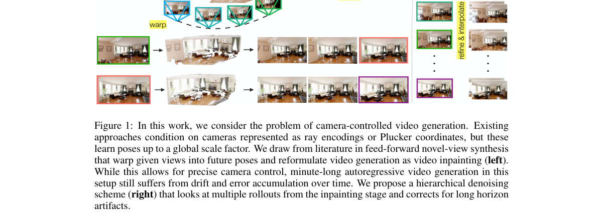

**Why this ranks #1**: 长视频生成最难的两处硬伤——时间漂移与相机控制——被同一套「细到粗」两级去噪顺手解决，且不必背 self-forcing 的训练代价。

---

### 2. BudSplat: Feed-forward 3D Gaussian Splatting under a Rendering Budget

**arXiv**: [2610.38278](https://arxiv.org/abs/2610.38278) | **Score**: 8.7 (relevance 9.0 x 0.7 + quality 8.0 x 0.3) | **Tags**: AIGC-visual, feed-forward-3dgs, gaussian-pruning, rendering-budget, novel-view-synthesis, voxel-fusion, Nanyang Technological | **Categories**: cs.CV | **Pages**: 19

**Authors**: Muyu Xu; Fangneng Zhan; Yu Wei; Ling Shao; Shijian Lu

**Affiliation**: Nanyang Technological University; Hong Kong University of Science and Technology

**Abstract**

> Feed-forward 3D Gaussian Splatting has recently emerged as a promising alternative to per-scene optimization, enabling fast novel view synthesis by predicting Gaussian primitives directly from input images. However, it quickly faces a bottleneck of rendering efficiency while scaling from sparse to dense multi-view inputs, which offer more geometric constraints but produce a rapidly growing set of candidate Gaussians. Existing solutions cannot reliably distinguish redundant primitives, leading to many redundant primitives from repeatedly observed regions and increased rendering cost without much gain in visual quality. We propose BudSplat, a compact feed-forward 3DGS framework that learns to keep the most valuable Gaussians under a limited primitive count. BudSplat has two novel designs. The first is a detail-aware importance score that is extracted from multi-level visual tokens, providing an explicit cue for regions where pruning is likely to harm perceptual quality. The score can be injected into voxel fusion to preserve high-value local contributors during multi-view aggregation. The second is quality-aware Gaussian pruning that selects a compact set of primitives by jointly considering rendering contribution and detail importance. The quality-aware pruning enables local quota redistribution that helps avoid over-allocating primitives to large redundant regions. Experiments on RE10K, DL3DV, and ACID show that BudSplat achieves a favorable trade-off among rendering quality and efficiency.

**Key findings**

- **Finding**: 论文指出前馈 3D Gaussian Splatting 在输入从稀疏走向稠密多视图时，候选高斯数量快速增长，渲染效率迅速成为瓶颈。
- **Finding**: 现有方案无法可靠区分冗余基元，反复被观测的区域堆积大量冗余高斯，渲染成本上升而视觉质量几乎没有提升。
- **Finding**: BudSplat 的目标是学习在有限基元数量下保留最有价值的高斯，把紧凑性当作前馈预测阶段的一次预算分配。
- **Finding**: 第一个设计是从多层视觉 token 中提取 detail-aware 重要度评分，明确指示哪些区域的裁剪会损伤感知质量。
- **Finding**: 该评分可注入 voxel fusion，在多视图聚合阶段就保住高价值的局部贡献者，而不是等到最后才动手剪。
- **Finding**: 第二个设计是 quality-aware 高斯剪枝，联合考虑渲染贡献与细节重要度挑选紧凑基元集合，并支持局部配额再分配，避免把基元过量分配给面积大却冗余的区域。
- **Inference**: 把重要度前置到融合阶段才是关键，因为冗余高斯在融合之前就已经被制造出来，事后剪枝只是亡羊补牢。
- **Recommendation**: 推荐。做前馈新视角合成、需要把渲染开销压到实时可部署的读者建议读。

**Key figures**

*Framework - Overview of BudSplat. With dense geometry, confidence maps, and multi-layer tokens as predicted from multi-view RGB images by VGGT, the detail-aware decomposition first extracts residual tok*

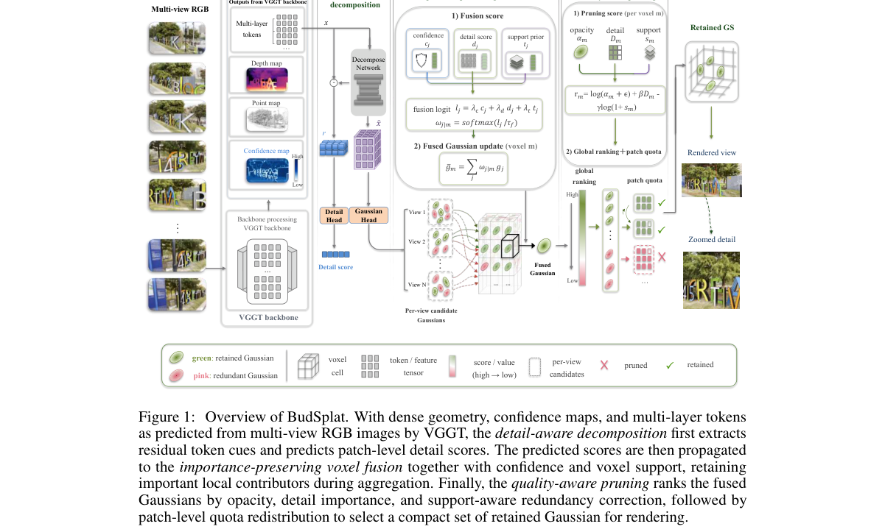

*Result - Qualitative comparison on challenging low-overlap target views. Red boxes highlight regions where baselines suffer from incomplete Gaussian coverage, blurred local structures, or uneven rend*

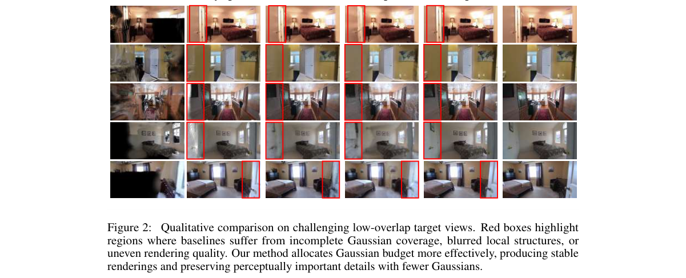

**Why this ranks #2**: 它把前馈 3DGS 的剪枝从启发式规则改写成显式的渲染预算分配问题，用 detail-aware 重要度决定有限数量的高斯该留给哪些区域。

---

### 3. Self-Consistency Geometry Injection for Multi-view Consistent Image Generation

**arXiv**: [2610.38518](https://arxiv.org/abs/2610.38518) | **Score**: 8.3 (relevance 8.5 x 0.7 + quality 8.0 x 0.3) | **Tags**: AIGC-visual, multi-view-generation, geometry-uncertainty, reliability-map, normal-prediction, diffusion, Guangdong | **Categories**: cs.CV, cs.GR | **Pages**: 17

**Authors**: Yupeng Xiao; Yankai Wu; Jianjie Luo; Jiajie Lin; Yi Yu; Zhenguo Yang

**Affiliation**: Guangdong University of Technology; Hiroshima University

**Abstract**

> Recent diffusion models have achieved impressive progress in single image to multi-view generation by synthesizing consistent novel views efficiently. Existing methods usually explicitly or implicitly couple geometry inference and texture synthesis, making generation vulnerable to inaccurate geometry prediction. Although several geometry-guided methods have explored decoupling, they usually treat predicted geometry as a fixed condition and do not explicitly model whether the geometry is reliable. We therefore propose Reliability-Guided Multi-View Generation (RGMV), which comprises a parameter-free Self-Consistency Geometry Gate (SCG) and a Reliability-aware Geometry Injection (RGI) module. Specifically, a geometry proposal generator produces multiple geometry predictions for the same reference image and target viewpoints under different stochastic sampling configurations. SCG measures their spatial agreement to derive a reliability map, which RGI uses to modulate the injection strength of geometry-conditioned residuals in the RGB synthesis model. Moreover, RGMV can adapt to different geometry proposal generators. As a result, RGMV preserves stronger geometric guidance in stable regions while attenuating unreliable geometry cues before they propagate into multi-view RGB generation. Extensive experiments show that reliability-aware geometry injection improves the geometric quality of multi-view generation. Code: https://github.com/WISLab-GDUT/RGMV.

**Key findings**

- **Finding**: 论文指出现有方法通常显式或隐式把几何推理与纹理合成耦合在一起，使生成结果直接受制于不准确的预测几何。
- **Finding**: 已有的几何引导方法虽然尝试了 decoupling，却把预测几何当作固定条件，并不显式建模这份几何到底可不可靠。
- **Finding**: RGMV 由一个无参数的 Self-Consistency Geometry Gate（SCG）和一个 reliability-aware 几何注入模块（RGI）组成。
- **Finding**: 几何提议生成器在同一参考图与目标视角下，按不同随机采样配置产出多组几何预测。
- **Finding**: SCG 度量这些预测之间的空间一致性得到可靠性图，RGI 用它调制几何条件残差在 RGB 合成模型中的注入强度。
- **Finding**: 框架可适配不同的几何提议生成器，在稳定区域保留更强的几何引导，在不可靠区域先衰减几何线索再让它进入多视图 RGB 生成。
- **Inference**: 用「同一输入多次采样的一致性」当可靠性代理，是零训练成本拿到不确定性估计的巧办法，也解释了这个 gate 为什么不需要任何参数。
- **Recommendation**: 推荐。做多视图一致生成、想给几何条件加一层保险的读者建议读。

**Key figures**

*Framework - Comparison of three paradigms for multi-view image generation. (a) Direct generation entangles geometric reasoning and texture synthesis in a single generator, making geometric errors difficul*

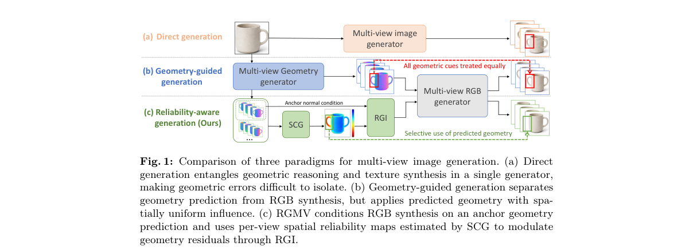

*Result - Overview of RGMV. Given a reference image and target camera poses, an off-the-shelf geometry proposal generator produces K stochastic sets of multi-view normal predictions. The first predictio*

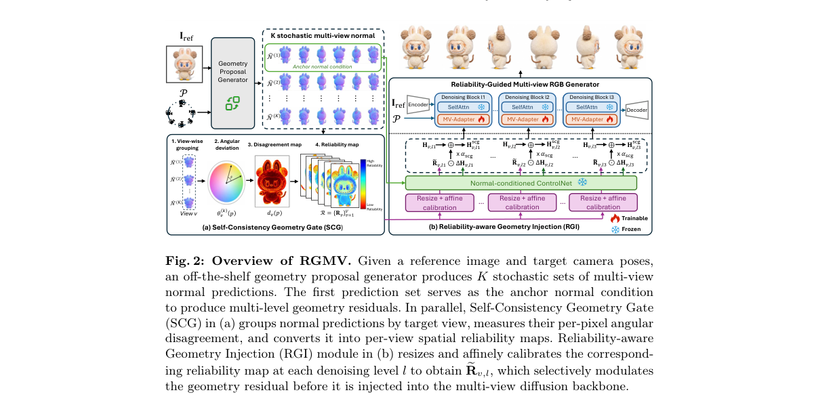

**Why this ranks #3**: 它把「几何预测可不可信」当成一等公民：用同一输入多次随机采样之间的空间一致性免费换来可靠性图，再按图调节几何注入的强度。

---

### 4. GOFish: Full Field-of-View Gaussian Splatting and Mesh Extraction

**arXiv**: [2610.37818](https://arxiv.org/abs/2610.37818) | **Score**: 7.8 (relevance 8.0 x 0.7 + quality 7.5 x 0.3) | **Tags**: AIGC-visual, fisheye-lens, gaussian-splatting, mesh-extraction, full-fov, digital-twin, Amazon | **Categories**: cs.CV, cs.GR, cs.RO | **Pages**: 26

**Authors**: Allen Tu; Meher Gitika Karumuri; Shifan Zhu; Hailing Wang; Yen-Liang Lin; David Held; Matthias Zwicker; Tom Goldstein

**Affiliation**: Amazon; University of Maryland, College Park; Northeastern University; Carnegie Mellon University

**Abstract**

> Robots, autonomous vehicles, and consumer 360° cameras use fisheye lenses for wide fields of view (FoVs). Simulation-ready digital twins require photorealistic rendering across the full FoV and an aligned collision mesh. However, prior fisheye Gaussian Splatting methods only rasterize up to 180° and do not produce meshes, while Gaussian surface reconstruction methods assume pinhole training images. We present GOFish, the first 3D Gaussian Splatting surface reconstruction method to train directly on fisheye images, rasterize FoVs beyond 180°, and extract an aligned mesh from the same scene. Calibrated densification recovers the surface across the entire FoV, while Calibrated Mip Filtering and Wide-Angle Appearance Modeling keep pixel blur and lens falloff out of the scene and mesh. Across the 200° FIORD and 205° FullCircle benchmarks, GOFish improves PSNR over the best prior method by 2.28 and 1.97 dB, respectively. It also outperforms fisheye rendering baselines within their own FoVs and achieves the highest mesh F-score on FIORD and the main ScanNet++ set. Together, the Gaussian scene and mesh form a LiDAR-free, simulation-ready digital twin that renders in real time, ray traces the full FoV, and provides collision geometry.

**Key findings**

- **Finding**: 论文指出既有鱼眼 3DGS 方法最多只光栅化到 180° 且不产出网格，而高斯表面重建方法又假设训练图像是针孔投影。
- **Finding**: GOFish 是首个直接在鱼眼图像上训练、可光栅化超过 180° 视场、并从同一场景抽出对齐网格的 3D Gaussian Splatting 表面重建方法。
- **Finding**: Calibrated densification 在全视场内恢复表面，Calibrated Mip Filtering 与 Wide-Angle Appearance Modeling 把像素模糊与镜头暗角挡在场景之外。
- **Finding**: 在 200° 的 FIORD 与 205° 的 FullCircle 基准上，PSNR 相对最好的既有方法分别提升 2.28 dB 与 1.97 dB。
- **Finding**: 在各方法自身视场范围内，GOFish 也超过鱼眼渲染基线，并在 FIORD 与 ScanNet++ 主测试集上取得最高的 mesh F-score。
- **Finding**: 高斯场景与网格共同构成免 LiDAR 的 simulation-ready digital twin，可实时渲染、光线追踪整个视场，并提供碰撞几何。
- **Inference**: 超过 180° 之后常见的半角截断与正深度判定失效，才是鱼眼 3DGS 长期停在 180° 的技术原因，而非数据或算力限制。
- **Recommendation**: 推荐。做机器人仿真、360° 相机重建，或需要同时拿到渲染结果与碰撞网格的读者建议读。

**Key figures**

*Framework - GOFish reconstructs Hall In from FIORD [8] as a Gaussian Splatting scene and aligned mesh over its full 200◦field of view. 3DGUT + PPISP [31, 4] stops at 160◦and does not extract a mesh. Fig*

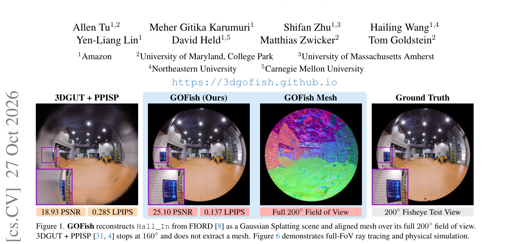

*Result - 3DGUT failures over a full field of view. (a) Its half- angle limit cuts rays beyond 80◦from the axis (orange), and its positive-depth test fails beyond 90◦(red). (b) Tiles come from the pro*

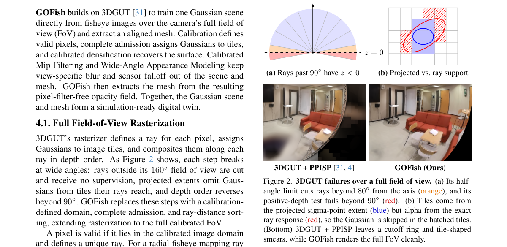

**Why this ranks #4**: 它是第一个能直接在鱼眼图像上训练、光栅化超过 180° 视场并同时抽出对齐网格的 3DGS 表面重建方法，一次把渲染与碰撞几何都补齐。

---

### 5. Aligning Misaligned Benchmarks for Single-View Novel View Synthesis

**arXiv**: [2610.38349](https://arxiv.org/abs/2610.38349) | **Score**: 7.5 (relevance 7.5 x 0.7 + quality 7.5 x 0.3) | **Tags**: AIGC-visual, benchmark-alignment, novel-view-synthesis, pose-estimation, co-visible-region, 3d-gaussians, University of British Columbia | **Categories**: cs.AI, cs.CV | **Pages**: 15

**Authors**: Yang-Che Tseng; Erqun Dong; Jeong-gi Kwak; Gopal Sharma; Shakiba Kheradmand; Stephan Garbin; Hossam Isack; Kwang Moo Yi

**Affiliation**: University of British Columbia; Google

**Abstract**

> While single-view novel view synthesis methods have been dramatically enhanced recently, how to quantify their performance has yet to be standardized. In this work, we demonstrate that an important factor lies in how each method's own reference frame is aligned with the so-called ground-truth pose. Existing methods often rely on test-time optimization of target poses for this alignment, which inherently is ill-posed due to the complexity of the optimization landscape of camera poses vs render accuracy, leading to methods being evaluated at an arbitrary local optimum. Some recognize this limitation and thus rely on 3D reconstructions of entire scenes using training and test views to align poses, which may be infeasible. In this work, instead, we propose to use traditional 2D-to-2D and 2D-to-3D image matching techniques to align 3D reconstructions. We also evaluate only within co-visible regions, between different views, which is the only place where a `correct' ground truth can be defined. Our evaluations show that with proper coordinate alignment, novel-view synthesis methods that use explicit 3D Gaussians achieve the state of the art, despite being previously reported in the literature to be outperformed by pure image-based 2D methods. We further provide a simple baseline that directly utilizes an off-the-shelf video generator and a feed-forward geometry estimator. Our simple baseline is already comparable to state-of-the-art methods specifically trained for novel-view synthesis, without any task-specific training.

**Key findings**

- **Finding**: 论文指出单视图新视角合成方法的性能如何量化尚无统一标准，关键变量在于各方法自身的参考坐标系与所谓真值位姿如何对齐。
- **Finding**: 现有方法常靠测试期优化目标位姿来对齐，但相机位姿与渲染精度的优化地形复杂，本质上 ill-posed，只能落在任意局部最优上；另一种做法是用训练与测试视图重建整个场景再对齐位姿，代价可能不可承受。
- **Finding**: 作者改用传统的 2D-to-2D 与 2D-to-3D 图像匹配来对齐 3D 重建，先做 2D 对应匹配粗对齐，再用 Perspective-n-Point 估计测试视图位姿。
- **Finding**: 评估只在不同视图之间的共可见区域内进行，因为只有那里才存在可被定义的「正确」真值。
- **Finding**: 评测显示，做了正确坐标对齐后，使用显式 3D Gaussian 的方法达到 SOTA，而文献此前普遍报告它们输给纯图像式的 2D 方法。
- **Finding**: 论文还给出一个简单基线，直接调用现成视频生成器加前馈几何估计器，不做任何任务特定训练，就已可比肩专训的 SOTA 方法。
- **Inference**: 这类「基准本身有问题」的论文价值在于纠正领域共识，代价是此前基于该基准得出的所有排行榜结论都应重新审视。
- **Recommendation**: 推荐。做单视图新视角合成，或要引用该方向既有 SOTA 结论的读者务必读。

**Key figures**

*Result - Extracting co-visible regions – We show example co- visible regions extracted by our protocol. We extract by projecting each pixel back and forth via DUSt3R [44] and checking their rela- tiv*

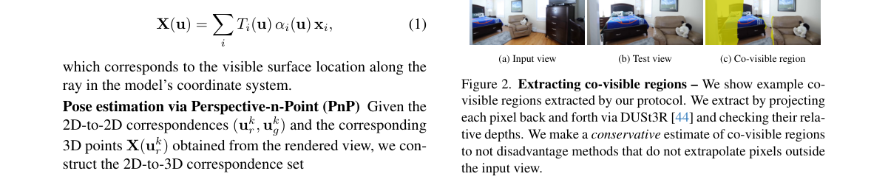

**Why this ranks #5**: 它指出单视图新视角合成的排行榜长期被坐标对齐误差污染：一旦按传统 2D 匹配做正确对齐，显式 3D Gaussian 方法反而成了 SOTA。

---

### 6. V-CAPE: Visual Consistency Assessment for Product Image Editing

**arXiv**: [2610.38611](https://arxiv.org/abs/2610.38611) | **Score**: 7.3 (relevance 7.5 x 0.7 + quality 7.0 x 0.3) | **Tags**: AIGC-visual, autoqa, visual-consistency, product-image, failure-mode, vlm-evaluation, Amazon | **Categories**: cs.CV | **Pages**: 26

**Authors**: Iaroslav Melekhov; Roberto Alcover Couso; Francesco Taioli; Daniel Coelho; Artur Bekasov; Virginia Fernandez Arguedas; Jose Miguel Grande Saiz

**Affiliation**: Amazon

**Abstract**

> Recent advances in generative image editing enable complex transformations such as background replacement, object manipulation, and pose adjustment from natural language instructions. However, verifying that these transformations preserve visual consistency, defined as the preservation of an object's intrinsic visual attributes, including geometry, texture, color, and fine-grained details, remains a largely unsolved problem. This challenge is particularly pronounced at scale, where manual inspection is infeasible and automated quality assessment (AutoQA) could become essential. In this work, we introduce Visual Consistency Assessment for Product Image Editing (V-CAPE), a large-scale dataset for evaluating visual consistency in generative image editing. The dataset consists of 40K unique source-target product image pairs, each annotated with binary accept/reject labels and structured failure modes capturing fine-grained inconsistencies such as geometric distortions, pose errors, and identity mismatches. V-CAPE combines real-world edited images with a synthetic subset constructed from 3D assets, enabling both realistic evaluation and controlled analysis. Vision-language models (VLMs) across all evaluated size categories on AutoQA achieve accuracy below 65%, indicating that the dataset poses a substantial challenge regardless of model scale. Our results highlight fundamental limitations of current models in verifying visual consistency under transformation, positioning V-CAPE as a benchmark for advancing fine-grained image editing evaluation.

**Key findings**

- **Finding**: 论文指出生成式图像编辑已能完成换背景、改物体、调姿态等复杂变换，但判断变换是否保持视觉一致性仍基本无解。
- **Finding**: 视觉一致性被定义为物体内在视觉属性的保持，包括几何、纹理、颜色与细粒度细节。
- **Finding**: V-CAPE 数据集包含 40K 对唯一的源图与目标图商品图对，每对都标注了二元的接受或拒绝标签。
- **Finding**: 标注还包含结构化失败模式，能刻画几何畸变、姿态错误、身份不匹配等细粒度不一致。
- **Finding**: 数据集把真实世界编辑图像与由 3D 资产构造的合成子集结合起来，既能贴近真实场景，也能做可控分析。
- **Finding**: 在 AutoQA 上，所有被评测规模的 vision-language model 准确率都低于 65%，说明这份数据集无论模型大小都是硬骨头。
- **Inference**: 把「主体有没有被保住」交给 VLM 自动打分在今天并不成立，编辑流水线上恐怕仍然离不开人工抽检。
- **Recommendation**: 推荐。做商品图编辑，或者需要给编辑模型配一套自动质检的读者建议读。

**Key figures**

*Framework - V-CAPE is a large-scale dataset for automated quality assessment in generative image editing, targeting fine-grained visual fidelity. The dataset combines real-world generative outputs (V-CA*

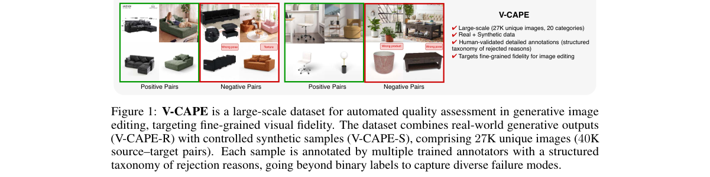

*Result - V-CAPE overview. Examples from the two complementary subsets: (a) real-world generative outputs reflecting practical artifacts, and (b) synthetic data with controlled transformations and pre*

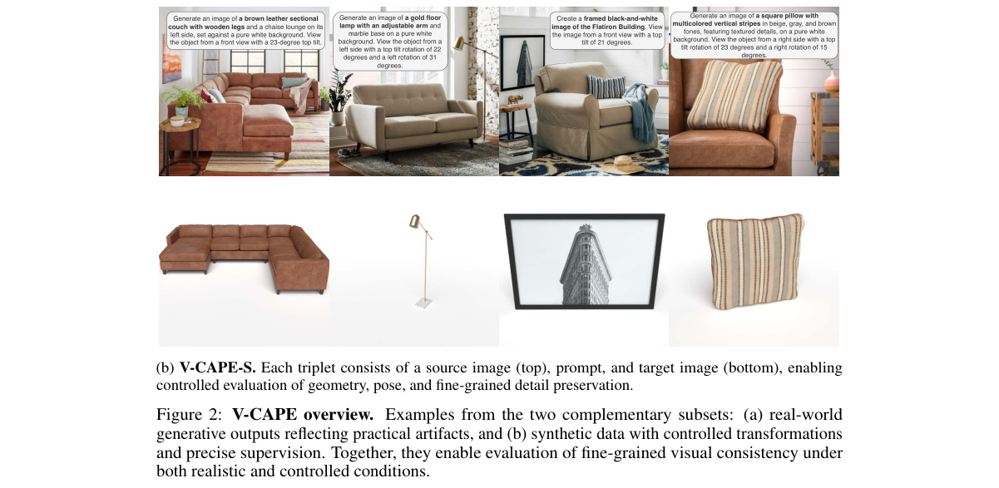

**Why this ranks #6**: 它把生成式图像编辑的质检做成可量化的基准：4 万对商品图带接受与拒绝标签及失败模式，而所有规模的 VLM 都做不过 65% 准确率。

---

### 7. 3DCodeEdit: Benchmarking Instruction-Guided 3D Program Editing

**arXiv**: [2610.38231](https://arxiv.org/abs/2610.38231) | **Score**: 7.0 (relevance 7.0 x 0.7 + quality 7.0 x 0.3) | **Tags**: AIGC-visual, 3d-code-generation, blender, instruction-editing, benchmark, multi-turn-feedback, New York | **Categories**: cs.CL, cs.CV, cs.GR | **Pages**: 29

**Authors**: Binjie Wang; Xinran Zhao; Shoubin Yu; Xiang Li; Silong Yong; Chenyang Yang; Tianyu Chen; Ruofei Du; He He; Chen Zhao; Tongshuang Wu

**Affiliation**: New York University; Carnegie Mellon University; The University of Texas at Austin; Google

**Abstract**

> Language models increasingly create 3D content through code, with practical workflows often relying on editing existing programs rather than regenerating them, for speed and precise control. Such edits require understanding what a program builds and foreseeing how a change reshapes it, yet prior benchmarks mostly evaluate generation or simple edits against a reference. In this paper, we introduce 3DCodeEdit, a benchmark of 2,592 instruction-guided editing tasks over 108 Blender programs that construct objects entirely in code. Its edits range from parameter to structural changes, style redesign, and scene composition, and are judged from renders against human-reviewed checklists. Across 17 models, the average success rate is only 37%, and even the strongest models complete fewer than 60% of structural and style edits. As models become more capable, their failures shift to geometric foresight, where the code runs but builds the wrong shape. We therefore study whether multi-turn feedback can compensate for this missing foresight. Feedback from a separate reviewer model that describes how the renders differ from the request helps most, more than maximum reasoning effort or an agent harness, and can let a 27B model surpass the single-shot rate of a 2.8T-parameter model.

**Key findings**

- **Finding**: 论文指出实际工作流往往靠修改已有程序而非重新生成，因为更快也更可控，这要求模型既懂程序建了什么、又能预见改动后形状如何变化。
- **Finding**: 3DCodeEdit 基准包含 2,592 个指令引导编辑任务，覆盖 108 个完全用代码构建物体的 Blender 程序。
- **Finding**: 编辑类型从参数改动、结构调整一路到风格重设计与场景组合，判定方式是渲染结果对照人工审核的 checklist。
- **Finding**: 在 17 个模型上平均成功率只有 37%，即便是最强模型，结构类与风格类编辑的完成率也不到 60%。
- **Finding**: 随着模型变强，失败点转向几何预见力，即代码能跑，但建出来的形状是错的。
- **Finding**: 作者研究多轮反馈能否补上几何预见力的短板，描述渲染差异的独立 reviewer 模型帮助最大，强于加大 reasoning effort 或加 agent harness；27B 模型借此超过 2.8T 参数模型。
- **Inference**: 瓶颈已从「写得出代码」变成「想得到改完长什么样」，所以让模型回头看自己的渲染结果比单纯堆算力更划算。
- **Recommendation**: 推荐。做 code-based 3D 生成，或想评估大模型几何理解能力的读者建议读。

**Key figures**

*Framework - We introduce 3DCodeEdit, a benchmark for instruction-guided editing of 3D objects built in code. (a) Our task involves modifying an existing Blender program according to an edit instruction.*

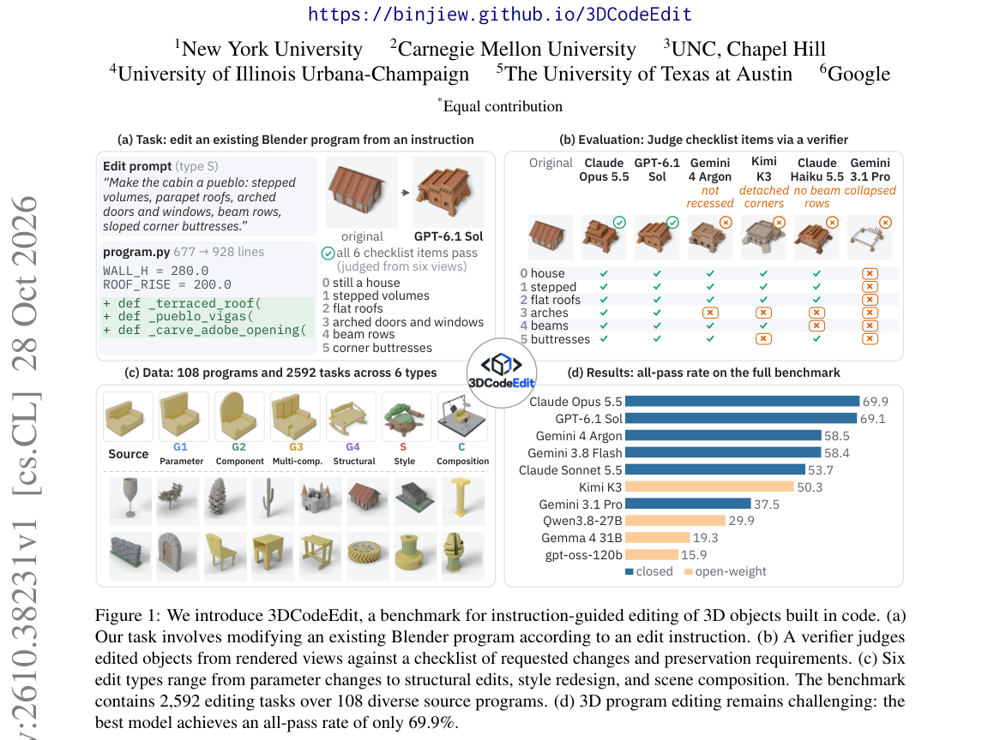

*Result - Construction of 3DCodeEdit. (1) A generator and an evaluator iteratively reconstruct OpenSCAD designs as editable Blender programs, preserving geometry while exposing parameters, parts, and*

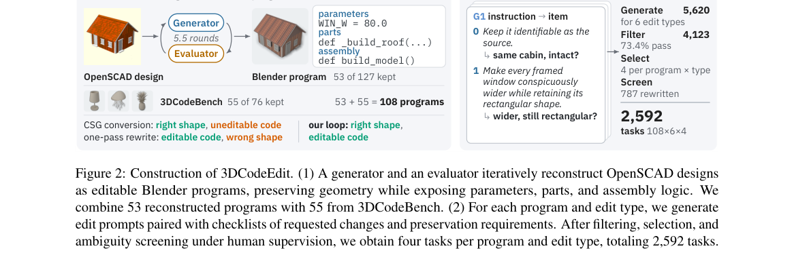

**Why this ranks #7**: 它把 3D 生成的评测从「能不能造出来」推进到「改得对不对」：17 个模型平均只有 37% 成功率，瓶颈已从写代码转向几何预见力。

---

### 8. StepControl: Long-Horizon Human Motion Generation from Foot-Contact Schedules

**arXiv**: [2610.38153](https://arxiv.org/abs/2610.38153) | **Score**: 7.0 (relevance 7.0 x 0.7 + quality 7.0 x 0.3) | **Tags**: AIGC-visual, human-motion, foot-contact, autoregressive-diffusion, event-conditioning, cross-attention, Seoul National | **Categories**: cs.CV | **Pages**: 15

**Authors**: Hojun Jang; Jinseok Bae; Donggeun Lim; Taesun Kim; Seungbin Jeong; Younghwan Lee; Yong Seok Kim; Young Min Kim

**Affiliation**: Seoul National University

**Abstract**

> Controllable human motion generation has largely focused on specifying what action should occur or where the body should move. We study a complementary question: can full-body motion be controlled by specifying only when each foot contacts the ground? We introduce StepControl, an autoregressive diffusion model conditioned on a future binary left/right foot-contact schedule, without requiring target root and body poses, or semantic prompts. StepControl represents contact as explicit temporal events and injects them through dedicated cross-attention with classifier-free guidance. We further introduce a stochastic mixture noise schedule and warmup strategy for stable long-horizon autoregressive generation. Experiments show that StepControl follows prescribed contact timing more accurately than adapting existing spatially guided motion generators to contact constraints. It maintains effective contact control over long continuous rollouts and responds to edited schedules such as cadence changes, stop-and-go pauses, limping gaits, and bilateral jumping. Our results show that minimal foot-contact schedules provide an effective and intuitive temporal interface for controllable motion generation.

**Key findings**

- **Finding**: 论文提出一个互补问题，即能否只指定每只脚何时触地就控制全身动作，而不必给出目标根节点与身体姿态，也不用语义 prompt。
- **Finding**: StepControl 是以未来的二值左右脚接触时间表为条件的自回归扩散模型。
- **Finding**: 接触被表示成显式的时间事件，并通过专用的 cross-attention 注入，配套 classifier-free guidance。
- **Finding**: 作者还提出 stochastic mixture noise schedule 与 warmup 策略，让长时间跨度的自回归生成保持稳定。
- **Finding**: 实验显示，StepControl 对指定接触时间的跟随比把既有空间引导动作生成器改造成接触约束更准。
- **Finding**: 它在长时间连续 rollout 中仍保持有效的接触控制，并能响应被编辑过的时间表，如节奏变化、停走交替、瘸步与双侧跳跃。
- **Inference**: 动作的可控性未必非得从姿态空间下手，从事件时间轴切入反而更自然，也让非专业用户更容易编辑。
- **Recommendation**: 推荐。做动作生成、需要精确节奏控制或角色动画合成的读者建议读。

**Key figures**

*Framework - StepControl generates full-body motion from foot- contact schedules without future foot positions or root trajectories. Beyond reproducing ordinary walking cadence, StepControl fol- lows aty*

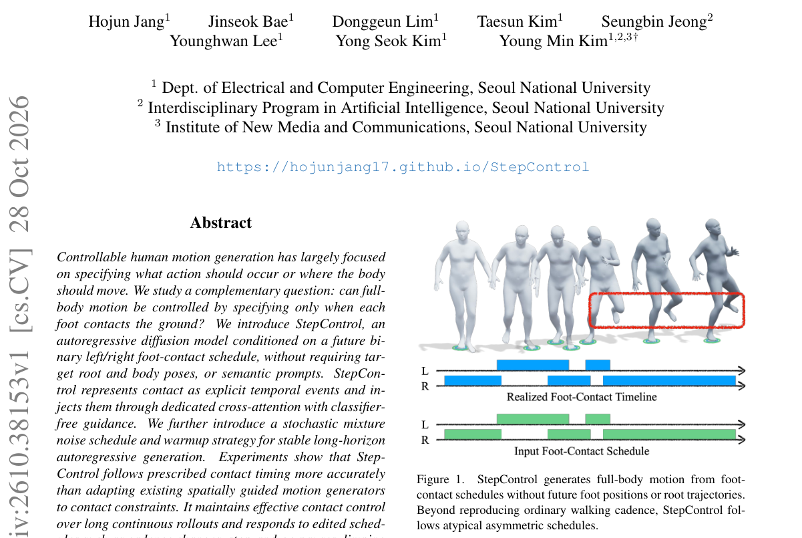

*Result - Overview of StepControl. (a) Motion tokens with per-frame diffusion levels and frame embeddings attend to event condition tokens via dedicated per-layer cross-attention, predicting clean mot*

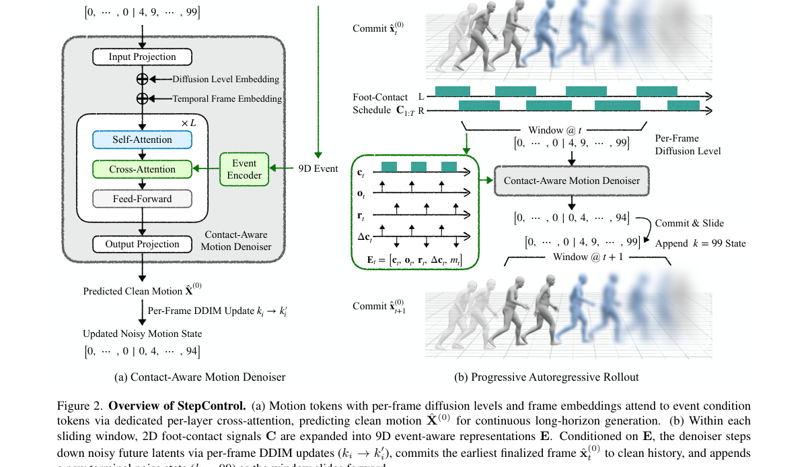

**Why this ranks #8**: 它把人体动作的可控维度压到极简：只给左右脚何时触地的二值时间表，就能定节奏、定停顿甚至定瘸步，其余全交给生成模型。

---

### 9. ETA-Motion: Efficient Topology-Agnostic Motion Diffusion via Sparse Joint Learning

**arXiv**: [2610.38259](https://arxiv.org/abs/2610.38259) | **Score**: 6.8 (relevance 7.0 x 0.7 + quality 6.5 x 0.3) | **Tags**: AIGC-visual, human-motion, topology-agnostic, sparse-joint, semantic-embedding, diffusion, KAIST | **Categories**: cs.CV | **Pages**: 14

**Authors**: Seoyoung Hwang; Tae-Kyun Kim

**Affiliation**: KAIST; Samsung Electronics

**Abstract**

> Topology-agnostic motion generation aims to synthesize motions for diverse characters with arbitrary skeletons. Unlike conventional motion generation, which assumes a fixed skeletal template, this setting must handle diverse joint configurations and inconsistent joint semantics across characters. Existing methods address this challenge through dense full-joint modeling, which incurs substantial computational cost and hinders learning transferable motion patterns across diverse skeletal topologies. We present ETA-Motion, a topology-agnostic motion generation framework based on sparse joint learning. Instead of learning motion from all joints, our method uses a compact subset of joints to reduce redundancy and trains the motion generator on the resulting sparse skeleton. To facilitate correspondence across diverse topologies, we introduce semantic joint embeddings that combine textual and visual cues, together with topology-aware training objectives for preserving skeletal structure. Although ETA-Motion is trained only on sparse skeletal observations, it supports full-skeleton motion generation during inference. Experimental results demonstrate that ETA-Motion outperforms existing topology-agnostic baselines while significantly improving efficiency and generalization to unseen motions and unseen topologies.

**Key findings**

- **Finding**: 论文指出 topology-agnostic 动作生成要为多样角色合成动作，必须处理多样的关节配置与跨角色不一致的关节语义，固定骨架模板的常规设定做不到这点。
- **Finding**: 现有做法依赖稠密的全身关节建模，计算开销大，也妨碍在不同骨架拓扑之间学习可迁移的动作模式。
- **Finding**: ETA-Motion 转而使用紧凑的关节子集来减少冗余，并在由此得到的稀疏骨架上训练动作生成器。
- **Finding**: 为支撑跨拓扑的对应关系，作者引入结合文本与视觉线索的 semantic joint embeddings，并配以 topology-aware 训练目标来保持骨骼结构。
- **Finding**: 尽管只在稀疏骨骼观测上训练，模型在推理时仍支持生成完整骨架的动作。
- **Finding**: 实验结果显示 ETA-Motion 超过既有 topology-agnostic 基线，同时显著改善效率以及对未见动作与未见拓扑的泛化。
- **Inference**: 「少看几个关节反而学得更泛」这个思路，对付骨架差异时比堆全身关节更可能迁移到没见过的角色上。
- **Recommendation**: 推荐。做多角色动作生成、需要一套模型覆盖不同骨架的读者建议读。

**Key figures**

*Framework - ETA-Motion is trained only on sparse joint subsets, yet it can generate motions for full target skeletons at inference time.*

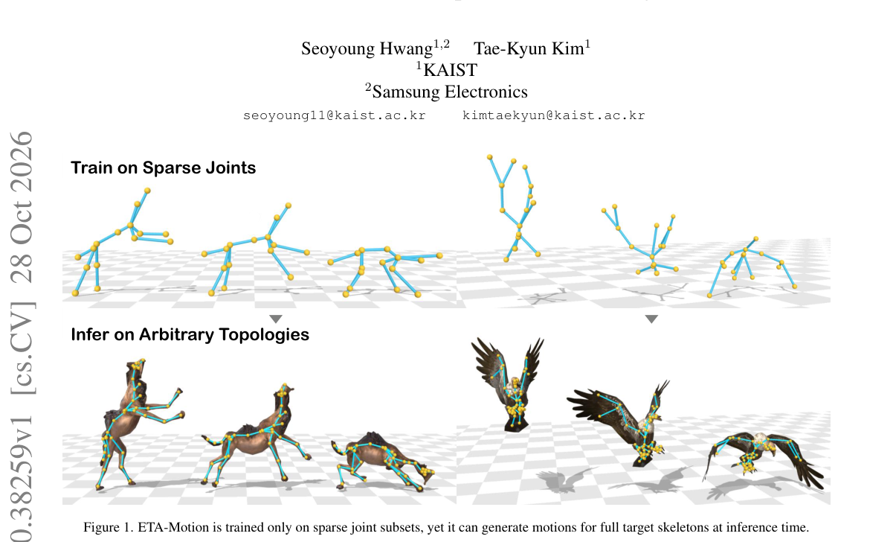

*Result - Overview of ETA-Motion. The model is trained on sparse joint subsets but generates motions for full target skeletons at inference time. To enable transferable motion generation across divers*

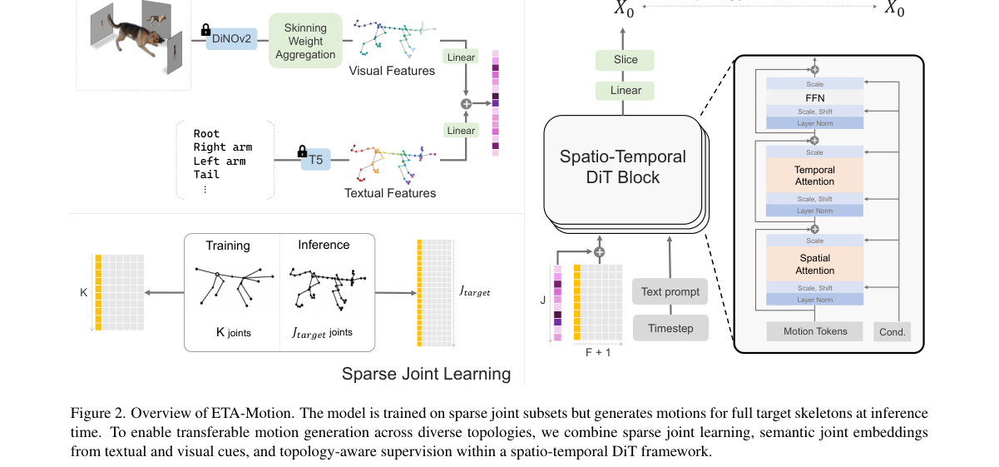

**Why this ranks #9**: 它反其道而行：不是为每种新骨架重训，而是只学一小撮关节，再靠语义关节嵌入把动作迁移到任意骨架。

---

### 10. MEV: A Multi-Event Video Dataset for Long-Take Generation

**arXiv**: [2610.38241](https://arxiv.org/abs/2610.38241) | **Score**: 6.7 (relevance 6.5 x 0.7 + quality 7.0 x 0.3) | **Tags**: AIGC-visual, long-take-video, multi-event, dataset, event-segmentation, video-caption, Mohamed bin Zayed | **Categories**: cs.AI, cs.CV | **Pages**: 38

**Authors**: Peiyuan Zhu; Shaoan Xie; Yifan Shen; Wen Tian; Zijian Li; Guangyi Chen; Kun Zhang

**Affiliation**: Mohamed bin Zayed University of Artificial Intelligence; Carnegie Mellon University

**Abstract**

> Current datasets for text-to-video generation are largely limited to short clips depicting a single event or coarse-grained captions. As a result, they provide limited supervision for modeling long-take temporal dependencies, often leading to temporally inconsistent generations when describing multiple events. In this paper, we introduce MEV, a multi-event video dataset designed for long-take video generation. MEV provides high-quality real-world videos where subjects can perform a sequence of distinct, non-overlapping events, featuring precise temporal boundaries and fine-grained procedural annotations. This event-centric discretization reduces confounding factors and enables models to support temporally localized conditioning and build long-take videos from atomic event units. Furthermore, we introduce a comprehensive annotation pipeline that segments videos into temporally grounded events, and generates structured captions at both the global level and the event level. In addition, under an event-centric evaluation protocol, we conduct multi-event generation experiments by fine-tuning on MEV with temporally grounded event conditioning, leading to improved long-take event transitions and more coherent content. We believe this work provides a publicly available resource for multi-event fine-tuning and event-centric evaluation, together with practical insights into learning from temporally structured video-text data.

**Key findings**

- **Finding**: 论文指出当前 text-to-video 数据集大多是短片段、单个事件与粗粒度 caption，对长镜头的时序依赖几乎没有监督信号。
- **Finding**: 缺乏这种监督会让模型在描述多个事件时产生时序不一致的生成结果。
- **Finding**: MEV 提供高质量真实视频，主体可依次完成一串互不重叠的区分性事件，带精确时间边界与细粒度程序性标注。
- **Finding**: 这种 event-centric 离散化减少了混淆因素，让模型支持时间局部化条件，并能用原子事件单元拼装长镜头视频。
- **Finding**: 作者给出完整标注流程，把视频切成时间锚定的事件，并同时生成全局层级与事件层级的结构化 caption。
- **Finding**: 在 event-centric 评测协议下，团队用带时间锚定事件条件的微调做了多事件生成实验，长镜头的事件过渡与内容连贯性都有改善。
- **Inference**: 把「事件」当作视频的中间表示，比让模型端到端生成长镜头更可控，也更容易在出错时定位到底是哪一步崩的。
- **Recommendation**: 推荐。做长镜头视频生成，或者需要事件级视频数据的读者建议读。

**Key figures**

*Framework - Examples of multi-event narratives in the MEV dataset. MEV contains high-quality long-take videos segmented into events with precise start/end timestamps and fine-grained procedural descript*

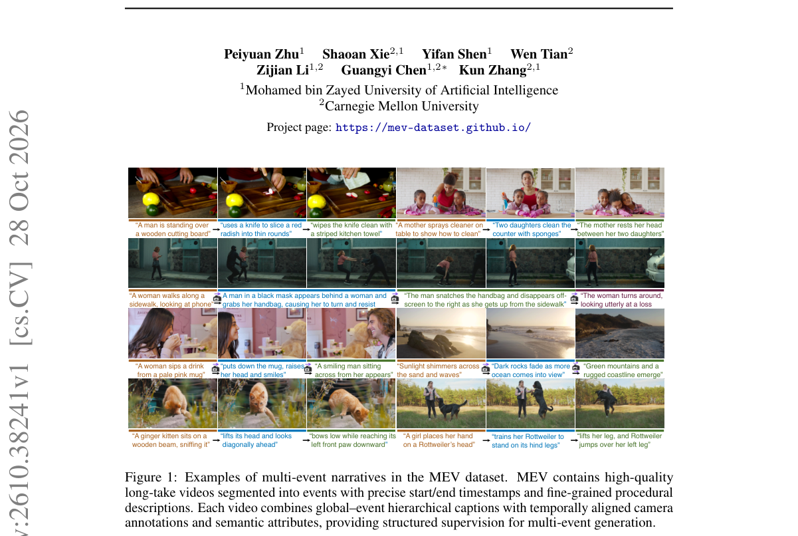

*Result - Comprehensive annotation scheme of the MEV dataset. MEV provides video-level captions at multiple granularities (short/middle/long), complemented by a structured set of global fields (e.g.,*

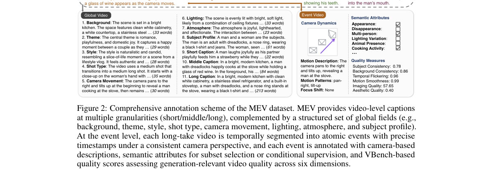

**Why this ranks #10**: 它瞄准长视频生成最大的数据缺口：把视频切成带精确时间边界的事件单元，让模型能按事件拼装长镜头而不是一次性生成。

---

## Footer

- Total papers scanned across all 7 tracks: 336（原始 446 条）
- aigc_visual track final top-10: 10
- Wild-cards in this track: 0
- Figure assets: 2026-10-29/res/

Generated by `mine-arxiv-daily-digest` skill. Sister file: `2026-10-29_aigc_visual_entry.md`.
