# ArXiv Daily Digest - 2026-10-29 (音频与语音语言模型, 10 papers)

**Generated**: 2026-10-31 17:30 CST

**Source**: arXiv cs.CV, cs.SD, eess.AS, cs.CL, cs.AI, cs.RO, cs.LG submissions, listing day 2026-10-28 (announced 2026-10-29 00:00 UTC)

**Batch window**: 2026-10-27T18:00:00Z .. 2026-10-28T18:00:00Z（arXiv 公告批次横跨两个 UTC 日：前一日 18:00 UTC 起算，当日 17:59:59 UTC 截止）

**Track**: audio_lm (top 10 of 336 papers scanned, 70 full reads)

**Scope**: 语音 / 音频语言模型、流式语音交互、说话人建模、多语种与低资源语音

⚠️ **Wild-card**: 本批该线 4 篇为 wild-card 补足，已在正文逐条标注并给出理由。

补足原因：该批次真正属于「音频 / 语音语言模型与双工语音交互」的论文只有 6 篇，其余 4 篇为语音数据集、对话安全与人因交互方向的补位，已在正文逐条标注并给出理由。

---

## Top 10 - 音频与语音语言模型

### 1. Beyond Aggregate WER: In-domain Adaptation, Learner Speech, Code-Switching, and Speaker Attribution in Online Spanish Learning Classrooms

**arXiv**: [2610.38016](https://arxiv.org/abs/2610.38016) | **Score**: 8.0 (relevance 8.0 x 0.7 + quality 8.0 x 0.3) | **Tags**: audio-lm, asr-adaptation, lora, code-switching, diarization, classroom-speech, Arizona State | **Categories**: cs.CL | **Pages**: 15

**Authors**: Olga Kellert; Samhitha Harish; Johnatan E Bonilla; Nemika Tyagi; Phanos Kareen; Nelvin Licona-Guevara

**Affiliation**: Arizona State University; Freie Universität Berlin

**Abstract**

> Automatic speech recognition (ASR) increasingly supplies transcripts for educational NLP, but aggregate word error rate (WER) can conceal errors concentrated in learner speech, multilingual turns, and speaker attribution. We compare platform-integrated, open-weight, adapted, and commercial ASR configurations on held-out sessions of online L2 Spanish interaction between L1 English learners and their instructors and tutors. Because English is the learner's shared first language, the interactions contain Spanish-only, English-only, and code-switched turns. Evaluation combines overall WER and character error rate (CER), WER disaggregated by speaker role and language context, and diarization error rate (DER). We also adapt Whisper large-v3 and MOSS-Transcribe-Diarize with LoRA using human-corrected in-domain classroom data. MOSS adaptation produced consistent improvements across speaker roles and language contexts, whereas Whisper showed smaller gains. Domain match proved more important than data volume: Larger out-of-domain bilingual and learner corpora did not outperform the smaller classroom corpus, where learner speech and code-switching are embedded in instructor--learner interaction. The open-weight MOSS adapter was competitive with commercial Muse Voice Transcribe on WER and CER and achieved lower system-provided DER on the recordings eligible for each system. Learner, English-only, and code-switched speech remained more difficult than instructor and Spanish-only speech. The findings demonstrate the value of condition-aware evaluation and interactionally matched data for bilingual educational ASR.

**Key findings**

- **Finding**: 论文指出聚合 WER 会掩盖集中在学习者语音、多语轮次与说话人归属上的错误，因此把评测按说话人角色与语言上下文拆开，并同时报告 DER。
- **Finding**: 比较对象包括平台集成、开放权重、适配与商业四类 ASR 配置，语料是在线 L2 西班牙语课程的留出会话，含学习者、教师与助教三类角色，因为英语是共同母语，会话里还有纯英语与语码转换轮次。
- **Finding**: 作者用 LoRA 在人工校正的域内课堂数据上适配 Whisper large-v3 与 MOSS-Transcribe-Diarize，配方由五折交叉验证固定，六个系统在七个留出会话上打分。
- **Finding**: MOSS 的适配在各说话人角色与语言上下文上都有稳定提升，Whisper 的增益较小。
- **Finding**: 域匹配比数据量更重要，更大的域外双语与学习者语料并未优于规模更小的课堂语料。
- **Finding**: 开放权重的 MOSS 适配器在 WER 与 CER 上与商业 Muse Voice Transcribe 相当，并在各自适用的录音上取得更低的系统给出的 DER。
- **Inference**: 对在线课堂与多语社交这类场景，聚合分数会系统性掩盖真正的问题，必须按角色和语言上下文分别看。
- **Recommendation**: 推荐读。做多语 ASR 评测、教育语音或需要 diarization 口径的读者可直接复用它的条件感知评测拆分方式。

**Key figures**

*Framework - Study pipeline. Whisper and MOSS are adapted with LoRA on 38 human-corrected Zoom sessions, with the recipe fixed by five-fold cross-validation. Six systems are scored on seven held-out sess*

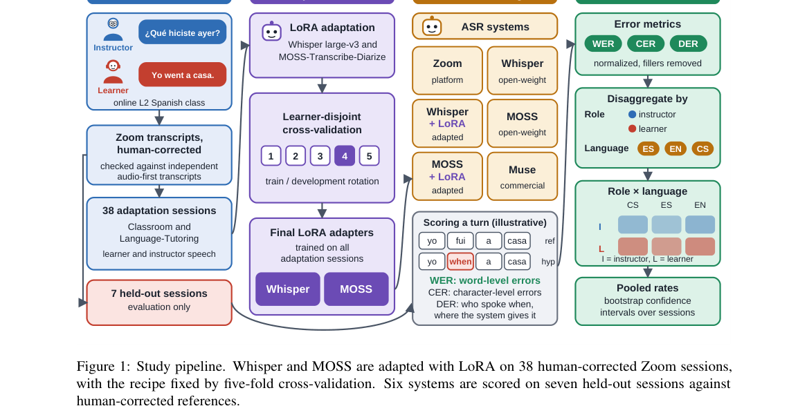

**Why this ranks #1**: 把聚合 WER 拆成角色与语言上下文的分解视图，并证明域内小数据比域外大数据更管用。

---

### 2. Do Audio LLMs HEAR Pain? Tracing Acoustic Evidence from Speech to Language Reasoning

**arXiv**: [2610.38570](https://arxiv.org/abs/2610.38570) | **Score**: 8.0 (relevance 8.0 x 0.7 + quality 8.0 x 0.3) | **Tags**: audio-lm, audio-llm, paralinguistic-cues, layer-wise-probing, pain-perception, prompt-injection, Microsoft | **Categories**: cs.AI, cs.CL, cs.SD | **Pages**: 26

**Authors**: Wenqi Li; Xiangjue Dong; Sulaiman Vesal

**Affiliation**: Microsoft

**Abstract**

> Large audio language models (LALMs) can process speech directly, but it remains unclear how well they use the non-lexical acoustic information that speech carries. We study this question through pain, using TAME-Pain, which contains pain-neutral Harvard sentences and spoken pain ratings recorded at different self-reported pain levels. We introduce HEAR, a four-stage diagnostic framework that traces pain-related information from the speech signal to the model's prediction, and apply it to seven closed-source and open-weight LALMs. On the Harvard sentences, where pain can only be inferred from the voice, all models perform at chance level, and same-speaker references or few-shot examples improve balanced accuracy by no more than six points. On the spoken ratings, the same models reach 87.5-99.7% balanced accuracy. Layer-wise probing of open-weight LALMs shows that pain can be decoded from early audio representations (74.1% balanced accuracy for binary prediction and 45.0% for three-class severity), but that this information, along with most pain-associated acoustic cues, decreases in deeper layers. In an acoustic perception test, weaker models cannot distinguish even large changes in these cues, whereas stronger models can but still fail to infer pain. Finally, we recover pain-related acoustic cues and directly reinject them as structured text into the prompt, which improves pairwise pain prediction by up to 32 points. These results indicate that current LALMs encode paralinguistic information in early layers that is largely unavailable when the model produces its answer.

**Key findings**

- **Finding**: 论文用疼痛作为切面研究大型音频语言模型能否利用语音中的非词汇声学信息，数据基于 TAME-Pain，含疼痛中性的 Harvard 句子与不同自述疼痛等级下的口述评分。
- **Finding**: 作者提出 HEAR 四阶段诊断框架，沿语音信号到模型预测的链路定位疼痛相关信息，并应用于七个闭源与开放权重的音频大模型。
- **Finding**: 在疼痛只能从声音推断的 Harvard 句子子集上，所有模型都处于随机水平，同说话人参考与 few-shot 示例最多只把 balanced accuracy 提升六个点。
- **Finding**: 在口述评分上，同一批模型达到 87.5% 到 99.7% 的 balanced accuracy，而对开放权重模型的逐层 probing 显示疼痛可从早期音频表征中解码，二分类 74.1%、三分类严重度 45.0%。
- **Finding**: 但这些信息与大部分疼痛相关声学线索在深层递减，声学感知测试中较弱模型连线索的明显变化都分辨不出，较强模型能分辨却仍推断不出疼痛。
- **Finding**: 恢复出的疼痛相关声学线索被改写成结构化文本重新注入 prompt，使成对疼痛预测最多提升 32 点。
- **Inference**: 说明音频大模型的副语言表征不是没学到，而是没有被通路带到答案里，改进空间可能在中间层读出而非预训练规模。
- **Recommendation**: 推荐读。做音频大模型评测、情感或健康语音分析的读者建议精读其分层 probing 与线索回注实验。

**Key figures**

*Framework - LALMs recognize pain when it is stated in words, but fail when it must be inferred from the voice. Examples from TAME-Pain (Dao et al., 2025), recorded during a pain-inducing cold pressor ta*

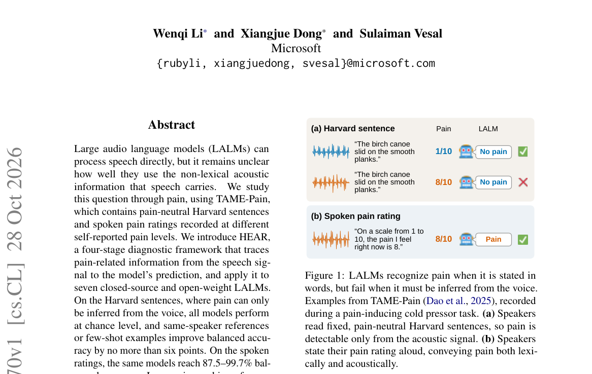

*Result - Overview of our HEAR analysis framework. (RQ1): we compare seven LALMs’ pain prediction under the neutral-sentence and spoken-rating settings. (RQ2): we identify pain-associated acoustic cue*

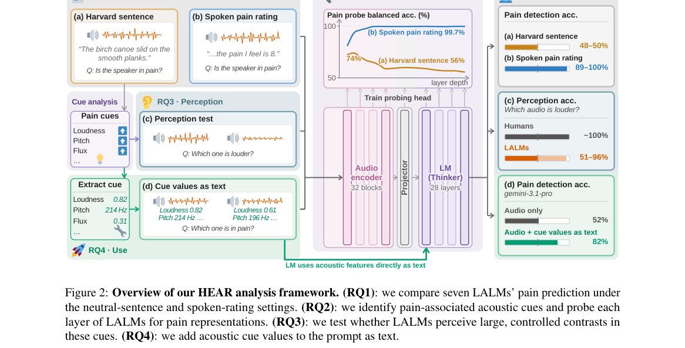

**Why this ranks #2**: 证明当前音频大模型在浅层编码了副语言线索，却在生成答案时几乎用不上。

---

### 3. Depth through Recurrence: Towards Ultra-Efficient On-Device ASR

**arXiv**: [2610.37833](https://arxiv.org/abs/2610.37833) | **Score**: 7.8 (relevance 8.0 x 0.7 + quality 7.5 x 0.3) | **Tags**: audio-lm, on-device-asr, weight-sharing, knowledge-distillation, moe-lora, cka-analysis, Qualcomm AI Research | **Categories**: cs.LG | **Pages**: 22

**Authors**: Chen Feng; Tianyi Xu; Ramchalam Kinattinkara Ramakrishnan; Yicheng Lin; Shaojie Zhuo; Zhaocong Yuan; Chenzheng Su; Xiaopeng Zhang

**Affiliation**: Qualcomm AI Research; McGill University

**Abstract**

> Modern automatic speech recognition (ASR) systems have achieved remarkable accuracy by scaling model depth and capacity, but at the cost of increased memory, energy, and computational demands. On edge devices where ASR is often most needed, such as watches and glasses, deploying such large models is infeasible due to extremely constrained resources. This raises a fundamental question: can we achieve high representational power in deep ASR models without scaling up parameterization? In this work, we revisit the role of depth and identify layer wise representational dynamics, in which most layers learn functionally similar transformations. Motivated by this insight, we propose a block-recurrent ASR architecture that replaces parameterized depth with a small set of recurrent blocks, each consisting of weight-shared layers, thereby preserving effective depth while drastically reducing model size. Through representation-guided grouping and knowledge distillation, block-recurrent models retain the accuracy of large reference models while using an order of magnitude fewer parameters. Across Open ASR Leaderboard benchmarks, a model with only two shared blocks recovers 97.4% of the accuracy of large models on average. The compact backbone further enables efficient on-device personalization through lightweight MoE-LoRA adaptation, allowing user-specific models to match or surpass the accuracy of general-purpose ASR systems with significantly lower inference cost. By reusing weights across recurrent steps, the proposed architecture reduces memory-access overhead and inference energy consumption. Together, these results show that high quality ASR can be achieved without large parameterization, and that structured recurrence provides a principled path towards ultra-compressed, energy-efficient, and personalized speech recognition on the edge.

**Key findings**

- **Finding**: 论文先追问能否在不堆参数的前提下拿到深度模型的表征能力，并指出大规模 ASR 模型的多数层学到的是功能上相似的变换。
- **Finding**: 作者据此提出 block-recurrent ASR 架构，用少量循环块取代参数化深度，每块由权重共享的层构成，保留有效深度同时大幅缩小模型。
- **Finding**: 借助表征引导的分组与知识蒸馏，block-recurrent 模型在参数量少一个数量级的情况下保住了大参考模型的精度。
- **Finding**: 在 Open ASR Leaderboard 基准上，仅用两个共享块的模型平均恢复了大型模型 97.4% 的准确率。
- **Finding**: 紧凑骨干进一步支持轻量 MoE-LoRA 适配做端侧个性化，用户专属模型可持平甚至超过通用 ASR 系统，而推理开销显著更低。
- **Finding**: 跨循环步复用权重同时降低了显存访问开销与推理能耗，这对功耗受限的端侧设备尤为关键。
- **Inference**: 这条路线对手表、眼镜等端侧场景的现实意义大于对榜单的意义，它把深度从参数预算换成了时间预算。
- **Recommendation**: 推荐读。做端侧语音识别、模型压缩或需要个性化 ASR 的读者，值得看它的 CKA 分组与蒸馏配方。

**Key figures**

*Framework - Overview of the proposed block-recurrent ASR framework. A large-scale ASR composed of L encoder blocks is analyzed using CKA to identify representational similar layers. Guided by this analy*

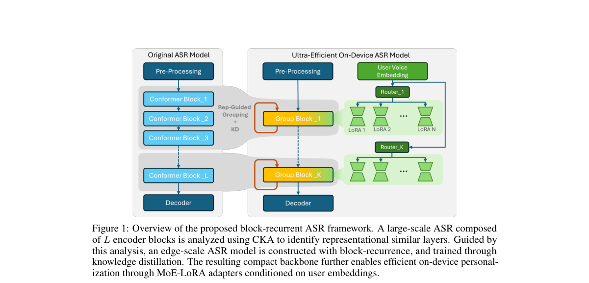

*Result - Layer-wise CKA similarity for STT-480ms, Parakeet-TDT-0.6B-v2, Canary-1B-Flash, and Granite-4.0-1B-Speech encoder models.*

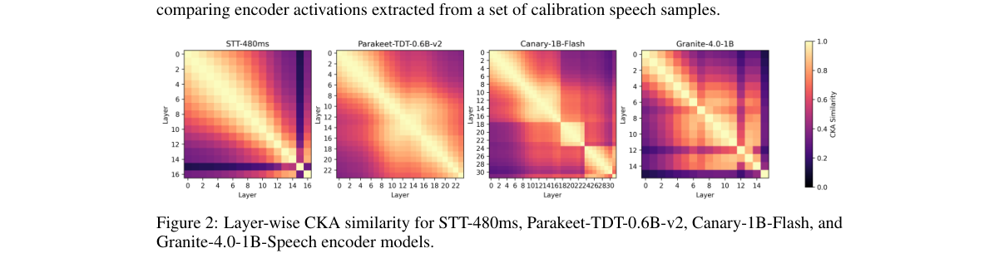

**Why this ranks #3**: 用相邻层表征高度相似这一观察把深度换成循环复用，参数少一个数量级而精度几乎不掉。

---

### 4. "It Would Make a Geordie Feel at Home": Regional Accent Perceptions and Speech Accommodation in Voice AI

**arXiv**: [2610.38005](https://arxiv.org/abs/2610.38005) | **Score**: 7.1 (relevance 7.0 x 0.7 + quality 7.5 x 0.3) | **Tags**: audio-lm, sociolinguistics, accent-bias, voice-assistant, speech-accommodation, user-interview, Heinrich Heine | **Categories**: cs.AI, cs.CL, cs.HC | **Pages**: 50

**Authors**: Dana Serditova; Kevin Tang; Jochen Steffens

**Affiliation**: Heinrich Heine University Düsseldorf; University of Applied Sciences Düsseldorf; University of Regensburg

**Abstract**

> Automatic speech recognition (ASR) systems often perform less accurately for speakers of regional dialects, but less is known about how users respond to these limitations and how regional voices produced by voice assistants (VAs) are evaluated through a sociolinguistic lens. This study investigates these issues among speakers of Newcastle English (Geordies), examining both linguistic accommodation to voice technologies and perceptions of regional versus mainstream-accented VA voices. Participants interacted with a simulated VA that spoke either Newcastle English or Standard Southern British English (SSBE). They subsequently completed semi-structured interviews about their experiences with the experimental VA and voice technologies, language use, accent attitudes, and place orientation. The findings reveal a two-way process of sociolinguistic bias. The Geordie VA was associated with familiarity, warmth, personality, and local belonging, but also with concerns about professionalism and authority, whereas the SSBE voice was perceived as more neutral, clear, and credible. Participants also reported adapting their speech when voice technologies failed to recognise them, most commonly by shifting to a more mainstream accent, enunciating more clearly, and speaking more slowly. These strategies are similar to accommodation in human-human interaction and reflect users' perceptions of what technologies can recognise, also known as perceived intelligibility pressures. Overall, the findings demonstrate that voice technologies can reproduce existing accent biases both by encouraging users to suppress regional features and by activating established social stereotypes through synthetic voices. The study positions sociolinguistics as a bridge between understanding human-AI interaction and designing inclusive technologies around users' own linguistic priorities.

**Key findings**

- **Finding**: 论文关注两件事，ASR 对地域方言说话人识别更差之后用户如何反应，以及语音助手发出的地域口音该如何被评价。
- **Finding**: 研究对象是纽卡斯尔英语使用者，参与者与一个模拟语音助手交互，助手分别说 Newcastle English 与标准南英英语 SSBE。
- **Finding**: 之后进行的半结构化访谈覆盖实验体验、语言使用、口音态度与地方认同。
- **Finding**: 结果呈现双向的社会语言学偏置，Geordie 音色带来熟悉、温暖、个性与本地归属感，同时引发对专业性与权威性的担忧，SSBE 音色则被认为更中性、更清晰、更可信。
- **Finding**: 参与者报告说，当语音技术识别不出自己时会主动调整说话方式，最常见的是转向更主流的口音、把发音咬得更清楚、放慢语速。
- **Finding**: 这些策略与人类之间的语言适应相似，体现出用户对技术能听懂什么的感知压力。
- **Inference**: 把语音助手的口音设计当成产品变量而不是中性默认值，是这篇比评测论文更实际的价值。
- **Recommendation**: 推荐读。做 voice assistant 产品、口音公平或社会语言学交叉的读者值得读，尤其是打算上线方言音色的团队。

**Key figures**

*Framework - An illustration of the Wizard-of-Oz Setup. Left (a,b): participant, Right (c,d): wizard*

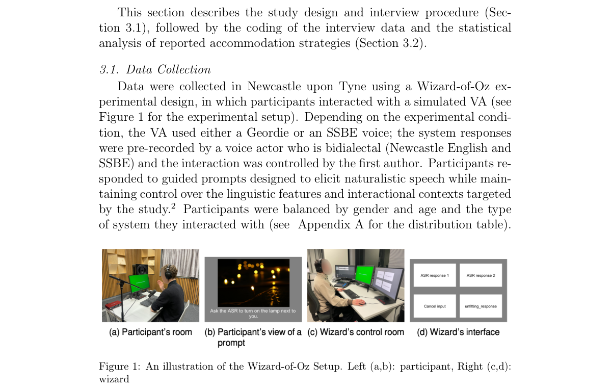

**Why this ranks #4**: 用地域口音的 voice assistant 做半结构化访谈，指出语音交互里的偏置是双向发生的。

---

### 5. MixCards: Evaluating Structured Descriptions of Multi-Source Sound Scenes

**arXiv**: [2610.38276](https://arxiv.org/abs/2610.38276) | **Score**: 7.1 (relevance 7.0 x 0.7 + quality 7.5 x 0.3) | **Tags**: audio-lm, audio-captioning, polyphonic-audio, structured-description, benchmark, sound-source-localization, New Jersey | **Categories**: cs.SD, eess.AS | **Pages**: 48

**Authors**: Sripathi Sridhar; Yujin Kim; Giovana Morais; Liang-Yuan Wu; Mehmet Atilay Kucukoglu; Prem Seetharaman; Lloyd May; Mark Cartwright; Magdalena Fuentes

**Affiliation**: New Jersey Institute of Technology; New York University; Adobe Research; Monash University

**Abstract**

> Audio captioning benchmarks typically evaluate a single unstructured free-text description of an audio scene, providing limited insight into how a model fails to understand polyphonic audio. A plausible caption may omit a source, or conflate multiple sources into one, or assign an attribute of one source to another, and conventional captioning evaluation cannot locate these errors. We introduce MixCardBench, a benchmark for structured captioning of polyphonic audio, which evaluates models in two stages: first, identifying and temporally localizing the sources in a scene, and second, generating a structured MixCard describing the semantic, temporal, and acoustic properties of each source. The benchmark contains 4884 ecologically plausible synthetic soundscapes with up to nine overlapping speech, music and sound effects sources built from high-quality recordings and source-level annotations, where each source has a reference MixCard. We evaluate six state-of-the-art large audio language models and find substantial limitations in current models, which struggle considerably with speech and sound effects timing and detection, with the strongest model reaching only around 60% mean card-field score. Performance varies significantly across attributes, exposing capability differences that are hidden by aggregate caption scores. We assess the quality and ecological validity of MixCardBench through human validation, distribution matching and a listening study, and show that human corrections have little effect on model rankings, and our synthesized soundscapes are closer to in-the-wild YouTube videos than source guided but otherwise random synthesis. The benchmark dataset and code are publicly available, and demo examples are at https://mixcards-anon.github.io/mixcards-demo/

**Key findings**

- **Finding**: 论文指出音频 captioning 基准通常只评一条无结构自由文本，难以看出模型在复音音频上如何失败，漏掉声源、把多个声源混成一个、或把一个声源的属性安到另一个头上。
- **Finding**: MixCardBench 分两阶段评测，先识别并定位场景中的声源，再为每个声源生成描述语义、时间与声学属性的结构化 MixCard。
- **Finding**: 基准含 4884 个生态上合理的合成声景，最多九个重叠的语音、音乐与音效源，全部由高质量录音与源级标注构建，每个源都配有参考 MixCard。
- **Finding**: 评测六个最先进的大型音频语言模型，模型在语音与音效的时间定位和检测上吃力，最强模型的平均卡片字段分也只有约 60%。
- **Finding**: 性能在不同属性上差异显著，暴露了被聚合 caption 分数掩盖的能力落差。
- **Finding**: 作者用人工校验、分布匹配与听测实验评估基准质量与生态有效性，显示人工修正对模型排序影响很小，合成声景比按源挑选但随机拼接更接近真实 YouTube 视频。
- **Inference**: 结构化卡片把说得像不像换成说得对不对，这类评测改造通常比再训一个更大的 captioner 更有信息量。
- **Recommendation**: 推荐读。做音频描述、复音理解或评测设计的读者可直接用 MixCardBench 复现一轮。

**Key figures**

*Framework - We propose MixCardBench, a benchmark for multi-source structured captioning where a model detects sound sources and generates a structured description per source (i.e. MixCard). We depict an*

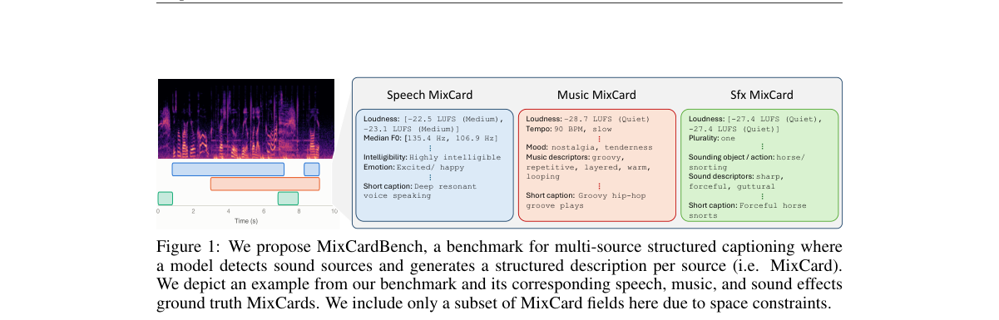

*Result - Our pipeline used to generate open, high-quality, ecologically-valid soundscapes contain- ing speech, music, and sound effects sources. We use SAM Audio for source separation. We use Vevo-Ti*

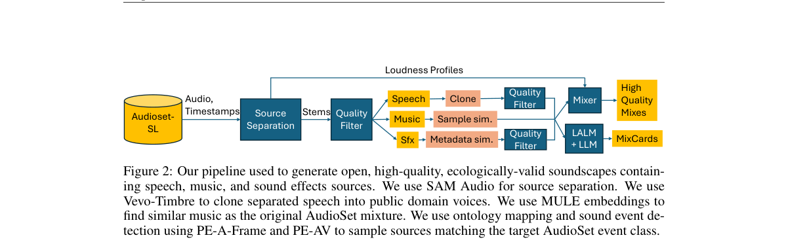

**Why this ranks #5**: 把自由文本 caption 拆成逐源的结构化卡片，让漏源、混源、张冠李戴这类错误第一次可定位。

---

### 6. Improving the Dependency on Fine-Tuning Data in Transfer Learning for Speech Emotion Recognition

**arXiv**: [2610.38050](https://arxiv.org/abs/2610.38050) | **Score**: 6.5 (relevance 6.5 x 0.7 + quality 6.5 x 0.3) | **Tags**: audio-lm, speech-emotion-recognition, transfer-learning, feature-compensation, autoencoder, domain-mismatch, University of Chile | **Categories**: eess.AS | **Pages**: 8

**Authors**: Ricardo García; Rodrigo Mahu; Carlos Busso; Néstor Becerra Yoma

**Affiliation**: University of Chile; Carnegie Mellon University

**Abstract**

> Compensating for train-test mismatches in acoustic environments is important for deployable speech solutions. This paper proposes to reduce the amount of fine-tuning data needed in transfer learning to mitigate the train-test mismatch by using a compensation mechanism based on the feature maximum likelihood linear regression (fMLLR) algorithm. Our scheme incorporates an autoencoder to reduce the number of trainable parameters. Operating on the encoder latent space, our compensation strategy employs an affine linear transform that accounts for rotations and shifts in the feature space. We evaluate the proposed solution in a speech emotion recognition (SER) task within a realistic human-robot interaction scenario. The results show that the proposed architecture outperforms the original scheme without the compensation strategy. We observe a performance gain in the mean concordance correlation coefficient (CCC) of 16.8% using 12.9% of the training set, and 14.4% using 50% of the training set.

**Key findings**

- **Finding**: 论文关注声学环境造成的训练测试错配，提出用 fMLLR 构造的补偿机制减少迁移学习所需的微调数据量。
- **Finding**: 该方案引入 autoencoder 以压低可训练参数量，使补偿机制本身不必引入大量额外参数。
- **Finding**: 补偿策略作用在 encoder latent space 上，用一个仿射线性变换刻画特征空间中的旋转与平移。
- **Finding**: 评测设定为真实人机交互场景下的语音情感识别任务，强调训练与测试环境不一致时的鲁棒性。
- **Finding**: 结果显示，加入补偿后的架构整体优于不含补偿策略的原方案，只用 12.9% 的训练集即取得平均 CCC 16.8% 的提升，用 50% 训练集时提升 14.4%。
- **Inference**: 这是把经典信号处理统计量塞进神经前端的一次务实复用，价值在于用少量标注换掉大规模重训，而非提出新模型结构。
- **Recommendation**: 选读。做情感识别、少样本迁移或需要在 encoder 后接通道补偿的读者可看，做生成或大模型的读者可略过。

**Key figures**

*Framework - Proposed architecture. The fMLLR framework is incorporated between the CNN and transformer layers.*

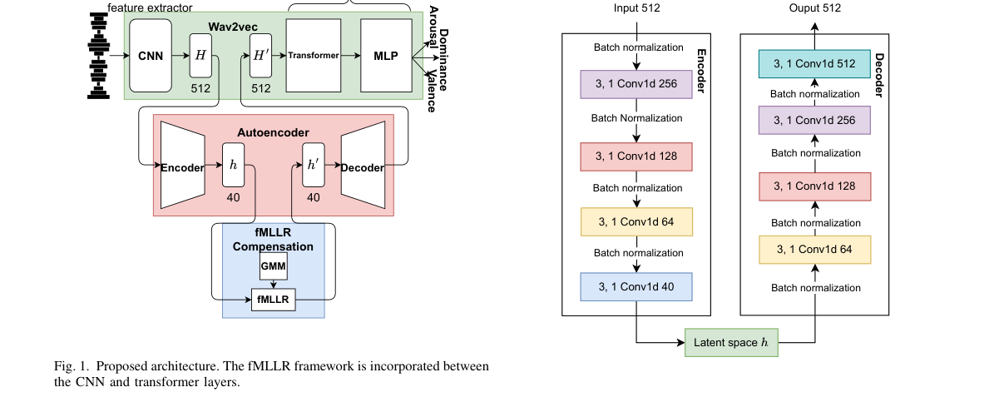

*Result - Autoencoder architecture to obtain the latent space h.*

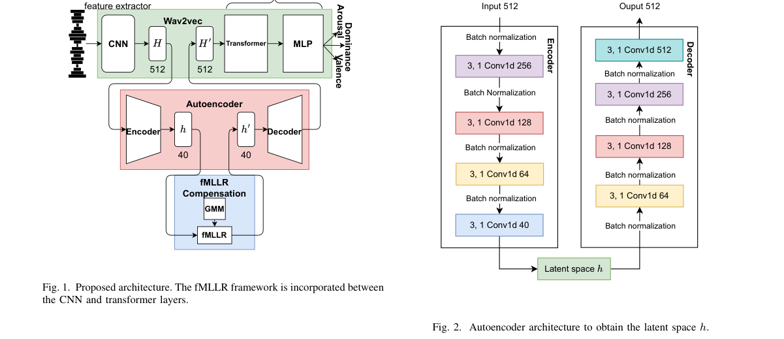

**Why this ranks #6**: 把经典 fMLLR 塞进 encoder latent space，用少量微调数据补上训练与测试之间的声学环境错配。

---

### 7. QMUL_AK at AISA-ArabicFC: Schema-Constrained Function Calling with ALLaM

**arXiv**: [2610.37995](https://arxiv.org/abs/2610.37995) | **Score**: 6.1 (relevance 6.0 x 0.7 + quality 6.5 x 0.3) | **Tags**: audio-lm, function-calling, arabic-dialect, lora, schema-constrained, shared-task, Queen Mary | **Categories**: cs.CL | **Pages**: 5

**Authors**: Ali Khairallah; Arkaitz Zubiaga

**Affiliation**: Queen Mary University of London

**Abstract**

> We describe the QMUL_AK submission to AISA-ArabicFC 2026. The system adapts the Arabic-English ALLaM-7B-Instruct model to function calling with low-rank adaptation (LoRA). It combines an Arabic schema-aware prompt, dialect and no-call resampling, a token-weighted training objective, and deterministic validation of generated calls against the candidate tool schema. The same output supports Track A function calling and Track B reasoning-augmented calling. Training uses only the official task data. On the development set, the system achieves 0.9982 function accuracy and 0.8920 argument exact match, corresponding to overall A and B scores of 0.9345 and 0.9454. On the blind test set, the system reaches overall A and B scores of 0.9253 and 0.9380, ranking 3rd on both submission tracks and 1st of 21 teams on the Track C dialect-robustness diagnostic with a macro-averaged score of 0.9075 and the smallest dialect gap in the shared task (0.077). The results show that function selection is nearly saturated, while argument extraction remains the main source of error.

**Key findings**

- **Finding**: 这是 QMUL_AK 参加 AISA-ArabicFC 2026 的系统报告，用 LoRA 把阿拉伯语-英语的 ALLaM-7B-Instruct 适配到 function calling。
- **Finding**: 系统组合了阿拉伯语 schema-aware prompt、方言与 no-call 重采样、token 加权训练目标，以及对生成的调用做确定性 schema 校验。
- **Finding**: 同一套输出同时支撑 Track A 的 function calling 与 Track B 的推理增强调用。
- **Finding**: 训练只使用官方任务数据，开发集上 function accuracy 为 0.9982、argument exact match 为 0.8920，总分 A 与 B 分别为 0.9345 与 0.9454。
- **Finding**: 盲测集上总分 A 与 B 为 0.9253 与 0.9380，两个赛道均排第 3。
- **Finding**: 在 Track C 方言鲁棒性诊断中，该系统以 0.9075 的宏平均分位列 21 队之首，方言间差距仅 0.077 为共享任务中最小，作者判断 function 选择已接近饱和而 argument 抽取才是主要误差来源。
- **Inference**: 它对语音语言模型的真正启示在多方言数据配比上，方言差距往往比总分更能区分方案。
- **Recommendation**: 选读。做阿拉伯语或多方言文本系统的读者可看其 schema 校验与重采样设计，只关心语音大模型的读者可略过。

**Key figures**

该论文正文未提取到可用图（图表为纯文本/表格排版）。

**Why this ranks #7**: wild-card 补位：这是纯文本的阿拉伯语 function calling 参赛系统，与语音语言模型的连接仅在于方言鲁棒性。  [wild-card=yes] 阿拉伯语 ALLaM 的函数调用系统（评测含方言鲁棒性诊断），主体是文本工具调用，语音/方言维度有限，补位计入。

---

### 8. Implicit Minor Detection from Multi-Turn Dialogue in High-Risk AI Interactions: A Constrained Self-Evolving LLM Harness

**arXiv**: [2610.38546](https://arxiv.org/abs/2610.38546) | **Score**: 5.8 (relevance 5.5 x 0.7 + quality 6.5 x 0.3) | **Tags**: audio-lm, multi-turn-dialogue, weak-identity, speaker-binding, constrained-inference, safety-guardrail, Beijing | **Categories**: cs.CL | **Pages**: 13

**Authors**: Xiaohan Zhang; Ying Zhao; Ruilin Guo; Xuanyuan Yu; Kaibo Huang; Yukun Wei; Zhongliang Yang; Linna Zhou

**Affiliation**: Beijing University of Posts and Telecommunications

**Abstract**

> In high-risk text interactions, a system may need to estimate whether the current speaker is likely to be a minor before applying age-conditioned safeguards. Many text-based dialogue systems lack strong identity signals such as account information, verified identity, facial data, or device data, and must rely on weak cues that emerge across multiple turns. We formulate implicit minor detection under weak identity information as a high-risk user-attribute inference task and propose a constrained framework comprising a large language model, a Harness, and a Maker-Checker protocol. The framework controls when inference is invoked, requires structured dialogue-linked evidence, and subjects validation-selected Harness revisions to version-level review. On a controlled Chinese benchmark comprising 8,328 multi-turn dialogues, our method improves average precision and minor-class F1 by 7.60 and 6.37 percentage points, respectively, over direct inference using the same LLM family.

**Key findings**

- **Finding**: 论文指出高风险交互中系统可能需要在施加按年龄分级的保护措施前，先判断当前说话人是否为未成年人。
- **Finding**: 多数文本对话系统缺乏账号信息、实名认证、人脸或设备等强身份信号，只能依赖跨多轮浮现的弱线索。
- **Finding**: 作者把弱身份条件下的隐式未成年人检测形式化为高风险用户属性推断任务。
- **Finding**: 提出的框架由一个 LLM、一个 Harness 与一套 Maker-Checker 协议构成，负责控制何时触发推断、要求结构化的对话关联证据，并对经校验筛选的 Harness 修改做版本级审查。
- **Finding**: 在包含 8328 段多轮对话的中文受控基准上，相对同族模型的直接推断，平均精确率与未成年人类 F1 分别提升 7.60 与 6.37 个百分点。
- **Finding**: 论文另指出，触发器演化还使触发环节的 F1 提升了 7.23 个百分点。
- **Inference**: 语音场景里同样的弱身份问题只会更难，因为声纹这类线索本身可被伪造，而文本线索至少能回溯到对话记录。
- **Recommendation**: 选读。做对话安全、身份推断或需要结构化证据链的读者值得看其 Harness 触发与校验设计，做语音生成的读者可略过。

**Key figures**

*Framework - Adjacent approaches leave a weak-identity gap. Platform age assurance depends on strong identity signals; static single-turn profiling loses cross-turn and speaker- binding context; content-*

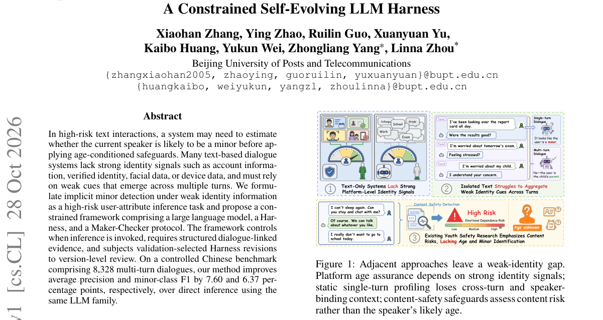

*Result - Overview of the constrained implicit-minor-detection framework. Runtime inference separates trigger routing, contex- tual support, structured evidence, and source-constrained decisions. Duri*

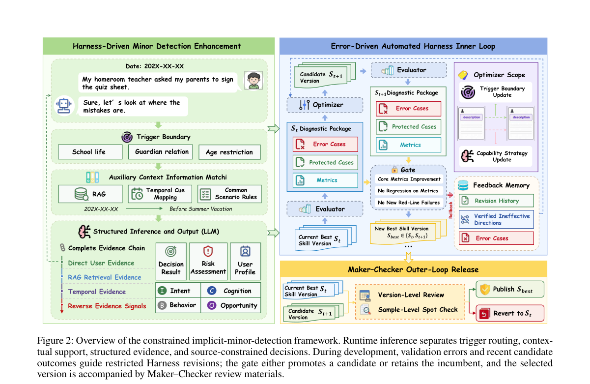

**Why this ranks #8**: wild-card 补位：它是纯文本的高风险对话任务，但核心难题跨轮次绑定说话人身份与口语对话的说话人归属同构。  [wild-card=yes] 多轮对话中的未成年人隐式识别框架，是对话安全 harness（文本对话为主），属语音助手安全的邻接方向，补位计入。

---

### 9. Effects of Deep Learning Architecture and Pretraining on Automated Vocal Fold Segmentation in Ex Vivo High-Speed Phonation Images

**arXiv**: [2610.37860](https://arxiv.org/abs/2610.37860) | **Score**: 5.6 (relevance 5.5 x 0.7 + quality 6.0 x 0.3) | **Tags**: audio-lm, vocal-fold-segmentation, image-pretraining, boundary-fidelity, high-speed-imaging, medical-imaging, University of Cincinnati | **Categories**: cs.CV, eess.IV, physics.flu-dyn | **Pages**: 37

**Authors**: Varun Vinayak Kalaiarasan; Charles Farbos de Luzan; Khalid Malik; Ephraim Gutmark; Liran Oren

**Affiliation**: University of Cincinnati

**Abstract**

> Two-dimensional (2D) intraglottal particle image velocimetry (PIV) of ex vivo phonation experiments quantifies vocal fold medial surface dynamics and the intraglottal flow field. However, it relies on manual segmentation because residual glare, low tissue-to-flow contrast, and tracer-particle speckle obscure the vocal fold boundaries. This study assessed how deep learning architecture and ImageNet pretraining affect automated vocal fold segmentation in these high-speed images. Four established architectures from three categories were benchmarked: the convolutional neural network (CNN)-based UNet and UNet++, the hybrid CNN-transformer-based TransUNet, and the pure transformer-based Swin-UNet, the latter two trained from scratch and from ImageNet-pretrained weights. Using 16,344 expert-annotated images from 227 phonation trials of excised canine larynges, the six pipelines were trained with five seeds under a standardized protocol and compared on 50 held-out test trials using trial-level Wilcoxon signed-rank tests with Holm correction. Mean Dice similarity coefficient (DSC) spanned only 0.9734 to 0.9764, so the pipelines differed mainly in boundary fidelity. Pretraining significantly improved the boundary F1 score (BF1) and 95th percentile Hausdorff distance (HD95) of the TransUNet and Swin-UNet, about four times more for the Swin-UNet. Once pretrained, the two performed similarly, although the Swin-UNet has only about a quarter of the trainable parameters. Without pretraining, the TransUNet had a significantly higher BF1 and a lower HD95 than both CNN-based pipelines and about half their share of images with HD95 > 50 pixels. To our knowledge, this is the first study to apply deep learning to vocal fold segmentation in 2D intraglottal PIV, and it offers a reference framework for segmenting experimental flow-visualization images with noisy optical conditions or highly deformable objects.

**Key findings**

- **Finding**: 论文称这是首个把深度学习用于二维喉内粒子图像测速声带分割的研究，而该技术可量化声带中面运动与喉内流场，此前依赖人工分割，因残余眩光、组织与流体对比度低、示踪粒子散斑都会遮住声带边界。
- **Finding**: 论文比较三类共四种架构，基于 CNN 的 UNet 与 UNet++、CNN-Transformer 混合的 TransUNet，以及纯 Transformer 的 Swin-UNet。
- **Finding**: 数据来自 227 次离体犬喉发声试验的 16344 张专家标注图像，六条流水线各以五个随机种子训练，在 50 次留出试验上做 Wilcoxon 检验加 Holm 校正。
- **Finding**: 平均 Dice 系数只在 0.9734 到 0.9764 之间，流水线差异主要体现在边界保真度，预训练显著提升了 TransUNet 与 Swin-UNet 的边界 F1 与 95 百分位 Hausdorff 距离。
- **Finding**: Swin-UNet 改善幅度约是 TransUNet 的四倍，预训练后两者接近且其可训练参数量只有约四分之一，不预训练时 TransUNet 的边界 F1 与 HD95 优于两条 CNN 流水线。
- **Finding**: 不预训练时 HD95 超过 50 像素的图像比例上，TransUNet 约只有两条 CNN 流水线的一半。
- **Inference**: 它落在音频线上的意义只在于声带这一发声源头的成像，与语音语言模型的建模方式没有交集。
- **Recommendation**: 选读。做医学图像分割或需要处理强噪声、高形变目标的读者可参考其评测协议，语音方向的读者可略过。

**Key figures**

*Framework - Methodology for evaluating semantic segmentation architectures for vocal fold delineation from two-dimensional (2D) intraglottal particle image velocimetry (PIV) high-speed images. Step (1) p*

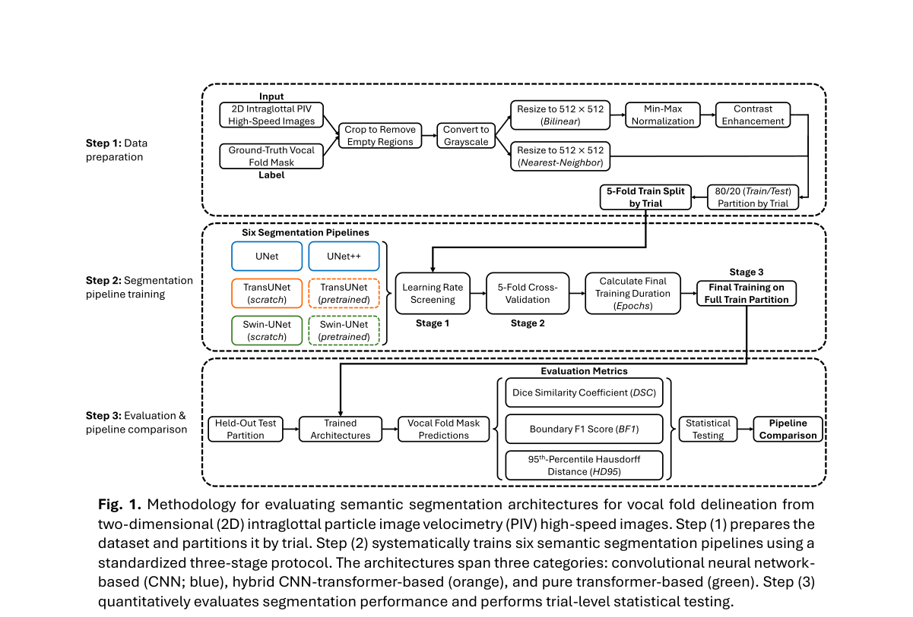

*Result - Ex vivo two-dimensional (2D) intraglottal particle image velocimetry (PIV) experimental setup and representative image-mask pair. (A) Schematic of the experimental setup. (B) Representative h*

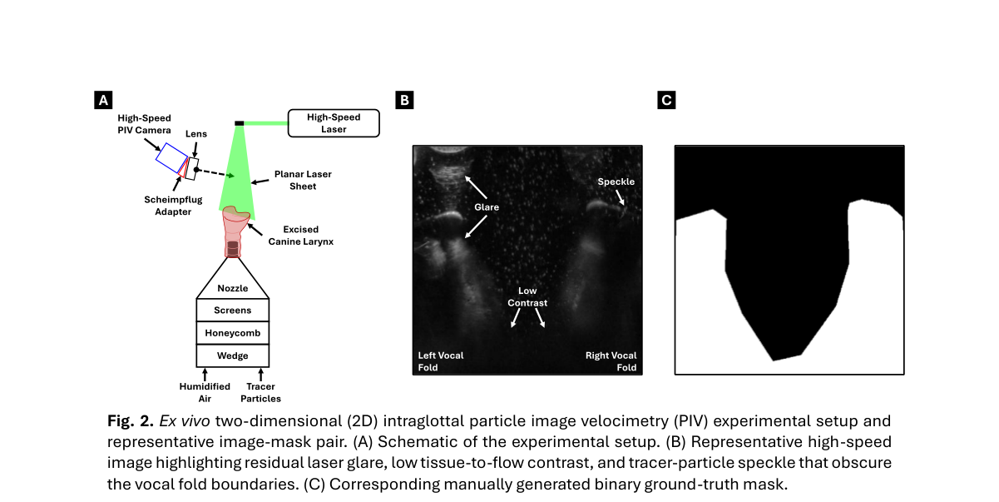

**Why this ranks #9**: wild-card 补位：它是一篇医学影像分割研究，与语音语言模型无关，只因借了声带发声的场景而进入这条线。  [wild-card=yes] 离体高速成像下的声带分割，属发声生理的视觉分割研究而非语音模型，补位计入。

---

### 10. The Artificial Personality Model: Theory, Implementation, Measurement and Experimental Validation in Conversational Agents

**arXiv**: [2610.38608](https://arxiv.org/abs/2610.38608) | **Score**: 5.6 (relevance 5.5 x 0.7 + quality 6.0 x 0.3) | **Tags**: audio-lm, conversational-agents, artificial-personality, questionnaire-design, social-presence, ux-evaluation, Karlsruhe | **Categories**: cs.AI, cs.HC | **Pages**: 56

**Authors**: Alexander Dregger; Barbarella Petz; Erik Kuhn; Pia Volk; Andreas Oberweis; Stefan Hillmann; Jannik Strötgen

**Affiliation**: Karlsruhe Institute of Technology; Humboldt-Universität zu Berlin

**Abstract**

> Artificial personality shapes user experience (UX) in human-machine interaction, yet coherent theoretical frameworks and validated measurement instruments remain limited. This paper refines and empirically evaluates the Artificial Personality Model (APM), a hybrid framework integrating human-centred and machine-specific personality dimensions. Across three experiments (N = 395), the model was operationalised and evaluated using the Artificial Personality Questionnaire (APQ). Factor analyses revealed that some human personality dimensions (e.g., agreeableness, conscientiousness) are partially transferable, whereas others (e.g., extraversion) did not emerge as distinct dimensions. Additional machine-specific dimensions were identified. The APQ provided encouraging initial psychometric evidence, while the human-centred BFI-2 showed poor reliability and an uninterpretable factor structure in Experiment 3. Experimental manipulations demonstrated significant effects of artificial personality on user satisfaction, continuous use intention, and social presence. The findings contribute an empirically refined framework and a novel instrument for measuring perceived artificial personality, offering practical guidance for designing conversational agents.

**Key findings**

- **Finding**: 论文指出人工人格会影响人机交互的用户体验，但成体系的人格框架与经验证的测量工具仍然有限。
- **Finding**: 作者改进并实证评估 Artificial Personality Model，这是一个融合以人为本维度与机器专属维度的混合框架。
- **Finding**: 在三个实验共 395 人的条件下，模型被操作化并用 Artificial Personality Questionnaire 评估。
- **Finding**: 因子分析显示部分人的人格维度如宜人性、尽责性可部分迁移，而外向性等另一些维度没有浮现为独立维度，研究还识别出额外的机器专属人格维度。
- **Finding**: APQ 给出了初步的心理测量学证据，而以人为本的 BFI-2 在第三个实验中表现出较差的信度与无法解释的因子结构。
- **Finding**: 实验操纵显示人工人格对用户满意度、持续使用意愿与社会临场感有显著影响。
- **Inference**: 对语音助手产品来说，它的可用之处在于提供了一份可复用的问卷与维度定义，而不是模型方法本身。
- **Recommendation**: 选读。做对话 agent 人格设定、UX 问卷或需要把社会临场感量化的读者可看，做语音建模的读者可略过。

**Key figures**

该论文正文未提取到可用图（图表为纯文本/表格排版）。

**Why this ranks #10**: wild-card 补位：它不是语音技术，而是给对话 agent 造人格的测量工具，落在本线是因为 conversational agent 的体验评估。  [wild-card=yes] 会话智能体的人工人格模型与量表，属对话交互的人因侧研究，补位计入。

---

## Footer

- Total papers scanned across all 7 tracks: 336（原始 446 条）
- audio_lm track final top-10: 10
- Wild-cards in this track: 4
- Figure assets: 2026-10-29/res/

Generated by `mine-arxiv-daily-digest` skill. Sister file: `2026-10-29_audio_lm_entry.md`.
