# ArXiv Daily Digest - 2026-10-29 (具身智能与世界模型, 10 papers)

**Generated**: 2026-10-31 17:30 CST

**Source**: arXiv cs.CV, cs.SD, eess.AS, cs.CL, cs.AI, cs.RO, cs.LG submissions, listing day 2026-10-28 (announced 2026-10-29 00:00 UTC)

**Batch window**: 2026-10-27T18:00:00Z .. 2026-10-28T18:00:00Z（arXiv 公告批次横跨两个 UTC 日：前一日 18:00 UTC 起算，当日 17:59:59 UTC 截止）

**Track**: embodied (top 10 of 336 papers scanned, 70 full reads)

**Scope**: 机器人操作与导航、视觉语言动作模型、世界模型、触觉感知与 sim-to-real

---

## Top 10 - 具身智能与世界模型

### 1. Embodied at Sea: Imitation Learning for Multi-Task Underwater Manipulation

**arXiv**: [2610.38199](https://arxiv.org/abs/2610.38199) | **Score**: 9.3 (relevance 9.5 x 0.7 + quality 9.0 x 0.3) | **Tags**: embodied, underwater-manipulation, vision-language-action, behavior-cloning, domain-shift, marine-robotics, New York | **Categories**: cs.LG, cs.RO | **Pages**: 8

**Authors**: Greta Perez-Haiek; Luca Macesanu; Kevin Angers; Mohammed Imam; Timothy Gambin; Christopher Clark

**Affiliation**: New York University; University of Malta

**Abstract**

> Behavior Cloning has demonstrated promising generalization capabilities for robotic manipulation in terrestrial environments. However, marine visual distortions and dynamic currents create a severe domain shift that remains a key bottleneck in adapting generalist architectures to underwater field manipulation. To address this, 1616 episodes of underwater manipulation data were collected in calm and turbulent waters and were used to train 14 generalist Vision-Language-Action (VLA) models (DynamicVLA) with varying proprioception observation configurations. Across three tasks on 1260 gradable on-hardware rollouts in a pool, 10 models outperformed the baseline, with the highest-performing model achieving a 93.3% overall success rate, including partial successes. Results are also introduced from a case study evaluating the performance of a single-task Action Chunking Transformer (ACT) and a generalist VLA (SmolVLA) policy for two tasks in marine archaeology and conservation: grasping and mooring. Experiments are performed on an ROV on and around the WWII wreck Coralita X127 and at Manoel Island Marina, Malta. Across 748 collected episodes and 508 gradable on-hardware rollouts, the ACT policy substantially outperformed SmolVLA (47.9% vs. 7.9% pooled success rate), earning a 66.7% success rate on the most successful task at the marine archaeological site. To enable further contributions to embodied intelligence in marine field robotics, the BLUEMBODIED KIT used to collect data, train models, and deploy policies on the ROV has been open sourced.

**Key findings**

- **Finding**: 论文在平静与湍流水域采集 1616 条水下操作数据，训练 14 个不同 proprioception 配置的 generalist VLA（DynamicVLA）。
- **Finding**: 三个任务、1260 次可评分的池中实机 rollout 里，10 个模型超过基线，最佳模型连同部分成功率达 93.3%。
- **Finding**: 作者在 WWII 沉船 Coralita X127 与马耳他 Manoel Island 码头做海洋考古与保育案例研究，共采集 748 回合、508 次可评分实机 rollout。
- **Finding**: 单任务 ACT 策略显著优于通用 SmolVLA，合并成功率为 47.9% 对 7.9%，在沉船现场最成功的任务上达到 66.7%。
- **Inference**: 领域偏移下专用 action chunking 策略反而赢过通用 VLA，说明通用性的红利要靠足够同域数据才兑现。
- **Inference**: SmolVLA 的 7.9% 更像是对零样本海洋泛化的警示，而不是调参不足。
- **Recommendation**: 推荐给做野外机器人与 VLA 的读者当作 domain shift 的负面实证，值得优先读。

**Key figures**

*Framework - Overview of Autonomous Underwater Mooring using Action Chunking Transformers (ACT). (Left) Training data collected across shipwreck and marina environments incorporating multi-modal observatio*

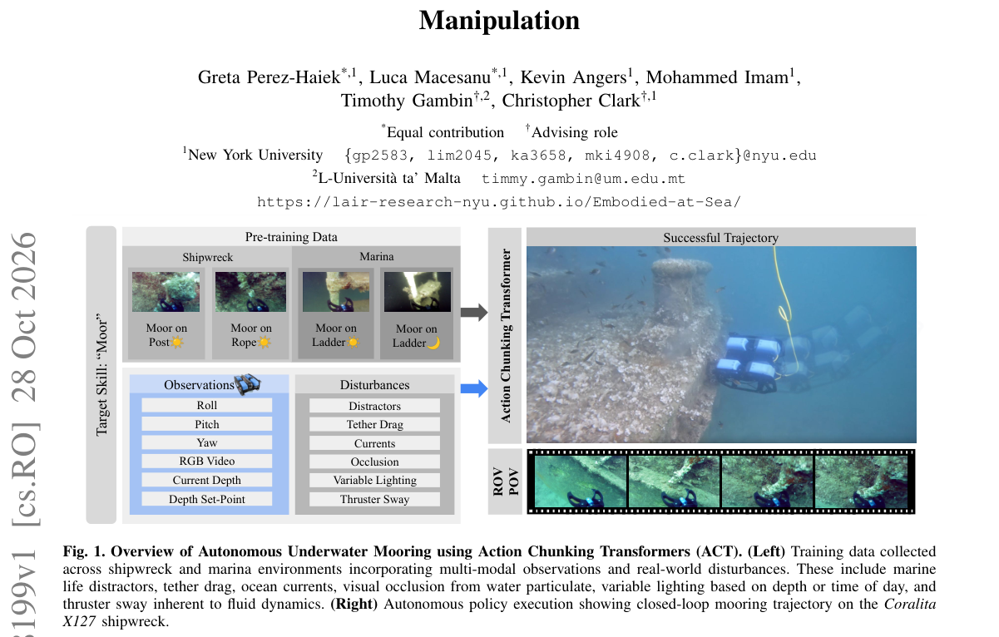

*Result - Pool Deployment: Experimental tasks evaluated in a controlled environment. Data collection in the Pool (Control Environment) was fully illuminated with a split (see Fig. 3) between calm and tu*

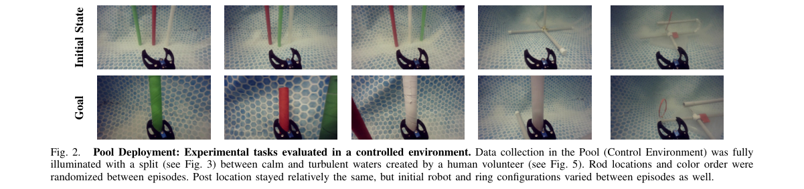

**Why this ranks #1**: 在真实海域采 1616 条数据训 14 个 generalist VLA，并报出 ACT 47.9% 对 SmolVLA 7.9% 的强硬对照，把通用大模型在极端 domain shift 下的失效摆到了台面上。

---

### 2. DexSuite: An All-in-One Framework for Dexterous Manipulation Across Arms, Hands, and Tasks

**arXiv**: [2610.37799](https://arxiv.org/abs/2610.37799) | **Score**: 9.2 (relevance 9.5 x 0.7 + quality 8.5 x 0.3) | **Tags**: embodied, dexterous-manipulation, simulation-framework, benchmark, teleoperation, tactile-sensing, Mila | **Categories**: cs.RO | **Pages**: 7

**Authors**: Anas Houssaini; Hugo He; Junming Shi; Amin Abyaneh; Ricardo Chahine; Shuo Wen; Mohamad H. Danesh; Charles-Étienne Fréchette; Mariana Sosa Guzman; Mathias Desrochers; Rayan Houssaini; Adam Landa

**Affiliation**: Mila; McGill University; Hugging Face; Kinova; Amazon FAR

**Abstract**

> Human-level dexterity remains a central open problem in robotics, yet few simulation frameworks cover the full workflow of dexterous manipulation, from setting up a robot to collecting dexterous demonstrations and evaluating policies. We present DexSuite, an all-in-one simulation framework for dexterous manipulation built on the Genesis simulator. DexSuite provides 30 tasks and assembles its 10 arms and 12 end-effectors, from parallel-jaw grippers to dexterous hands, into more than 100 single-arm robots and thousands of bimanual pairs. It also ships a standardized environment API, integrated teleoperation, and simulated tactile sensing. Moreover, we define a benchmark of 16 task-embodiment pairs spanning diverse contact complexities and horizons, and release a dataset of 4,700 successful episodes in simulation from human teleoperation, scripted experts, and learned policies. We release DexSuite as open source and hope others will build on it. Videos and datasets are available at https://dexsuiteorg.github.io

**Key findings**

- **Finding**: DexSuite 基于 Genesis 模拟器构建，提供 30 个任务，并把 10 条手臂与 12 种末端执行器组装成 100 多个单臂机器人与数千个双臂组合。
- **Finding**: 框架包含标准化环境 API、集成遥操作与模拟触觉感知，并定义了一个含 16 组 task-embodiment 对的基准。
- **Finding**: 作者开源发布 4700 条来自人工遥操作、脚本专家与学习策略的成功回合数据集。
- **Inference**: 把手臂、末端执行器与任务解耦成可配置项，意味着跨 embodiment 泛化评测第一次有了统一接口。
- **Inference**: 模拟触觉与脚本专家数据同框，说明它想同时承接 imitation learning 与触觉研究两类用户。
- **Recommendation**: 推荐。做灵巧操作、跨本体泛化或需要可复现基准的团队建议直接采用该框架。

**Key figures**

*Framework - DexSuite. An all-in-one simulation framework for dexterous manipulation, supporting diverse embodiments, GPU-parallel simulation, and cross- embodiment training and evaluation. It includes a b*

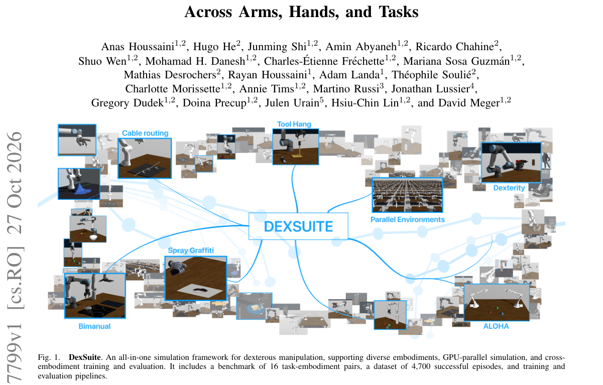

*Result - DexSuite architecture. Tasks define assets, reset logic, observations, actions, and success metrics. Robot embodiments and controllers are instantiated through a shared abstraction on top of G*

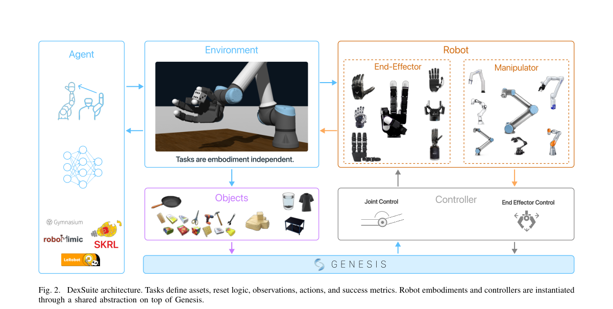

**Why this ranks #2**: 把灵巧操作从建机器人、采演示到评策略的全流程做成一个开源框架，一次给出 30 任务、100 多个单臂机型与 4700 条成功回合。

---

### 3. SaiVLA-JEPA: Evaluating Future Latent Prediction in JEPA-Conditioned VLA Control

**arXiv**: [2610.38508](https://arxiv.org/abs/2610.38508) | **Score**: 8.3 (relevance 8.5 x 0.7 + quality 8.0 x 0.3) | **Tags**: embodied, jepa, vla-policy, diffusion-flow-policy, latent-prediction, closed-loop-eval, Synthoid.ai (VLA Research Team) | **Categories**: cs.AI, cs.RO | **Pages**: 18

**Authors**: Rufeng Xiao; Ruihao Xiao; Wei Chen; Xinhai Sun

**Affiliation**: Synthoid.ai (VLA Research Team), Shanghai, China

**Abstract**

> Joint-embedding predictive architectures (JEPAs) learn to predict representations rather than pixels, offering a compact way to model how visual scenes evolve. We ask whether this predictive objective improves closed-loop control when a vision-language-action (VLA) policy already uses V-JEPA features. We call our JEPA-conditioned flow policy family SaiVLA-JEPA. It combines a vision-language model with a diffusion transformer action expert and receives features from a frozen V-JEPA encoder. Two lightweight auxiliary heads predict future representations during training and are omitted at inference, leaving the action sampler unchanged. We compare policies without JEPA features, with current JEPA conditioning, and with additional future supervision on 10,030 paired LIBERO-Plus episodes. Current JEPA conditioning reaches about 82.5% success versus 71.6% without JEPA, while future supervision provides no detectable aggregate gain at the evaluated training budget. We separately evaluate SaiVLA-JEPA-TCA, which adapts latent context, and SaiVLA-JEPA-TPA, which adapts selected parameters. The context-retry gain is a system-level result under a larger attempt budget; parameter adaptation shows no consistent advantage over the frozen policy and target controls. These results motivate assessing latent-prediction objectives through paired closed-loop rollouts rather than latent loss alone.

**Key findings**

- **Finding**: SaiVLA-JEPA 把视觉语言模型与 diffusion transformer 动作专家结合，动作特征来自冻结的 V-JEPA 编码器。
- **Finding**: 训练时用两个轻量辅助头预测未来表征，推理时把它们去掉，动作采样器完全不变。
- **Finding**: 在 10030 对 LIBERO-Plus 配对 episode 上，加入当前 JEPA 条件的成功率约 82.5%，不加则为 71.6%。
- **Finding**: 额外加入未来监督在所评估的训练预算下并没有带来任何可检测的总体增益。
- **Finding**: TCA 变体通过适配 latent context 取得收益，但该增益依赖更大的尝试预算；参数适配相对冻结策略与目标控制没有一致优势。
- **Inference**: 未来预测没带来收益，说明瓶颈不在表征预测能力本身，而在闭环数据分布与训练预算。
- **Recommendation**: 推荐做 VLA 表征研究的读者按配对闭环 rollout 的方法论来读，别只看 latent loss。

**Key figures**

*Framework - SaiVLA-JEPA architecture and its FutureJEPA training variant. Current images feed the frozen V- JEPA and VLM encoders; projected JEPA tokens join the native prefix and action tokens in the r*

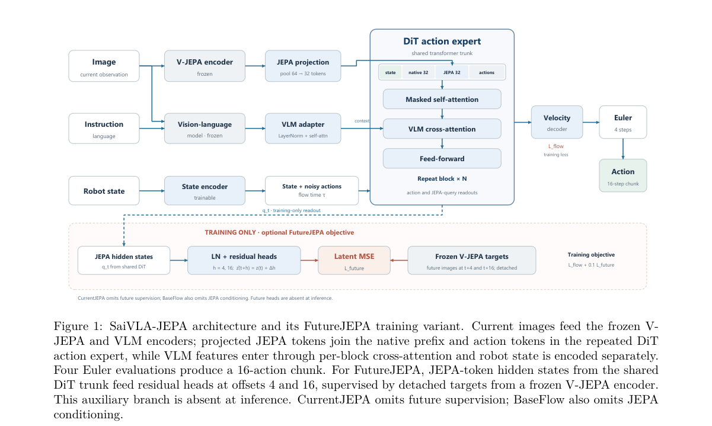

*Result - SaiVLA-JEPA-TCA context pathway. The frozen SaiVLA-JEPA policy applies the context adapter at each of four Euler evaluations using fixed e = [m; u]. After every executed four-action window,*

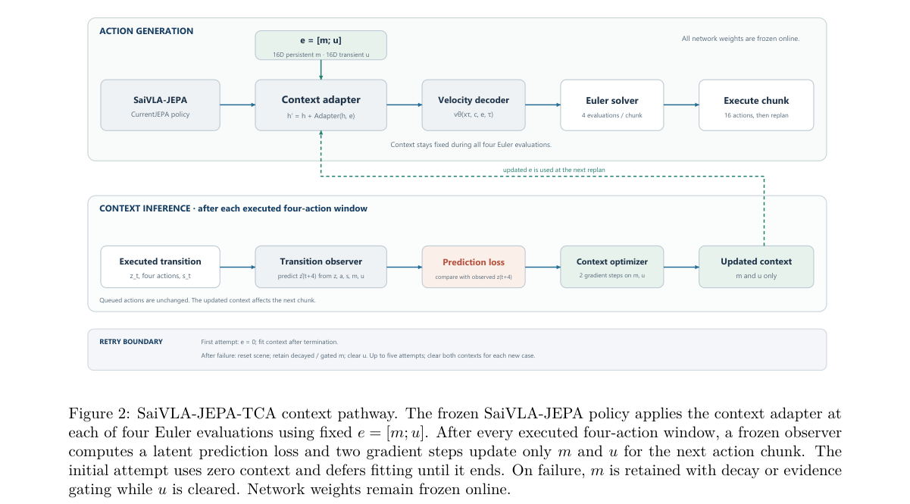

**Why this ranks #3**: 用 10030 对 LIBERO-Plus 配对闭环 rollout 把「未来潜变量预测有用」这句常见说法测成 82.5% 对 71.6% 的当前条件收益、未来监督零增益的清醒结论。

---

### 4. Recursive Self-Improvement in Physical AI: Mechanisms, Evidence, and Evaluation

**arXiv**: [2610.38266](https://arxiv.org/abs/2610.38266) | **Score**: 8.0 (relevance 8.0 x 0.7 + quality 8.0 x 0.3) | **Tags**: embodied, survey, recursive-self-improvement, world-model, curriculum-revision, evaluation-protocol, Institute of Automation | **Categories**: cs.RO | **Pages**: 33

**Authors**: Xiaofeng Han; Kaize Luo; Zenghuang Fu; Zichong Zhu; Zhe Feng; Changwei Wang; Rongtao Xu; Weiliang Meng; Xiaopeng Zhang

**Affiliation**: Institute of Automation, Chinese Academy of Sciences; University of Chinese Academy of Sciences; Southern University of Science and Technology

**Abstract**

> Embodied systems can update policies, world models, skills, and executable programs from deployment experience, allowing one interaction to benefit later tasks. When a system also revises and reuses its data-acquisition, feedback, or learning procedures, experience changes the process that produces capability, introducing recursive self-improvement. This paper surveys research in physical AI through the connection between persistent capability and its improvement process. We first explain the functional distinction between learner updates and improvers, then compare policy learning, imagined experience, memory and skill accumulation, and executable harnesses. These approaches connect to revisions of curricula, rewards, and research programs in different ways. Contact validity, recovery, retention, and resource costs determine whether the resulting gains accumulate during continued deployment. An L0-L3 rubric distinguishes task-local adaptation, persistent capability gain, inherited process revision, and verified improver gain. Representative benchmarks and within-study contrasts relate these distinctions to existing results. We further propose common-data and interactive comparisons that evaluate reference and revised improvers from shared learner starts, separating the use of experience from its acquisition. This perspective connects the diverse methods, physical operating conditions, and evaluation evidence, underpinning embodied RSI. A comprehensive list of studies in this survey is available at https://github.com/nkd-lkz/physical-ai-rsi-survey.

**Key findings**

- **Finding**: 论文区分 learner update 与 improver：前者只更新策略等产物，后者连数据采集、反馈或学习流程本身也会被修订。
- **Finding**: 综述横向比较了 policy learning、imagined experience、记忆与技能累积、可执行 harness 四条路线，以及课程、奖励与研究程序的修订方式。
- **Finding**: 作者提出 L0–L3 rubric，区分任务内适应、持久能力增益、继承的流程修订与已验证的 improver 增益。
- **Finding**: 论文建议用 common-data 与 interactive 比较，让参考实现与修订后的 improver 从同一 learner 起点出发，分离经验的使用与经验的获取。
- **Inference**: 把「过程是否被修订」当成核心变量，比只看最终性能更能区分真自我改进与单纯更多训练。
- **Inference**: contact validity、恢复、留存与资源成本四个维度决定了增益能否在持续部署中累积。
- **Recommendation**: 推荐。做具身智能自我改进或需要设计评测协议的研究者应优先读这篇综述。

**Key figures**

该论文正文未提取到可用图（图表为纯文本/表格排版）。

**Why this ranks #4**: 把「物理 AI 自我改进」从口号拆成 L0–L3 可判级差与对照评测协议，正好补上具身系统反复宣称自我改进却无统一尺度的空白。

---

### 5. FORGE: Feasible Online Reduced-Order Reference Generation and Whole-Body Execution for Agile Humanoid Locomotion

**arXiv**: [2610.37974](https://arxiv.org/abs/2610.37974) | **Score**: 7.8 (relevance 8.0 x 0.7 + quality 7.5 x 0.3) | **Tags**: embodied, humanoid-locomotion, reduced-order-model, whole-body-tracking, reference-generation, unitree-g1, California | **Categories**: cs.LG, cs.RO | **Pages**: 8

**Authors**: Adrian B. Ghansah; Yujin An; Jeeseop Kim; Soon-Jo Chung

**Affiliation**: California Institute of Technology

**Abstract**

> This paper presents a two-stage learning framework for versatile and agile humanoid locomotion that couples online reduced-order model (ROM) reference generation with whole-body tracking control. In the first stage, we train a command-conditioned whole-body reference generator using single rigid body dynamics combined with full humanoid kinematics. In the second stage, the frozen ROM policy is rolled out online to generate references for training a whole-body tracking policy on the full-order dynamics model. Learning a kino-dynamically consistent reference generator in the simplified ROM space enables us to generate references over a broad command space and over multiple locomotion strategies using a single unified framework. We demonstrate the approach on a Unitree G1 humanoid robot, achieving longitudinal velocities from -2.0 m/s to 2.8 m/s, lateral velocities up to +-1.0 m/s, angular velocities up to +-3.0 rad/s, one-legged hopping, and continuous transitions across the commands, all using one unified reference policy and one whole-body tracking policy.

**Key findings**

- **Finding**: 框架第一阶段用单刚体动力学加完整 humanoid 运动学，训练命令条件的全身体参考生成器。
- **Finding**: 第二阶段冻结 ROM 策略并在线 rollout 生成参考，用以在全阶动力学模型上训练全身体追踪策略。
- **Finding**: 在简化的 ROM 空间里学到动力学一致的参考生成器，使同一框架能覆盖宽命令空间与多种运动策略。
- **Finding**: 在 Unitree G1 上，纵向速度达 -2.0 至 2.8 m/s，横向速度最高 ±1.0 m/s，角速度最高 ±3.0 rad/s，并支持单腿跳与命令间连续切换。
- **Inference**: 降阶模型在这里不是近似误差的来源，而是保证参考可行的手段——先可行再保真是更稳的分工。
- **Inference**: 全命令空间共用一套策略，说明参考生成器与追踪器可以解耦迭代。
- **Recommendation**: 推荐。做人形机器人 locomotion 的读者可读，尤其适合关注参考轨迹生成与分层控制的。

**Key figures**

*Framework - A command generator drives the ROM controller and plant rollouts, from which we generate whole-body refer- ences that are passed to a whole-body tracking controller.*

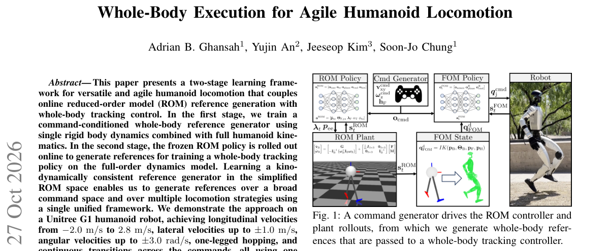

*Result - An overview of the two-stage training architecture. (Left) Illustrates the Stage 1 training, in which a command- conditioned whole-body reference generator is trained based on SRB dynamics and*

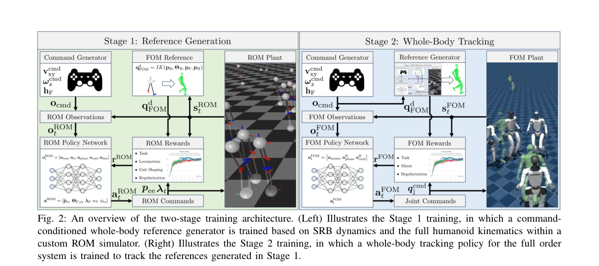

**Why this ranks #5**: 把降阶模型当作在线参考轨迹生成器来换取可行参考，再用全阶模型的全身体追踪策略执行，一个统一策略覆盖 2.8 m/s 级速度与单腿跳等多样步态。

---

### 6. When More Planning Hurts: Learned Planners for World Models

**arXiv**: [2610.37891](https://arxiv.org/abs/2610.37891) | **Score**: 7.8 (relevance 8.0 x 0.7 + quality 7.5 x 0.3) | **Tags**: embodied, world-model, learned-planner, pusht, planning-cost, negative-result, Independent Researcher | **Categories**: cs.AI, cs.LG, cs.RO | **Pages**: 23

**Authors**: Josef Chen

**Affiliation**: Independent Researcher

**Abstract**

> On PushT, our fixed action updater (1,505 parameters) solves 8 of 16 scenes reserved from our configuration selection. The comparison planners perform as follows: Selected Adam (7 tasks solved, total planning and encoding time 218.440s), adapted iCEM (2 tasks solved, total planning and encoding time 49.309s), released LePlanner (16 tasks solved, total planning and encoding time 5.652s). The total planning and encoding time for our action updater is 59.079s. Note that our action updater does not satisfy the task-cost criterion we fixed before evaluation. We also conduct another matched experiment where we only replay the first ten commands in each context and then allow the next solve 4, 8 or 12 updates (subsequent solves all get 8 updates). Among all 16 contexts (8 scene clusters), the 3 budgets get 9, 8 and 7 successes, respectively. Interestingly, the extra updates did not rescue any failing task in this experiment. All the changes in success/failure happen in one scene cluster, where we observe that the extra updates decrease the costs of the selected latent world-model trajectories for our updater, while the tasks that used to be successes become failures. The code, weights, evaluators, execution traces and cost accounting accompany the paper.

**Key findings**

- **Finding**: 在 PushT 上作者固定动作更新器只有 1505 个参数，解出配置选择阶段留出的 16 个场景中的 8 个。
- **Finding**: 对比中 Selected Adam 解出 7 个任务（规划与编码 218.440 秒），adapted iCEM 解出 2 个（49.309 秒），released LePlanner 解出 16 个（5.652 秒）。
- **Finding**: 作者的动作更新器规划与编码总时间为 59.079 秒，且未满足评估前设定的任务代价判据。
- **Finding**: 匹配实验里只重放前十条命令后分别允许 4、8、12 次更新，三种预算分别成功 9、8、7 次，额外更新没有救回任何失败任务。
- **Finding**: 所有成败变化集中在一个场景簇，额外更新反而降低了所选 latent world-model 轨迹的代价，之前的成功任务变成失败。
- **Inference**: 规划器优化的轨迹代价与任务是否真正完成并不同向，单纯加预算会把策略推离正确解。
- **Recommendation**: 推荐做 world model 规划的读者读，它是少见地被量化记录的负面结论，可直接用于避免重复踩坑。

**Key figures**

*Result - Sixteen-scene confirmation. Shown are (left) number of successful tasks (out of sixteen total scenes) and (right) total planning and encoding time (in seconds; note that the sum includes uns*

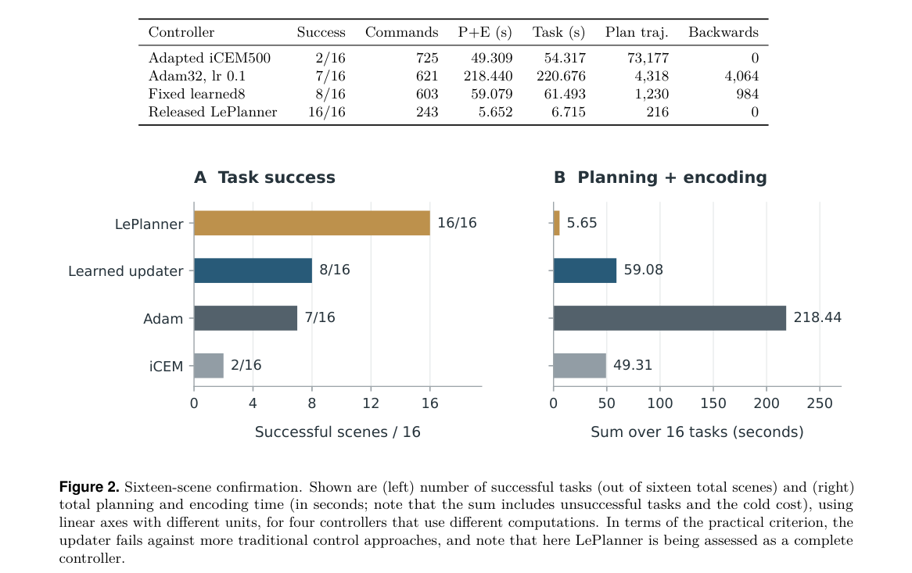

**Why this ranks #6**: 「多规划反而更糟」这一负结果比又一个更强 planner 更有价值——加大更新预算降低了 latent 轨迹代价，却把已解出的任务变成失败。

---

### 7. Proprioceptive Finger Force Estimation for Reliable Box Manipulation

**arXiv**: [2610.38351](https://arxiv.org/abs/2610.38351) | **Score**: 7.5 (relevance 7.5 x 0.7 + quality 7.5 x 0.3) | **Tags**: embodied, finger-force, proprioception, mixture-density-network, uncertainty, contact-rich, Korea | **Categories**: cs.RO | **Pages**: 9

**Authors**: Junha Cha; Chanwoo Kim; Kisang Park; Yeoncheol Jang; Doyoung Kim; Seungmin Kim; Kyungjae Lee; Sungjoon Choi

**Affiliation**: Korea University

**Abstract**

> Reliable box manipulation requires successful placement without damage, which depends on maintaining sufficient contact force without excessive loading. We hypothesize that per-finger force feedback improves manipulation reliability relative to open-loop finger commands. To this end, we present Finger External-Force Estimation from Proprioceptive SignaLs (FEEL), an uncertainty-aware residual method that estimates per-finger external force magnitude from proprioceptive histories. Our method combines a calibrated virtual-spring estimate with a residual distribution predicted by a Mixture Density Network (MDN) and requires no dedicated contact sensors during deployment. The estimated force is used for continuous per-finger adaptation, while predictive uncertainty is evaluated as an empirical signal of ambiguity in proprioceptive force estimation. Across ten fingers and contact forces spanning 0-20 N, our method achieves a mean RMSE of 0.251 N, reducing the error by 92.8% relative to the virtual spring and by 9.4% relative to an end-to-end MDN. In box pick-and-place, force adaptation maintains task success at 10/10 and increases both damage-free outcomes and reliability from 7/10 to 10/10. The project page is available at https://finger-force-estimation.pages.dev/

**Key findings**

- **Finding**: FEEL 是一种不确定性感知的方法，从本体感知历史估计每根手指的外力幅值。
- **Finding**: 方法把标定过的虚拟弹簧估计与 Mixture Density Network 预测的残差分布相结合，部署时不需要专门的接触传感器。
- **Finding**: 在 10 根手指、0–20 N 的接触力范围内，平均 RMSE 为 0.251 N，相对虚拟弹簧降低 92.8%，相对端到端 MDN 降低 9.4%。
- **Finding**: 估计出的力用于逐指连续自适应，同时把预测不确定性当作本体感知力估计歧义的经验信号。
- **Finding**: 在箱子抓取放置任务中，力自适应把任务成功率保持在 10/10，并把无损结果与可靠性从 7/10 提升到 10/10。
- **Inference**: 虚拟弹簧提供物理先验、MDN 只学残差，这个分工让样本效率与外推稳定性都更好。
- **Recommendation**: 推荐。做低成本触觉或精密装配的读者值得读，方法可以移植到其他关节力估计任务。

**Key figures**

*Framework - Overview of FEEL. (A) A wearable F/T sensor collects reference force magnitudes synchronized with proprioceptive histories during finger motion. (B) The proprioceptive history xi,t serves as i*

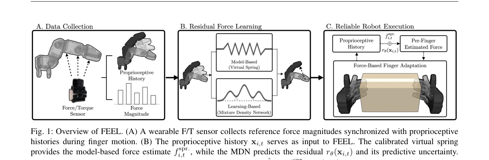

*Result - Real force-data collection using a wearable F/T sensor. Contact interactions at multiple finger locations are synchronized with proprioceptive measurements.*

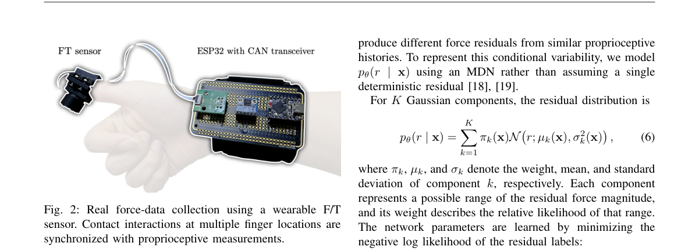

**Why this ranks #7**: 只靠本体感知就把每根手指的外力反推到 0.251 N RMSE，且部署不需要任何接触传感器，箱子搬运的无损结果从 7/10 直接做到 10/10。

---

### 8. Self-Labeled Preference Transfer for Steerable Robot Manipulation

**arXiv**: [2610.38000](https://arxiv.org/abs/2610.38000) | **Score**: 7.5 (relevance 7.5 x 0.7 + quality 7.5 x 0.3) | **Tags**: embodied, preference-following, vision-language-action, self-labeling, annotation-cost, real-robot-transfer, UC Berkeley | **Categories**: cs.RO | **Pages**: 9

**Authors**: Kaiwen Hong; Shaoting Peng; Xiangyu Zeng; Pengcheng Wang; Boyuan Tian; Haonan Chen; Yifan Zhu; Yixiao Wang; Katherine Driggs-Campbell

**Affiliation**: UC Berkeley; Harvard University; Stanford University

**Abstract**

> Vision-language-action (VLA) policies can learn to follow execution preferences, such as where to grasp an object or how to move around an obstacle, from demonstrations annotated with preference labels. Providing these annotations for every new task, however, is costly. We study whether learned preference control can transfer to new tasks whose demonstrations contain the desired behaviors but lack preference annotations. We find that a policy trained with preference annotations can follow preferences on a new task before adaptation but achieves limited task success. Fine-tuning on target demonstrations without these annotations improves task success while weakening preference control. Motivated by this finding, we introduce Self-Labeled Preference Transfer (SPT). SPT jointly trains a shared vision-language backbone for preference-conditioned action prediction and preference recognition on annotated source demonstrations. It then freezes the recognizer to preserve its cross-task preference recognition capability and uses it to self-label target demonstrations for policy fine-tuning. Across five types of execution preferences in simulation, the recognizer achieves 96.4% accuracy, and SPT reaches 84.8% preference following and 89.2% task success, compared with 59.4% and 88.0% for naive finetuning. We further extend to multiple preferences, achieving 93.8% preference following compared with 42.5% of baselines. In real-world experiments, SPT increases preference following from 52.5% to 92.5% relative to naive finetuning across two task transfers. These results show that SPT can support preference adaptation across tasks and objects while maintaining success, without additional manual preference annotations.

**Key findings**

- **Finding**: 带偏好标注训练的策略在未适配的新任务上能跟随偏好，但任务成功率有限；在无标注目标演示上微调后，任务成功率提升而偏好控制被削弱。
- **Finding**: SPT 联合训练共享视觉语言 backbone 同时做偏好条件的动作预测与偏好识别，随后冻结识别器并用它给目标演示自标注，再微调策略。
- **Finding**: 在仿真中五类执行偏好上，识别器准确率 96.4%，SPT 的偏好遵循率 84.8%、任务成功率 89.2%，naive finetuning 分别为 59.4% 与 88.0%。
- **Finding**: 扩展到多偏好场景时，SPT 的偏好遵循率达 93.8%，基线只有 42.5%。
- **Finding**: 真实机器人实验中，跨两个任务迁移的偏好遵循率从 naive finetuning 的 52.5% 提升到 92.5%。
- **Inference**: 偏好控制与任务成功会互相挤占，把识别器冻结才能保住跨任务识别的迁移能力。
- **Recommendation**: 推荐做可操控机器人策略的读者，尤其适合需要低成本偏好监督的团队。

**Key figures**

*Framework - Motivation and overview. A task can be completed in several valid ways. SPT learns to follow and recognize execution preferences on labeled source tasks. It then labels target demonstrations s*

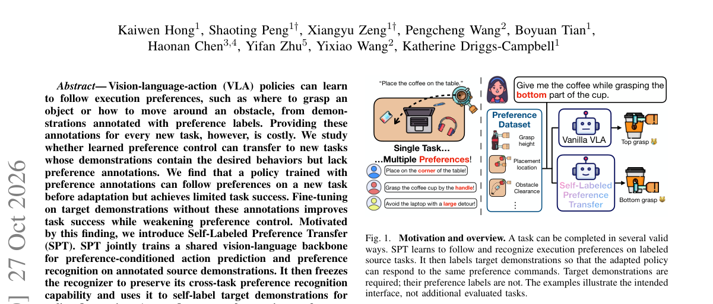

*Result - Self-Labeled Preference Transfer. Stage A trains a shared vision-language backbone for preference-conditioned action prediction and preference recognition. The recognition branch answers a pre*

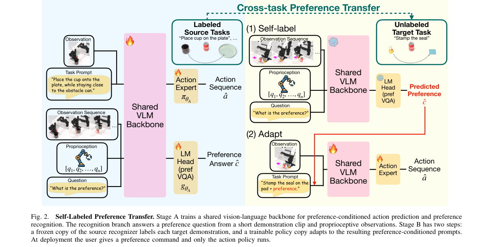

**Why this ranks #8**: 它先用一个反直觉发现立论——新任务上微调会涨任务成功率却削弱偏好控制——再用自标注把偏好标注成本压下去，真机上把偏好遵循从 52.5% 拉到 92.5%。

---

### 9. An Empirical Study of Wrist-Target Construction and Joint-Angle Limits in Humanoid Arm Retargeting

**arXiv**: [2610.37801](https://arxiv.org/abs/2610.37801) | **Score**: 7.0 (relevance 7.0 x 0.7 + quality 7.0 x 0.3) | **Tags**: embodied, motion-retargeting, humanoid-arm, joint-limits, reach-normalization, hardware-replay, Georgia | **Categories**: cs.RO | **Pages**: 8

**Authors**: MinJun Chang

**Affiliation**: Georgia Institute of Technology

**Abstract**

> Motion retargeting maps a demonstrated human movement onto a robot to compute its joint motion. This study examines how the construction of the desired wrist position affects whether computed arm joint angles reach their permitted limits on a Unitree H1-2. A reconstructed target is formed from demonstrated arm directions and robot segment lengths, so its shoulder-to-wrist distance depends on the demonstrated angle between the segments even when no posture-matching preference is applied. A reach-normalized target retains that direction while rescaling the distance, using the same processed demonstrations and the same joint-angle method. Across a forward-reach sweep the reconstructed target places a joint angle at a bound in 10 of 20 repetitions and the reach-normalized target in none. Across 25 recordings from one participant the corresponding counts are 8 and 6 on the reaching arm and 14 and 5 on the supporting arm, and a second participant repeats the bricklaying and lifting comparison. In hardware replay a joint is commanded to a bound in 12 of 16 direction-matching arm-records and in none of the 16 normalized records, and within the eligible records both tracking error and executed torque at those frames exceed their values elsewhere in the same run. Cross-body reach and arm-to-arm clearance identify limits of radial adjustment. The findings support treating target construction and posture matching as separate retargeting decisions, and evaluating both alongside the wrist positions and clearance that manipulation requires.

**Key findings**

- **Finding**: 论文在 Unitree H1-2 上考察腕部目标构造方式如何影响算出的臂关节角是否触及允许上限。
- **Finding**: 重建目标由演示臂方向与机器人杆长构成，即使不施加姿态匹配偏好，肩到腕距离仍随演示中两段夹角变化。
- **Finding**: reach 归一化目标保留方向但重缩放距离，用的是同一批处理后的演示与同一套关节角方法。
- **Finding**: 前伸扫描 20 次中重建目标有 10 次把某关节角推到边界，reach 归一化目标一次也没有。
- **Finding**: 一名参与者 25 段记录里，伸臂侧分别为 8 与 6 次、支撑臂分别为 14 与 5 次；第二名参与者重复了砌砖与抬举的对比。
- **Finding**: 硬件回放中方向匹配臂的 16 条记录有 12 条被指令到边界，16 条归一化记录一条也没有，且这些帧的跟踪误差与执行力矩都高于同一次运行的其它帧。
- **Inference**: 目标构造与姿态匹配应当作为两个独立的 retargeting 决策来设计与评估。
- **Recommendation**: 推荐做人形上肢动作迁移的读者，属于小而硬的工程结论，读来很快。

**Key figures**

*Result - Saturated reaching-arm recordings across four forward-reach settings. Each setting has five repetitions. Reconstructed and reach-normalized targets use the same joint-angle method. Direction m*

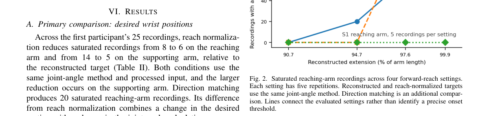

**Why this ranks #9**: 它把「重建腕部目标」与「reach 归一化目标」在同一批演示、同一套关节角算法下并排测，硬件回放里前者 12/16 触限、后者 0/16，差异被钉死在一个设计选择上。

---

### 10. ELEVATE: Agentic Controller Acquisition from Task Failure for Quadrupedal Manipulation

**arXiv**: [2610.38388](https://arxiv.org/abs/2610.38388) | **Score**: 7.0 (relevance 7.0 x 0.7 + quality 7.0 x 0.3) | **Tags**: embodied, agentic-rl, quadruped-manipulation, coding-agent, controller-library, sim-to-real, Carnegie Mellon | **Categories**: cs.RO | **Pages**: 23

**Authors**: Shiqi Liu; Radu Corcodel; Ding Zhao

**Affiliation**: Carnegie Mellon University; MERL (Research Labs)

**Abstract**

> Quadrupedal manipulators can extend their workspace through whole-body interaction, but task-planning agents' capabilities remain limited by their available controllers. We present ELEVATE, a framework that uses persistent failures during task-program refinement to identify and acquire missing whole-body control capabilities. When these failures suggest a missing physical capability, a coding agent formulates and iteratively refines a reinforcement-learning problem, specifying behavior-specific rewards, curricula, and termination conditions. Validated controllers are added to the capability library and composed with existing controllers to retry the task. Starting from a single pretrained loco-manipulation controller, ELEVATE autonomously acquires controllers for wall-supported elevation, supported manipulation, and wall descent across a sequence of seven simulation tasks. These controllers are reused in subsequent reaching and object-manipulation tasks. On the five tasks beyond the initial controller's workspace, ELEVATE achieves mean success rates of 98.4%-100% across five independent runs, while coding-agent baselines with a fixed controller library fail to complete these tasks. The synthesized task programs, together with the acquired controllers, also transfer to a physical quadrupedal manipulator without real-robot training or fine-tuning, achieving 18/20 successes in rack retrieval and 16/20 in floor-to-rack placement. Videos and demonstrations are available at https://agentic-quad-elevate.github.io/public/.

**Key findings**

- **Finding**: ELEVATE 用任务程序精炼过程中的持续失败来识别并获取缺失的全身控制能力。
- **Finding**: 当失败指向缺失的物理能力时，coding agent 会构造并迭代精炼一个强化学习问题，指定行为相关的奖励、课程与终止条件。
- **Finding**: 验证通过的控制器被加入能力库并与已有控制器组合后重试任务；从单个预训练 loco-manipulation 控制器起步，框架自主获取了靠墙抬升、支撑操作与沿墙下降的控制器。
- **Finding**: 在超出初始控制器工作空间的五个任务上，ELEVATE 在五次独立运行中取得 98.4%–100% 的平均成功率，而固定控制器库的 coding agent 基线全部失败。
- **Finding**: 合成出的任务程序与获取的控制器在没有真机训练或微调的情况下迁移到实体四足机器人，抓取货架物品成功 18/20，落地到货架 16/20。
- **Inference**: 把失败当作能力探测信号，等于让 agent 自己决定该学什么，突破了任务程序手写的瓶颈。
- **Recommendation**: 推荐做 agentic RL 与机器人控制器合成的读者，方法与四足本体解耦，容易迁移。

**Key figures**

*Framework - Reusing existing controllers and learning missing capabilities. The robot uses its initial loco-manipulation controller to pick up a bottle. When a wall-mounted rack lies beyond its reach, it*

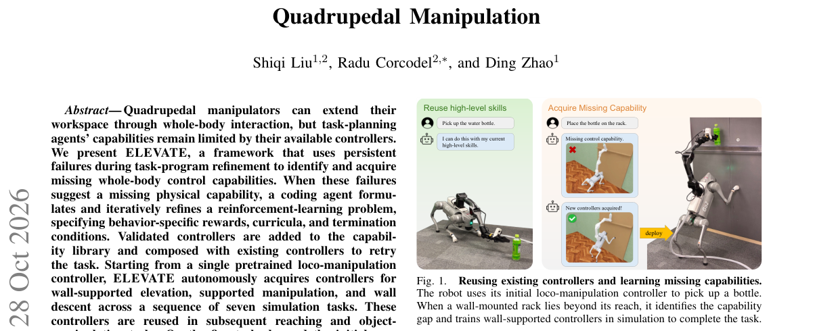

*Result - Overview of ELEVATE. The agent synthesizes and refines task programs using its capability library. Persistent failures after refinement (1) motivate controller learning (2): the agent assesses*

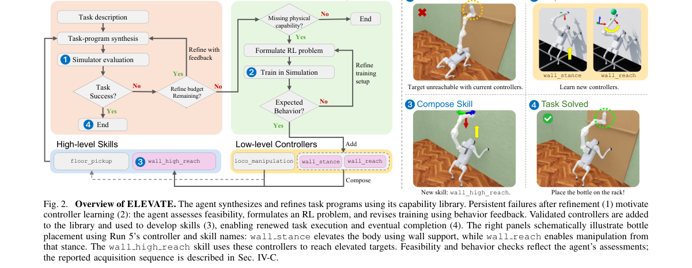

**Why this ranks #10**: 让 coding agent 读任务失败日志、自动写 RL 问题去补齐缺失的全身控制器，再零真机训练迁移到实机——失败不再只是失败，而是能力缺口的定位信号。

---

## Footer

- Total papers scanned across all 7 tracks: 336（原始 446 条）
- embodied track final top-10: 10
- Wild-cards in this track: 0
- Figure assets: 2026-10-29/res/

Generated by `mine-arxiv-daily-digest` skill. Sister file: `2026-10-29_embodied_entry.md`.
