# ArXiv Daily Digest - 2026-10-29 (生成式内容模型强化学习, 10 papers)

**Generated**: 2026-10-31 17:30 CST

**Source**: arXiv cs.CV, cs.SD, eess.AS, cs.CL, cs.AI, cs.RO, cs.LG submissions, listing day 2026-10-28 (announced 2026-10-29 00:00 UTC)

**Batch window**: 2026-10-27T18:00:00Z .. 2026-10-28T18:00:00Z（arXiv 公告批次横跨两个 UTC 日：前一日 18:00 UTC 起算，当日 17:59:59 UTC 截止）

**Track**: rl_aigc (top 10 of 336 papers scanned, 70 full reads)

**Scope**: 针对生成式内容模型（扩散 / 流匹配 / 视频 / 图像 / 音频）的 RL 与偏好优化

⚠️ **Wild-card**: 本批该线 9 篇为 wild-card 补足，已在正文逐条标注并给出理由。

补足原因：该批次真正把 RL / 奖励 / 偏好用于扩散、流匹配与生成模型后训练的论文只有 1 篇（Multi-Draft On-Policy Distillation for Diffusion Drafters），其余 9 篇为生成流理论、密度比估计、引导式采样与 agentic 生成的数据合成方向补位，已在正文逐条标注并给出理由。

---

## Top 10 - 生成式内容模型强化学习

### 1. Multi-Draft On-Policy Distillation for Diffusion Drafters

**arXiv**: [2610.37778](https://arxiv.org/abs/2610.37778) | **Score**: 8.8 (relevance 9.0 x 0.7 + quality 8.5 x 0.3) | **Tags**: rl-aigc, diffusion-drafter, speculative-decoding, on-policy-distillation, verifier-feedback, acceptance-length, Georgia | **Categories**: cs.CL | **Pages**: 20

**Authors**: Petr Molodyk; Yuchen Zhu; Jaemoo Choi; Molei Tao; Yongxin Chen

**Affiliation**: Georgia Institute of Technology

**Abstract**

> Speculative decoding is used to reduce the inference cost of language models. One-step diffusion drafters propose a block of multiple tokens in parallel, reducing the sequential cost of speculative decoding. On-policy distillation trains these drafters using verifier feedback on their own proposals. However, parallel drafting makes this feedback difficult to use: the drafter predicts each token without observing the preceding tokens sampled within the same block, while the verifier conditions its prediction on those tokens. Different sampled prefixes therefore give different verifier targets for the same drafter prediction. We show that distilling against these targets separately can suppress tokens that are plausible after some prefixes but unlikely after others, harming draft acceptance. We explain the effects of this mismatch and introduce Multi-Draft On-Policy Distillation (MDraft), a new parallel drafter distillation method which samples several draft blocks from the same context and aggregates the verifier's full-vocabulary conditionals across their prefixes. We use all the drafts to collect information from the verifier, allowing support from alternative prefixes to influence the training target. The resulting algorithm improves the acceptance length of a parallel drafter beyond the level of pre-training, and alleviates the effects of the distributional mismatch. MDraft changes only training, retaining the drafter's architecture and inference procedure, allowing the resulting drafter to be used as-is in place of the pretrained checkpoint. Experiments on a suite of mathematical, coding, and conversational tasks show longer accepted drafts than prior distillation methods.

**Key findings**

- **Finding**: 论文指出一步扩散 drafter 并行提出一段 token，而 on-policy 蒸馏只能用 verifier 对自己提案的反馈来训练。
- **Finding**: 关键矛盾在于 drafter 预测每个 token 时看不到同一 block 内已采出的前缀，verifier 的预测却又条件于这些前缀。
- **Finding**: 同一个 drafter 预测因此对应不同的 verifier 目标，分别对这些目标蒸馏会压掉「在某些前缀下合理、在另一些前缀下不合理」的 token，损害草稿接受率。
- **Finding**: MDraft 从同一上下文采样多个草稿块，并把 verifier 在各前缀下的全词表条件分布聚合起来，让其它前缀的支持参与训练目标的构造。
- **Finding**: 该算法把并行 drafter 的接受长度提升到预训练之上的水平，并缓解了上述分布错位。
- **Finding**: 它只改训练流程，保留 drafter 的架构与推理方式，产出的 drafter 可以直接替换预训练 checkpoint；在数学、代码与对话任务上接受的草稿长于既有蒸馏方法。
- **Inference**: 这篇是「verifier 即奖励」路线在扩散模型上的一次干净落地，缺的不是 reward，而是 reward 的条件化目标该怎么聚合。
- **Recommendation**: 推荐。做扩散加速或投机解码的读者必读，聚合多前缀 verifier 条件的思路可直接迁移到并行采样器上。

**Key figures**

*Framework - A parallel drafter predicts the second token without observing its sampled first token. The verifier’s preferred continuation depends on that first token; different training objectives theref*

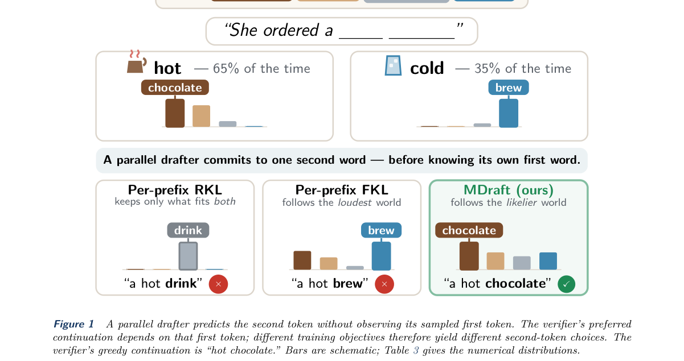

*Result - Position-wise conditional acceptance gains over DFlash, in percentage points, at T = 0 (left) and T = 1 (right). Red: MDraft; green: AdaFlash; orange: RKL. The evaluation uses 1,656 prompts f*

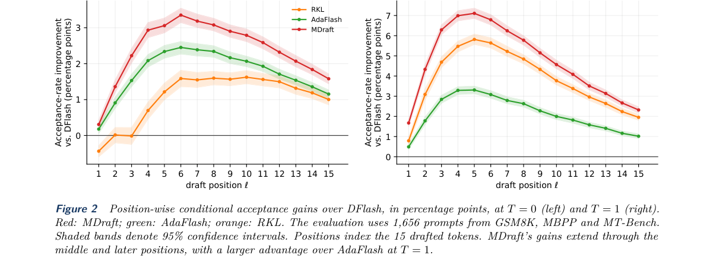

**Why this ranks #1**: 它是这一批里唯一名副其实的「用 verifier 奖励信号做扩散模型在线蒸馏」：把并行草稿带来的目标错位讲清楚并修好。

---

### 2. Estimating Implicit Expected Log Density Ratios

**arXiv**: [2610.38151](https://arxiv.org/abs/2610.38151) | **Score**: 7.5 (relevance 7.5 x 0.7 + quality 7.5 x 0.3) | **Tags**: rl-aigc, density-ratio-estimation, implicit-densities, finite-sample-limits, eldr, off-policy-bias, Carnegie Mellon | **Categories**: cs.AI, cs.LG, stat.ML | **Pages**: 141

**Authors**: Avi Amalanshu; Chandler Squires; Yizhou Lu; Pradeep Ravikumar

**Affiliation**: Carnegie Mellon University

**Abstract**

> When exact probabilities cannot be computed, \emph{density ratio estimation (DRE)} is a key subroutine in the wide range of applications where density ratios appear, from experimental design to generative modelling and reinforcement learning. In this paper, we introduce the concept of an \emph{expected log density ratio (ELDR)}: log density ratios that are integrated under some third, possibly distinct measure. We show many problems with implicit densities where DRE is naïvely used are actually ELDR estimation tasks, and prove fundamental limitations on finite-sample ELDR estimation. Based on these results, we argue that the typical DRE-based approaches are unsuitable for ELDR estimation, and provide some foundational motivation towards bespoke ELDR estimators. To demonstrate, we propose a simple modification to some DRE methods that allows samples convergent to the integral distribution to appear in training data. We show through benchmarks that this can improve ELDR estimation error.

**Key findings**

- **Finding**: 论文提出 expected log density ratio（ELDR）这一概念，即在某个第三方（可能不同）测度下积分的 log 密度比。
- **Finding**: 作者指出许多隐式密度问题被朴素地当作 DRE 处理，实际上是 ELDR 估计任务，并证明了有限样本下 ELDR 估计的根本局限。
- **Finding**: 基于这些结果，论文论证典型 DRE 方法不适合 ELDR 估计，并为专门的 ELDR 估计器提供基础动机。
- **Finding**: 作为验证，作者对部分 DRE 方法做了一个简单修改，让训练数据中出现收敛到积分分布的样本。
- **Finding**: 在基准上这一简单修改降低了 ELDR 的估计误差，说明把积分分布的样本放进训练数据确实有效。
- **Inference**: 与本线的关系要说清：论文本身不做 RL 也不做偏好优化，但偏好目标里的隐式奖励、以及带 KL 正则化的强化学习，都要靠密度比来换算。
- **Inference**: 它的实际含义是，把密度比当成万能接口去搭 RL 或偏好目标时，要先确认积分测度是否一致，否则估计误差会被误读成策略改进。
- **Recommendation**: 选读。做偏好优化理论、或需要严谨处理隐式密度与 off-policy 偏差的读者值得读，其余可略过。

**Key figures**

*Framework - The median regret over the winning method across designs per-prior, normalized by the spread across methods. The median per-β of such per-prior medians across priors is shown, with IQR bands*

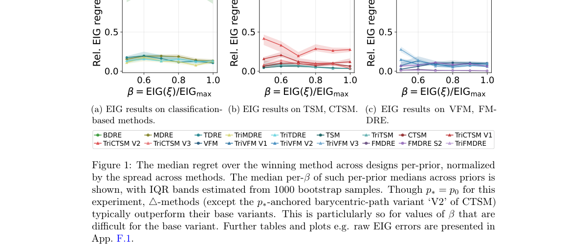

*Result - The median regret over the winning method across designs per-prior, normalized by the spread across methods. The median per-β of such per-prior medians across priors is shown, with IQR bands*

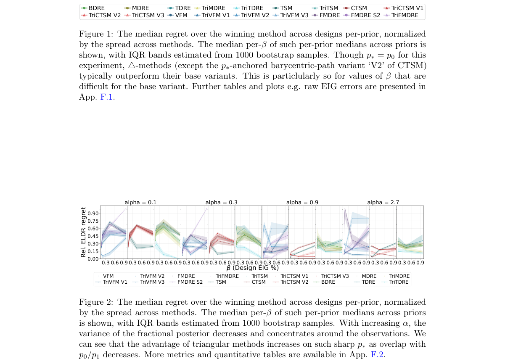

**Why this ranks #2**: 它给 RL 与偏好优化里最常被默认使用的密度比估计划了边界：很多所谓 DRE 问题其实是另一类估计任务，用错工具会带来系统性偏差。  [wild-card=yes] 隐式对数密度比估计是分布匹配蒸馏类方法的统计内核，但论文本身不含 RL 优化，补位计入。

---

### 3. MiniMMD: Minimization of MMD for Sampling, Inference and Integration

**arXiv**: [2610.38122](https://arxiv.org/abs/2610.38122) | **Score**: 7.1 (relevance 7.0 x 0.7 + quality 7.5 x 0.3) | **Tags**: rl-aigc, mmd, kernel-discrepancy, distribution-matching, sampling, generative-modelling, University College London | **Categories**: cs.LG, stat.ML | **Pages**: 233

**Authors**: Zonghao Chen

**Affiliation**: University College London

**Abstract**

> Many problems in computational statistics and machine learning can be formulated as approximating a target distribution by minimizing a discrepancy over a restricted class of candidate distributions. This minimum-discrepancy viewpoint appears, for example, in numerical integration, sampling, generative modelling, and statistical inference, but these instances are often studied separately in the literature. This thesis develops the first unified treatment of these many problems through the minimization of the maximum mean discrepancy (MMD), a kernel-based discrepancy between probability measures. The central theme is that MMD is not only a statistically meaningful distance between probability distributions, but also a tractable optimization objective to design practical and efficient algorithms. This thesis summarizes the recent theoretical and empirical advancements of such minimum-MMD based algorithms.

**Key findings**

- **Finding**: 论文把大量计算统计与机器学习问题统一表述为：在受限的候选分布族上最小化某个 discrepancy 以逼近目标分布。
- **Finding**: 这类最小差异视角出现在数值积分、采样、生成建模与统计推断中，但文献里通常被分开研究。
- **Finding**: 该学位论文给出首个以最大化平均差异（MMD）最小化统一处理这些问题的框架。
- **Finding**: 核心论点是 MMD 不仅是分布之间有统计意义的距离，也是可用于设计实用高效算法的可优化目标。
- **Finding**: 论文汇总了这类基于最小 MMD 的算法在理论与实证上的近期进展。
- **Inference**: 与本线的关系需要摊开讲：MMD 最小化属于「用散度做分布匹配」这一族，与带正则化的 reward-weighted regression 同源，但它不含 reward、不含 policy，也没有偏好数据。
- **Inference**: 对做生成式 RL 的人有价值的地方在于，分布匹配目标的可优化性与统计意义之间的取舍，在这里被系统地讨论过一遍。
- **Recommendation**: 选读。做生成建模与最优化的读者可当方法论索引；只关心 RL 算法的读者可以只看相关章节，不必通读。

**Key figures**

该论文正文未提取到可用图（图表为纯文本/表格排版）。

**Why this ranks #3**: 它把散度最小化这条统计主线统一起来，恰好是生成模型与带正则化 RL 目标共同依赖的地基，但论文本身没有任何 reward 或 policy。  [wild-card=yes] 以最小化 MMD 统一采样/推断/积分的学位论文式总结，是分布匹配方法的理论基础但无 RL，补位计入。

---

### 4. AtomSteer: Test-Time Constraint Steering for Atomistic Generative Models

**arXiv**: [2610.38517](https://arxiv.org/abs/2610.38517) | **Score**: 7.1 (relevance 7.0 x 0.7 + quality 7.5 x 0.3) | **Tags**: rl-aigc, test-time-steering, flow-matching, crystal-structure, stereochemistry, constraint-projection, Massachusetts | **Categories**: cs.AI, cs.LG | **Pages**: 36

**Authors**: Pengfei Cai; Katharina S. C. Jäger; Utkarsh Utkarsh; Nofit Segal; Bowen Deng; Akshay Subramanian; Rafael Gomez-Bombarelli

**Affiliation**: Massachusetts Institute of Technology

**Abstract**

> Diffusion and flow matching models offer scalable approaches to generating crystalline materials, molecular conformers, and protein-ligand complexes. However, satisfying crystallographic symmetry, structural geometry, and accurate stereochemistry remains challenging. Satisfying these requirements calls for corrections that preserve the geometry already captured by the pretrained model. In this work, we propose AtomSteer, a test-time inference framework for steering pretrained atomistic generative models with structural constraints. During sampling, AtomSteer corrects intermediate structure predictions with bounded local projections, graph-rigid stereochemical transformations, and projections over periodic symmetries, accepting updates that improve constraint satisfaction while limiting changes to the rest of the structure. We demonstrate AtomSteer across three pretrained backbones, FlowMM, ET-Flow, and Boltz-2, spanning de novo crystal generation and crystal structure prediction, molecular conformer generation, and protein-ligand complex structure prediction. AtomSteer improves space-group distribution coverage in de novo crystal generation and improves target space-group recovery in crystal structure prediction. AtomSteer improves molecular validity and E/Z stereochemical accuracy while retaining conformer ensemble fidelity. For protein-ligand complexes, AtomSteer reduces ligand E/Z errors relative to experimental reference structures while achieving competitive docking success and PoseBusters validity. Our method provides a unified framework for adding chemical and crystallographic control to existing atomistic generative models without retraining or architectural changes.

**Key findings**

- **Finding**: 论文指出扩散与流匹配模型能规模化生成晶体、分子构象与蛋白-配体复合物，但满足晶体对称性、结构几何与立体化学仍然困难。
- **Finding**: AtomSteer 是测试期推理框架，在采样过程中用有界局部投影、图刚性立体化学变换与周期对称性投影纠正中间结构预测。
- **Finding**: 它只接受能改善约束满足度的更新，同时限制对结构其余部分的改动，以保留预训练模型已经学到的几何。
- **Finding**: 作者在 FlowMM、ET-Flow 与 Boltz-2 三个预训练骨干上验证，覆盖从头晶体生成与晶体结构预测、分子构象生成、蛋白-配体复合物结构预测。
- **Finding**: 从头晶体生成上改善了空间群分布覆盖，晶体结构预测上改善了目标空间群命中率，同时提升分子有效性与 E/Z 立体化学准确率并保持构象集合保真度。
- **Finding**: 在蛋白-配体任务上配体 E/Z 误差下降，同时保持有竞争力的对接成功率与 PoseBusters 有效性；卡片摘要还提到三类投影族：化学 Gauss–Newton、刚性片段与刚体投影、晶体对称性与 motif 投影。
- **Inference**: 与本线的边界要说明白：这属于 guidance 与约束投影家族，信号是解析写死的结构残差，不是学出来的 reward，也不做策略优化。
- **Recommendation**: 选读但有条件推荐。做材料与分子生成、需要硬约束可控采样又不愿重训模型的读者值得看；只关心 RL 的人可跳过。

**Key figures**

*Framework - AtomSteer applies structure-dependent projections during sampling. (1) At state xt, the pre-trained model predicts the endpoint ˆxend*

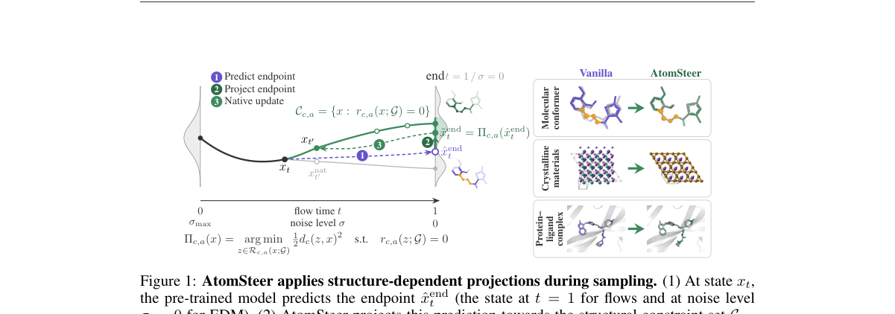

*Result - Crystallographic symmetry and requested structures in FlowMM. a, Detected space- group distributions of the MP-20 test set, vanilla FlowMM, and AtomSteer in de novo generation. b, Symmetry s*

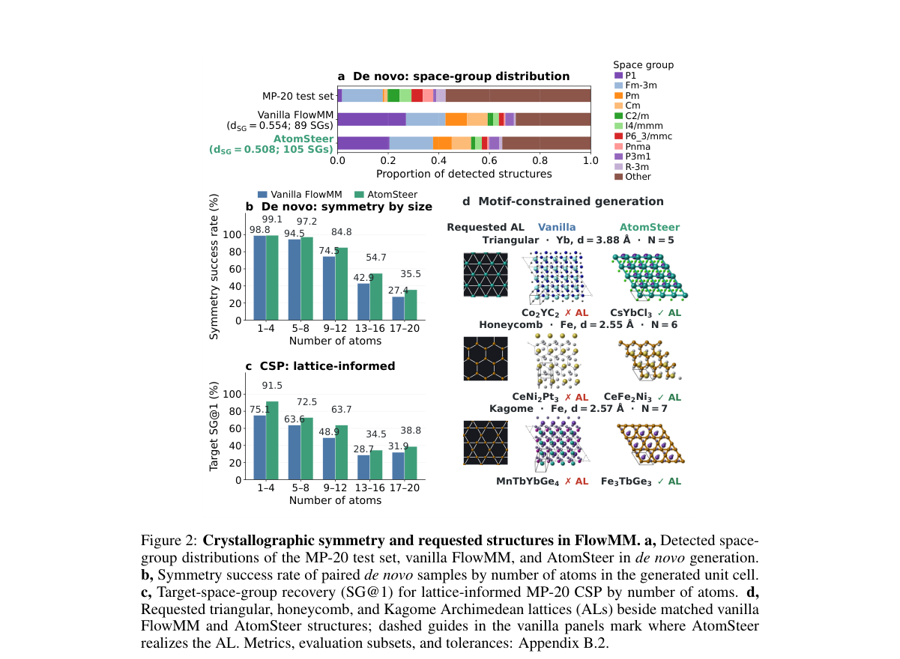

**Why this ranks #4**: 它把「结构约束」当成手写 guidance 直接插进扩散与流匹配的采样过程，属于 guidance 家族但完全没有学习到的 reward。  [wild-card=yes] 原子尺度生成模型的测试期约束引导，是免训练的引导式采样而非 RL 优化，补位计入。

---

### 5. Finite-Step Geometry of Marginal-Preserving Velocity Fields in Generative Flows

**arXiv**: [2610.37936](https://arxiv.org/abs/2610.37936) | **Score**: 7.1 (relevance 7.0 x 0.7 + quality 7.5 x 0.3) | **Tags**: rl-aigc, flow-matching, ode-discretization, finite-step-error, marginal-preservation, reachability, FusionBrain Lab | **Categories**: cs.LG, stat.ML | **Pages**: 60

**Authors**: Ewsey Obzherin; Valentin Khrulkov

**Affiliation**: FusionBrain Lab; MIRIAI

**Abstract**

> Generative flows can admit different velocity fields that induce the same continuous marginal evolution but behave differently after numerical discretization. We study this finite-step non-equivalence while keeping the marginal path and numerical method fixed. Projected modified equations characterize the component of local integration error that changes the marginal law and give sufficient conditions for higher marginal convergence order. For affine fixed-shape distributions, we characterize exact finite-step reachability and derive spectral obstructions and sharp nearest-reachable Wasserstein errors. For diffusion probability-flow ODEs, we construct skew-score perturbations that preserve the exact marginal path under exact scores and quantify their leakage under score error. Controlled Gaussian and mixture experiments recover the predicted order, reachability, and obstruction phenomena.

**Key findings**

- **Finding**: 论文指出生成流可以对应多个不同的 velocity field，它们在连续极限下诱导相同的边缘演化，却在数值离散之后表现不同；研究因此在固定边缘路径与固定数值方法的前提下刻画这种有限步非等价性。
- **Finding**: 修正后的修正方程刻画出局部积分误差中会改变边缘律的那一部分，并给出更高边缘收敛阶的充分条件。
- **Finding**: 对仿射定形分布，论文给出精确的有限步可达性刻画，并导出谱障碍与最近可达的 Wasserstein 误差。
- **Finding**: 对扩散概率流 ODE，作者构造了保持精确边缘路径的 skew-score 扰动，并量化它在 score 误差下的泄漏。
- **Finding**: 受控的高斯与混合分布实验复现了所预测的阶数、可达性与障碍现象。
- **Inference**: 与本线的边界很清楚：论文没有任何 reward、policy 或优化算法，它研究的是 flow matching 与扩散采样器本身的数值几何。
- **Inference**: 但对做 RL-for-flow-matching 的人有直接意义，被优化的 velocity field 在有限步下的行为差异，正是 reward 曲线与样本质量对不上的一个来源。
- **Recommendation**: 选读。想真正理解 flow matching 采样误差的读者值得读；只关心策略优化的人可以先看可达性与谱障碍部分。

**Key figures**

*Framework - Rotation can repair an under-expanding Euler step. In this exact two-dimensional Gaussian example (βh = 0.7), the radial step falls short (left). Adding rotation preserves the continuous dis*

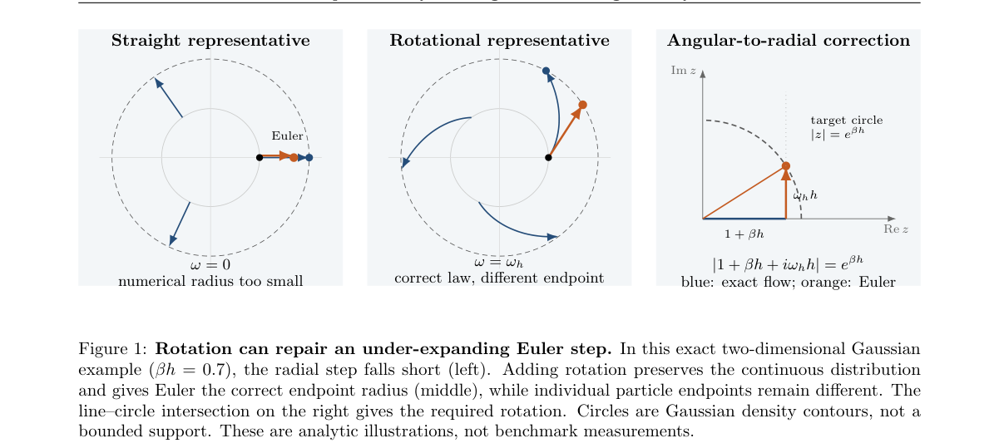

*Result - A correction can change the output without reaching every target. The first two panels show all Euler covariance responses in two dimensions as the rotation K = ωJ varies (h = 1). With unequ*

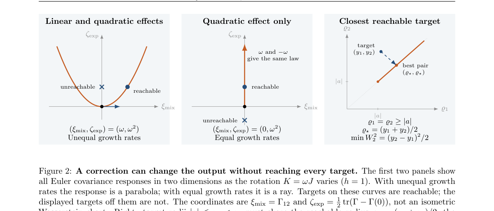

**Why this ranks #5**: 它回答了「同一个 velocity field 被离散化之后还剩下多少」这个所有 flow matching 采样器都在踩的地雷，属于本线 flow matching 家族的几何基础，但完全没有 RL 成分。  [wild-card=yes] 保边际速度场的有限步几何是生成流采样器的理论分析，不含策略优化，补位计入。

---

### 6. Beyond Reachability: When Edit Order Preserves Couplings in Graph Flow Matching

**arXiv**: [2610.38486](https://arxiv.org/abs/2610.38486) | **Score**: 7.1 (relevance 7.0 x 0.7 + quality 7.5 x 0.3) | **Tags**: rl-aigc, graph-flow-matching, edit-order, coupling-preservation, poisson-clock, aliasing-bound, Hong Kong Polytechnic | **Categories**: cs.IT, cs.LG | **Pages**: 14

**Authors**: Zilin Li; Zixing Song

**Affiliation**: The Hong Kong Polytechnic University

**Abstract**

> Shortest-path optimality does not guarantee that a memoryless graph generator preserves a prescribed source-target correspondence. We study whether reordering legal shortest edits can retain this correspondence without changing the pairing, mandatory edits, or sampling budget. Under a common Poisson clock, we establish an exact criterion for endpoint coupling recoverability: the source-blind Markov projection attains the unavoidable clock-error floor if and only if routes to distinct targets do not share graph states. Routes to the same target may merge without sacrificing endpoint fidelity. This characterization leads to an exact finite-state routing formulation and a legality-preserving scheduling procedure with recovery certificates. A marker-free construction demonstrates how shared edge structure can retain source distinctions, while a capacity-constrained family exhibits a sharp separation in paired error between edit orders with identical marginal error. Finally, a target-conditioned aliasing bound connects structural route design to the terminal fidelity of a learned graph-only generator. These results characterize when legal edit ordering can preserve a prescribed coupling under fixed operational costs.

**Key findings**

- **Finding**: 论文指出最短路径最优并不保证无记忆的图生成器能保留预先指定的 source-target 对应关系。
- **Finding**: 作者研究在不改变配对、强制编辑与采样预算的前提下，重排合法最短编辑能否保住该对应关系。
- **Finding**: 在共同的 Poisson 时钟下，论文给出端点耦合可恢复性的精确判据：通往不同目标的路径不共享图状态时，source-blind Markov 投影达到不可避免的时钟误差下界；通往同一目标的路径则允许合并。
- **Finding**: 该刻画导出精确的有限状态路由表述与保合法性的调度过程，并附带恢复证书。
- **Finding**: 论文给出无标记构造，说明共享边结构如何保留 source 之间的区分；受容量约束的构造则展示了边缘误差相同时成对误差仍会出现尖锐分离。
- **Finding**: 最后的目标条件 aliasing 界把结构化的路径设计与仅用图的生成器的终端保真度联系起来。
- **Inference**: 与本线的边界同样要说清：论文研究的是图上 flow matching 的路径设计与耦合理论，没有 reward 也没有策略优化；但对偏好与编辑类生成流程有直接教训——只看边缘指标会掩盖配对层面的失效。
- **Recommendation**: 选读。做图编辑生成、结构化生成或需要保住配对关系的读者值得读；一般读者可略过。

**Key figures**

该论文正文未提取到可用图（图表为纯文本/表格排版）。

**Why this ranks #6**: 它给出「同样的边缘误差可以对应完全不同的配对误差」的判据，对任何需要保留 source-target 对应关系的生成式流程都是必须知道的坑。  [wild-card=yes] 图上 flow matching 的编辑顺序与耦合保持，是生成模型的理论结果，补位计入。

---

### 7. Logical Guidance of Stochastic Interpolants

**arXiv**: [2610.38648](https://arxiv.org/abs/2610.38648) | **Score**: 7.1 (relevance 7.0 x 0.7 + quality 7.5 x 0.3) | **Tags**: rl-aigc, logical-guidance, stochastic-interpolants, flow-matching, constraint-composition, score-re-equilibration, NEC Laboratories Europe | **Categories**: cs.LG | **Pages**: 30

**Authors**: Gerrit Gerhartz; Francesco Alesiani; Jonathan Warrell; Henrik Christiansen; Matheus Ferraz; Mathias Niepert

**Affiliation**: NEC Laboratories Europe; Heidelberg University; NEC Laboratories America; NEC Bio B.V.

**Abstract**

> Guidance and composition of generative models have applications in visual design, chemistry, and biology. Logical guidance composes conditional scores exactly for diffusion models. However, Flow Matching (FM) and Stochastic Interpolants (SI) learn velocity fields. We show that negation and exclusive disjunction admit exact conditional velocity composition on any interpolant, whereas conjunction, and therefore any formula containing one, is exact on Gaussian paths but in general incurs a drift-interaction error, so composed velocities need not sample the logical target. LOGSI solves this by using score-based re-equilibration as our principled mechanism and falling back to the Gaussian-path velocity rule as an approximate transport predictor. In non-Gaussian bridge problems, generation alternates transport steps with score re-equilibration steps. On image trans fer (EMNIST to CMNIST, CelebA) and QM9 source-to-target molecular editing with logical attribute constraints, LOGSI improves rule conformity at the same network-evaluation budget over composed-velocity baselines, while also improving fidelity on the image tasks. More broadly, LOGSI applies wherever stochastic interpolants need guidance and logical combinations of constraints are natural.

**Key findings**

- **Finding**: 论文指出逻辑引导对扩散模型可以精确组合条件 score，但 flow matching 与 stochastic interpolants 学的是 velocity field。
- **Finding**: 作者证明否定与析取在任何 interpolant 上都允许精确的条件 velocity 组合，而合取以及任何含合取的公式只在高斯路径上精确。
- **Finding**: 在一般情形下合取会引入 drift-interaction error，导致组合出的 velocity 未必采样自逻辑目标。
- **Finding**: LOGSI 用基于 score 的再平衡作为原理性机制，并把高斯路径的 velocity 规则当作近似的 transport predictor。
- **Finding**: 在非高斯桥接问题上，生成过程交替进行 transport 步骤与 score 再平衡步骤。
- **Finding**: 在 EMNIST 到 CMNIST、CelebA 的图像迁移与 QM9 的源到目标分子编辑上，LOGSI 在相同网络评估预算下比组合 velocity 基线更符合规则，并在图像任务上同时提升保真度。
- **Inference**: 与本线的边界：这是引导与组合的理论工作，没有 reward 学习也没有策略优化；它给 RL-for-flow-matching 的启示是引导信号应构造在 score 上再转成 velocity。
- **Recommendation**: 选读但推荐给做可控生成的读者。做 flow matching、想用逻辑组合约束的读者值得读；纯 RL 读者可跳过。

**Key figures**

*Framework - Overview of LOGSI. (a) Logical composition targets samples from ρ1 satisfying c1 ∧c2, transported from ρ0 by a stochastic interpolant, sampling can only use the atomic conditioned scores and*

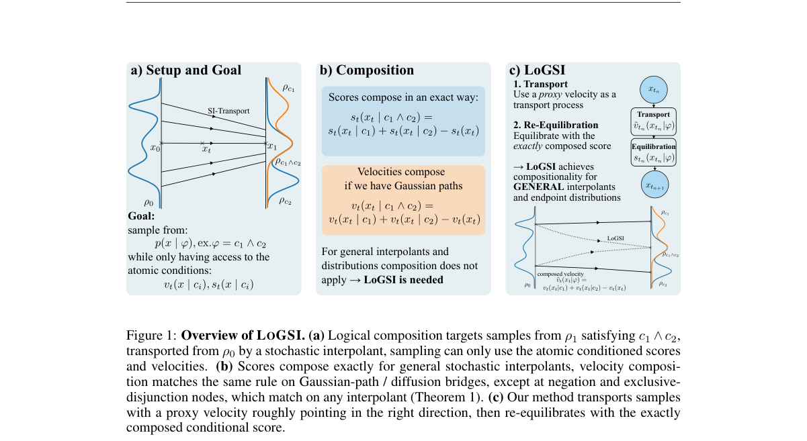

*Result - EMNIST to CMNIST logical sampling at matched NFE. (left) Conformity of LOGSI and of the compute-matched baselines, as a function of corrector steps K. Rand-2/Rand-3 are random depth-2/3 expr*

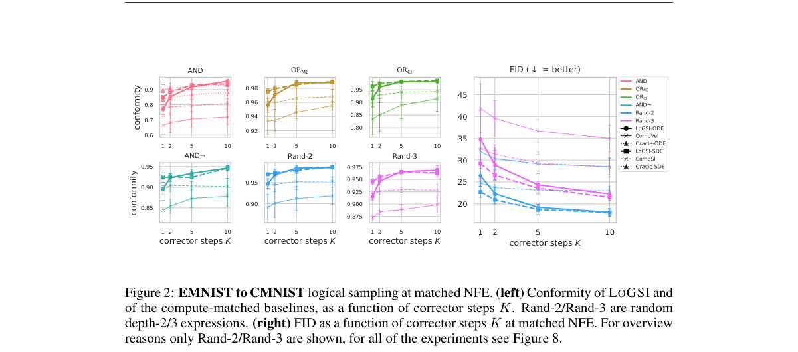

**Why this ranks #7**: 它精确刻画了「score 能组合、velocity 不能」这条分界，并给出把两者缝在一起的采样方案，是 flow matching 家族里少见地先讲清原理再谈性能的一篇。  [wild-card=yes] 随机插值的逻辑引导用 score 重平衡替代策略优化，是奖励无关的引导式采样，补位计入。

---

### 8. WeVisCut: The Whole Editing Room in One Agent From Narration to Long-Form Video

**arXiv**: [2610.38352](https://arxiv.org/abs/2610.38352) | **Score**: 7.1 (relevance 7.0 x 0.7 + quality 7.5 x 0.3) | **Tags**: rl-aigc, script-to-video, policy-learning, verified-replay, tool-harness, agentic-editing, Xidian | **Categories**: cs.AI, cs.CV | **Pages**: 35

**Authors**: Chenyu Mu; Wenming Weng; Qinrui Wang; Xingsong Ye; Hao Yu; Jun He; Chong Sun; Chen Li; Jing Lyu; Erkun Yang; Cheng Deng

**Affiliation**: Xidian University; WeChat Vision, Tencent Inc.

**Abstract**

> Producing long-form videos from narration requires interdependent decisions that remain coherent across shots. Existing agentic editors often use multi-stage workflows driven by general models, leaving the quality-cost trade-off of compact, task-adapted policies unclear. We address this gap with WeVisCut, a long-form script-to-video system that connects tool execution with policy learning. Its agent harness maintains shared production state so that tool feedback informs subsequent decisions and repairs. Because finished videos do not expose these decisions, our four-stage data pipeline combines editing inversion with verified replay to turn recovered editing intent into executable supervision. Applied to 3,750 finished videos, this pipeline yields over 130K training examples. We use this supervision to train a single 9B policy that coordinates production and recovers from failures within the same harness. Moreover, we introduce a 100-task benchmark and five metrics assessing editing quality and delivery reliability. Under a shared tool environment, WeVisCut substantially outperforms its base model and achieves comparable performance to Claude Opus 5 while using nearly 33x fewer generated tokens per successful output minute. It also outperforms task-matched native editors on our proposed metrics.

**Key findings**

- **Finding**: 论文指出长视频生成需要跨镜头保持一致的相互依赖决策，而现有 agentic 编辑器多用通用模型驱动的多阶段流水线，任务适配小策略的质量与成本折中并不清楚。
- **Finding**: WeVisCut 把工具执行与策略学习连起来，其 agent harness 维护共享的 production state，让工具反馈能影响后续决策与修复。
- **Finding**: 由于成品视频不暴露决策过程，作者设计四阶段数据管线，用 editing inversion 配合 verified replay 把还原出的编辑意图变成可执行监督。
- **Finding**: 该管线在 3750 个成品视频上产出超过 13 万条训练样本，并用来训练单个 9B 策略，让它在同一个 harness 内协调生产并在失败时恢复。
- **Finding**: 论文同时提出一个 100 任务 benchmark 与五项评估编辑质量和交付可靠性的指标。
- **Finding**: 在共享工具环境下，WeVisCut 显著超过自身基座模型，以接近 33 倍更少的每成功输出分钟生成 token 达到与 Claude Opus 5 可比的水平，并优于任务匹配的原生编辑器。
- **Inference**: 与本线的边界要说明白：这是行为克隆式的监督回归加 verified 数据合成，没有 reward model、没有 online RL，也没有偏好学习。
- **Recommendation**: 选读有条件推荐。做长视频 agent 的读者值得看数据合成管线；研究 RL-for-generation 的读者可只关注如何把不可见的决策变回可训练监督这一段。

**Key figures**

*Framework - Overview of WeVisCut. Top: Script-driven stateful video production (planning, retrieval, composition, inspection, repair) with multi-round edits. Middle: Baseline comparisons in time, cost, p*

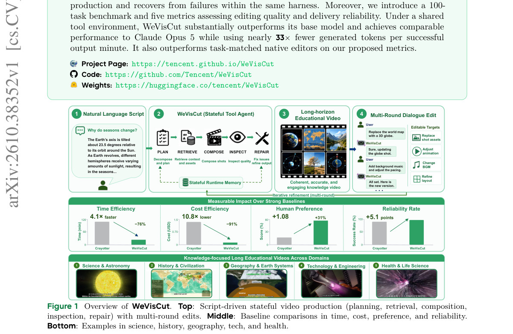

*Result - The WeVisCut agent harness with stateful tool selection. A shared policy chooses legal tools from the evolving production state. Validated returns update artifacts and inform inspection, loca*

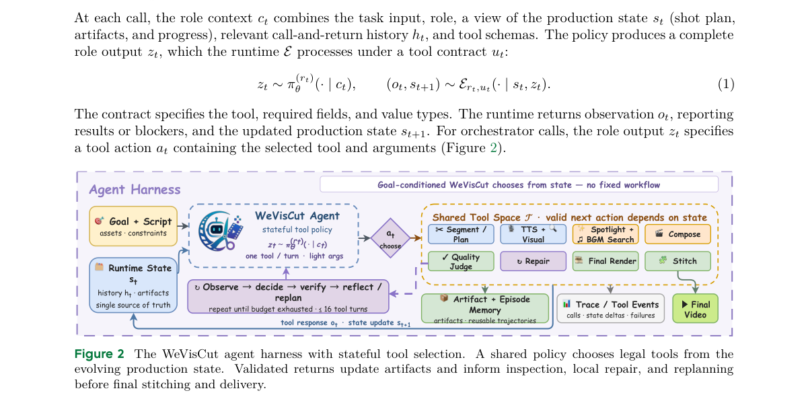

**Why this ranks #8**: 它把「成品视频反推成可执行监督」做成了 13 万条训练数据，再训一个 9B 单体策略，是本线里少见地把 agent 工程与策略学习真正接上的案例。  [wild-card=yes] 长视频编辑智能体靠编辑反演与验证回放构造监督并训练策略，属 agentic 数据合成而非 RL 优化，补位计入。

---

### 9. Compositional Diffusion Planning with Chunk Selection and Reachability Measure

**arXiv**: [2610.38291](https://arxiv.org/abs/2610.38291) | **Score**: 6.7 (relevance 6.5 x 0.7 + quality 7.0 x 0.3) | **Tags**: rl-aigc, diffusion-planner, chunk-composition, reachability-classifier, graph-routing, mode-averaging, Seoul National | **Categories**: cs.RO | **Pages**: 21

**Authors**: Chanyoung Park; Youngjoong Kim; Jaesik Park

**Affiliation**: Seoul National University

**Abstract**

> Compositional diffusion planners have demonstrated remarkable success on long-horizon diffusion planning by sampling short trajectories, namely chunks, and composing them into a long trajectory. However, averaging overlapping chunks can induce the mode-averaging problem, resulting in discontinuous trajectories. Several works aim to address this problem, whereas a non-negligible portion of plans remains infeasible. In this work, we propose Selective Compositional Diffuser (SCD), handling this problem by measuring reachability. To this end, we present a self-supervised learning method for the reachability classifier. This is trained on offline data and generated chunks jointly to address potential distributional mismatch, while reducing the bias inherited from the generated data. Based on this, we construct a graph whose edge costs represent whether consecutive chunks are reachable, and traverse the graph to find effective yet efficient routes. Lastly, we generate bridging trajectories and refine the composed trajectory for smooth transitions. We evaluate our method on OGBench stitching tasks. It practically reduces incompatible mode compositions and the mode-averaging problem compared to the studied baselines. Across tasks, SCD improves success rates, reaching state-of-the-art results on HumanoidMaze-Large and Giant tasks.

**Key findings**

- **Finding**: 论文指出组合式 diffusion planner 通过采样短轨迹 chunk 再拼成长轨迹取得成功，但重叠 chunk 的平均会引发 mode-averaging 问题，产生不连续轨迹。
- **Finding**: 作者观察到仍有相当比例的计划不可行，无法把 chunk 排列成可行组合。
- **Finding**: SCD 用可达性度量来处理这个问题，并提出自监督的 reachability classifier 学习方法。
- **Finding**: 训练时把离线数据与生成的 chunk 一起使用，以缓解分布不匹配并降低继承自生成数据的偏差。
- **Finding**: 由此构造一张图，边代价表示相邻 chunk 是否可达，再在图上遍历以寻找有效且高效的路线，最后生成桥接轨迹并细化合成轨迹以获得平滑过渡。
- **Finding**: 在 OGBench 的 stitching 任务上，SCD 相对基线减少了不兼容的模式组合与 mode-averaging，多个任务成功率提升，在 HumanoidMaze-Large 与 Giant 上达到最好结果。
- **Inference**: 与本线的边界：这是 inference-time 的候选筛选，选择依据是学出来的可达性判别器而非 reward 模型，也没有对生成器本身做 RL 更新。
- **Recommendation**: 选读。做扩散规划、长程组合生成的读者值得看可达性建图思路；关心 RL 训练生成模型的读者可只借它的判别器训练配方。

**Key figures**

*Framework - Overview of the SCD pipeline. Double-dotted lines in Fig. 1a represent the initially generated plans. To find the executable plans, (i) we generate plans as in Fig. 1a, (ii) evaluate each st*

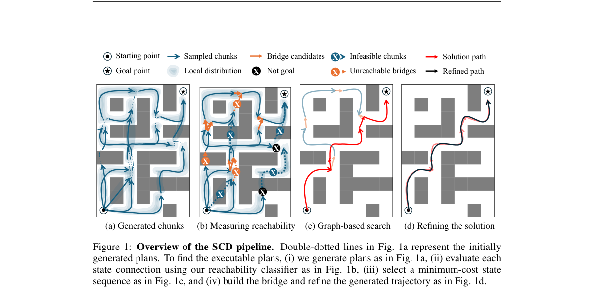

*Result - Failure cases in HumanoidMaze- Giant. The red color denotes infeasible trajecto- ries and the blue color denotes feasible ones. Valid refers to the percentage of feasible trajectories. More*

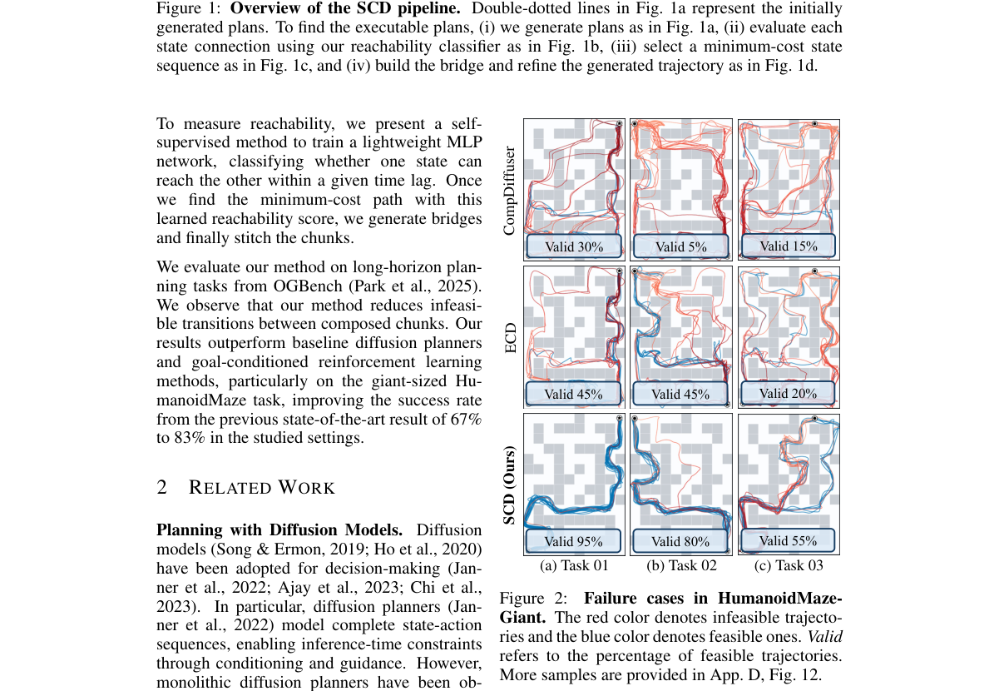

**Why this ranks #9**: 它用自监督学到的 reachability 判别器在多个采样 chunk 之间做选择，属于 inference-time selection 家族，但打分器判的是几何可达性而不是美学或偏好。  [wild-card=yes] 扩散规划的分块选择与可达性度量接近 Best-of-N 式的候选挑选，但用的是可达性而非可验证奖励，补位计入。

---

### 10. Structure-retained low-rank adapters for weather synthesis

**arXiv**: [2610.38413](https://arxiv.org/abs/2610.38413) | **Score**: 6.5 (relevance 6.5 x 0.7 + quality 6.5 x 0.3) | **Tags**: rl-aigc, weather-synthesis, low-rank-adapter, structure-preservation, sdxl, data-generation, Unknown | **Categories**: cs.CV | **Pages**: 10

**Authors**: Shunxin Wang; Alexandros Stergiou; Luuk Spreeuwers; Estefania Talavera; Nicola Strisciuglio

**Affiliation**: [unverified]

**Abstract**

> Real-world deployment of computer vision models, particularly in outdoor scenarios, is often limited by environmental interferences, such as adverse weather. Improving model robustness across weather conditions is thus critical for reliability. However, sourcing high-quality data relevant to isolated weather effects is a significant challenge. Most datasets include changes in dynamic elements across observations of the same scene: subjects such as pedestrians and vehicles change between shots, while camera viewpoints vary. These aspects make it difficult to decouple solely weather-induced distribution shifts from the scene. In this work, we address this with a novel weather synthesis framework that utilizes structure-retaining Low-Rank Adapters (LoRA). We analyze the attention blocks in Stable Diffusion XL (SDXL) and identify where relevant structural information is mostly processed during image-to-image translation. Through an architectural analysis of SDXL, we learn structural LoRA matrices for the corresponding blocks and then leverage them for weather synthesis, eliminating the need for external conditioning such as ControlNet. Experimental results demonstrate that our method improves upon existing synthesis approaches, achieving greater realism while preserving structure. This provides a robust pipeline for generating high-fidelity training and evaluation data for outdoor computer vision applications.

**Key findings**

- **Finding**: 论文指出室外视觉模型的部署常被恶劣天气这类环境干扰限制，获取只含天气因素的高质量数据十分困难。
- **Finding**: 原因是常见数据集里同一场景的多次观测还混着行人车辆等动态元素变化与视角变化，难以把天气引起的分布漂移单独剥离出来。
- **Finding**: 作者的做法是先用结构保持的 Low-Rank Adapter 搭一套天气合成框架。
- **Finding**: 他们分析 SDXL 的注意力块，定位到图像到图像翻译过程中结构信息主要在哪些块被处理。
- **Finding**: 基于这一架构分析，他们为对应块学习结构化 LoRA 矩阵并用于天气合成，从而不再需要 ControlNet 这类外部条件。
- **Finding**: 实验显示该方法优于既有合成方案，真实感更高同时保持结构；卡片里的贡献还提到它改善了天气效果的多样性且计算开销较小，为室外计算机视觉应用生成高保真的训练与评测数据提供了完整管线。
- **Inference**: 与本线的边界很清楚：这篇是扩散编辑与数据合成工作，既没有 reward 也没有偏好优化，它与 guidance 家族的关系只是「替代外部条件注入」这一条路径。
- **Recommendation**: 选读。做恶劣天气数据合成或需要保结构的图像编辑的读者值得看；研究生成模型 RL 的读者可跳过。

**Key figures**

*Framework - Text-guided weather manipulation with structure-LoRA for preserving the structural layout of input images.*

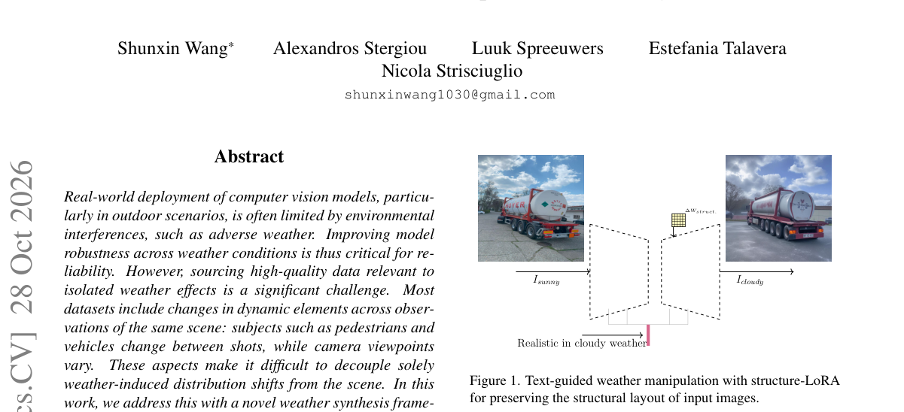

**Why this ranks #10**: 它通过分析 SDXL 的注意力块定位结构信息在哪里被处理，把天气变化做成只动这几块的 LoRA，是生成数据合成里少见的「先做架构分析再动手」的做法。  [wild-card=yes] 保留结构的低秩适配用于天气合成，属生成模型的参数高效微调，补位计入。

---

## Footer

- Total papers scanned across all 7 tracks: 336（原始 446 条）
- rl_aigc track final top-10: 10
- Wild-cards in this track: 9
- Figure assets: 2026-10-29/res/

Generated by `mine-arxiv-daily-digest` skill. Sister file: `2026-10-29_rl_aigc_entry.md`.
