# ArXiv Daily Digest - 2026-10-29 (强化学习 · 核心算法 / 理论 / MARL, 10 papers)

**Generated**: 2026-10-31 17:30 CST

**Source**: arXiv cs.CV, cs.SD, eess.AS, cs.CL, cs.AI, cs.RO, cs.LG submissions, listing day 2026-10-28 (announced 2026-10-29 00:00 UTC)

**Batch window**: 2026-10-27T18:00:00Z .. 2026-10-28T18:00:00Z（arXiv 公告批次横跨两个 UTC 日：前一日 18:00 UTC 起算，当日 17:59:59 UTC 截止）

**Track**: rl_core (top 10 of 336 papers scanned, 70 full reads)

**Scope**: RL 算法本身与理论、奖励学习、多智能体 RL、规划控制、sim-to-real 与 agentic RL

---

## Top 10 - 强化学习 · 核心算法 / 理论 / MARL

### 1. Learning from Relative Action Credit for Escaping Local Minima

**arXiv**: [2610.38034](https://arxiv.org/abs/2610.38034) | **Score**: 8.8 (relevance 9.0 x 0.7 + quality 8.5 x 0.3) | **Tags**: rl-core, credit-assignment, action-conditioned-critic, local-minima, peg-insertion, exploration-noise, Istituto Italiano di Tecnologia | **Categories**: cs.LG, cs.RO | **Pages**: 2

**Authors**: Giovanni Minelli; Giulio Turrisi; Lorenzo Amatucci; Victor Barasuol; Claudio Semini

**Affiliation**: Istituto Italiano di Tecnologia

**Abstract**

> Reinforcement learning holds the promise of robots that learn manipulation skills from interaction alone, without pretrained priors or demonstration data. In practice, on-policy methods such as PPO routinely stall on long-horizon, contact-rich tasks: dense reward shaping carries the policy through stages, yet stitching them together and discovering sparsely rewarded events rarely succeeds. We trace this failure to the missing action discrimination in state-value credit assignment: a state-value critic judges progress only by episode outcomes, so when the policy converges to a partial solution all outcomes coincide, and improvement stops because no action can prove better than another. We therefore extend PPO with an action conditioned value critic which, can compare the executed action with alternatives sampled at the same state and aid the learning signal. Combined with Generalized Advantage Estimation and a bound on exploration noise, we show how the extended algorithm escapes the plateau and completes precise peg insertion within a training budget where PPO with identical exploration fails.

**Key findings**

- **Finding**: 论文指出 on-policy 方法如 PPO 在长时程、接触密集任务上常陷入停滞，稠密 reward shaping 能带过各个阶段却难以把它们缝合起来。
- **Finding**: 作者把这一失败归因于 state-value credit assignment 中缺失的动作区分度：策略收敛到部分解时各结果趋同，无法证明某个动作优于另一个。
- **Finding**: 改进是给 PPO 加一个 action conditioned value critic，把执行动作与同状态下采样的替代动作做比较以辅助学习信号。
- **Finding**: 结合 Generalized Advantage Estimation 与对探索噪声的界限后，扩展算法在相同探索条件下越过了平台期。
- **Finding**: 在同样的训练预算下，扩展算法完成了精密 peg insertion，而 PPO 失败。
- **Inference**: 相对动作信用把「进步」从 episode 结局改成同状态内的动作对比，绕开了稀疏奖励最难的部分。
- **Recommendation**: 推荐做接触密集机器人 RL 的读者，思路可迁移到其他以状态值为中心的 on-policy 算法。

**Key figures**

*Framework - Task scene with detail of the contact-rich insertion stage: the peg, grasped and transported, must be aligned with and inserted into a tight-fitting hole.*

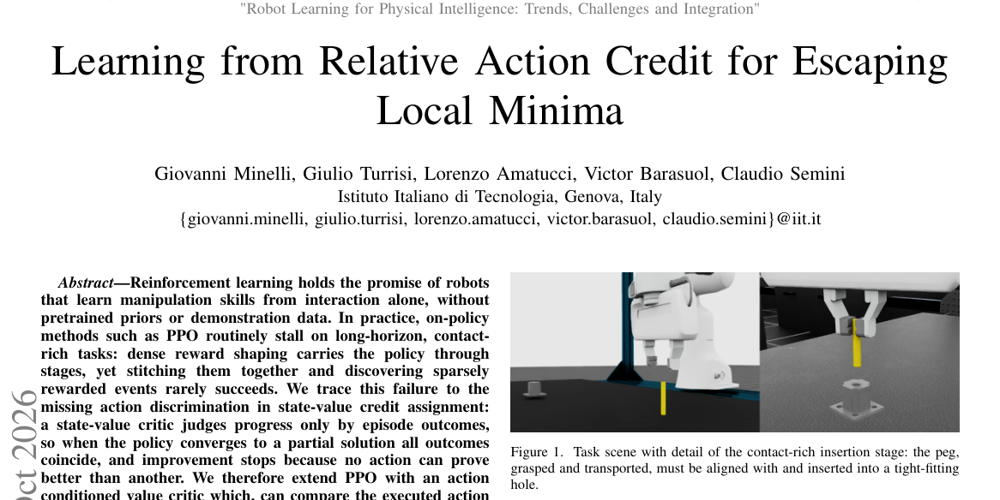

*Result - Normalized training reward on the multi-stage peg-insertion task (5 seeds); horizontal bands mark the reward level of each completed stage. PPO (blue) stalls mid-task without reaching insert*

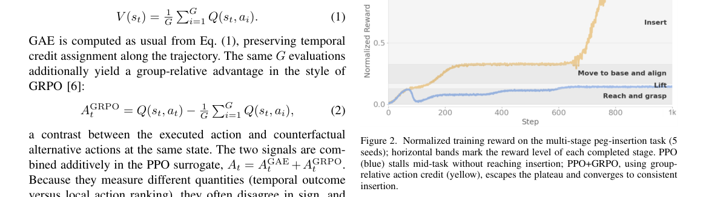

**Why this ranks #1**: 它把 PPO 在接触密集长时程任务上的平台期归因到 state-value critic 无法区分同状态不同动作，并用 action-conditioned critic 做相对比较后成功完成精密 peg insertion。

---

### 2. Cooperative EV Charging Assignment Using Multi-Agent Reinforcement Learning: A Comparison of QMIX and Independent Q-Learning Under Urban Traffic Uncertainty

**arXiv**: [2610.38053](https://arxiv.org/abs/2610.38053) | **Score**: 8.0 (relevance 8.0 x 0.7 + quality 8.0 x 0.3) | **Tags**: rl-core, multi-agent-rl, ctde, ev-charging, sumo-sim, ablation, Mohammed V | **Categories**: cs.LG, cs.MA | **Pages**: 14

**Authors**: Nour-Eddine Moumni; Rachid Alaoui; Driss Kiouach

**Affiliation**: Mohammed V University; Sidi Mohamed Ben Abdellah University

**Abstract**

> The allocation of electric vehicles to public charging stations is increasingly constrained by the fact that several heterogeneous facilities often serve the same stream of requests while observing only partial local information. An accept/reject decision that is defensible for one station may nevertheless reduce the efficiency of the charging district as a whole. We formulate this operational problem as a Decentralized Partially Observable Markov Decision Process (Dec-POMDP) and examine whether Centralized Training with Decentralized Execution (CTDE), instantiated through QMIX, improves assignment performance relative to a cooperative Independent Q-Learning baseline (IQL). The evaluation uses a six-station urban network simulated with SUMO, five independent random seeds, 200 training episodes, and four traffic flux scenarios ranging from 100 to 250 vehicles/hour. Under this protocol, QMIX reaches a mean reward per evaluated decision of +0.776, versus +0.578 for IQL (delta = +0.198, seed-paired Cohens dz = 2.98, exact two-sided Wilcoxon p = 0.0625, the minimum attainable value at this sample size), and raises the acceptance rate from 72.4% to 94.0% (delta = +21.6 pp, dz = 5.24, Wilcoxon p = 0.0625). A five-variant ablation suggests this gain is primarily attributable to the CTDE architecture when holding cooperative reward terms fixed, though not formally isolated with a single seed. By contrast, cooperative reward shaping and experience sharing show no clear descriptive benefit and may slightly reduce performance. These findings support the view that, for multi-station charging assignment, coordination should be embedded in the learning architecture rather than added only through heuristic cooperation terms.

**Key findings**

- **Finding**: 论文把电动车分配到公共充电站的形式化为 Dec-POMDP，比较 CTDE 的 QMIX 与合作式 Independent Q-Learning（IQL）基线。
- **Finding**: 评估用 SUMO 模拟的六站城市网络、五个独立随机种子、200 个训练回合，覆盖每小时 100 到 250 辆的四档交通流量。
- **Finding**: QMIX 每次决策的平均奖励为 +0.776，IQL 为 +0.578（差值 +0.198），种子配对 Cohen's dz = 2.98，精确双侧 Wilcoxon p = 0.0625，即该样本量下可取到的最小值。
- **Finding**: 接受率从 72.4% 提升到 94.0%（+21.6 个百分点，dz = 5.24，Wilcoxon p = 0.0625）。
- **Finding**: 五变体消融提示收益主要来自 CTDE 架构本身，但因只有单个种子未能严格隔离；相比之下 reward shaping 与经验共享没有明确收益，甚至可能略微降低性能。
- **Inference**: 统计显著性在这个样本量下已被推到边界，数值差异应被当作趋势而非定论来读。
- **Recommendation**: 推荐做 CTDE 消融的读者，方法论参考价值高于结论本身。

**Key figures**

*Framework - Overview of the cooperative MARL framework. A centralized MARL controller trains six station agents (two fast, two medium, two slow) on a SUMO-simulated urban network through CTDE. Each agen*

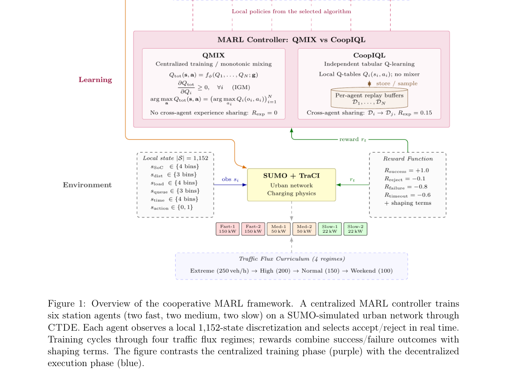

*Result - Reward convergence curves (IQL = blue, QMIX = orange) per traffic flux scenario, show- ing per-episode mean reward across 5 seeds. QMIX converges faster and achieves higher asymptotic perfor*

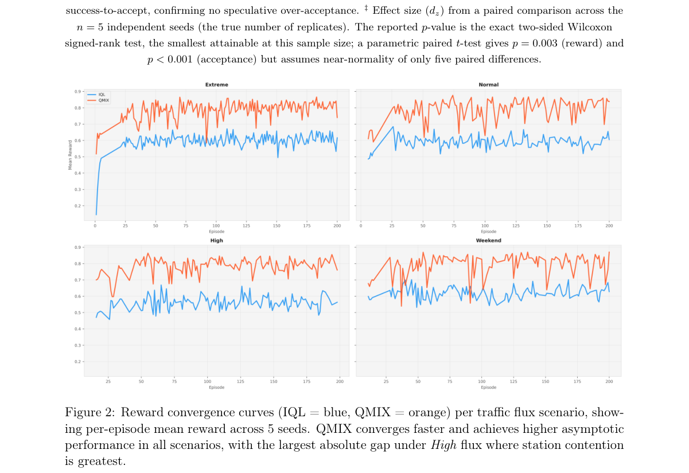

**Why this ranks #2**: 它在同一 Dec-POMDP 协议下把 QMIX 与合作式 IQL 正面对照，并用五变体消融指出差距来自 CTDE 架构本身，而不是常见的 reward shaping 套路。

---

### 3. Multi-Agent Reinforcement Learning for Global Climate Policy Cooperation

**arXiv**: [2610.37870](https://arxiv.org/abs/2610.37870) | **Score**: 7.8 (relevance 8.0 x 0.7 + quality 7.5 x 0.3) | **Tags**: rl-core, climate-policy, negotiation, free-riding, compliance-penalty, cooperation, Technical | **Categories**: cs.GT, cs.LG, cs.MA | **Pages**: 6

**Authors**: Anne Moll-Elsborg; Oskar Bohn Lassen; Francisco Camara Pereira

**Affiliation**: Technical University of Denmark

**Abstract**

> International climate policy requires coordination among countries whose mitigation decisions impose local costs but generate global benefits. Classical game-theoretic and integrated assessment approaches can study these incentives, but typically rely on prescribed behavioural assumptions or equilibrium concepts. Recent work has therefore explored Multi-Agent Reinforcement Learning as a way to model climate-policy cooperation as an emergent outcome of repeated strategic interaction. We extend an existing MARL climate framework with a multi-stage negotiation mechanism in which agents propose agreements, accept or reject commitments, and face penalties for non-compliance. This allows us to study how agreement design affects learned mitigation behaviour, compliance, and climate outcomes. In an idealized setting with four homogeneous agents, we find that non-binding agreements do little to overcome free-riding, while moderate non-compliance penalties improve cooperation and reduce warming. However, excessively strong penalties discourage ambitious commitments, revealing a trade-off between enforcement and participation. We position the framework as a methodological contribution for testing agreement design rather than a predictive model of real negotiations.

**Key findings**

- **Finding**: 论文在一个已有 MARL 气候框架上加入多阶段谈判机制，智能体提出协议、接受或拒绝承诺，并因不遵守而受罚。
- **Finding**: 该机制被用来研究协议设计如何影响学到的减排行为、履约率与气候结果。
- **Finding**: 在四个同质智能体的理想化设定中，无约束力的协议几乎无法克服搭便车。
- **Finding**: 中等强度的违规惩罚能明显改善智能体之间的合作，并降低模拟中的增温幅度。
- **Finding**: 过强的惩罚反而抑制雄心勃勃的承诺，暴露出执行力度与参与意愿之间的权衡。
- **Inference**: 谈判式 MARL 把制度设计变成可迭代的实验变量，比直接调 reward 更有解释力。
- **Recommendation**: 选读给做博弈式多智能体或政策建模的读者，结论限于理想化设定，别当预测模型用。

**Key figures**

*Framework - Multi-stage MARL framework. Module 1a: Agents propose commitments (stage 1) and evaluate them (stage 2). Module 1: They choose climate actions (stage 3), which determine emissions. Module 2:*

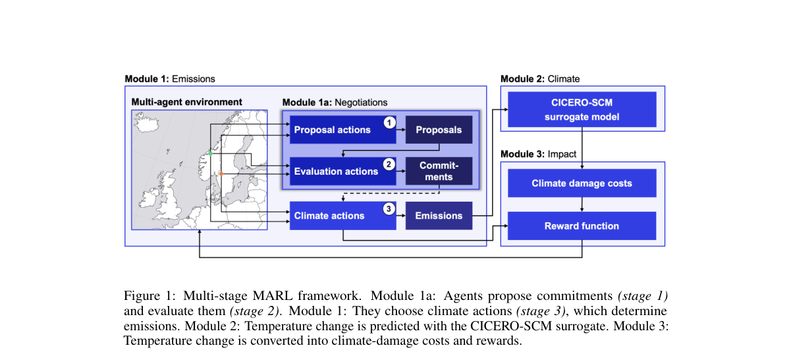

**Why this ranks #3**: 它把「协议怎么签」变成 MARL 里可实验的变量，并给出反直觉结论：中等惩罚改善合作，过强惩罚反而让各方不敢承诺。

---

### 4. EARS-Info: Information-Aware Event-Driven Reallocation for Multi-Robot Exploration

**arXiv**: [2610.38040](https://arxiv.org/abs/2610.38040) | **Score**: 7.8 (relevance 8.0 x 0.7 + quality 7.5 x 0.3) | **Tags**: rl-core, multi-robot-exploration, information-gain, event-driven-reallocation, openstreetmap, communication-dropout, University of Klagenfurt | **Categories**: cs.AI, cs.MA, cs.RO | **Pages**: 11

**Authors**: Kabeh Mohsenzadegan; Vahid Tavakkoli; Kyandoghere Kyamakya

**Affiliation**: University of Klagenfurt; Université de Kinshasa

**Abstract**

> We introduce EARS-Info, an information-aware extension of Event-Driven Ant Reallocation Search for multi-robot exploration on OpenStreetMap-derived grids. It combines marginal sensing gain, feasible relocation, return-aware routing, sensing reservations, and cached shortest paths. Across 168,000 episodes comparing 30 implementations on eight city maps, EARS-Info achieves the highest mean operational score in every evaluation panel. With eight robots and 3% communication dropout, it improves the score over EARS-Safe by 5.43%, increases weighted discovery from 88.88% to 98.46%, and reduces mean energy use by 2.62%. Score differences are positive in all eight cities ($p=0.0078125$; descriptive 95% city-bootstrap interval $[0.0159,0.0694]$), with no simulated incidents across 5,600 EARS-Info episodes. These results support the complete controller; individual component advantages remain uncertain. Generalization is limited by reused geography, one training replicate, coarse maps, and adapted comparison methods.

**Key findings**

- **Finding**: EARS-Info 是 Event-Driven Ant Reallocation Search 的信息感知扩展，作用在 OpenStreetMap 衍生的栅格地图上。
- **Finding**: 控制器组合了边际感知增益、可行重分配、返回感知路径规划、感知预约与缓存最短路。
- **Finding**: 在 168000 个回合、30 种实现、8 张城市地图的比较中，EARS-Info 在每个评估面板都取得最高平均运行分数。
- **Finding**: 在 8 机器人、3% 通信丢包设定下，分数比 EARS-Safe 高 5.43%，加权发现率从 88.88% 升到 98.46%，平均能耗下降 2.62%。
- **Finding**: 分数差在 8 个城市上全为正（p=0.0078125，描述性 95% 城市自助区间 [0.0159, 0.0694]），5600 个回合中无模拟事故。
- **Inference**: 收益来自完整控制器，但单个组件的贡献仍不确定，作者也承认地理复用、单次训练重复与粗粒度地图限制了泛化。
- **Recommendation**: 推荐做多机器人探索与重分配规划的读者，消融部分的诚实表述尤其值得看。

**Key figures**

*Framework - The proposed information controller. Both local exploration and relocation use observable sensing gain. Graph return and runtime action filtering remain part of execution.*

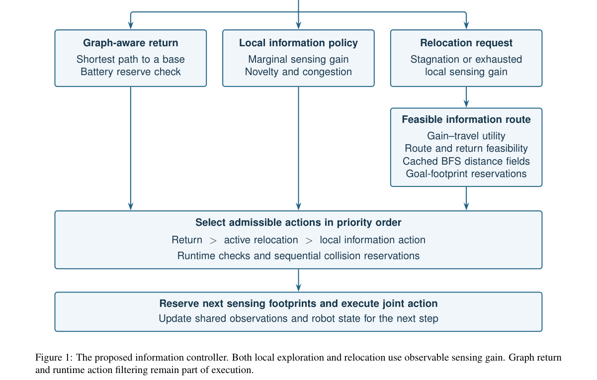

*Result - displays the measured score across team sizes and dropout settings. These are evaluations of one fixed configu- ration, without retuning for individual test cities or settings. Higher dropout*

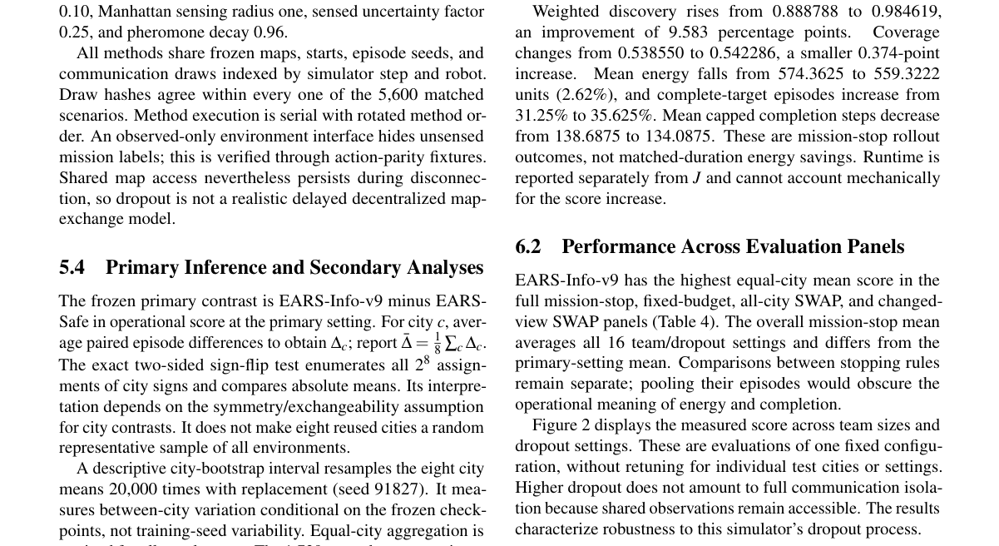

**Why this ranks #4**: 它把「感知能带来多少信息」显式写进多机器人重分配决策，在 8 张城市地图的 168000 回合里全面领先，并把发现率从 88.88% 推到 98.46% 而能耗反而下降。

---

### 5. GARDEN: Generalist Autonomous Reward Design Through Evidence Navigation for Cooperative Multi-Agent Reinforcement Learning

**arXiv**: [2610.37926](https://arxiv.org/abs/2610.37926) | **Score**: 7.8 (relevance 8.0 x 0.7 + quality 7.5 x 0.3) | **Tags**: rl-core, reward-design, llm-agent, reward-transfer, overcooked, smax, Karabuk | **Categories**: cs.AI, cs.MA, eess.SY | **Pages**: 8

**Authors**: Dogan Urgun

**Affiliation**: Karabuk University

**Abstract**

> Cooperative multi-agent reinforcement learning (MARL) enables teams of agents, such as robots and autonomous vehicles, to learn coordinated behavior, but what such teams learn is largely determined by their reward function. Because task success alone provides too little guidance for learning, intermediate rewards are usually designed by hand, and this effort must often be repeated whenever the environment or the team changes. Large language models (LLMs) can automate the effort by writing reward functions as code, yet the resulting rewards are typically designed and tested in a single setting. To enable their reuse across settings, GARDEN (Generalist Autonomous Reward Design through Evidence Navigation) is proposed, in which one reward program is developed for a family of related scenarios and transferred, unchanged, to scenarios that were not available during its design. During development, environment code, training records, and agent behavior are investigated by an LLM reward engineer, and draft rewards are tested in trial training runs, while the learning algorithm and the rule for selecting the final reward are held fixed. On unseen scenarios of the Overcooked and SMAX benchmarks, task returns were increased by 58.2% and 52.5% over the default rewards on two kitchen layouts, and the mean win rate in two combat scenarios was raised from 51.0% to 89.9%. Under matched candidate and probe budgets, this exceeded the 84.2% and 79.2% obtained with fixed diagnostic feedback and Eureka-inspired reward reflection. These results show that a single autonomously engineered reward can be reused effectively across related cooperative scenarios.

**Key findings**

- **Finding**: GARDEN 让一个奖励程序面向一族相关场景开发，再原封不动迁移到设计时未出现的场景。
- **Finding**: 开发过程中由 LLM reward engineer 调查环境代码、训练记录与智能体行为，草案奖励在试跑训练中测试，学习算法与最终奖励的选取规则保持固定。
- **Finding**: 在 Overcooked 与 SMAX 未见场景的两个厨房布局上，任务回报相对默认奖励分别提升 58.2% 与 52.5%。
- **Finding**: 在两个战斗场景中，平均胜率从 51.0% 提升到 89.9%。
- **Finding**: 在候选与探针预算对齐的条件下，该结果超过了固定诊断反馈（84.2%）与受 Eureka 启发的奖励反思（79.2%）取得的提升。
- **Inference**: 关键在于开发期证据的导航方式，而不是 LLM 写 reward 这个动作本身。
- **Recommendation**: 推荐用 LLM 自动化奖励设计的团队，尤其适合已有多个同族场景却反复手写中间奖励的情况。

**Key figures**

*Framework - Overview of GARDEN for one task family. Candidates are developed in independent sessions from shared development evidence and private learning probes (1, 2), assessed with the fixed learner (3*

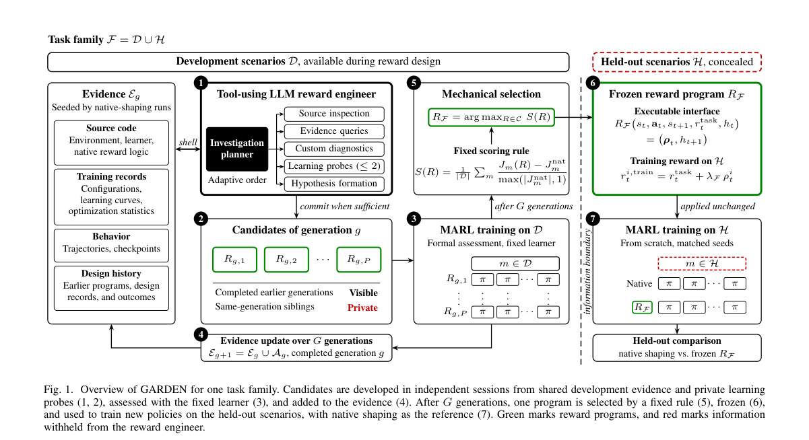

*Result - Held-out scenarios. (a), (b) Overcooked layouts, in which two cooks must coordinate across a dividing counter or around a central counter. (c), (d) SMAX battles with allied units in blue and e*

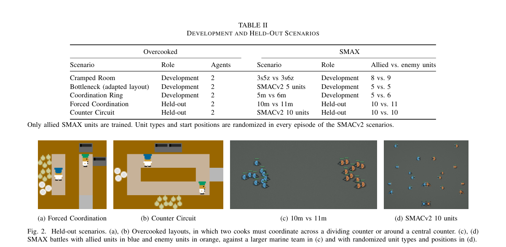

**Why this ranks #5**: 它把 LLM 自动写 reward 从一次性脚本升级成可迁移资产：一个奖励程序原封不动搬到设计时没见过的场景，仍把 Overcooked 与 SMAX 的成绩拉高一大截。

---

### 6. Variational Consequence-Driven Offline Reinforcement Learning

**arXiv**: [2610.38238](https://arxiv.org/abs/2610.38238) | **Score**: 7.5 (relevance 7.5 x 0.7 + quality 7.5 x 0.3) | **Tags**: rl-core, offline-rl, distribution-shift, latent-divergence, consequence-aware, kl-regularization, Nanjing | **Categories**: cs.LG | **Pages**: 35

**Authors**: Wen Jiang; Ke Jiang; Xiaoyang Tan

**Affiliation**: Nanjing University of Aeronautics and Astronautics; MIIT Key Laboratory of Pattern Analysis and Machine Intelligence; The University of Osaka

**Abstract**

> Offline reinforcement learning (RL) typically mitigates distribution shift by imposing divergence constraints on the action distributions of the learned and behavior policies. However, this paradigm cannot ensure the underlying dynamic consistency structure: even minor action deviations can lead to drastically different transitions, inadvertently driving the agent away from the offline dataset. To address this, we explore policy constraints through their induced state-consequence distributions rather than relying on pure action-distribution matching. Nevertheless, directly enforcing such consequence-aware constraints is computationally intractable without access to the true underlying dynamics model. To bypass this issue, we propose Structural Behavior Regularization (StBR), which replaces the intractable objective with a closed-form latent divergence. Structuring this latent space to reflect transition dynamics renders the latent divergence a theoretically bounded surrogate for the true consequence-distribution divergence. By regularizing the learned policy with this latent divergence, StBR adaptively tightens the behavior constraint in dynamics-sensitive regions, effectively preventing deviations outside the offline dataset. Empirically, we demonstrate that StBR achieves superior performance across diverse offline RL benchmarks.

**Key findings**

- **Finding**: 论文指出离线 RL 通常靠对动作分布加散度约束来缓解分布偏移，但这无法保证底层的动态一致性结构。
- **Finding**: 作者改从策略诱导的状态后果分布出发约束策略，直接执行这类后果感知约束在拿不到真实动力学模型时不可计算。
- **Finding**: StBR 用结构化高斯潜空间中的闭式 KL 散度替代不可解目标，潜空间按转移动力学组织，使该散度成为真实后果分布散度的有界代理。
- **Finding**: 用该潜散度正则化学到的策略后，行为约束会在动力学敏感区域自动收紧，防止动作偏离离线数据集。
- **Finding**: 论文在多个离线 RL 基准上报告了优于对比方法的表现，验证了该结构化正则的价值。
- **Inference**: 后果约束是比动作约束更贴近物理直觉的正则方向，代价是需要额外学一个结构化潜空间。
- **Recommendation**: 推荐做离线 RL 的读者，尤其值得对照现有行为正则方法的假设来看。

**Key figures**

*Framework - Conceptual illustration of divergence-based behavior regularization. Purely action distri- bution matching (left) neglects dynamic consistency, whereas ideal consequence-aware constraints (r*

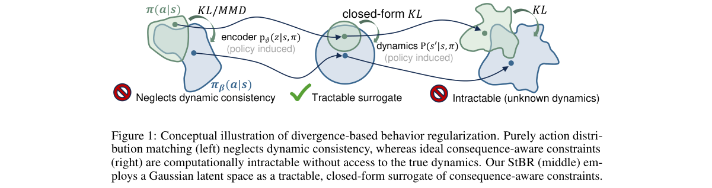

*Result - The architecture of the proposed StBR framework.The blue flow represents the learning of latent representations (Eq. (8)) through the proposed State Belief Gaussian Fitting. The red flow hig*

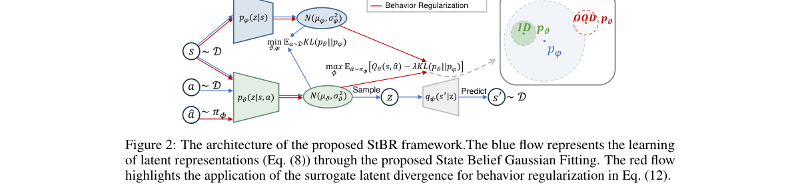

**Why this ranks #6**: 它指出离线 RL 只约束动作分布并不能保证动态一致性，改成约束诱导出的状态后果分布，并用闭式 latent 散度绕开需要真实动力学模型的困难。

---

### 7. CSO: Refining Robotic Policies via Skill Distribution Alignment and Skill-Grained Optimization

**arXiv**: [2610.38357](https://arxiv.org/abs/2610.38357) | **Score**: 7.5 (relevance 7.5 x 0.7 + quality 7.5 x 0.3) | **Tags**: rl-core, skill-quantization, rejection-sampling, policy-optimization, libero, real-robot, Harbin | **Categories**: cs.LG, cs.RO | **Pages**: 31

**Authors**: Zhiyuan Xiang; Xiang Deng; Wanjie Tao; Xu Chen; Zhao Jielun; Weili Guan

**Affiliation**: Harbin Institute of Technology (Shenzhen); Mashang Consumer Finance; Shenzhen Institute for Advanced Study; University of Electronic Science and Technology of China

**Abstract**

> Discretizing continuous actions into discrete skills using methods like VQ-VAE has emerged as a powerful paradigm for robotic manipulation. However, quantization errors yield a suboptimal distribution for the skill prior, degrading its performance. While reinforcement learning offers a path for refinement, its direct application faces unstable encoder updates and a granularity dilemma in importance sampling. To address these challenges, we introduce Cascaded Skills Optimization (CSO), a two-stage post-training framework. First, Rejection-Sampling Supervised Fine-tuning aligns the model's observation-to-skill mapping with the distribution of successful online trajectories via supervised fine-tuning. Second, with the observation encoder frozen, Skills Policy Optimization computes an independent, clipped importance ratio for each complete skill, enabling stable and efficient updates. With a lightweight QueST-style policy, CSO raises overall LIBERO success from 80.1% to 97.5%, improves performance on RoboTwin2.0, and achieves 61.0% success across five physical single-arm tasks. Additional comparisons with FAST, discrete BEAST, and fixed-buffer IQL further validate the effectiveness of our two-stage post-training strategy.

**Key findings**

- **Finding**: 论文指出用 VQ-VAE 之类方法把连续动作离散成 skill 虽有威力，但量化误差会让 skill prior 分布次优并拖低性能。
- **Finding**: 直接上 RL 会遇到编码器更新不稳定，以及重要性采样粒度与决策粒度不匹配这两个困境。
- **Finding**: CSO 第一阶段用 Rejection-Sampling Supervised Fine-tuning，把观测到 skill 的映射对齐到成功在线轨迹的分布。
- **Finding**: 第二阶段冻结观测编码器，为每段完整 skill 计算独立的裁剪重要性比，从而实现稳定高效的更新。
- **Finding**: 配合轻量的 QueST 风格策略，CSO 把 LIBERO 总体成功率从 80.1% 提升到 97.5%，并改善了 RoboTwin2.0 上的表现。
- **Finding**: 在五个实体单臂物理任务上成功率达到 61.0%，与 FAST、离散 BEAST 及固定 buffer 的 IQL 的对比进一步验证了两阶段后训练策略。
- **Inference**: 优化的单位必须与决策的单位一致——按整段 skill 做重要性比，比按 token 做更稳。
- **Recommendation**: 推荐做离散动作策略与后训练的读者，两阶段思路可迁移到其它量化策略。

**Key figures**

*Framework - The architecture and data flow of our proposed CSO framework. Stage 1 (R-SFT): The initial policy is executed to collect trajectories, and successful trajectories are stored in a replay buff*

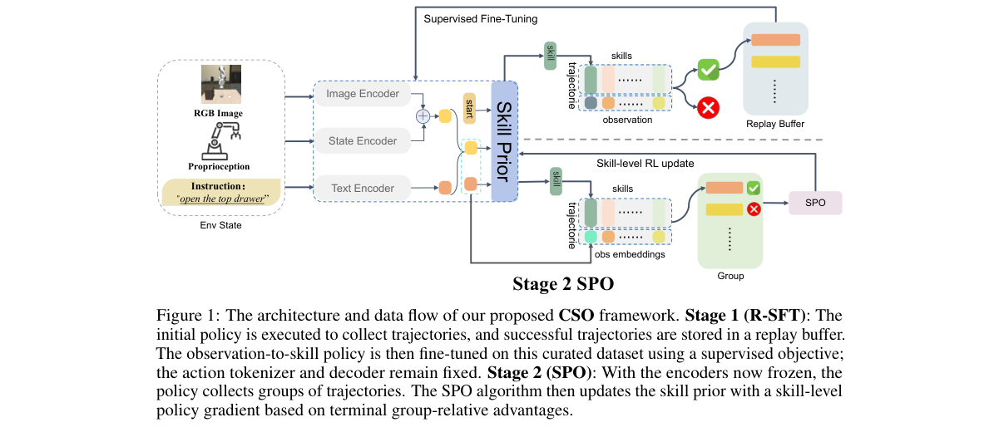

*Result - LIBERO-90 learning curves: mean reward with standard-deviation shading over three seeds. Table 4 separately evaluates LIBERO-Long.*

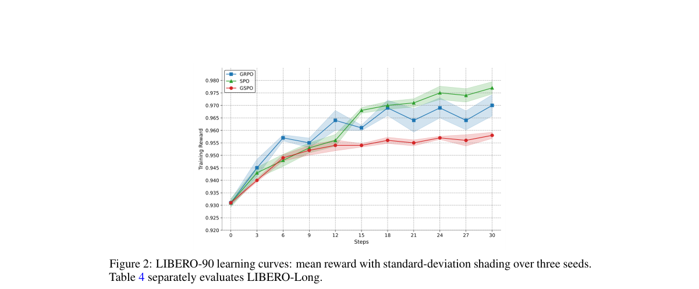

**Why this ranks #7**: 它把 skill 量化后的策略后训练拆成两步：先用拒绝采样监督微调稳住 skill 分布，再对整段 skill 做独立裁剪重要性比更新，把 LIBERO 成功率从 80.1% 推到 97.5% 并落到真机。

---

### 8. Game-Theoretic Foundations for Undiscounted Bisimulation Metrics

**arXiv**: [2610.38313](https://arxiv.org/abs/2610.38313) | **Score**: 7.3 (relevance 7.0 x 0.7 + quality 8.0 x 0.3) | **Tags**: rl-core, bisimulation-metrics, undiscounted-mdp, game-theory, total-reward, average-reward, University of Wisconsin–Madison | **Categories**: cs.AI, cs.GT, cs.LG, math.OC | **Pages**: 56

**Authors**: Matthew Zurek; Yudong Chen; Josiah P. Hanna

**Affiliation**: University of Wisconsin–Madison

**Abstract**

> Bisimulation metrics offer a principled notion of task-relevant state similarity in reinforcement learning, but existing constructions and methods are largely confined to discounted MDPs, where contraction arguments ensure well-defined fixed points and downstream guarantees. We develop a unified foundation for bisimulation metrics in undiscounted settings, that is total- and average-reward problems, by replacing the standard operator-centric view with a game-centric one: we interpret prior metric operators as Bellman-Shapley operators of zero-sum turn-based games and define metrics as the corresponding game value functions, yielding unique definitions even when $γ=1$. This game-theoretic foundation facilitates transfer of dynamic-programming theory and algorithms. We also use this game-centric perspective to characterize how metric finiteness depends on structural properties of the underlying MDP and motivate certain directed metrics that remain finite in weakly communicating MDPs. We further introduce an abstract framework for modifying the games' action spaces, allowing general transition coupling sets, that recovers many existing metrics and guides new constructions. Finally, we prove that these metrics bound total-reward and, when the optimal gain is state-independent, optimal relative value differences. We also provide error and suboptimality guarantees for aggregation-based planning in total- and average-reward settings.

**Key findings**

- **Finding**: 论文指出既有双模拟度量的构造与方法基本局限于折扣 MDP，那里收缩性论证保证不动点存在与下游保证成立。
- **Finding**: 作者用博弈中心视角取代算子中心视角，把已有度量算子解释为零和轮次博弈的 Bellman-Shapley 算子，并把度量定义为相应博弈的价值函数，即使 γ=1 也唯一。
- **Finding**: 这一基础使得动态规划理论与算法可以直接迁移，并用于刻画度量的有限性如何依赖底层 MDP 的结构性质。
- **Finding**: 论文据此提出某些有向度量，它们在弱连通 MDP 中仍然保持有限而不发散。
- **Finding**: 作者引入通过修改博弈动作空间的抽象框架，允许一般的转移耦合集合，可还原许多已有度量并指导新构造。
- **Finding**: 论文证明这些度量可以界定 total-reward，以及当最优增益与状态无关时的最优相对价值差，并给出基于聚合的规划在两种无折扣设定下的误差与次优性保证。
- **Inference**: 把度量当作博弈价值函数，让有限性条件变得可解释，而不是靠折扣收缩来兜底。
- **Recommendation**: 推荐做 RL 理论与状态抽象的读者，这是基础性工作，值得精读公式部分。

**Key figures**

该论文正文未提取到可用图（图表为纯文本/表格排版）。

**Why this ranks #8**: 把双模拟度量从 operator 视角换成零和博弈的 Bellman-Shapley 视角后，γ=1 的 total-reward 与 average-reward 世界第一次有了唯一且有理论支撑的度量定义。

---

### 9. Echo: Scaling Visual Reinforcement Learning with Off-policy Experience

**arXiv**: [2610.37865](https://arxiv.org/abs/2610.37865) | **Score**: 7.1 (relevance 7.0 x 0.7 + quality 7.5 x 0.3) | **Tags**: rl-core, visual-rl, off-policy, inverse-distillation, fasttd3, genesis-sim, Columbia | **Categories**: cs.AI, cs.RO | **Pages**: 16

**Authors**: Gagan Khandate

**Affiliation**: Columbia University

**Abstract**

> Scaling visual reinforcement learning (RL) with GPU-accelerated simulation is computationally expensive due to rendering and visual-policy inference costs. Consequently, two-stage teacher--student distillation is commonly used to train visual policies, but introduces an imitation gap. In this preliminary study, we introduce \echomethod{}, \textbf{a single-stage off-policy RL framework that scales experience collection without proportionally increasing visual computation}. Through \textbf{inverse distillation}, a state-based auxiliary policy imitates the evolving visual policy and collects inexpensive, unrendered experience. Echo leverages this experience for off-policy value learning, directly improving the visual policy through a shared privileged critic. We instantiate \echomethod{} with FastTD3 and evaluate it on three visual control tasks and two dexterous manipulation tasks in Genesis. Relative to \sdpgmethod{} under the evaluated configurations, Echo reduces time to reference returns by an average of \textbf{60\% across the three locomotion tasks} and \textbf{56\% across both hand tasks}, while improving peak mean returns by \textbf{62\% and 12\%}, respectively. Both hand tasks also achieve higher mean returns at matched simulator-transition budgets. These initial results suggest that scaling off-policy experience is a promising approach to efficient direct visual RL.

**Key findings**

- **Finding**: 论文指出用 GPU 加速仿真扩展视觉 RL 时，渲染与视觉策略推理成本高昂，常用两阶段 teacher-student 蒸馏但会引入 imitation gap。
- **Finding**: Echo 是单阶段 off-policy RL 框架，通过逆向蒸馏让 state-based 辅助策略模仿不断演化的视觉策略并收集不渲染的廉价经验。
- **Finding**: 这些经验用于 off-policy 价值学习，并通过共享的 privileged critic 直接改进视觉策略。
- **Finding**: 论文用 FastTD3 实例化 Echo，在 Genesis 上评估三个视觉控制任务与两个灵巧操作任务。
- **Finding**: 相对 SDPG，Echo 把达到参考回报所需时间在三个 locomotion 任务上平均缩短 60%，在两个手部任务上缩短 56%。
- **Finding**: 峰值平均回报分别提升 62% 与 12%，两个手部任务在相同仿真 transition 预算下也取得更高的平均回报。
- **Inference**: 视觉 RL 的瓶颈在渲染而非算法，把经验收集与视觉计算解耦是直接的省算力路径。
- **Recommendation**: 推荐做大规模视觉 RL 的读者，作者自陈是初步研究，可当方向参考。

**Key figures**

*Framework - Scaling visual RL with off-policy auxiliary experience. A state-based imitator collects unrendered transitions, while a small rendered subset supplies visual-policy experience. Both streams*

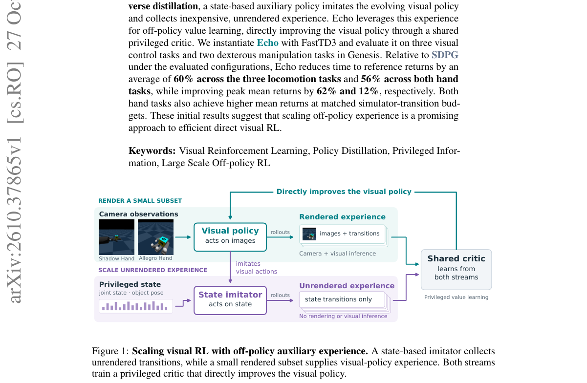

*Result - Two key ideas in Echo. (1) Imitate the visual policy: a state-based imitator matches noise-free visual actions with stopped gradients. (2) Update the visual policy with the shared critic: bo*

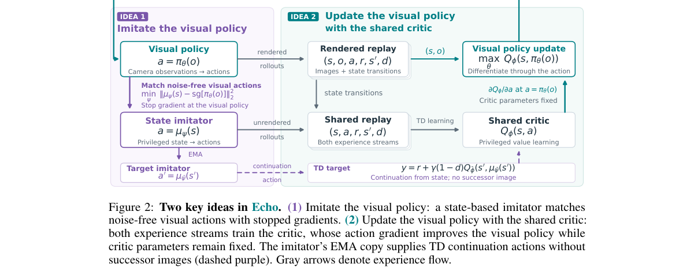

**Why this ranks #9**: 它用逆向蒸馏让 state-based 辅助策略替视觉策略收集不渲染的廉价经验，绕开 teacher-student 蒸馏固有的 imitation gap，把视觉 RL 拉回单阶段。

---

### 10. Transportable Offline Reinforcement Learning in Presence of Unmeasured Confounding

**arXiv**: [2610.38253](https://arxiv.org/abs/2610.38253) | **Score**: 7.1 (relevance 7.0 x 0.7 + quality 7.5 x 0.3) | **Tags**: rl-core, offline-rl, unmeasured-confounding, transportability, instrumental-variables, pessimistic-policy, Duke | **Categories**: cs.LG | **Pages**: 97

**Authors**: Junyi Liao; Hangqi Ren; Zhuoran Yang

**Affiliation**: Duke University; Vanderbilt University; Yale University

**Abstract**

> Offline reinforcement learning seeks to learn decision policies from previously collected data, but deployment environments may differ from the domains in which the data were collected, and logged variables may omit confounders that affected both historical actions and outcomes. We study offline policy learning under the joint challenges of domain discrepancy and unmeasured confounding, where multiple heterogeneous source datasets provide complementary information about a target domain. We develop a causally adjusted transportability framework combining transportability theory with instrumental variables, negative controls, and proxies to identify target-domain causal quantities. For confounded contextual bandits, identification reduces to systems of bridge-function integral equations, enabling minimax estimation from finite samples. Confidence sets for the identified quantities are then used for pessimistic policy optimization, yielding CAT-CCB. We extend the framework to episodic confounded Markov decision processes, where complementary sources identify target reward and transition mechanisms under structural and completeness conditions. Under Gaussian dynamics and linear function approximation, this yields CAT-CMDP. We establish high-probability finite-sample suboptimality guarantees that quantify the effects of approximation, estimation, source-to-target shift, offline coverage, and sample size. For bounded finite-dimensional linear classes, the contextual-bandit guarantee recovers the standard $\widetilde{\mathcal O}(N^{-1/2})$ rate. Numerical experiments support the effectiveness of the framework for learning target-domain policies from heterogeneous confounded data. Together, the results provide a principled approach when no single source dataset suffices for causal identification and policy optimization.

**Key findings**

- **Finding**: 论文研究域差异与未测混淆同时存在下的离线策略学习，多个异质源数据集为同一目标域提供互补信息。
- **Finding**: 作者把 transportability 理论结合 instrumental variables、negative controls 与 proxy 变量，识别目标域的因果量。
- **Finding**: 对有混淆的 contextual bandit，识别可归约为 bridge-function 积分方程组，从而支持有限样本下的 minimax 估计。
- **Finding**: 用识别量的置信集做悲观策略优化得到 CAT-CCB，并扩展到 episodic 的有混淆 MDP，在结构与完备性条件下用互补源识别目标域的奖励与转移机制，得到 CAT-CMDP。
- **Finding**: 论文给出高概率有限样本次优性保证，量化了近似、估计、源到目标偏移、离线覆盖度与样本量的影响。
- **Finding**: 对有界有限维线性类，contextual bandit 的保证回到标准的 N^{-1/2} 速率，数值实验支持该框架的有效性。
- **Inference**: 识别条件写在结构与完备性假设里，没有单一源数据足够时，多源互补才是可行路径。
- **Recommendation**: 推荐做因果推断与离线 RL 交叉方向的读者，理论部分偏硬，需要一定统计基础。

**Key figures**

*Framework - The statistical DAG for a contextual bandit.*

**Why this ranks #10**: 它把 offline RL 的两个硬问题——部署域与数据域不同、且日志里漏掉了同时影响历史动作与结果的混淆变量——放在一起，给出可证明的因果识别与悲观策略优化。

---

## Footer

- Total papers scanned across all 7 tracks: 336（原始 446 条）
- rl_core track final top-10: 10
- Wild-cards in this track: 0
- Figure assets: 2026-10-29/res/

Generated by `mine-arxiv-daily-digest` skill. Sister file: `2026-10-29_rl_core_entry.md`.
