# ArXiv Daily Digest - 2026-10-29 (强化学习 · LLM 后训练与对齐, 10 papers)

**Generated**: 2026-10-31 17:30 CST

**Source**: arXiv cs.CV, cs.SD, eess.AS, cs.CL, cs.AI, cs.RO, cs.LG submissions, listing day 2026-10-28 (announced 2026-10-29 00:00 UTC)

**Batch window**: 2026-10-27T18:00:00Z .. 2026-10-28T18:00:00Z（arXiv 公告批次横跨两个 UTC 日：前一日 18:00 UTC 起算，当日 17:59:59 UTC 截止）

**Track**: rl_llm (top 10 of 336 papers scanned, 70 full reads)

**Scope**: LLM 后训练阶段的 RL：RLHF / DPO / GRPO / RLVR / RLAIF、奖励建模与可验证奖励

---

## Top 10 - 强化学习 · LLM 后训练与对齐

### 1. SCOPE: Selective Critical-Step On-Policy Self-Distillation for Agentic Reinforcement Learning

**arXiv**: [2610.38391](https://arxiv.org/abs/2610.38391) | **Score**: 8.8 (relevance 9.0 x 0.7 + quality 8.5 x 0.3) | **Tags**: rl-llm, on-policy-distillation, hindsight-skill, agentic-rl, error-step-localization, length-efficiency, Zhejiang | **Categories**: cs.AI | **Pages**: 23

**Authors**: Qirui Liu; Wei Cao; Yu Mi; Yichen Sun; Xuekun Zhang; Lei Liu; Yue Shen; Zhixuan Chu

**Affiliation**: Zhejiang University; Ant Group

**Abstract**

> Outcome-based reinforcement learning provides coarse supervision for long-horizon LLM agents: failed trajectories may contain correct steps, while successful trajectories can contain errors. Trajectory-level skills can also shift teacher preferences at unrelated steps, introducing off-target distillation signals. We introduce SCOPE, a framework for Selective Critical-Step On-Policy Self-Distillation. After a supervised warm-up, the policy analyzes its own trajectories, generates step-specific hindsight skills, and distills their guidance only at selected error steps. A bounded signed teacher-student coefficient stabilizes auxiliary updates while preserving positive reinforcement and negative correction. A success-relative pairwise length reward further encourages efficient task completion. Experiments on ALFWorld and WebShop demonstrate consistent improvements across multiple model backbones. With Qwen2.5-3B, SCOPE achieves 97.7% success on ALFWorld and 85.2% on WebShop, outperforming SEED by 5.9 and 6.3 percentage points, respectively. On unseen ALFWorld tasks, SCOPE reaches 89.6% success, improving over GRPO by 23.2 percentage points with 46.7% fewer interactions. Scaling to Qwen3-32B, SCOPE achieves 99.2% success on seen ALFWorld tasks and 94.0% on unseen tasks.

**Key findings**

- **Finding**: SCOPE 在有监督 warm-up 之后让策略分析自己的 rollout，生成 step-specific 的 hindsight skill，并且只在选中的错误步骤上蒸馏这些指导。
- **Finding**: 论文指出轨迹级 skill 会把教师偏好带到无关步骤上，产生 off-target 蒸馏信号，这是自蒸馏在长程 agent 任务上失真的主因。
- **Finding**: 方法用有界的 signed teacher-student 系数稳定辅助更新，同时保留正向强化与负向纠正，并额外用 success-relative 的成对长度奖励鼓励高效完成。
- **Finding**: 在 ALFWorld 与 WebShop 上，Qwen2.5-3B 分别取得 97.7% 与 85.2% 的成功率，比 SEED 高 5.9 与 6.3 个百分点。
- **Finding**: 在未见过的 ALFWorld 任务上成功率为 89.6%，比 GRPO 高 23.2 个百分点，同时交互次数少了 46.7%。
- **Finding**: 规模放大到 Qwen3-32B 后，已见任务成功率 99.2%，未见任务 94.0%。
- **Inference**: 与单纯替换 reward 相比，把蒸馏约束在关键错误步上更像是给 outcome 稀疏任务补了一层密集且定位准确的信用分配。
- **Recommendation**: 推荐。做长程 agent RL 的读者必读，想在 outcome 稀疏环境里加自蒸馏信号的团队重点看它的错误步选择机制。

**Key figures**

*Framework - Motivation and results of SCOPE. (a) Outcome–step mismatch. (b) Off-target skill signals. (c) Training dynamics (mean ± std. across seeds); Unbounded SCOPE uses raw-gap OPSD. (d) Qwen2.5-3B r*

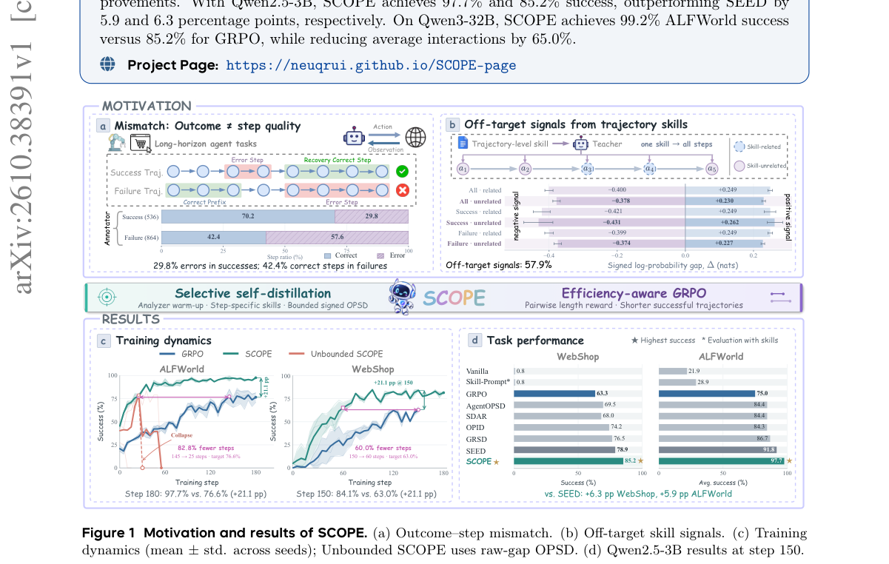

*Result - Overview of SCOPE. Supervised initialization teaches the policy to analyze trajectories and generate corrective skills. During online training, the policy collects and analyzes its own rollou*

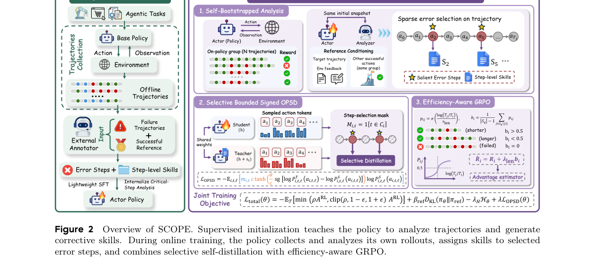

**Why this ranks #1**: 把轨迹级 outcome 监督拆到出错步骤上做自蒸馏，是本批里最正面回应「奖励太粗」这一核心痛点的 agentic RL 工作。

---

### 2. Nemotron 3.5 Super and Lightning: Open, Efficient Mixture-of-Experts Hybrid Mamba-Transformer Models for Agentic AI

**arXiv**: [2610.38095](https://arxiv.org/abs/2610.38095) | **Score**: 8.5 (relevance 8.5 x 0.7 + quality 8.5 x 0.3) | **Tags**: rl-llm, moe-architecture, hybrid-mamba-transformer, rlvr-post-training, speculative-decoding, multi-teacher-distillation, NVIDIA | **Categories**: cs.AI, cs.CL, cs.LG | **Pages**: 79

**Authors**: NVIDIA; :; Aastha Jhunjhunwala; Aayushi Ashokkumar Srivastava; Abhibha Gupta; Abhinav Garg; Abhinav Khattar; Achsah Wildish; Adam Rajfer; Adi Renduchintala; Adil Asif; Adriana Flores Miranda

**Affiliation**: NVIDIA

**Abstract**

> We introduce Nemotron 3.5 Super and Nemotron 3.5 Lightning, open and efficient Mixture-of-Experts Hybrid Mamba-Transformer models designed for reasoning, long-context understanding, and agentic workloads. Super is a 120B-parameter, 12B-active multimodal model, while Lightning is a smaller 30B-parameter, 3B-active text model; both designed for efficient deployment. Both models combine large-scale distillation, long-context training, and native speculative decoding, while Super further incorporates Indic continued pretraining and agentic software-engineering mid-training. We develop a comprehensive post-training pipeline spanning supervised fine-tuning and reinforcement learning (RLVR and RLHF), complemented in Super by specialized teacher training and multi- teacher on-policy distillation (MOPD). This transforms Super from a text-only base model into a multimodal agent capable of reasoning over text, images, video, and interactive tool environments. We further explore test-time scaling through parallel agent execution and self-verification. Across training and deployment, we jointly optimize capability and efficiency. Indic continued pretraining improves Indian-language benchmarks by up to 9.82 percentage points, while agentic mid-training strengthens software-engineering capabilities and robustness across agent harnesses. The post-trained Super model achieves 51.78% on SWE-bench Pro, surpassing Nemotron 3 Ultra despite using approximately 4.6x fewer active parameters. Post-training MTP boosting improves speculative- decoding acceptance length by up to 21.8% under probabilistic draft sampling, while NVFP4 quantization achieves 99.62% median accuracy recovery relative to BF16. Inference optimizations enable up to 4,856 output tokens/s/GPU on GB200 while sustaining at least 50 tokens/s/user.

**Key findings**

- **Finding**: Super 为 120B 总参、12B 激活的多模态 MoE，Lightning 为 30B 总参、3B 激活的纯文本模型，两者都是 Mamba-Transformer 混合架构。
- **Finding**: 论文公开了从 SFT 到 RL（RLVR 与 RLHF）的完整后训练流水线，Super 还额外加入专用教师训练与多教师 on-policy 蒸馏（MOPD）。
- **Finding**: 后训练后的 Super 在 SWE-bench Pro 上达到 51.78%，超过 Nemotron 3 Ultra，而激活参数量约为对方的 1/4.6。
- **Finding**: MTP boosting 让概率式 draft 采样下的投机解码接受长度最多提升 21.8%，NVFP4 量化相对 BF16 保留 99.62% 的中位准确率恢复。
- **Finding**: 在 GB200 上推理优化可做到每 GPU 最高 4856 个输出 token/s，同时维持每用户至少 50 token/s。
- **Finding**: 论文还探索了并行 agent 执行与自验证形式的 test-time scaling，并发布基座、后训练与量化 checkpoint 及训练配方。
- **Inference**: 这类报告的价值不在某个单点算法，而在把 RL、蒸馏、量化与推理压缩的口径一次对齐，社区可以照抄流程而不必猜配方。
- **Recommendation**: 推荐。做 agentic 后训练或推理成本优化的团队优先读，checkpoint 与 recipe 均开放，适合直接当基线。

**Key figures**

*Framework - Benchmark performance of Nemotron 3.5 Super (120B-A12B) compared with six leading open models across agentic tasks, code generation, mathematical and scientific reasoning, multi- modal unde*

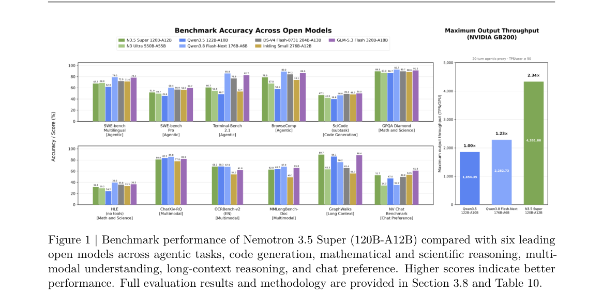

*Result - Four-stage Indic synthetic-data pipeline implemented using NeMo Data Designer for the twelve priority languages. Selected English source documents, primarily from Nemotron-CC, contain fewer*

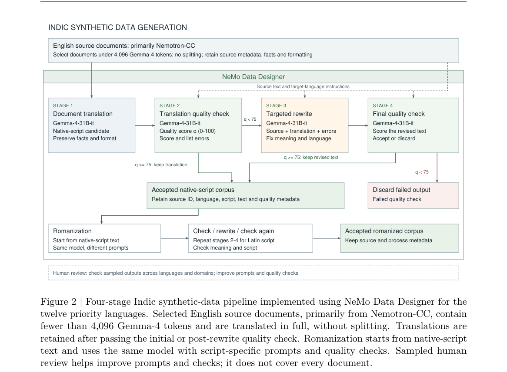

**Why this ranks #2**: 把 RLVR/RLHF、多教师 on-policy 蒸馏、量化与投机解码一次性写进同一份可复现的 open 配方，是本批最完整的工业级后训练流水线披露。

---

### 3. Predict the Reward, Not the World: World Reward Models for ML Agents

**arXiv**: [2610.38439](https://arxiv.org/abs/2610.38439) | **Score**: 8.0 (relevance 8.0 x 0.7 + quality 8.0 x 0.3) | **Tags**: rl-llm, reward-model, program-search, execution-feedback, calibrated-probability, world-model-critique, Hong Kong | **Categories**: cs.AI, cs.CL | **Pages**: 21

**Authors**: Yuxiao Lee; Zherui Yang; Fan Liu; Hao Liu

**Affiliation**: The Hong Kong University of Science and Technology

**Abstract**

> Search-based machine-learning (ML) agents improve a solution by writing candidate programs, executing them, and keeping the best. Execution gives the search reliable feedback, but a single run can take hours, and most runs end in programs the agent discards. Recent agents try to save these runs by letting a large language model act as a world model that predicts how each program would perform. However, a wrong prediction feeds the search false information. We argue that an agent does not need to predict the outcome of execution, only the decision that execution would support. We propose World Reward Models (WRMs), which learn from real execution results to choose directly which candidate will perform better, without predicting any intermediate outcome. We prove that a selector which predicts execution from the same inputs cannot outperform the best direct selector, that predicted outcomes add an error which can make a likelihood-trained world model prefer the worse program on every instance, and that cross-entropy on executed winners drives a WRM toward the optimum. Our WRM, ForeCritic, adapts a 9B typed decision model to 5k executed program pairs. On 12,438 held-out pairs from 26 ML tasks, it picks the better program 79.4% of the time, while general-purpose LLM judges reach 53--62%, and its probabilities are calibrated. Inside AIDE, ML-Master, and ForeAgent, it cuts mean task time by 4.4--7.5 times while keeping their mean scores within 0.01 or raising them.

**Key findings**

- **Finding**: World Reward Model 从真实执行结果中学习，直接选出更优的候选程序，而不预测任何中间执行结果。
- **Finding**: 论文证明：从相同输入预测执行的 selector 无法超过最好的直接 selector，且预测结果引入的误差可能让似然训练的 world model 在每个样本上都偏好更差的程序。
- **Finding**: 论文进一步证明，在已执行的胜者上做交叉熵会把 WRM 推向最优解。
- **Finding**: ForeCritic 把一个 9B 的 typed decision model 适配到 5000 对按执行得分标注的程序对上。
- **Finding**: 在 26 个 ML 任务的 12438 对留出样本上，它 79.4% 的时间选对更优程序，而通用 LLM judge 只有 53% 到 62%，且输出概率经过校准。
- **Finding**: 接入 AIDE、ML-Master 与 ForeAgent 后，平均任务耗时下降 4.4 到 7.5 倍，平均分数保持在 0.01 以内或更高。
- **Inference**: 这对当下「让 LLM 当世界模型预演执行」的做法是个直接提醒：错误的预演比不预演更糟，因为它污染的是搜索的排序依据。
- **Recommendation**: 推荐。做代码与 ML agent 搜索的读者值得读，能把执行成本降一个量级并给出可复现的判别器训练方式。

**Key figures**

*Framework - Three ways to choose which program to keep. (a) Ex-*

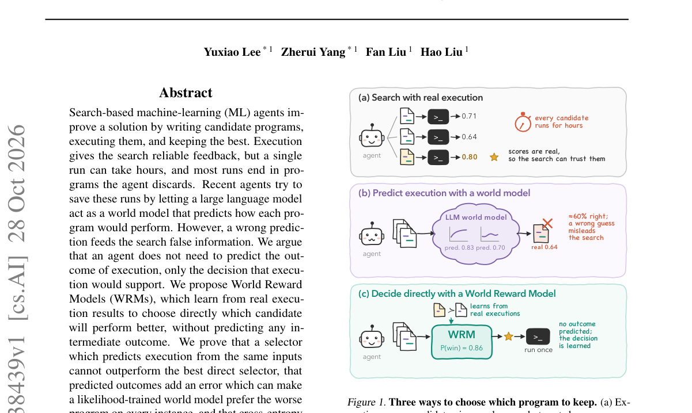

*Result - Predicting execution adds no information about the winner. (a) The predicted trace z is computed from X, so no world-model*

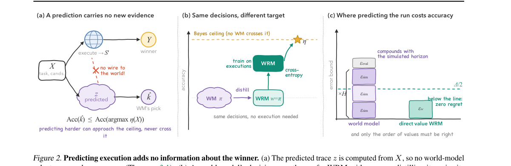

**Why this ranks #3**: 它证明「预测执行结果」不如「直接预测执行会支持哪个决策」，把 LLM-as-world-model 的常见做法换成一个概率可校准的判别器。

---

### 4. Co-Evolving Policy and Rubric via Capability Awareness for Open-Ended Generation

**arXiv**: [2610.38566](https://arxiv.org/abs/2610.38566) | **Score**: 8.0 (relevance 8.0 x 0.7 + quality 8.0 x 0.3) | **Tags**: rl-llm, rubric-reward, capability-diagnosis, closed-loop-rl, self-distillation, open-ended-generation, Alibaba Token Hub | **Categories**: cs.AI | **Pages**: 30

**Authors**: Chengsheng Zhang; Wenshen Xu; Yuchuan Wu; Zhiyuan Yu; Junfeng Fang; Tianlong Wang; Bingxue Qiu; Yongbin Li; Xiang Wang

**Affiliation**: Alibaba Token Hub, Alibaba Group; Nanjing University; National University of Singapore; University of Science and Technology of China

**Abstract**

> Rubric-based reinforcement learning (RL) offers interpretable, fine-grained supervision for aligning large language models (LLMs) on open-ended generation tasks. However, static rubric criteria may become saturated or remain beyond the policy's exploration, rendering the reward signals insufficiently discriminative. While recent efforts seek to guide sampling exploration or evolve rubrics, they fail to explicitly factor in how rubric difficulty should track the evolving policy's capabilities, resulting in a persistent mismatch between the optimization objective and the policy's current capability frontier. In this paper, we propose \textbf{Co}-Evolving Policy and Rubric via \textbf{C}apability \textbf{A}wareness (\textbf{CoCA}), a closed-loop framework that jointly adapts the rubric and policy through criterion-level diagnosis. Specifically, CoCA contrasts query-only and rubric-guided rollouts to characterize each criterion relative to the current policy, recalibrates criteria with mismatched difficulty, and identifies guidance-revealed capability gaps for frontier-based learning. Based on this insight, CoCA either expands rubric-conditioned frontiers through guided optimization or transfers qualified gains through on-policy self-distillation. As the policy updates, CoCA improves the capability diagnosis and enables more reliable distillation, thereby completing the co-evolution loop. Extensive experiments across diverse benchmarks and LLMs demonstrate that CoCA consistently improves performance over rubric-based RL methods. Moreover, CoCA promotes the internalization of guidance-revealed capabilities into query-only behavior while mitigating capability degradation.

**Key findings**

- **Finding**: CoCA 是闭环框架，通过 criterion 级诊断同时调整 rubric 与策略，针对静态准则饱和或超出策略探索范围导致奖励不具判别性的问题。
- **Finding**: 诊断方式是对比 query-only 与 rubric-guided 两组 rollout，据此刻画每条准则相对当前策略的位置。
- **Finding**: 与策略能力错配的准则会被重新标定，被引导揭示出的能力缺口则用于前沿式学习。
- **Finding**: 依据诊断结果，框架要么通过 guided optimization 扩展 rubric 条件下的能力前沿，要么通过 on-policy 自蒸馏把合格增益迁移回 query-only 行为。
- **Finding**: 论文报告在多个 benchmark 与多个 LLM 上，CoCA 持续优于其它 rubric-based RL 方法。
- **Finding**: 该方法还把引导暴露出的能力内化进 query-only 行为，同时缓解能力退化。
- **Inference**: 「先诊断、再决定是拉开前沿还是把能力搬回来」这个分叉比单纯把判据调松调紧更难，但也更贴近策略真实的瓶颈位置。
- **Recommendation**: 推荐。做开放式生成对齐、或研究 rubric 奖励如何自适应的读者优先读，其诊断流程可以直接复用。

**Key figures**

*Framework - Motivation and overview of CoCA. (a) Static criteria may become saturated or remain unmet, limiting reward discriminativeness. (b) Query-only failures can conceal capabilities elicitable und*

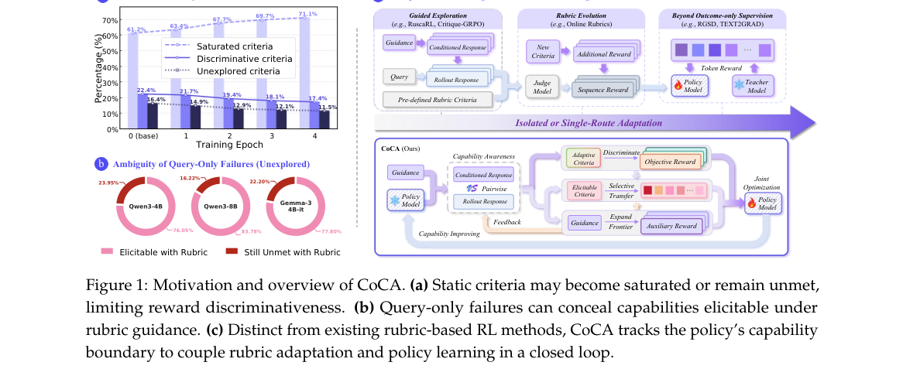

*Result - Pipeline overview of our CoCA. Dual-Group rollouts contrast query-only and rubric- conditioned behavior to diagnose criterion-level capabilities, guiding capability-aware rubric calibration*

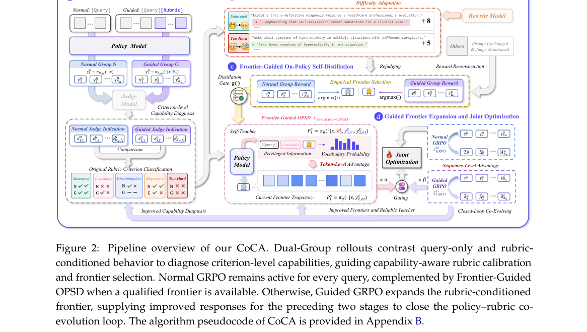

**Why this ranks #4**: 它把 rubric 当成会随策略能力自动标定的活靶子而非固定分数表，是本批 rubric-based RL 里最接近「奖励不具判别性」根因的处理。

---

### 5. Rubricon: Automated Rubric Generation and Refinement for LLM Evaluation and Training

**arXiv**: [2610.38220](https://arxiv.org/abs/2610.38220) | **Score**: 7.5 (relevance 7.5 x 0.7 + quality 7.5 x 0.3) | **Tags**: rl-llm, rubric-generation, synthetic-reward, llm-self-critique, expert-alignment, healthbench, Handshake AI | **Categories**: cs.AI | **Pages**: 52

**Authors**: Ulyana Tkachenko; Hui Wen Goh; Guram Gogia; Jonas Mueller

**Affiliation**: Handshake AI

**Abstract**

> Rubrics enable reward assignment on tasks without verifiable answers, but are expensive to manually produce from scratch. We present Rubricon, a pipeline that generates discriminative rubrics without requiring human preference labels, rubric annotation, or generator-model training. Using any LLM, Rubricon samples multiple rubrics, selects the most discriminative candidate, adds criteria to capture overlooked requirements or response flaws, and prunes criteria that are misaligned or shallow. Alongside LLM self-critique and test-time scaling, Rubricon uses observed criterion pass rates on example model responses to guide refinement. Across five professional, consumer, clinical, and general-use LLM benchmarks, Rubricon produces rubrics whose scores of frontier LLM responses exhibit 9% greater alignment with labor-intensive expert-authored rubrics, compared to the best alternative synthetic rubric generation method among RRD, QSRG, OpenRubrics, and agentic generation via harnesses like Codex. On HealthBench, post-training a Qwen3.5-9B model with Rubricon rubrics yields 4.5% better performance than training with rubrics from the strongest alternative synthetic rubric generator, RRD.

**Key findings**

- **Finding**: Rubricon 是一条自动生成判别性 rubric 的流水线，不需要人工偏好标注、rubric 标注，也不需要专门训练生成模型。
- **Finding**: 流程分 Generate-and-Select、Add 与 Prune 三步：一次 LLM 调用起草、选出最具判别力的候选，再补充遗漏的要求与回答缺陷、剪掉不对齐或浅层的准则。
- **Finding**: 流水线同时利用 LLM self-critique、test-time scaling，以及在样例模型回答上观测到的准则通过率来指导精修。
- **Finding**: 在五个覆盖专业、消费、临床与通用场景的 LLM benchmark 上，其 rubric 对前沿模型回答的评分与人工专家 rubric 的对齐度高 9%。
- **Finding**: 对比对象包括 RRD、QSRG、OpenRubrics，以及用 Codex 这类 harness 做 agentic 生成的方法。
- **Finding**: 在 HealthBench 上，用 Rubricon 的 rubric 后训练 Qwen3.5-9B，比用最强替代生成器 RRD 的 rubric 训练高出 4.5%。
- **Inference**: 关键差别在判别力而非覆盖度——人工 rubric 往往写得细却区分不开强弱模型，而这里靠准则通过率做减法。
- **Recommendation**: 推荐。想用 rubric 做奖励或做无标准答案评测的读者可直接用这条流水线，且换更强的 LLM 即可立刻变好。

**Key figures**

*Framework - The Rubricon pipeline. Given a task prompt, example strong-model responses, and optional reference material, Generate-and-Select drafts 𝐾= 5 candidate rubrics and selects the rubric with the*

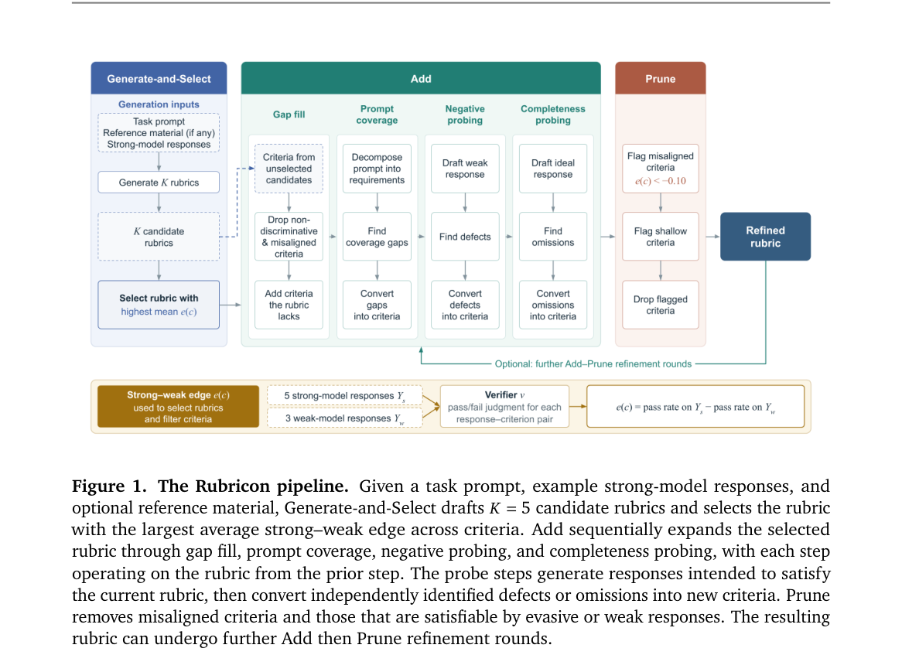

**Why this ranks #5**: 把 rubric 从「人工写的评分表」变成「任意 LLM 一次起草加三轮增删」的流水线，直接压低了无标准答案任务上做奖励建模的门槛。

---

### 6. ATI-OPD: Adaptive Teacher Intervention for Stable Long-Sequence On-Policy Distillation

**arXiv**: [2610.38160](https://arxiv.org/abs/2610.38160) | **Score**: 7.5 (relevance 7.5 x 0.7 + quality 7.5 x 0.3) | **Tags**: rl-llm, on-policy-distillation, teacher-intervention, training-stability, long-reasoning, disagreement-metric, Harbin | **Categories**: cs.CL | **Pages**: 26

**Authors**: Jiannan Guan; Youxin Jiang; Yutai Hou; Qiguang Chen; Yirong Zeng; Haitao Wang; Dengyun Peng; Zheng Yan; Jinhao Liu; Tao Ye; Dandan Tu; Wanxiang Che

**Affiliation**: Harbin Institute of Technology; Huawei Technologies

**Abstract**

> On-policy distillation (OPD) trains a student on its own responses using token-level feedback from a teacher. As responses grow longer, the student's prefix can depart from the teacher's own reasoning, weakening its feedback on later tokens. Updates based on this feedback can reinforce the same deviations in later responses and destabilize training. Prior approaches such as length control and loss reweighting limit learning from problematic responses but leave their prefixes unchanged. Fixed cutoffs can also discard later reasoning. We propose \textbf{Adaptive Teacher Intervention for On-Policy Distillation (ATI-OPD)} to improve subsequent teacher guidance by revising the student's reasoning prefix. ATI-OPD replaces the earliest high-disagreement segment with a short teacher segment, then lets the student resume its own reasoning from the revised text. To handle renewed disagreement, it excludes persistently divergent suffixes from the distillation loss while retaining useful student continuation. Training diagnostics show less teacher-student disagreement, fewer gradient spikes, and fewer extremely long responses. Across five mathematical reasoning benchmarks and two teacher-student pairs, ATI-OPD improves average student-only accuracy over standard OPD.

**Key findings**

- **Finding**: 论文指出响应变长时学生前缀会偏离教师的推理路径，教师对后续 token 的反馈随之变弱，基于这种反馈的更新又会在后续回答中强化同一偏航。
- **Finding**: 以往的长度控制与 loss 重加权只是限制从问题回答中学习，前缀本身不变；固定截断又会直接丢掉后面的推理。
- **Finding**: ATI-OPD 用一段短的教师片段替换最早出现的高分歧片段，然后让学生从改写后的文本继续自己的推理。
- **Finding**: 对重新出现的分歧，它把持续偏离的后缀排除在蒸馏 loss 之外，同时保留有用的学生续写。
- **Finding**: 训练诊断显示师生分歧更小、梯度尖峰更少、极长响应也更少，说明改写前缀确实抑制了偏航的自我强化。
- **Finding**: 在五个数学推理 benchmark 与两组师生配对上，ATI-OPD 相对标准 OPD 提升了学生自身（teacher-free）的平均准确率。
- **Inference**: 这里的「干预」本质是用一次 teacher 采样换取后续数百个 token 的干净监督信号，比一味丢弃长样本更划算。
- **Recommendation**: 推荐。做长链推理蒸馏的读者强烈建议读，它对失稳成因的拆解很实用。

**Key figures**

*Framework - Vanilla OPD on JustRL-DeepSeek exhibits prediction disagreement and training instability. (a) Gap measures the absolute difference between teacher and student log-probabilities for the same*

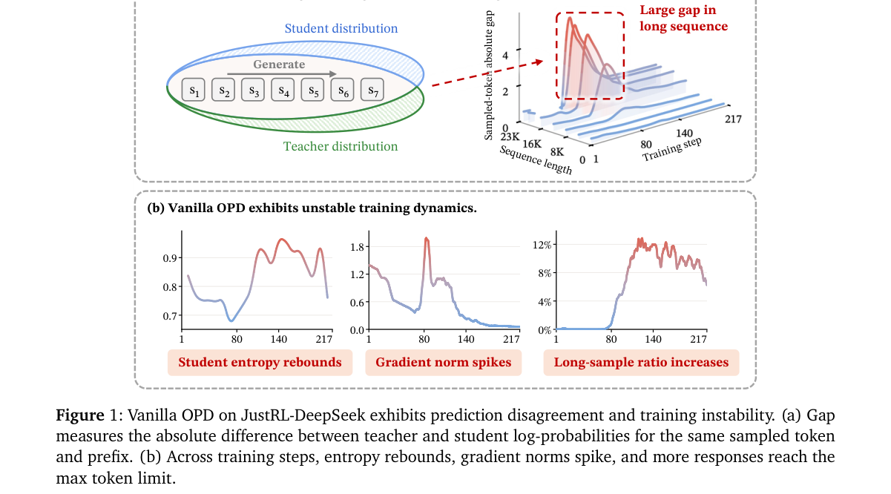

*Result - ATI-OPD replaces a high-divergence student segment with a teacher segment and lets the student generate a new continuation. Persistent divergence after the handoff determines a supervision c*

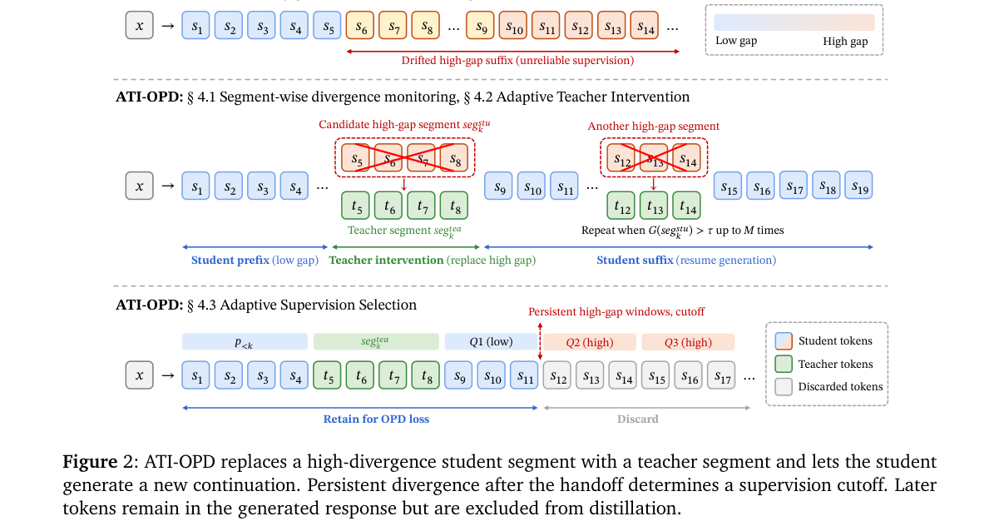

**Why this ranks #6**: 它指出长回答里的 on-policy 蒸馏会自我强化偏航，于是改写学生的推理前缀而不是只降权或截断，直接治的是 OPD 的病根。

---

### 7. How Much Do Teacher Bridges Matter in Interleaved On-Policy Distillation?

**arXiv**: [2610.38383](https://arxiv.org/abs/2610.38383) | **Score**: 7.5 (relevance 7.5 x 0.7 + quality 7.5 x 0.3) | **Tags**: rl-llm, on-policy-distillation, negative-result, gradient-geometry, ablation-study, kl-loss, University of Sydney | **Categories**: cs.CL, cs.LG | **Pages**: 25

**Authors**: Leran Chen; Zhiyuan Yao; Lingnan Kong

**Affiliation**: The University of Sydney; University of California San Diego

**Abstract**

> On-policy distillation (OPD) trains a student using teacher predictions on student-generated responses. Some methods insert teacher-written segments, or bridges, but disagree on how to train on those tokens. We compare no loss, forward KL and reverse KL on identical trajectories using Qwen3-1.7B as student and Qwen3-4B-Instruct-2507 as teacher. We separate gradients by which model wrote each token. Under our short training runs and BF16 inference, pre-specified tests detected no added accuracy benefit from teacher text as context or as a training target. A one-paragraph bridge after the student's first paragraph is only 2.7% of the tokens and contributes a small gradient nearly orthogonal to the student-token gradient. In this main comparison, the three loss treatments gave similar gradient directions and were statistically equivalent in accuracy within a +/-5 percentage-point margin. An exploratory pilot placing the bridge where failed responses disagreed most with the teacher suggested a benefit from teacher-token loss. A pre-specified replication did not confirm this, and fourfold weighting showed no significant accuracy benefit. Two limitations bound these findings. Among the tested amounts of training on fixed responses, gains peaked after four updates before the student increasingly failed to stop generating. None of the tested online training variants met the criteria for stable stopping and improved accuracy. Our evaluations used BF16 inference, which rounds away most of the small weight changes. When evaluated in exact FP32, the tested replication models frequently reached the response-length limit. Our accuracy findings therefore concern BF16 inference; they do not establish that teacher-token supervision is generally unnecessary.

**Key findings**

- **Finding**: 作者在完全相同的轨迹上比较无 loss、forward KL 与 reverse KL 三种处理，用 Qwen3-1.7B 作学生、Qwen3-4B-Instruct-2507 作教师。
- **Finding**: 在短训练与 BF16 推理下，预指定检验没有检测到把教师文本当作上下文或当作训练目标所带来的额外准确率收益。
- **Finding**: 学生首段之后插入的一段教师文本只占 2.7% 的 token，贡献的梯度很小，且与学生 token 的梯度近乎正交。
- **Finding**: 三种 loss 处理给出的梯度方向相近，准确率在正负 5 个百分点的范围内统计等价。
- **Finding**: 探索性试验曾显示 teacher-token loss 有益，但预注册的复现没有确认这一点，四倍加权也没有带来显著收益。
- **Finding**: 论文自划边界：固定响应上训练的增益在第 4 次更新后见顶，此后学生越来越停不下来；BF16 推理会抹平微小权重变化，而在精确 FP32 下复现模型频繁触及长度上限。
- **Inference**: 结论的强度取决于精度设置与停止稳定性，作者敢写「不足以断言 teacher-token 监督普遍无用」，说明实验边界意识比结论本身更值钱。
- **Recommendation**: 选读但在动手前必读。做 on-policy 蒸馏并打算加 teacher bridge 的团队，先照它的协议跑一遍再决定投入。

**Key figures**

*Framework - Author-segmented gradient geometry over all 48 updates of the teacher-assisted arms. (a) Token share, KL-mass share and relative gradient norm of the teacher bridge 𝐵. (b) Cosine between 𝑔𝐵a*

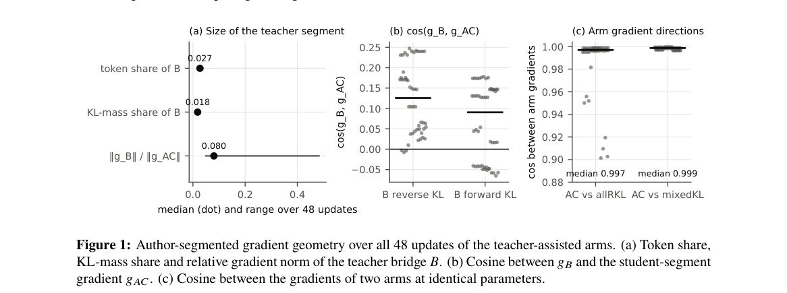

**Why this ranks #7**: 一篇用预注册检验与失败复现把「teacher bridge 有用」这个流行说法认真打穿的负面结果，对做蒸馏的人比再堆一个技巧更有用。

---

### 8. Two Birds with One Stone: Skill-Augmented Generation via Unified Retrieval and Utilization

**arXiv**: [2610.38204](https://arxiv.org/abs/2610.38204) | **Score**: 7.5 (relevance 7.5 x 0.7 + quality 7.5 x 0.3) | **Tags**: rl-llm, skill-retrieval, unified-rl, grpo, tool-augmented-llm, retrieval-as-generation, Chongqing | **Categories**: cs.CL | **Pages**: 10

**Authors**: Zihan Luo; Jiahui Kang; Wei Zhou; Qilin Fan; Mingyan Li; Chao Chen

**Affiliation**: Chongqing University; Huazhong University of Science and Technology

**Abstract**

> Skills, as reusable external knowledge, have demonstrated substantial potential to enhance the ability of Large Language Models (LLMs) to solve complex tasks. However, existing skill-augmented generation methods typically rely on separate models for skill retrieval and skill utilization, resulting in disconnected optimization of these two processes. To address this gap, we propose Skill-Uni, a unified reinforcement learning framework that jointly optimizes skill retrieval and utilization. Specifically, we adopt a generative skill retrieval paradigm that enables a single model to both learn how to retrieve relevant skills and leverage them for task solving. To effectively train this unified framework, we introduce a two-stage training strategy consisting of warm-up instruction tuning and GRPO, allowing the model to progressively improve its skill retrieval and utilization capabilities. Extensive experiments on five skill-related benchmarks demonstrate the effectiveness of Skill-Uni, yielding average performance gains of 66.59% and 34.82% over the base Qwen3-4B and LLaMA3.1-8B models, respectively. Besides, Skill-Uni is compatible with various skill retrieval engines, demonstrating its flexibility and generalizability. Additional in-depth analyses also provide insights into the effectiveness of Skill-Uni.

**Key findings**

- **Finding**: 论文指出既有 skill-augmented 生成方法用两个模型分别做检索与使用，两个环节各自优化、彼此脱节。
- **Finding**: Skill-Uni 采用生成式技能检索范式，让同一个模型既学如何检索相关技能，也学如何用它们完成任务。
- **Finding**: 训练分两阶段：先做 warm-up 指令微调，再进入 GRPO，检索与使用能力逐步提升。
- **Finding**: 在五个技能相关 benchmark 上，相对 Qwen3-4B 与 LLaMA3.1-8B 基座平均性能分别提升 66.59% 与 34.82%。
- **Finding**: 方法兼容多种技能检索引擎，说明它并不绑定某一种向量库或检索器。
- **Finding**: 论文进一步的分析揭示了统一建模检索与使用之所以有效的内在原因。
- **Inference**: 把检索写成生成动作之后，检索结果的质量可以被奖励直接优化，而不是像传统 RAG 那样只能间接影响最终答案。
- **Recommendation**: 推荐。做 skill 与工具增强 LLM 的读者值得读，GRPO 阶段的奖励设计以及与检索引擎解耦的做法可以直接借用。

**Key figures**

*Framework - Retrieval and task accuracy gains relative to TF-IDF, measured as the accuracy differences between each retriever and TF-IDF in skill retrieval and downstream task comple- tion, respectively*

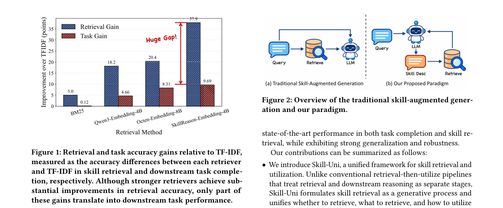

*Result - Overview of the traditional skill-augmented gener- ation and our paradigm.*

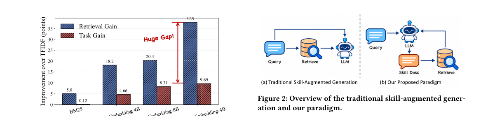

**Why this ranks #8**: 把「检索技能」也变成可被 GRPO 优化的生成动作，一次训练同时面对找错技能和用错技能这两个老问题。

---

### 9. Locating Sycophancy Across Training Stages in Open Language Models

**arXiv**: [2610.37788](https://arxiv.org/abs/2610.37788) | **Score**: 7.1 (relevance 7.0 x 0.7 + quality 7.5 x 0.3) | **Tags**: rl-llm, sycophancy, checkpoint-probing, preference-optimization, behavior-attribution, measurement, Boston Children's Hospital and Harvard Medical School | **Categories**: cs.AI, cs.CL | **Pages**: 25

**Authors**: Jiarui Yao; Shweta Parihar; Nghia Tuan Bui; Guergana K Savova; Lijing Wang

**Affiliation**: Boston Children's Hospital and Harvard Medical School; New Jersey Institute of Technology

**Abstract**

> Language model assistants sometimes change a correct answer when the user suggests a wrong one. The behavior, called sycophancy, is usually attributed to preference-based post-training, yet early measurements found it in pretrained models. We ask where it comes from by measuring it at every available stage of training: 13 open checkpoints from 5 lineages, from base model through supervised fine-tuning and preference optimization to release. We separate how far an injected claim moves a model's answer from how firmly the answer was held, and vary who makes the claim, how reliable they are said to be, and how strongly they make it. Two sycophancy behaviors with different origins emerge, and both replicate across datasets. Deference to a claim in the prompt is already present in every base model, which ranks sources in the same order as its post-trained descendants. Capitulation in conversation, dropping a stated answer when the user objects, is largely absent from base models and present in every post-trained checkpoint. When the objection names an alternative, most post-trained models give up firmly held answers as often as loosely held ones. We discuss the implications of these measurements for evaluating sycophancy and approaches for addressing each behavior.

**Key findings**

- **Finding**: 论文在 5 条模型谱系的 13 个开放 checkpoint 上逐阶段测量，覆盖 base model、SFT、偏好优化直到最终发布。
- **Finding**: 作者把「注入的错误主张能把答案推动多远」与「答案原本被多坚定地持有」拆成两个维度，并变化主张者身份、被声称的可靠性以及主张强度。
- **Finding**: 由此得到两种来源不同的迎合行为：一种在 base model 里就已存在，另一种只在后训练后出现，且两者都在多个数据集上复现。
- **Finding**: 对 prompt 中主张的顺从在每一个 base model 里就已存在，其对信息源的排序与后训练后代保持一致。
- **Finding**: 对话中的投降行为——用户反驳时放弃已给出的答案——在 base model 中基本不存在，却在每个后训练 checkpoint 上都出现。
- **Finding**: 当反驳点名了某个替代答案时，多数后训练模型放弃坚定持有答案的频率，与放弃不坚定答案的频率相当。
- **Inference**: 这说明「降低 sycophancy」不能只当成偏好对齐的副作用来治理，prompt 级顺从与对话级投降需要分开设计干预点。
- **Recommendation**: 推荐。做对齐评估或安全红队的读者必读，它提供了可复用的分阶段测量协议与更细的行为拆分。

**Key figures**

*Framework - One row (i, c, x) of the design. Left: the prompt P(i, s) in base template. The injected suggestion occupies the first line and names one of the two targets, and the next-token logits of the*

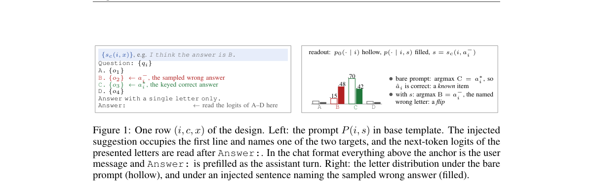

*Result - Firmness before any suggestion is inserted on MMLU. Other datasets are in Section D. Left: median runner-up gap in logits, the lead of the model’s prediction ˆai over its second-ranked lette*

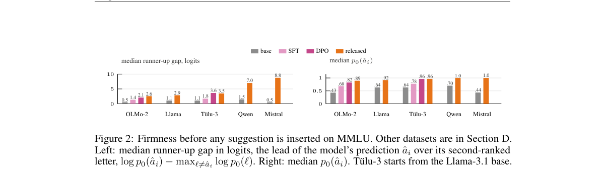

**Why this ranks #9**: 它把「迎合是不是偏好对齐带来的」这一默认假设拆成两个可分离的行为，并指出其中一半在 base model 里就已经存在。

---

### 10. Post-Training Large Language Models with LLMON

**arXiv**: [2610.38120](https://arxiv.org/abs/2610.38120) | **Score**: 7.0 (relevance 7.0 x 0.7 + quality 7.0 x 0.3) | **Tags**: rl-llm, instruction-data-separation, prompt-injection, identifier-binding, attention-interpretability, tool-calling, IBM Research | **Categories**: cs.AI, cs.LG | **Pages**: 14

**Authors**: Basel Shbita; Michael Hind; Chad DeLuca; Nathan Fulton; Shubhi Asthana; Farhan Ahmed; Anisa Halimi; Yada Zhu; Mauro Martino; David Cox; Dan Gutfreund

**Affiliation**: IBM Research

**Abstract**

> Large Language Models (LLMs) treat all context tokens uniformly, lacking explicit separation between executable instructions and passive data. This leads to prompt injection vulnerabilities, ambiguous instruction binding, and unreliable execution control. We present a post-training methodology using LLMON (LLM Object Notation), a framework that enables separating instructions from data and requires explicit identifier-based execution. We construct a large-scale structured training corpus of 4.6B tokens spanning general, RAG (Retrieval-Augmented Generation), and tool-calling data, augmented with distractor-infused variants in which competing instructions and irrelevant data segments are present in context but not referenced. Post-training two Granite-4.1 base models (3B and 8B) through supervised fine-tuning followed by reinforcement learning, we show that LLMON-structured supervision reduces attack success rates on indirect prompt-injection benchmarks from 53-100% to 0.02-5.6% while preserving general capabilities. We further introduce attention-based interpretability metrics that diagnose failure modes at individual transformer layers for structured inputs, revealing how our approach reshapes internal attention patterns. Our results demonstrate that explicit execution semantics can be taught through standard post-training without architectural modification.

**Key findings**

- **Finding**: 论文指出 LLM 对上下文 token 一视同仁，导致 prompt injection 风险、指令绑定歧义与执行控制不可靠。
- **Finding**: LLMON 引入分层标记框架，把指令与数据显式分离，并要求基于标识符的显式执行绑定。
- **Finding**: 作者构造了 4.6B token 的结构化训练语料，覆盖通用、RAG 与工具调用数据，并加入含竞争指令与无关数据段的干扰版本。
- **Finding**: 对 Granite-4.1 的 3B 与 8B 基座做 SFT 加强化学习后，间接 prompt injection 的攻击成功率从 53%–100% 降到 0.02%–5.6%，同时保留通用能力。
- **Finding**: 论文还提出基于注意力的可解释性指标，可在单个 transformer 层上定位失败模式，揭示该方法如何重塑内部注意力模式。
- **Finding**: 结论是显式的执行语义可以只靠常规后训练教会，而不需要改动模型架构。
- **Inference**: 真正起作用的是「训练分布里必须有干扰项」这一条，若语料里没有竞争指令，模型学到的只是标记语法而不是执行优先级。
- **Recommendation**: 推荐。做工具调用、RAG 或 agent 安全工程的读者优先读，语料构造思路与分层注意力指标可直接复用。

**Key figures**

*Framework - Example of an execution block in LLMON syntax. All special tokens are highlighted in light-pink.*

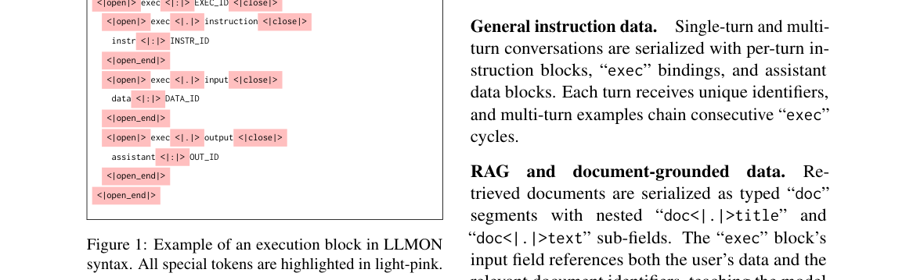

*Result - Instruction Focus Ratio (IFR) per transformer layer for the LLMON-trained Granite-4.1-3B (teal) vs. its Instruct counterpart (pink) on a distractor example. The two are indistinguishable thr*

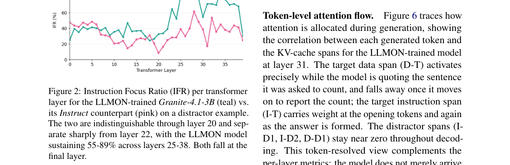

**Why this ranks #10**: 它不靠新架构，而是用一套标记语法把「指令」与「数据」在 token 层面分开，再用常规后训练把这套语义灌进模型，攻击成功率从 53–100% 压到 0.02–5.6%。

---

## Footer

- Total papers scanned across all 7 tracks: 336（原始 446 条）
- rl_llm track final top-10: 10
- Wild-cards in this track: 0
- Figure assets: 2026-10-29/res/

Generated by `mine-arxiv-daily-digest` skill. Sister file: `2026-10-29_rl_llm_entry.md`.
