# ArXiv Daily Digest - 2026-10-30 (AIGC 音频生成, 10 papers)

**Generated**: 2026-10-31 17:00 CST

**Source**: arXiv cs.CV, cs.SD, eess.AS, cs.CL, cs.AI, cs.RO, cs.LG submissions, listing day 2026-10-29 (announced 2026-10-30 00:00 UTC)

**Batch window**: 2026-10-28T18:00:00Z .. 2026-10-29T18:00:00Z（arXiv 公告批次横跨两个 UTC 日：前一日 18:00 UTC 起算，当日 17:59:59 UTC 截止）

**Track**: aigc_audio (top 10 of 619 papers scanned, 70 full reads)

**Scope**: 音频 / 语音 / 音乐的生成、合成、编辑与生产工具链，含 TTS、神经音频编码与空间音频

---

## Top 10 - AIGC 音频生成

### 1. Discovering Interpretable Acoustic Features in Autoregressive Voice-Cloning TTS Models

**arXiv**: [2610.40505](https://arxiv.org/abs/2610.40505) | **Score**: 8.7 (relevance 9.0 x 0.7 + quality 8.0 x 0.3) | **Tags**: AIGC-audio, sparse-autoencoder, mechanistic-interpretability, feature-steering, zero-shot-tts, auto-interpretability, University of Texas at Austin | **Categories**: cs.CL, cs.LG, cs.SD, eess.AS | **Pages**: 26

**Authors**: Anuj Diwan; David Harwath; Eunsol Choi

**Affiliation**: University of Texas at Austin; New York University

**Abstract**

> Voice-cloning TTS models synthesize an unseen speaker's voice from brief speech prompts, but it remains unclear which acoustic properties they represent and use. We introduce a feature-based interpretability framework for autoregressive voice-cloning TTS models, analyzing features from sparse autoencoders (SAEs), PCA, and random directions via sparse probing, steering, and quantitative auto-interpretability. We focus on Qwen3-TTS and extend probing and steering to $5$ additional models to test generalization across architectures. These models encode concepts like pitch, energy, noise, and accent, but sparse prediction and steering are effective only for some concepts. Strong probing does not always translate to steering or vice-versa. SAEs are useful for sparse probing of human-labelled concepts and novel-concept discovery, while PCA is competitive for dense probing and steering. Auto-interpretability finds $684$ automatically validated SAE features in Qwen3-TTS covering speaker clusters, speaking style, and recording conditions beyond known concepts. Overall, we perform a comprehensive interpretability study of autoregressive voice-cloning TTS models.

**Key findings**

- **Finding**: 论文提出面向自回归 voice-cloning TTS 的可解释性框架，用 SAE、PCA 与随机方向配合稀疏 probing、生成时 steering 和 auto-interpretability 分析模型表征。
- **Finding**: 实验以 Qwen3-TTS 为主要对象，并把 probing 与 steering 扩展到另外 5 个模型，用同一套流程检验跨架构的泛化性。
- **Finding**: 模型确实编码了 pitch、energy、noise、accent、emotion 等概念，但稀疏预测与 steering 只在部分概念上有效，强 probing 并不必然带来可用的 steering。
- **Finding**: SAE 更适合对人类标注概念做稀疏 probing 与新概念发现，PCA 在稠密 probing 和 steering 上与 SAE 相当。
- **Finding**: auto-interpretability 在 Qwen3-TTS 中自动验证出 684 个 SAE 特征，覆盖说话人聚类、说话风格与录音条件等已知概念之外的部分。
- **Inference**: probing 强不等于可 steering，说明当前这批特征与生成时干预之间还隔着内部因果结构这类问题，线性特征未必是施加干预的正确基底。
- **Recommendation**: 推荐读。做 TTS 可解释性、语音安全或想搞清模型内部音学表征的读者，建议精读其特征提取与 steering 设置。

**Key figures**

*Framework - Our main interpretability evaluation pipeline. We evaluate feature sets via known-concept probing and steering across 6 voice-cloning TTS models, and through quantitative auto-interpretabili*

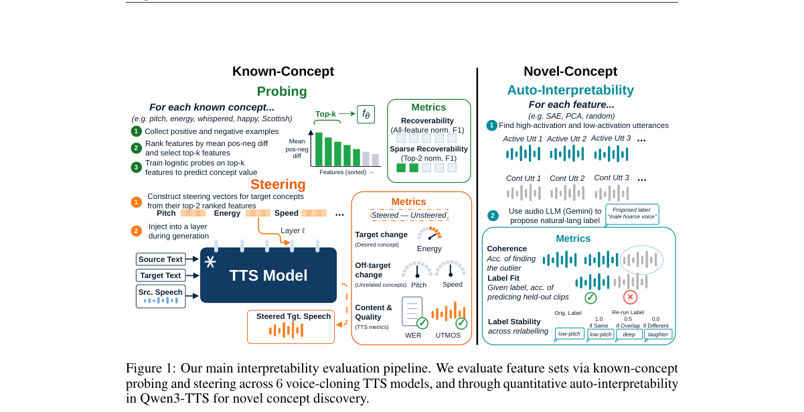

*Result - Feature extraction from TTS residual-stream activations using SAE, PCA, random direc- tions, and untrained SAEs. We study multiple layers in Qwen3-TTS and one in other models.*

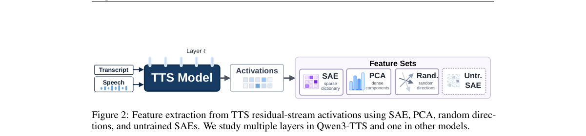

**Why this ranks #1**: 把可解释性工具箱整体搬进自回归 voice-cloning TTS，并量化了 probing 与 steering 之间的错位，是这条线上方法学味道最重的一篇。

---

### 2. Array-Agnostic High-Order Ambisonics Encoding via Diffusion Posterior Sampling

**arXiv**: [2610.39185](https://arxiv.org/abs/2610.39185) | **Score**: 8.3 (relevance 8.5 x 0.7 + quality 8.0 x 0.3) | **Tags**: AIGC-audio, ambisonics, spatial-audio, diffusion-posterior-sampling, array-agnostic, zero-shot, Ben-Gurion | **Categories**: eess.AS, eess.SP | **Pages**: 12

**Authors**: Amit Milstein; Nir Shlezinger; Boaz Rafaely

**Affiliation**: Ben-Gurion University of the Negev

**Abstract**

> Ambisonics provides a device-independent representation of three-dimensional sound fields; however, extracting these coefficients from practical microphone array recordings remains strongly dependent on array geometry, acoustic transfer functions, and spatial sampling resolution. This pipeline is typically divided into two distinct tasks: encoding, which entails reconstructing the physically resolvable spatial components, and upscaling, which requires generating higher-order coefficients. Model-based approaches often fail on irregular arrays due to ill-conditioned transfer matrices, whereas conventional neural encoders remain strictly tied to the specific acquisition setup seen during training. Furthermore, existing upscaling methods usually assume ideal low-order inputs, ignoring device-specific array artifacts. We present ADEUPS, a unified framework that couples an array-independent Ambisonic diffusion prior with an explicit physical acquisition model during inference, enabling zero-shot encoding and upscaling across diverse array configurations. We train our prior using an order-masking strategy and perform inference via score blending, which we demonstrate to be crucial for solving the underlying inverse problem. Through extensive numerical evaluations across various array geometries, we show that ADEUPS consistently outperforms task- and array-specific baselines. Finally, we conduct subjective listening tests to confirm the perceptual effectiveness of our approach.

**Key findings**

- **Finding**: ADEUPS 把与阵列无关的 Ambisonic 扩散先验与显式物理采集模型在推理阶段耦合，从而在不同阵列配置下同时完成 zero-shot 编码与升阶。
- **Finding**: 论文指出模型法在不规则阵列上会因传递矩阵病态而失效，而传统神经编码器严格绑定训练时出现过的采集设置。
- **Finding**: 先验用 order-masking 策略训练，推理时通过 score blending 采样，作者认为 score blending 是解开这一逆问题的关键环节。
- **Finding**: 在多种阵列几何上的数值评测中，ADEUPS 持续优于按任务和按阵列定制的基线，并通过了主观听测。
- **Inference**: 把阵列几何显式搬进推理端的物理模型、让神经先验只承担分布先验，比再训一个阵列专用编码器更省数据，也更容易换硬件。
- **Recommendation**: 推荐读。做空间音频、阵列标定或沉浸式音频的读者值得读，尤其是想更换麦克风阵列又不愿重新训练的团队。

**Key figures**

*Framework - ADEUPS Pipeline*

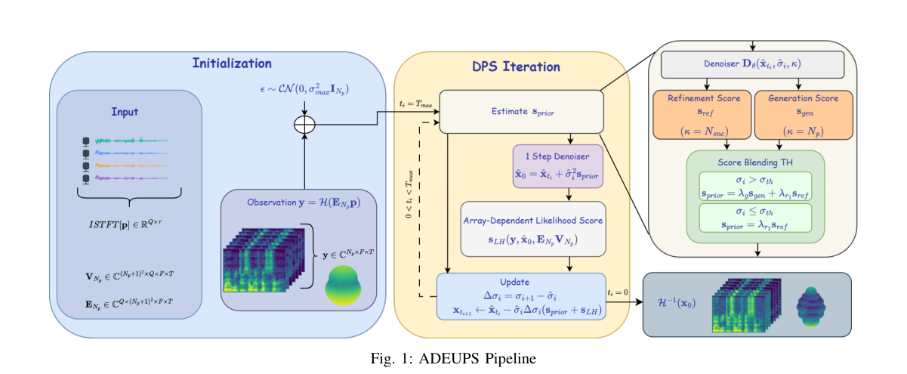

**Why this ranks #2**: 把高阶 Ambisonics 的编码与升阶统一成一次扩散后验采样，并靠显式物理采集模型实现跨阵列的 zero-shot 迁移。

---

### 3. What Makes a Good Audio Prompt for Zero-Shot TTS? Learning Prompt Selection from Synthesis Outcomes

**arXiv**: [2610.40372](https://arxiv.org/abs/2610.40372) | **Score**: 8.0 (relevance 8.0 x 0.7 + quality 8.0 x 0.3) | **Tags**: AIGC-audio, zero-shot-tts, prompt-selection, word-error-rate, speaker-similarity, reference-clip, Hebrew | **Categories**: cs.SD | **Pages**: 15

**Authors**: Arnon Turetzky; Yossi Adi

**Affiliation**: The Hebrew University of Jerusalem

**Abstract**

> Zero-shot text-to-speech (TTS) models clone a target voice from a short reference clip, commonly referred to as the prompt. In practice, the prompt has to be cut from a longer recording of the speaker, so which part to use must be chosen. To understand what makes a good prompt, we analyze hundreds of thousands of outputs synthesized by four TTS models from candidate prompts of YouTube recordings. The choice of prompt substantially changes intelligibility, naturalness and speaker similarity. Standard predicted-quality scores capture mainly the naturalness part but miss most of the intelligibility gain. We find that the models largely agree on which prompt yields the highest measured speaker similarity, but much less on which prompt yields intelligible speech. We propose a small network that learns from the outputs a TTS model produced to rank a recording's candidate prompts from their audio alone. Without synthesizing anything at selection time, it picks prompts that lower the word error rate on held-out recordings by a third (Qwen3-TTS) to two fifths (F5-TTS) relative to a randomly chosen prompt, more than predicted quality achieves and nearly as much as synthesizing a dozen test sentences from every candidate first.

**Key findings**

- **Finding**: 论文用 YouTube 录音的候选 prompt 让 4 个 TTS 模型合成出数十万条输出，用这一规模的数据拆解 prompt 选择对三项指标的影响。
- **Finding**: prompt 的选择会实质性改变可懂度、自然度与说话人相似度；常用的预测质量分数主要反映自然度，漏掉了大部分可懂度收益。
- **Finding**: 各模型对「哪段 prompt 说话人相似度最高」的判断大体一致，但对「哪段最可懂」的分歧明显更大。
- **Finding**: 论文提出一个小型网络，直接从录音音频本身给候选 prompt 打分排序，在选择阶段不做任何合成。
- **Finding**: 在留出录音上，该选择器相对随机 prompt 把词错误率降低了三分之一（Qwen3-TTS）到五分之二（F5-TTS），优于预测质量分数，接近为每个候选合成十几句测试语音。
- **Inference**: 既然不同质量指标之间本就存在分歧，用一个便宜的选择器专门补上可懂度这一维，比追求一个通用质量分数更贴近真实需求。
- **Recommendation**: 推荐读。做零样本 TTS 产品、语音合成落地或需要整理参考音频的工程同学可以直接参考其选择器思路。

**Key figures**

*Framework - Our audio selector, a small network trained on a TTS model’s synthesis outcomes, picks prompts that lower WER more than choosing by predicted qual- ity, without synthesizing anything. WER ga*

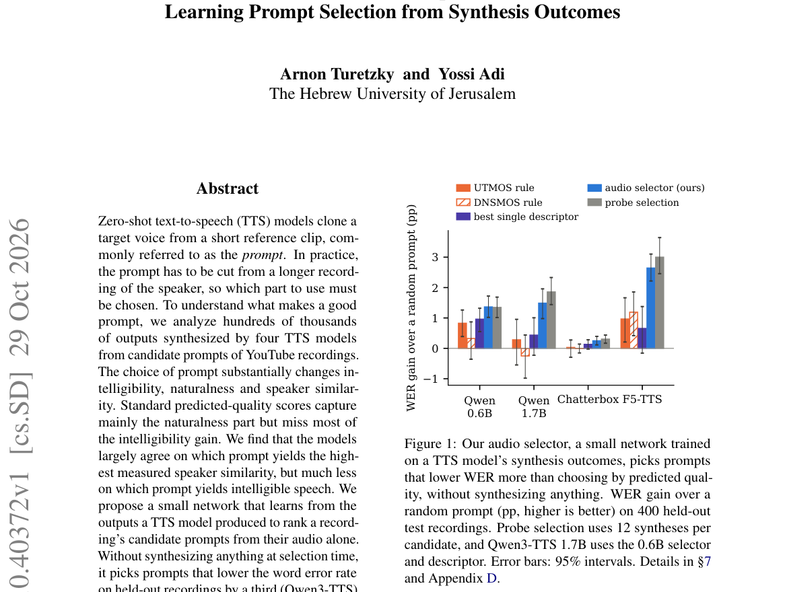

*Result - Intelligibility gain against naturalness gain on the test (Qwen3-TTS 0.6B), by UTMOS (left) and by the held-out Audiobox judge (right). The curve adds the audio selector’s UTMOS head with we*

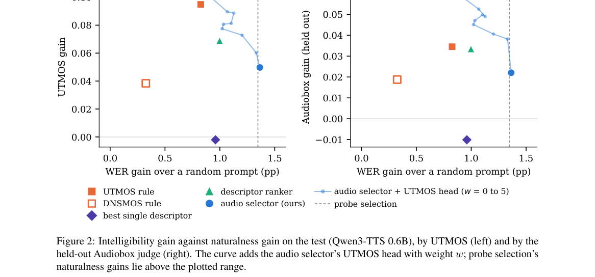

**Why this ranks #3**: 它问的是零样本 TTS 落地里最琐碎也最致命的问题——参考音频该剪哪一段，并且给出了不用合成就能选段的解法。

---

### 4. SonoWorld4D: From One Video to a 4D Audio-Visual Scene via Diffusion Synchronization

**arXiv**: [2610.40640](https://arxiv.org/abs/2610.40640) | **Score**: 7.8 (relevance 8.0 x 0.7 + quality 7.5 x 0.3) | **Tags**: AIGC-audio, 4d-audio-visual, spatial-audio, diffusion-synchronization, monocular-video, sound-field, University of Maryland | **Categories**: cs.CV, cs.SD | **Pages**: 24

**Authors**: Derong Jin; Xiyi Chen; Ming C. Lin; Ruohan Gao

**Affiliation**: University of Maryland, College Park

**Abstract**

> Recent progress in visual scene generation has extended beyond static 3D scenes toward the more challenging problem of generating dynamic 4D scenes from minimal input. However, sound, despite being intrinsically coupled with dynamic objects and events, remains largely unmodeled in prior work. We introduce Video-to-4DAVScene, a new task that turns a video into an explorable, time-varying 4D audio-visual scene, and present the SonoWorld4D framework for this task. Given a monocular video, our method generates a 360 static background, reconstructs explicit motion trajectories of dynamic, sound-emitting foreground objects, and synthesizes a physically-grounded sound field consistent across multiple sources through dual-space audio diffusion synchronization. The resulting 4D scene supports real-time novel-view visual and spatial audio rendering. Evaluation on real-world dynamic scenes and a user study demonstrates SonoWorld4D generates 4D audio-visual scenes with perceptually realistic, physically grounded spatial audio consistent with scene geometry and visual content.

**Key findings**

- **Finding**: 论文提出 Video-to-4DAVScene 任务，把一段视频变成可探索、随时间变化的 4D 音频-视觉场景，并给出 SonoWorld4D 框架。
- **Finding**: 给定单目视频，方法生成 360 度静态背景，重建发声前景物体的显式运动轨迹，并通过 dual-space audio diffusion synchronization 合成与多声源一致、物理可解释的声场。
- **Finding**: 论文指出声音与动态物体和事件天然耦合，但在既有的 4D 场景生成工作中几乎没有被建模。
- **Finding**: 生成的 4D 场景支持实时的新视角视觉渲染与空间音频渲染，可在真实动态场景与用户研究上评测。
- **Inference**: 用 dual-space 同步扩散把声源的空间位置与时间轨迹绑在一起，比先合成声音再摆位更容易得到与几何一致的听感。
- **Recommendation**: 选读。关心空间音频生成、场景理解或音视频联合建模的读者推荐读，只关心纯音频合成的读者可以只看方法框架。

**Key figures**

*Framework - From a single monocular video, SONOWORLD4D generates an explorable 4D audio- visual scene, where you can navigate to novel viewpoints and follow arbitrary listener trajecto- ries while heari*

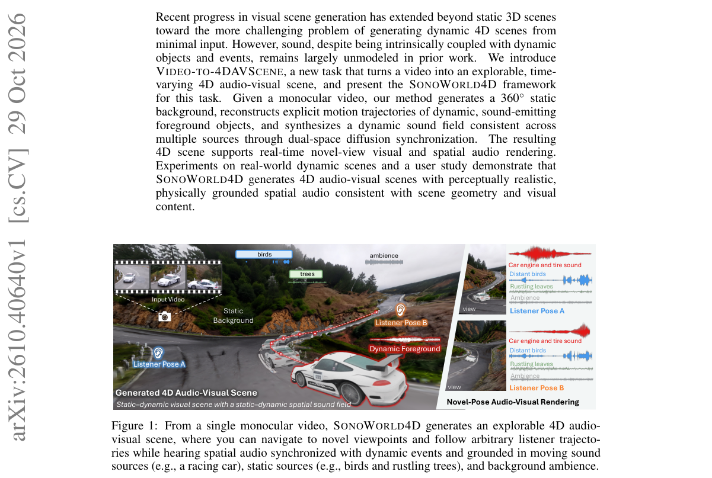

**Why this ranks #4**: 它把视频里的声音从贴在画面上的素材变成有物理依据的空间声场，是这条线上少见的从单目视频出发的 4D 音频-视觉联合生成。

---

### 5. AKDQ: Adaptive Key-Delta Quantization for Low-Bitrate RVQ-based Neural Speech Codecs

**arXiv**: [2610.39885](https://arxiv.org/abs/2610.39885) | **Score**: 7.7 (relevance 7.5 x 0.7 + quality 8.0 x 0.3) | **Tags**: AIGC-audio, neural-codec, rvq, bitrate-reduction, key-delta, streaming, University of Science and Technology of China | **Categories**: eess.AS | **Pages**: 5

**Authors**: Xiao-Hang Jiang; Yang Ai; Zhen-Hua Ling; Ji Wu

**Affiliation**: University of Science and Technology of China; Tsinghua University

**Abstract**

> Low-bitrate speech coding is essential for bandwidth-constrained channels and on-device applications, but conventional residual vector quantization (RVQ)-based codecs employ a fixed number of codebooks per frame regardless of content. Adjacent speech frames often exhibit strong similarity, and quantizing them independently with the same scheme results in redundant encoding, thereby wasting bitrate. Therefore, we propose Adaptive Key-Delta Quantization (AKDQ), which replaces the fixed per-frame VQ allocation of RVQ with an adaptive frame-wise key-or-delta policy. AKDQ is a plug-in strategy that requires no modification to the codec's encoder-decoder backbone. Specifically, in AKDQ, each frame is classified as either a key-frame (K-frame) quantized with all VQs, or a delta-frame (D-frame) quantized with only a few VQs on a delta correction from the previous reconstruction, thereby reducing bitrate. The K/D decision is made by a budget-aware causal scheduler through a bit-bank mechanism, keeping the system streamable with no additional lookahead. Experiments on both causal and non-causal codec families demonstrate that AKDQ effectively reduces bitrate redundancy. For instance, on DAC, using AKDQ at 1.5 kbps achieves reconstruction quality comparable to using the baseline RVQ at 2.0 kbps, saving 25% of the bitrate.

**Key findings**

- **Finding**: AKDQ 把 RVQ 固定每帧用满的 VQ 分配，换成逐帧自适应的 key 或 delta 策略，是插在编码器与解码器之间的即插即用模块。
- **Finding**: 每帧被判定为 key-frame 就用全部 VQ 量化，判为 delta-frame 则只对上一帧重建结果做 delta 修正并使用少数 VQ。
- **Finding**: key/delta 的判定由一个带预算的因果调度器通过 bit-bank 机制完成，系统保持可流式，不需要额外前瞻。
- **Finding**: 论文的出发点是相邻语音帧高度相似，独立用同一套码本量化会浪费码率。
- **Finding**: 在 DAC 上，AKDQ 用 1.5 kbps 得到的重建质量与基线 RVQ 的 2.0 kbps 相当，等于省下 25% 码率；在因果与非因果两类 codec 上都验证了这一点。
- **Inference**: 收益来自码率分配而非重建网络改造，因此这类优化可以在不重训主干的前提下迁移到已有 checkpoint 上，工程复用性很强。
- **Recommendation**: 推荐读。做语音 codec、端侧传输或 TTS 系统压缩的读者值得读，可直接借鉴其调度器设计。

**Key figures**

*Framework - Overview of the proposed AKDQ with cK = 4 and cD = 1 as an example. Here, x and ˆx denote the speech to be encoded and the decoded speech, respectively. et and ˆet denote the inter-frame resid*

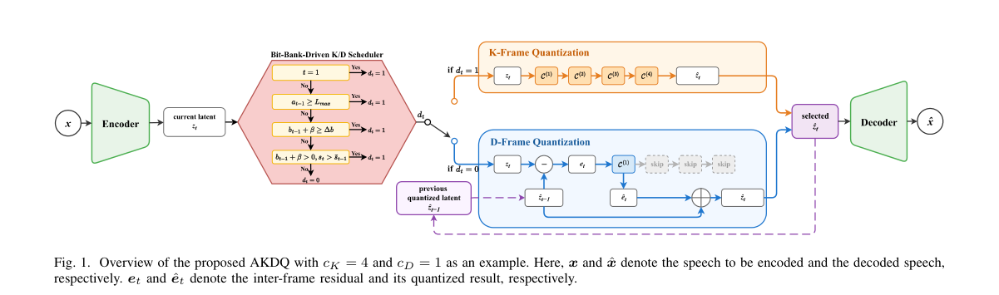

**Why this ranks #5**: 它不改编码器解码器骨架，只换 RVQ 的码字分配策略就砍掉四分之一码率，是对神经语音 codec 管线最省事的改造。

---

### 6. Reading-Level Verification of Kanji Words in Japanese Financial Speech Synthesis

**arXiv**: [2610.39168](https://arxiv.org/abs/2610.39168) | **Score**: 7.5 (relevance 7.5 x 0.7 + quality 7.5 x 0.3) | **Tags**: AIGC-audio, japanese-tts, kanji-reading, ctc-verification, voice-cloning, quality-gate, Best AI Co. | **Categories**: cs.CL, cs.SD, eess.AS | **Pages**: 6

**Authors**: Cheng Zhang

**Affiliation**: Best AI Co., Ltd., Tokyo, Japan

**Abstract**

> Few-shot voice cloning makes it cheap to produce daily Japanese financial commentary with several synthetic speakers, but kanji words with more than one reading, such as the word for "market" (shijo vs. ichiba) or "overall trend" (taisei vs. oze), are still misread. A common quality gate transcribes each synthesized sentence with automatic speech recognition (ASR), converts both the input and the transcript to kana, and regenerates on mismatch. We show that this gate is unreliable in both directions: when the audio contains a misreading, the ASR language model frequently writes the expected kanji back, hiding the error, and when the audio is correct, ordinary recognition errors trigger needless regeneration. We propose a reading-level check that scores the expected reading and its confusable alternatives with a connectionist temporal classification (CTC) hiragana recognizer and flags a word when an alternative explains the audio better. On 540 utterances from three voice-cloned production voices covering 30 financial terms, with misreadings injected under controlled conditions, the transcript-based gate detected 78.9% of misreadings at a 44.4% false-alarm rate, whereas the proposed check detected 91.7% at 5.0% (AUC 0.990). On natural kanji input, it caught a front-end error that the transcript-based gate missed for one voice, and reduced regeneration requests from 38.9% to 6.1% of sentences.

**Key findings**

- **Finding**: 论文针对日语金融解说中一字多读的汉字词（如「市場」的 shijo 与 ichiba）被读错的问题，提出读音级校验。
- **Finding**: 常见做法是先用 ASR 转写合成句子、把输入与转写都转成假名再比对重生成；作者证明这道闸门双向都不可靠。
- **Finding**: 音频真的读错时，ASR 的语言模型常把预期汉字写回去从而掩盖错误；音频读对时，普通识别错误又触发大量无谓重生成。
- **Finding**: 论文改用一个 CTC 假名识别器给预期读音及其易混淆读音打分，只有当混淆读音更能解释音频时才报警。
- **Finding**: 在三个声音克隆生产语音、30 个金融词、540 条注入误读的句子上，转写闸门以 44.4% 误报率检出 78.9% 的误读，新校验器则以 5.0% 误报率检出 91.7%（AUC 0.990）。
- **Finding**: 在自然汉字输入上，新校验器还抓到一个转写闸门漏掉的前端错误，并把重生成请求从 38.9% 降到 6.1% 的句子。
- **Inference**: 把「朗读的是哪个音」与「转写成了哪段文字」拆成两个问题，前者用音素级模型更可靠，也顺带砍掉了大量重生成算力。
- **Recommendation**: 推荐读。做多音字语言 TTS、语音质检或生产合成流水线的读者值得读其校验器与阈值设计。

**Key figures**

*Framework - Generate–verify–regenerate loop. Stage 1 is the deployed transcript- based gate; Stage 2 is the proposed reading-level check.*

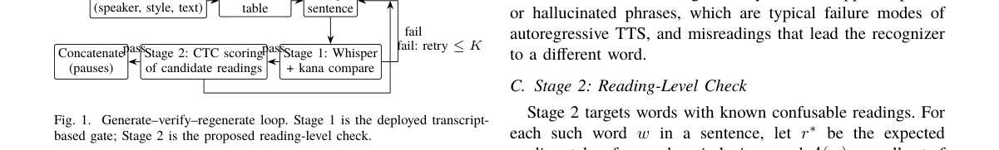

*Result - Distribution of the margin m(w) in (2) for utterances with the correct (K) and the injected wrong (W) reading. Dashed line: θ = 0.*

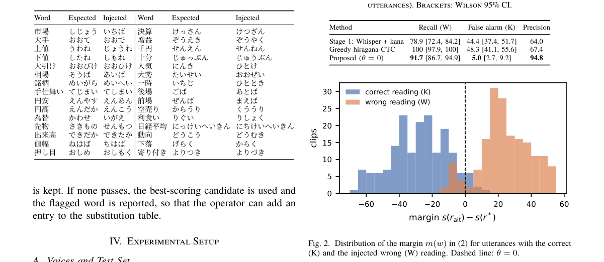

**Why this ranks #6**: 它指出业里常用的 ASR 回检在两个方向都不可靠，并给出一个把误读检出率与误报率同时压下来的读音级校验器。

---

### 7. Toward Complete Speaker Anonymization: a Streaming Cascaded System for Voice Privacy and PII Removal

**arXiv**: [2610.39754](https://arxiv.org/abs/2610.39754) | **Score**: 7.5 (relevance 7.5 x 0.7 + quality 7.5 x 0.3) | **Tags**: AIGC-audio, voice-privacy, speaker-anonymization, pii-removal, streaming-cascade, attacker-eer, Center for Language and Speech Processing | **Categories**: cs.SD, eess.AS | **Pages**: 5

**Authors**: Stanisław Kacprzak; Thomas Thebaud; Najim Dehak

**Affiliation**: Center for Language and Speech Processing, Johns Hopkins University; AGH University of Krakow; AMIAD

**Abstract**

> We present a cascade streaming voice privacy system, consisting of ASR, NLP, and TTS modules. By leveraging recent improvements in all three aspects of speech and language processing, we show that such a system is capable of achieving a result comparable to state-of-the-art offline voice privacy systems, while providing controllable capabilities of content protection beyond voice. With an estimated utterance-onset end-to-end latency of 717 ms, the presented system preserves speech content with 11% WER on Librispeech, while detecting PII with a 69% SLU F1 score and achieving up to 47.66% EER against a semi-informed attacker.

**Key findings**

- **Finding**: 论文提出由 ASR、NLP、TTS 三个模块组成的级联流式语音隐私系统，其中新增的 NLP 模块专门负责移除个人身份信息。
- **Finding**: 作者认为该系统效果可与当时的离线语音隐私 SOTA 相当，同时提供超越声音本身的可控内容保护能力。
- **Finding**: 在以话语起点估计的端到端延迟为 717 ms 的条件下，系统在 Librispeech 上以 11% WER 保留语音内容。
- **Finding**: PII 检测达到 69% 的 SLU F1，针对具备一定先验信息的攻击者最高可取得 47.66% EER。
- **Finding**: 整个系统以近似流式的方式运行，各组件都选用了较快的实现，为完全流式的匿名化系统打下基线。
- **Inference**: 级联方案把「换声音」和「改内容」解耦，隐私策略可以按场景裁剪；代价是端到端质量受 ASR 误差累积影响。
- **Recommendation**: 选读。做语音隐私、会议转写脱敏或需要按需删改内容的读者值得读，纯生成方向的读者可略过。

**Key figures**

该论文正文未提取到可用图（图表为纯文本/表格排版）。

**Why this ranks #7**: 它把语音匿名化拆成 ASR、NLP、TTS 三段串起来，既保内容又能单独删 PII，还给出接近离线 SOTA 的流式延迟。

---

### 8. Automated Parameter Sensitivity Ranking in Audio Synthesis

**arXiv**: [2610.38740](https://arxiv.org/abs/2610.38740) | **Score**: 6.7 (relevance 6.5 x 0.7 + quality 7.0 x 0.3) | **Tags**: AIGC-audio, dsp-synthesis, parameter-sensitivity, sobol, spectral-fingerprint, measure-validate, Bahçeşehir | **Categories**: cs.SD | **Pages**: 8

**Authors**: Ogulcan Kibar; Baris Ozcan

**Affiliation**: Bahçeşehir University; Balıkesir University; Burhaniye Vocational School

**Abstract**

> Software synthesizers expose dozens of coupled controls, many of them redundant or perceptually inert at typical operating points. This paper presents a two-stage, measure-and-validate framework that ranks parameters by their influence on the audio output and then checks that ranking against an independent, variance-based experiment. Every rendered clip is normalized to -23 LUFS and described by five spectral fingerprints, so that gain shifts cannot masquerade as timbral change. The Sweep Test scores each parameter by spectral deviation over a 101-step sweep; the Sobol Test scores it by summed per-cell variance over a 128-point Sobol excitation. Across five architecturally distinct synthesizers (TorchSynth, Pyo, Pedalboard, Csound, and FluidSynth) spanning 48 to 76 parameters, the two tests agree at Spearman ρ= 0.82-0.96 (p-values \le 7.2 \times 10^{-15}) on the four engines that render deterministically, and at ρ= 0.32 on the one with process-level render noise--a diagnostic of that engine rather than of the method. The strong correlations survive reducing the Sobol budget from 128 to 32 points, and the complete analysis costs a one-time offline budget of about 66,000 renders.

**Key findings**

- **Finding**: 论文提出两阶段的 measure-and-validate 框架，先按参数对音频输出的影响排序，再用独立的基于方差的实验反过来检验这份排序。
- **Finding**: 每段渲染都被归一化到 -23 LUFS 并用五种频谱指纹描述，避免单纯增益变化被误判成音色变化。
- **Finding**: Sweep Test 用 101 步扫描的频谱偏差给参数打分，Sobol Test 用 128 点 Sobol 激励的逐格方差之和打分。
- **Finding**: 在 TorchSynth、Pyo、Pedalboard、Csound 与 FluidSynth 五个合成器、48 到 76 个参数上，两种测试在四个确定性渲染引擎上的 Spearman ρ 为 0.82 到 0.96。
- **Finding**: 唯一带进程级渲染噪声的引擎相关系数只有 0.32，作者将其视为该引擎的诊断而非方法失效；把 Sobol 预算从 128 降到 32 点后相关性依然成立。
- **Finding**: 论文报告完整分析的一次性离线代价约为 66000 次渲染，这是整套参数排名流程需要付出的渲染预算。
- **Inference**: 归一化加频谱指纹这一步是方法能否成立的关键，先把音量维度消掉再谈音色敏感度，才让排序结果可跨引擎比较。
- **Recommendation**: 选读。做软件合成器、音频插件或需要做参数自动化的读者值得读其度量与验证流程。

**Key figures**

*Framework - Overview of the framework.*

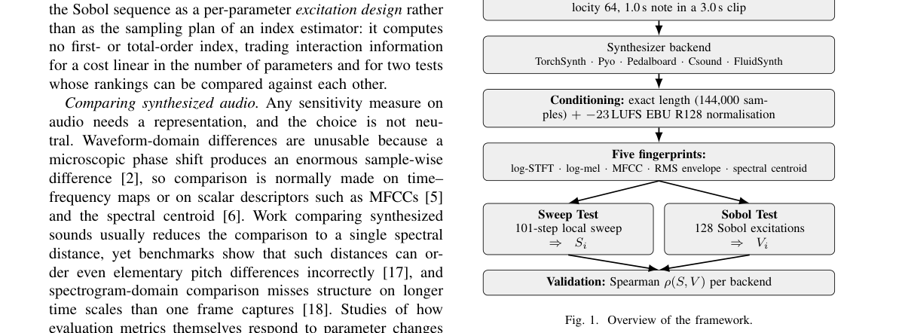

*Result - Per-cell variance of the Sobol Test: each row is one of the K conditioned clips, variance is taken down each cell c, and the sum over cells gives Vi.*

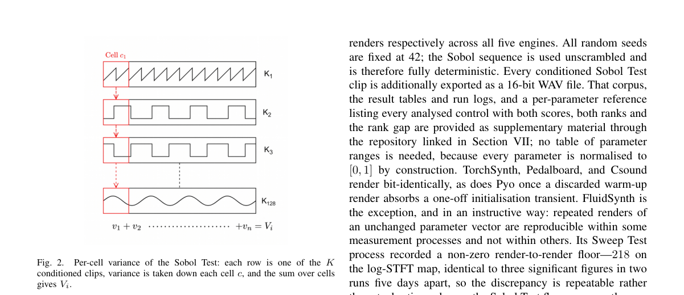

**Why this ranks #8**: 它给出的是一套可复用的合成器参数体检方法：先用扫描打分，再用独立实验验证排序，让「旋钮值多少」不再靠耳朵拍脑袋。

---

### 9. Personalising Parametric Audio Effect Recommendation for Vocals from Parameter-only Style Priors

**arXiv**: [2610.38696](https://arxiv.org/abs/2610.38696) | **Score**: 6.7 (relevance 6.5 x 0.7 + quality 7.0 x 0.3) | **Tags**: AIGC-audio, audio-effects, style-prior, personalization, recommendation, label-shift, C4DM | **Categories**: eess.AS | **Pages**: 6

**Authors**: Soumya Sai Vanka; Hayato Yamakawa; Kazunobu Kondo; Yu Takahashi; György Fazekas

**Affiliation**: C4DM, Queen Mary University of London; RDD, Yamaha Corporation

**Abstract**

> Audio effect recommendation has mostly modelled style through reference audio and audio-domain losses. Because the parameter-to-audio map of parametric effects is many-to-one, such systems can match a reference without reflecting how a given engineer works. We instead model an engineer's style as a distribution over effect-chain parameters, which matches the data engineers can realistically share: console recalls store parameters without the audio they were applied to. Under a label-shift assumption, a personalised recommendation follows in closed form from a generic content model, a parameter population model and an engineer prior, with no paired engineer audio and no tuned weights. For vocal chains, the content signal is small but real, and concentrated in high-frequency EQ, dynamics and reverb. A forced-choice test with $14$ listeners found that the style-prior and content-only recommendations were distinguishable (89.3%), with results consistent with prior width affecting the balance between style and content, while parameter-space cosine does not predict perceived difference.

**Key findings**

- **Finding**: 论文指出既有音频效果推荐多用参考音频和音频域损失建模风格，但参数到音频是多对一映射，配上参考音频未必反映某位工程师的工作方式。
- **Finding**: 作者改把工程师风格建模为效果链参数上的一个分布，这正是调音台 recall 实际能共享的数据形态——只存参数、不存音频。
- **Finding**: 在 label-shift 假设下，个性化推荐可以从通用内容模型、参数总体模型与工程师先验闭式推出，既不需要配对的工程师音频，也不需要调权重。
- **Finding**: 在人声链路上内容信号虽小但真实存在，且集中在高频 EQ、动态与混响三类处理上。
- **Finding**: 14 名听者的强制选择测试中，风格先验推荐与纯内容推荐有 89.3% 被区分出来，结果与先验宽度影响风格内容配比的判断一致。
- **Finding**: 实验还显示参数空间的余弦相似度并不能预测听感差异，度量上接近并不等于听上去接近。
- **Inference**: 这套闭式解把个性化成本压到几乎为零，适合做产品里的效果链默认值推荐，但效果上限受限于内容信号本身的强度。
- **Recommendation**: 选读。做音乐制作工具、插件推荐或研究 DSP 风格建模的读者可以读，工程同学也可直接借鉴先验的构造方式。

**Key figures**

*Framework - Gaussian case of Eq. (2): the content model and engi- neer prior combine, with the population base rate divided out.*

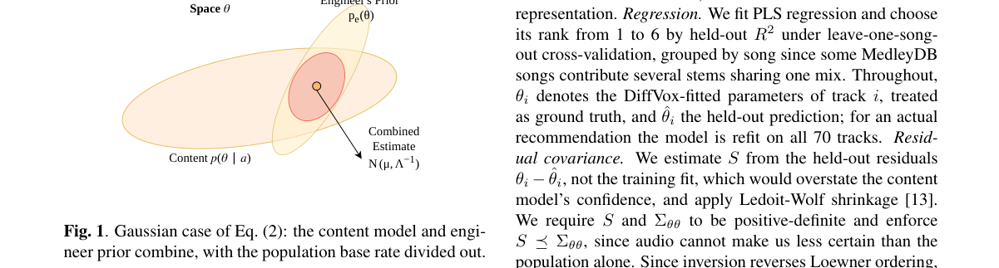

*Result - Content model effect block sensitivity by audio fea- tures.*

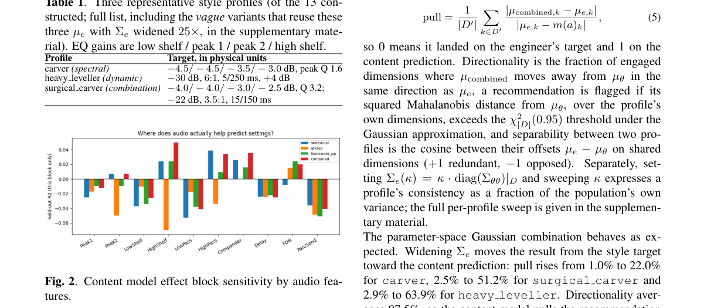

**Why this ranks #9**: 它把「工程师的风格」建模成参数分布而不是参考音频，于是只用调音台 recall 就能做个性化效果推荐。

---

### 10. Structured Pruning of Feedback Delay Networks

**arXiv**: [2610.38768](https://arxiv.org/abs/2610.38768) | **Score**: 6.3 (relevance 6.0 x 0.7 + quality 7.0 x 0.3) | **Tags**: AIGC-audio, feedback-delay-network, reverberation, structured-pruning, vectorized-kernels, dsp-efficiency, AudioLab | **Categories**: eess.AS, eess.SP, math.NA | **Pages**: 11

**Authors**: Facundo Franchino; Karolina Prawda

**Affiliation**: AudioLab, University of York; Massachusetts Institute of Technology; Aalto University

**Abstract**

> Feedback delay networks (FDNs) are recursive filter structures used to synthesise artificial reverberation. Their feedback matrix governs both energy exchange between delay lines and the computation required at every sample, making its design central to balancing an FDN's acoustic performance and implementation efficiency. In this work, we develop an FDN-specific structured pruning method that connects these acoustic and computational concerns, allowing high-order dense orthogonal designs to be fitted to efficient implementations. The feedback matrix is replaced by stages of fixed permutations and small orthogonal blocks. We characterise connectivity growth with the network depth and derive exact conditional block updates for matrix fitting, followed by refinement against the reference FDN magnitude response. The resulting factors admit direct vectorised evaluation, with arithmetic cost and coefficient storage scaling linearly with network size for fixed block size and depth. On an Apple M2, the selected staged kernels achieve feedback-multiplication speedups over dense BLAS ranging from approximately threefold to over twentyfold across the tested network sizes, while substantially reducing coefficient storage. Objective metrics and listening tests indicate that the proposed staged approximations closely preserve the spectral and temporal character of their dense references. An analysis of processor utilisation and register reuse explains why execution time depends on more than the operation count. Finally, block size and depth provide practical control over response fidelity, storage, and real-time cost, allowing acoustic design to precede the choice of an efficient implementation.

**Key findings**

- **Finding**: 论文针对合成人工混响的 FDN 结构，提出面向 FDN 的结构化剪枝方法，让高阶稠密正交设计能被拟合到高效实现上。
- **Finding**: 反馈矩阵被替换为若干级固定置换与小型正交块的组合，作者刻画了连接数随网络深度的增长规律。
- **Finding**: 论文给出矩阵拟合的精确条件块更新，并进一步按参考 FDN 的幅度响应做精修。
- **Finding**: 所得因子支持直接向量化求值，在块大小与深度固定时，算术量与系数存储都随网络规模线性增长。
- **Finding**: 在 Apple M2 上，选出的分级内核相对稠密 BLAS 的反馈乘法加速约为三倍到二十倍以上，同时大幅减少系数存储。
- **Finding**: 客观指标与听测表明分级近似较好地保住了稠密参考的频谱与时间特征；作者还用处理器利用率与寄存器复用的分析解释执行时间为何不只看运算量。
- **Inference**: 声学设计可以先行、实现方式后选，这条思路对任何先做数学设计再落地实现的 DSP 系统都适用。
- **Recommendation**: 选读。做实时混响、音频 DSP 优化或虚拟声学引擎的读者值得读其块结构与速度分析。

**Key figures**

该论文正文未提取到可用图（图表为纯文本/表格排版）。

**Why this ranks #10**: 它把混响网络的声学设计和高维正交反馈矩阵的计算开销接上，让稠密设计能直接落到实时内核上。

---

## Footer

- Total papers scanned across all 7 tracks: 619（原始 828 条）
- aigc_audio track final top-10: 10
- Wild-cards in this track: 0
- Figure assets: 2026-10-30/res/

Generated by `mine-arxiv-daily-digest` skill. Sister file: `2026-10-30_aigc_audio_entry.md`.
