# ArXiv Daily Digest - 2026-10-30 (AIGC 视觉生成, 10 papers)

**Generated**: 2026-10-31 17:00 CST

**Source**: arXiv cs.CV, cs.SD, eess.AS, cs.CL, cs.AI, cs.RO, cs.LG submissions, listing day 2026-10-29 (announced 2026-10-30 00:00 UTC)

**Batch window**: 2026-10-28T18:00:00Z .. 2026-10-29T18:00:00Z（arXiv 公告批次横跨两个 UTC 日：前一日 18:00 UTC 起算，当日 17:59:59 UTC 截止）

**Track**: aigc_visual (top 10 of 619 papers scanned, 70 full reads)

**Scope**: 图像 / 视频 / 3D 内容的生成与编辑，含扩散与流匹配模型的训练方法、加速、评测基准

---

## Top 10 - AIGC 视觉生成

### 1. LucidLyra: Feed-Forward Generative 3D Scene Reconstruction and Joint Understanding via Multi-Task Distillation

**arXiv**: [2610.40495](https://arxiv.org/abs/2610.40495) | **Score**: 9.3 (relevance 9.5 x 0.7 + quality 9.0 x 0.3) | **Tags**: AIGC-visual, gaussian-splatting, feed-forward-reconstruction, open-vocabulary-segmentation, multi-task-distillation, video-diffusion, NVIDIA | **Categories**: cs.CV | **Pages**: 37

**Authors**: Oliver Hahn; Rodrigo Marcuzzi; Sangeetha Grama Srinivasan; Alessandro Burzio; Sherwin Bahmani; Jiahui Huang; Stefan Roth; Shengyu Huang; Qunjie Zhou; Laura Leal-Taixé

**Affiliation**: NVIDIA; TU Darmstadt; Università degli Studi di Modena e Reggio Emilia; ELIZA; hessian.AI

**Abstract**

> We present LucidLyra, a framework that makes generatively reconstructed 3D scenes directly queryable for semantics and instances in a feed-forward manner from video latents. While generative 3D reconstruction can synthesize virtual environments from a single image, downstream applications in robotics and physical AI require not only visual realism but also access to scene semantics and object identities. Existing 3D understanding approaches, however, require captured multi-view scenes, have limited generalization capabilities, or rely on expensive per-scene processing and optimization. To bridge this gap, our method distills complementary knowledge from a camera-controlled video diffusion model and frozen 2D vision foundation models into a unified model to jointly infer 3D Gaussians encoding geometry, appearance, open-vocabulary semantics, and class-agnostic instance cues. The resulting scenes support novel-view rendering, open-vocabulary segmentation, and object grouping without per-scene optimization, while training requires neither manual 3D annotations nor captured multi-view data. Our method outperforms baselines combining state-of-the-art 3DGS segmentation approaches with generative 3D scene reconstruction on curated synthetic and real-image-conditioned benchmarks, while preserving reconstruction quality. Furthermore, our latent formulation naturally extends to monocular video, reconstructing structured dynamic 3D scenes across time. By turning renderable but unstructured outputs into queryable 3D worlds, LucidLyra enables downstream applications including 3D scene editing, 3D asset mining, and robotic simulation.

**Key findings**

- **Finding**: LucidLyra 从 video latents 前馈推断统一 3D 高斯，同时编码几何、外观、开放词表语义与类无关实例线索。
- **Finding**: 训练时把相机可控视频扩散模型与冻结 2D 视觉基础模型的互补知识蒸馏进同一模型，不需要人工 3D 标注或多视角采集。
- **Finding**: 所得场景无需逐场景优化即可支持新视角渲染、开放词表分割与物体分组，在合成与真实图像条件基准上超过「3DGS 分割 + 生成式重建」的组合基线。
- **Finding**: 其潜变量表述还能自然扩展到单目视频，跨时间重建出结构化的动态 3D 场景。
- **Finding**: 论文的设计出发点是：整合式模型应让语义先验与几何互相强化，而不是给一个孤立的重建结果外挂语义或物体信息。
- **Inference**: 把语义做成重建的原生输出，比「先重建再分割」更省算力，也更容易拿到跨视角一致的实例 ID。
- **Recommendation**: 推荐。做生成式 3D、机器人仿真，或需要「重建完就能语义查询」的读者优先读。

**Key figures**

*Framework - Feed-forward semantic- and instance-aware image-to-3D scene generation. Top: LucidLyra infers a unified 3D Gaussian Splatting (3DGS) representation consisting of appearance, geometry, semant*

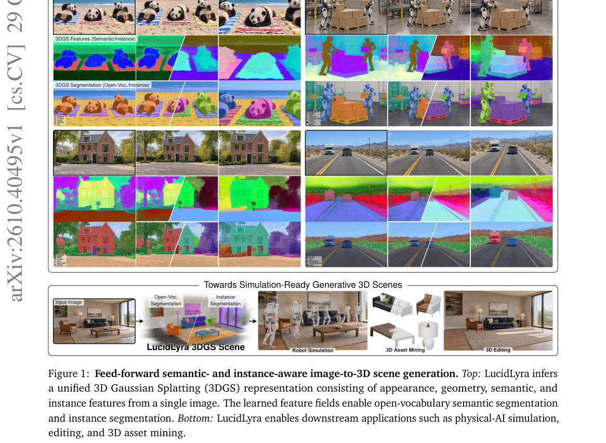

*Result - LucidLyra framework. A frozen camera-controlled video generation model produces multi-view latents. Its RGB decoder and frozen 2D foundation models construct reconstruction, semantic, and in*

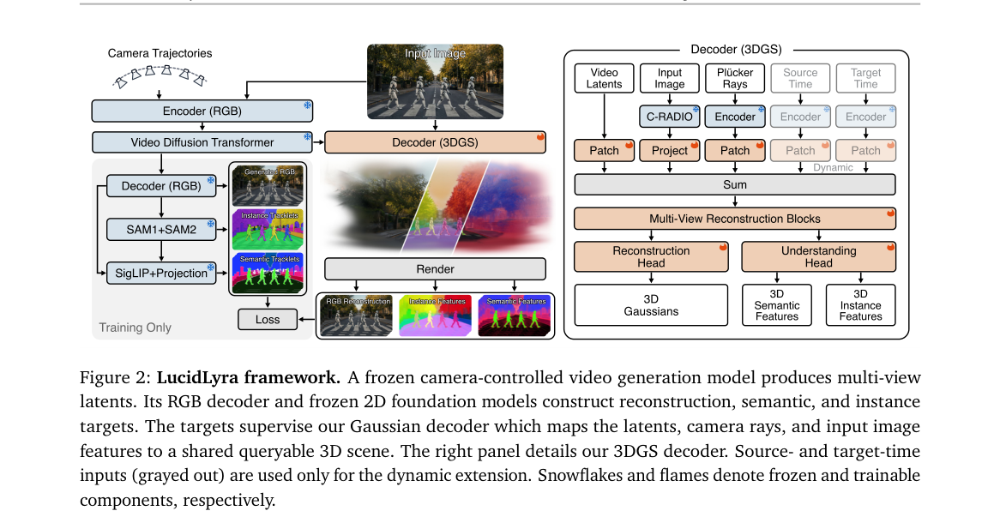

**Why this ranks #1**: 它把语义与实例线索原生蒸进前馈式 3D 高斯重建，让「生成完就能问」不再依赖外挂分割模型。

---

### 2. Coupled Guidance for Flow Matching

**arXiv**: [2610.40109](https://arxiv.org/abs/2610.40109) | **Score**: 8.8 (relevance 9.0 x 0.7 + quality 8.5 x 0.3) | **Tags**: AIGC-visual, flow-matching, classifier-free-guidance, coupling-geometry, inpainting, robot-control, Huawei | **Categories**: cs.LG, cs.RO | **Pages**: 25

**Authors**: Mateo Clémente; Léo Maxime Brunswic; Rui Heng Yang; Amir Rasouli

**Affiliation**: Huawei

**Abstract**

> Guidance methods are essential tools for steering the generation process in diffusion models, improving the generalizability of stochastic robotic controllers and enabling high-quality controlled image synthesis. Despite strong parallels between flow-matching and diffusion, integrating guidance into flow-matching models remains quite challenging. Recent work has proposed general guidance frameworks for flow-matching, however, they are direct adaptations of diffusion guidance methods and can prove unstable. In this work, we conduct a theoretical analysis of guidance in flow-matching and show that a naive translation of diffusion-based guidance to flow-matching breaks the coupling distribution used during training, resulting in weaker control over sampling accuracy. Building on this insight, we propose Coupled Guidance, a flow-matching-specific guidance mechanism derived from a geometric perspective that leverages the coupling structure inherent to flow-matching training. To validate the effectiveness of our approach, we conduct extensive experimentation on a custom robotic collision avoidance task using ManiSkill3, four robotic dexterous manipulation tasks from the Adroit benchmark, and three image generation tasks, namely inpainting, super-resolution, and deblurring, using the ImageNet-128 and CelebA-HQ-256 datasets. Our findings show that our framework improves sample quality and guidance stability across all tasks, without imposing any additional overhead.

**Key findings**

- **Finding**: 论文对 flow matching 中的 guidance 做理论分析，指出直接照搬 diffusion 的 guidance 会破坏训练所用的 coupling 分布，导致采样精度上的控制变弱。
- **Finding**: 由此提出 Coupled Guidance，从几何视角出发、利用 flow matching 训练内在的 coupling 结构，构造专属于该范式的 guidance。
- **Finding**: 实验覆盖 ManiSkill3 的自定义机器人避障任务、Adroit 基准的四个灵巧手操作任务，以及 inpainting、超分辨率、去模糊三类图像生成任务。
- **Finding**: 框架在全部任务上同时提升样本质量与 guidance 稳定性，且不引入任何额外开销。
- **Inference**: 说明 flow matching 的 guidance 不是 diffusion 公式的参数微调问题，「照搬」在数学层面就站不住。
- **Inference**: 机器人控制与图像修复能在同一套 guidance 机制下一起变好，这种跨域通用性比单点指标更值得看。
- **Recommendation**: 推荐。做 flow matching 改造、或需要用 guidance 稳定机器人控制的读者建议读。

**Key figures**

*Framework - Qualitative examples of image reconstruc- tions for noiseless inpainting, deblurring, and super- resolution, comparing naive ΠGDM , ΠGDM+, and our coupled guidance method.*

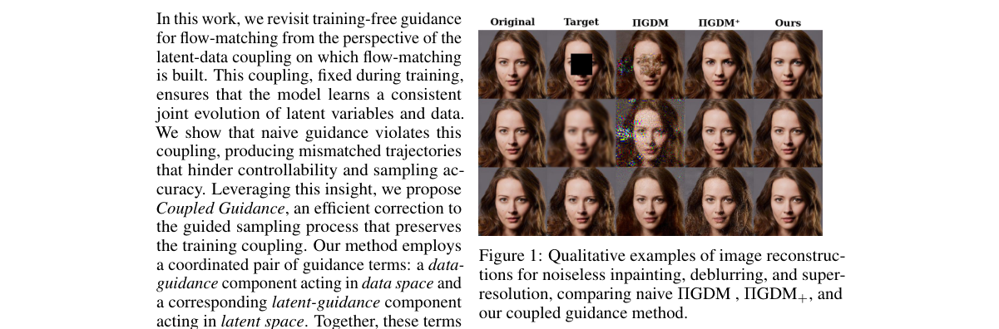

*Result - Experimental setups for robotics tasks. From left to right: Maniskill PickCube, Adroit Door, Hammer, Relocate, and Pen.*

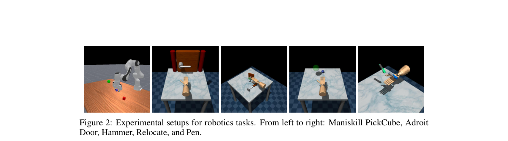

**Why this ranks #2**: 它证明把 diffusion 的 guidance 直接搬到 flow matching 会破坏训练时的 coupling 分布，并给出几何视角的修法。

---

### 3. MorphSIG: Subject-Driven Image Generation via Decoupled Anchoring and Feature Transport

**arXiv**: [2610.39530](https://arxiv.org/abs/2610.39530) | **Score**: 8.7 (relevance 9.0 x 0.7 + quality 8.0 x 0.3) | **Tags**: AIGC-visual, subject-driven-generation, training-free, frequency-decoupling, pseudo-flow, identity-alignment, UESTC | **Categories**: cs.CV | **Pages**: 14

**Authors**: Hailong Yan; Yongrui Zhang; Xiangtao Zhang; Le Zhang

**Affiliation**: UESTC; Hohai University

**Abstract**

> We propose MorphSIG, a training-free framework that reformulates subject-driven image generation (SIG) as pseudo-video feature transport. MorphSIG contains two core modules: Progressive Decoupled Anchoring, which uses frequency-domain decoupling and structural scrambling during early denoising to break structural locking and enable a gradual transition from free composition to identity alignment; and Pseudo-flow Guided Feature Transport, which constructs a latent-space pseudo-flow field to mimic Image-to-Video temporal coherence and transport subject semantics precisely. To address stylistic homogeneity and the lack of ground truth in existing benchmarks, we further introduce a benchmark with diverse stylized subjects. Extensive experiments show that MorphSIG significantly improves pose diversity and subject fidelity over baselines without additional training. Overall, MorphSIG bridges static generation and dynamic propagation, providing a cost-effective paradigm for high-fidelity subject consistency.

**Key findings**

- **Finding**: MorphSIG 是 training-free 框架，把 subject-driven 图像生成重新表述为伪视频特征传输，不做任何额外训练。
- **Finding**: Progressive Decoupled Anchoring 在去噪早期用频域解耦与结构打乱打破结构锁定，让生成从自由构图逐步过渡到身份对齐。
- **Finding**: Pseudo-flow Guided Feature Transport 在潜空间构造伪流场，模仿 image-to-video 的时序一致性以精确搬运主体语义。
- **Finding**: 针对现有基准风格雷同、缺乏 ground truth 的问题，论文另外提出一个包含多样化风格化主体的基准。
- **Finding**: 实验显示 MorphSIG 在无需训练的前提下，姿态多样性与主体保真度都显著超过基线。
- **Inference**: 把「主体一致性」当作视频时序问题来解，绕开了训练成本，但也受限于伪流场对单帧生成模型的表达能力。
- **Recommendation**: 有条件推荐。关心主体保真与训练成本、或正在做免训练个性化方案的读者值得读。

**Key figures**

*Framework - Qualitative comparison between MorphSIG and the baseline.*

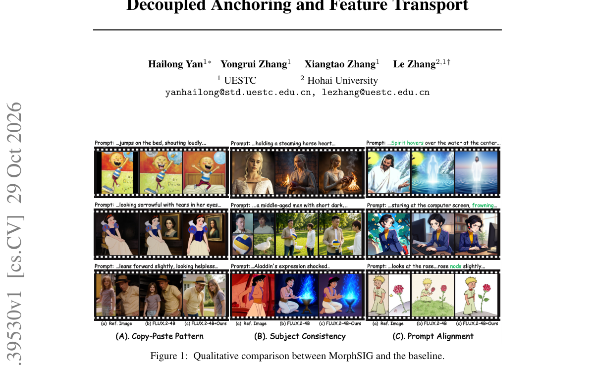

*Result - Comparison of different SIG paradigms. SC (Sub- ject Consistency), and Cost (computational complexity).*

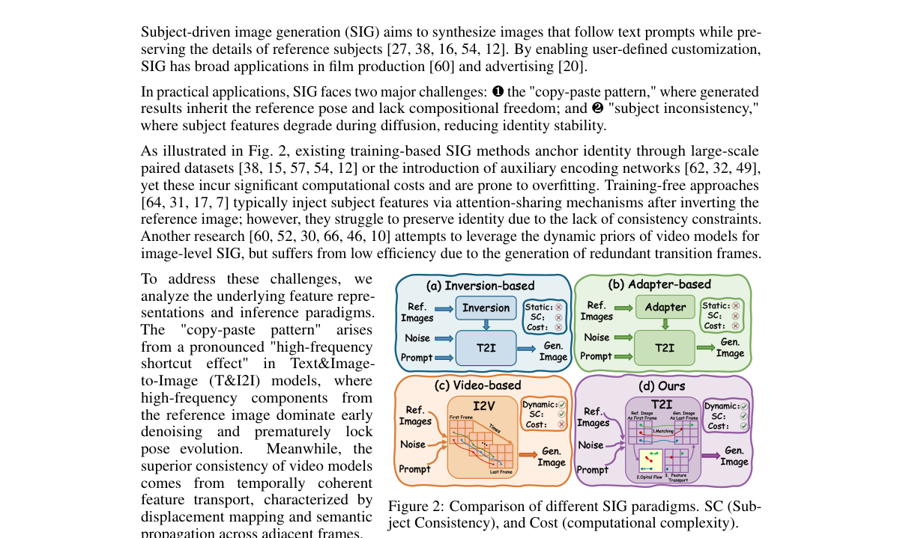

**Why this ranks #3**: 它把 subject-driven 生成改写成「伪视频特征传输」：先在频域松开结构锁，再用潜空间伪流场把主体身份搬过去。

---

### 4. AB-Attention: Accurate Block Attention for Accelerating Video Diffusion Transformers

**arXiv**: [2610.39663](https://arxiv.org/abs/2610.39663) | **Score**: 8.5 (relevance 8.5 x 0.7 + quality 8.5 x 0.3) | **Tags**: AIGC-visual, video-diffusion, block-sparse-attention, training-free, kv-cache, inference-speedup, InfRec | **Categories**: cs.CV | **Pages**: 20

**Authors**: Bin Xu; Mo Zhang; Zhengfeiyang Zhang; Xinfeng Yang; Yixing Ma; Wei Wang; HeXin Wang; Pengfei Zhou; Wangbo Zhao

**Affiliation**: InfRec; The Chinese University of Hong Kong, Shenzhen; Shandong University; The University of Tokyo; Fudan University; University of California, Berkeley; The Hong Kong University of Science and Technology

**Abstract**

> Video diffusion transformers generate high-quality videos, but the quadratic cost of 3D full attention dominates their inference. Dynamic block-sparse attention reduces this cost by computing exact attention only on key/value blocks selected from current activations. However, its fidelity degrades under aggressive sparsity: blocks are scored from coarse summaries or formed by costly global clustering, pruned blocks vanish from the softmax, and whole tiles are kept or dropped even when only a few of their keys matter. To address these limitations, we propose Accurate Block Attention (AB-Attention), a training-free method that accurately approximates dense attention at high sparsity. Its Intra-Block Clustering Selector (IBCS) estimates block importance faithfully yet cheaply by clustering queries only within each query block, without permuting tokens. Sampling with Inclusion-Probability Weighting (SIP) then samples blocks in proportion to these estimates and reweights them by inverse inclusion probability, so that one pass estimates dense attention rather than truncating it. Finally, its kernel gathers key/value blocks much smaller than a tile into full tensor-core tiles, refining selection at no extra tensor-core cost. On Wan2.1 and HunyuanVideo, AB-Attention skips 89--92\% of attention, whereas the baselines compute 1.8--3.6$\times$ as much, yet it still improves PSNR by up to 4.4~dB over the strongest baseline and achieves up to 2.23$\times$ end-to-end speedup. Our code is available at https://github.com/InfRec-Cardinal/AB-Attention.

**Key findings**

- **Finding**: AB-Attention 是 training-free 方法，目标是在高稀疏率下精确逼近稠密注意力，用于视频扩散 Transformer 的推理加速。
- **Finding**: Intra-Block Clustering Selector 只在每个 query block 内部聚类 query 来估计 block 重要性，不做 token 置换，代价更低也更忠实。
- **Finding**: Inclusion-Probability Weighting 按估计的 block 重要性采样并按逆 inclusion probability 重加权，使单次前向成为稠密注意力的估计而非截断。
- **Finding**: 其 kernel 把远小于一个 tile 的 key/value block 聚成完整 tensor-core tile，在不增加 tensor-core 开销的前提下细化选择粒度。
- **Finding**: 在 Wan2.1 与 HunyuanVideo 上跳过 89% 至 92% 的注意力计算，基线却仍需计算 1.8 至 3.6 倍的量，PSNR 相对最强基线最高提升 4.4 dB，端到端加速最高 2.23 倍。
- **Inference**: 「用加权估计代替裁剪」是最可迁移的一点，稀疏 attention 的质量下滑多半来自裁剪偏差而非稀疏本身。
- **Recommendation**: 推荐。做视频生成推理加速或稀疏注意力工程的读者建议读，代码已公开。

**Key figures**

*Framework - Examples on Wan2.1-T2V-14B, with one frame and an enlarged region per method. AB-Attention is closest to dense attention in full-video PSNR while achieving the highest speedup.*

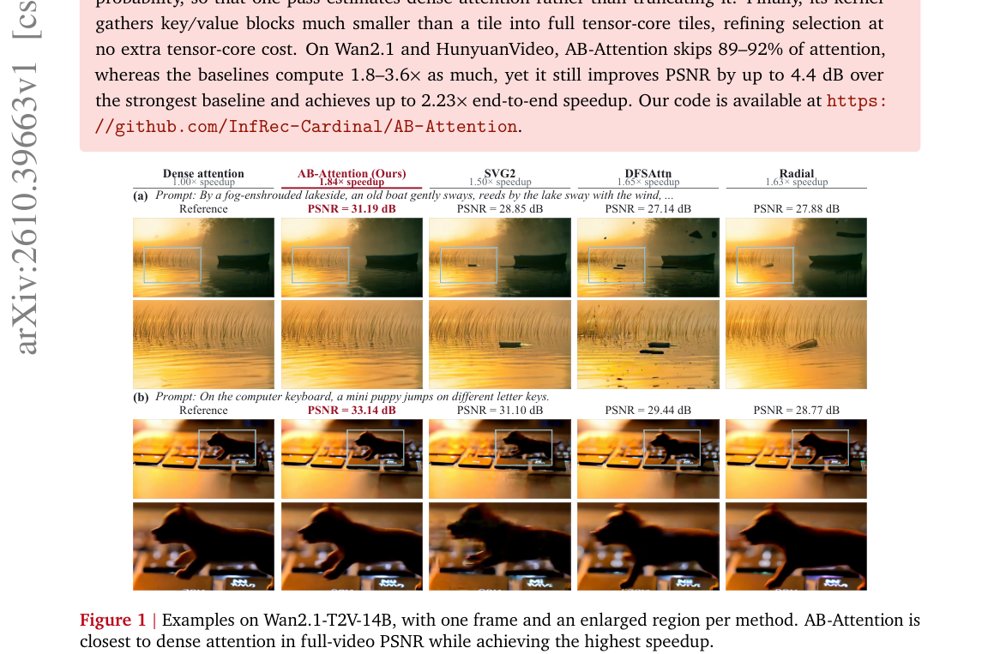

*Result - Attention mass, recall, and error on Wan2.1-T2V-14B at 89.16% sparsity. (a) Sorted cumulative attention mass of 4-token key blocks; the band spans the 10th–90th percentiles of query blocks.*

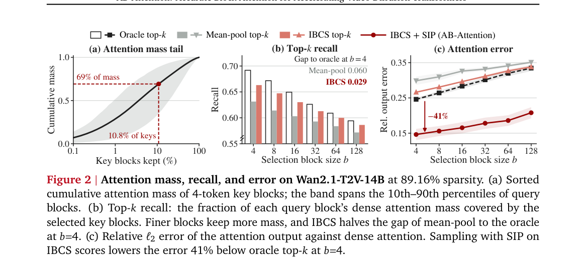

**Why this ranks #4**: 它的锋利之处在于用 inclusion probability 加权把稀疏注意力做成对稠密注意力的一次估计，而不是粗暴截断。

---

### 5. CLaW: Codec-Guided Adaptive Latent Watermarking for Traceable Diffusion Image Generation

**arXiv**: [2610.39160](https://arxiv.org/abs/2610.39160) | **Score**: 8.2 (relevance 8.5 x 0.7 + quality 7.5 x 0.3) | **Tags**: AIGC-visual, watermarking, diffusion-models, codec, traceability, frozen-backbone, University of Science and Technology of China | **Categories**: cs.CR, cs.CV | **Pages**: 34

**Authors**: Huangchao Song; Lingyun Yu; Cong Li; Peiqi Jiang; Mingqi Fang; Hongtao Xie

**Affiliation**: University of Science and Technology of China; Tianjin University

**Abstract**

> With the rapid advancement of text-to-image diffusion models, increasingly realistic AI-generated content has raised serious concerns about misuse and copyright infringement. Digital watermarking offers a promising solution by enabling user-level traceability, yet existing methods remain difficult to deploy at scale, hindered by costly model retraining or detection, poor effectiveness-fidelity trade-offs, and limited robustness to image transformations. To address these challenges, we propose CLaW (Codec-guided Latent Watermarking), a robust and efficient watermarking framework for traceable diffusion image generation with frozen diffusion backbones and inversion-free detection. Specifically, CLaW first uses a pretrained watermark codec to map each watermark message to a latent residual, enabling low-cost sampling-time injection. Then, the residual is injected within a late denoising window, where image semantics are better preserved and the watermark signal is less perturbed by subsequent denoising updates, yielding a better balance between watermark effectiveness and image fidelity. Furthermore, we introduce a decoder-guided adaptive injection mechanism that uses decoding confidence as feedback to dynamically calibrate watermark strength, reinforcing weak watermark signals and improving robustness under image transformations. Extensive experiments show that CLaW preserves high visual fidelity and achieves state-of-the-art robustness under image transformations, enabling reliable user-level traceability.

**Key findings**

- **Finding**: CLaW 面向可追溯的扩散图像生成，冻结扩散主干并采用 inversion-free 检测，无需重训模型即可部署。
- **Finding**: 它先用预训练水印 codec 把每条水印消息映射为潜空间残差，实现低成本的采样期注入。
- **Finding**: 残差在去噪后期窗口注入，此时图像语义保存更好、后续去噪更新对水印信号扰动更小，有效性与保真度更平衡。
- **Finding**: decoder-guided 自适应注入机制以解码置信度为反馈动态校准水印强度，弱信号被强化，从而提升图像变换下的鲁棒性。
- **Finding**: 实验在 SD3.5-medium 与 FLUX.1-dev 上进行，视觉保真保持高位，图像变换下的鲁棒性达到 state-of-the-art，支持用户级追踪。
- **Inference**: 把水印强度交给解码置信度来定，比固定强度更能应对不同语义区域抗变换能力的差异。
- **Recommendation**: 推荐。做 AIGC 版权溯源、生成式服务合规或需要给扩散模型加水印的读者值得读。

**Key figures**

*Framework - User-level traceability in image-generation services. (a) During generation, the platform assigns each user a unique watermark message and embeds it into the generated image, which may under*

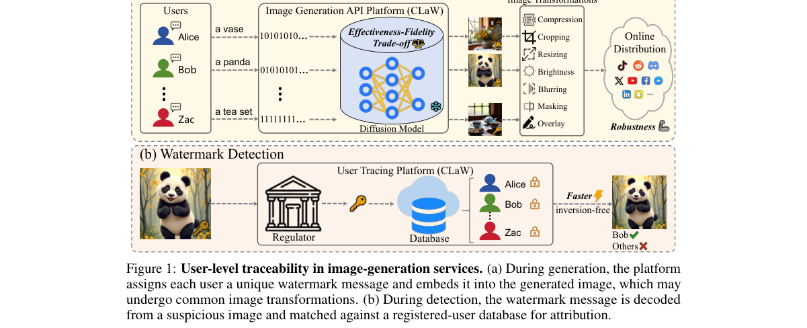

*Result - Overview of CLaW. (a) Pretraining a secret encoder Es and a secret decoder Ds within the latent space of a frozen VAE: Es converts a user-specific payload into a latent residual, while Ds re*

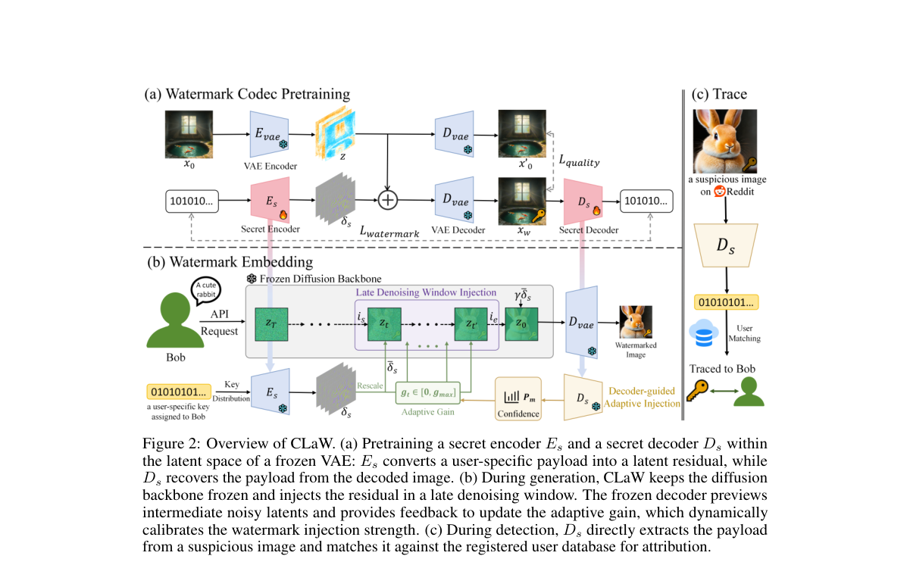

**Why this ranks #5**: 它是给现成扩散服务「贴用户标记」的：不重训主干、不做反演检测，靠预训练 codec 把水印映射成潜空间残差。

---

### 6. EPC-RawDC: Equivariant Physics Constrained 3D Diffusion with Raw Data Consistency for CBCT to CT Image Synthesis

**arXiv**: [2610.40046](https://arxiv.org/abs/2610.40046) | **Score**: 8.0 (relevance 8.0 x 0.7 + quality 8.0 x 0.3) | **Tags**: AIGC-visual, medical-image-synthesis, 3d-latent-diffusion, physics-constraint, raw-data-consistency, cbct-to-ct, Jordan | **Categories**: cs.AI, cs.CV, physics.med-ph | **Pages**: 10

**Authors**: Alzahra Altalib; Chunhui Li; Alessandro Perelli

**Affiliation**: Jordan University of Science and Technology; University of Glasgow; University of Dundee

**Abstract**

> Cone beam computed tomography (CBCT) is widely used for image guided and adaptive radiotherapy, but scatter, noise, reconstruction artifacts, and inaccurate Hounsfield units limit its quantitative use. Recent diffusion approaches for CBCT to CT synthesis remain largely image driven, with limited use of the underlying acquisition physics. We propose EPC-RawDC, a conditional 3D latent diffusion framework that combines volumetric generative modeling with two complementary constraints derived from the same scanner specific CBCT forward model. First, geometry equivariant projection constraint exploits the rotational equivariance of the CBCT forward operator by supervising the synthesized CT through correspondingly transformed reference projections. Second, raw data consistency uses noisy projection measurements of the individual acquisition as scan specific supervision during training. The framework was evaluated on two independent clinical cohorts with distinct scanner geometries and projection sources. For JUST, the physics constraints used measured clinical raw CBCT projections acquired with an Elekta system, whereas for SynthRAD2025 the projection data were simulated from the reference CT using a Varian geometry with Poisson photon statistics. EPC-RawDC achieved an SSIM of 0.97 in both cohorts and improved PSNR over DDPM by 2.66 dB on SynthRAD2025 and 2.10 dB on JUST, while reducing mean MAE by 20.3% and 19.0%, respectively. On SynthRAD2025, projection consistency and equivariant errors were reduced by 55.0% and 41.4% relative to DDPM. These results demonstrate that combining a volumetric diffusion prior with scanner geometry and scan specific projection measurements improves quantitative CBCT to CT synthesis across both simulated and measured projection domains. Code available after publication at https://github.com/ALZAHRAALTALIB/EPC-RawDC.

**Key findings**

- **Finding**: EPC-RawDC 是条件 3D latent diffusion 框架，把体数据生成建模与两个源自同一扫描仪 CBCT 前向模型的约束结合起来。
- **Finding**: 几何等变投影约束利用 CBCT 前向算子的旋转等变性，用相应变换过的参考投影监督合成出的 CT。
- **Finding**: 原始数据一致性把单次采集的含噪投影测量用作 scan-specific 的训练监督。
- **Finding**: 评估覆盖两个独立临床队列，JUST 使用 Elekta 系统实测的临床 raw CBCT 投影，SynthRAD2025 则用 Varian 几何加 Poisson 光子统计从参考 CT 模拟投影。
- **Finding**: 两个队列的 SSIM 均达 0.97，PSNR 相对 DDPM 分别提升 2.66 dB 与 2.10 dB，平均 MAE 分别下降 20.3% 与 19.0%。
- **Finding**: 在 SynthRAD2025 上，投影一致性与等变误差相对 DDPM 分别下降 55.0% 与 41.4%。
- **Inference**: 物理约束的价值不只在指标，更在于把模拟投影与真实实测投影纳入同一套监督，跨队列的泛化更可信。
- **Recommendation**: 推荐。医学图像合成、扩散模型物理先验、CT 定量精度方向的读者强烈建议读。

**Key figures**

*Framework - Overview of the proposed EPC-RawDC framework. The reference CT x0 and input CBCT xc are encoded into volumetric latent representations, and conditional 3D diffusion produces the synthesized CT*

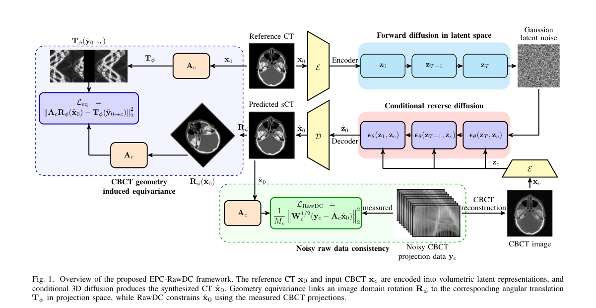

*Result - Qualitative comparison after single domain training for the SynthRAD2025 and JUST clinical test sets using (a) the full HU range and (b) the soft tissue window. Columns show the reference CT (*

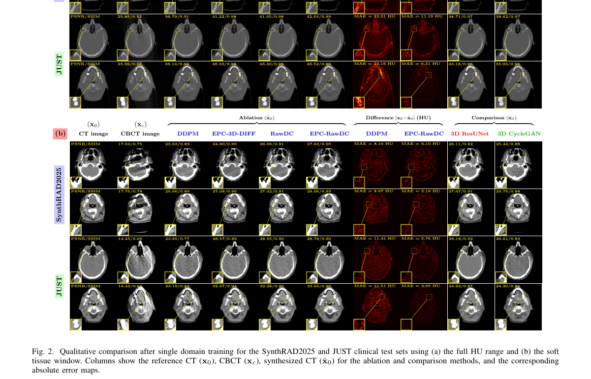

**Why this ranks #6**: 它把 CBCT 的采集物理当成监督信号写进 3D 扩散，而不是只学图像分布，实测投影域与模拟投影域都能用。

---

### 7. ACD-GS: Asymmetric Curvature-aware Densification for 3D Gaussian Splatting

**arXiv**: [2610.39399](https://arxiv.org/abs/2610.39399) | **Score**: 8.0 (relevance 8.0 x 0.7 + quality 8.0 x 0.3) | **Tags**: AIGC-visual, gaussian-splatting, densification, curvature-prior, model-compaction, novel-view-synthesis, Shanghai Jiao Tong | **Categories**: cs.CV | **Pages**: 29

**Authors**: Houqiang Zhong; Tianchi Zhu; Qiang Hu; Xiaoyun Zhang; Li Song; Wenjun Zhang

**Affiliation**: Shanghai Jiao Tong University

**Abstract**

> 3D Gaussian Splatting (3DGS) has emerged as a powerful paradigm for real-time photorealistic novel view synthesis. However, its training-time densification remains largely heuristic, often resulting in redundant Gaussian proliferation and inaccurate geometric reconstruction. Existing methods predominantly rely on first-order screen-space gradients to trigger cloning and splitting, which fail to distinguish true geometric discontinuities from high-frequency textures or noisy residuals. To address this limitation, we propose ACD-GS, an Asymmetric Curvature-aware Densification framework for compact and geometry-aware 3D Gaussian optimization. Our key insight is that second-order depth responses provide a more reliable structural prior for density control, enabling asymmetric regulation of cloning and splitting to better capture geometric discontinuities. Building on this, we introduce a multi-view photometric consistency constraint to suppress transient single-view errors, together with a capacity-aware adaptive regulation strategy that balances densification and pruning during training. Unlike post-hoc compression or quantization-based approaches, ACD-GS directly prevents redundant Gaussian generation during training, yielding inherently compact representations. Extensive experiments demonstrate that our method reduces nearly 60% of Gaussian count and storage while maintaining competitive rendering fidelity, consistently outperforming existing methods across multiple datasets. Our code is available in https://waveviewer.github.io/ACD-GS/.

**Key findings**

- **Finding**: ACD-GS 针对 3DGS 训练期 densification 依赖启发式阈值、导致高斯冗余膨胀与几何不准的问题，提出曲率感知的非对称 densification。
- **Finding**: 关键观察是二阶深度响应比一阶 screen-space 梯度更可靠地反映结构先验，能区分真实几何断裂与高频纹理、噪声残差。
- **Finding**: 据此对 cloning 与 splitting 做非对称调节，splitting 更多发生在深度边界附近，cloning 被相应抑制。
- **Finding**: 另加多视角光度一致性约束筛掉单视角的瞬时误差，并配合容量感知的自适应调节在 densification 与 pruning 之间取平衡。
- **Finding**: 实验显示该方法把高斯数量与存储减少近 60%，同时保持有竞争力的渲染保真度，在多个数据集上一致优于既有方法。
- **Inference**: 与事后压缩或量化路线不同，它在训练阶段就阻止冗余高斯生成，因此「更小」是内生属性而非二次加工。
- **Recommendation**: 推荐。做 3DGS 压缩、几何精度或实时新视角合成的读者值得读。

**Key figures**

*Framework - The point-cloud visualizations show our ACD-GS produces sparser Gaussians while preserving scene structure. The right plot (training time vs. storage, color-coded by PSNR) confirms that we ac*

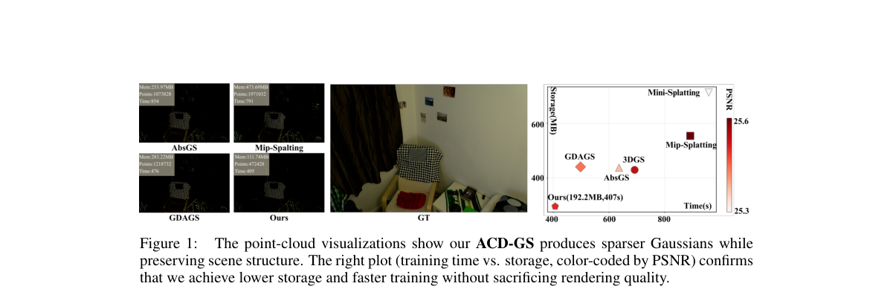

*Result - Overview of ACD-GS. Curvature-guided asymmetric densification suppresses cloning and promotes splitting near depth boundaries; multi-view photometric gating verifies candidates; capacity-aware*

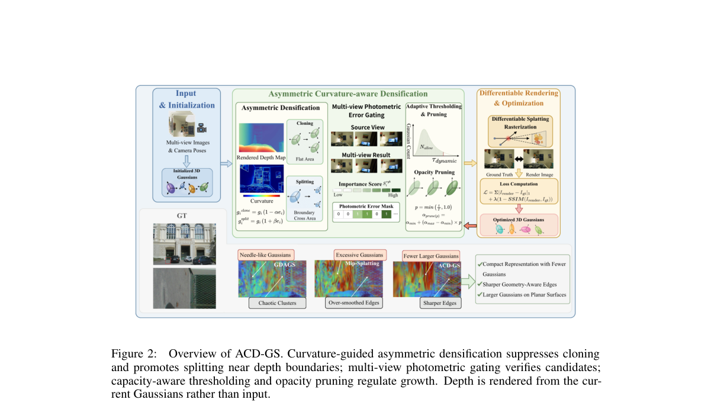

**Why this ranks #7**: 它把 3DGS 的 densification 触发条件从一阶梯度换成二阶深度曲率，少生成六成高斯的同时几何反而更准。

---

### 8. GradSplat: Gradients Inside the Forward Pass for Feed-Forward 3D Gaussian Splatting

**arXiv**: [2610.38951](https://arxiv.org/abs/2610.38951) | **Score**: 7.8 (relevance 8.0 x 0.7 + quality 7.5 x 0.3) | **Tags**: AIGC-visual, feed-forward-3dgs, gradient-refinement, recurrent-update, novel-view-synthesis, log-anisotropy, South Dakota State | **Categories**: cs.CV | **Pages**: 21

**Authors**: Jingong Chen; Linlian Jiang; Guangyuan Li; Xinxin Zuo; Yang Wang; Chulwoo Pack; Kyle Gao; Kwanghee Won

**Affiliation**: South Dakota State University; Aalto University; Concordia University; Mila - Quebec AI Institute; ELLIS Institute Finland

**Abstract**

> Feed-forward 3D Gaussian Splatting predicts a scene from a few images, but our predictor is less accurate than its own Gaussians optimized per scene on those images. This gap lies mostly in the shape of the Gaussians, their scale and rotation, since optimizing the shape alone recovers almost all of it and opacity and color recover less. Gradient steps on the input views correct this shape, and the model holds these views at inference. Log-anisotropy correction changes the axis ratios of each Gaussian in log space at constant volume, and in-forward gradient refinement renders the Gaussians into the input views and applies the gradient of the photometric loss with a learned recurrent update, first to opacity and color and then to the shape. GradSplat is a feed-forward model that refines its own Gaussians by learned gradient steps inside its forward pass, with no target view. On both complete six-view RealEstate10K protocols, it has the best PSNR and SSIM among nine methods and keeps its accuracy from $6$ to $42$ input views. Without fine-tuning, it is the most accurate on DL3DV and has the best PSNR and SSIM on ScanNet++. The code will be released at https://github.com/Jingong-Chen/GradSplat/.

**Key findings**

- **Finding**: 论文发现前馈 3DGS 预测器在精度上不及在同一批图像上逐场景优化出的高斯，而差距主要来自高斯的形状即尺度与旋转。
- **Finding**: 只优化形状一项就能补回几乎全部差距，反倒是 opacity 与 color 恢复得较少。
- **Finding**: GradSplat 在前向过程内部执行学习到的梯度步：先把高斯渲染回输入视角，对光度损失求梯度，先更新 opacity 与 color，再更新形状。
- **Finding**: 形状更新使用 log-anisotropy 修正，在 log 空间改变各向轴比而保持体积不变。
- **Finding**: 该方法不需要 target view，在 RealEstate10K 完整六视角协议上于九种方法中取得最佳 PSNR 与 SSIM，输入视角从 6 到 42 时精度保持稳定。
- **Finding**: 无需微调时它在 DL3DV 上精度最高，在 ScanNet++ 上取得最佳 PSNR 与 SSIM。
- **Inference**: 把优化藏进前向网络，等于用一次网络前向换取传统上逐场景迭代的成本，适合一次训练多次部署的场景。
- **Recommendation**: 推荐。做前馈式 3D 重建、想绕开逐场景优化的读者值得读。

**Key figures**

*Framework - GradSplat is a feed-forward model that reconstructs a scene as 3D Gaussians from a few views and refines them by gradient steps on the input views inside the model. Its Gaussians are rendere*

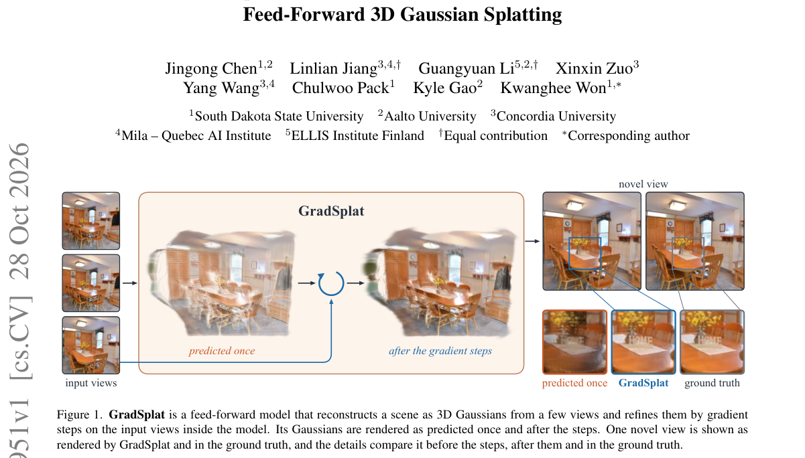

*Result - Motivation. A feed-forward model predicts the Gaussians in one pass, but rendered back into an input view they leave a large error (a). Per-scene optimization of their scale and rotation rem*

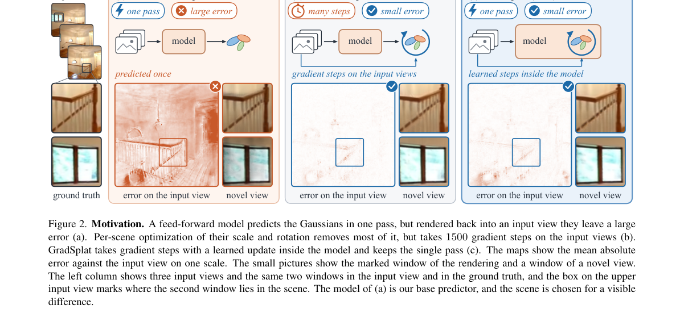

**Why this ranks #8**: 它把「前馈模型不如逐场景优化」的差距定位到高斯形状一项，并在前向过程内部用学习到的梯度步把它补回来。

---

### 9. Edited Endpoints as Partial Goals for Image-to-Video Generation

**arXiv**: [2610.39179](https://arxiv.org/abs/2610.39179) | **Score**: 7.7 (relevance 7.5 x 0.7 + quality 8.0 x 0.3) | **Tags**: AIGC-visual, image-to-video, endpoint-conditioning, temporal-artifacts, edit-relevance, evaluation-metrics, Seoul National | **Categories**: cs.CV | **Pages**: 34

**Authors**: Sihyun Kim; Sanghyun Jo; Kyungsu Kim

**Affiliation**: Seoul National University; OGQ

**Abstract**

> Edited endpoint images make the target of an image-to-video transition explicit and can improve transition completion, but also preserve context in the source image's layout. Full-frame endpoint conditioning turns this preserved context into requirements on the video's final state, potentially inducing temporal artifacts. We measure discontinuity with Hard-Cut (HC), late background reversal with Background Motion Reversal (BMR), and motion suppression with Dynamic Degree (DD). These artifacts appear across five video models spanning training-free and learned endpoint conditioning, in model-specific forms. We study Partial, a selective conditioning scheme that constrains only an edit-relevant region estimated from image-editor attention and leaves the remaining terminal content to the video model. Across three backbones on TC-Bench-I2V, Partial reduces temporal artifacts relative to full-frame conditioning, with no significant difference in Transition Completion Ratio (TCR); on Wan2.2-Turbo, uniformly weakening conditioning does not reproduce these reductions. A donor-context intervention keeps full-frame conditioning and replaces only the context outside the edit-relevant region with the final frame of a Partial video. It lowers HC and BMR on HunyuanVideo-1.5 and lowers BMR while restoring DD on Wan2.2-Turbo, with no significant difference in TCR, so constraint extent alone does not account for these artifacts. Together, these findings suggest that edited endpoints should serve as partial future goals, although edit relevance does not guarantee future validity. Code and data will be released at https://github.com/wannagetacat/Edited-Endpoints-I2V.

**Key findings**

- **Finding**: 论文指出编辑过的 endpoint 图像虽然让 image-to-video 的目标更明确，却会把源图布局里保留下来的上下文也变成对视频终态的要求，从而诱发时序伪影。
- **Finding**: 作者用 Hard-Cut 衡量断裂、Background Motion Reversal 衡量晚期背景反转、Dynamic Degree 衡量运动抑制这三类伪影。
- **Finding**: 这些伪影在横跨 training-free 与 learning-based endpoint 条件化的五个视频模型上都出现，只是形式随模型而异。
- **Finding**: 提出的 Partial 只约束由图像编辑器 attention 估计出的编辑相关区域，其余终态内容交给视频模型；三个 backbone 在 TC-Bench-I2V 上都降低了时序伪影，而转换完成度 TCR 无显著差异。
- **Finding**: 在 Wan2.2-Turbo 上 uniformly 减弱条件强度并不能复现这些改善，donor-context 干预则把差异进一步分离出来。
- **Finding**: donor-context 干预在 HunyuanVideo-1.5 上降低 HC 与 BMR，在 Wan2.2-Turbo 上降低 BMR 并恢复 DD，说明仅靠约束范围本身解释不了这些伪影。
- **Inference**: 结论是编辑后的 endpoint 应当只充当「部分未来目标」，但编辑相关性并不自动保证未来有效性。
- **Recommendation**: 推荐。做 image-to-video 条件化，或研究端帧控制与时序伪影关系的读者值得读。

**Key figures**

*Framework - Edited endpoints preserve context that need not specify the video’s future. Full-frame endpoint conditioning constrains both requested appearance and preserved context. Partial constrains on*

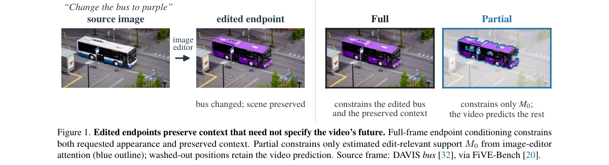

*Result - Partial reduces temporal artifacts relative to Full. Paired differences with 95% CIs over 103 prompts and five seeds; open markers are not significant. Tables 1 and C1 give levels and interv*

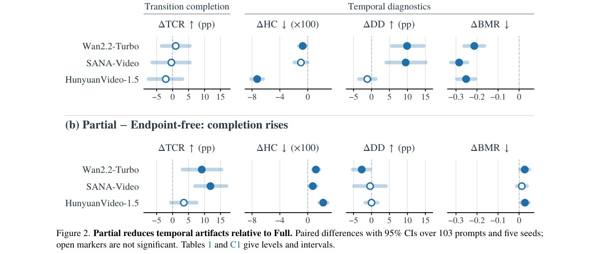

**Why this ranks #9**: 它先量化「编辑后的末帧当目标」会诱发硬切、背景反转与运动抑制，再提出只约束编辑相关区域的 Partial 条件化。

---

### 10. Calibrating Attention-Based Token Pruning for Efficient Multi-Image Synthesis in UMMs

**arXiv**: [2610.39467](https://arxiv.org/abs/2610.39467) | **Score**: 7.5 (relevance 7.5 x 0.7 + quality 7.5 x 0.3) | **Tags**: AIGC-visual, unified-multimodal-models, token-pruning, training-free, context-compression, kv-cache, Beihang | **Categories**: cs.CV | **Pages**: 21

**Authors**: Zimeng Wu; Qijian Tian; Penghui Du; Changqian Yu; Jiaxin Chen; Yunhong Wang

**Affiliation**: Beihang University; KlingAI Research; Shanghai Jiao Tong University

**Abstract**

> Unified Multimodal Models (UMMs) enable powerful multi-image synthesis but incur substantial computation from long visual contexts. While token pruning offers a direct route to accelerating inference, existing methods are primarily adapted from understanding tasks, suffering from insufficient reference image exploration, confused conditional guidance, and pooling-induced ambiguity that degrades generation quality. To address these issues, we propose CATP, the first training-free context-compression method tailored to UMM generation, which \textbf{C}alibrates the discrepancies of general \textbf{A}ttention-based \textbf{T}oken \textbf{P}runing for better quality-efficiency trade-off. Concretely, building on independent layer-wise pruning during denoising, we introduce Guidance-Consistent Pruning (GCP) to synchronize pruning decisions across conditioning branches, and a Taylor-Calibrated Attention Metric (TCAM) that derives a theoretically grounded second-order correction for pooling-induced bias. In addition, a Fast Scoring Operator (FSO) fuses the calibration into tiled online Softmax to reduce pruning cost. Extensive experiments across representative UMMs and benchmarks demonstrate that CATP consistently outperforms state-of-the-art token-reduction methods, achieving up to 2.09$\times$ attention-core speedup.

**Key findings**

- **Finding**: CATP 是首个面向 UMM 多图生成的 training-free 上下文压缩方法，针对既有剪枝方法从理解任务移植过来时的参考图探索不足、条件引导混乱与池化歧义。
- **Finding**: Guidance-Consistent Pruning 把各条件分支的剪枝决策同步到 full-condition 分支，以保住干净的 guidance。
- **Finding**: Taylor-Calibrated Attention Metric 给出有理论依据的二阶修正，校正 token 池化带来的偏差。
- **Finding**: Fast Scoring Operator 把校准融合进分块的 online Softmax，压低剪枝本身的计算代价。
- **Finding**: 整体建立在去噪过程中逐层独立剪枝之上，通过跨层剪枝 visual KV cache token 加速 UMM 推理。
- **Finding**: 在多个代表性 UMM 与基准上，CATP 一致超过 state-of-the-art token reduction 方法，attention-core 最高加速 2.09 倍。
- **Inference**: 剪枝方法失效多半不是稀疏太狠，而是不同条件分支看到的信息不一致，量化这一点常比调稀疏率更有效。
- **Recommendation**: 推荐。做多图生成、统一多模态模型加速或上下文压缩的读者值得读。

**Key figures**

*Result - Framework overview. (Top) UMM inference pipeline with CATP. It accelerates denoising by pruning visual KV cache tokens across layers at predefined timesteps. (Bottom) Illustration of the mai*

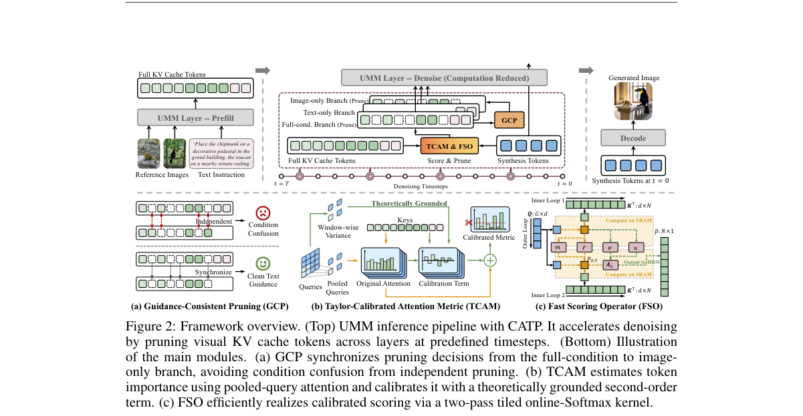

**Why this ranks #10**: 它指出剪枝方法从理解任务移植到多图生成会失配，先修「分支间剪枝不一致」和「池化偏差」两个具体病灶。

---

## Footer

- Total papers scanned across all 7 tracks: 619（原始 828 条）
- aigc_visual track final top-10: 10
- Wild-cards in this track: 0
- Figure assets: 2026-10-30/res/

Generated by `mine-arxiv-daily-digest` skill. Sister file: `2026-10-30_aigc_visual_entry.md`.
