# ArXiv Daily Digest - 2026-10-30 (音频与语音语言模型, 10 papers)

**Generated**: 2026-10-31 17:00 CST

**Source**: arXiv cs.CV, cs.SD, eess.AS, cs.CL, cs.AI, cs.RO, cs.LG submissions, listing day 2026-10-29 (announced 2026-10-30 00:00 UTC)

**Batch window**: 2026-10-28T18:00:00Z .. 2026-10-29T18:00:00Z（arXiv 公告批次横跨两个 UTC 日：前一日 18:00 UTC 起算，当日 17:59:59 UTC 截止）

**Track**: audio_lm (top 10 of 619 papers scanned, 70 full reads)

**Scope**: 语音 / 音频语言模型、流式语音交互、说话人建模、多语种与低资源语音

⚠️ **Wild-card**: 本批该线 3 篇为 wild-card 补足，已在正文逐条标注并给出理由。

补足原因：该批次真正属于「音频 / 语音语言模型与双工语音交互」的论文只有 7 篇，其余 3 篇为超模态感知模型、数据集与空间音频评测方向的补位，已在正文逐条标注并给出理由。

---

## Top 10 - 音频与语音语言模型

### 1. Streaming Speech Recognition on a Microcontroller: a 65.7M-Parameter Transducer in 2 and 4 Bits on the ESP32-P4

**arXiv**: [2610.38739](https://arxiv.org/abs/2610.38739) | **Score**: 8.5 (relevance 8.5 x 0.7 + quality 8.5 x 0.3) | **Tags**: audio-lm, on-device-asr, post-training-quantization, microcontroller, simd-kernels, edge-deployment, University of Science and Technology Houari Boumediene (USTHB) | **Categories**: cs.AR, cs.LG, eess.AS | **Pages**: 18

**Authors**: Billal Boumedine

**Affiliation**: University of Science and Technology Houari Boumediene (USTHB)

**Abstract**

> We run Kroko, a 65.7M-parameter streaming Zipformer2 transducer for English, on the ESP32-P4, a microcontroller with two 400 MHz RISC-V cores, a 128-bit SIMD extension (PIE) and 32 MB of PSRAM, but no neural accelerator. Without any training, the encoder's 290 matrices are stored with 2 or 4 bits per weight in Hadamard-rotated groups: the width of each matrix comes from its measured sensitivity, and each matrix is first corrected toward the original model's output, then rounded with GPTQ and a search over the group norms. The released 71 MB of int8 weights become a 26.65 MB file. Activations are int16 between the matrix products and int8 into them. A C engine with hand-written PIE kernels processes each 1.28 s chunk of audio in 0.90 s on both cores, beam search included, and its PC build computes the same bits as the chip, so accuracy is measured on whole test sets. LibriSpeech WER is 4.34% on test-clean and 10.26% on test-other, against 3.94% and 9.17% for the released model; on FLEURS and Common Voice the gap grows to 2.3 and 1.1 points. A GPU simulator shows that the integer arithmetic costs nothing and that the whole gap comes from the weights, and an ablation on all of test-clean shows that GPTQ does most of the work. We also report the port's speed history, from 51.3 s to 0.62 s of encoder time per chunk, each design step measured again in one build, an attempt to reach 16 MB that stopped at 19.63 MB, and what did not work. We did not measure energy. The inference engine, the firmware and the 2/4-bit weights are available at https://github.com/BoumedineBillal/esp32-pie-asr.

**Key findings**

- **Finding**: 论文在 ESP32-P4 上运行英语流式 Zipformer2 transducer Kroko，该芯片有两个 400 MHz RISC-V 核、128 位 SIMD 扩展和 32 MB PSRAM，但没有神经网络加速器。
- **Finding**: 无需任何训练，编码器的 290 个矩阵按 2 bit 或 4 bit 存储，分组经过 Hadamard 旋转，组宽由实测敏感度决定，舍入用 GPTQ 配合组范数搜索。
- **Finding**: 官方发布的 71 MB int8 权重最终变成 26.65 MB 文件；激活在矩阵乘之间保持 int16、进入矩阵时转为 int8。
- **Finding**: 手写 PIE 内核的 C 引擎在双核上处理每个 1.28 秒音频块用时 0.90 秒，已包含 beam search。
- **Finding**: PC 版构建计算出与芯片相同的比特，因此精度可在完整测试集上测量：LibriSpeech test-clean 为 4.34% WER、test-other 为 10.26%，对照发布模型是 3.94% 与 9.17%。
- **Finding**: 在 FLEURS 与 Common Voice 上差距拉大到 2.3 与 1.1 个点；GPU 模拟器显示整数运算本身没有代价，差距全部来自权重，test-clean 上的消融表明 GPTQ 贡献了大部分工作。
- **Inference**: 端侧部署的瓶颈已经从算力转向权重精度与内存预算，这套流程可以迁移到其它流式声学模型的量化上。
- **Recommendation**: 推荐读。做端侧语音识别、MCU 部署或低比特量化的工程师强烈建议精读其量化与内核实现。

**Key figures**

*Framework - The pipeline on the chip. The six encoder stacks run at the frame rates shown, each with 5.12 s of left context.*

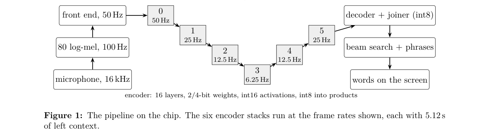

**Why this ranks #1**: 它把 6570 万参数的流式 transducer 真正塞进没有 NPU 的 ESP32-P4，并用 2/4 bit 权重把体积压到 26.65 MB，是这条线上最硬核的端侧部署结果。

---

### 2. Towards Multilingual End-of-Turn Detection using Frozen Speech Encoders

**arXiv**: [2610.39755](https://arxiv.org/abs/2610.39755) | **Score**: 8.0 (relevance 8.0 x 0.7 + quality 8.0 x 0.3) | **Tags**: audio-lm, end-of-turn, multilingual, frozen-encoder, zero-shot-transfer, dialogue-system, Uniphore | **Categories**: eess.AS | **Pages**: 8

**Authors**: Rini Sharon; Kadri Hacioglu; Andreas Stolcke

**Affiliation**: Uniphore

**Abstract**

> A spoken dialogue system must judge when the user has yielded the floor. This end-of-turn (EoT) detector is normally trained and tuned afresh for each language, which is costly to scale to new languages. We instead build one on a frozen multilingual encoder, training only a small fixed-size head. Using five CALLHOME languages, we investigate three questions. First, how well a head trained on one language transfers zero-shot to the others. Second, how much target-language adaptation is required to recover full task performance. Third, whether a single fixed decision threshold holds across languages without per-language tuning. We find that the head transfers well, even between tonal and pitch-accent languages, and that a few hours of audio recover nearly all the loss, matching in-language training. A frozen multilingual encoder with one lightweight head is a practical, language-agnostic baseline for EoT detection.

**Key findings**

- **Finding**: 论文把端到端检测器建在冻结的多语语音编码器之上，只训练一个小尺寸的检测头，避免为每种语言从头训练和调参。
- **Finding**: 作者在五种 CALLHOME 语言上考察三个问题：单语训练的头能否零样本迁移到其他语言、需要多少目标语言适配才能追平、单一固定阈值能否跨语言通用而不做逐语种调参。
- **Finding**: 检测头的迁移表现良好，声调语言与音高重音语言之间同样成立，说明表层声学差异不会阻断迁移。
- **Finding**: 少量目标语言音频就能补回几乎全部性能损失，效果与用该语言原生数据训练相当。
- **Finding**: 论文由此把「冻结多语编码器加一个轻量检测头」定位为端到端检测的实用、语言无关的基线。
- **Inference**: 多语系统的成本大头往往在标注与逐语种调参上，冻结主干把这条成本压到了可忽略的水平。
- **Recommendation**: 推荐读。做多语种语音助手、端到端检测或想快速搭基线的读者值得读其迁移实验设置。

**Key figures**

*Framework - How one conversation becomes labeled examples, shown for a shift boundary, with the frame-level target zoomed in below.*

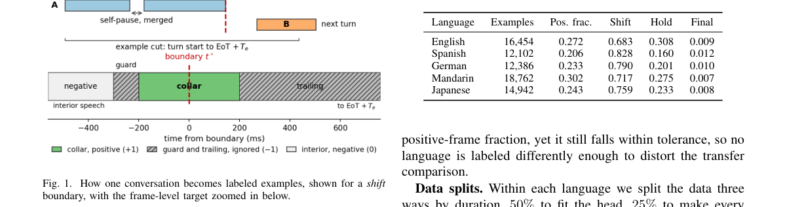

*Result - Zero-shot transfer AUC for (a) causal and (b) full-context (oracle) encoders (layer 6).*

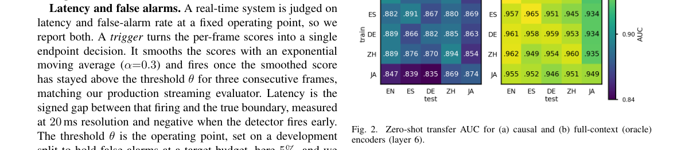

**Why this ranks #2**: 它把端到端检测从「每种语言重训一个模型」改成「冻结多语编码器加一个小头」，给多语种语音助手铺了一条低成本的路。

---

### 3. The Importance of Speech Genre for End-of-Turn Detector Training

**arXiv**: [2610.39742](https://arxiv.org/abs/2610.39742) | **Score**: 7.7 (relevance 7.5 x 0.7 + quality 8.0 x 0.3) | **Tags**: audio-lm, end-of-turn, training-data-genre, convlstm, false-alarm, annotation-pipeline, Uniphore | **Categories**: cs.AI, eess.AS | **Pages**: 7

**Authors**: Rini Sharon; Kadri Hacioglu; Jeena Prakash; Andreas Stolcke

**Affiliation**: Uniphore

**Abstract**

> End-of-turn (EoT) detection has been studied mostly through features, models, and modalities, while the speech genre of the training data has drawn far less attention. We isolate this factor. Using one reproducible annotation pipeline, we build a matched pair of corpora, multi-turn human-human conversational and single-turn human-machine, and train the same streaming ConvLSTM EoT detector on each. Across four test sets the conversational model reaches up to +0.45 higher F1, driven by fewer false alarms on the mid-turn pauses and hesitations that are rare in single-turn corpora. This conversational-training effect is not specific to frame-level decoding. Under a matched complete-or-not test it also appears at the utterance level, across two encoders, but only on conversational test data. Testing only on single-turn speech, as most prior work does, therefore hides the benefit of conversational training data. Against open-source baselines, our 1.8M-parameter model attains the highest F1 on every test set.

**Key findings**

- **Finding**: 论文用同一套可复现的标注流程构造一对规模与标注都匹配的语料：多人对话式语料与单人机式语料，只让训练体裁成为变量。
- **Finding**: 同一个流式 ConvLSTM 检测器在两者上训练后，对话式模型在四个测试集上 F1 最高提升 0.45。
- **Finding**: 增益主要来自更少的误报，而误报集中在单人机语料中很少出现的话语中停顿与犹豫上。
- **Finding**: 该效应不限于帧级解码，在整句「完整与否」的匹配测试下、在两个编码器上都成立，但只在对话式测试数据上显现。
- **Finding**: 作者指出多数既有工作只在单人机语音上测试，因此掩盖了对话式训练数据的收益。
- **Finding**: 与开源基线相比，这个 180 万参数的模型在每个测试集上都取得最高 F1。
- **Inference**: 数据体裁是被长期忽略的免费收益，做真实对话系统的团队应当优先把训练数据换成含真实交互的语料。
- **Recommendation**: 推荐读。做语音助手、打断处理或端到端检测的读者值得读其配对语料构造与评测划分。

**Key figures**

*Framework - Frame-level vs. utterance-level decisions on a turn with two mid-turn pauses. The frame-level detector scores every frame, holds back through both pauses, and fires only at the turn end. The u*

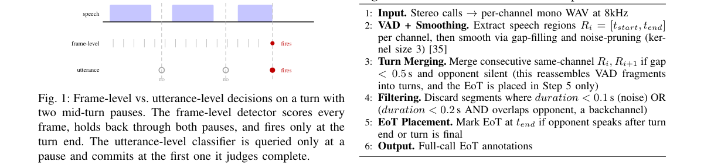

*Result - Utterance-level complete-or-not AUROC for two frozen encoders, conversational (Conv) vs single-turn (ST) training, across four test sets. Dotted line: chance.*

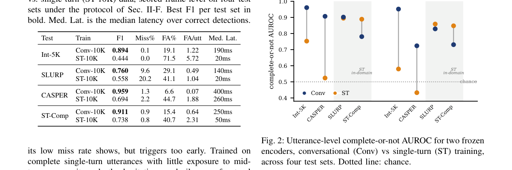

**Why this ranks #3**: 它指出端到端检测研究普遍忽略的一个变量——训练语料体裁，并用严格配对的实验证明这一项能带来最多 0.45 F1 的差距。

---

### 4. Efficient Agentic Audio-Visual Question Answering through Toolset Pruning and Modality Consolidation

**arXiv**: [2610.38960](https://arxiv.org/abs/2610.38960) | **Score**: 7.3 (relevance 7.5 x 0.7 + quality 7.0 x 0.3) | **Tags**: audio-lm, audio-visual-qa, agentic-perception, toolset-pruning, inference-efficiency, omni-modal, University of Edinburgh | **Categories**: cs.AI, cs.CL, eess.AS | **Pages**: 14

**Authors**: Yi Wang; Tianzi Wang; Peter Bell

**Affiliation**: University of Edinburgh; Chinese University of Hong Kong

**Abstract**

> Fine-grained audio-visual question answering (AVQA) requires models to resolve complex cross-modal correspondences and temporally grounding from sparsely distributed evidence. Omni-modal agents, which autonomously orchestrate perception tools to actively collect evidence, achieve strong performance, but it remains unclear whether active perception from both audio and visual modalities depends on broad specialized toolsets, especially audio or visual modality-specific tools. Such systems may also introduce long execution trajectories and substantial inference cost. We investigate whether comparable performance can be retained with a compact workflow exposing only essential perceptual capabilities. Starting from the specialized-tool OmniAgent, we conduct staged controlled experiments that prune the toolset and progressively consolidate modality-specific tools into omni-modal tools, motivating a two-tool agent comprising only Omni-modal captioning and Omni-modal QA. Across three widely used AVQA benchmarks, our compact agent achieves comparable or better accuracy than the specialized-tool agent while reducing inference cost by around 70%.

**Key findings**

- **Finding**: 论文研究细粒度音视频问答中，Omni-modal agent 主动调度感知工具时，是否真的依赖大量模态专用工具集。
- **Finding**: 作者指出这类依赖大量工具的系统会带来很长的执行轨迹和不菲的推理开销，直接影响线上可用性。
- **Finding**: 起点是专用工具版的 OmniAgent，随后通过分阶段的受控实验逐步剪枝工具集，并把模态专用工具合并成 omni-modal 工具。
- **Finding**: 实验最终收敛到只保留 Omni-modal captioning 与 Omni-modal QA 的双工具智能体。
- **Finding**: 在三个常用 AVQA 基准上，这个精简智能体的准确率与专用工具版本相当甚至更好，同时把推理成本降低了约 70%。
- **Inference**: 通用工具配上足够强的多模态底座，可能比一堆窄工具更能跨场景泛化，这会改变感知工具的设计习惯。
- **Recommendation**: 推荐读。做多模态智能体、音视频问答或关心推理成本的读者值得读其工具消融设置。

**Key figures**

*Framework - Overview of the proposed framework. During inference, a text-only planner dynamically selects between two omni-modal tool interfaces or returns the final answer. A prompt-level caption-first*

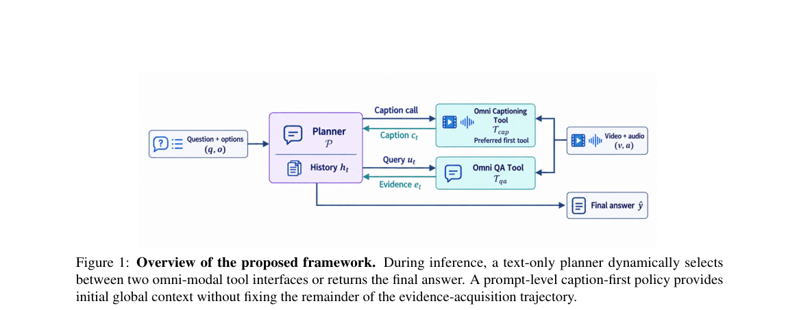

*Result - Accuracy-efficiency trade-offs across Systems 0–11 on the selected Daily-Omni validation subset. The corresponding latency values are presented in Appendix C, to save space for Table 4.*

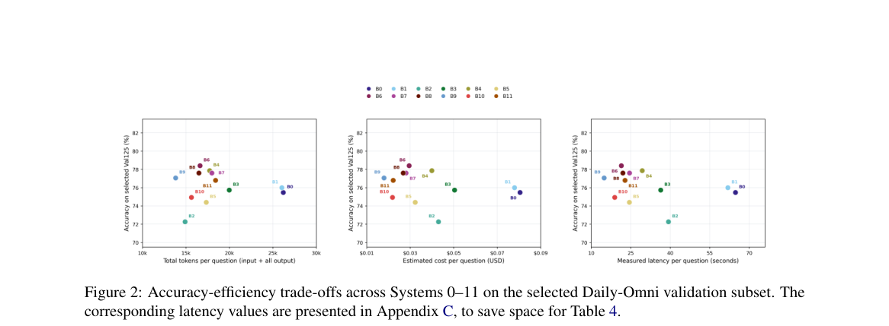

**Why this ranks #4**: 它用受控实验证明音视频智能体根本不需要一整套专用工具，把工具箱砍到两个反而更准更省，这条线少见地给出了效率账。

---

### 5. How Architecture, Typology, and Adaptation Strategies Shape ASR for Low-Resource African Languages: A Controlled Empirical Study

**arXiv**: [2610.39004](https://arxiv.org/abs/2610.39004) | **Score**: 7.1 (relevance 7.0 x 0.7 + quality 7.5 x 0.3) | **Tags**: audio-lm, low-resource-asr, african-languages, model-adaptation, whisper-mms, typology, Microsoft Research Africa | **Categories**: cs.CL, cs.SD, eess.AS | **Pages**: 11

**Authors**: Mercy Muchai; Kevin Chege; Nick Mumero Mwangi; Samuel Chege Maina; Felermino Ali; Elizabeth Ankrah; Ignatius Ezeani

**Affiliation**: Microsoft Research Africa; Lancaster University

**Abstract**

> Despite recent advancements in ASR, identifying effective architectures, fine-tuning approaches, and data adaptation strategies for low-resource languages remains challenging. We present a systematic comparison across five low-resource African languages and Swahili as a mid-resource contrast, fine-tuning three models from distinct architectures: Phi-4-multimodal-instruct, Whisper-large-v3-turbo, and MMS-1B-all. We analyze data sufficiency, monolingual versus multilingual adaptation, domain fine-tuning, and language-adapter transfer. Phi-4 achieves the best overall accuracy, MMS shows comparable CER, while Whisper exhibits high CER, consistent with known hallucinations and repetition loops. Performance saturates at different data scales, offering practical data-efficiency targets, while typological complexity consistently shapes error rates. Domain fine-tuning benefits Phi-4 and Whisper but degrades MMS, revealing limitations of adapter-based adaptation. Proxy language adapters outperform training MMS adapters from scratch.

**Key findings**

- **Finding**: 论文在五种低资源非洲语言上做系统对比，并以斯瓦希里语作为中等资源的对照，分析维度包括数据充分性、单语与多语适配、领域微调与语言适配器迁移。
- **Finding**: 对比对象是三种架构不同的模型：Phi-4-multimodal-instruct、Whisper-large-v3-turbo 和 MMS-1B-all，统一做微调。
- **Finding**: Phi-4 总体准确率最好，MMS 的 CER 与之相当，Whisper 的 CER 偏高，与已知的幻觉和重复循环问题一致。
- **Finding**: 各模型的性能在不同数据规模上饱和，论文给出了实用的数据效率目标；实验显示性能在 150 小时后基本走平。
- **Finding**: 领域微调对 Phi-4 和 Whisper 有帮助，却会让 MMS 变差，暴露出基于适配器适配的局限；代理语言适配器的效果优于从头训练 MMS 适配器。
- **Finding**: 论文还报告语言类型学的复杂度会持续影响各语言的错误率，是跨语言误差差异的稳定来源。
- **Inference**: 「换模型」和「换适配方式」是两条独立杠杆，在低资源场景里先调整数据与适配策略往往比换架构更划算。
- **Recommendation**: 推荐读。做低资源语音识别、多语种 ASR 或要选开源模型的读者值得把它当作选型对照表。

**Key figures**

*Framework - CER across six languages for Phi-4, MMS, and Whisper fine-tuned on 200 h of monolingual data. Corresponding WER is reported in Figure 8 (Ap- pendix A).*

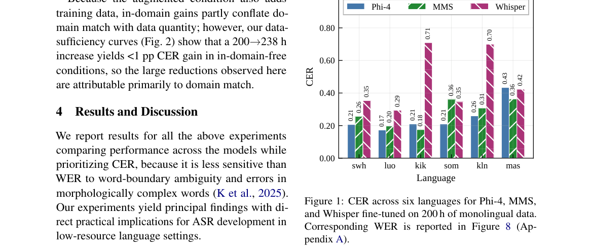

*Result - CER as a function of training data (hours) across six languages. Performance largely plateaus after 150 h.*

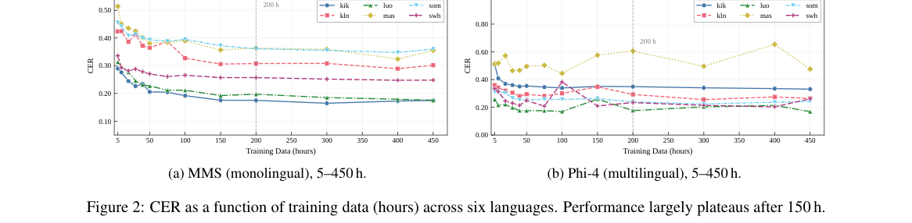

**Why this ranks #5**: 它在五种非洲低资源语言上把架构、微调策略和语言适配放在同一套实验里横向比，是这条线上少见的可复现选型参考。

---

### 6. SpeakerTurn: Target-Speaker Semantic Turn Detection in Multi-Speaker Environments

**arXiv**: [2610.39828](https://arxiv.org/abs/2610.39828) | **Score**: 7.0 (relevance 7.0 x 0.7 + quality 7.0 x 0.3) | **Tags**: audio-lm, target-speaker, turn-detection, backchannel, speech-mixture, speaker-attribution, Tianjin Normal | **Categories**: eess.AS | **Pages**: 6

**Authors**: Nan Li; Hetao Shan; Jintao Liang; Jiahao Yan; Longbiao Wang; Tubin Huang; Min Xu

**Affiliation**: Tianjin Normal University; Tianjin University; Shanghai Shenqijiyuan Intelligent Terminal Co., Ltd.

**Abstract**

> Semantic completeness alone cannot determine when an assistant should respond in a multi-speaker environment: a completed utterance may belong to an interfering speaker, while the designated user is still speaking, acknowledging, or requesting time. We therefore study semantic turn inference conditioned on speaker identity. We propose SpeakerTurn, a framework that jointly predicts the target transcript and turn state from a speech mixture and an independent target-speaker reference. Built on CocktailASR-1, it links semantic decisions to the corresponding target content through joint supervision, distinguishing complete, incomplete, backchannel, wait, and target-absent states, with a separate interruption task. We also examine whether structured chain-of-thought (CoT) supervision improves decisions by representing speaker presence and semantic cues. On a synthetic multi-speaker test set, SpeakerTurn achieves five-state macro F1 of 0.811 and target-transcription character error rate (CER) of 4.20%, correctly resolving all ten reference-swapped interruption pairs. Joint-format transcription and native-interface recognition nevertheless behave differently, and CoT improves validation transcription without improving turn macro F1. These results show why target attribution, semantic turn discrimination, and recognition retention require separate assessment when adapting speech language models for speaker-conditioned interaction.

**Key findings**

- **Finding**: 论文指出在多说话人环境里，仅凭语义完整性无法决定助手何时该接话：一句说完了的话可能属于干扰说话人，而目标用户仍在说话、附和或示意等待。
- **Finding**: 作者提出 SpeakerTurn，从语音混合与一份独立的目标说话人参考出发，联合预测目标转写与轮次状态。
- **Finding**: 该框架基于 CocktailASR-1 构建，用联合监督把语义决策与对应的目标内容挂钩。
- **Finding**: 状态被细分为 complete、incomplete、backchannel、wait 与 target-absent 五类，并另设一个打断任务。
- **Finding**: 在合成多说话人测试集上，SpeakerTurn 的五状态宏 F1 为 0.811，目标转写 CER 为 4.20%，并正确解决了全部十组参考交换后的打断样本。
- **Finding**: 论文还发现联合格式转写与原生接口识别的表现并不一致，且 chain-of-thought 监督改善了验证集转写却没有改善轮次宏 F1。
- **Inference**: 目标归属、语义轮次区分与识别保持必须分开评估，否则一个指标上的提升会掩盖另两个能力的退化。
- **Recommendation**: 推荐读。做语音助手、多人会议系统或带打断交互的读者值得读其状态定义与评测设置。

**Key figures**

*Framework - Data construction and evaluation partitions. Supervision uses the observed prefix and synthetic generation receipts. Recorded-voice mixtures carry presence labels only. The experiments below f*

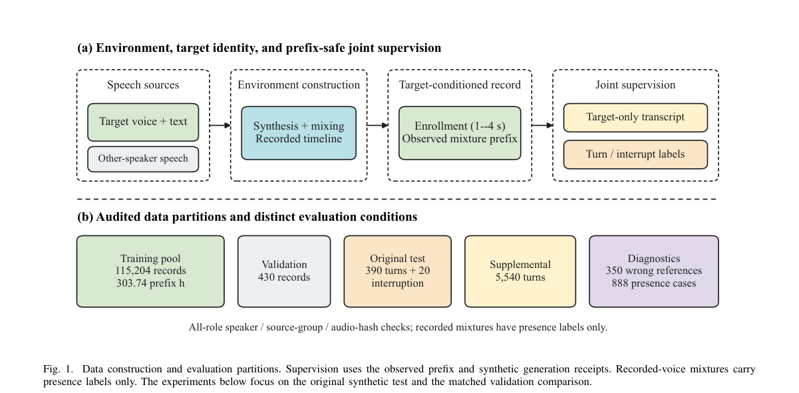

*Result - Target-conditioned Turn LLM and adaptation scope. Both joint arms inherit the same frozen acoustic path and use separate LLM LoRA weights. Target text and decisions are generated outputs; a st*

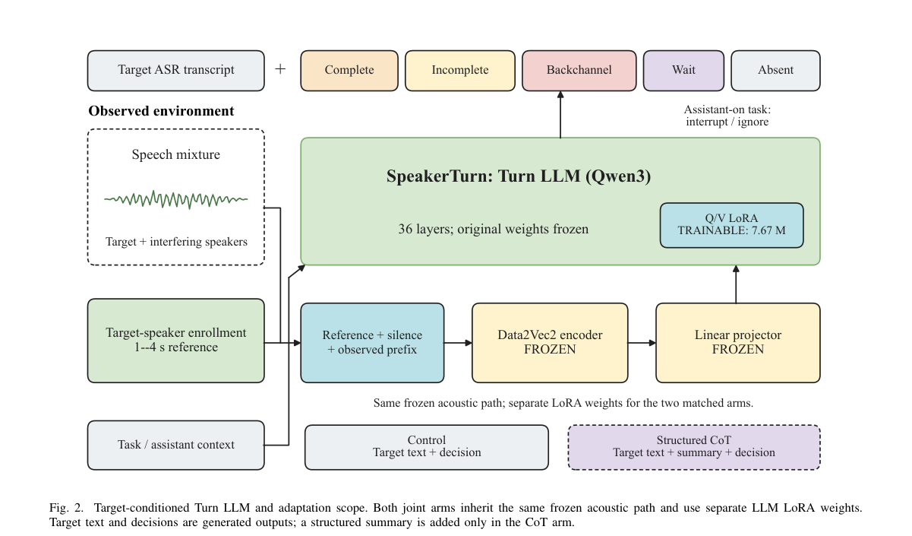

**Why this ranks #6**: 它指出语义完整不等于该助手可以接话，把目标说话人归属和语义轮次判定绑在一起做，是多人场景下助手响应时机的一把钥匙。

---

### 7. Wav2Aug: A Drop-In Speech Augmentation Policy

**arXiv**: [2610.38656](https://arxiv.org/abs/2610.38656) | **Score**: 6.1 (relevance 6.0 x 0.7 + quality 6.5 x 0.3) | **Tags**: audio-lm, data-augmentation, waveform-domain, multi-view-training, spec-augment, calibrated-pool, Concordia | **Categories**: cs.SD, eess.AS | **Pages**: 6

**Authors**: Gianfranco Dumoulin Bertucci; Mirco Ravanelli

**Affiliation**: Concordia University; Mila-Quebec AI Institute

**Abstract**

> SpecAugment is the dominant speech augmentation policy, but researchers have studied it primarily for automatic speech recognition (ASR), and it operates on spectrograms, limiting its applicability to other speech tasks and waveform models. We propose Wav2Aug, a drop-in waveform augmentation policy that randomly samples two augmentations from a calibrated pool of waveform transformations. We calibrate the augmentation hyperparameters once and reuse them across tasks and architectures, eliminating task-specific tuning. Experiments on ten speech benchmarks show that Wav2Aug achieves ASR performance comparable to SpecAugment while improving over it on average across non-ASR tasks, yielding an average relative error reduction of 12.8% over the strongest compatible SpecAugment baseline. We further show that multi-view training provides additional gains, with two augmented views offering the best tradeoff between performance and computational cost.

**Key findings**

- **Finding**: 论文指出 SpecAugment 虽是主流语音增强策略，但主要在 ASR 上被研究，且作用在频谱图上，限制了它用于其他语音任务和波形模型。
- **Finding**: Wav2Aug 是一个即插即用的波形域增强策略，从一个经过校准的波形变换池中随机采样两种增强并作用于原始音频。
- **Finding**: 超参数只校准一次，之后在任务与架构之间复用，从而免掉逐任务的调参。
- **Finding**: 在十个语音基准上，Wav2Aug 的 ASR 表现与 SpecAugment 相当，而在非 ASR 任务上平均更优，相对最强的兼容 SpecAugment 基线平均降低 12.8% 相对误差。
- **Finding**: 多视图训练还能带来额外收益，两个增强视图在性能与计算开销之间取得最佳折中。
- **Finding**: 表现最佳的配置使用两个拼接的增强视图，相对不做增强的训练平均提升 19.6%。
- **Inference**: 波形域增强的价值在于打通数据管线，一次校准多处复用，对多任务语音团队尤其划算。
- **Recommendation**: 推荐读。做语音语言模型训练、想统一多任务增强策略的读者值得读其变换池与校准方式。

**Key figures**

*Framework - Overview of Wav2Aug. We sample two augmentations uniformly per batch and apply them sequentially to each utterance, with hyperparameters drawn from globally fixed ranges.*

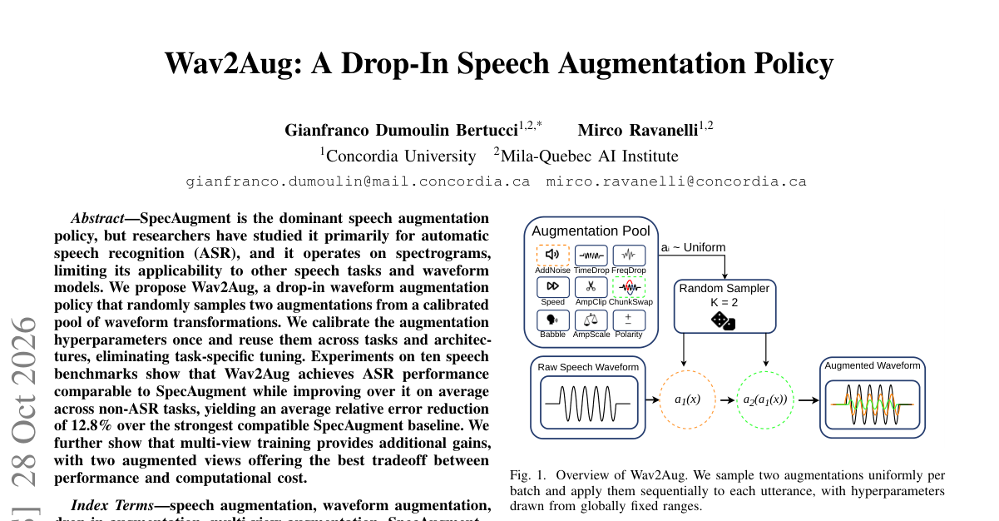

*Result - Waveform and log-mel spectrogram before and after noise addition followed by chunk swapping. Colored lines mark chunk boundaries. Matching letters track swapped chunks.*

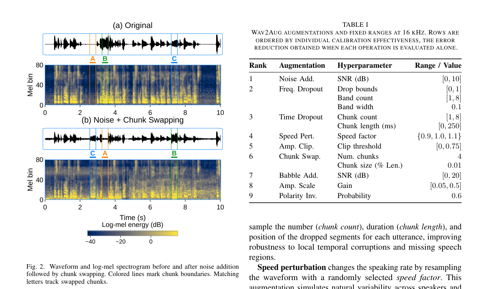

**Why this ranks #7**: 它把语音增强从频谱域挪到波形域，参数一次校准全局复用，直接打破 SpecAugment 只能服务 ASR 的格局。

---

### 8. Youtu-Parsing-Omni: One Encoder, One Schema, All Modalities

**arXiv**: [2610.39301](https://arxiv.org/abs/2610.39301) | **Score**: 6.0 (relevance 6.0 x 0.7 + quality 6.0 x 0.3) | **Tags**: audio-lm, omni-modal-parser, unified-encoder, self-evolving-distillation, structured-extraction, audio-video, Tencent Cloud ADP (Youtu-Parsing-Omni Team) | **Categories**: cs.CV | **Pages**: 53

**Authors**: Yunhang Shen; Zhangquan Chen; Xiaotian Li; Zhongpeng Cai; Qing Zhou; Zekai Zhang; Kun Zhang; Zezhong Wu; Jian Hu; Haihan Gao; Heting Gao; Xin Li

**Affiliation**: Tencent Cloud ADP (Youtu-Parsing-Omni Team)

**Abstract**

> We present Youtu-Parsing-Omni, an omni-modal parser that converts documents, images, audio, and video into structured records grounded in space and time, providing a perception layer for agents that read, locate, and cite evidence across modalities. Its design rests on one encoder for every modality and one schema for every task. Youtu-Omni-Encoder, initialized from a pre-trained language model to strengthen text reading, encodes all modalities with shared weights in a unified space-time coordinate system, and a few fusion layers let video frames attend to concurrent audio, bringing cross-modal fusion and temporal alignment into perception itself. OmniSchema unifies the outputs of all ten parsing tasks, allowing a single self-evolving post-training procedure, OmniSchema-Aware On-Policy Distillation (OSAD), to provide a shared token-role-based objective across tasks. In each round, the model is trained on its own rollouts against token-level targets from a reference-conditioned copy of itself, which is then refreshed with the trained weights, so that the parser and its supervision co-evolve. With a single 5 B-parameter checkpoint, Youtu-Parsing-Omni achieves state-of-the-art performance on OmniDocBench v1.6 (96.96 Overall) and leads all open-weight models on OmniParsingBench (75.08 Avg.), with its advantage concentrated on audio and video. It also achieves the best overall chart-parsing score (95.02) and the highest exact chemical-fingerprint agreement among compared systems, and matches a dedicated optical-music model in character-level transcription of typeset sheet music while staying far ahead of general-purpose systems. Code and model weights are publicly available.

**Key findings**

- **Finding**: Youtu-Parsing-Omni 把文档、图像、音频与视频统一解析成落在时空坐标中的结构化记录，为需要读取、定位并引用证据的智能体提供感知层。
- **Finding**: Youtu-Omni-Encoder 从预训练语言模型初始化以强化文本阅读，用共享权重把所有模态编码到统一的时空坐标系，另有少量融合层让视频帧关注同时发生的音频。
- **Finding**: OmniSchema 统一了全部十类解析任务的输出，使单一的自演化后训练流程 OmniSchema-Aware On-Policy Distillation 可以跨任务共用 token 级角色目标。
- **Finding**: 每轮训练让模型在自己的 rollout 上对齐来自参考条件副本的 token 级目标，再用训练后的权重刷新该副本，使解析器与监督相互演化。
- **Finding**: 单个 50 亿参数 checkpoint 在 OmniDocBench v1.6 上达 96.96 Overall，在 OmniParsingBench 上以 75.08 Avg. 领先开放权重模型，优势集中在音频与视频。
- **Finding**: 它同时取得最佳图表解析总分 95.02 与最高的化学指纹精确一致率，并在排版乐谱的字符级转写上追平专用光学音乐模型。
- **Inference**: 音频与视频的优势集中在同一编码器上，说明此前多模态系统的短板往往在感知层而非后训练或数据规模。
- **Recommendation**: 推荐读。做多模态感知、文档与音视频结构化抽取的读者值得读其 schema 设计与自演化蒸馏流程。

**Key figures**

*Framework - Youtu-Parsing-Omni ranks first on OmniDocBench v1.6 (a), is the strongest open-weight model on OmniPars- ingBench (b), and also leads on most domain-specific benchmarks (c).*

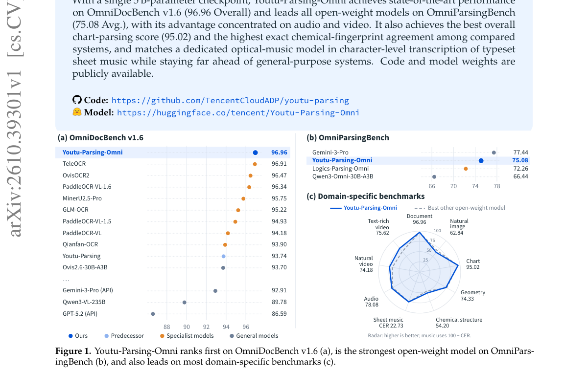

*Result - Omni-modal parsing with one encoder and one schema. Youtu-Parsing-Omni parses documents, natural images, audio, and video with Youtu-Omni-Encoder shared across all modalities, and unifies th*

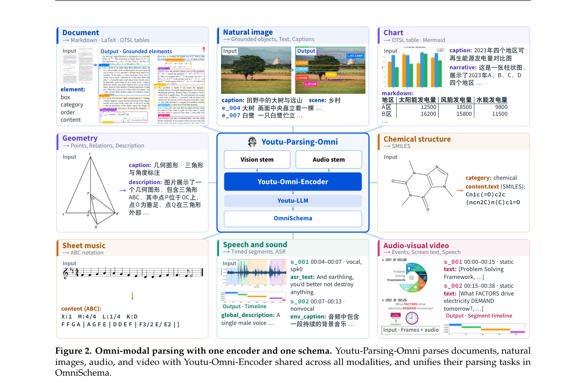

**Why this ranks #8**: 一个编码器加一套 schema 就统一了十类解析任务，并把跨模态融合与时间对齐拉进感知本身，是这条线上格局最大的一篇。  [wild-card=yes] 全模态解析器（文档 / 图像 / 音频 / 视频）主体是文档解析，音频只是其中一支，属超模态感知模型的补位。

---

### 9. Mind The Gap (MTG-AD): Dataset and Fine-grained Evaluation for End-to-End Inline Audio Descriptions

**arXiv**: [2610.39955](https://arxiv.org/abs/2610.39955) | **Score**: 5.6 (relevance 5.5 x 0.7 + quality 6.0 x 0.3) | **Tags**: audio-lm, audio-description, accessibility, mllm-evaluation, dataset, inline-timing, Google Research | **Categories**: cs.AI, cs.CV, cs.HC | **Pages**: 31

**Authors**: Subhashini Venugopalan; Jenny Tan; Taylor Roper; Jimmy Tobin; Anton Kast; Alicia Martin; Sam Sepah; Amy Pavel

**Affiliation**: Google Research; UC Berkeley

**Abstract**

> Audio descriptions (AD) are essential for making visual media accessible to blind and low-vision (BLV) users. While Multimodal Large Language Models (MLLMs) offer a scalable solution for generating audio descriptions on-demand, their performance on ``inline'' audio descriptions -- which must fit within existing silences in a video -- remains under-explored, particularly for diverse user-generated content (UGC). We present a comprehensive investigation into MLLM-generated inline audio descriptions. First, we introduce MTG-AD, a professionally annotated dataset of 36 hours of videos, each averaging $\sim$5 mins. and 8k+ descriptions in total, co-created by paired blind and sighted AD professionals to provide a high-quality benchmark for this task. Second, we propose MTG-AD-Eval, an evaluation framework based on audio description expert guidelines that provides fine-grained, reference-free actionable metrics for model improvement. Crucially, our framework evaluates the end-to-end task: it renders the generated scripts into audio tracks to assess their fit within the original video's natural silences, minimizing disruptive overlaps. Our analysis across frontier MLLMs reveals that while models accurately describe visual events and substantially reduce speech overlaps, gaps persist in narrative pacing and flow. Finally, we empirically validate that our automated and reference-free metrics correlate significantly with human quality ratings from sighted raters and 7 BLV participants, finding that while users narrowly prefer human-authored audio descriptions, they find MLLM-generated audio descriptions highly beneficial for comprehension. We provide actionable system design guidance and release MTG-AD at https://hf.co/datasets/google/mind-the-gap-inline-ad and MTG-AD-Eval at https://github.com/google/mtg-ad.

**Key findings**

- **Finding**: 论文研究 MLLM 生成的内联音频描述，必须嵌进视频现有静音空档，而这一任务在多样化的用户生成内容上仍缺乏研究。
- **Finding**: 作者发布 MTG-AD 数据集，覆盖 433 个专业标注视频共 36 小时、平均每条约 5 分钟、含 8 千余条描述，由盲人与明眼音频描述专家配对共创。
- **Finding**: 论文提出 MTG-AD-Eval 评测框架，基于音频描述专家守则给出细粒度、无参考且可直接指导改进的指标。
- **Finding**: 该框架评估的是端到端任务：把生成的脚本文本渲染成音轨，再看它是否落进原视频的自然静音，从而把干扰性重叠降到最低。
- **Finding**: 对前沿 MLLM 的分析显示，模型能准确描述视觉事件并显著减少语音重叠，但叙事节奏与流畅度仍有缺口。
- **Finding**: 自动化无参考指标与明眼评分者及 7 名盲障用户的质量评分显著相关；用户略偏好人工撰写的描述，但认为 MLLM 生成的描述对理解帮助很大。
- **Inference**: 把评价落到渲染后的时间轴上，比只比文本更接近真实无障碍体验，这类端到端度量值得成为生成式音频任务的标配。
- **Recommendation**: 推荐读。做无障碍、MLLM 评测或语音描述生成的读者值得读其数据与指标设计。

**Key figures**

*Framework - Temporal Constraints of Inline Audio Descriptions. Inline AD must fit precisely into natural silences within a video’s narration (purple). Both the professional “Gold” human AD from MTG-AD (*

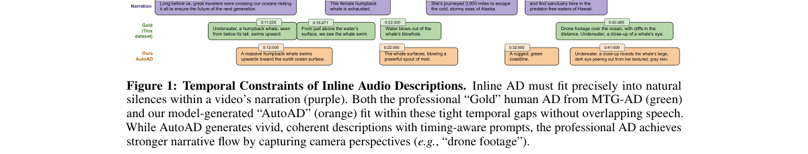

*Result - Dataset Statistics. MTG-AD comprises 433 professionally annotated videos (∼36 hours): (a) video durations center around 5 minutes; (b) human-annotated AD segments per minute; (c) vlogs form*

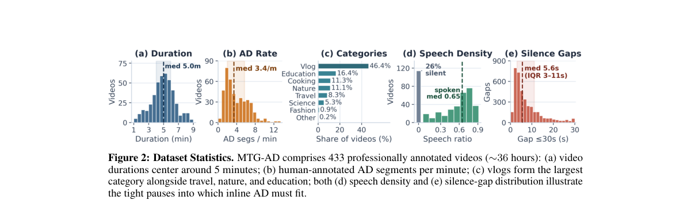

**Why this ranks #9**: 它把音频描述从「能说清画面」推进到「必须塞进原视频的静音空档」，并给出能渲染回时间轴做端到端评估的评测框架。  [wild-card=yes] 面向视障人群的行内音频描述数据集与细粒度评测，属数据 / 评测资源，不含语音交互建模方法。

---

### 10. AVPS-360: A Spatial Audio-Visual Benchmark for Instance Segmentation and Tracking of Sound-Producing Persons

**arXiv**: [2610.40480](https://arxiv.org/abs/2610.40480) | **Score**: 5.2 (relevance 5.0 x 0.7 + quality 5.5 x 0.3) | **Tags**: audio-lm, spatial-audio, sound-source-localization, instance-segmentation, benchmark, ambisonics, Audio Research Group | **Categories**: cs.CV | **Pages**: 5

**Authors**: Yifu Sun; Parthasaarathy Sudarsanam; Tuomas Virtanen; Archontis Politis

**Affiliation**: Audio Research Group, Tampere University

**Abstract**

> Audio-visual instance segmentation (AVIS) segments and tracks individual sound-producing objects in videos. Existing benchmarks predominantly use monaural audio, which lacks inter-channel cues for spatially distinguishing concurrent sound sources. We introduce AVPS-360 (Audio-Visual Person Segmentation 360), a spatial audio-visual benchmark bridging AVIS and sound event localisation and detection (SELD). Built upon STARSS23, it pairs first-order Ambisonics audio with synchronised 360° video across 230 recordings totalling 10.5 hours. Recordings average 164.0 seconds. The dataset captures intermittent sound production in real-world interactions dominated by speech, alongside laughter, clapping, and footsteps. It provides 31,678 manually reviewed instance masks linked to source identities and sound-event labels. We also present a baseline that integrates spatial audio with visual features for frame-level segmentation and identity association across frames. Experiments on AVPS-360 show that existing AVIS methods struggle with detection and identity association in long recordings with intermittent sound production, while our baseline substantially improves performance in both aspects.

**Key findings**

- **Finding**: 论文指出既有音视频实例分割基准多用单声道音频，缺少区分并发声源所需的通道间线索。
- **Finding**: AVPS-360 建立在 STARSS23 之上，把一阶 Ambisonics 音频与同步的 360 度视频配对，覆盖 230 段录音共 10.5 小时，平均每段 164.0 秒。
- **Finding**: 录音捕捉的是以语音为主的真实交互中的间歇性发声，同时包含笑声、掌声与脚步声。
- **Finding**: 数据集提供 31,678 个人工审核的实例掩码，并关联到声源身份与声音事件标签。
- **Finding**: 作者同时给出把空间音频与视觉特征结合的基线，做帧级分割并跨帧做身份关联。
- **Finding**: 实验显示既有 AVIS 方法在长录音的间歇性发声场景下，检测与身份关联都难以应付，而该基线在这两方面都有明显改善。
- **Inference**: 单声道基准天然回避了空间线索带来的歧义，这可能让既有方法的多声源能力被高估。
- **Recommendation**: 选读。做声音事件定位与检测、音视频分割或需要空间音频数据集的读者值得读这篇基准。

**Key figures**

*Framework - Annotation examples from AVPS-360. Coloured masks denote sound-producing persons, illustrating occlusion (top) and sound-source movement (bottom). Colours indicate consistent person identities*

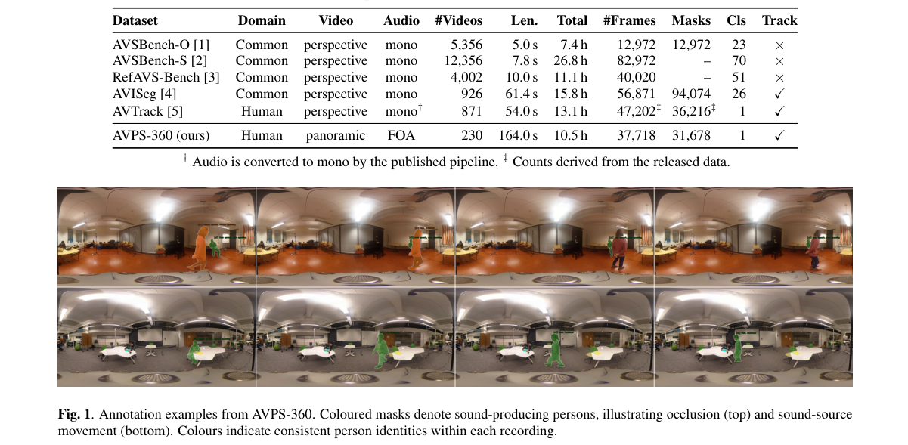

*Result - Baseline architecture. Audio guides frame-level segmentation, and the resulting instance queries are mapped to embeddings for cross-frame association. A memory bank provides historical embeddi*

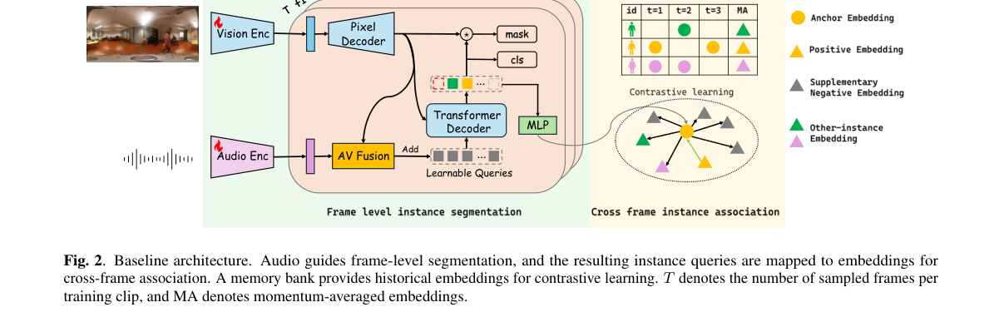

**Why this ranks #10**: 它把一阶 Ambisonics 搬进音视频实例分割，让并发声源的空间信息真正参与分割与身份关联，是这条线上偏感知侧的基准工作。  [wild-card=yes] 空间音视实例分割基准，评测对象是分割与声音源身份关联，不涉及语音交互或音频语言模型。

---

## Footer

- Total papers scanned across all 7 tracks: 619（原始 828 条）
- audio_lm track final top-10: 10
- Wild-cards in this track: 3
- Figure assets: 2026-10-30/res/

Generated by `mine-arxiv-daily-digest` skill. Sister file: `2026-10-30_audio_lm_entry.md`.
