# ArXiv Daily Digest - 2026-10-30 (具身智能与世界模型, 10 papers)

**Generated**: 2026-10-31 17:00 CST

**Source**: arXiv cs.CV, cs.SD, eess.AS, cs.CL, cs.AI, cs.RO, cs.LG submissions, listing day 2026-10-29 (announced 2026-10-30 00:00 UTC)

**Batch window**: 2026-10-28T18:00:00Z .. 2026-10-29T18:00:00Z（arXiv 公告批次横跨两个 UTC 日：前一日 18:00 UTC 起算，当日 17:59:59 UTC 截止）

**Track**: embodied (top 10 of 619 papers scanned, 70 full reads)

**Scope**: 机器人操作与导航、视觉语言动作模型、世界模型、触觉感知与 sim-to-real

---

## Top 10 - 具身智能与世界模型

### 1. PRIME W0: Physical Priors from World Models for Embodied Manipulation

**arXiv**: [2610.39528](https://arxiv.org/abs/2610.39528) | **Score**: 9.3 (relevance 9.5 x 0.7 + quality 9.0 x 0.3) | **Tags**: embodied, flow-matching, world-model, kv-injection, adaptive-moe, vla-policy, Lumos SZ Lab Team | **Categories**: cs.RO | **Pages**: 22

**Authors**: Huabin Peng; Fagang Jin; Yancong Wei; Tengfei Ma; Chuhang Liu; Chao Yu; Liqing Chen

**Affiliation**: Lumos SZ Lab Team; Lumos Robotics; Tsinghua University (THU); The Chinese University of Hong Kong (CUHK); Nanyang Technological University (NTU)

**Abstract**

> Vision-Language-Action (VLA) models excel at instruction following, yet most remain feed-forward: they condition actions only on the current observation and discard both long-horizon temporal context and the hierarchical structure of VLM representations. We present PRIME W0, a hierarchical conditional flow-matching framework that closes this gap through three synergistic designs: (1)per-layer KV injection from a pretrained VLM into an Adaptive MoE action expert; (2)dynamics-aware conditioning via asynchronous world-model subgoal-image prediction and a DINOv2 historical-frame semantic bridge; and (3)Action Dynamic Manifold (ADM) flow matching with covariance-structured noise that respects robot kinematic coupling. PRIME W0 is trained in four stages---VLM pre-training, DAT/NTP visuomotor pre-training, DiT flow-matching decoder assembly with WM injection, and end-to-end SFT---and achieves state-of-the-art results on LIBERO and real-robot benchmarks, with systematic ablations validating each architectural component.

**Key findings**

- **Finding**: 论文指出多数 VLA 是 feed-forward 的，只以当前观测为条件，丢掉了长时序上下文与 VLM 表示的层次结构。
- **Finding**: PRIME W0 是分层条件流匹配框架，三项设计为逐层 KV 注入 Adaptive MoE 动作专家、异步 world model 子目标图像加 DINOv2 历史帧语义桥、带协方差结构噪声的流匹配。
- **Finding**: 训练分四阶段：VLM 预训练、DAT/NTP 视觉运动预训练、DiT 流匹配解码器装配并注入 WM、端到端 SFT。
- **Finding**: 在 LIBERO 与真机基准上取得 SOTA 结果，并用系统性消融验证每个架构组件。
- **Inference**: 异步预测子目标图像等于把「想象」变成条件而非额外 rollout，在不抬高端到端延迟的前提下补上了时序先验。
- **Inference**: ADM 用协方差结构噪声贴合机器人运动学耦合，是把物理可行域写进动作空间的务实做法，但先验协方差如何确定仍值得追问。
- **Recommendation**: 推荐。做 VLA、长时序操作或想用 world model 增强策略的读者强烈建议读。

**Key figures**

*Framework - PRIME W0 architecture.*

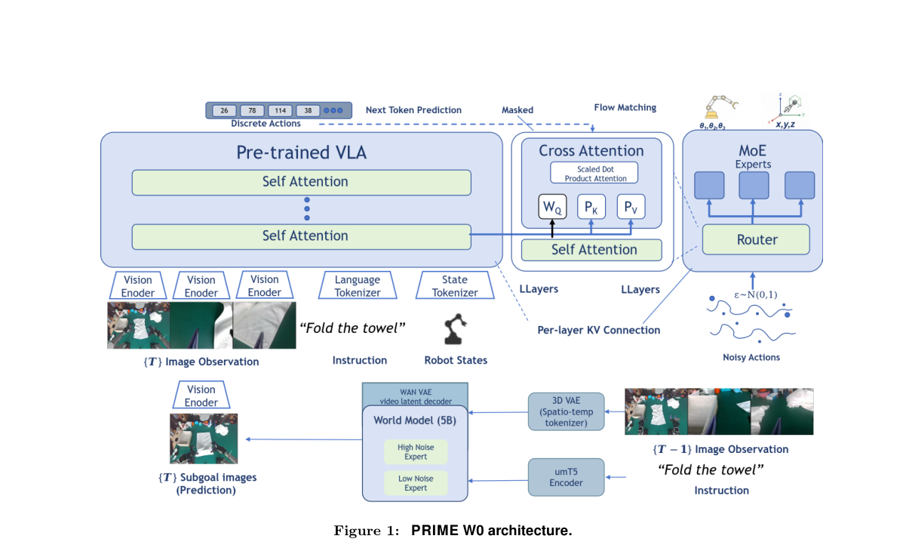

*Result - Four-stage training pipeline. (1) VLM Pretrain: the vision–language backbone is trained on general multimodal supervision (e.g. captioning / VQA). (2) NTP / task-specific pre-training: with*

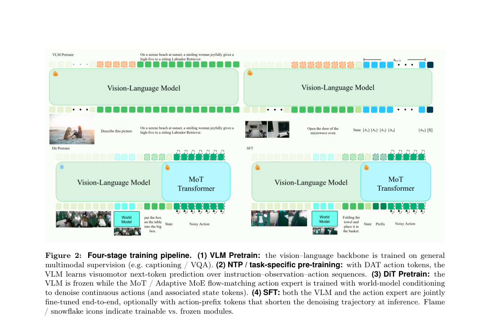

**Why this ranks #1**: 把异步 world model 的子目标预测、逐层 KV 注入和运动学耦合约束一起塞进流匹配 VLA，直击 feed-forward VLA 丢掉的时序与物理先验。

---

### 2. TouchBridge: Tactile-Conditioned Human-to-Robot Transfer for Dexterous Manipulation

**arXiv**: [2610.40349](https://arxiv.org/abs/2610.40349) | **Score**: 9.2 (relevance 9.5 x 0.7 + quality 8.5 x 0.3) | **Tags**: embodied, tactile-retargeting, human-to-robot, dexterous-manipulation, data-collection, vla-finetuning, Tsinghua | **Categories**: cs.RO | **Pages**: 10

**Authors**: Haozhe Zhang; Gu Zhang; Zirui Zou; Yuzheng Chen; Jinlong Wu; Zixuan Hu; Jianke Zhang; Yucheng Hu; Zhecheng Yuan; Huazhe Xu

**Affiliation**: Tsinghua University; Zhejiang University; Nanyang Technological University; Hunan University; Peking University

**Abstract**

> Human demonstrations offer an efficient and scalable source of data for dexterous robot manipulation, but differences in sensing and hand morphology complicate the transfer of contact-rich interactions. We present TouchBridge, a hardware--software co-designed framework for human-to-robot data transformation. A wearable human demonstration interface and a corresponding robot interface establish cross-embodiment correspondence in visual and fingertip tactile sensing. We introduce Tac-Retarget, a tactile-conditioned retargeting method that uses measured contact to align fingertip contact patches and preserve their spatial relations within and across hands. Unlike object-aware or simulation-based transfer pipelines, Tac-Retarget requires no object mesh, object-pose estimate, or physics simulation for retargeting, enabling direct and scalable conversion of human demonstrations into robot-domain training data. Combined with visual synthesis and camera-anchored action conversion, TouchBridge produces robot-domain demonstrations for fine-tuning a pretrained vision-language-action (VLA) model. Across four real-world contact-rich tasks, policies fine-tuned solely on TouchBridge-converted human demonstrations achieve a 72.5% average success rate, compared with 77.5% using an equal number of teleoperated robot demonstrations, while human demonstration collection is 7.0x faster. Under the same policy and training setup, Tac-Retarget outperforms DexPilot and UniDex by 25.0 and 42.5 percentage points, respectively.

**Key findings**

- **Finding**: 论文指出人类演示是灵巧操作的高效可扩展数据源，但传感方式与手形态差异让接触密集交互难以直接迁移。
- **Finding**: TouchBridge 是软硬件协同的人类到机器人数据转换框架，可穿戴人类接口与机器人接口在视觉和指尖触觉上建立跨 embodiment 对应。
- **Finding**: Tac-Retarget 用实测接触对齐指尖接触区域并保留其空间关系，retarget 过程不需要物体网格、物体位姿估计或物理仿真。
- **Finding**: 结合视觉合成与相机锚定动作转换，TouchBridge 产出机器人域演示用于微调预训练 VLA 模型。
- **Finding**: 四个真机接触密集任务上，仅用转换后人类演示微调的策略平均成功率 72.5%，等量遥操作机器人演示为 77.5%，而人类采集快 7.0 倍。
- **Finding**: 相同策略与训练设置下，Tac-Retarget 分别比 DexPilot 和 UniDex 高 25.0 与 42.5 个百分点。
- **Inference**: 用采集效率而非策略上限来论证人类演示路线，说明瓶颈在数据生产端而不在算法端。
- **Recommendation**: 推荐。做灵巧手操作、缺机器人演示数据或想扩触觉数据的读者强烈建议读。

**Key figures**

*Framework - We introduce TouchBridge, a tactile-conditioned human-to-robot transformation framework. TouchBridge-Cap records human demonstrations with sensing configurations aligned to the robot interface*

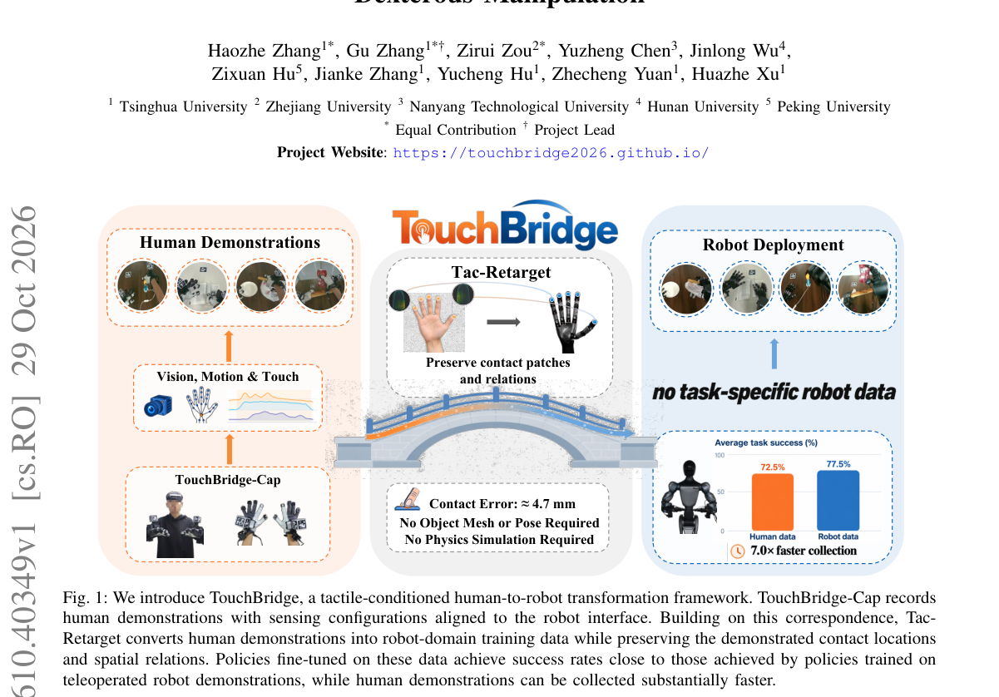

*Result - Human–Robot Hardware Co-design. (a,b) Hu- man demonstration and robot deployment interfaces. (c,d) Corresponding fingertip tactile-sensor placements and wrist- camera configurations reduce mis*

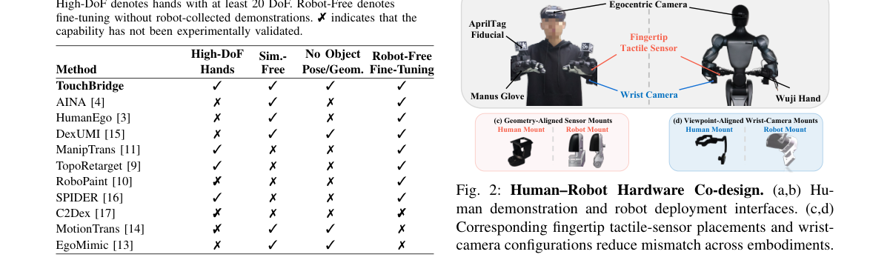

**Why this ranks #2**: 用实测指尖接触做跨手 retarget，人类演示转机器人训练数据全程不需要物体网格或仿真，直接打掉数据规模这个瓶颈。

---

### 3. AcrossDEX 1.0: From Human Motion Pretraining to Bimanual Dexterous Manipulation across Hand Embodiments

**arXiv**: [2610.40210](https://arxiv.org/abs/2610.40210) | **Score**: 8.7 (relevance 9.0 x 0.7 + quality 8.0 x 0.3) | **Tags**: embodied, bimanual-dexterity, human-motion-pretraining, flow-matching, multi-embodiment, replanning, Unknown | **Categories**: cs.RO | **Pages**: 8

**Authors**: Xiaoyu Yang; Nan Wu

**Affiliation**: [unverified]

**Abstract**

> Bimanual dexterous manipulation requires continuous coordination of wrist motion, finger contact, and object motion. Human videos provide rich manipulation experience. Using this experience for robot control requires aligning human poses with robot commands and accounting for embodiment-specific kinematics and contact dynamics. We present AcrossDEX 1.0, a learning system that connects human motion pretraining, simulation-based expert learning, robot demonstration collection, and visual closed-loop execution. Pretraining on HOT3D Aria predicts one second of bimanual motion from five images and thirty annotated hand states over the preceding second. Robot adaptation preserves the visual encoder, temporal backbone, and wrist parameters. Shared wrist representations, separate finger fields, and validity masks support both six-channel Inspire hands and sixteen-joint Allegro hands. The robot policy predicts sixty control targets from frontal images, command history, and task conditions. It executes a prefix and replans from updated observations. We compare direct regression, diffusion, and flow matching on lid opening and return and closed-lid object reorientation. Direct regression achieves success rates of 40.6\% for opening and return, 100.0\% for Inspire reorientation, and 93.3\% for Allegro reorientation. Flow matching achieves 90.0\% on Allegro reorientation. Paired comparisons further show that constraining replanning with the previous plan improves the continuous execution of generative policies. These results demonstrate a common adaptation pipeline for two hand embodiments and highlight the roles of contact coordination and action-chunk continuity.

**Key findings**

- **Finding**: 论文指出双手灵巧操作需要腕部运动、手指接触与物体运动的持续协同，转成机器人指令必须对齐姿态并适配 embodiment 专属的运动学与接触动力学。
- **Finding**: AcrossDEX 1.0 是贯通人类动作预训练、仿真专家学习、机器人演示采集与视觉闭环执行的完整系统。
- **Finding**: 在 HOT3D Aria 上预训练，由过去一秒的五张图像与三十个标注手部状态预测未来一秒的双手动作。
- **Finding**: 机器人适配保留视觉编码器、时序骨干与腕部参数，共享腕部表示配合分离手指场与有效性掩码同时支持六通道 Inspire 手与十六关节 Allegro 手。
- **Finding**: 策略从前视图像、指令历史与任务条件预测六十个控制目标，先执行一个前缀再基于更新观测重规划。
- **Finding**: 直接回归在开盖返回上成功率 40.6%，Inspire 重定向 100.0%，Allegro 重定向 93.3%；流匹配在 Allegro 重定向上为 90.0%。
- **Inference**: 配对比较显示用前一计划约束重规划能改善生成式策略的连续执行，说明 action chunk 的时间连续性是独立于生成质量的一环。
- **Recommendation**: 推荐。做双手灵巧操作或想把人类视频转成机器人策略的读者强烈建议读。

**Key figures**

*Framework - Overview of AcrossDEX 1.0. (a) Human pretraining and robot expert data support adaptation with human replay. (b) A shared Transformer processes images and motion history. Masks select human or*

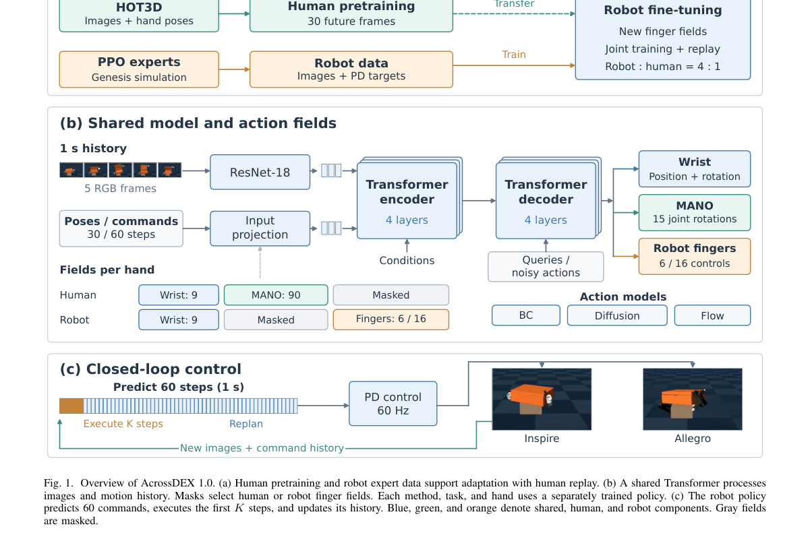

*Result - Success rates for lid opening and return and object reorientation with two hand embodiments. Each configuration is post-trained separately and evaluated using (11).*

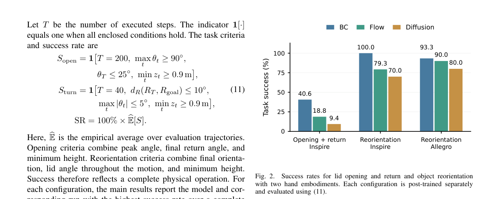

**Why this ranks #3**: 一套从人类动作预训练到双手灵巧操作的通用适配流程，用「先执行前缀再按新观测重规划」补上生成式策略最容易断的一环。

---

### 4. CAPTURER: A Dexterous Aerial Manipulator for Dynamic and Precise Grasping across Diverse Environments

**arXiv**: [2610.39119](https://arxiv.org/abs/2610.39119) | **Score**: 8.5 (relevance 8.5 x 0.7 + quality 8.5 x 0.3) | **Tags**: embodied, aerial-grasping, dynamic-target, disturbance-rejection, cooperative-planning, state-estimation, Beihang | **Categories**: cs.RO | **Pages**: 31

**Authors**: Meng Wang; Jindou Jia; Sicheng Zhou; Zeshuai Chen; Kexin Guo; Xiang Yu; Lei Guo

**Affiliation**: Beihang University; Nanyang Technological University; National University of Singapore; Beijing Key Laboratory of Bio-inspired Intelligent Technology

**Abstract**

> As a representative form of embodied robotic interaction, aerial grasping requires close coordination between the aerial platform and manipulator. Most existing systems perform aerial grasping with static or slowly moving targets under fixed scenarios. Dynamic and precise grasping across different conditions introduces additional challenges, including target motion, localization drift, dynamic coupling, and external disturbances. In this work, we present CAPTURER, a dexterous aerial manipulator for centimeter-level grasping across diverse environments. To achieve the challenging goal, we first develop an onboard perception system for state estimation and target detection. Drift correction and global pose transformation are introduced to improve target localization during flight. A cooperative motion planner is proposed to coordinate the mobility of the aerial platform with the dexterity of the manipulator according to the relative target state. To maintain grasping accuracy under disturbances, we design a disturbance-rejection controller to compensate for dynamic coupling, model uncertainty, and external disturbances. The capability of CAPTURER is validated through indoor and outdoor experiments with both static and moving targets. The results demonstrate that CAPTURER achieves centimeter-level grasping accuracy for a marker pen measuring only 1.5 cm in diameter at flight speeds exceeding 1.5 m/s.

**Key findings**

- **Finding**: 论文指出既有空中抓取多在固定场景抓静态或慢速目标，动态精确抓取还要额外应对目标运动、定位漂移、动态耦合与外部扰动。
- **Finding**: CAPTURER 是做厘米级抓取的空中灵巧机械臂，先构建机载感知系统做状态估计与目标检测。
- **Finding**: 用漂移修正与全局位姿变换改善飞行过程中的目标定位，避免机载状态估计随航程拉长而漂移。
- **Finding**: 提出协同运动规划器，按目标的相对状态协调空中平台的机动性与机械臂的灵巧度。
- **Finding**: 设计抗扰控制器补偿动态耦合、模型不确定性与外部扰动，在扰动下维持抓取精度。
- **Finding**: 室内外实验同时覆盖静态与运动目标，在飞行速度超过 1.5 m/s 时对直径仅 1.5 cm 的马克笔实现厘米级抓取精度。
- **Inference**: 这是整机系统级贡献，亮点在于把漂移修正、协同规划与抗扰控制串成闭环，而不是某一个全新算法。
- **Recommendation**: 选读。关注空中机器人整机系统与动态抓取的读者值得看，做算法研究的人可只读方案框架。

**Key figures**

*Result - Schematic of CAPTURER.*

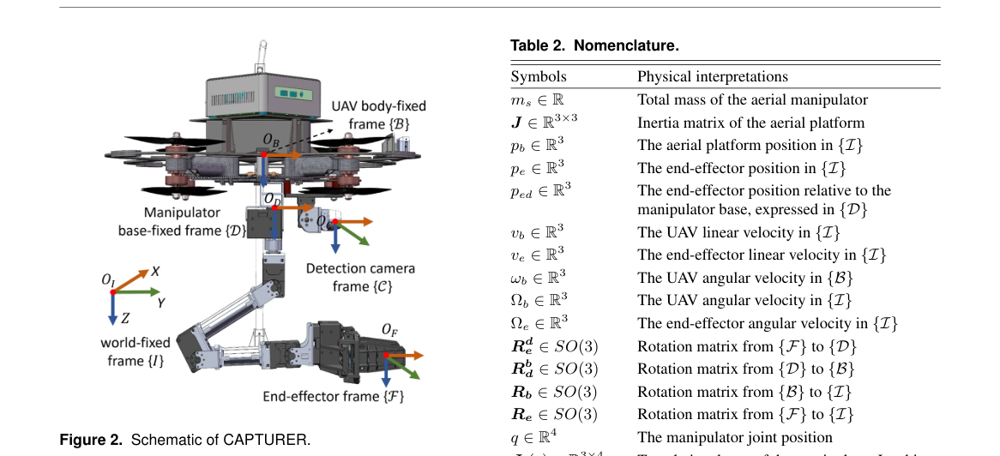

**Why this ranks #4**: 空中抓取被推到 1.5 m/s 飞行速度下抓 1.5 cm 直径目标，靠协同运动规划与抗扰控制器把平台机动和机械臂灵巧真正协调起来。

---

### 5. From Reasoning to Action: Consequence-Grounded Alignment for Vision-Language-Action Models

**arXiv**: [2610.39543](https://arxiv.org/abs/2610.39543) | **Score**: 8.2 (relevance 8.5 x 0.7 + quality 7.5 x 0.3) | **Tags**: embodied, embodied-cot, reward-alignment, group-relative-optimization, mixture-of-transformers, zero-shot-adaptation, Peking | **Categories**: cs.RO | **Pages**: 9

**Authors**: Yixue Zhang; Wenke Xia; Kun Wu; Wenbo Yu; Pei Ren; Junnan Nie; Di Hu; Zhengping Che; Chang Liu

**Affiliation**: Peking University; Beijing Innovation Center of Humanoid Robotics; Renmin University of China; Beijing Forestry University

**Abstract**

> Reasoning informs decision-making by connecting intended actions with their expected consequences. Recent vision-language-action (VLA) models incorporate embodied chains of thought (ECoTs) to guide action generation. However, such guidance remains implicit, as actions are conditioned on ECoTs rather than explicitly optimized to align with them. We introduce CoRAct, a consequence-grounded reasoning-to-action alignment framework that explicitly aligns reasoning and action through reward-guided optimization in action noise space. CoRAct formulates two physically grounded ECoT components as verifiable signals: movement specifies intended motion, while waypoints encode expected spatial consequences. A unified Mixture-of-Transformers jointly models ECoT reasoning, action generation, and action-conditioned future prediction. For candidate actions generated from sampled noise, CoRAct computes alignment rewards based on movement consistency and agreement between predicted outcomes and specified waypoints. These rewards guide group-relative optimization of the initial noise distribution, steering action generation toward consistency with intended actions and expected consequences. Experiments across RoboCasa, VLABench, and real-world manipulation tasks demonstrate improvements in task success, generalization, and reasoning-execution alignment over strong ECoT-based VLA baselines. CoRAct also grounds externally provided ECoTs in executable behavior, enabling zero-shot adaptation to novel scenarios by leveraging knowledge from powerful vision-language models. Project page and dataset: https://onlyxingxingzyx.github.io/CoRAct/

**Key findings**

- **Finding**: 论文指出 VLA 里的 ECoT 只是隐式指导，动作以 ECoT 为条件却并未被显式优化成与之一致，看起来正确的推理也可能误导规划。
- **Finding**: CoRAct 把 ECoT 拆成两个物理可验证成分：movement 规定意图动作，waypoints 编码预期空间后果。
- **Finding**: 统一的 Mixture-of-Transformers 联合建模 ECoT 推理、动作生成与动作条件下的未来预测。
- **Finding**: 对从采样噪声生成的候选动作，按 movement 一致性与预测结果对 waypoints 的吻合度计算对齐奖励。
- **Finding**: 这些奖励引导初始噪声分布的 group-relative 优化，把动作生成推向与意图动作和预期后果一致。
- **Finding**: 在 RoboCasa、VLABench 与真机操作任务上，相比强 ECoT 基线的 VLA 在任务成功率、泛化与推理-执行一致性上均有提升，并能落地外部提供的 ECoT 实现零样本适配新场景。
- **Inference**: 在噪声空间而非权重空间做对齐，把「一致性」当成可搜索的采样问题，代价是训练需要成组的候选动作。
- **Recommendation**: 推荐。做 VLA 推理链、想让模型既说得对也做得对的读者强烈建议读。

**Key figures**

*Framework - Reasoning-to-action alignment paradigms. (a) Direct CoT-to-action learning leaves reasoning–execution correspondence implicit. (b) CoRAct explicitly bridges rea- soning and execution through c*

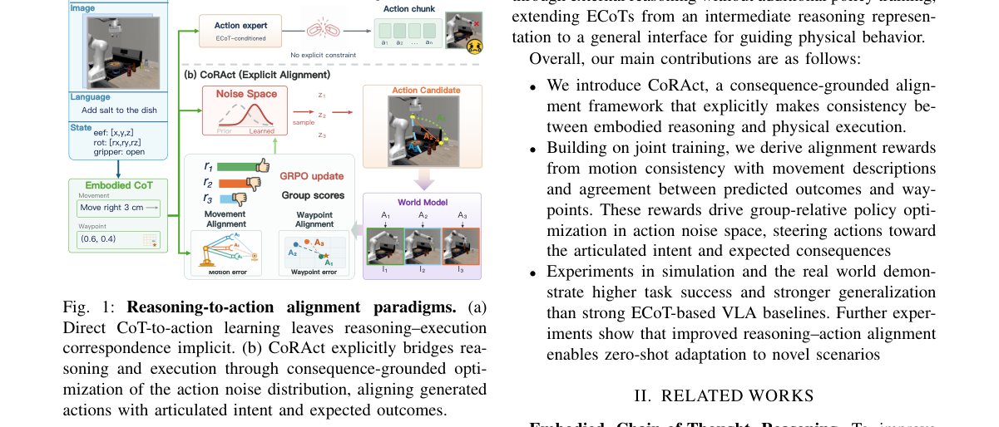

*Result - Framework of CoRAct. (a) CoRAct jointly models ECoT reasoning, action generation, and action-conditioned future prediction in a unified Mixture-of-Transformers, coupling actions with intent an*

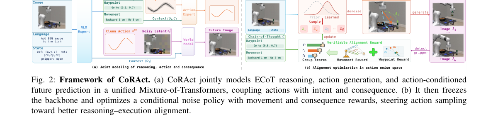

**Why this ranks #5**: 把 ECoT 从提示升级成显式对齐目标，在动作噪声空间用 group-relative 优化让动作真正服从推理与预期后果。

---

### 6. OpenFlyV2: An onboard vision-language-action model for aerial perception and navigation

**arXiv**: [2610.39287](https://arxiv.org/abs/2610.39287) | **Score**: 8.0 (relevance 8.0 x 0.7 + quality 8.0 x 0.3) | **Tags**: embodied, aerial-navigation, onboard-inference, sim-to-real, action-chunk, temporal-memory, Shanghai Artificial Intelligence Laboratory | **Categories**: cs.RO | **Pages**: 15

**Authors**: Junli Liu; Zhongrui You; Chenhui Li; Zhen Li; Yuyang Tian; Qizhen Chen; Delin Qu; Haoming Song; Dong Wang; Xuelong Li; Zhigang Wang; Bin Zhao

**Affiliation**: Shanghai Artificial Intelligence Laboratory; Northwestern Polytechnical University; Beihang University; Shanghai Jiao Tong University; Zhejiang University

**Abstract**

> Human cognition flexibly draws on a shared perceptual foundation to understand environments, attend to referenced entities, reason about spatial relationships, and act. Endowing aerial robots with an analogous functional organization remains challenging, as existing systems are often specialized for individual capabilities, dependent on offboard computation, or unable to sustain closed-loop operation on resource-constrained platforms. We present OpenFlyV2, a unified onboard vision-language-action architecture that uses a shared vision-language representation to support semantic understanding, language-grounded perception, spatial reasoning, and continuous aerial control within a single model. A compact action expert converts the shared multimodal context into short-horizon flight waypoints, while motion-aware temporal memory and action priors reduce the computational cost of closed-loop execution. We construct \dataset{}, a simulation-based dataset comprising approximately 70,000 navigation trajectories and 60,000 vision-language instruction--response pairs. OpenFlyV2 generates action chunks, each comprising 12 waypoints, entirely onboard at 10 Hz using an NVIDIA Jetson Orin NX. It transfers zero-shot from simulation to physical quadrotor flight, achieving a 48\% navigation success rate across four real-world environments without real-world aerial training data. Extensive results demonstrate that broad vision-language competence and continuous closed-loop flight can coexist within a single model on a resource-constrained aerial platform. Code will be made publicly available at https://github.com/Ideal-ljl/AeroBrain.

**Key findings**

- **Finding**: 论文指出既有空中机器人系统多只专精单项能力、依赖机外计算，或在资源受限平台上撑不起闭环运行。
- **Finding**: OpenFlyV2 是统一的机载视觉-语言-动作架构，用共享视觉语言表示同时支持语义理解、语言锚定感知、空间推理与连续空中控制。
- **Finding**: 紧凑动作专家把共享多模态上下文转成短时域飞行航点，运动感知时序记忆与动作先验降低闭环执行开销。
- **Finding**: 配套的仿真数据集含约 7 万条导航轨迹与 6 万条视觉语言指令-回答对。
- **Finding**: 每个 action chunk 含 12 个航点，在 NVIDIA Jetson Orin NX 上完全机载以 10 Hz 生成。
- **Finding**: 从仿真零样本迁移到真实四旋翼飞行，在四个真实环境取得 48% 导航成功率，全程没有真实飞行训练数据。
- **Inference**: 48% 的零样本成功率并不算高，但机载实时与单模型统一架构的系统价值可能比绝对成功率更值得关注。
- **Recommendation**: 推荐。关注端侧部署、无人机 VLA 与 sim-to-real 的读者强烈建议读。

**Key figures**

*Framework - Overview of OpenFlyV2, a unified onboard vision-language-action model for aerial robots. (A) A shared vision-language backbone integrates visual observations and language instructions with m*

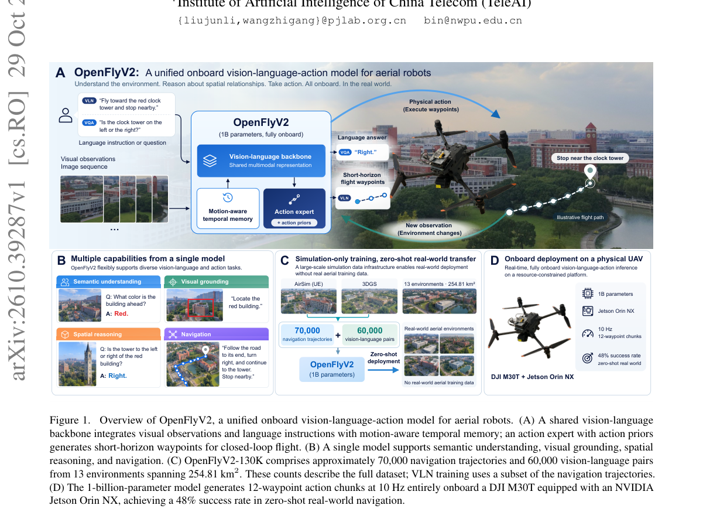

*Result - Shared environments and data composition of OpenFlyV2-130K. (A) Thirteen environments supporting both navigation and VQA: four AirSim environments, two Unreal Engine city environments, and s*

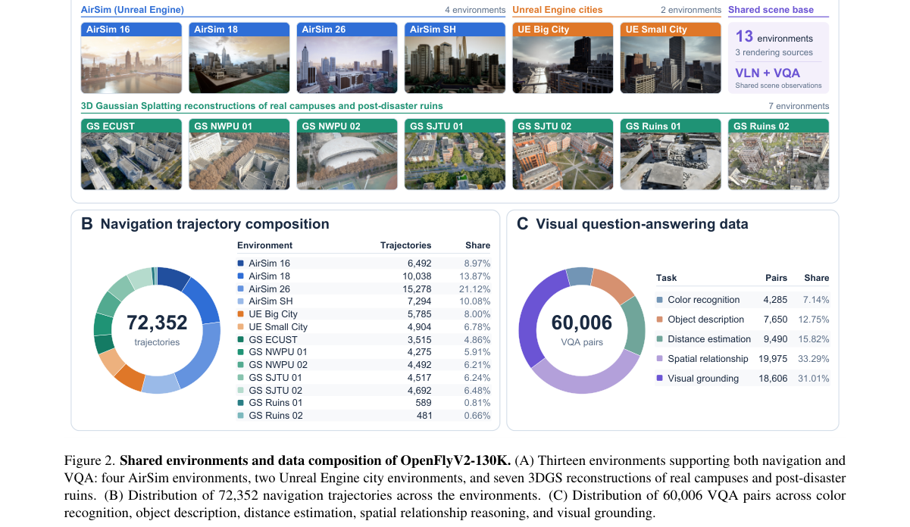

**Why this ranks #6**: 语义理解、空间推理与连续飞行控制被压进单个机载模型，在 Jetson Orin NX 上 10 Hz 出 chunk，还能零样本飞真机。

---

### 7. Tactus: Tactile & Pose Sensing Glove for Natural Dexterity Data Collection

**arXiv**: [2610.39076](https://arxiv.org/abs/2610.39076) | **Score**: 8.0 (relevance 8.0 x 0.7 + quality 8.0 x 0.3) | **Tags**: embodied, tactile-sensing, wearable-glove, imu-fusion, data-collection, benchmark, Meta Reality Labs Research | **Categories**: cs.AI, cs.AR, cs.LG, cs.RO | **Pages**: 9

**Authors**: Li Guan; Rachael Granberry; Sahar Aseeri; Sahar Rostami; Taylor Niehues; Sai Dhanooshi Marri; Mia Huang; Dingtian Zhang; Ziyi Kou; Jason Pursel; Eric Whitmire; Vatsal Mehta

**Affiliation**: Meta Reality Labs Research

**Abstract**

> Collecting naturalistic human manipulation demonstrations with accurate contact force and hand pose is essential for robot dexterous manipulation policy and foundational world model learning - yet no existing wearable platform provides both calibrated fingertip force sensing and occlusion-resilient hand tracking in a form factor that preserves natural manipulation behavior. We present Tactus, a textile-integrated sensing glove that co-optimizes three design pillars: (1) a thin, conformal 3D-knit form factor (1.5 mm fingertip stackup) designed to minimize interference with natural manipulation, (2) strategically placed capacitive tactile sensors at manipulation-relevant regions informed by empirical contact studies, and (3) IMU-fused pose tracking that maintains accuracy through the hand-object occlusions where manipulation data is most valuable. Tactus includes a documented calibration pipeline for cross-glove consistency and per-session calibration for subject-dependent correction. To enable objective comparison, we introduce standardized benchmarking protocols for tactile force regression and hand pose estimation, and apply them to Tactus and two commercially available tactile gloves - to our knowledge the first quantitative cross-platform evaluation of this kind. Tactus resolves a minimum detectable force of 0.59 N at 95% confidence, 1.6 - 2.7x lower than the commercial baselines, and with 0.87 cross-participant consistency, while our pose tracking sustains 11.0 mm fingertip keypoint relative error during manipulation, when occlusion is heaviest. We show that these combined signals support object property estimation, slip detection, and representative recording of hand-object interaction - yielding demonstration data with the fidelity required for contact-aware manipulation policies and world models.

**Key findings**

- **Finding**: 论文指出采集带准确接触力与手部姿态的自然人类演示对灵巧操作策略和基础 world model 学习很关键，但现有可穿戴平台没有同时提供标定指尖力与抗遮挡手部追踪。
- **Finding**: Tactus 是织物集成传感手套，共同优化三点：1.5 mm 指尖叠层的薄型贴合 3D 针织形态、按接触研究布点的电容式触觉传感器、以及 IMU 融合姿态追踪。
- **Finding**: 提供保证跨手套一致性的标定流程，以及针对被试差异的逐 session 标定。
- **Finding**: 引入标准化的触觉力回归与手部姿态估计基准协议，应用于 Tactus 与两款商用触觉手套，作者称这是首个此类跨平台定量评估。
- **Finding**: Tactus 最小可检测力为 0.59 N（95% 置信），比商用基线低 1.6 到 2.7 倍，跨被试一致性为 0.87。
- **Finding**: 姿态追踪在遮挡最严重的手部操作中维持 11.0 mm 指尖关键点相对误差。
- **Inference**: 把「最小可检测力」显式量化意味着触觉数据质量有了可比口径，而不是各论文自说自话。
- **Recommendation**: 推荐。做触觉数据采集、world model 数据底座或想评估商用手套的读者强烈建议读。

**Key figures**

*Framework - Form-factor of Tactus digital sensing gloves capable of high-fidelity tactile and pose sensing for natural hand-object manipulation data collection.*

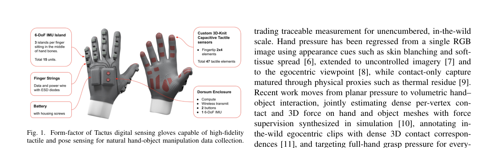

*Result - Glove fit sets whether sensor contact means hand contact. A) An oversized glove lifts the sensor off the skin, so it touches first. A conformal glove tensions sensors against the hand. B) Comp*

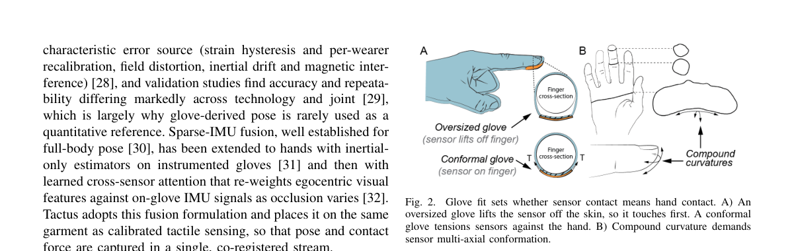

**Why this ranks #7**: 首个把标定指尖力与抗遮挡手部姿态同时做进可穿戴手套，还附上了触觉手套的跨平台定量横评。

---

### 8. Seeing and Imagining as One: Unified Video Generation and 4D Perception for Embodied World Modeling

**arXiv**: [2610.39232](https://arxiv.org/abs/2610.39232) | **Score**: 7.7 (relevance 8.0 x 0.7 + quality 7.0 x 0.3) | **Tags**: embodied, video-diffusion, dense-perception, 4d-perception, unified-representation, embodied-world-model, RoboScience | **Categories**: cs.CV, cs.RO | **Pages**: 22

**Authors**: Haitang Feng; Zhuoman Liu; Zhennan Wang; Sheng Wang; Juelin Li; Chengzhi Zhao; Hexiang Wei; Lin Shao

**Affiliation**: RoboScience; Nanjing University; The Hong Kong Polytechnic University; National University of Singapore

**Abstract**

> Embodied world models should not only imagine plausible futures, but also perceive the geometric, semantic, and motion structure of the evolving world. We present GenSight, a unified embodied world model that brings future video generation and dense perception into a single pretrained video diffusion transformer. GenSight uses a unified spatiotemporal representation for video, depth, embodiment segmentation, and first-frame-relative 2D flow. Built on a shared DiT backbone, GenSight uses lightweight task modulation to predict all modalities within the same architecture. All tasks are jointly optimized within a unified velocity prediction space. At inference, GenSight supports two complementary modes: multi-step future video generation with aligned dense predictions and single-step dense perception from an observed video. By unifying modality representation, model architecture, and prediction space, GenSight avoids separate modality-specific pipelines and couples appearance, geometry, semantics, and motion in a shared representation. It promotes cross-modal consistency and allows dense perception to benefit from the spatiotemporal priors learned through video generation. Trained on embodied manipulation data spanning multiple robot embodiments and human-hand interactions, GenSight demonstrates strong performance in both video generation and dense 4D perception, highlighting the effectiveness of unifying seeing and imagining for embodied world modeling.

**Key findings**

- **Finding**: 论文指出 embodied world model 不只该想象合理未来，还要感知演化世界的几何、语义与运动结构。
- **Finding**: GenSight 是统一的 embodied world model，把未来视频生成与稠密感知放进同一个预训练视频扩散 transformer。
- **Finding**: 它用统一的时空表示承载视频、深度、embodiment 分割与首帧相对 2D 光流。
- **Finding**: 共享 DiT 骨干配轻量任务调制，在同一架构内预测所有模态，所有任务在统一的 velocity prediction 空间里联合优化。
- **Finding**: 推理支持两种互补模式：多步未来视频生成并输出对齐的稠密预测，以及从观测视频做单步稠密感知。
- **Finding**: 在覆盖多种机器人 embodiment 与人手交互的具身操作数据上训练，视频生成与稠密 4D 感知两方面都表现强劲。
- **Inference**: 把 perception 当成生成模型的旁路输出，比单独训感知模型更容易拿到一致的跨模态对应，但单 DiT 也意味着感知精度受生成先验牵制。
- **Recommendation**: 推荐。做具身 world model、4D 感知或想省掉独立感知管线的读者强烈建议读。

**Key figures**

*Framework - GenSight unifies seeing and imagining for embodied world modeling. Given an initial image and a text prompt, GenSight generates future video together with aligned embodiment segmentation, de*

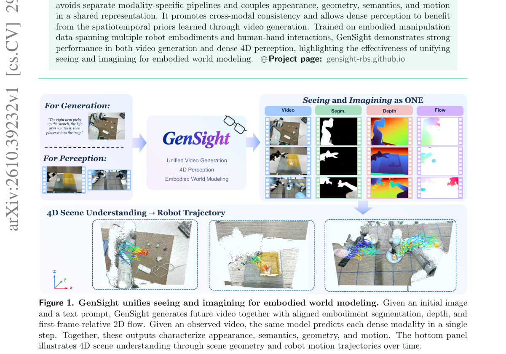

*Result - Overview of GenSight. Top: A shared Video DiT processes noisy video latents and predicts velocities for RGB video (V ), embodiment segmentation (S), depth (D), and first-frame-relative 2D fl*

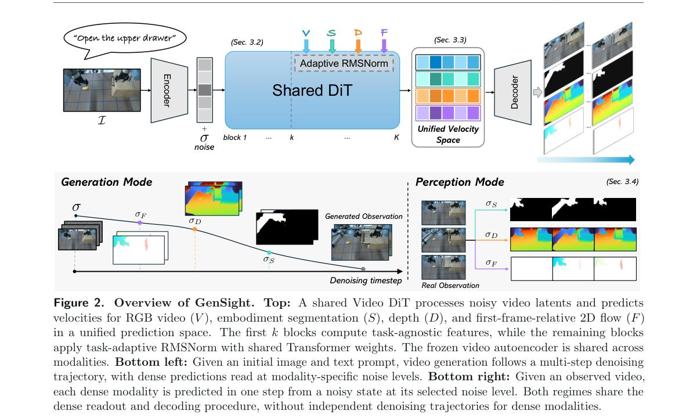

**Why this ranks #8**: 把「看见」和「想象」塞进同一个视频扩散 transformer，让视频生成学到的时空先验反哺稠密 4D 感知。

---

### 9. Improving Fine-Grained Manipulation through Demonstration Expansion and Execution Design

**arXiv**: [2610.40430](https://arxiv.org/abs/2610.40430) | **Score**: 7.7 (relevance 7.5 x 0.7 + quality 8.0 x 0.3) | **Tags**: embodied, demonstration-expansion, vla-policy, inverse-kinematics, closed-loop-replanning, challenge-baseline, Nanjing | **Categories**: cs.RO | **Pages**: 6

**Authors**: Jingxu Gu; Dongze Lian

**Affiliation**: Nanjing University

**Abstract**

> Fine-grained manipulation requires a robot policy to follow instructions, remain robust to visual variations, and translate predicted actions into precise robot control. We present Demonstration Expansion and Execution Design (DEED), a framework for adapting a pretrained vision-language-action policy to the five MetaFine tasks through structured demonstration expansion and execution design. DEED generates demonstrations for different instructions from the same initial scene and renders each physical trajectory under different camera positions and lighting conditions while preserving its original states and action targets. A hierarchical sampling strategy balances instructions, trajectories, and visual conditions during supervised adaptation. At deployment, DEED converts predicted action chunks into robot commands using inverse kinematics, gripper mappings selected for each task, and closed-loop replanning. DEED achieves an official Overall score of 85.55%. Fixed-policy evaluations show that performance varies with execution horizon, denoising budget, and gripper mapping.

**Key findings**

- **Finding**: 论文把细粒度操作的要求拆成三条：跟随指令、对视觉变化保持鲁棒、把预测动作转成精确的机器人控制。
- **Finding**: DEED 用结构化的演示扩展与执行设计，把预训练 VLA 策略适配到五个 MetaFine 任务。
- **Finding**: 演示扩展从同一初始场景为不同指令生成演示，并在保持原状态与动作目标的前提下渲染不同相机位置与光照条件。
- **Finding**: 层次化采样策略在监督适配阶段平衡指令、轨迹与视觉条件三者，避免某一维度单独主导扩展示例。
- **Finding**: 部署时用逆运动学把预测动作 chunk 转成机器人指令，配上按任务选定的夹爪映射与闭环重规划。
- **Finding**: DEED 取得官方 Overall 分数 85.55%，固定策略评测显示性能随执行时域、去噪预算与夹爪映射而变化。
- **Inference**: 分数随去噪预算与夹爪映射波动，说明这类赛道的名次很大程度由推理期工程细节决定，而不是策略本身。
- **Recommendation**: 选读。想冲挑战赛排名或需要搭建数据扩展加执行落地流水线的读者值得看。

**Key figures**

*Framework - Overview of DEED (T5 illustrated). Paired demonstrations and visual re-rendering support adaptation; deployment executes an H-step prefix of each K-step prediction before re-observation.*

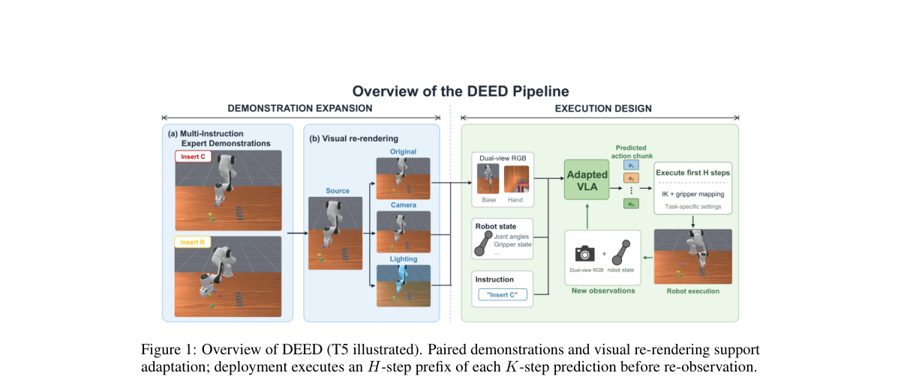

*Result - Comparison with the official π0 baseline on the final leaderboard [20].*

**Why this ranks #9**: 赛场上最实用的一套打法：用指令、轨迹、视角三维扩展演示数据，再用执行期设计把动作 chunk 变成可控的机器人指令。

---

### 10. Catch It All!: Generalizable Dynamic Catching with a Dexterous Hand

**arXiv**: [2610.39044](https://arxiv.org/abs/2610.39044) | **Score**: 7.5 (relevance 7.5 x 0.7 + quality 7.5 x 0.3) | **Tags**: embodied, dynamic-catching, dexterous-grasp, safety-curriculum, egocentric-vision, zero-shot-transfer, UC San Diego | **Categories**: cs.RO | **Pages**: 8

**Authors**: Arth Shukla; Kehlani Fay; Huaze Liu; Darin Djapri; Alexiy Buynitsky; Nicklas Hansen

**Affiliation**: UC San Diego; Harvey Mudd College

**Abstract**

> Catching arbitrary objects requires generalization to novel projectiles and real-time adaptation to unpredictable contact dynamics under noisy visual observations. This paper presents Catch It All!, a sim-to-real catching framework for humanoid robots that generalizes and adapts to unseen objects with variable physical properties for underhand and overhand catches, using only one egocentric camera. We learn policies which generalize to unseen objects with varying geometry, deformability, elasticity, and physical properties. Effective grasps which adapt real-time to object poses and shapes are learned through careful grasp reward design. We provide safety-aware curricula which enable safe, high-frequency action execution near hardware limits, including wrist torque limits as low as 5 Nm. We validate our system by deploying zero-shot on a Unitree G1. With only one egocentric camera, Catch It All! successfully performs underhand and overhand catches on 9 unseen objects not seen during training, including low-rebound plushes, semi-deformable toys and chip bags, and rigid-elastic objects with high rebound on contact.

**Key findings**

- **Finding**: 论文指出接住任意物体要求泛化到新投射物，并在噪声视觉观测下实时适应不可预测的接触动力学。
- **Finding**: Catch It All! 是面向人形机器人的 sim-to-real 接球框架，只需一个 egocentric 相机，支持下手与上手两种接法。
- **Finding**: 策略学习泛化到几何、可变形性、弹性与物理属性各异的未见物体，有效抓取通过细致的抓取奖励设计实时适应物体位姿与形状。
- **Finding**: 提供安全感知课程，使机器人能在接近硬件极限时安全高频执行动作，手腕力矩下限低至 5 Nm。
- **Finding**: 系统在 Unitree G1 上零样本部署，成功对 9 个训练中未见的物体完成下手与上手接球，包括低回弹毛绒玩具、半可变形玩具与薯片袋，以及接触时高回弹的刚弹性物体。
- **Inference**: 5 Nm 的力矩下限说明这类动态任务里动作质量与硬件安全其实是同一个设计问题。
- **Inference**: 单个 egocentric 相机承担闭环抓取与接球，视觉估计误差是整套方案最可能失效的环节。
- **Recommendation**: 推荐。做人形机器人动态操作、sim-to-real 或硬件安全设计的读者强烈建议读。

**Key figures**

*Framework - Overview. Our method successfully catches diverse, unseen objects overhand and underhand using only an egocentric camera. Left: The real-world object test set includes 9 unseen objects with va*

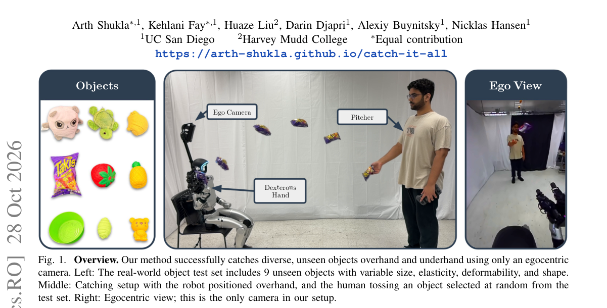

*Result - Teacher-student training. Stage 1: An RL teacher policy is trained on ground-truth projectile position. Stage 2: A student policy imitates the frozen teacher via DAgger using noisy camera obse*

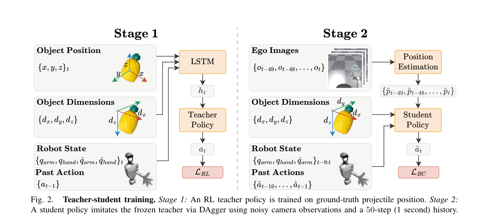

**Why this ranks #10**: 单目 egocentric 相机加 sim-to-real 就能接住 9 种没见过的物体球，安全课程让它贴着硬件力矩上限跑还不伤人。

---

## Footer

- Total papers scanned across all 7 tracks: 619（原始 828 条）
- embodied track final top-10: 10
- Wild-cards in this track: 0
- Figure assets: 2026-10-30/res/

Generated by `mine-arxiv-daily-digest` skill. Sister file: `2026-10-30_embodied_entry.md`.
