# ArXiv Daily Digest - 2026-10-30 (生成式内容模型强化学习, 10 papers)

**Generated**: 2026-10-31 17:00 CST

**Source**: arXiv cs.CV, cs.SD, eess.AS, cs.CL, cs.AI, cs.RO, cs.LG submissions, listing day 2026-10-29 (announced 2026-10-30 00:00 UTC)

**Batch window**: 2026-10-28T18:00:00Z .. 2026-10-29T18:00:00Z（arXiv 公告批次横跨两个 UTC 日：前一日 18:00 UTC 起算，当日 17:59:59 UTC 截止）

**Track**: rl_aigc (top 10 of 619 papers scanned, 70 full reads)

**Scope**: 针对生成式内容模型（扩散 / 流匹配 / 视频 / 图像 / 音频）的 RL 与偏好优化

⚠️ **Wild-card**: 本批该线 5 篇为 wild-card 补足，已在正文逐条标注并给出理由。

补足原因：该批次真正把 RL / 奖励 / 偏好直接用于扩散、流匹配、视频与图像生成的论文只有 5 篇，其余 5 篇为生成模型蒸馏、对抗训练与自我进化 harness 方向的补位，已在正文逐条标注并给出理由。

---

## Top 10 - 生成式内容模型强化学习

### 1. EmpDPO: Enabling Emphasis Control in TTS via Direct Preference Optimization

**arXiv**: [2610.39427](https://arxiv.org/abs/2610.39427) | **Score**: 9.2 (relevance 9.5 x 0.7 + quality 8.5 x 0.3) | **Tags**: rl-aigc, tts, direct-preference-optimization, emphasis-control, diffusion-tts, multilingual-zero-shot, Adobe Research | **Categories**: cs.SD, eess.AS | **Pages**: 5

**Authors**: Haonan Chen; Yunyun Wang; Megan Wei; Zeyu Jin

**Affiliation**: Adobe Research; Brown University

**Abstract**

> Word-level emphasis conveys meaning that text alone cannot express and is therefore essential for a practical text-to-speech (TTS) system. In this work, we study how to add emphasis control post hoc to a pretrained TTS model that has never been trained with emphasis annotations. We present EmpDPO, a simple, efficient, and effective two-stage recipe that adds emphasis control to a multilingual zero-shot diffusion TTS model through supervised fine-tuning followed by direct preference optimization (DPO). The training signals for both stages come from an off-the-shelf multilingual emphasis detector, so that no manual emphasis annotation or task-specific reward design is needed. We find that DPO can substantially strengthen emphasis control with only a few thousand preference pairs and training steps. Objective and subjective evaluations against strong public systems show that our model produces perceptible emphasis while preserving naturalness and overall quality.

**Key findings**

- **Finding**: 论文研究如何给一个从未用重音标注训练过的预训练 TTS 模型后加重音控制。
- **Finding**: EmpDPO 是一套两阶段配方，面向多语种 zero-shot diffusion TTS 模型，先做 supervised fine-tuning，再做 direct preference optimization。
- **Finding**: 两个阶段的训练信号都来自一个现成的多语种重音检测器，因此既不需要人工重音标注，也不需要任务特定的奖励设计。
- **Finding**: 论文发现 DPO 只需几千条偏好对与有限训练步数，就能显著增强重音控制。
- **Finding**: 对强公开系统的客观与主观评测显示，模型能产生可感知的重音，同时保持自然度与整体质量。
- **Inference**: 这是典型的借现成信号做后训练范式，标注的边际成本被压到接近零，但效果上限被检测器本身锁死。
- **Inference**: 与需要人工偏好数据的方案相比，它的可扩展性明显更强，迁移到新语言也更容易。
- **Recommendation**: 推荐。做 TTS 后训练、韵律与情感控制的读者值得读。

**Key figures**

*Framework - Overview of EMPDPO. SFT stage: a multilingual emphasis detector labels real speech with emphasis markers. DPO stage: the same detector scores candidates sampled from the SFT model to build cho*

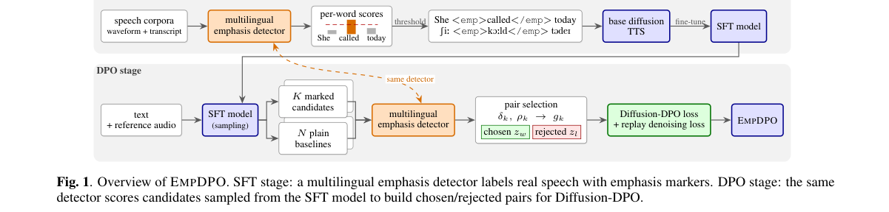

*Result - Listening test interface (English version): emphasis strength of the highlighted word (Q1) and naturalness (Q2) on a 1–5 scale, and whether another word sounds emphasized (Q3).*

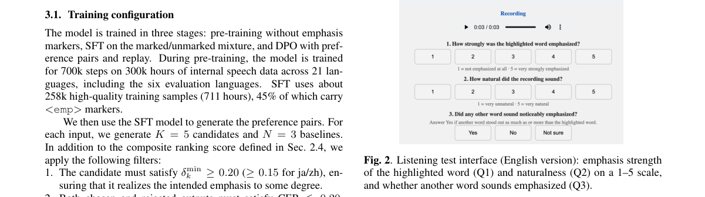

**Why this ranks #1**: 它用现成的多语种重音检测器充当训练信号，几乎零标注成本地给后训练 TTS 补上重音控制。

---

### 2. DeCoRL: Decomposed Consistency Reinforcement Learning for Multi-Image Composition

**arXiv**: [2610.39265](https://arxiv.org/abs/2610.39265) | **Score**: 8.8 (relevance 9.0 x 0.7 + quality 8.5 x 0.3) | **Tags**: rl-aigc, multi-image-composition, reward-decomposition, object-level-consistency, vlm-reward, image-editing, Xiaohongshu Inc. | **Categories**: cs.AI, cs.CV | **Pages**: 20

**Authors**: Zhiqiang Wu; Shuang Sun; Jiale Zhang; Jing Li; Yibo Chen; Xu Tang; Yao Hu

**Affiliation**: Xiaohongshu Inc.

**Abstract**

> Multi-image composition (MICo) is a critical yet challenging capability for large-scale image editing models, where consistency degrades rapidly as the number of reference images increases. While supervised fine-tuning (SFT) can equip models with basic MICo ability, it provides only implicit supervision on the composed image and often fails to learn reliable object-level correspondence across multiple references. We propose DeCoRL, a reinforcement-learning (RL) framework that improves MICo consistency by decomposing holistic MICo consistency into object-level consistency. DeCoRL first establishes instruction-relevant object correspondences across reference images and localizes the corresponding regions in the generated image. It then uses a VLM-based reward model trained on single-object consistency annotations to produce fine-grained, object-wise feedback, which is aggregated into a multi-object consistency reward to guide RL post-training. We further introduce DeCo-Bench, a benchmark covering compositions from 2 to 6 reference images. Experiments on DeCo-Bench and the public MICo-Bench demonstrate consistent improvements in MICo consistency.

**Key findings**

- **Finding**: 论文指出多图合成是大型图像编辑模型的关键却困难的能力，参考图数量增加时一致性迅速退化，而 SFT 只对合成图提供隐式监督。
- **Finding**: DeCoRL 把整体 MICo 一致性分解为物体级一致性，先在参考图之间建立与指令相关的物体对应，并在生成图中定位对应区域。
- **Finding**: 它用基于单物体一致性标注训练的 VLM reward model 产出细粒度、逐物体的反馈，再聚合成多物体一致性 reward 指导 RL 后训练。
- **Finding**: 论文同时提出 DeCo-Bench，覆盖 2 到 6 张参考图的组合，用于系统评测多图一致性。
- **Finding**: 在 DeCo-Bench 与公开的 MICo-Bench 上都取得一致的一致性提升。
- **Inference**: 奖励分解让 credit 落到具体物体上，避免稀疏的整体奖励淹没细节差异，这是这类任务里最关键的一步。
- **Inference**: 数据成本从多图组合标注降到单物体标注，是比分数提升更实际的收益。
- **Recommendation**: 推荐。做多图编辑、奖励分解与 RL 后训练的读者建议读。

**Key figures**

*Framework - Qualitative comparisons on two challenging MICo examples, each involving six reference images. Compared with open-source and proprietary baselines, our method better preserves the identities*

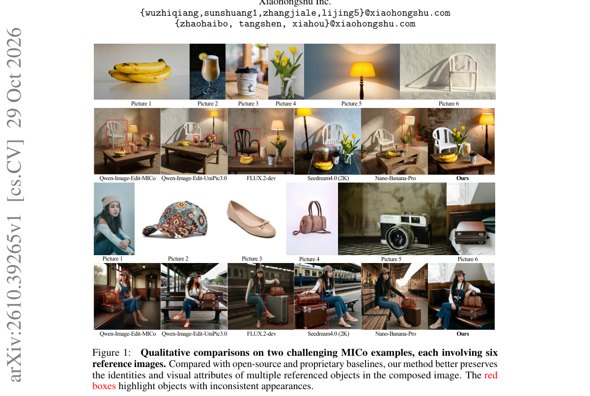

*Result - Overview of DeCoRL. DeCoRL improves MICo consistency via decomposed, object-level RL. We use a VLM to parse the instruction and identify instruction-relevant objects in each reference image,*

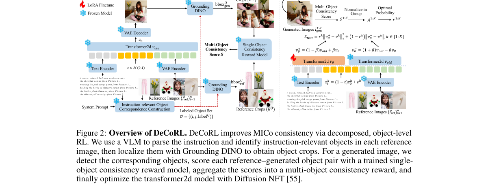

**Why this ranks #2**: 多图编辑真正失败的是跨参考图的物体对应错位，DeCoRL 把笼统的整体一致性奖励拆成逐物体的奖励再聚合。

---

### 3. EditAgent: Rethinking Agentic Image Editing

**arXiv**: [2610.39664](https://arxiv.org/abs/2610.39664) | **Score**: 8.0 (relevance 8.0 x 0.7 + quality 8.0 x 0.3) | **Tags**: rl-aigc, agentic-image-editing, listwise-judging, verification-record, vlm-judge, data-engine, UC San Diego | **Categories**: cs.CV | **Pages**: 28

**Authors**: Haiyang Xu; Tianyu Wang; Jialu Li; Jiteng Mu; Yuanjun Xiong; Jianming Zhang; Zhuowen Tu; Mingze Xu

**Affiliation**: UC San Diego; Adobe Research

**Abstract**

> Agentic image editors decompose complex requests into steps, but when a step fails, they mostly retry with the same narrow set of tools and a judge that scores each output by eye directly. We argue that such agents are bounded by two spaces: the action space of what the agent can do, and the observation space of what its judge can see. On our expert-annotated benchmark, a general-purpose editor yields no usable result in over 40% of the cases, and no judge is reliable across edit types. We present EditAgent, which expands both spaces. It routes each step to general editors and specialized methods, and attaches to each candidate a verification record. With these records, off-the-shelf VLM judges outperform finetuned reward models. Candidates are generated in parallel and judged in one listwise call: experts prefer this to sequential refinement in 78.5% of decided comparisons, at no more than half the judge calls. EditAgent improves two open-weight editors on three benchmarks and serves as a data engine for training stronger editors.

**Key findings**

- **Finding**: 论文指出 agentic 图像编辑器把复杂请求拆成多步，某步失败时基本只会用同一批窄工具重试，其上限被动作空间与 judge 的观测空间共同限制。
- **Finding**: 在专家标注基准上，通用编辑器超过 40% 的情形无法给出可用结果，且没有任何 judge 在所有编辑类型上都可靠。
- **Finding**: EditAgent 把每一步路由到通用编辑器与专用方法，并为每个候选附带验证记录；有了这些记录，现成的 VLM judge 表现优于微调过的 reward model。
- **Finding**: 候选并行生成并在一次 listwise 调用中统一评判，专家在 78.5% 的可判比较中偏好这一方式，judge 调用次数至多为逐次精修的一半。
- **Finding**: EditAgent 在三个 benchmark 上改进两个开源权重编辑器，并可作为训练更强编辑器的数据引擎。
- **Inference**: 一次 listwise 评判配并行候选，本质是把 best-of-N 做成单次调用，既省 judge 预算又让 judge 做全局比较。
- **Inference**: 验证记录比换更大更强的 judge 更管用，说明此前失败的根源在于观测信息不足而非评分能力不足。
- **Recommendation**: 推荐。做 agentic 编辑、judge 与 reward model 设计的读者建议读。

**Key figures**

*Framework - EditAgent expands both the action space of the agent and the observation space of its judge. Instead of trying again with the same editor, EditAgent generates candidates with different editi*

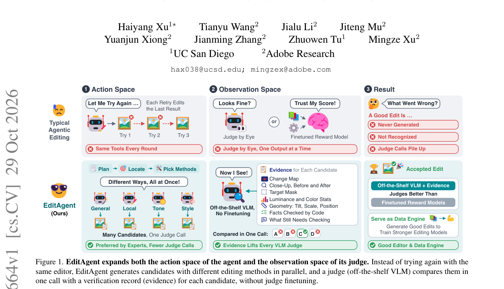

*Result - Where the action space and the observation space fall short, by edit group. (a) Action space: share of the expert-labeled sets in which only general-editor candidates, only specialized candi*

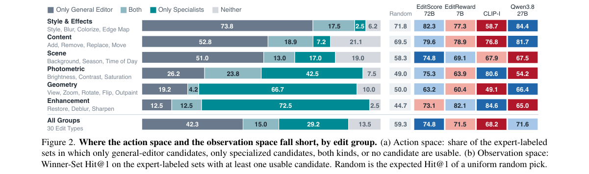

**Why this ranks #3**: 它同时扩张 agent 的动作空间与 judge 的观测空间，并证明现成的 VLM judge 比微调过的 reward model 更能挑出好结果。

---

### 4. Skillful and realistic precipitation forecasting with reinforced diffusion

**arXiv**: [2610.38775](https://arxiv.org/abs/2610.38775) | **Score**: 7.8 (relevance 8.0 x 0.7 + quality 7.5 x 0.3) | **Tags**: rl-aigc, reinforced-diffusion, precipitation-forecasting, physics-consistency, discrete-diffusion, extreme-events, Apple | **Categories**: cs.LG, physics.ao-ph | **Pages**: 45

**Authors**: Ozan Sener; Anand Avati; David Hafner; Jierui Lin; Laura Manduchi; Xiaoying Pang; Langwen Huang; Torsten Hoefler; Russ Schumacher; Vladlen Koltun

**Affiliation**: Apple; ETH Zurich; Colorado State University

**Abstract**

> Accurate precipitation forecasting remains elusive as physics-based models struggle to resolve mesoscale convection and machine learning often yields physically inconsistent, blurred results that consistently underestimate extreme events. We present FitzRoy, the first system that simultaneously achieves state-of-the-art predictive skill and physical realism over the continental United States. Through a reinforced diffusion framework, where a conditional discrete diffusion model is refined via reinforcement learning, FitzRoy effectively resolves the long-standing trade-off between pointwise accuracy and structural fidelity. Across lead times up to 24 hours, FitzRoy consistently matches or exceeds state-of-the-art models while preserving structural realism and capturing extreme events. Its low-latency inference further enables deployment in real-time operational settings. In case studies such as the 2025 Texas Hill Country floods and the 2026 Missouri floods, FitzRoy signals record-breaking accumulations that existing models largely missed. By bridging the gap between realism and skill, FitzRoy establishes a new frontier for high-fidelity precipitation forecasting.

**Key findings**

- **Finding**: 论文指出物理模型难以解析中尺度对流，机器学习又常给出物理不一致、模糊且系统性低估极端事件的结果。
- **Finding**: FitzRoy 通过 reinforced diffusion 框架，用强化学习精修一个 conditional discrete diffusion 模型。
- **Finding**: 它声称同时实现最先进的预报技巧与物理真实性，解决了 pointwise accuracy 与 structural fidelity 之间长期存在的取舍。
- **Finding**: 在最长 24 小时的预见期内，FitzRoy 持续匹配或超过最先进模型，同时保持结构真实性并捕捉极端事件。
- **Finding**: 其低延迟推理还使实时业务部署成为可能；2025 年 Texas Hill Country 洪水与 2026 年 Missouri 洪水的案例中，它给出破纪录的累积量信号。
- **Inference**: 这是少见地把 RL 收益体现在结构保真而非单纯精度上的例子，说明奖励里编码了物理结构项而非只有逐点误差。
- **Inference**: 离散扩散配合 RL 在气象这类离散状态空间上比连续扩散更自然，这是它相对通用图像扩散 RL 的场景优势。
- **Recommendation**: 推荐。做生成式预报、RL for diffusion 与科学应用的读者值得读。

**Key figures**

*Framework - Flooding in the Texas Hill Country. (A) 6-hour observed accumulated precipitation from radar between 03:00 and 09:00 UTC on 4 July 2025 around Camp Mystic (center of red box). (B) Area-averag*

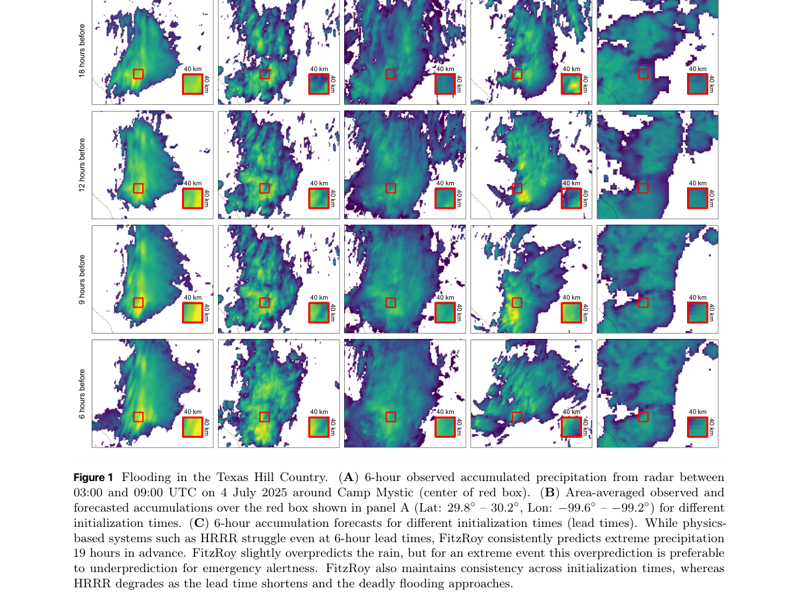

*Result - Missouri flood. (A) 9-hour observed accumulated precipitation from radar between 03:00 and 12:00 UTC on 10 July 2026. (B) Area-averaged observed and forecasted accumulations over the red box*

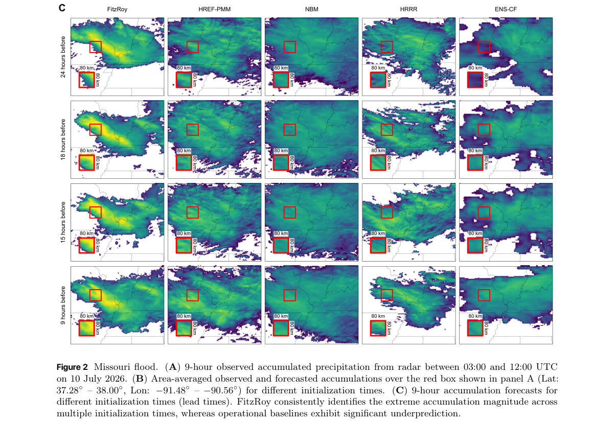

**Why this ranks #4**: 它把 RL 接到 conditional discrete diffusion 上，让降水预报第一次同时拿到 pointwise accuracy 与结构真实性。

---

### 5. SelfThinker: Self-Evolving Reasoning via Reliability-Verified Intrinsic Visual Thoughts

**arXiv**: [2610.40115](https://arxiv.org/abs/2610.40115) | **Score**: 7.5 (relevance 7.5 x 0.7 + quality 7.5 x 0.3) | **Tags**: rl-aigc, visual-chain-of-thought, flow-matching, self-distillation, cpmi-scoring, unified-multimodal, Tsinghua Shenzhen International Graduate School | **Categories**: cs.CV | **Pages**: 25

**Authors**: Zhangquan Chen; Ruqi Huang

**Affiliation**: Tsinghua Shenzhen International Graduate School, Tsinghua University

**Abstract**

> Unified multimodal models can both generate and understand images within a single set of weights, offering an opportunity to use image synthesis as training supervision for visual comprehension. However, existing visual chain-of-thought methods rely on human-annotated helper images during training and require slow image generation at test time. We present SelfThinker, the first self-evolving framework that turns a unified model's self-generated visual thoughts into stronger understanding without human image annotations. Given a visual problem, SelfThinker samples candidate helper images from its generation pathway and uses its frozen understanding pathway to score each candidate via conditional pointwise mutual information. High-utility visual thoughts then refine the generator via flow matching and serve as privileged teacher context for on-policy self-distillation. At inference, SelfThinker reasons directly from the original image in text without generating intermediate images. Although trained only on small synthetic visual-search and navigation datasets, SelfThinker transfers broadly to natural-image and spatial benchmarks, raising the seven-benchmark average of ThinkMorph-7B from 52.7 to 64.0 (+11.3 points). Controlled image-perturbation probes further show that SelfThinker surpasses ThinkMorph-7B by up to 40.4 points and its pretrained BAGEL-7B backbone by up to 23.2 points across fine-grained and spatial perception tasks. Our code is available at https://github.com/zhangquanchen/SelfThinker.

**Key findings**

- **Finding**: SelfThinker 是首个让统一多模态模型用自生成视觉思维增强自身理解的自我进化框架，训练全程无需人工图像标注。
- **Finding**: 给定视觉问题，它从生成通路采样候选辅助图，并用冻结的理解通路按 conditional pointwise mutual information 给每个候选打分。
- **Finding**: 高效用的视觉思维随后通过 flow matching 精修生成器，并作为特权 teacher context 参与 on-policy 自蒸馏。
- **Finding**: 推理时它在文本中直接从原图推理，不生成中间图像，避开了视觉 chain-of-thought 方法普遍需要的慢速图像生成。
- **Finding**: 只在小型合成视觉搜索与导航数据集上训练却广泛迁移，把 ThinkMorph-7B 的七基准平均分从 52.7 提到 64.0（+11.3），扰动探针中最多超过其 backbone 23.2 点。
- **Inference**: cPMI 打分加权 flow matching 在形式上更接近奖励加权的自我训练，而不是策略梯度的 RL，新颖处在自我监督闭环而非 RL 算法本身。
- **Inference**: 推理期不需要生成中间图像，是它相对视觉 CoT 路线最实用的工程优势，也让它能直接接进统一模型的服务链路。
- **Recommendation**: 推荐。做统一多模态模型与视觉思维链的读者建议读。

**Key figures**

*Framework - Overview of SelfThinker. The upper-left Self-Evolution panel summarizes the closed loop of imagining candidate visual thoughts, verifying reliable ones, and evolving into a stronger model. Imag*

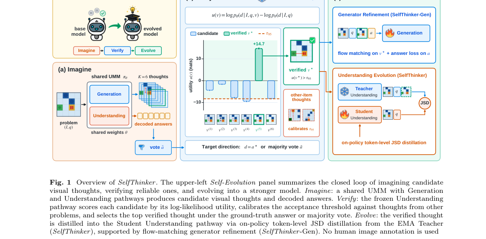

*Result - Per-benchmark and average scores of ThinkMorph-7B, SelfThinker (Nav), SelfThinker (Mix), and SelfThinker under the unified judge and text-only decoding. Numbers above the bars indicate the gain*

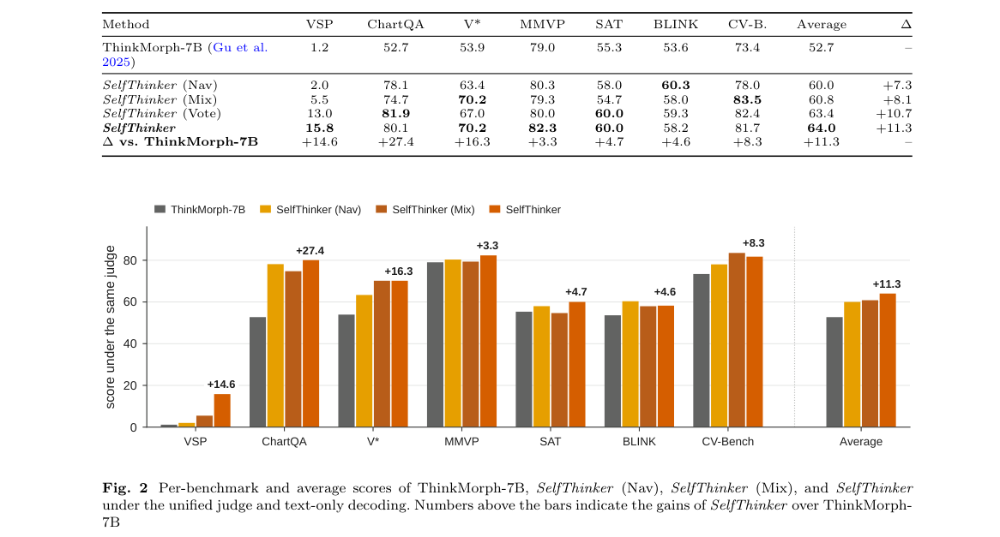

**Why this ranks #5**: 它让模型用自己的图像生成通路造出视觉思维来监督自己的理解能力，既免人工标注又在推理时省掉生成中间图像。

---

### 6. VEvo-Harness: Causally-Guarded Self-Evolving Harness for Agentic Image Generation

**arXiv**: [2610.39158](https://arxiv.org/abs/2610.39158) | **Score**: 7.1 (relevance 7.0 x 0.7 + quality 7.5 x 0.3) | **Tags**: rl-aigc, agentic-generation, causal-verification, skill-library, vlm-judge, continual-learning, Taobao & Tmall group of Alibaba | **Categories**: cs.CV | **Pages**: 14

**Authors**: Yuan Wang; Yuhang Yu; Mengting Chen; Tianrun Xu; Zihao Pan; Xuetao Feng; Wei Li

**Affiliation**: Taobao & Tmall group of Alibaba; Tsinghua University

**Abstract**

> The central bottleneck in visual generation and editing has migrated from achieving pixel-level fidelity to satisfying densely constrained user specifications through increasingly agentic workflows. Prevailing agentic generation pipelines remain shallow generate-verify-rewrite loops treating VLM judgments as coarse visual feedback, either discarding repair experience or admitting ungated updates that poison skill library. With memorize and govern periods left open, they degrade into ungoverned iterators of repeated trial-and-error rather than continual self-evolving harness. Towards this issue, we present \textbf{VEvo-Harness}, the first causally-guarded continual self-evolving harness system for agentic visual generation. VEvo-Harness introduces four coupled innovations: (1) \textit{a visual traceback} that densifies sparse judgments into root-cause attributions with a hierarchical verification tree; (2) \textit{a visual continual governance} that admits only causally valid skill patches through counterfactual dual-arm image generation replay; (3) \textit{a lifecycle-managed harness state} that hierarchically distills root-cause-anchored episodes across working, experience, and pattern tiers into a persistent skill library of routable and causally verified capabilities; (4) \textit{a heterogeneous sandbox policy} that orchestrates a diverse action space of repair primitives, dynamically routing cost-aware interventions based on root causes to select the most effective strategy. VEvo-Harness surpasses state-of-the-art agentic methods and rivals proprietary generators (\textit{e.g.}, GPT-Image, Nano-Pro) while maintaining the continual harness evolution and generalization.

**Key findings**

- **Finding**: 论文指出视觉生成与编辑的瓶颈已从像素级保真迁移到满足密集约束的用户规格，因而越来越多地走 agentic 工作流。
- **Finding**: 作者批评现有 agentic 生成管线多是浅层的生成-验证-重写循环，把 VLM 判断当作粗粒度视觉反馈，要么丢弃修复经验，要么让未门控的更新污染技能库。
- **Finding**: VEvo-Harness 用带层级验证树的 visual traceback 把稀疏判断细化为根因归因，并用反事实双臂图像回放只接纳因果有效的技能补丁。
- **Finding**: 它还在 working、experience、pattern 三层之间蒸馏根因锚定的 episode，形成可路由且经因果验证的持久技能库。
- **Finding**: 第四项是异构 sandbox 策略，按根因动态路由带成本的修复原语；论文报告该系统超过最先进的 agentic 方法，并可与 GPT-Image、Nano-Pro 等专有生成器竞争。
- **Inference**: 与 RL 的关系边界很清楚：这里的 VLM 判断充当的是粗粒度奖励信号，但没有策略梯度、没有轨迹级 advantage，全靠因果门控与经验蒸馏更新技能。
- **Inference**: 反事实双臂回放是它区别于普通反思循环的关键，能挡住那些恰好奏效但归因错误的修补。
- **Recommendation**: 选读。关注 agentic 生成、评测闭环与持续学习的读者值得读，想学 policy-gradient 的读者可跳过。

**Key figures**

*Framework - From stateless refinement to continual capability growth. VEvo-Harness causally verifies and reuses visual experience, enabling frozen generators to become progressively stronger with usage.*

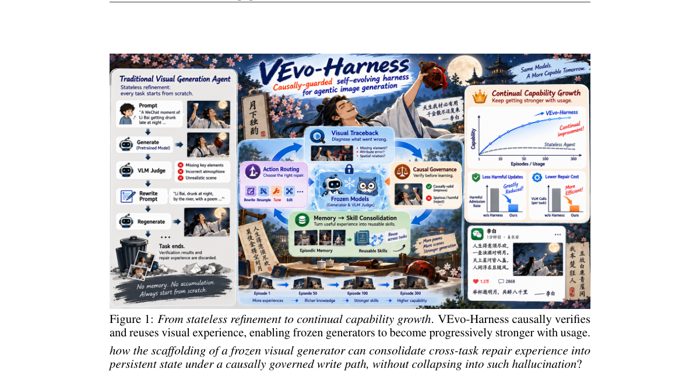

*Result - Overview of our proposed VEvo-Harness pipeline. A self-evolving scaffold is built around (a) a Interaction Loop for generation and verification, comprising (b) Visual Traceback, (c) Visual C*

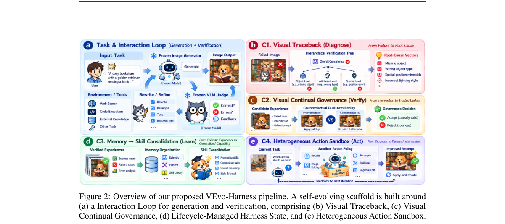

**Why this ranks #6**: 它不解决单张图好不好看，而是解决生成技能库会不会被无效修补污染这一 agentic 生成的核心治理问题。  [wild-card=yes] 自我进化 harness 的治理机制（视觉回溯 + 因果门控技能库），由验证反馈驱动但不是策略梯度式 RL。

---

### 7. ROAD: Modern Adversarial Training for Simple One-Step Distillation at Scale

**arXiv**: [2610.39539](https://arxiv.org/abs/2610.39539) | **Score**: 7.0 (relevance 7.0 x 0.7 + quality 7.0 x 0.3) | **Tags**: rl-aigc, adversarial-distillation, one-step-generator, text-to-image, critic-head, representation-space, Shanghai Jiao Tong | **Categories**: cs.CV, cs.LG | **Pages**: 37

**Authors**: Xiaoou Li; Shan You; Tao Huang

**Affiliation**: Shanghai Jiao Tong University; SenseTime

**Abstract**

> One-step distillation turns pretrained diffusion models into fast generators, but strong results often require substantial training machinery and compute. Pure adversarial distillation offers a simpler route, yet has struggled at modern text-to-image scale. To address this limitation, we propose ROAD (Representation-grounded One-step Adversarial Distillation), a one-stage framework that distills text-to-image models with one adversarial objective and a lightweight representation-space critic. First, we replace the classical convolutional head with a Lipschitz-controlled Transformer head with token-level text conditioning, which matches the semantic tokens of modern visual encoders. Second, we observed a fixed random feature mixing leads to long-horizon degradation. We attribute it to generator-critic co-adaptation around one realization-specific view, and periodically re-draw the mixing to keep the randomization effective. Third, for our dense and vector-valued logits, we introduce Jacobian R1 which penalizes the full input-logit Jacobian, overcoming pooled R1's limitation of neglecting most of logit sensitivities. A single adversarial objective then suffices: in one step, ROAD reaches 11.03 FID on SDXL and 13.73 on SD3.5-M on COCO-10K, surpassing the multi-step teachers at a fraction of distribution matching's training compute.

**Key findings**

- **Finding**: one-step 蒸馏把预训练扩散模型变成快速生成器，但强结果往往依赖繁重的训练机制与算力；ROAD 用一个阶段、单一对抗目标与轻量表征空间 critic 走更简单的路。
- **Finding**: 它把经典卷积 head 换成受 Lipschitz 控制的 Transformer head 并加入 token 级文本条件，以匹配现代视觉编码器的语义 token。
- **Finding**: 作者观察到固定随机特征混合会导致长程退化，归因于生成器与 critic 围绕单一实现视角的共适应，于是周期性重抽混合以保持随机化有效。
- **Finding**: 针对稠密且向量值的 logits，他们提出 Jacobian R1 惩罚完整的输入-logit Jacobian，克服 pooled R1 忽略大部分 logit 敏感性的局限。
- **Finding**: 单一对抗目标就够用，一步之内 ROAD 在 SDXL 上达到 11.03 FID、在 SD3.5-M 上达到 13.73（COCO-10K），超过多步教师，算力只有分布匹配蒸馏的一小部分。
- **Inference**: 与 RL 的关系边界很清楚：critic 扮演了 reward model 的角色，生成器做的是对该对抗信号的最小化回归，没有策略梯度也没有轨迹采样。
- **Inference**: 周期重抽混合与 Jacobian R1 两处修补说明对抗蒸馏在现代规模上的主要障碍是 critic 过拟合而非目标设计。
- **Recommendation**: 选读。做快速生成器、扩散蒸馏与对抗训练的读者值得读，关注 RL 方法的读者可只读讨论部分。

**Key figures**

*Framework - A single adversarial loss suffices for one-step distillation. Left: samples from ROAD. Right: one-step SDXL FID vs. training GPU-hours (our runs). DMD2 starts from the base model; DMD2-ODE i*

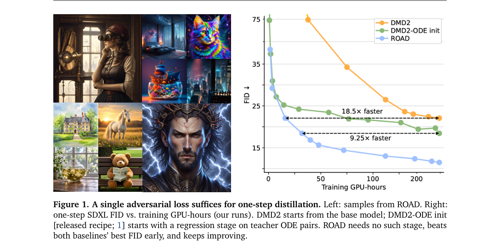

*Result - Overall architecture and critic head’s ViT block of ROAD. Left: generated and real images are encoded into multi-level semantic features, transformed by periodically re-drawn random mixings*

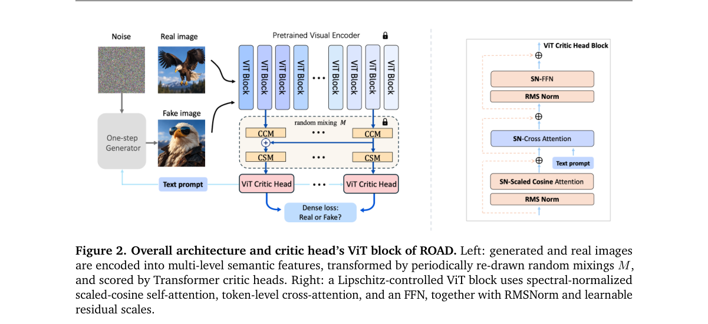

**Why this ranks #7**: 它用单一对抗目标和轻量表征空间 critic，把 one-step 蒸馏从需要庞大训练机器的路线拉回简单可复现的路线。  [wild-card=yes] 对抗蒸馏的极小极大目标等价于一种对抗式奖励，但不是策略梯度 / 可验证奖励式 RL。

---

### 8. sDMD: Sinkhorn Distribution Matching Distillation

**arXiv**: [2610.39889](https://arxiv.org/abs/2610.39889) | **Score**: 6.7 (relevance 6.5 x 0.7 + quality 7.0 x 0.3) | **Tags**: rl-aigc, distribution-matching-distillation, sinkhorn-divergence, few-step-sampling, mode-coverage, wasserstein-flow, KAIST | **Categories**: cs.CV, cs.LG | **Pages**: 41

**Authors**: Jaihoon Kim; Lingxiao Li; Soshi Shimada; Roshni Cooper; Minhyuk Sung; Yiwei Zhao

**Affiliation**: KAIST; Netflix

**Abstract**

> Distribution Matching Distillation (DMD) distills multi-step diffusion models into few-step generators by minimizing reverse KL divergence. Despite its strong performance, DMD guides samples by local density alone, which introduces two limitations: teacher scores can be unreliable in regions of low teacher density, and the mode-seeking behavior of reverse KL can collapse the student onto a subset of the teacher modes. We first connect DMD to Wasserstein gradient flow, showing that its gradient follows from a fixed-point formulation with integral KL (IKL) as the energy functional. This perspective motivates augmenting IKL with an optimal transport term that addresses these limitations by guiding outlier samples toward the target and promoting mode coverage. We realize this term using Sinkhorn divergence estimated from finite batches. In practice, however, errors in the estimated Sinkhorn velocity can perturb in-domain samples for which IKL guidance is already accurate. To this end, we introduce sDMD, which adaptively activates the Sinkhorn correction based on discriminator outputs, focusing on outlier samples where IKL may be unreliable. With 2--4 sampling steps on FLUX.1-dev, Qwen-Image-20B, and Wan2.1-14B, sDMD outperforms distillation baselines on GenEval, DPG, WISE, and VBench while improving sample diversity over DMD2.

**Key findings**

- **Finding**: Distribution Matching Distillation 通过最小化 reverse KL 把多步扩散模型蒸馏成少步生成器，但只由局部密度引导样本。
- **Finding**: 这带来两个问题：教师在低密度区域的打分可能不可靠，且 reverse KL 的 mode-seeking 行为可能让学生塌缩到教师模式的一个子集。
- **Finding**: 作者先把 DMD 连接到 Wasserstein 梯度流，证明其梯度可由以 integral KL 为能量的不动点形式导出，并据此用最优传输项增广 IKL，把离群样本推向目标并促进模式覆盖。
- **Finding**: 该项用有限 batch 估计的 Sinkhorn divergence 实现，但其速度估计误差会扰动 IKL 已准确的域内样本，因此 sDMD 依据 discriminator 输出自适应启用修正。
- **Finding**: 在 FLUX.1-dev、Qwen-Image-20B 与 Wan2.1-14B 上以 2 到 4 步采样，sDMD 在 GenEval、DPG、WISE 与 VBench 上超过蒸馏基线，样本多样性也优于 DMD2。
- **Inference**: 与 RL 的关系边界很清楚：DMD 的学生更新在形式上就是以密度比为隐式 reward 的加权回归，Sinkhorn 项同样是分布距离充当奖励，而不是学出来的偏好模型。
- **Inference**: 按 discriminator 输出自适应开关修正，比一律施加 OT 项更稳，说明这里的瓶颈在估计噪声而非目标函数缺项。
- **Recommendation**: 选读。做少步生成器、扩散蒸馏的读者值得读，想找 policy-gradient 方法的读者可跳过。

**Key figures**

该论文正文未提取到可用图（图表为纯文本/表格排版）。

**Why this ranks #8**: 它指出 DMD 只靠局部密度会把学生钉在教师模式的一个子集上，并用按需启用的 Sinkhorn 修正来补这块短板。  [wild-card=yes] 分布匹配蒸馏（Sinkhorn 正则），奖励来自分布差异而非策略奖励。

---

### 9. Efficient Covariance-Aware Vicinal Latent Diffusion for Continuous Conditional Image Generation

**arXiv**: [2610.39277](https://arxiv.org/abs/2610.39277) | **Score**: 6.5 (relevance 6.5 x 0.7 + quality 6.5 x 0.3) | **Tags**: rl-aigc, continuous-conditional-generation, cfg-distillation, latent-diffusion, vicinal-learning, progressive-distillation, Nanjing | **Categories**: cs.CV | **Pages**: 14

**Authors**: Xin Ding; Shuo Huang; Zhenglong Ding; Sen Zhang; Nenglun Chen; Peibei Cao; Yongwei Wang; Fei Wu

**Affiliation**: Nanjing University; Zhejiang University

**Abstract**

> Continuous Conditional Generative Modeling (CCGM) aims to synthesize high-dimensional data conditioned on continuously valued scalar labels. However, existing continuous diffusion models face severe data sparsity under imbalanced and long-tailed label distributions, which can lead to visual artifacts and condition inconsistency. Moreover, inference-time classifier-free guidance and dense pixel-space integration introduce substantial sampling overhead, limiting practical deployment. To address these challenges, we propose CAViLD, an efficient latent diffusion framework for continuous conditional generation. CAViLD first constructs a purified condition-aware latent space through density-adaptive vicinal learning, auxiliary semantic regularization, and NIQE-guided negative data augmentation. It then internalizes the conditional guidance direction through an EMA teacher, enabling single-branch conditional inference, and introduces covariance-aware progressive distillation for label-dependent probability-flow ODEs, supporting sampling down to four NFEs. Experiments on RC-49, UTKFace, and Steering Angle demonstrate a favorable trade-off among generation fidelity, continuous condition consistency, and sampling efficiency.

**Key findings**

- **Finding**: 连续条件生成要在连续标量标签下合成高维数据，而现有连续扩散模型在长尾标签分布下面临数据稀疏、易产生视觉瑕疵与条件不一致的问题。
- **Finding**: 推理期的 classifier-free guidance 与稠密像素空间积分又带来可观开销，限制实际部署，这也是 CAViLD 要处理的问题。
- **Finding**: CAViLD 先通过密度自适应的 vicinal learning、辅助语义正则化与 NIQE 引导的负数据增广，构建出净化后的条件感知隐空间。
- **Finding**: 它用 EMA teacher 把条件引导方向内化实现单分支条件推理，无需推理期外接 guidance，并引入协方差感知的渐进蒸馏用于标签相关的 probability-flow ODE，把采样压到 4 个 NFE 以内。
- **Finding**: 在 RC-49、UTKFace 与 Steering Angle 上，论文报告生成保真度、连续条件一致性与采样效率之间取得良好权衡。
- **Inference**: 与 RL 的关系边界很清楚：这里的条件引导是被蒸馏掉的推理期技巧，属于 guidance 内化而非奖励优化，没有 policy gradient 也没有偏好数据。
- **Inference**: guidance 内化后单分支推理省掉的算力往往比模型本身的加速更值钱，这是它相对普通蒸馏的实际收益。
- **Recommendation**: 选读。做条件扩散加速、CFG 内化与连续条件生成的读者值得读。

**Key figures**

*Framework - Quality–efficiency comparison on Steering Angle at 64 × 64. The axes denote sampling throughput and SFID, while marker size indicates aggregate peak GPU memory. CAViLD achieves a favorable tra*

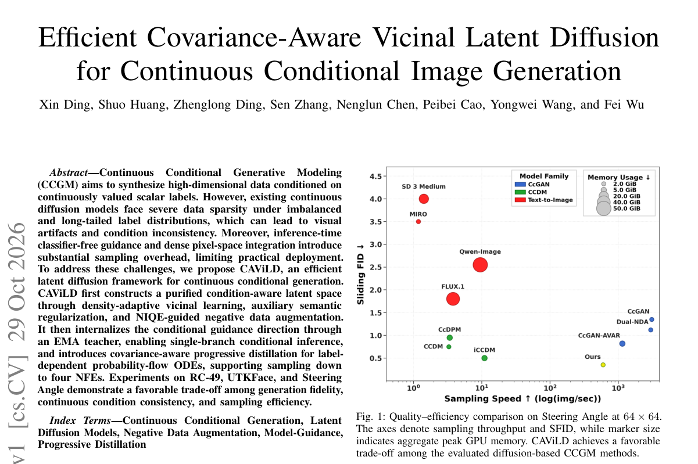

*Result - Overview of CAViLD. Yellow blocks denote adapted or integrated components, while orange blocks denote the proposed components. Unhighlighted blocks represent standard pipeline elements.*

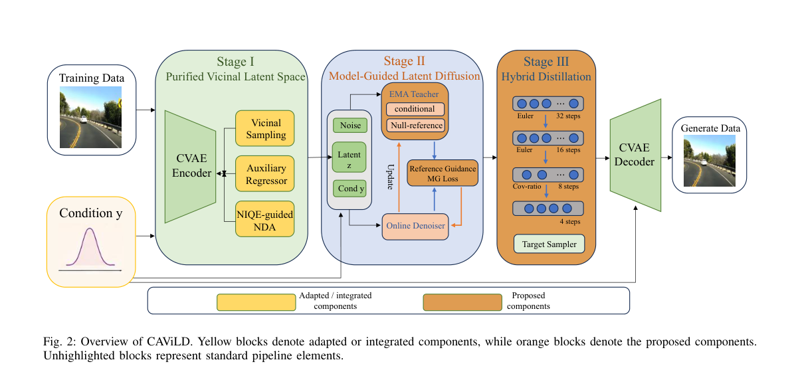

**Why this ranks #9**: 它把 classifier-free guidance 的方向内化进单分支推理，并用协方差感知的渐进蒸馏把采样压到四步以内。  [wild-card=yes] 用 EMA 教师把条件引导方向内化（CFG 蒸馏），属蒸馏而非 RL 优化。

---

### 10. An ODE-based Sampler for Discrete Diffusion Models

**arXiv**: [2610.40618](https://arxiv.org/abs/2610.40618) | **Score**: 6.1 (relevance 6.0 x 0.7 + quality 6.5 x 0.3) | **Tags**: rl-aigc, discrete-diffusion, ode-sampler, consistency-distillation, probability-flow-ode, flow-matching, CMAP | **Categories**: cs.LG, stat.ML | **Pages**: 76

**Authors**: Samson Gourevitch; Yazid Janati; Eric Moulines; Eric P. Xing; Alain Durmus; Giacomo Zanella

**Affiliation**: CMAP, Ecole polytechnique; Institute of Foundation Models; MBZUAI; EPITA LRE; Bocconi University

**Abstract**

> The marginals of a continuous diffusion model can be reproduced by a deterministic ordinary differential equation (ODE), known as the probability flow ODE, which provides a foundation for accelerated sampling and consistency distillation. In this paper we address the question whether an analogous formulation exists for discrete diffusion models and answer it affirmatively by introducing exponential residual flows (ERFs). Our framework augments the discrete state with a continuous residual variable for each token and position. These residuals evolve deterministically according to piecewise-defined ODEs whose vector fields depend on the current discrete state and the forward and backward rate matrices of the prescribed diffusion model. The discrete state changes whenever a residual reaches zero. We prove that this construction preserves the marginals of the original diffusion. We derive a practical discretization of our sampler and specialize it to masked and uniform diffusion. The deterministic trajectories of ERFs support consistency distillation and yield empirical improvements over previous approaches across a variety of benchmarks including code and text generation tasks.

**Key findings**

- **Finding**: 论文指出连续扩散模型的边缘分布可由确定性常微分方程（probability flow ODE）复现，作者追问离散扩散是否有类似形式并给出肯定答案，提出 exponential residual flows。
- **Finding**: ERF 为每个 token 与位置增广一个连续残差变量，残差依据依赖当前离散状态以及正反向速率矩阵的分段定义 ODE 向量场确定性地演化。
- **Finding**: 当某个残差降到零时离散状态随之改变，论文证明这一构造保持了原扩散模型的边缘分布。
- **Finding**: 作者推导出该采样器的实用离散化，并专门化到 masked 与 uniform 两种扩散。
- **Finding**: ERF 的确定性轨迹支持一致性蒸馏，在包括代码与文本生成任务的多种基准上相对既有方法取得经验性提升。
- **Inference**: 与 RL 的关系边界很清楚：这篇本身不做任何奖励优化，它属于采样加速与一致性蒸馏这一族，对 RL 线的价值在于提供可蒸馏的确定性轨迹。
- **Inference**: 离散扩散的 ODE 采样器此前缺失，而 RL for diffusion 又依赖确定性轨迹，缺了它这条链在离散文本模态上就接不上。
- **Recommendation**: 选读。做离散扩散、ODE 采样器与一致性蒸馏的读者值得读，只关心 RL 奖励设计的读者可跳过。

**Key figures**

*Framework - The Exponential Residual Flow algorithm. Evolution of the joint state (Xt, Et), initialized in- dependently with X1 ∼p1 and E1 ∼Exp(1)⊗(3×6). Each histogram displays the residual values at o*

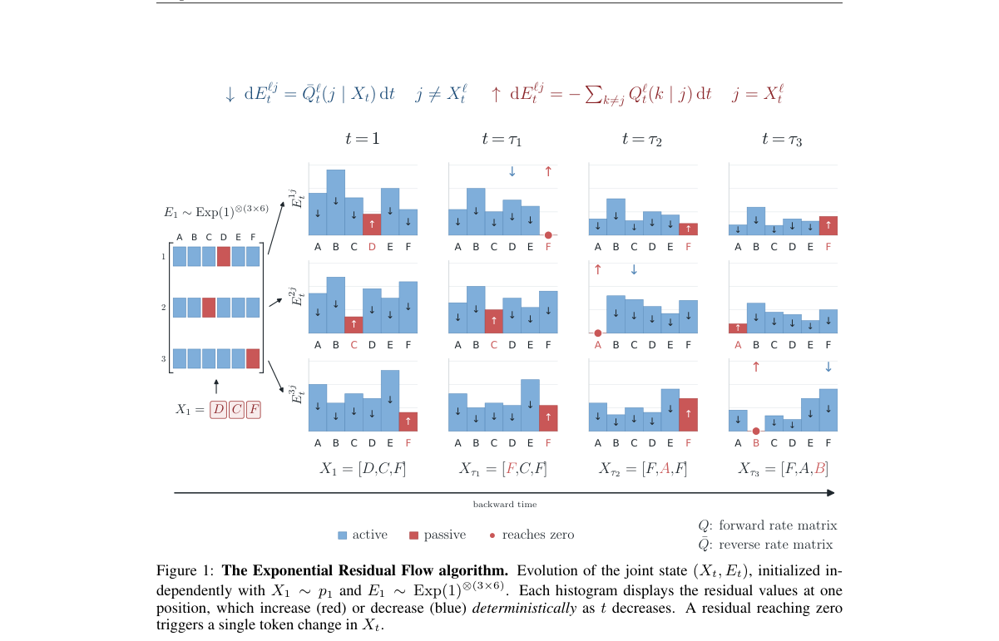

*Result - Sampling quality at matched NFE on TinyGSM (top) and OpenWebText (bottom). Dashed curves denote ancestral samplers; solid curves denote ERF. TinyGSM bands are 95% bootstrap intervals over qu*

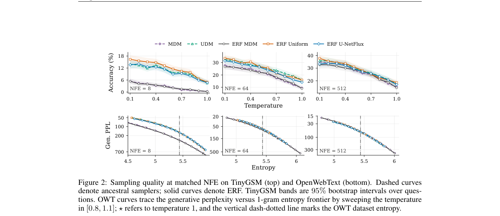

**Why this ranks #10**: 它回答了一个基础问题：离散扩散能不能像连续扩散那样有确定性的 ODE 采样器，答案是可以，而且轨迹还能拿来蒸馏。  [wild-card=yes] 离散扩散的确定性 ODE 采样器与一致性蒸馏，属采样加速而非 RL。

---

## Footer

- Total papers scanned across all 7 tracks: 619（原始 828 条）
- rl_aigc track final top-10: 10
- Wild-cards in this track: 5
- Figure assets: 2026-10-30/res/

Generated by `mine-arxiv-daily-digest` skill. Sister file: `2026-10-30_rl_aigc_entry.md`.
