# ArXiv Daily Digest - 2026-10-30 (强化学习 · 核心算法 / 理论 / MARL, 10 papers)

**Generated**: 2026-10-31 17:00 CST

**Source**: arXiv cs.CV, cs.SD, eess.AS, cs.CL, cs.AI, cs.RO, cs.LG submissions, listing day 2026-10-29 (announced 2026-10-30 00:00 UTC)

**Batch window**: 2026-10-28T18:00:00Z .. 2026-10-29T18:00:00Z（arXiv 公告批次横跨两个 UTC 日：前一日 18:00 UTC 起算，当日 17:59:59 UTC 截止）

**Track**: rl_core (top 10 of 619 papers scanned, 70 full reads)

**Scope**: RL 算法本身与理论、奖励学习、多智能体 RL、规划控制、sim-to-real 与 agentic RL

---

## Top 10 - 强化学习 · 核心算法 / 理论 / MARL

### 1. Reinforcement Learning for the Game of Balatro: A Fast Simulator and Two-Policy Training Approach

**arXiv**: [2610.39049](https://arxiv.org/abs/2610.39049) | **Score**: 8.8 (relevance 9.0 x 0.7 + quality 8.5 x 0.3) | **Tags**: rl-core, multi-agent-ppo, credit-assignment, fast-simulator, roguelike, phase-decomposition, Duke | **Categories**: cs.AI, cs.LG | **Pages**: 13

**Authors**: Ajay Vikram Periasami; Anjaneya Gupta; Ethan Cheng; Ivan Rosales

**Affiliation**: Duke University

**Abstract**

> Balatro, a 2024 roguelike deckbuilder, presents three difficulties that have historically derailed reinforcement learning methods: a 3,000-action state-dependent action space, horizons of several hundred decisions with sparse rewards, and pervasive stochasticity in both card draws and shop generation. Published RL results on the game remain scarce. We introduce an end-to-end pipeline comprising (i) a high-throughput Rust simulator that is automatically state-diffed against the live game client via BalatroBot, (ii) a condensed observation-action interface with dynamic per-step masking of legal moves, and (iii) a multi-agent PPO architecture that decomposes play into a tactical blind policy and a strategic shop policy that share the full game state but act in disjoint phases. Long-horizon credit assignment is partially addressed by per-agent reward routing with explicit cross-agent credit. On the main joint run, training metrics show a sharp phase transition in which the first-blind clear rate converges above 99% and mean episode return increases by roughly an order of magnitude, plateauing at a mean maximum ante of 3 out of 8; single-agent baselines under identical rewards oscillated between greedy and hoarding failure modes and did not stably clear the first blind. These results establish the two-policy decomposition as a strong reactive baseline for Balatro and localise the remaining gap to long-horizon strategic planning rather than tactical blind play.

**Key findings**

- **Finding**: 论文指出 Balatro 对 RL 有三重难点：3000 步的状态相关动作空间、数百步决策的稀疏奖励长程，以及抽牌与商店生成的普遍随机性。
- **Finding**: 团队给出端到端管线，核心是高吞吐 Rust 模拟器，经 BalatroBot 与在线游戏客户端自动做状态 diff。
- **Finding**: 观测-动作接口被显著压缩以适配长程决策，并按步动态屏蔽当前局面下的非法动作。
- **Finding**: 多智能体 PPO 架构把对局拆成战术盲注策略与策略商店策略，两者共享完整游戏状态但在不相交阶段行动。
- **Finding**: 长程信用分配问题通过逐智能体奖励路由与显式跨智能体信用得到部分缓解。
- **Finding**: 主联合训练中首盲通关率收敛到 99% 以上、平均回合回报提升约一个数量级，但平均最高底注停在 8 里的 3；同等奖励下单智能体基线在贪婪与囤积两种失败模式间振荡，无法稳定通过首盲。
- **Inference**: 结果把瓶颈明确定位到长程战略规划而非战术盲注，说明按阶段拆解比换算法更关键。
- **Recommendation**: 推荐。想做长程稀疏奖励 RL、需要自建高保真快速模拟器的读者强烈建议读。

**Key figures**

*Result - Multi-agent setup for blind play and shop decisions: shared observation preprocessing and a universal card encoder feed agent-specific backbones; the blind policy attends over hand (and joke*

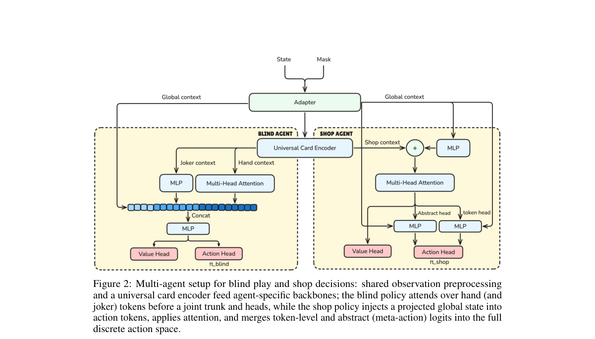

**Why this ranks #1**: 把长程稀疏奖励游戏拆成战术与战略两个阶段策略，让多智能体 PPO 的信用分配问题有了可操作的解法。

---

### 2. Cheap Retrieval and Observation Credit Assignment from One Quantity: The Value of Information

**arXiv**: [2610.40030](https://arxiv.org/abs/2610.40030) | **Score**: 8.5 (relevance 8.5 x 0.7 + quality 8.5 x 0.3) | **Tags**: rl-core, value-of-information, memory-retrieval, credit-assignment, world-model, td-target, Technical | **Categories**: cs.AI, cs.LG | **Pages**: 11

**Authors**: Daniel Strauss; Nikolaos Sotirakis; Zhenshan Bing; Alois Knoll

**Affiliation**: Technical University of Munich; Nanjing University; Harbin Institute of Technology

**Abstract**

> Memory in reinforcement learning raises two problems. Attention finds the relevant item by scoring the whole store, which is costly for robots under latency and energy limits. When a retrieved memory pays off, credit for acquiring it must cross the whole sequence. We argue that both are governed by one quantity, the value of information, and propose to estimate it from archived rollouts with a learned world model. We obtain that, when read at the observation, it yields a provable lower bound on the optimal value of the acquiring action, which floors its TD target and attributes this floor to the observation that earned it. Read at the decision, it defines the optimal retrieval set. A pilot retrieval system, to be trained and improved with this signal, solves a memory task with reduced context.

**Key findings**

- **Finding**: 论文指出 RL 记忆带来两个问题：注意力要给整个存储打分来检索，对受延迟与能耗限制的机器人代价高；检索到的记忆兑现价值时，获取它的信用要跨越整条序列。
- **Finding**: 作者主张两者由同一个量即信息价值支配，并用学习到的 world model 从归档 rollout 里估计它。
- **Finding**: 在观测处读取时，它给出获取动作最优价值的一个可证下界，为其 TD target 设下限，并把这一下限归因到挣到它的那个观测。
- **Finding**: 在决策处读取时，它直接定义应当检索的最优集合，把检索范围变成可算出来的量。
- **Finding**: 一个试点的检索系统以该信号训练与改进，用更短的上下文解决了记忆任务。
- **Inference**: 把检索成本与信用分配统一到一个标量，让记忆模块可以端到端地参与信用传播，而不是只当上下文。
- **Inference**: 可证下界依赖 world model 的估计质量，误差如何传导到 TD target 是落地时最该先验证的一环。
- **Recommendation**: 推荐。做机器人记忆机制、world model 辅助 RL 或关心长期信用分配的读者强烈建议读。

**Key figures**

*Framework - Information value on a recorded POMDP trajectory. Decision t needs x1 (at s) and x2 (at u) jointly; the look at k−1 would repeat x1 but is not taken, so R = ∅attains the sup in Eq. (7). Bell*

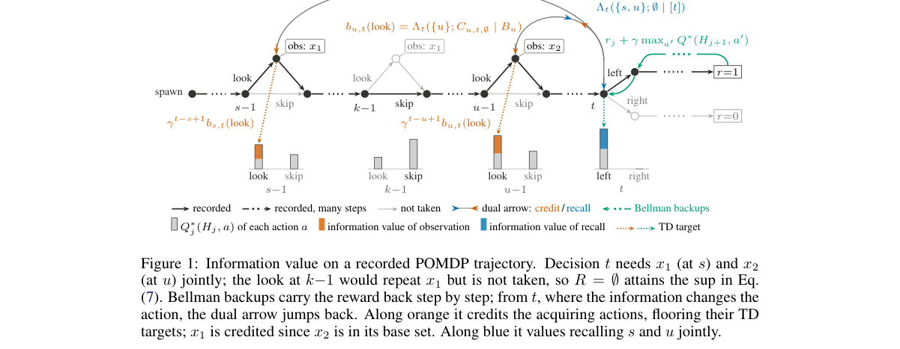

**Why this ranks #2**: 把记忆的检索代价与跨序列信用分配统一到信息价值这一个量上，是把记忆模块接进 RL 训练循环的干净接口。

---

### 3. Online Dense Reinforcement Learning with Planning-Grounding Agent for UI Navigation on Live IOS Apps

**arXiv**: [2610.39264](https://arxiv.org/abs/2610.39264) | **Score**: 8.3 (relevance 8.5 x 0.7 + quality 8.0 x 0.3) | **Tags**: rl-core, online-rl, ui-navigation, dense-reward, llm-as-judge, critic-stability, Apple | **Categories**: cs.AI | **Pages**: 18

**Authors**: Peitong Duan; Khashayar Gatmiry; Jeffrey Nichols; Samy Bengio; Emmanuel Abbe

**Affiliation**: Apple

**Abstract**

> While frontier vision-language models demonstrate strong capabilities in user interface (UI) navigation, their high inference costs prohibit everyday use. Conversely, smaller models trained via supervised fine-tuning (SFT) or offline reinforcement learning often memorize static trajectories, leading to brittle execution and an inability to recover from errors. To address these limitations, we propose a novel online reinforcement learning framework that trains UI navigation agents directly on live iOS applications. Our framework decouples the agent into two specialized components: a Planning agent and a UI Grounding model. We rely on an LLM-as-a-Judge to provide comprehensive reward signals, combining dense, step-level feedback to evaluate intermediate progress with a terminal reward for overall task completion. To effectively leverage this dual reward structure, we optimize the agent using Proximal Policy Optimization (PPO) with step-level advantage estimation. Furthermore, we introduce GiGPPO, a novel neighbor-conditioned value estimation method that improves critic stability by leveraging reward signals from visually similar states across concurrent trajectories. To support this online training paradigm at scale, we introduce an efficient infrastructure that orchestrates hundreds of concurrent virtual iOS devices. Evaluations on rigorous benchmarks, including UINavBench, iOSWorld, and AndroidWorld, demonstrate that our online RL trained agents substantially outperform both SFT and terminal-only RL baselines while accelerating training convergence. Notably, our 8B RL agents achieve nearly a sevenfold improvement over the SFT baseline in out-of-distribution generalization to Android environments, while outperforming Gemini-3.5-Flash and tying with Gemini-3.1-Pro on real iOS applications.

**Key findings**

- **Finding**: 论文指出前沿视觉语言模型做 UI 导航能力虽强但推理成本过高，而 SFT 或离线 RL 训出的小模型只会背静态轨迹，执行脆弱且无法从错误中恢复。
- **Finding**: 框架把 agent 解耦为 Planning agent 与 UI Grounding 模型两个组件，配套基础设施可编排数百个并发虚拟 iOS 设备。
- **Finding**: 用 LLM-as-a-Judge 组合步级稠密反馈与任务完成的终止奖励，并以 PPO 配合步级优势估计来优化 agent。
- **Finding**: 提出 GiGPPO 这一邻居条件化的价值估计方法，借助并发轨迹中视觉相似状态的奖励信号提升 critic 稳定性。
- **Finding**: 在 UINavBench、iOSWorld 与 AndroidWorld 上，在线 RL agent 大幅超过 SFT 与只用终止奖励的 RL 基线，8B agent 在 Android 泛化上较 SFT 提升近七倍。
- **Finding**: 在真实 iOS 应用上，8B RL agent 超过 Gemini-3.5-Flash，并与 Gemini-3.1-Pro 持平。
- **Inference**: 在线训练能摆脱静态轨迹记忆，是因为奖励来自真实交互的中间状态而非标注轨迹，这也解释了它为何比离线 RL 贵得多。
- **Recommendation**: 推荐。做 GUI agent、在线 RL 基建或稠密奖励设计的读者强烈建议读。

**Key figures**

*Framework - Overview of the iOS agent architecture and training setup.*

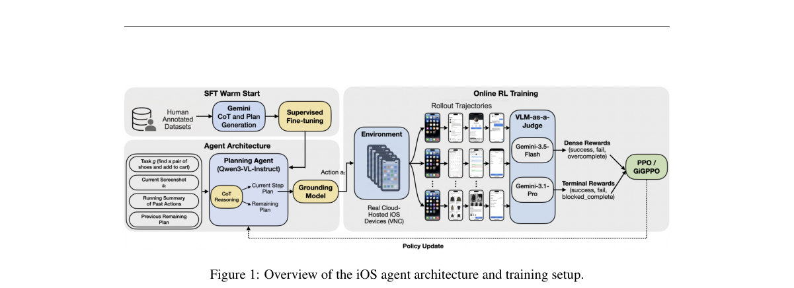

**Why this ranks #3**: 在真实 iOS 应用上做在线稠密 RL，还顺手用邻居条件化的价值估计治了 critic 稳定性这个老大难。

---

### 4. Timbre: Reliability-aware harmonic consensus for label-free multimodal test-time rexinforcement learning

**arXiv**: [2610.39439](https://arxiv.org/abs/2610.39439) | **Score**: 8.0 (relevance 8.0 x 0.7 + quality 8.0 x 0.3) | **Tags**: rl-core, test-time-rl, pseudo-labeling, harmonic-consensus, modality-reweighting, chi2-barycenter, University of Melbourne | **Categories**: cs.AI | **Pages**: 21

**Authors**: Haotian Lyu; Haoyu Wang; Ru Wang; Feng Ji; Ziwen Li; Jiaxian Guo; Mingming Gong

**Affiliation**: University of Melbourne; Mohamed bin Zayed University of Artificial Intelligence; The University of Tokyo; Google

**Abstract**

> Label-free test-time reinforcement learning adapts vision--language models using rewards derived from their own predictions. However, misinterpreted visual evidence and sensitivity to textual formulation can produce a consistent but incorrect consensus that majority voting reinforces. Cross-view aggregation can expose such errors, but image and text transformations may themselves degrade task-relevant evidence to different extents. We introduce \method, a reliability-aware harmonic consensus framework for multimodal test-time reinforcement learning. \method constructs a $2\times2$ grid combining original and perturbed images with direct-solving and reframing modes, selects pseudo-labels through weighted harmonic aggregation, and adapts modality-level weights using batch-averaged, temporally smoothed shifts in pseudo-label confidence as a heuristic reliability signal. We formulate consensus as a weighted $χ^2$-barycenter problem whose unique minimizer is the normalized weighted harmonic aggregate, without requiring correct-answer invariance. An exact support--dispersion decomposition characterizes when harmonic aggregation preserves or corrects arithmetic rankings, while a sensitivity analysis establishes how modality reweighting changes pairwise ranking margins, informing interpretation of the heuristic updates. Across six benchmarks and three Qwen3-VL model scales, \method outperforms TTRV in 16 of 18 benchmark--model settings on adaptation instances and 17 of 18 settings on held-out instances under matched estimation and optimization rollout counts. These results demonstrate improved target-task adaptation and transfer to unseen instances without further updates.

**Key findings**

- **Finding**: 论文指出无标签 test-time RL 用模型自身预测派生奖励，但被误读的视觉证据与对文本措辞的敏感会形成一致却错误的共识，多数投票反而会把它放大。
- **Finding**: 跨视角聚合能暴露这类错误，但图像与文本变换本身对任务相关证据的破坏程度并不相同。
- **Finding**: Timbre 构造原始与扰动图像配直接求解与改写模式的 2×2 网格，用加权调和聚合挑选伪标签，并按伪标签置信度的批平均、时间平滑变化自适应调整模态级权重。
- **Finding**: 作者把共识表述为加权 χ²-barycenter 问题，其唯一极小解就是归一化加权调和聚合，且不需要正确答案不变性。
- **Finding**: 精确的支撑-离散分解刻画了调和聚合何时保持或纠正算术排序，敏感性分析说明模态重加权如何改变成对排序间隔。
- **Finding**: 在六个基准与三个 Qwen3-VL 规模上，匹配估计与优化 rollout 次数后，Timbre 在适配样本的 18 个基准-模型设置中有 16 个超过 TTRV，在留出样本上有 17 个设置超过。
- **Inference**: 调和平均更偏好强度不足但多数视角一致的伪标签，这在证据质量不均时是合理偏好，但也意味着一旦所有视角共享同一误读，共识本身无法自救。
- **Recommendation**: 推荐。做 test-time RL、多模态共识或自标注伪标签的读者强烈建议读。

**Key figures**

*Framework - Overview of TIMBRE. Four views combine original or perturbed images with direct- solving or reframe-and-solve prompts. Weighted harmonic consensus selects the pseudo-label y∗. Cross-view shi*

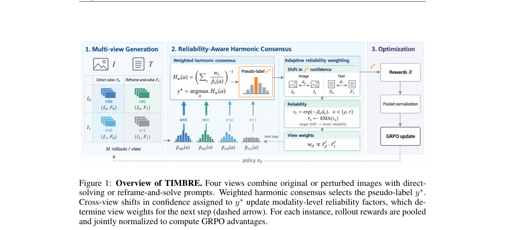

*Result - Pseudo-label accuracy during test-time adaptation. Comparison between TIMBRE and TTRV on DynaMath with Qwen3-VL-8B-Instruct. Curves are smoothed using a time-weighted exponential moving aver*

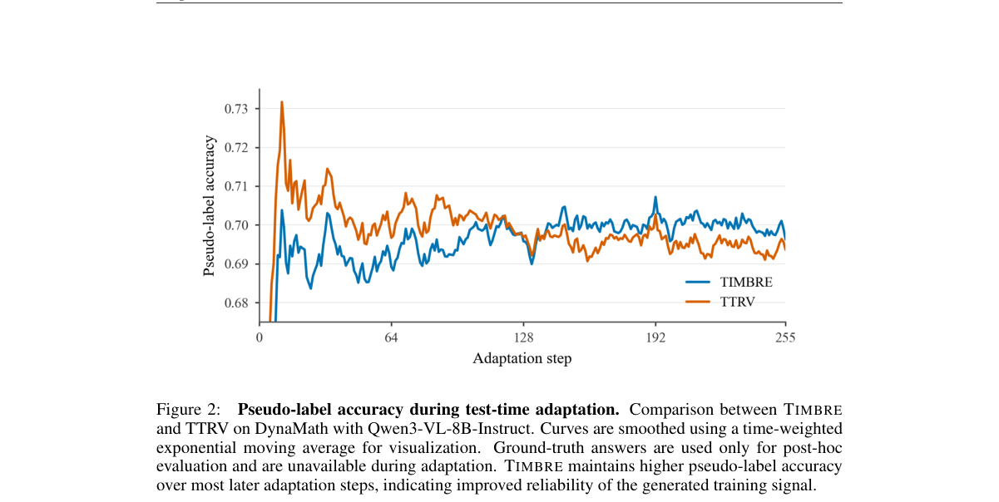

**Why this ranks #4**: 无标签 test-time RL 最大的坑是「一致但错误」的共识，这篇用可靠性加权的调和聚合去纠正伪标签偏差。

---

### 5. Safe Multi-Objective Reinforcement Learning: Zero Constraint Violation and Primal-Averaging Convergence

**arXiv**: [2610.39409](https://arxiv.org/abs/2610.39409) | **Score**: 8.0 (relevance 8.0 x 0.7 + quality 8.0 x 0.3) | **Tags**: rl-core, safe-rl, multi-objective, pareto-optimal, constraint-violation, sample-complexity, Harbin | **Categories**: cs.AI, cs.LG, math.OC, stat.ML | **Pages**: 58

**Authors**: Chenxi Li; Yao Shu; Siyang Gao; Shuang Qiu; Guangxin Jiang

**Affiliation**: Harbin Institute of Technology; The Hong Kong University of Science and Technology (Guangzhou); City University of Hong Kong

**Abstract**

> Many applications of multi-objective reinforcement learning (MORL) require policies that balance conflicting objectives while satisfying safety constraints. We study safe MORL with zero constraint violation throughout learning, covering both cumulative and stepwise constraints. A key challenge is to explore sufficiently under unknown dynamics and constraint costs without violating the constraints. For a given preference over objectives, we develop an algorithm to learn a safe Pareto optimal policy by combining optimistic reward estimates with pessimistic cost bounds. With high probability, every policy executed over $T$ episodes incurs zero constraint violation. The algorithm returns a safe Markov policy induced by the averaged occupancy measure and achieves an $\widetilde{O}(1/\sqrt{T})$ suboptimality gap under smooth Tchebycheff scalarization. We further develop a preference-free algorithm that first explores safely without a prespecified preference and then computes a safe policy for any given preference without further interaction. Over $T$ exploration episodes and $K$ planning iterations, it retains the same safety guarantee and achieves an $\widetilde{O}(1/\sqrt{T}+1/\sqrt{K})$ suboptimality gap. Both algorithms require knowledge of a policy that strictly satisfies the constraints and its costs. We then relax these requirements, incurring at most constant cumulative violation. To our knowledge, we provide the first sample-efficient MORL algorithms that guarantee safety for every executed policy.

**Key findings**

- **Finding**: 论文研究安全多目标 RL，要求学习全程零约束违反，同时覆盖累积约束与逐步约束。
- **Finding**: 核心难点在于必须在未知动力学与未知约束代价下充分探索，同时全程不违反约束。
- **Finding**: 针对给定目标偏好，作者结合乐观奖励估计与悲观代价上界，学习安全的 Pareto 最优策略。
- **Finding**: 以高概率保证在 T 个回合内执行的每个策略都零约束违反，算法返回由平均占用测度诱导的安全 Markov 策略。
- **Finding**: 在光滑 Tchebycheff 标量化下达到 Õ(1/√T) 次优差距；另有无需预设偏好的版本先安全探索再为任意偏好计算安全策略，在 T 次探索与 K 次规划迭代下保持同样安全保证并达到 Õ(1/√T+1/√K) 差距。
- **Finding**: 两个算法都需要已知一个严格满足约束的策略及其成本，作者随后放松这一要求，代价是至多常数级的累积违反。
- **Inference**: 「零违反」是执行层面而非优化层面的保证，它依赖一个已知安全策略作锚点，因此冷启动阶段仍是最脆弱的环节。
- **Recommendation**: 推荐。做安全 RL、多目标决策或关心可证明安全保证的读者强烈建议读。

**Key figures**

该论文正文未提取到可用图（图表为纯文本/表格排版）。

**Why this ranks #5**: 安全多目标 RL 第一次把「每个被执行策略都零约束违反」写成可证的保证，而不是训练时的经验观察。

---

### 6. Event2Reward: Learning Robotic Rewards from Progress Relations

**arXiv**: [2610.39212](https://arxiv.org/abs/2610.39212) | **Score**: 7.7 (relevance 7.5 x 0.7 + quality 8.0 x 0.3) | **Tags**: rl-core, reward-shaping, progress-prediction, potential-based, libero, failure-demonstrations, Peking | **Categories**: cs.LG, cs.RO | **Pages**: 44

**Authors**: Junnan Nie; Zitian Fan; Jiachen Zhang; Junyi Lao; Likui Zhang; Chenghao Liu; Xiaoyang Lu; Yunbo Wang; Yixue Zhang; Linbo Zhai; Jiayi Li; Mengzhe Wang

**Affiliation**: Peking University; JD Explore Academy

**Abstract**

> Learning task progress from robot demonstrations provides a practical way to construct dense shaping rewards for robotic reinforcement learning. A common approach uses normalized demonstration time as progress labels, implicitly assuming monotonically increasing task progress. During policy exploration, however, actual task progress can stall or even regress. Such models may mistake regressions for progress, assigning positive shaping rewards to actions that cause progress loss. Real suboptimal and failed executions offer corrective experience, but assigning absolute progress values to their states is difficult. Our key observation is that stalls, regressions, and recoveries establish local relative progress relations even when absolute progress is unknown. We introduce Event2Reward, which uses normalized temporal labels to anchor the progress scale and these within-trajectory relations to constrain local changes, combining absolute and relative progress supervision. Its progress predictions serve as potentials for reward shaping. We curate an event-annotated dataset from approximately 100K raw real-robot execution records, covering successful, suboptimal, and failed executions, without requiring framewise absolute progress labels. Under the same training budgets, Event2Reward improves average policy success by 18.16 percentage points over a baseline using only sparse task rewards across 40 tasks in four LIBERO suites. On real robots, average success after 30 minutes of wall-clock training reaches 60.0% on three precise insertion tasks and 90.0% on three object manipulation tasks, exceeding the sparse-reward baseline under the same budget by 36.7 and 23.3 percentage points, respectively. Ablation studies further show that absolute progress supervision and relative progress relations are complementary, with joint supervision yielding better downstream policy learning.

**Key findings**

- **Finding**: 论文指出常用做法把归一化演示时间当作进度标签，隐含任务进度单调递增的假设，但探索中进度会停滞甚至倒退。
- **Finding**: 后果是这类模型可能把倒退误判为进度，给造成进度损失的动作派发正的塑形奖励。
- **Finding**: 作者的关键观察是，停滞、倒退与恢复即便不知道绝对进度，也确立了轨迹内的局部相对进度关系。
- **Finding**: Event2Reward 用归一化时间标签锚定进度尺度，再用轨迹内关系约束局部变化，把绝对与相对进度监督结合起来，进度预测作为 potential 用于奖励塑形。
- **Finding**: 团队从约 10 万条真机执行记录整理出事件标注数据集，覆盖成功、次优与失败执行，无需逐帧绝对进度标签。
- **Finding**: 相同训练预算下，它在四个 LIBERO 套件的 40 个任务上比稀疏奖励基线平均提升 18.16 个百分点，真机 30 分钟训练后插入任务达 60.0%、操作任务达 90.0%。
- **Inference**: 把相对进度关系从失败演示里提出来，等于让「失败」不再只是负奖励，而变成可用的结构化监督。
- **Recommendation**: 推荐。做机器人奖励设计、稀疏奖励或想利用失败演示的读者强烈建议读。

**Key figures**

*Framework - Overview of Event2Reward. Left: pretraining data and real robot rollouts containing both successful and failed executions. Task events provide within-trajectory progress relations that compl*

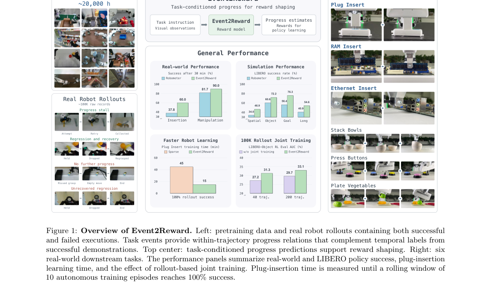

*Result - Overview of progress supervision in Event2Reward. Left: normalized temporal labels from successful expert trajectories anchor the progress scale of a shared vision-language model. Right: exe*

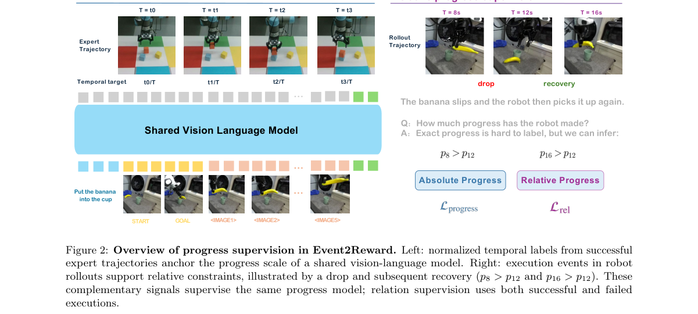

**Why this ranks #6**: 把失败轨迹当成进度监督来挖，从停滞、倒退与恢复里榨出奖励学习的相对信号，这是稀疏奖励场景最稀缺的数据。

---

### 7. How Much Should a VLA Trust Its Reasoning? Step-Level Guidance as a Measured Action-Value Function

**arXiv**: [2610.40002](https://arxiv.org/abs/2610.40002) | **Score**: 7.5 (relevance 7.5 x 0.7 + quality 7.5 x 0.3) | **Tags**: rl-core, classifier-free-guidance, value-function, reasoning-strength, vla-policy, driving, Seoul National | **Categories**: cs.CV, cs.LG, cs.RO | **Pages**: 6

**Authors**: Dabin Seo; Eunhyek Joa

**Affiliation**: Seoul National University

**Abstract**

> Reasoning vision-language-action (VLA) policies write a reasoning trace and then decode the action from it. A wrong trace yields a wrong action, and even a correct-looking trace can mislead the plan. Existing remedies ask whether the reasoning is right. We ask how strongly it should steer. CoC-CFG applies classifier-free guidance between the policy's context and the same context without the reasoning span. One weight per Euler step attenuates or amplifies the reasoning, and w=1 recovers the original policy. We treat the choice of this weight as a Markov decision process whose action values are measured, not bootstrapped. With the expert frozen and the noise fixed, applying a weight for one step and finishing the plan under the current controller returns that weight's value exactly. Q-adaptive guidance fits these values with small critics and improves the controller conservatively. In the Alpasim driving simulator it outperforms every fixed weight and online RL (SAC, GRPO) in open loop, and in closed loop it passes 262 of 300 scenes, against 252 for the original policy. On held-out frames of the Waymo end-to-end driving benchmark, its first three stages outperform every fixed weight, four adaptive-guidance methods, SAC and GRPO. On the hidden test set, a frozen Alpamayo 1.5 with rule-based camera and vehicle conversions and Q-adaptive guidance sets a new state of the art among published methods: 8.135159 rater feedback score, against 8.079 for the best published method.

**Key findings**

- **Finding**: 论文指出推理式 VLA 先写推理链再据此解码动作，错误的推理链会导出错误动作，看起来正确的推理链也可能误导规划。
- **Finding**: 现有补救多是问推理对不对，CoC-CFG 改问推理该以多强的力度引导动作。
- **Finding**: CoC-CFG 在策略上下文与去掉推理段的同一上下文之间做 classifier-free guidance，每个 Euler 步一个权重可衰减或放大推理，w=1 恢复原策略。
- **Finding**: 权重选择被建模为 MDP，动作价值是测量出来的而非 bootstrap 出来的：在专家冻结、噪声固定时施加权重一步并完成整个规划可精确得到该权重价值。
- **Finding**: Q-adaptive guidance 用小 critic 拟合这些价值并保守地改进控制器，在 Alpasim 开环超过所有固定权重与 SAC、GRPO，闭环通过 300 个场景中的 262 个，原策略为 252 个。
- **Finding**: 在 Waymo 留出帧上其前三个阶段超过所有固定权重、四种自适应引导方法与 SAC、GRPO，隐藏测试集上冻结的 Alpamayo 1.5 取得 8.135159 的 rater 分数，最佳已发表方法为 8.079。
- **Inference**: 动作价值靠测量而非 bootstrap，意味着每次评估引导强度都要跑完整规划，计算开销不小，换来的是对「推理该信多少」这一问题的可计算答案。
- **Recommendation**: 推荐。做 VLA 推理引导、自动驾驶端到端或想把推理强度当连续动作的读者强烈建议读。

**Key figures**

*Framework - Not whether to trust a VLA’s reasoning, but how strongly it steers the action, at every step. A reasoning VLA writes its reasoning, then decodes the action conditioned on it. (a) COC-CFG set*

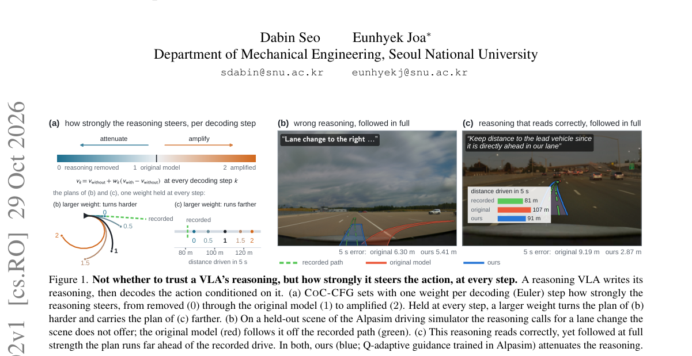

*Result - Q-adaptive guidance. At every Euler step small critics read what the step has computed, and the penalized argmax of their mean is wk. Offline, each weight’s value is measured by one-step bra*

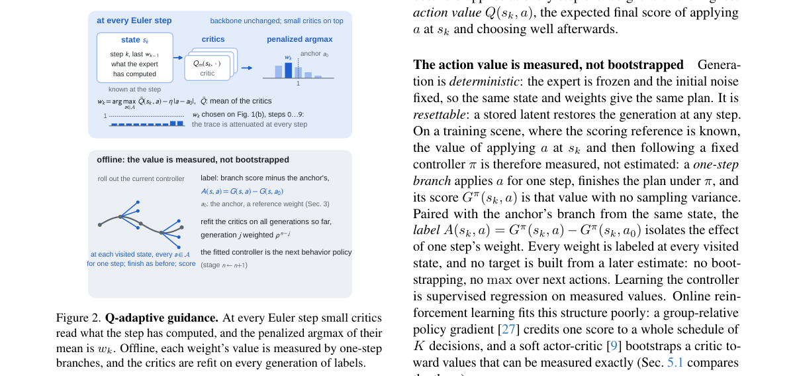

**Why this ranks #7**: 不再问推理链对不对，而是问它该以多强力度引导动作，把「该信多少推理」变成可测量、可优化的动作。

---

### 8. Value Function-Guided MPPI for Hierarchical Planning and Control in Off-Road Autonomous Navigation

**arXiv**: [2610.38731](https://arxiv.org/abs/2610.38731) | **Score**: 7.1 (relevance 7.0 x 0.7 + quality 7.5 x 0.3) | **Tags**: rl-core, mppi, value-function, cost-map-free, online-policy-evaluation, off-road, Robotics Institute | **Categories**: cs.RO | **Pages**: 8

**Authors**: Anoushka Alavilli; Raymond Song; Guanya Shi; Jeff Schneider

**Affiliation**: Robotics Institute, Carnegie Mellon University

**Abstract**

> Autonomous navigation in off-road terrain is commonly achieved using hierarchical control and planning architectures that rely on explicit cost maps and one-way information flow from a high-level planner to a low-level controller, decoupling planning from the true execution cost experienced during control. We propose a hierarchical planning and control framework in which information flows bidirectionally, allowing the low-level controller to guide trajectory selection at the planning level. The highest level of the hierarchy is a Model Predictive Path Integral (MPPI) control-style planner that determines optimal trajectories and passes these waypoints to a pretrained low-level reinforcement learning (RL) controller. Rather than drawing from an explicit cost map, our MPPI planner leverages the value function of the RL controller as an implicit cost representation. In this formulation, MPPI serves as a trajectory exploration mechanism, while the low-level controller's value function guides the search. To account for the distribution shift seen by the value function between training and evaluation, we propose an online policy evaluation process that adapts the value function to unseen driving experiences, and we demonstrate this adaptation in unseen off-road simulation environments. We evaluate our approach in a high-fidelity off-road driving simulator across a range of challenging terrain conditions and compare its performance against a baseline MPPI controller. The results demonstrate that our method achieves safer and more effective navigation to goal locations while eliminating the need for explicit cost maps and enabling tighter coupling between planning and control.

**Key findings**

- **Finding**: 论文指出越野导航常用分层规划控制架构，靠显式 cost map 和从高层规划器到低层控制器的单向信息流，把规划与真实执行代价割裂。
- **Finding**: 作者提出信息双向流动的分层规划控制框架，让低层控制器反过来指导规划层的轨迹选择。
- **Finding**: 最高层是 MPPI 控制式规划器，负责确定最优轨迹并把航点传给预训练的低层 RL 控制器。
- **Finding**: MPPI 不再依赖显式 cost map，而是借用 RL 控制器的 value function 作为隐式代价表示，MPPI 充当轨迹探索机制。
- **Finding**: 为处理 value function 在训练与评估之间的分布漂移，作者提出在线策略评估流程来适配未见驾驶经验，并在未见越野仿真环境中演示该适配。
- **Finding**: 在高保真越野驾驶模拟器的多种地形条件下与基线 MPPI 控制器对比，方法实现更安全更有效的目标导航，同时去掉了显式 cost map。
- **Inference**: 用学出来的 value function 代替 cost map，把代价定义的责任转移给策略本身，代价是失去人工可解释、可编辑的代价地图。
- **Recommendation**: 选读。做越野导航、规划控制耦合或想摆脱手绘 cost map 的读者值得看。

**Key figures**

*Framework - Overview of our value-guided planning framework. We pre-train RL policies to provide both an actor πθ(s) and a value function Vϕ(s). MPPI samples candidate trajectories and evaluates them usin*

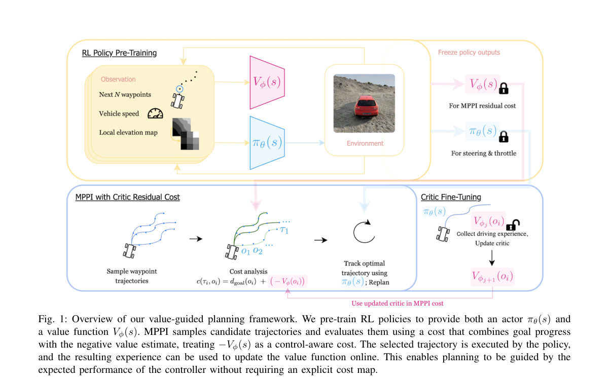

*Result - Comparison between baseline MPPI, our algorithm, and our algorithm with online adaptation. All trajectories were unseen during training. In (A), our method incurs damage midway through the tra*

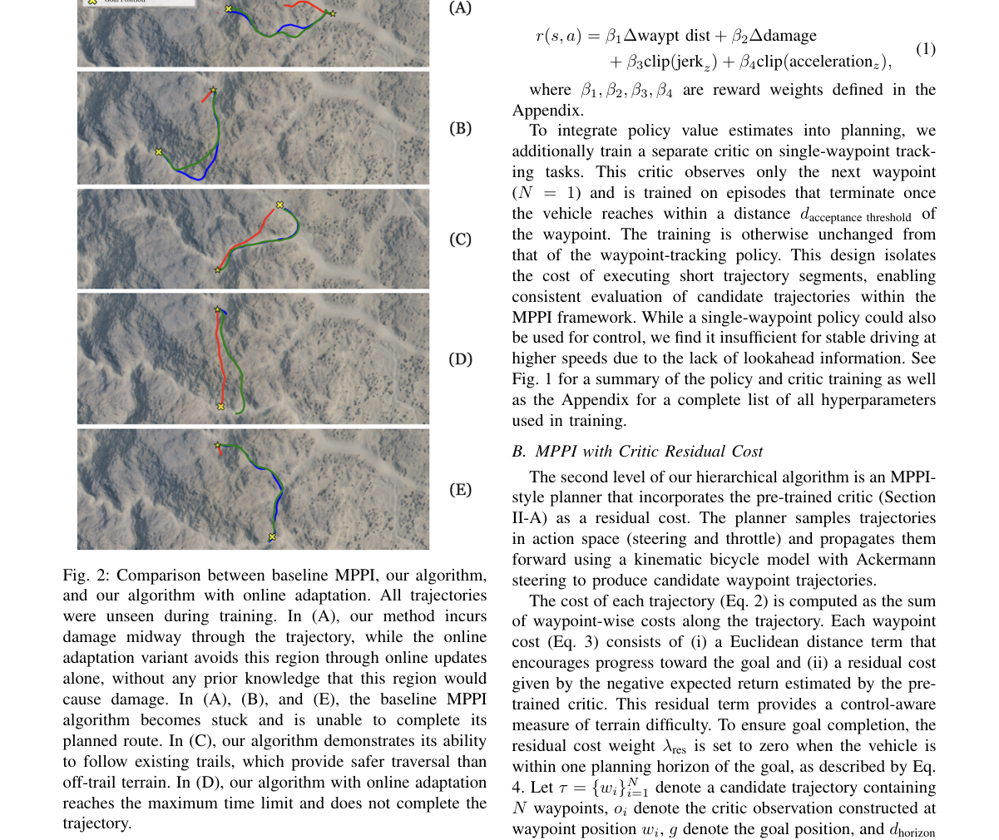

**Why this ranks #8**: 用学出来的 value function 当 cost map，把越野导航里手绘代价地图这件苦活整个消掉，还让规划与控制双向耦合。

---

### 9. Robotic Data Inoculation

**arXiv**: [2610.39054](https://arxiv.org/abs/2610.39054) | **Score**: 7.1 (relevance 7.0 x 0.7 + quality 7.5 x 0.3) | **Tags**: rl-core, data-collection, shared-control, residual-policy, coverage, offline-rl, UC Berkeley | **Categories**: cs.RO | **Pages**: 16

**Authors**: Qiyang Li; Zhiyuan Zhou; Charles Xu; Sergey Levine

**Affiliation**: UC Berkeley

**Abstract**

> Modern robot learning systems feed on high-quality demonstration data, and their performance hinges on coverage. Without good coverage, small errors compound and the policy can quickly go into out-of-distribution states from which it cannot recover. Yet there is no principled way of collecting high-coverage data, and data collection often relies on heuristic instructions to human operators. Purely online reinforcement learning (RL) explores at the cost of safety and sample efficiency, while DAgger-style interventions require the policy to fail by chance before a human can correct it. In this paper, we ask instead whether we can modify how the robot behaves during data collection to collect more useful data. We propose Data Inoculation (DI), a shared-control framework in which a human provide closed-loop teleoperation commands while a residual policy perturbs these commands. The residual policy is trained online, on the growing dataset, with the same reward-maximizing objective later used for policy extraction, so its perturbations steer data collection toward the deviations a policy trained on the data would make. These perturbations expose the robot to a wider range of states, while the human's continuous corrections provide recovery demonstrations, "inoculating" the dataset against the learner's future mistakes while the human remains in control. On three challenging real-world robotic tasks, DI consistently improves or matches the success rate of policies trained with both behavioral cloning and offline RL, showing DI as an effective data collection strategy for improving downstream policy performance.

**Key findings**

- **Finding**: 论文指出机器人学习依赖高质量演示数据的覆盖度，覆盖不足会让小误差累积并把策略推入无法恢复的分布外状态，但目前没有采集高覆盖度数据的原则性办法。
- **Finding**: 纯在线 RL 探索要付出安全与样本效率代价，DAgger 式干预则要求策略先偶然失败人类才能纠正。
- **Finding**: Data Inoculation 是共享控制框架，人类提供闭环遥操作指令，同时一个 residual policy 对这些指令施加扰动。
- **Finding**: residual policy 在不断增长的数据集上在线训练，目标与后续策略抽取用的奖励最大化目标相同，因此扰动会把采集导向据该数据训出的策略会犯的偏差。
- **Finding**: 这些扰动让机器人暴露在更广的状态分布上，而人类的持续纠正提供恢复演示，在人类仍掌舵的前提下给数据集打上预防未来错误的疫苗。
- **Finding**: 在三个挑战性真机任务上，DI 一致地提升或追平用行为克隆和离线 RL 训练的策略成功率。
- **Inference**: 关键洞见是把采集策略与学习策略的目标对齐，扰动因此自动指向学习者会犯错的方向，而不是人为设计探索噪声。
- **Recommendation**: 推荐。做机器人数据采集、DAgger 替代方案或被数据覆盖度困扰的读者强烈建议读。

**Key figures**

*Framework - Data inoculation (DI). Left: During data collection, we train a residual inoculative policy with online RL to perturb the human’s closed-loop teleoperation commands. The perturbations steer*

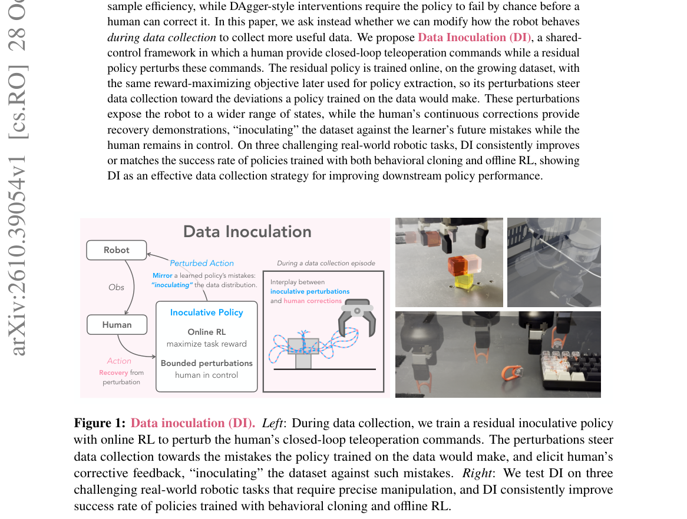

*Result - Task success rates. The results for {t-cube/cable/keycap} are averaged over {9/5/5} seeds with 20 evaluation trials each. Error bars indicate the standard errors. Full table in Tables 1 to 4*

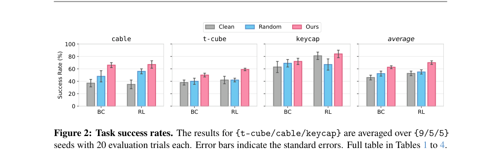

**Why this ranks #9**: 不改算法改采集：让一个 residual policy 专门把机器人推向「学出来的策略会犯的错」，人类同时兜底纠正。

---

### 10. VeriCUA: Verification as Agentic Exploration for Computer-Using Agents

**arXiv**: [2610.40578](https://arxiv.org/abs/2610.40578) | **Score**: 7.1 (relevance 7.0 x 0.7 + quality 7.5 x 0.3) | **Tags**: rl-core, computer-use-agent, task-verification, agentic-exploration, gui-and-code, evidence-rules, Google | **Categories**: cs.AI, cs.CL, cs.CV | **Pages**: 29

**Authors**: Qiushi Sun; Da Yu; Alexander Knop; Amer Sinha; Lingpeng Kong; Ben Kao; Ravi Kumar; Pritish Kamath

**Affiliation**: Google; The University of Hong Kong

**Abstract**

> Building and scaling computer-using agents (CUAs) across desktop, mobile, and web environments requires reliable task-completion verification for data curation, evaluation, and reinforcement learning. Typical automated approaches prompt vision-language models (VLMs) to judge trajectories or generate programs to inspect application state. However, both rely on partial views of complex digital environments. VLM judges are restricted to supplied observations, while generated programs depend on accessible state. These views can omit decisive evidence or leave completion judgments unsupported. Tailoring separate verifiers to different platforms and access settings adds further engineering cost. We present VeriCUA, a platform-agnostic framework for verification through agentic exploration. It treats verification as dynamic evidence gathering and assessment within a shared procedure for online and offline settings across platforms and observation modalities. After inspecting the available context to construct a task rubric, the verifier selects GUI or code checks for unresolved requirements and combines their findings under explicit evidence rules. Experiments show improved agreement with reference labels over the compared baselines across these settings, with the largest offline gains on hard cases and stronger rejection of false completion claims online. Further analyses connect these gains to complementary evidence and test-time exploration.

**Key findings**

- **Finding**: 论文指出构建与扩展 computer-using agent 需要可靠的任务完成验证，用于数据整理、评估与强化学习。
- **Finding**: 典型做法是让视觉语言模型评判轨迹或生成程序检查应用状态，但两者都只依赖复杂数字环境的局部视图。
- **Finding**: VLM 评判受限于给定观测，生成程序则依赖可访问的状态，这些视图可能漏掉决定性证据或让完成判定失去支撑，为不同平台定制验证器还会带来额外工程成本。
- **Finding**: VeriCUA 是平台无关的验证框架，把验证当作动态的证据收集与评估，在在线与离线设置、不同平台与观测模态间共享同一套流程。
- **Finding**: 验证器先检查可用上下文构造任务评分表，再为未解决的要求选择 GUI 或代码检查，并按显式证据规则合并这些发现。
- **Finding**: 实验显示各设置下与参考标签的一致性都优于对比基线，在线设置下对虚假完成声明的拒绝更强，离线设置下困难样例收益最大。
- **Inference**: 把「验证」做成会主动探索环境的 agent 而非一次性打分器，等于承认判定本身需要探索预算，这会实质改变 RL 训练里奖励信号的质量与成本。
- **Recommendation**: 选读。做 computer-use agent、数据 curation 或需要可靠任务判定信号的读者值得看。

**Key figures**

*Framework - VeriCUA inspects the available environment or recording before constructing a rubric, then gathers evidence to verify its requirements.*

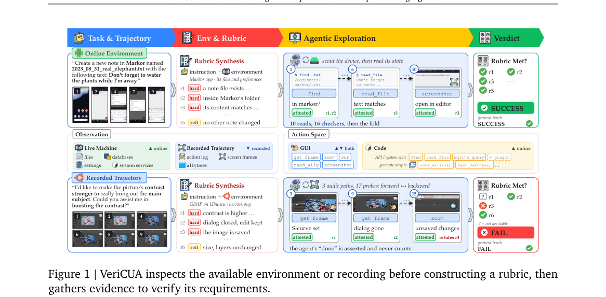

*Result - VeriCUA gathers evidence from retained trajectories and, when accessible, the current interface and underlying machine state. Each read retains its source attributes.*

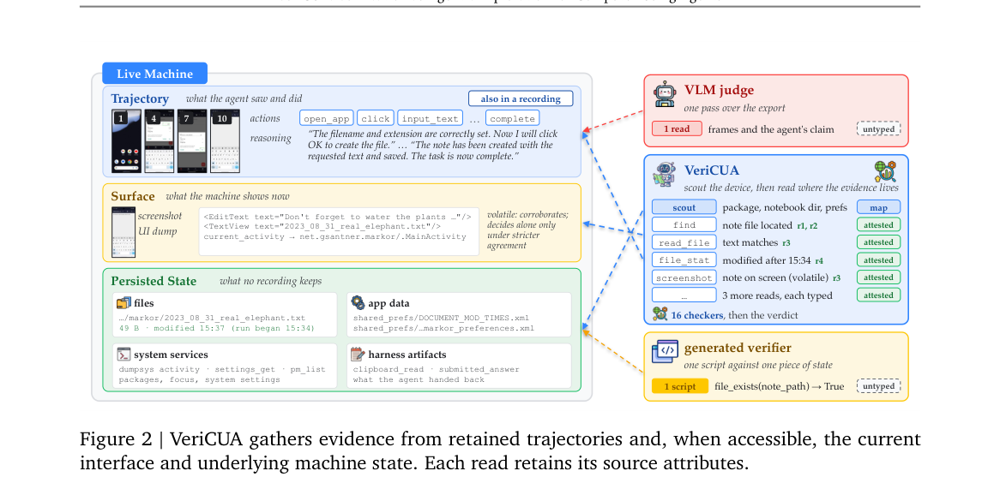

**Why this ranks #10**: 把任务完成验证做成会主动去查环境的 agent，承认判定本身就需要探索预算，这直接决定 RL 奖励质量。

---

## Footer

- Total papers scanned across all 7 tracks: 619（原始 828 条）
- rl_core track final top-10: 10
- Wild-cards in this track: 0
- Figure assets: 2026-10-30/res/

Generated by `mine-arxiv-daily-digest` skill. Sister file: `2026-10-30_rl_core_entry.md`.
