# ArXiv Daily Digest - 2026-10-30 (强化学习 · LLM 后训练与对齐, 10 papers)

**Generated**: 2026-10-31 17:00 CST

**Source**: arXiv cs.CV, cs.SD, eess.AS, cs.CL, cs.AI, cs.RO, cs.LG submissions, listing day 2026-10-29 (announced 2026-10-30 00:00 UTC)

**Batch window**: 2026-10-28T18:00:00Z .. 2026-10-29T18:00:00Z（arXiv 公告批次横跨两个 UTC 日：前一日 18:00 UTC 起算，当日 17:59:59 UTC 截止）

**Track**: rl_llm (top 10 of 619 papers scanned, 70 full reads)

**Scope**: LLM 后训练阶段的 RL：RLHF / DPO / GRPO / RLVR / RLAIF、奖励建模与可验证奖励

---

## Top 10 - 强化学习 · LLM 后训练与对齐

### 1. Aligning Medical Vision Language Models at the Capability Boundary with Entropy Adaptive Rubric Grounding

**arXiv**: [2610.39835](https://arxiv.org/abs/2610.39835) | **Score**: 8.8 (relevance 9.0 x 0.7 + quality 8.5 x 0.3) | **Tags**: rl-llm, medical-vlm, preference-optimization, rubric-reward, entropy-gating, capability-boundary, Shanghai Jiao Tong | **Categories**: cs.AI, cs.CV | **Pages**: 10

**Authors**: Hongyu Bai; Jiaqi Zeng; Chunzheng Zhu

**Affiliation**: Shanghai Jiao Tong University; Hunan University

**Abstract**

> Medical diagnostic reasoning requires verifiable links between visual evidence and clinical knowledge, yet current medical vision language models are aligned with objectives that reward the wrong behavior. Uniform supervised fine tuning lets easy cases dominate updates while clinically critical boundary cases saturate prematurely. Sparse rewards based only on final-answer correctness cannot assess anatomical grounding or clinical logic, inviting reward hacking through answer shortcuts. We propose MedCBR, a two-stage alignment framework coupling boundary-aware preference optimization with rubric-grounded reinforcement learning. First, we construct counterfactual boundary preferences at the model's capability frontier using empirical pass rates and preference pairs that share reasoning prefixes but diverge at decisive diagnostic branches. Difficulty Weighted Boundary Preference Optimization (DBPO) concentrates learning on this calibrated boundary region. Second, we distill reusable clinical rubrics from boundary trajectories and activate them according to prediction entropy. Entropy Gated Grounded Policy Optimization (EGPO) rewards answer correctness, anatomical grounding, and reasoning fidelity while suppressing rubric noise on reliable samples. A reference policy anchored to the boundary-aligned model couples population-level boundary priors with instance-level uncertainty, making diagnostic reasoning more accurate and clinically grounded. Experiments on six medical benchmarks show consistent improvements over strong general, specialized, and reinforcement learning baselines, reaching 61.2% average accuracy with the largest gains on challenging differential diagnosis tasks. Ablations show super-additive gains: combining the two stages exceeds the sum of their individual improvements.

**Key findings**

- **Finding**: MedCBR 把边界感知的偏好优化与 rubric 接地强化学习耦合成两阶段对齐框架，第一阶段用经验通过率在模型能力前沿构造反事实边界偏好对，它们共享推理前缀、只在关键诊断分支上分歧。
- **Finding**: EGPO 从边界轨迹中蒸馏可复用的临床 rubric 并按预测 entropy 激活，奖励答案正确性、解剖学 grounding 与推理忠实度，同时在可靠样本上抑制 rubric 噪声。
- **Finding**: 一个锚定在边界对齐模型上的参考策略把群体级边界先验与实例级不确定性结合起来，进一步稳定诊断推理。
- **Finding**: 六个医学 benchmark 上一致优于通用、专用与强化学习基线，平均准确率达 61.2%，增益最大的困难鉴别诊断任务。
- **Finding**: 消融实验显示两阶段的收益是超可加的，合并后的提升超过两者各自单独提升幅度之和。
- **Inference**: 这套设计针对的是 reward hacking 与梯度浪费，而不是能力上限问题，因此它更可能迁移到别的可验证域。
- **Inference**: 61.2% 的绝对水平说明医学 VLM 的瓶颈仍在知识覆盖与临床推理深度，偏好优化只能在既有能力上重新分配。
- **Recommendation**: 推荐。做医疗多模态对齐、或想用可解释 rubric 替代黑盒奖励的读者建议精读。

**Key figures**

*Framework - Motivation of MedCBR. Standard SFT distributes gradient uniformly across all tokens, causing loss satura- tion on clinically critical hard samples (left). Sparse binary rewards in convention*

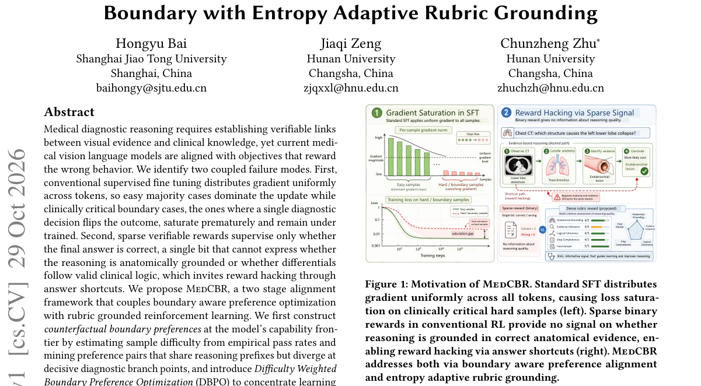

*Result - Overview of MedCBR. Stage 1 (CBP, off policy): from the SFT model, 𝑁trajectories are sampled per query, empirical pass rates define the capability boundary band, and counterfactual preferenc*

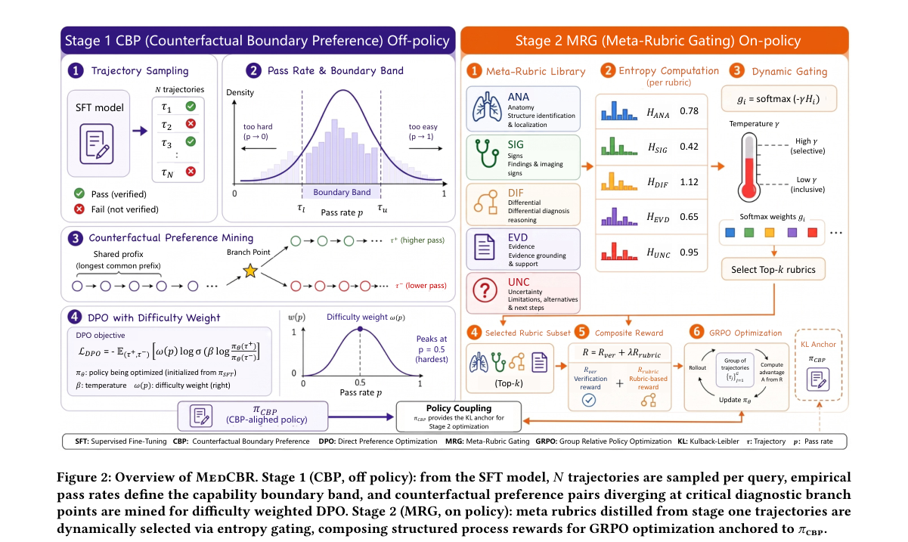

**Why this ranks #1**: 它把有限的偏好学习预算精确投到模型的能力边界，而不是让容易样本与已经饱和的难题互相稀释。

---

### 2. There Is No Free Lunch in RLVR: Every pass@1 Gain Has a pass@k Price

**arXiv**: [2610.39295](https://arxiv.org/abs/2610.39295) | **Score**: 8.8 (relevance 9.0 x 0.7 + quality 8.5 x 0.3) | **Tags**: rl-llm, rlvr, pass-at-k, exponential-tilt, entropy-collapse, learning-theory, Unknown | **Categories**: cs.AI, cs.LG, math.OC, stat.ML | **Pages**: 19

**Authors**: Yinuo Liu

**Affiliation**: [unverified]

**Abstract**

> Reinforcement learning with verifiable rewards (RLVR) makes a language model solve more problems on the first try and fewer when given many tries: it raises pass@1 while the base model overtakes it at large sampling budget k. Is this a failure of RL to add reasoning, or a transient that more training removes? We settle the question with a theorem. The reversal is a price, and we compute its exact rate. Modeling RLVR as an exponential tilt of a base policy over strategies shared across prompts, we prove that under exclusive specialization every update that raises pass@1 strictly lowers the success of some prompt; a strictly positive price on prompts (Stiemke duality) is the exact condition, and being merely the best strategy on a prompt is provably not enough. When the loss reaches the hardest prompts, it forces a pass@k crossover, and the number of crossings is at most the sign variation of the shift in per-prompt success, a totally positive bound that is tight and that recovers the known single-crossover result as its order-preserving case. The crossover is not a bug to patch: a constrained update traces the exact pass@1 versus pass@k frontier, and removing the crossover entirely costs the entire pass@1 gain. The same tilt identity yields entropy collapse and the entropy-performance law with an identifiable exponent, unifying two literatures under one mechanism. Reinforcement cannot widen the reasoning frontier; it can only move along it, at a price we make measurable by a diagnostic that reads the bound, the order-preserving test, and the price from any evaluation log. There is no free lunch, only a price.

**Key findings**

- **Finding**: 论文把 RLVR 建模为在跨 prompt 共享的策略集合上对基座策略做 exponential tilt，并证明每次抬高 pass@1 都会压低某些 prompt 的成功率。
- **Finding**: 定理用 Stiemke 对偶给出价格严格为正的条件，说明「在某 prompt 上只是最优策略」并不足以避免翻转。
- **Finding**: 交叉点个数被证明不超过 per-prompt 成功率的 sign variation，这个全正界是 tight 的，并 recovers 已知的单交叉结果作为其保序特例。
- **Finding**: 作者指出消除交叉并不免费，约束式更新恰好描出 pass@1 与 pass@k 的前沿，彻底去掉交叉要付出全部 pass@1 收益。
- **Finding**: 同一个 tilt 恒等式还导出 entropy collapse 与带可识别指数的 entropy-performance 律，把两个原本分离的文献统一到同一机制。
- **Inference**: 只汇报 pass@1 的 RLVR 论文几乎必然高估推理增益，评测时必须同时画出大 sampling budget 下的 pass@k。
- **Inference**: 定理给出了一条可操作的自检——任何 RLVR 训练日志都能反推出价格，这让收益归因第一次有了可证伪的标准。
- **Recommendation**: 强烈推荐。做 RLVR 的读者必读，关心评测规范与指标设计的读者也值得读。

**Key figures**

*Framework - Per-prompt loss is inevitable under specialization, but the aggregate pass@k crossover is conditional on Assumption 2. Regime A (fine coverage) has a genuinely hard tail that the tilt starve*

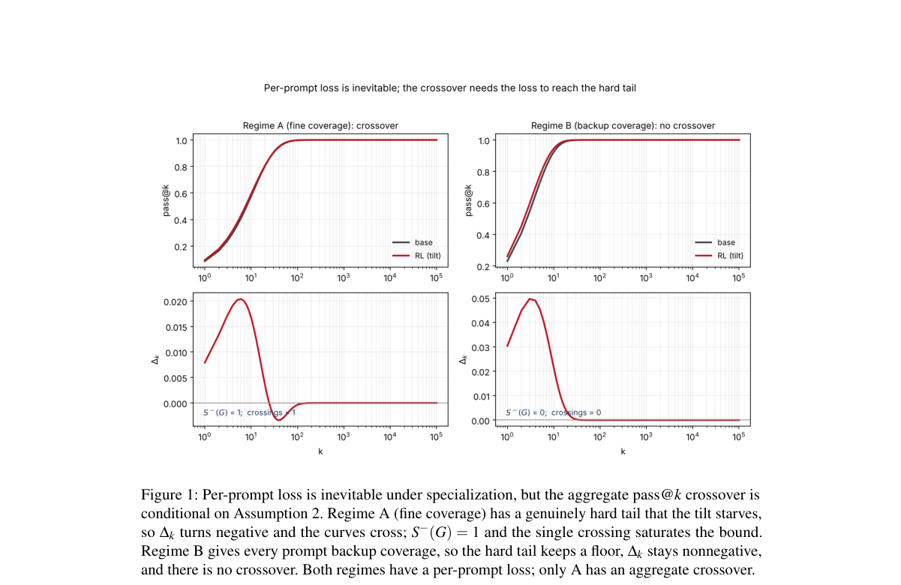

*Result - The no-free-lunch frontier. Each point is the best pass@1 gain achievable at a given per- prompt floor γ, against the price it pays, the worst pass@k loss maxk(base−RL). The unconstrained GR*

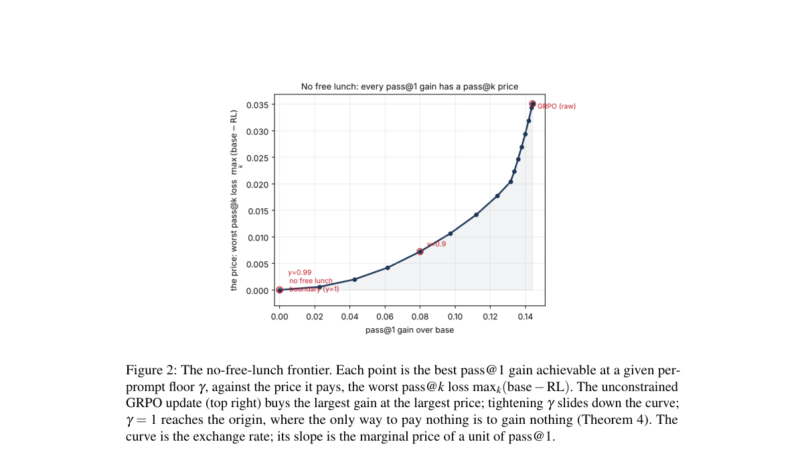

**Why this ranks #2**: 它把 RLVR 最刺眼的副作用——pass@1 涨而 pass@k 跌——从工程现象变成一条可计算、可证明的价格。

---

### 3. Reasoning or Pattern Exploitation? Mechanistic Insights from RL-Trained Language Models

**arXiv**: [2610.39182](https://arxiv.org/abs/2610.39182) | **Score**: 8.2 (relevance 8.5 x 0.7 + quality 7.5 x 0.3) | **Tags**: rl-llm, mechanistic-interpretability, sparse-autoencoder, grpo, tic-tac-toe, reasoning-vs-pattern, Carnegie Mellon | **Categories**: cs.AI, cs.CL | **Pages**: 49

**Authors**: Aishik Nagar; Cheston Tan

**Affiliation**: Carnegie Mellon University; Institute of High Performance Computing (IHPC), A*STAR; Centre for Frontier AI Research (CFAR), A*STAR

**Abstract**

> Large language models (LLMs) are increasingly described as acquiring "reasoning" skills after reinforcement learning with verifiable rewards. However, whether these gains reflect genuine reasoning or more superficial adaptations remains underexplored. In this work, we probe LLMs trained in a finite and exhaustively analyzable logical domain, namely Tic-Tac-Toe, and trace how internal representations evolve across reinforcement learning (RL) with Group Relative Policy Optimization (GRPO). Quantitatively, RL yields high accuracy and robustness across prompt variations, suggesting the emergence of game reasoning. Mechanistic interpretability, however, paints a different picture: features extracted with sparse autoencoders (SAEs) reveal that models primarily adapt to rely more heavily on information already explicit in the prompt, such as whose turn it is, game progression and board occupancy. In comparison, high-level concepts like board symmetries and strategic forks remain weakly represented, raising concerns that reasoning benchmarks overestimate model abilities. This suggests that RL-driven "reasoning" may conflate task-specific adaptations to input information with reasoning ability. We provide, for the first time: (i) a systematic interpretability pipeline tracing representation dynamics across RL training in small-scale LLMs; (ii) an extension of SAE-based feature discovery to hypothesis-driven testing in a finite logical domain; and (iii) an interpretability-based demonstration that RL post-training neither adds nor removes concept information but reorganizes which features dominate the representation, with causal interventions locating the decision downstream of it, in the late-layer state.

**Key findings**

- **Finding**: 论文在有限且可穷举分析的井字棋逻辑域上训练并分析 LLM，追踪 GRPO 强化学习过程中内部表征的演化。
- **Finding**: 量化上 RL 带来了高准确率与跨 prompt 变体的鲁棒性，表面看像是游戏推理能力的涌现。
- **Finding**: 但稀疏自编码器提取的特征显示，模型主要变得更依赖 prompt 中已显式给出的信息，比如轮到谁、走子进度与棋盘占位。
- **Finding**: 相比之下，棋盘对称性与战术岔路这类高层概念的表征依然很弱，作者据此担心推理 benchmark 会高估模型能力。
- **Finding**: 论文给出结论，RL 后训练既不增加也不删除概念信息，只是重组了表征中占主导的特征，因果干预进一步把决策定位在末层状态上。
- **Inference**: 如果这个结论能外推到更复杂的域，那么「RL 学会了推理」与「RL 学会了读题」在训练日志上几乎无法区分。
- **Inference**: 井字棋很小，但正因为可穷举，它可能是少见的能给出否定性硬证据的场域，方法论价值高于结论本身。
- **Recommendation**: 有条件推荐。做 RL 机制分析与可解释性的读者强烈建议读，只关心榜单提升的读者可先读摘要。

**Key figures**

*Framework - Overview of our experimental setup*

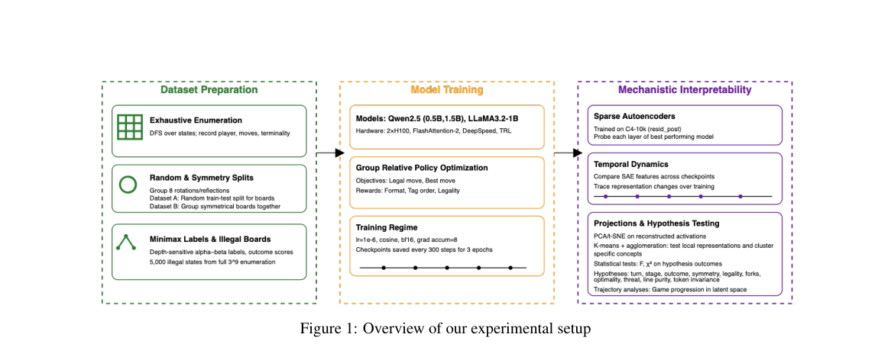

*Result - Best performance of each model and training setting for the legal move and best move prediction tasks on the random-split dataset. Complete performance plots for all settings (different boar*

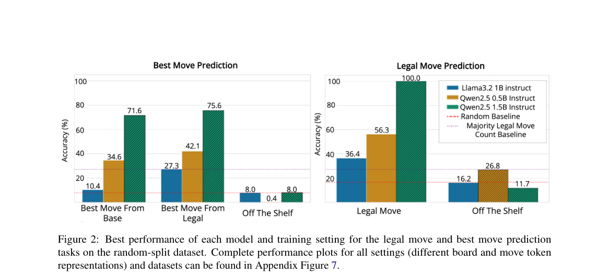

**Why this ranks #3**: 它在可穷举的井字棋域里用 SAE 逐层追踪 GRPO 训练后的表征，给出「RL 学到的是推理还是读题」的硬证据。

---

### 4. Distributional Reward Calibration and Budget-Neutral Credit Assignment for Multimodal RLVR

**arXiv**: [2610.40250](https://arxiv.org/abs/2610.40250) | **Score**: 8.2 (relevance 8.5 x 0.7 + quality 7.5 x 0.3) | **Tags**: rl-llm, grpo, advantage-estimation, optimal-transport, credit-assignment, multimodal-rlvr, Shenzhen | **Categories**: cs.AI | **Pages**: 19

**Authors**: Lang Chen; Zongxin Xu; Borui Wang; Anran Liu; Shitong Chen

**Affiliation**: Shenzhen University

**Abstract**

> We revisit advantage estimation in Group Relative Policy Optimization (GRPO) and observe that any token-level advantage admits a two-stage factorization: a \emph{sample-level baselining} step that converts scalar verifier rewards into a comparable sequence-level signal, and a \emph{token-level credit assignment} step that distributes that signal over the trajectory. Existing estimators typically address only one of these stages: affine baselines preserve the shape of each task's reward law, so heavy tails and binary cliffs propagate into the gradient, while token-level credit rules tie the size of each token's update to raw confidence scales and need not conserve the total credit issued by the verifier. We propose \textbf{TACE} (Two-stage Advantage and Credit Estimation), a two-stage estimator that addresses both stages. At stage~(S1), we replace linear standardization with a one-dimensional optimal-transport map to a standard normal, which gives a common population reward law across tasks and caps finite-sample outliers deterministically. At stage~(S2), we rank-calibrate a stop-gradient evidence contrast within each trajectory and renormalize the clipped token weights to have mean one, so credit is redistributed across tokens while its total mass and sign are conserved. We prove population-level inter-task moment equity, a deterministic tail bound, and mass-conservation, boundedness, and sign-anchoring properties that affine baselines and unnormalized token weights do not satisfy. On a multimodal reasoning suite, TACE obtains the strongest results on a majority of the benchmarks but does not dominate every setting.

**Key findings**

- **Finding**: 论文观察到任意 token 级 advantage 都可分解为样本级 baselining 与 token 级 credit assignment 两步，已有估计器通常只处理其中一步。
- **Finding**: affine baseline 保留各任务奖励分布的形状，使重尾与二元悬崖直接传导进梯度；而 token 级规则把更新幅度绑在原始置信尺度上。
- **Finding**: TACE 第一阶段用一维 optimal transport 映射替代线性标准化，把不同任务拉齐到统一的标准正态奖励律，并确定性压制有限样本离群点。
- **Finding**: 第二阶段在轨迹内做 rank 校准的 stop-gradient evidence contrast，并把裁剪后的 token 权重重归一化到均值为一，使信用重分配而总量与符号守恒。
- **Finding**: 作者证明了 inter-task 矩等性、确定性尾部界、质量守恒、有界性与符号锚定等 affine baseline 与未归一化 token 权重都不满足的性质。
- **Inference**: 在多模态推理套件上 TACE 于多数 benchmark 取得最强结果却并非每个设定都占优，说明这些 estimator 的优劣仍高度依赖任务分布。
- **Inference**: 把 verifier 的信用预算显式守恒，比调 advantage 温度更接近问题本质，也更容易解释为何某些 reward 分布会训崩。
- **Recommendation**: 推荐。适合做 GRPO advantage、多模态 RLVR 与 credit assignment 的读者精读。

**Key figures**

*Framework - Overview of TACE. Stage (S1), ours: replaces (Ri −µG)/σG with the 1D optimal-transport map onto N(0, 1), Ai = Φ−1((rankτ(Ri) −0.5)/Nτ), for inter-task gradient equity. Stage (S2), ours (star*

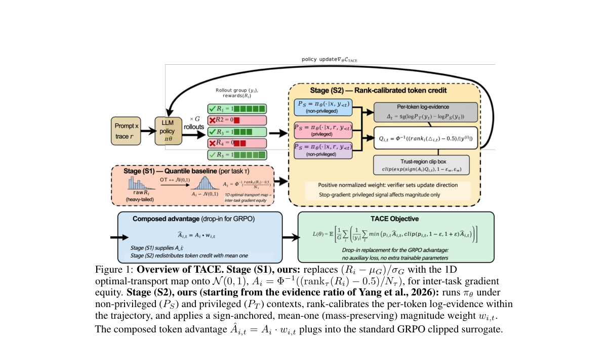

*Result - A WeMath example solved correctly by the trained model.*

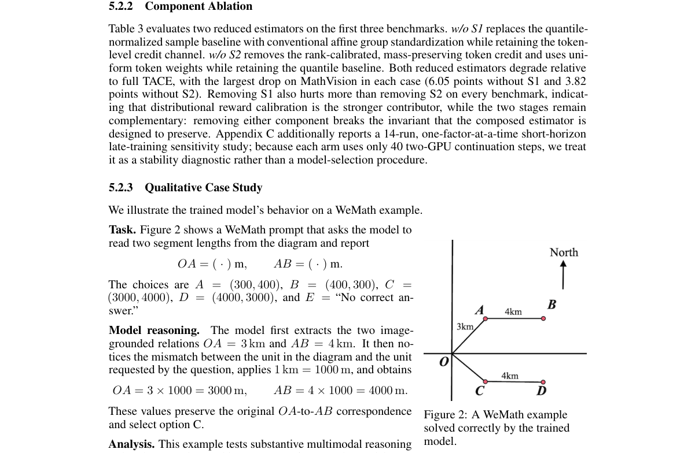

**Why this ranks #4**: 它把 GRPO 的 advantage 拆成基线与信用两段，分别补上现有估计器各自漏掉的那一半机制。

---

### 5. H$^2$R: Hierarchical Hint-Based Reward for Mathematical Reasoning via Reinforcement Learning

**arXiv**: [2610.39934](https://arxiv.org/abs/2610.39934) | **Score**: 8.0 (relevance 8.0 x 0.7 + quality 8.0 x 0.3) | **Tags**: rl-llm, rlvr, hierarchical-hint, math-reasoning, intermediate-supervision, benchmark, New York | **Categories**: cs.LG | **Pages**: 17

**Authors**: He Tu; Siye Li; Hongyi Wen

**Affiliation**: New York University Shanghai

**Abstract**

> Reinforcement Learning with Verifiable Rewards has shown great promise in enhancing mathematical reasoning in large language models. However, existing approaches provide limited intermediate supervision for complex, multi-step reasoning tasks. To bridge this gap, we propose \textbf{Hierarchical Hint-based Reward}, a framework that leverages the intrinsic sub-question structure of mathematical problems as structured intermediate conditioning signals during RLVR training. Unlike chain-of-thought prompting, these hierarchical hints serve as logically grounded intermediate milestones that effectively reduce the reasoning horizon toward the final answer. To validate this framework, we introduce \textbf{HiMath}, a benchmark of hierarchically structured mathematical problems. Across diverse LLMs, hierarchical hints consistently improve reasoning performance even without task-specific training. When integrated into RL training via H$^2$R, they boost Qwen2.5-Math-7B accuracy on HiMath from 30.4\% to 39.1\% using hierarchical hints, and up to 45.6\% with Oracle Hierarchical Hints. This pronounced improvement demonstrates that incorporating reliable intermediate checkpoints into reward design is essential for sustaining complex mathematical reasoning.

**Key findings**

- **Finding**: 针对既有 RLVR 方法对复杂多步推理提供的中间监督有限，H²R 利用数学问题的内在子问题结构，把它们作为结构化的中间条件信号用于训练。
- **Finding**: 与 chain-of-thought prompting 不同，这些层级 hint 是逻辑上有依据的中间里程碑，能有效缩短到达最终答案的推理 horizon。
- **Finding**: 作者同时提出分层结构化的数学问题基准 HiMath，用来验证层级 hint 在不同难度上的作用。
- **Finding**: 跨多个 LLM，层级 hint 即使在没有任务专门训练的情况下也持续提升推理表现，说明它是可迁移的中间监督。
- **Finding**: 通过 H²R 集成进 RL 训练后，Qwen2.5-Math-7B 在 HiMath 上从 30.4% 提升到 39.1%，使用 Oracle 层级 hint 可达 45.6%。
- **Inference**: Oracle 与自动 hint 之间还差 6.5 个点，说明瓶颈在中间监督的自动生成质量，而不在 RL 目标设计。
- **Inference**: 把 hint 当条件输入而非可验证奖励项，也让 RLVR 的「可验证」这层含义被削弱了一些，评测时要留意。
- **Recommendation**: 推荐。关注 RLVR 中间监督设计、课程与数学推理训练的读者建议读。

**Key figures**

*Framework - Comparison of three reward signal paradigms on the same mathematical reasoning problem. Given an identical model output, ORM assigns a single binary reward based solely on final-answer corre*

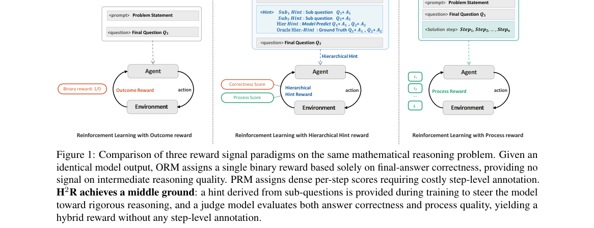

*Result - Overview of the H2R framework. Five hint conditions are constructed by varying the <hints> field: No-Hint provides no intermediate context; Sub1-Hint and Sub2-Hint provide the ground-truth s*

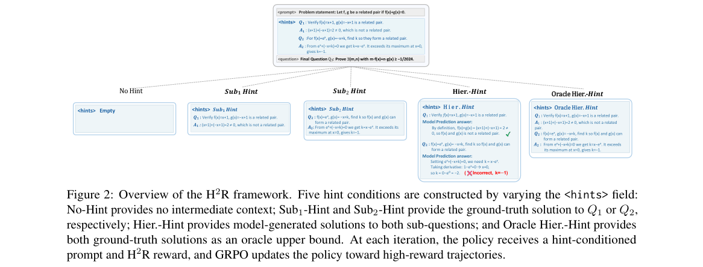

**Why this ranks #5**: 它用数学题自身的子问题结构充当中间条件信号，填补复杂多步推理在 RLVR 中最缺的那块中间监督。

---

### 6. Grounding Multimodal Reasoning with Evidence-Ablated Negatives

**arXiv**: [2610.39237](https://arxiv.org/abs/2610.39237) | **Score**: 7.8 (relevance 8.0 x 0.7 + quality 7.5 x 0.3) | **Tags**: rl-llm, multimodal-rlvr, evidence-ablation, negative-sampling, shortcut-learning, vlm, University of Maryland | **Categories**: cs.CL | **Pages**: 24

**Authors**: Chenxi Liu; Tianyi Xiong; Yanshuo Chen; Heng Huang

**Affiliation**: University of Maryland, College Park

**Abstract**

> Reinforcement learning with verifiable rewards (RLVR) has become a powerful tool for improving multimodal reasoning. However, standard outcome supervision suffers from credit assignment ambiguity, as a model may receive positive rewards by exploiting language priors or dataset shortcuts rather than grounding its reasoning in the requisite visual evidence. This makes high-quality negative responses critical, since effective negatives should remain plausible under the current policy while exposing the shortcut that should be suppressed. In this paper, we propose EVAN, a multimodal reinforcement learning framework utilizing EVidence-Ablated Negatives to train LMMs against their own language-prior failures. EVAN first identifies highly visually dependent examples using a scaled image information gain metric and preserves data diversity with a mixed-ranking strategy. It then constructs evidence-ablated images by masking the most discriminative image patches, eliciting plausible but visually ungrounded responses from the current policy. During policy optimization, these negative responses are incorporated as bounded auxiliary signals under the clean image, penalizing shortcut learning while maintaining RL stability. Experiments across challenging multimodal reasoning benchmarks demonstrate that EVAN mitigates modality imbalance and improves over strong RLVR baselines. Our code is available at https://github.com/DawnLIU35/EVAN.git.

**Key findings**

- **Finding**: 针对标准结果监督下模型可能靠语言先验或数据集捷径拿正奖励、而非真正落到视觉证据上的问题，EVAN 用 EVidence-Ablated Negatives 让 LMM 训练在自身语言先验失效之处。
- **Finding**: 框架先用缩放后的图像信息增益度量筛出高度依赖视觉的样本，再用混合排序策略保持数据多样性。
- **Finding**: 它构造 evidence-ablated 图像，遮蔽最具判别力的图像 patch，从当前策略中诱导出貌似合理但视觉上无依据的回复作为负例。
- **Finding**: 策略优化阶段，这些负回复在干净图下作为有界辅助信号加入，惩罚捷径学习的同时保持 RL 稳定性。
- **Finding**: 在若干困难的多模态推理 benchmark 上，EVAN 缓解了模态不平衡并优于强 RLVR 基线。
- **Inference**: 这是把负样本当作一等公民来构造，而不是在采样池里随机取负例，与组内对比的 GRPO 是互补关系。
- **Inference**: 遮蔽粒度与判别性度量直接决定负例质量，这两个设计很可能是复现时最敏感的环节。
- **Recommendation**: 推荐。正在做多模态 RLVR 或关注语言先验捷径的读者建议读。

**Key figures**

该论文正文未提取到可用图（图表为纯文本/表格排版）。

**Why this ranks #6**: 它用被遮掉判别区域的图像逼模型说出看似合理却无视觉依据的答案，再把这些负样本变成压制捷径的信号。

---

### 7. SCARL: Sequence Confidence-Aligned Reinforcement Learning

**arXiv**: [2610.40407](https://arxiv.org/abs/2610.40407) | **Score**: 7.8 (relevance 8.0 x 0.7 + quality 7.5 x 0.3) | **Tags**: rl-llm, rlvr, confidence-calibration, advantage-reshaping, entropy-collapse, exploration, Baidu Frontier Research Department | **Categories**: cs.AI, cs.LG | **Pages**: 18

**Authors**: Zhenghong Ke; Jingbo Zhou; Hua Wu

**Affiliation**: Baidu Frontier Research Department; Nanjing University

**Abstract**

> Reinforcement learning with verifiable rewards (RLVR) improves language-model reasoning by scoring sampled responses with a rule-based verifier and reinforcing those that pass. Where a classifier's training couples predicted probability to labels, nothing ties an RLVR policy's confidence in a response to its reward: aligned training would drive responses with the same advantage toward equal confidence, yet the advantage is blind to confidence. Under this sequence-confidence misalignment, a success the policy barely found earns the same update as one it produces with near certainty, and a confident error is corrected no harder than an exploratory one. We propose SCARL (Sequence Confidence-Aligned Reinforcement Learning), which reshapes, but never re-signs, each advantage with the alignment gap between the response's group-relative confidence and the outcome its advantage certifies, normalized into shares of each class's advantage budget. Misaligned samples absorb the force, responses with the same advantage are driven toward equal confidence, and repairing the misalignment doubles as a remedy for the entropy collapse that erodes exploration. SCARL provably reduces to its base estimator when a class's confidences agree, adds no extra passes and one hyperparameter. On Qwen3-4B-Base it lifts average Pass@32 by 2.4 points over DAPO and is best among nine compute-matched methods on both coverage and per-draw accuracy; applied unchanged across four estimators and four backbones, it improves 14 of 16 settings while preserving policy entropy and widening the confidence-correctness separation. Our code is available at https://github.com/kezhh163/scarl.

**Key findings**

- **Finding**: 分类器训练会把预测概率与标签绑定，但 RLVR 策略的响应置信度与其 reward 之间没有任何联系，advantage 对置信度完全盲视。
- **Finding**: 在这种 sequence-confidence 失配下，勉强才找到的成功与近乎确定的成功拿到同样的更新，自信的错误与探索性错误被纠正的力度也相同。
- **Finding**: SCARL 用响应 group-relative 置信度与 advantage 所认证结果之间的 alignment gap 重塑每个 advantage，只重塑不改变符号，并归一化为各类的 advantage 预算份额。
- **Finding**: 失配样本吸收更多更新，同 advantage 的响应被推向相近置信度，修补失配同时抑制 entropy collapse；当某类样本置信度一致时 SCARL 可证明退化为基线 estimator，只多一个超参。
- **Finding**: 在 Qwen3-4B-Base 上它相对 DAPO 把平均 Pass@32 提升 2.4 点，是九种等算力方法中最佳；套用到四个 estimator 与四个 backbone 时 16 个设定中有 14 个改善。
- **Inference**: 它把 entropy collapse 当作置信度与奖励失配的症状来治，而不是额外加熵正则，这条路径更干净也更省超参。
- **Inference**: 单任务 2.4 点的 Pass@32 提升并不醒目，但跨 16 个设定的 14/16 一致性更能说明这是系统性收益。
- **Recommendation**: 推荐。做 RLVR advantage 设计、尤其关心置信度校准与探索退化的读者值得读。

**Key figures**

*Framework - Sequence-confidence misalignment and its repair. Group-relative RLVR gives each response a sequence- level advantage (A) blind to how confidently the policy produced it. SCARL turns token lo*

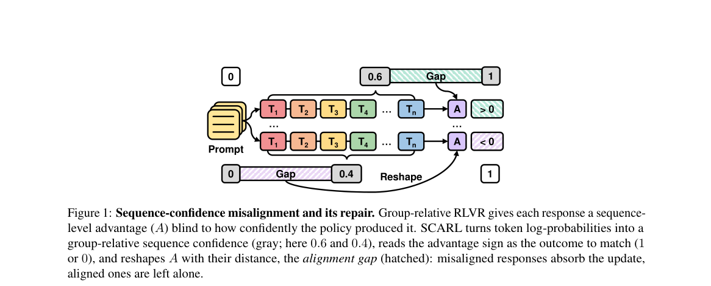

*Result - Avg@32 (left) and Pass@32 (right) on Qwen3-4B-Base, averaged over the five benchmarks, across 150 training steps; step 0 is the untrained base model. SCARL (bold) leads both metrics through*

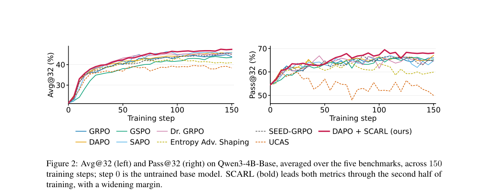

**Why this ranks #7**: 它指出了 RLVR 里一个被普遍忽略的错配：策略对自己答案的置信度与奖励认证的结果之间没有任何绑定。

---

### 8. Training language models in simulation for psychiatric intake

**arXiv**: [2610.40476](https://arxiv.org/abs/2610.40476) | **Score**: 7.7 (relevance 7.5 x 0.7 + quality 8.0 x 0.3) | **Tags**: rl-llm, multi-turn-rl, clinical-simulation, psychiatric-intake, composite-reward, safety-eval, Google DeepMind | **Categories**: cs.AI, cs.CL | **Pages**: 76

**Authors**: Samuel Schmidgall; Tim Strother; Alex Bijamov; Min Woo Sun; Anil Palepu; Akshay Goel; Ulysse Marteau-Ferey; Théo Moutakanni; Yubin Kim; Joseph Breda; Christina Chen; Justin Chen

**Affiliation**: Google DeepMind; Google Research; Google for Health; Stanford University; Johns Hopkins University; Harvard Medical School

**Abstract**

> In psychiatric practice, the clinical intake interview remains a primary diagnostic instrument, requiring the clinician to establish rapport while disentangling complex, overlapping presentations. Here, we show that multi-turn reinforcement learning (RL) in simulation environments improves language model performance on structured text-based psychiatric intake, spanning history-taking, differential diagnosis, and initial management planning. In a randomized, double-blind crossover study ($N = 60$ matched scenario pairs, 120 encounters) comparing the RL-trained agent against its identically prompted base model, 32 board-certified psychiatrists role-played standardized patients while a separate panel of 15 independent, board-certified psychiatrists scored the de-identified transcripts. The trained agent outperformed the base model in 76.7% of matched scenario pairs ($p < 0.0001$), with gains on an adapted clinical-examination rubric ($d_z = 0.77$, $p < 0.0001$), patient-centered communication (82.0% vs. 65.2%, $p < 0.001$), and differential diagnosis appropriateness (68.3% vs. 33.3%, $p < 0.001$). Across 127 psychiatrist-validated simulated intake scenarios, the trained agent nearly doubled its base model's clinical rubric score (0.706 vs. 0.379; composite reward 0.564 vs. 0.294, $p < 0.0001$). To systematically probe conversational safety, we established two Delphi-consensus taxonomies, of clinical safety risks and relational competencies, from which 256 challenging adversarial presentations were derived; we find that training in simulation environments more than halved under-triage of acute safety risks (12.9% vs. 30.5%, $p < 0.0001$). Simulation environments thus provide a controlled testbed for training and stress-testing psychiatric conversational agents, with gains that transferred to psychiatrist-enacted encounters, though residual gaps require safeguards and clinician oversight.

**Key findings**

- **Finding**: 论文在模拟环境中做多轮强化学习以改进结构化文本精神科初诊表现，并设计随机双盲交叉研究：32 名 board-certified 医生扮演标准化病人，另 15 名独立医生评分。
- **Finding**: 研究共纳入 60 对匹配场景、120 次问诊，训练后的 agent 在 76.7% 的匹配场景对中优于同提示的基座模型（p < 0.0001），临床查体量表上效应量 d_z = 0.77。
- **Finding**: 以病人为中心的沟通从 82.0% 对 65.2%（p < 0.001），鉴别诊断恰当性从 68.3% 对 33.3%（p < 0.001）。
- **Finding**: 在 127 个精神科医生验证的模拟初诊场景上，训练后 agent 的临床量表分数几乎翻倍（0.706 对 0.379），复合 reward 为 0.564 对 0.294。
- **Finding**: 论文建立两套 Delphi 共识分类法并派生 256 个对抗性呈现，发现模拟训练把急性安全风险漏诊率从 30.5% 降到 12.9%。
- **Inference**: 真正稀缺的是把安全性写进 reward 与评测，而不是只优化问诊质量，这部分让训练目标更接近真实临床风险。
- **Inference**: 效果迁移到真人扮演场景，说明模拟里的 reward 与真实临床评分之间没有严重错位，这在医疗 RL 里并不常见。
- **Recommendation**: 推荐。做医疗 LLM、多轮 RL 与对话安全评测的读者建议精读。

**Key figures**

*Result - Performance in psychiatrist-enacted standardized clinical encounters. a, Double-blind crossover OSCE design with board-certified psychiatrists (𝑁=32) role-playing standardized patients and*

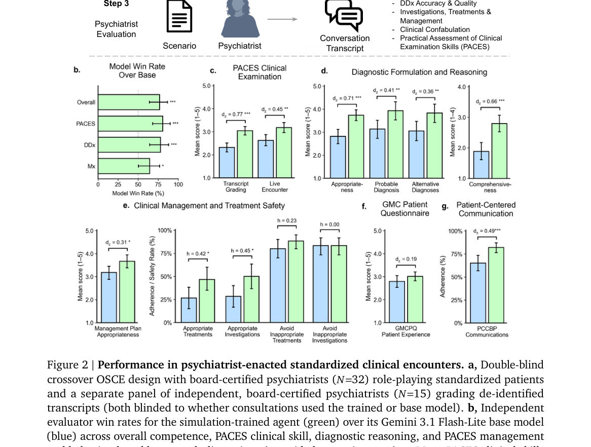

**Why this ranks #8**: 它把多轮 RL 放进医生角色扮演的模拟环境，并用双盲交叉实验确认收益能迁移到真人扮演的问诊。

---

### 9. When Does Closed-Loop Curriculum Adaptation Help GRPO? An Analysis on Countdown

**arXiv**: [2610.39056](https://arxiv.org/abs/2610.39056) | **Score**: 7.5 (relevance 7.5 x 0.7 + quality 7.5 x 0.3) | **Tags**: rl-llm, grpo, curriculum-learning, difficulty-adaptive, sample-efficiency, reasoning, Texas Christian | **Categories**: cs.AI, cs.LG | **Pages**: 6

**Authors**: Yuv Raj Pant; Moshiur Rahman Tonmoy; Kaiqun Fu

**Affiliation**: Texas Christian University; Texas A&M University - Kingsville

**Abstract**

> Reinforcement fine-tuning has become an effective post-training paradigm for improving the reasoning ability of large language models, but it remains sample-inefficient when the training distribution is mismatched to the model's current capability. In group-relative objectives such as Group Relative Policy Optimization (GRPO), problems that are too hard often produce uniformly failed rollouts, while problems that are too easy provide little useful advantage signal. In this work, we introduce CLOSEDLOOPGAUSSIAN, a lightweight adaptive curriculum method for efficient reinforcement fine-tuning on ordered reasoning tasks. Instead of following a fixed easy-to-hard schedule, CLOSEDLOOPGAUSSIAN preserves the structure of an Easy-to-Hard Gaussian sampler while dynamically adjusting its pace and spread using periodic probe estimates of per-difficulty accuracy. The controller accelerates training when the model is ahead of a reference curriculum, slows down when the model falls behind, and broadens sampling when earlier difficulties regress. This feedback mechanism keeps training focused on tasks that are challenging but still learnable, without changing the reward function, model architecture, or underlying GRPO optimizer. Experiments on symbolic arithmetic reasoning task show that CLOSEDLOOPGAUSSIAN improves exact-match accuracy over vanilla GRPO and fixed open-loop curricula, with the strongest gains in intermediate-difficulty regimes where group-relative learning signals are most informative. Codes are available at https://github.com/yuvrajpant56/Closed_Loop_Curriculum.

**Key findings**

- **Finding**: 论文指出强化微调在训练分布与模型当前能力不匹配时样本效率低，group-relative 目标下过难题目整组 rollout 失败、过易题目几乎不产生 advantage 信号。
- **Finding**: CLOSEDLOOPGAUSSIAN 保留 Easy-to-Hard Gaussian 采样的结构，同时用周期性的 per-difficulty 准确率探测估计动态调节其节奏与展宽。
- **Finding**: 控制器在模型领先参考课程时加速训练，落后时减速，而在早期难度出现回退时展宽采样。
- **Finding**: 这一反馈机制让训练聚焦于有挑战但仍可学的题目，且不改动 reward 函数、模型架构或底层 GRPO 优化器。
- **Finding**: 在符号算术推理任务上，它的 exact-match 准确率超过 vanilla GRPO 与固定的开环课程，最强增益出现在中等难度区间。
- **Inference**: 增益集中在中等难度，说明 group-relative 学习信号的信息量高度集中在那一段，课程设计的收益也因此依赖难度分布的形状。
- **Inference**: 只改数据分布不改算法，使它与几乎所有 GRPO 变体正交，落地成本与超参负担都很低。
- **Recommendation**: 推荐。做 GRPO 训练课程与样本效率的读者值得读。

**Key figures**

*Framework - Overview of the proposed adaptive closed-loop curriculum framework.*

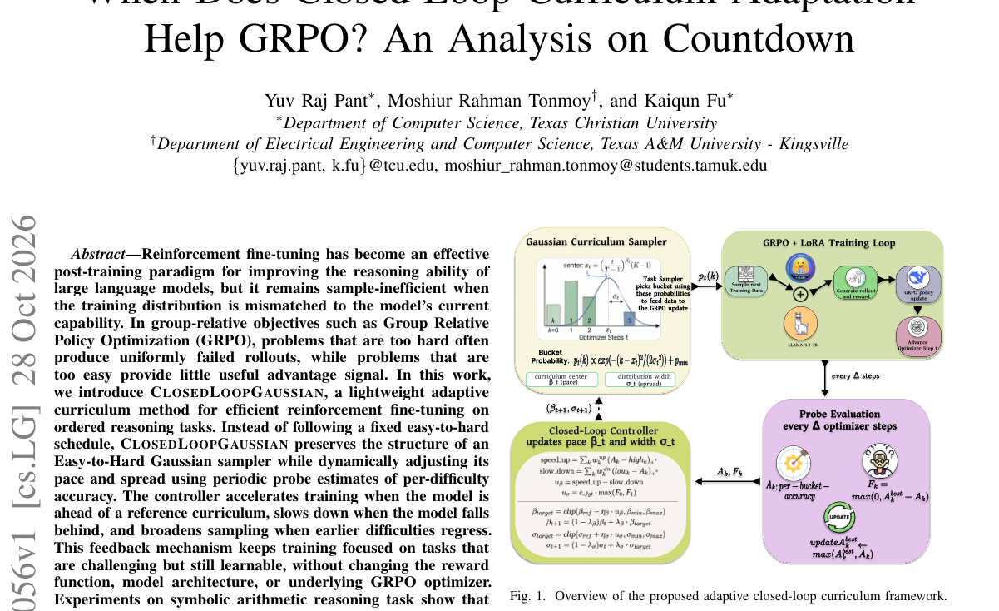

*Result - traces βt, σt, uβ, and n = 3 probe accuracy across all four seeds. The first probe at step 100 shows near-floor accuracy beyond the easiest bucket, producing a mildly negative uβ and a small*

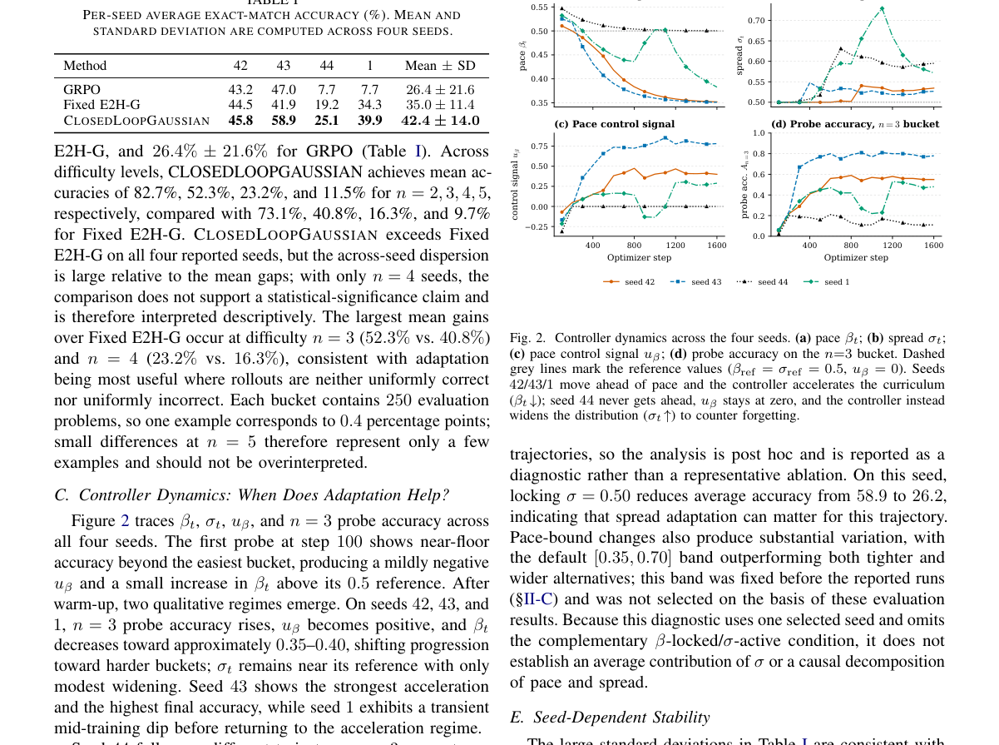

**Why this ranks #9**: 它把固定由易到难的开环课程换成用难度探测实时调节的闭环采样器，且完全不动 reward 与优化器。

---

### 10. Reward-Adaptive Co-Evolution of Policy and Rubric

**arXiv**: [2610.40096](https://arxiv.org/abs/2610.40096) | **Score**: 7.5 (relevance 7.5 x 0.7 + quality 7.5 x 0.3) | **Tags**: rl-llm, rubric-reward, policy-rubric-coevolution, reward-routing, open-ended-rl, event-triggered, Peking | **Categories**: cs.AI | **Pages**: 16

**Authors**: Yizhu Chen; Jianguang Jiang; Jiameng Huang; Chuyu Fang; Bojun Zhang; Zhenyu Jiao; Xing Yuan; Tong Lin

**Affiliation**: Peking University; Baidu Inc.; Institute of Automation, Chinese Academy of Sciences

**Abstract**

> Rubric-based rewards provide fine-grained, interpretable supervision for open-ended reinforcement learning, where holistic scalar rewards struggle to capture multidimensional response quality. Static rubrics can lose discriminative power as the policy distribution evolves, while existing policy--rubric co-evolution methods rely on globally prescribed update schedules that ignore heterogeneous reward informativeness. We introduce RACE, a Reward-Adaptive Co-Evolution framework. At the group level, per-rollout-group training-signal routing classifies groups as informative, diversity-collapsed, or rubric-failed, updating the policy only with informative groups while caching rubric failures. At the phase level, event-triggered phase switching enters rubric optimization upon persistent reward saturation and returns when rubric-reward improvement plateaus. Rubric phases train the generator on cached pairs using a frozen judge and a scale-normalized pairwise-margin reward. Across both levels, online threshold adaptation adjusts routing and switching thresholds through proportional control. Under a unified evaluation protocol, RACE achieves the highest average performance and outperforms the strongest fixed-alternation baseline on all eight tasks, while improving rubric discrimination.

**Key findings**

- **Finding**: 论文提出 RACE，针对静态 rubric 随策略分布演化而失去区分力、既有协同演化方法依赖全局预设更新调度这两个问题。
- **Finding**: group 层把 rollout group 分为 informative、diversity-collapsed 与 rubric-failed 三类，只用 informative 组更新 policy。
- **Finding**: 在 phase 层做事件触发的阶段切换，奖励持续饱和时进入 rubric 优化、rubric-reward 改进进入平台期时返回策略优化，rubric-failed 的 group 被缓存起来留作训练对。
- **Finding**: rubric 阶段使用冻结的 judge 与尺度归一化的 pairwise-margin reward，在缓存的偏好对上训练生成器。
- **Finding**: 两层都通过比例控制在线调整路由与切换阈值，在统一评测协议下取得最高平均表现，并在全部八个任务上超过最强的固定交替基线。
- **Inference**: 把 rubric-failed 的 group 缓存而不是丢弃，等于把 rubric 的失效样本变成可复用的训练资产，这是最实用的一步设计。
- **Inference**: 八个任务全部领先比只赢平均分更有说服力，说明收益并非靠少数任务拉动。
- **Recommendation**: 推荐。做开放式 RL、rubric 奖励设计与 judge 训练的读者建议读。

**Key figures**

*Framework - Framework overview of RACE. A shared model parameterized by θ alternates between the policy πθ and rubric generator Gθ. During the policy phase, πθ samples {yi}G*

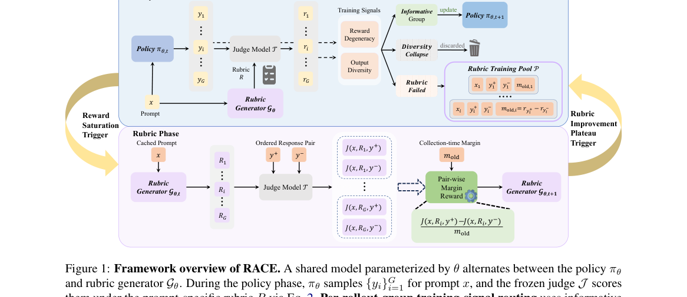

*Result - Phase-length dynamics. Policy (a) and rubric (b) phase lengths across successive alternations; solid curves denote 5-point moving averages (MA), and dashed horizontal lines mark the target l*

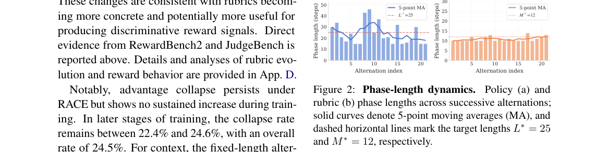

**Why this ranks #10**: 静态 rubric 会随策略分布漂移而失去区分力，RACE 用奖励信息量自适应地决定何时该训策略、何时该训 rubric。

---

## Footer

- Total papers scanned across all 7 tracks: 619（原始 828 条）
- rl_llm track final top-10: 10
- Wild-cards in this track: 0
- Figure assets: 2026-10-30/res/

Generated by `mine-arxiv-daily-digest` skill. Sister file: `2026-10-30_rl_llm_entry.md`.
