# ArXiv Daily Digest - 2026-11-02 (AIGC 音频生成, 10 papers)

**Generated**: 2026-11-02 17:30 CST

**Source**: arXiv cs.CV, cs.SD, eess.AS, cs.CL, cs.AI, cs.RO, cs.LG submissions, listing day 2026-10-30 (announced 2026-10-31 00:00 UTC)

**Batch window**: 2026-10-29T18:00:00Z .. 2026-10-30T18:00:00Z（arXiv 公告批次横跨两个 UTC 日：前一日 18:00 UTC 起算，当日 17:59:59 UTC 截止）

**Track**: aigc_audio (top 10 of 465 papers scanned, 70 full reads)

**Scope**: 音频 / 语音 / 音乐的生成、合成、编辑与生产工具链，含 TTS、神经音频编码与空间音频

⚠️ **Wild-card**: 本批该线 5 篇为 wild-card 补足，已在正文逐条标注并给出理由。

补足原因：该批次 eess.AS 仅 7 篇、cs.SD 仅 13 篇，真正属于「音频生成 / TTS / 音乐」的论文只有 5 篇，其余 5 篇为声学数据集、音频表征与 DSP 工具链方向的补位，已在正文逐条标注并给出理由。

---

## Top 10 - AIGC 音频生成

### 1. MFlowAudio: Efficient Text-to-Audio Synthesis via Mamba-based Stateful Flow Matching

**arXiv**: [2610.41852](https://arxiv.org/abs/2610.41852) | **Score**: 9.2 (relevance 9.5 x 0.7 + quality 8.5 x 0.3) | **Tags**: AIGC-audio, flow-matching, state-space-model, dual-scan, streaming-generation, long-form-audio, neurips-2026, University College London | **Categories**: cs.SD | **Pages**: 23

**Authors**: Hao Dai; Panyu Chen; Jagmohan Chauhan

**Affiliation**: University College London; King's College London

**Abstract**

> Recent advancements in audio generation have been largely driven by Transformer-based diffusion models. However, these models suffer from quadratic complexity of self-attention, severely bottlenecking the long-form audio synthesis. To overcome this limitation, we propose MFlowAudio, a novel latent audio generation framework that synergizes the continuous-time dynamics of Flow Matching with a custom-designed TCMamba backbone. TCMamba uses an innovative dual-scan mechanism: a TimeMamba module to capture long-range causal dependencies with linear complexity, and a ChannelMamba module to model cross-channel correlations such as harmonic structures. Exploiting this structural foundation, we formulate the Stateful Flow Matching (SFM) paradigm. This framework inherently enables chunk-wise training and streaming generation, maintaining an $\mathcal{O}(1)$ caching complexity without incurring extra computational overhead. To enable fine-grained controllable synthesis, we devise a novel guidance mechanism that neutralizes vector field collisions precipitated by on-the-fly semantic transitions of prompts. Comprehensive empirical evaluations confirm that MFlowAudio yields generative fidelity on par with state-of-the-art baselines while establishing significant computational efficiency, achieving above $14.5$% acceleration in generation and facilitating perceptually seamless streaming synthesis with a constant latency of $1.8$ seconds. Demo: https://huggingface.co/spaces/mflowaudio/MFlowAudio

**Key findings**

- **Finding**: 论文提出 MFlowAudio，用自研的 TCMamba 骨干替换 Transformer 骨干，TimeMamba 以线性复杂度建模长程因果依赖，ChannelMamba 建模谐波结构这类跨通道相关性。
- **Finding**: 基于该骨干提出 Stateful Flow Matching（SFM）范式，原生支持分块训练与流式生成，缓存复杂度为 O(1) 且不引入额外计算开销。
- **Finding**: 为支持 prompt 实时切换，作者提出 State-Decoupled Conditional Guidance（SDCG），用以抵消语义切换造成的向量场碰撞。
- **Finding**: 在 AudioCaps 测试集上 MFlowAudio（581M）在 10 秒设置下取得 FD 11.8569、KL 1.1158、IS 11.6865、FADv 2.5248、CLAP 0.4957、FADopenl3 96.2363，在 FD 与 KL 上优于 TangoFlux（15.8429 / 1.1164）。
- **Finding**: 论文称 MFlowAudio 是首个把独立 Mamba 用于扩散式 T2A 生成的框架，定位是长时全频段叙事音频。
- **Finding**: 相同硬件下生成延迟相对基线加速 81.8%（10 秒）与 14.5%（30 秒），流式合成维持恒定 1.8 秒延迟；增大 batch 时延迟最多再降约 63.9%。
- **Inference**: 线性复杂度骨干加 O(1) 缓存的流式范式，比单纯追求更大采样步数更贴近长音频的落地成本结构。
- **Recommendation**: 推荐读。做长时音频、交互式 agent 音效与 VR 音频的读者，建议精读 TCMamba 双扫描与 SFM 的状态传递设计。

**Key figures**

*Framework - The key components of MFlowAudio: (left) the workflow of MFlowAudio, audio is encoded and decoded into latent using VAE and vocoder; (middle) the architecture of the TCMamba block; and (righ*

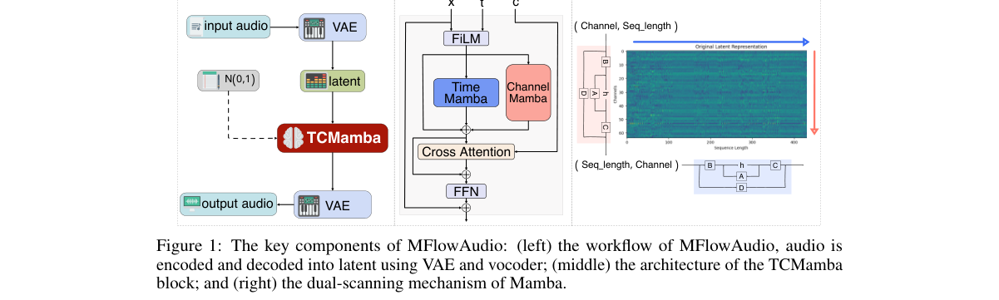

*Result - Beyond conventional monolithic training and generation, MFlowAudio also facilitates (a) chunked AR-style training and (b) chunked generation to support streaming.*

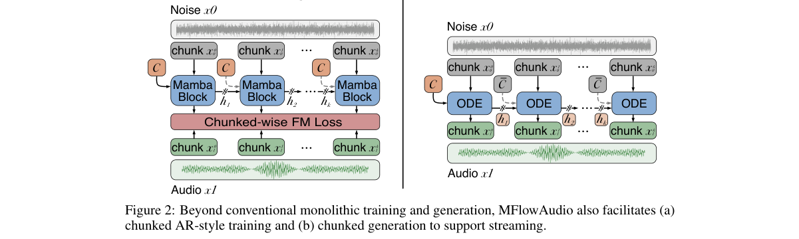

**Why this ranks #1**: 把 Mamba 单独用在扩散式 T2A 上，并用 Stateful Flow Matching 换来 O(1) 缓存的流式生成。

---

### 2. Scalable Audio-LLM System for Speech MOS Evaluation: A Diagnostic Case Study and Adaptation Roadmap

**arXiv**: [2610.41539](https://arxiv.org/abs/2610.41539) | **Score**: 8.3 (relevance 8.5 x 0.7 + quality 8.0 x 0.3) | **Tags**: AIGC-audio, mos-estimation, audio-llm, lora-finetuning, speech-quality-assurance, somos, samsung, Samsung Electronics | **Categories**: cs.SD, eess.AS | **Pages**: 7

**Authors**: Dimitrios Kokkinis; Panagiotis Kakoulidis; Nikolaos Ellinas; Chrysovalanti Lymperi; Alexandra Vioni; Georgios Vardaxoglou; Iakovi Alexiou; Myrsini Christidou; Jeasung Lee; Gunu Jho; Inchul Hwang; Pirros Tsiakoulis

**Affiliation**: Samsung Electronics

**Abstract**

> The continuous deployment of enterprise voice systems creates a critical operational bottleneck: evaluating the acoustic quality of synthetic speech across high-volume production updates. While human Mean Opinion Score (MOS) remains the quality gold standard, it introduces severe operational costs and turn-around delays that make continuous integration infeasible. In this work, we present a system design case study for a scalable, low-cost and offline evaluation pipeline capable of scoring large batches of synthetic speech at marginal cost. First, we use Qwen2-Audio-7B-Instruct in a zero-shot setting for granular MOS estimation, noticing perceptual blind spots and inherent biases. Then, we analyze SOMOS dataset and construct a diagnostic benchmark that operationalizes two prosodic dimensions associated with human naturalness ratings. Finally, we adapt Qwen2-Audio-7B-Instruct through a parameter-efficient finetuning (LoRA) on the task of MOS evaluation, observing improvements over base model and widely used neural baselines like UTMOS and establishing a practical blueprint for enterprise-grade speech quality assurance.

**Key findings**

- **Finding**: 论文先验证 Qwen2-Audio-7B-Instruct 零样本预测 MOS 与人类评分几乎不相关，基线 Pearson 相关仅 -0.0312。
- **Finding**: 论文提出两段解耦流水线：先让 Audio-LLM 生成预定义声学维度的定性描述，再由纯文本 LLM（Llama-3-8B-Instruct）把定性描述映射为 MOS 数值。
- **Finding**: 扫描不同生成温度时相关最高出现在 1.5（Pearson 0.2467），仍远不足以支撑评测用途，说明模型能感知质量但难以直接映射成分数。
- **Finding**: 论文分析 SOMOS 数据集：该数据集由 200 个 TTS 系统生成的 LJ Speech 音色合成语音共 2 万条，MOS 由众包收集。
- **Finding**: 用 SOMOS 训练集做 LoRA 微调后，数值型目标的最佳组合取得 Pearson 0.6506 与 Spearman 0.6582，远高于 UTMOSv2 的 0.4310 / 0.4193，也远高于基座模型的 0.0028 / 0.02。
- **Finding**: 把输出包进对话模板的文本型目标反而最差（0.0406 / 0.0287），并用分箱平衡（beta）抑制数据集中 3.0–4.0 分数段的多数类偏置。
- **Inference**: 零样本失效与微调后大幅跃升说明瓶颈在数值映射而非语义理解，把定性诊断与标量回归解耦是可复用的工程思路。
- **Recommendation**: 推荐读。做 TTS 质量回归、模型上线前批量质检的团队可直接照搬其三阶段蓝图画法。

**Key figures**

*Framework - Proposed framework design for adapting a base Audio LLM into a MOS prediction system.*

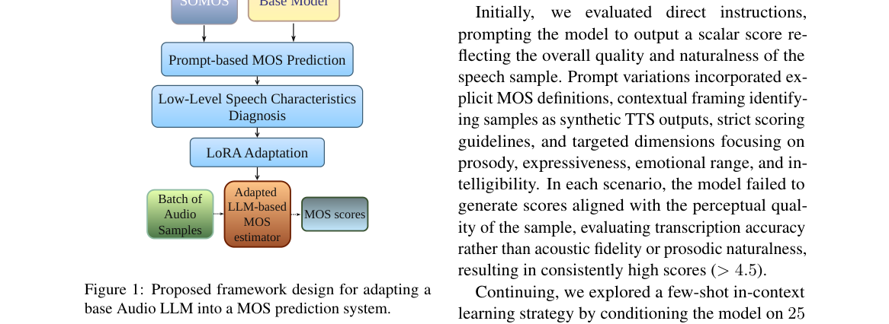

*Result - Average MOS score for each characteristic.*

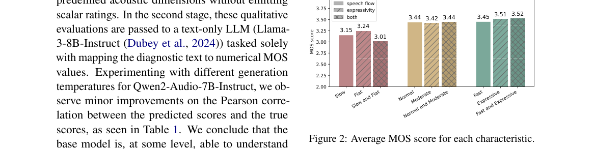

**Why this ranks #2**: 先证伪零样本 Audio-LLM 打 MOS 的能力，再用 LoRA 把同一模型拉到优于 UTMOS 的相关性。

---

### 3. Nedimo: An Evidence-Grounded Multilingual Pipeline for AI-Generated Sleep Stories

**arXiv**: [2610.40970](https://arxiv.org/abs/2610.40970) | **Score**: 8.2 (relevance 8.5 x 0.7 + quality 7.5 x 0.3) | **Tags**: AIGC-audio, sleep-stories, text-to-speech, safety-guardrails, loudness-normalization, multilingual, evidence-mapping, University of Piraeus | **Categories**: cs.AI, cs.CL, cs.HC, cs.SD | **Pages**: 7

**Authors**: Georgios Makridis; Stefanos Kampouris

**Affiliation**: University of Piraeus

**Abstract**

> Generative audio systems can produce large libraries of personalized bedtime content, but ordinary media objectives (retention, completion, and novelty) are poorly aligned with the goal of supporting a transition toward sleep. Direct evidence for narrated bedtime audio in adults is mixed, and a recent active-controlled trial did not support such audio as a standalone treatment for sleep disturbance. We translate this uncertain evidence into conservative engineering requirements and present a multilingual pipeline for generating and narrating low-arousal sleep stories. The implemented prototype separates deterministic planning from large language model generation, represents content and delivery parameters explicitly, shapes each script through a four-phase attention taper, validates structural and lexical constraints, performs a bounded error-aware retry, and quarantines unresolved outputs. Provider-agnostic text-to-speech synthesis is followed by paragraph-aware joining, two-pass loudness normalization, and a publication gate that re-measures the saved, encoded file against fixed loudness, loudness-range, and true-peak limits. The product data model records stop position, replay, early abandonment, and completion while treating these events as ambiguous behavioral proxies rather than clinical outcomes. We contribute an evidence-to-requirement mapping, a traceable guardrail architecture with explicit acceptance thresholds, technical evaluation criteria, and a prospective protocol for testing sleep-onset effects. No clinical efficacy is claimed; the system is positioned as a relaxation and attentional-support tool whose benefit and possible reliance must be evaluated empirically.

**Key findings**

- **Finding**: 论文先梳理证据边界，指出 2026 年一项纳入 495 名在职成人的随机对照试验中，睡前故事在主要睡眠干扰指标上并未优于主动对照；另引 1136 名瑞典成人的自选调查。
- **Finding**: 系统把确定性规划与 LLM 生成分离，显式表示内容与朗读参数，并用四阶段注意力衰减（attention taper）整形每篇脚本。
- **Finding**: 生成结果经过结构与词汇约束校验、有界错误感知重试，仍无法解决的输出被隔离（quarantine）。
- **Finding**: 合成环节 provider-agnostic 的 TTS 之后依次做段落感知拼接、两遍响度归一化，并由发布门在落盘编码后重新测量响度、响度范围与真峰值三项限值。
- **Finding**: 产品数据模型记录停止位置、重播、提前放弃与完成，但作者明确把这些事件当作有歧义的行为代理指标而非临床结果。
- **Finding**: 论文贡献被表述为证据到需求的映射、带显式接受阈值的可追溯护栏架构、技术评测准则与入睡效应的前瞻性测试协议，且不声称任何临床疗效。
- **Inference**: 把「留存率、完播率」这类媒体指标当作助眠目标可能与使用意图相悖，因此论文把行为代理与疗效严格切开是关键的诚实性设计。
- **Recommendation**: 推荐读。做健康类生成产品或需要给生成系统加发布门禁的读者，值得参考其护栏与验收阈值写法。

**Key figures**

*Framework - End-to-end production pipeline. Solid arrows show the publication path; dashed arrows show correction, quarantine, and aggregate feedback paths.*

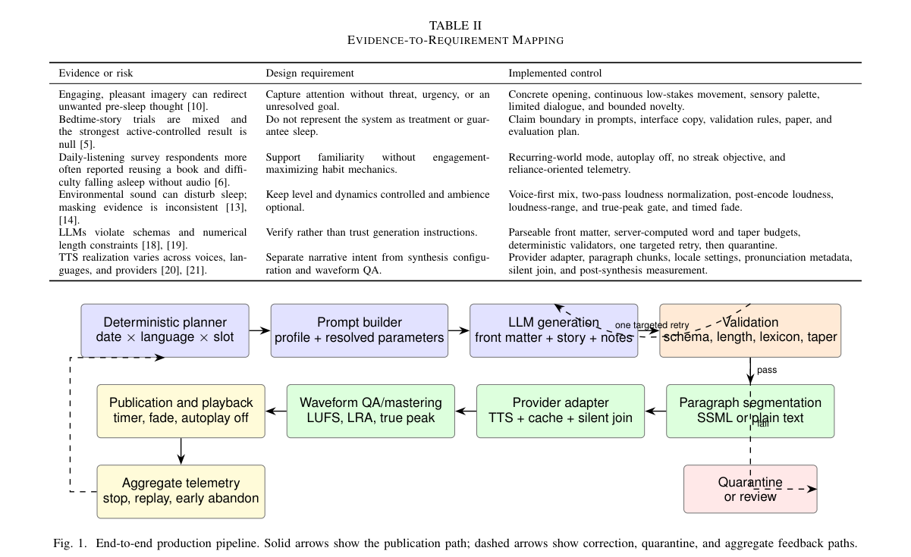

*Result - Conceptual attention taper. Attentional demand is sufficient to redirect thought early, then declines; the permitted arousal band remains low throughout. The curves are design targets, not mea*

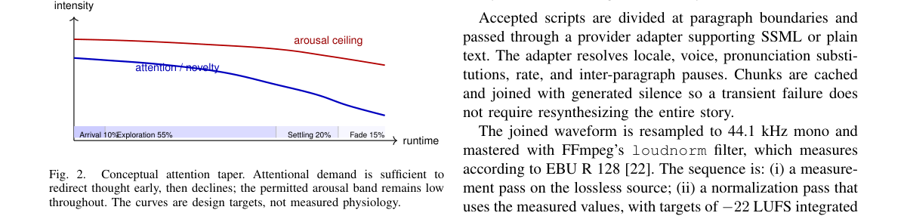

**Why this ranks #3**: 把证据不足的助眠音频诉求翻译成保守的工程护栏，而不是包装成疗效。

---

### 4. From prediction error to sparse events: Biologically inspired signed-dyadic coding for Mandarin keyword spotting

**arXiv**: [2610.41381](https://arxiv.org/abs/2610.41381) | **Score**: 8.0 (relevance 8.0 x 0.7 + quality 8.0 x 0.3) | **Tags**: AIGC-audio, event-based-audio, signed-dyadic-coding, predictive-coding, keyword-spotting, hardware-efficiency, mandarin, University of Cambridge | **Categories**: cs.AI, cs.SD, eess.AS | **Pages**: 14

**Authors**: Zijian Zhou; Rui Liu; Rongxiang Nie; Rui Ma; Ziyao Zhang; Xin Du

**Affiliation**: University of Cambridge

**Abstract**

> In continuous spiking keyword spotting, temporally correlated acoustic frames can repeatedly trigger memory access and neural computation at a dense input interface, even when hidden activity is sparse. Predictive processing and sensory adaptation suggest retaining predictable input locally and responding selectively to deviations. Inspired by this mechanism, we propose Predictive Signed-Dyadic Coding (PG). PG maintains a local prediction for each input channel and transmits an event only when the residual exceeds a learned threshold. Each event carries a sign and a finite power-of-two magnitude, and the receiver reconstructs it with fixed-point shifts and additions. In Mandarin keyword spotting, INPUT-PG reaches 90.00% accuracy while reducing mean SRAM reads by 33.87% and inference cycles by 32.77%. PG provides a hardware interface for research on low-power continuous speech processing and event-based sensory systems.

**Key findings**

- **Finding**: 论文提出 Predictive Signed-Dyadic Coding（PG）：为每个输入通道维护局部预测，仅当残差超过可学习阈值时才发出事件，事件携带符号与有限的二次幂幅度。
- **Finding**: 接收端只用定点比较、移位与加法重建输入，形成无乘法器的硬件接口，与 rate coding 与 TTFS 编码形成对照。
- **Finding**: 在普通话关键词 spotting 的 720 条测试片段上，INPUT-PG 达到 90.00% 准确率，同时平均 SRAM 读取次数减少 33.87%、推理周期减少 32.77%。
- **Finding**: 在单条固定片段上的 routed 评测中，增量推理能耗下降 39.49%（不含权重加载），作者明确说明软件负载评测用 720 条片段而能耗评测只用 1 条片段。
- **Finding**: 论文比较三种部署方案：无编码的 DIRECT、只在声学输入处编码的 INPUT-PG、以及在输入与隐层边界都编码的 ALL-PG，结论是选择性输入预测是该任务的有效部署点。
- **Inference**: 声学帧之间的时间冗余可以直接换成存储与执行开销的下降，说明神经形态事件接口在低功耗连续语音处理上仍有可挖空间。
- **Recommendation**: 推荐读。做端侧关键词唤醒、神经形态听觉或低功耗连续语音的读者，可参考其编码与部署点的对照设计。

**Key figures**

*Framework - Predictive signed-dyadic coding and its interface with keyword classification. PG maintains a shared prediction, transmits thresholded signed-dyadic residuals, and reconstructs the input bef*

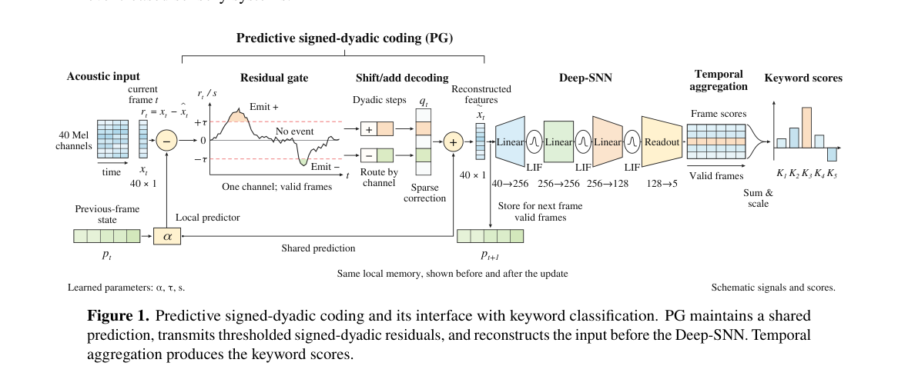

*Result - Selective PG placement and boundary semantics. DIRECT has no PG, INPUT-PG places PG before the first linear map, and ALL-PG places PG before all learned maps. Small residuals remain silent,*

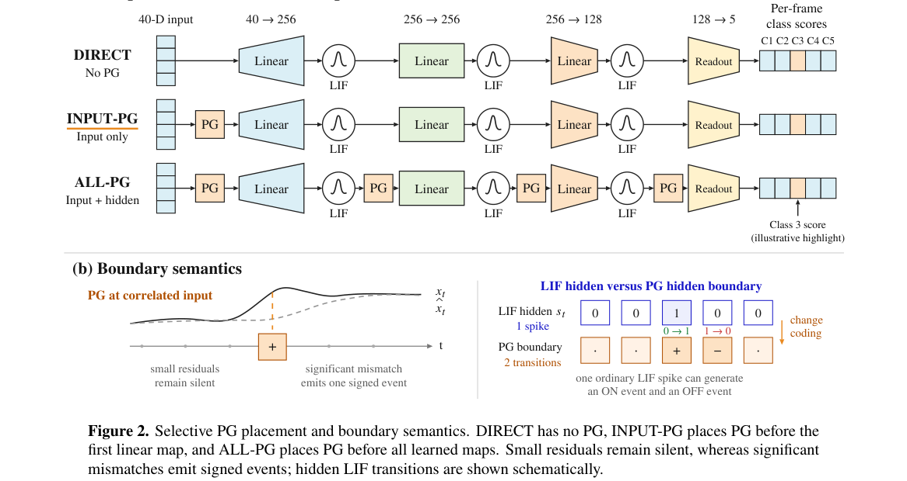

**Why this ranks #4**: 把预测编码搬到声学前端，只传残差事件就把内存与推理开销砍掉三分之一。

---

### 5. Self-Supervised Object-Centric Representation for Multi-Task Audio Analysis

**arXiv**: [2610.41870](https://arxiv.org/abs/2610.41870) | **Score**: 8.0 (relevance 8.0 x 0.7 + quality 8.0 x 0.3) | **Tags**: AIGC-audio, object-centric, slot-attention, self-supervised, sound-event-detection, source-separation, iwaenc-2026, Tampere | **Categories**: cs.SD | **Pages**: 5

**Authors**: Parthasaarathy Sudarsanam; Tuomas Virtanen

**Affiliation**: Tampere University

**Abstract**

> This paper studies the capability of an object-centric audio representation to support multiple downstream tasks within a unified framework. The object-centric model is trained in a self-supervised setup using slot attention by reconstructing Audio Spectrogram Transformer (AST) patch embeddings from a set of latent slots. It is trained on synthetic audio mixtures, which provides controlled multi-source audio scenes. These slot representations are evaluated for the classification, detection, and separation of sound events by training task specific output layers. On the classification task, the model achieves an F1-score of 0.8, comparable to clip-level AST embeddings which achieve 0.7. For sound event detection, it reaches a macro F1-score of 0.7, outperforming clip-level AST embeddings at 0.4 and matching AST patch embeddings at 0.7, which encode finer time-frequency information. In source separation, it achieves an SI-SDR improvement (SI-SDRi) of 18.4 dB. Furthermore, in a zero-shot source separation setting, the model achieves an SI-SDRi of 14.5 dB. These results demonstrate that slot-based representations capture transferable and compositional structure in audio scenes, enabling generalization across tasks and datasets.

**Key findings**

- **Finding**: 论文提出对象中心的音频表征框架，Stage I 用 slot attention 自监督地从若干潜 slot 重建 AST 的 patch embedding，训练数据为合成的多源音频混合。
- **Finding**: 分类任务上 F1 达到 0.8，与 clip 级 AST embedding 的 0.7 相当。
- **Finding**: 声音事件检测上 macro F1 为 0.7，明显高于 clip 级 AST embedding 的 0.4，与编码更细时频信息的 AST patch embedding 持平。
- **Finding**: 声源分离上 SI-SDRi 达到 18.4 dB，zero-shot 分离设定下仍有 14.5 dB。
- **Finding**: 论文结论是 slot 表征在音频场景中捕捉到可迁移、可组合的结构，支持跨任务与跨数据集的泛化。
- **Inference**: 分类上只小幅领先而检测与分离上差距明显，说明组合式 slot 的价值主要体现在需要「拆开多个声源」的任务上。
- **Recommendation**: 推荐读。做多声源音频理解、通用音频表征预训练的读者，值得读其两阶段训练与任务头设计。

**Key figures**

*Framework - Stage I: Self-supervised slot pretraining. Stage II: Downstream classification, detection, and source separation tasks.*

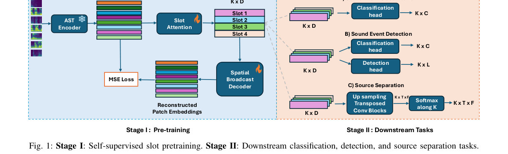

**Why this ranks #5**: 用一组 slot 表示同时支撑分类、检测与分离，把表征学习推向组合式结构。

---

### 6. ARPEGE: Dataset and Methods to Estimate Acoustic and Geometric Parameters of Rooms from Sound

**arXiv**: [2610.41543](https://arxiv.org/abs/2610.41543) | **Score**: 7.7 (relevance 7.5 x 0.7 + quality 8.0 x 0.3) | **Tags**: AIGC-audio, room-impulse-response, ambisonics, acoustic-dataset, image-source-method, blind-room-estimation, spatial-audio, Univ. Gustave Eiffel | **Categories**: cs.SD, eess.AS | **Pages**: 5

**Authors**: Jean-Daniel Pascal Prieto; Prerak Srivastava; Cédric Foy; Antoine Deleforge

**Affiliation**: Univ. Gustave Eiffel; Univ. Strasbourg, CNRS UMR 7501

**Abstract**

> Can one hear the walls of a room? To foster audio signal processing research around this question we release ARPEGE, a dataset containing hundreds of ambisonic spherical-array room impulse responses recorded in 6 empty rooms, annotated by the relative positions of sources, microphones and all acoustic reflectors. The dataset includes multiple room sizes, surface materials, orientations and distances, as well as recordings of human speakers and handclaps. Two state-of-the-art methods on image source localization and blind room parameter estimation are demonstrated on the data. Initial code for re-simulating the measured room impulse responses is provided, a longer term goal being to digitally twin the dataset.

**Key findings**

- **Finding**: 论文发布 ARPEGE 数据集（Acoustic Reflector, room ParamEter and Geometry Estimation），包含在 6 个空房间采集的 248 条 ambisonic 球形阵列房间脉冲响应。
- **Finding**: 房间尺寸与地面面积在 11.5 至 42 平方米之间，多数近似长方体，第 4 个房间带约 1 平方米的凹角呈 L 形，材质涵盖混凝土灰墙、金属与厚玻璃板、亚麻油地板与石膏吊顶。
- **Finding**: 采集使用 Genelec 8020 音箱与 48 kHz 采样，八段 50 Hz 至 20 kHz 指数正弦扫频求平均并反卷积，设备高度统一为 1.58 米，几何标注用激光测距仪人工测量，标注误差估计约 5 厘米。
- **Finding**: 房间 1、2、3、5 还提供 4 个阵列位置上的 192 通道固定声源录音、约 12 分钟法英男女真人语音，以及 3 名操作者各 20 次击掌的 28 组录音。
- **Finding**: 论文在数据上演示两个当时最先进方法：图像声源定位与盲房间参数估计，并提供基于 Pyroomacoustics 图像声源法的初始重仿真代码，长期目标是数字孪生该数据集。
- **Inference**: 带几何真值的房间脉冲响应稀缺，这一数据集的价值主要在给空间声学与房间参数估计提供可复现的评测底座。
- **Recommendation**: 推荐读。做空间音频、房间声学或需要声学仿真数据的研究者，建议取用其标注规范与仿真复现代码。

**Key figures**

*Framework - Examples of impulse response recording setups in the 6 rooms of ARPEGE, with the respective shoebox-envelop dimensions and reverberation times averaged over 4 octave bands from 500 Hz to 4 kHz*

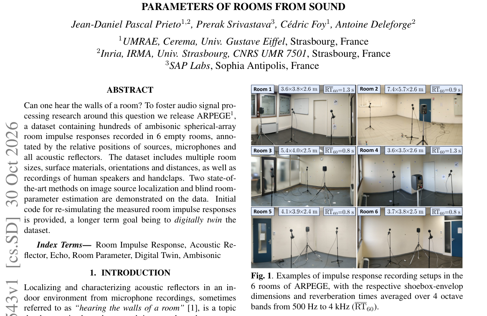

*Result - Example of a measurement-simulation alignment of RIR, with the expected times of arrival of early echoes from geometrical annotations.*

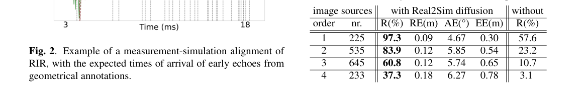

**Why this ranks #6**: 补位进入本线：提供带完整几何标注的球形阵列房间脉冲响应数据集与可复现仿真代码。  [wild-card=yes] ARPEGE 是球形阵列房间脉冲响应数据集与盲房间参数估计方法，属声学数据集与信号处理底座而非生成模型，补位计入。

---

### 7. Self-Localization of Distributed Microphone Arrays Using One Source and Acoustic Reflections

**arXiv**: [2610.41547](https://arxiv.org/abs/2610.41547) | **Score**: 7.7 (relevance 7.5 x 0.7 + quality 8.0 x 0.3) | **Tags**: AIGC-audio, array-self-localization, image-source-model, point-cloud-registration, room-impulse-response, ad-hoc-arrays, spatial-audio, Univ. Strasbourg | **Categories**: cs.SD | **Pages**: 5

**Authors**: Thomas Guffroy; Jean-Daniel Pascal Prieto; Cédric Foy; Antoine Deleforge

**Affiliation**: Univ. Strasbourg, CNRS UMR 7501; Univ. Gustave Eiffel

**Abstract**

> We present a method to estimate the relative position and orientation of two non-coplanar microphone arrays using a room impulse response (RIR) from a single source. The approach exploits early acoustic reflections, retrieved by each array in the form of a 3D image-source point cloud, using a recently-proposed image-source localization technique. The task is then reduced to aligning the two unlabeled point clouds, which is made difficult by their inherent symmetries and by spurious, missing and noisy estimates. To this aim we introduce ARCTIC, a point-cloud registration algorithm that performs a ranked search over congruent triangles anchored on the true source. Simulated and real experiments show that ARCTIC strongly outperforms two baselines, achieving mean angular and radial self-localization errors below 5 and 10 cm across 36 real RIRs measured in 6 different rooms.

**Key findings**

- **Finding**: 论文给出只用单个声源的房间脉冲响应来估计两套非共面麦克风阵列相对位置与朝向的方法，每个阵列把早期反射转成三维图像声源点云。
- **Finding**: 难点在于两个无标签点云的对齐，作者引入 ARCTIC（Anchor-based Registration using Congruent TrIangle Consensus），以真实声源为锚点对相似三角形做排序搜索。
- **Finding**: 在 6 个不同房间采集的 36 条真实脉冲响应上，ARCTIC 的平均角度误差低于 5 度、平均径向误差低于 10 厘米，显著优于两个基线。
- **Finding**: 论文强调自己研究的是文献中尚未探索的极简设定：不假设时间同步、已知声源位置、已知房间几何或近场条件，只需阵列内部同步与已知内部几何。
- **Inference**: 复用早期反射做定位，把「多声源事件」需求压到单声源，代价是必须处理点云固有的对称性与虚假、缺失估计。
- **Recommendation**: 推荐读。做 ad-hoc 麦克风网络、空间音频自标定的读者，值得读其点云配准的锚点搜索实现。

**Key figures**

*Framework - Proposed approach: RIRs are mapped to image-source point clouds which are robustly aligned to self-localize the arrays.*

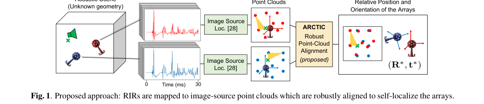

*Result - Influence of the number of image sources on the pro- portion of correct alignments using ARCTIC.*

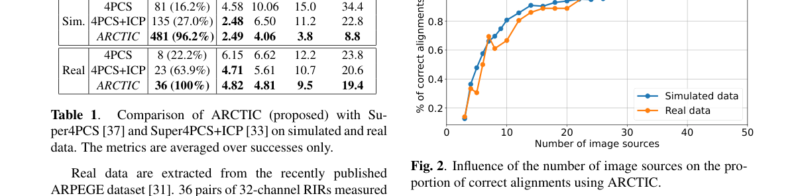

**Why this ranks #7**: 补位进入本线：用单声源与早期反射完成两套分布式阵列的相对位姿自定位。  [wild-card=yes] 用单个声源与早期反射做分布式麦克风阵列自定位，是空间音频的测量算法，补位计入。

---

### 8. A richness-sensitive Acoustic Biodiversity Index from species-level detections: classifier benchmarking, false-positive control and validation against standard soundscape indices in an African savanna and an urban zoo

**arXiv**: [2610.42042](https://arxiv.org/abs/2610.42042) | **Score**: 7.7 (relevance 7.5 x 0.7 + quality 8.0 x 0.3) | **Tags**: AIGC-audio, bioacoustics, biodiversity-index, birdnet, false-positive-control, passive-acoustic-monitoring, richness, Abu Dhabi Maritime Academy | **Categories**: cs.LG, cs.SD, q-bio.QM | **Pages**: 35

**Authors**: Muhammad Saeed; Dmitry Mikhaylov; Mohamed H. Alhosani; Yasser F. Al Wahedi; Rory Pilossof; Ahmed Arabi; Walid Shaaba

**Affiliation**: Abu Dhabi Maritime Academy; My Trees Trust; Emirates Park Zoo and Resort

**Abstract**

> Acoustic indices are widely used as rapid proxies for biodiversity, but they summarise the distribution of sound energy rather than the species producing it and often track richness poorly. We revise and test an Acoustic Biodiversity Index (ABI) built from species-level detections. Its primary form, ABI_E, is Shannon diversity of detections normalised by the regional species pool expected at the site and season (H / ln S_ref); temporal stability T is reported as a separate component. We first benchmarked four classifiers on a strongly labelled tropical dataset (1,216 calls, 24 classes) with recording-grouped cross-validation. BirdNET embeddings + logistic regression performed best (macro-F1 0.750 +/- 0.029), and random frame-level splits inflated accuracy from 0.41 to 0.70. We then applied BirdNET v2.4 with a location and season filter to recordings from a riverine savanna in the Zambezi Valley, Zimbabwe, and from three habitats at Emirates Park Zoo and Resort, Abu Dhabi, United Arab Emirates. A stricter post-hoc location filter removed 517 high-confidence detections of 9 implausible species, all at the zoo. After diel-matched rarefaction to equal effort (6 h), the savanna site held 21 species (Hill number 1D = 9.83; ABI_E = 0.38) against 1.3-13 species (ABI_E = 0.03-0.21) at the zoo sites. Across 149 recorded hours, ABI_E correlated strongly with richness (Spearman rho = 0.93), whereas six standard indices did not (best: ACI, rho = 0.48). The stability term was lower at the savanna site (0.39) than at the zoo (0.65-0.67), showing that it penalises the natural diel cycle of bird activity. Species-level indices with explicit false-positive control, a declared regional reference pool and effort standardisation provide a more interpretable biodiversity indicator than energy-based acoustic indices.

**Key findings**

- **Finding**: 论文重新修订基于物种级检出的声学生物多样性指数 ABI，其主形式 ABI_E 为检出结果的 Shannon 熵除以该地点与季节的参考物种池（H / ln S_ref），时间稳定性 T 作为独立分量单独报告。
- **Finding**: 在强标注热带数据集（1216 次鸣声、24 类）上用录制组交叉验证比较四个分类器，BirdNET embedding 加逻辑回归最佳，macro-F1 为 0.750 ± 0.029。
- **Finding**: 论文指出随机帧级切分会虚高，准确率从 0.41 被抬到 0.70，因此必须按录制分组划分。
- **Finding**: 在赞比西河谷稀树草原与阿布扎比酋长国动物园三处生境应用 BirdNET v2.4 并加地点与季节过滤后，更严格的事后地点过滤剔除了 517 条高置信度误报、涉及 9 个不合理物种，且全部出现在动物园。
- **Finding**: 按昼夜匹配稀释到同等努力量（6 小时）后，草原站点有 21 个物种（Hill 数 1D = 9.83，ABI_E = 0.38），动物园各站点为 1.3 至 13 个物种（ABI_E = 0.03 至 0.21）。
- **Finding**: 在 149 小时录音上 ABI_E 与物种丰富度的 Spearman 相关为 0.93，而六个标准声景指数中最好的 ACI 只有 0.48；稳定性项草原为 0.39、动物园为 0.65 至 0.67。
- **Inference**: 差异主要来自「参考物种池 + 显式误报控制 + 努力量标准化」三件事，说明能量型指数丢掉了物种身份这一层信息。
- **Recommendation**: 推荐读。做生态声学、被动监测或需要用模型检测结果构造可解释指标的读者，建议关注其评估协议设计。

**Key figures**

*Framework - Location of the two study areas: Chirundu in the Zambezi Valley, northern Zimbabwe (riverine savanna; one recorder), and Emirates Park Zoo and Resort, Abu Dhabi, United Arab Emirates (three re*

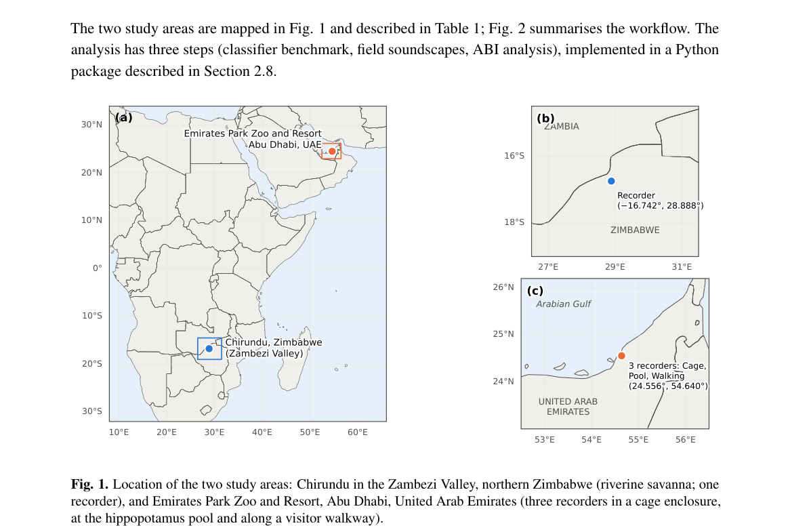

*Result - Analysis workflow. Field recordings are standardised to 30 min h−1 and analysed in 1-min blocks for six acoustic indices and for BirdNET species detections with a location and season filter. A*

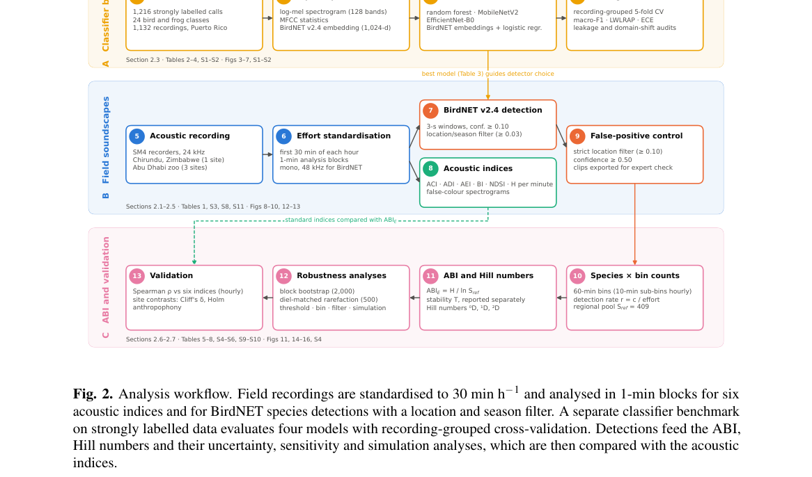

**Why this ranks #8**: 补位进入本线：把生物多样性指标从声能统计换成物种级检出，并给出完整的误报控制链条。  [wild-card=yes] 以物种级检出构建声学生物多样性指数，是生态声学指标研究，补位计入。

---

### 9. A General Theoretical Framework for Transformed Geometric Pattern Matching in Music

**arXiv**: [2610.42095](https://arxiv.org/abs/2610.42095) | **Score**: 7.1 (relevance 7.0 x 0.7 + quality 7.5 x 0.3) | **Tags**: AIGC-audio, music-theory, pattern-matching, transformation-class, formalization, occurrence-set, m-i-r, Aalborg | **Categories**: cs.CG, cs.SD | **Pages**: 61

**Authors**: David Meredith

**Affiliation**: Aalborg University

**Abstract**

> In this paper, we present a framework of concepts, terminology and notation for geometric pattern matching, centred around the idea of a {\em transformation class}. After formally defining the concept of a transformation class, we provide detailed definitions of a number of specific transformation classes that are particularly relevant to pattern matching and pattern discovery in music, which is the primary application domain within which the framework has been developed. We then provide formal definitions of the notions of {\em match}, {\em occurrence}, {\em maximal match\/} and {\em maximal occurrence\/} and prove some results relating to these concepts. We then define and explore in detail the idea of an {\em occurrence set\/} and the more general notion of a {\em heterogeneous occurrence set}. Finally, we explore in detail the concept of {\em transformational equivalence}, including a consideration of {\em transformation groups}, along with the group-theoretic and transformational equivalence properties of selected transformation classes.

**Key findings**

- **Finding**: 论文提出以「变换类」（transformation class）为核心的几何模式匹配概念、术语与记号框架，并正式定义该概念。
- **Finding**: 论文给出与音乐模式匹配和模式发现相关的多个具体变换类的详细定义，并证明 match、occurrence、maximal match、maximal occurrence 之间的关系。
- **Finding**: 论文进一步定义并深入讨论 occurrence set 以及更一般的 heterogeneous occurrence set。
- **Finding**: 最后一部分详述 transformational equivalence，纳入 transformation group 的考量，并分析若干变换类的群论与变换等价性质。
- **Finding**: 论文说明该框架虽以音乐为主要应用域发展，但原则上可推广到任何数据为多维点集、且点集间有意义关系可由几何变换建模的领域。
- **Finding**: 论文的 61 页篇幅包含 23 张图，作者标注为即将出版书籍第二章的草稿；文中提到的变换类此前已用于分析拉威尔《Menuet sur le nom d'Haydn》中 HAYDN 主题各处出现之间的关系。
- **Inference**: 这类长篇形式化论文的价值在于把社区里口头流传的「同一段旋律换位重复」变成可判定、可组合的数学对象。
- **Recommendation**: 推荐读。做音乐模式发现、主题检索或需要统一术语的研究者，可作为该方向的定义性参考慢读。

**Key figures**

*Framework - Pseudocode for the insertion-sort algorithm (based on Cormen et al. [1, p. 18]).*

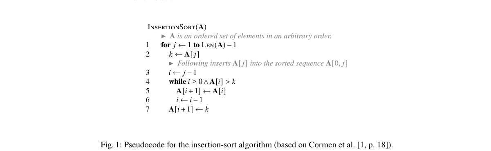

*Result - A straightforward implementation in Java of the insertion-sort pseudocode shown in Fig. 1.*

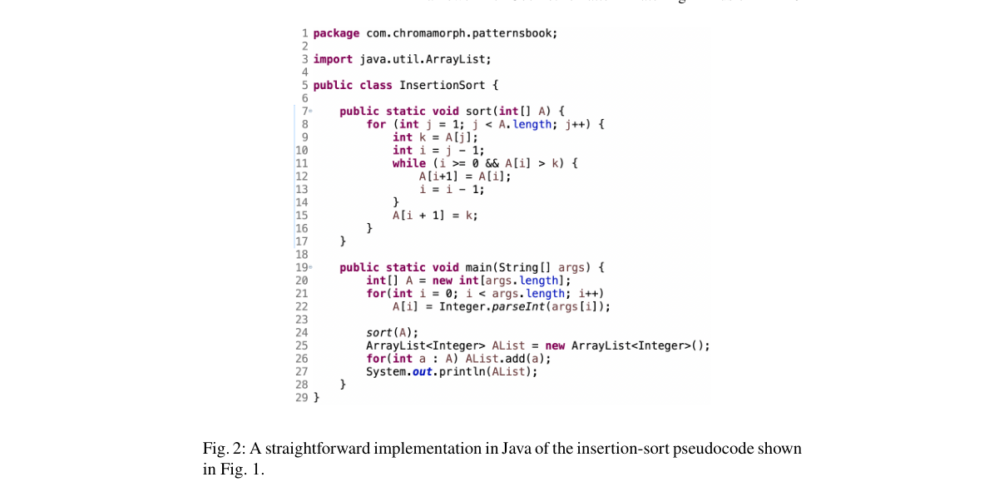

**Why this ranks #9**: 补位进入本线：为音乐中的几何模式匹配建立一套完整的形式化概念与记号体系。  [wild-card=yes] 音乐中几何模式匹配的理论框架与记号体系，属音乐信息学的形式化基础，补位计入。

---

### 10. MotorSense: A Video-EMG Dataset of Motoric Representations for Action Understanding

**arXiv**: [2610.41127](https://arxiv.org/abs/2610.41127) | **Score**: 7.1 (relevance 7.0 x 0.7 + quality 7.5 x 0.3) | **Tags**: AIGC-audio, video-emg, egocentric-video, sensorimotor-alignment, cross-modal-pretraining, hand-reconstruction, neurips-2026, University of Maryland | **Categories**: cs.CV, cs.RO | **Pages**: 28

**Authors**: Eadom Dessalene; Michael Maynord; Amir-Hossein Shahidzadeh; Botao He; Yasamin Tabatabaee; Ruoshi Liu; Ruohan Gao; Paul Pu Liang; Yiannis Aloimonos

**Affiliation**: University of Maryland, College Park; Carnegie Mellon University; Massachusetts Institute of Technology

**Abstract**

> Computer vision models learn hand action only from its visual consequences, without access to the underlying embodied motor signals. We address this absence with MotorSense, the first large-scale paired egocentric video and surface electromyography (EMG) dataset. MotorSense pairs bimanual EMG bands with egocentric video and yields synchronized video, bimanual EMG and IMU, and audio across 100 hours of unscripted manipulation. EMG offers a powerful scalable alternative to manual annotation: it captures finger movement, hand configuration, and the forces exerted between hand and environment as a dense signal free of occlusion and labeler bias, whereas manual annotation is costly, subjective, and unreliable under occlusion. We use MotorSense to learn sensorimotor alignment, producing an organization of action that is shared across the visual and motoric spaces, through cross-modal pre-training between video and EMG. The resultant vision models are then transferred to downstream tasks that benefit from sensorimotor alignment: in this case, action recognition, 3D hand reconstruction, and 3D contact reconstruction. We further demonstrate a generative application in which EMG motor signals are used to condition a video diffusion model, yielding videos of fine-grained hand manipulation. Across four action-centric computer vision tasks and eight popular video datasets, we demonstrate that sensorimotor alignment provides a stronger foundation for visual representation learning than conventional self-supervised learning methods over video, outperforming every baseline across all tasks and datasets evaluated.

**Key findings**

- **Finding**: 论文发布 MotorSense，首个大规模配对的自我中心视频与表面肌电（EMG）数据集，把双侧 EMG 臂带与自我中心视频配对，产出同步的视频、双侧 EMG 与 IMU 以及音频，覆盖 100 小时无脚本操作。
- **Finding**: 作者强调 EMG 相比人工标注的优势：它捕捉手指运动、手部构型与手与环境之间的作用力，是不受遮挡与标注者偏差影响的稠密信号。
- **Finding**: 论文用视频与 EMG 的跨模态预训练学到感知—运动对齐，得到在视觉空间与运动空间之间共享的动作组织方式。
- **Finding**: 所得视觉模型被迁移到动作识别、三维手部重建与三维接触重建三类下游任务，并进一步演示用 EMG 运动信号条件化视频扩散模型生成细粒度手部操作视频。
- **Finding**: 在四个以动作为中心的视觉任务与八个常用视频数据集上，感知—运动对齐强于常规视频自监督学习方法，并在所评全部任务与数据集上超过每个基线。
- **Inference**: 把「动作的因」而非只有「动作的果」引入预训练，等于给视觉表征补上物理约束，这对遮挡场景尤其有利。
- **Recommendation**: 推荐读。做自我中心视频、手部重建或想引入具身信号的视觉研究者，可关注其数据集与跨模态预训练设置。

**Key figures**

*Result - The bimanual EMG sensing setup of MOTORS- ENSE. Middle: the MindRove Armband used for data col- lection, worn on the left and right wrists (top and bottom row, respectively), with colored do*

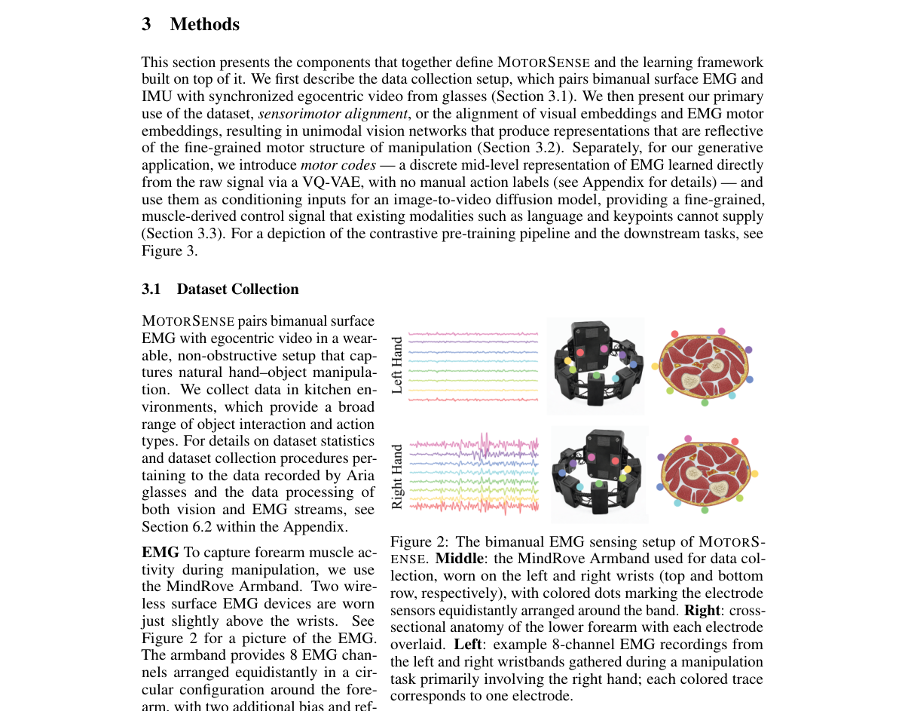

**Why this ranks #10**: 补位进入本线：首个大规模视频与表面肌电配对数据集，让动作理解有身体内部信号可依。  [wild-card=yes] Video-EMG 手部运动数据集，评测的是动作理解而非音频生成，仅因 EMG 信号与语音产生共享发声肌群而进入该线，补位计入。

---

## Footer

- Total papers scanned across all 7 tracks: 465（原始 615 条）
- aigc_audio track final top-10: 10
- Wild-cards in this track: 5
- Figure assets: 2026-11-02/res/

Generated by `mine-arxiv-daily-digest` skill. Sister file: `2026-11-02_aigc_audio_entry.md`.
