# ArXiv Daily Digest - 2026-11-02 (AIGC 视觉生成, 10 papers)

**Generated**: 2026-11-02 17:30 CST

**Source**: arXiv cs.CV, cs.SD, eess.AS, cs.CL, cs.AI, cs.RO, cs.LG submissions, listing day 2026-10-30 (announced 2026-10-31 00:00 UTC)

**Batch window**: 2026-10-29T18:00:00Z .. 2026-10-30T18:00:00Z（arXiv 公告批次横跨两个 UTC 日：前一日 18:00 UTC 起算，当日 17:59:59 UTC 截止）

**Track**: aigc_visual (top 10 of 465 papers scanned, 70 full reads)

**Scope**: 图像 / 视频 / 3D 内容的生成与编辑，含扩散与流匹配模型的训练方法、加速、评测基准

---

## Top 10 - AIGC 视觉生成

### 1. Any Forcing: Any-Step Generality and One-Step Stability for Autoregressive Video Generation

**arXiv**: [2610.42031](https://arxiv.org/abs/2610.42031) | **Score**: 9.3 (relevance 9.5 x 0.7 + quality 9.0 x 0.3) | **Tags**: AIGC-visual, AIGC-visual, autoregressive-video, one-step-generation, adversarial-discriminator, long-video, kv-cache-memory, Xidian University, Xidian | **Categories**: cs.CV | **Pages**: 19

**Authors**: Jiahua Xu; Yijie Fang; Nannan Wang; Xunhao Lin; Li Cao; Lei Hao; Mingrui Zhu; Fei Gao; Xinbo Gao

**Affiliation**: Xidian University; Huawei

**Abstract**

> Autoregressive video generation enables efficient inference through streaming prediction. However, existing methods are typically restricted to fixed sampling steps, limiting the flexibility to balance generation quality and efficiency, while one-step generation suffers from degraded visual quality and error accumulation over long sequences, leading to content drift and generation collapse. To address these issues, we propose Any Forcing, a unified framework for achieving Any-Step Generality and One-Step Stability. Specifically, we introduce a unified adversarial discriminator that jointly performs real-distribution alignment, inter-step consistency alignment, and first-frame quality enhancement, enabling flexible sampling while preserving one-step generation quality. Furthermore, we propose a training-free adaptive long-term memory selection mechanism that selects historical states based on global semantic relevance and local value contribution, while remapping their temporal positions to preserve temporal relationships within the memory cache, thereby enabling stable one-step long-video generation. Experiments demonstrate that Any Forcing achieves high-quality and stable one-step autoregressive video generation, achieving 20.9 FPS and 24.7 FPS for short and long video generation on a single H100 GPU, respectively.

**Key findings**

- **Finding**: Any Forcing 用统一对抗判别器同时做真实分布对齐、采样步间一致性与首帧增强，让同一套权重适配不同采样步数。
- **Finding**: 480p 5 秒视频上，4 步与 2 步的 VBench 总分分别为 85.09 与 84.89，高于 CausVid 的 83.05/81.03 与 Self Forcing 的 84.20/81.79。
- **Finding**: 一步采样下总分 85.06(1*)与 84.79(1†)，同样高于 ASD、One Forcing 与 Causal Forcing。
- **Finding**: 消融显示去掉首帧增强后总分从 85.06 掉到 83.52、从 84.79 掉到 81.86，是三项对抗任务中影响最大的一项。
- **Finding**: 提出免训练的自适应长期记忆选择，按全局语义相关性与局部价值贡献挑选历史状态，并重映射其时间位置。
- **Finding**: 单张 H100 上短视频 20.9 FPS、长视频 24.7 FPS(历史帧预算 H=6)，长视频总分为对比方法中最高。
- **Inference**: 统一判别器把采样步数从模型属性变成推理期参数，比为每个步数单独蒸馏一套模型更实用。
- **Inference**: 首帧增强影响最大，说明一步生成的质量瓶颈在初始化，而不是后续帧的误差累积。
- **Recommendation**: 推荐。做实时或流式视频生成、需要在部署期自由切换采样步数的读者优先读。

**Key figures**

*Framework - Visual comparison of short- and long-video generation. Existing methods exhibit degraded visual quality and suffer from long-horizon error accumulation under one-step sampling. Any Forcing ac*

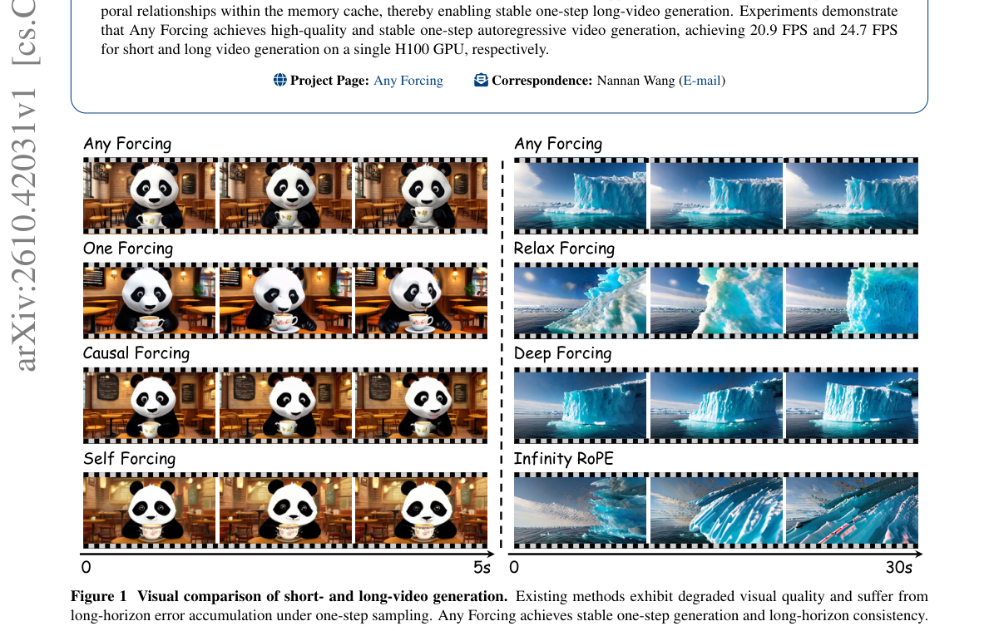

*Result - Motivation of Any Forcing. Existing methods struggle to balance sampling-step generality and one-step quality, while in- sufficient global relevance or local contribution undermines one- ste*

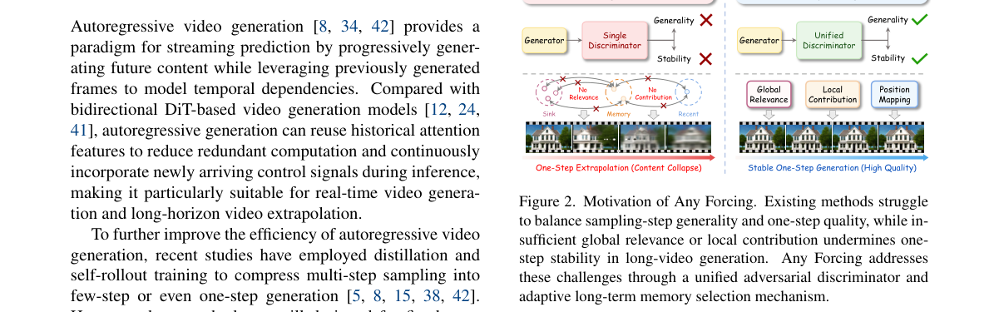

**Why this ranks #1**: 把采样步数自由度与一步稳定性塞进同一个对抗判别器，一步长视频不再内容漂移。

---

### 2. MoETok: Sparse Expert Routing for 1D Visual Tokenizers

**arXiv**: [2610.41992](https://arxiv.org/abs/2610.41992) | **Score**: 9.3 (relevance 9.5 x 0.7 + quality 9.0 x 0.3) | **Tags**: AIGC-visual, AIGC-visual, visual-tokenizer, mixture-of-experts, autoregressive-generation, query-role-analysis, unified-model, Huazhong University of Science and Technology, Huazhong | **Categories**: cs.CV | **Pages**: 23

**Authors**: Jiahao Guo; Bao Tang; Haoxiang Cao; Jingfeng Yao; Bo Li; Wenyu Liu; Kun Gai; Changqian Yu; Xinggang Wang

**Affiliation**: Huazhong University of Science and Technology; South China Normal University

**Abstract**

> Modern visual tokenizers aim to preserve fine-grained visual details while learning high-level semantic representations for downstream generation and understanding. Query-based 1D visual tokenizers encode images into flexible latent sequences, yet how individual learnable queries gather and encode image information remains poorly understood. We reveal that these queries spontaneously develop complementary roles under semantic supervision: a small set of Content queries captures high-level semantic information, while a larger set of Detail queries preserves fine-grained visual details for reconstruction. To adapt token processing to these heterogeneous roles, we introduce MoETok, a 1D visual tokenizer that routes tokens through sparsely activated experts. Jointly optimized with reconstruction and semantic objectives, the router learns role-specialized processing paths adapted to each token's representation. Across model scales and token budgets, MoETok consistently improves reconstruction, semantic representation, and autoregressive generation over dense tokenizers under matched supervision and active computation. On ImageNet, it combines strong reconstruction and semantic representation with state-of-the-art class-conditional generation within the 1D tokenizer family. We further validate MoETok at scale in a unified autoregressive model jointly trained for understanding and generation with a next-token cross-entropy objective. The resulting model combines competitive visual understanding with state-of-the-art generation among unified discrete models, matching or surpassing diffusion-based models such as BAGEL and Qwen-Image on benchmarks including DPG-Bench (87.61), GenEval2 (40.04 GM), and WISE (0.49).

**Key findings**

- **Finding**: 论文用注意力方差与逐查询 linear probe 分析多种 1D tokenizer，发现语义监督下查询自发分化：少量 Content 查询抓高层语义，大量 Detail 查询保留重建细节。
- **Finding**: 只用 Content 查询解码会彻底失败(rFID 大于 300)，遮蔽 Detail 查询则只在对应区域破坏重建。
- **Finding**: 在 1D(query-based)设置下，MoETok 把 rFID 从 1.522 降到 1.368，linear probe 从 48.72 提到 60.22，zero-shot Top-1 从 59.17 提到 65.03，gFID 从 10.35 降到 9.59。
- **Finding**: 专家设计消融给出 E8/T2 为折中方案(linear probe 60.63、zero-shot 66.37、gFID 8.99)，全激活 8 个专家提升有限但激活算力翻四倍。
- **Finding**: 在 Small/Base/Large 三种规模与 64/256 两种 token 预算下均优于 dense tokenizer，ImageNet 类条件生成在 1D tokenizer 家族中达到最好水平。
- **Finding**: 统一自回归模型在 DPG-Bench 87.61、GenEval2 40.04 GM、WISE 0.49 上与 BAGEL、Qwen-Image 等扩散模型相当或更优。
- **Inference**: 稀疏 MoE 的收益来自角色分工而非堆参数——角色划分先由分析给出，路由再把它兑现成算力分配。
- **Inference**: Content-only 解码 rFID 大于 300 说明两类查询不可互相替代，这是全文最有说服力的因果证据。
- **Recommendation**: 推荐。做 1D tokenizer、统一理解与生成模型，或想压缩自回归生成算力的读者值得读。

**Key figures**

*Framework - Semantic supervision promotes query-role differentiation. Each query is plotted by attention variance Vq and per-query linear probe score. Blue and orange indicate Detail and Content queries*

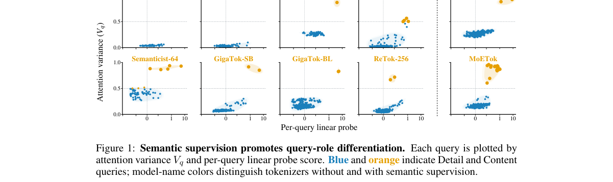

*Result - Complementary query roles. (a) Content attention follows objects; Detail atten- tion stays localized. (b) Masking Detail queries affects reconstruction in matching regions.*

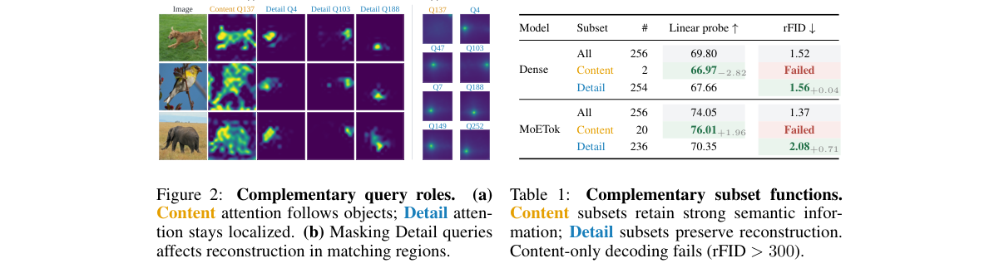

**Why this ranks #2**: 先证明 1D token 的查询会分化成内容与细节两类角色，再用稀疏专家路由按角色分派算力。

---

### 3. From Evaluation to Evolution: Benchmarking Image Editing and Evolving Image Models

**arXiv**: [2610.41210](https://arxiv.org/abs/2610.41210) | **Score**: 9.2 (relevance 9.5 x 0.7 + quality 8.5 x 0.3) | **Tags**: AIGC-visual, AIGC-visual, image-editing-benchmark, checklist-evaluation, recursive-self-improvement, multi-agent, Sun Yat-sen University, Sun Yat-sen | **Categories**: cs.AI, cs.CV | **Pages**: 58

**Authors**: Jun He; Canmiao Fu; Ying Zhang; Zhipeng Huang; Chenyu Mu; Yazhen Xie; Chen Li; Jing Lyu; Weijia Li; Xiang Zhang

**Affiliation**: Sun Yat-sen University; WeChat Vision, Tencent Inc.; Xidian University; Fudan University; Tsinghua Shenzhen International Graduate School

**Abstract**

> Real-world image editing requires coordinating multiple visual transformations with content preservation and reference constraints, yet aggregate scores can readily obscure unmet local requirements. Effective evaluation must therefore identify local failures and translate them into priorities for subsequent model improvement. We introduce WeGenEditBench, comprising 2,740 evaluation instances and 148 task types across single-image, text-intensive, and multi-reference editing. Pre-generated checklists shared across models decompose each request into atomic requirements; item-level deductions and visual evidence are established first and then summarized into scores for edit execution, preservation, visual quality, and task-specific correctness. To support the experience-acquisition component of recursive self-improvement (RSI), we develop WeGenEvoStudio, a unified multi-agent harness for RSI-oriented learning that integrates model-conditioned failure diagnosis, retrieval-grounded data construction, supervised adaptation, and re-evaluation. Among 15 evaluated configurations, GPT-Image-2 leads single-image editing with an Overall score of 4.076, while Seedream-5.0-Pro leads text-intensive editing at 4.291. Evolution experiments across four generation and editing benchmarks demonstrate substantial targeted gains: on their report-selected Top-5 single-image targets, FLUX.2 [dev] improves Overall from 1.083 to 3.517, while Qwen-Image-Edit-2511 gains 13.2%. Together, our benchmark and harness provide a foundation for developing more reliable image models through interpretable evaluation and feedback-driven learning.

**Key findings**

- **Finding**: 提出 WeGenEditBench，含 2,740 个评测实例、19 个任务族、148 个任务类型，覆盖单图编辑、文本密集编辑与多参考编辑三种设定。
- **Finding**: 每个实例预生成一份跨模型共享的原子级 checklist，单图 checklist 通常 16–20 条，文本密集与多参考通常 6–10 条。
- **Finding**: 逐条判定与视觉证据先建立，再汇总为编辑执行、内容保持、视觉质量与任务正确性四项得分。
- **Finding**: 15 个评测配置中，GPT-Image-2 以 Overall 4.076 领先单图编辑，Seedream-5.0-Pro 以 4.291 领先文本密集编辑。
- **Finding**: WeGenEvoStudio 多智能体 harness 集成条件化失败诊断、检索式数据构造、监督式适配与再评估，构成 RSI 导向的闭环。
- **Finding**: 在四个生成与编辑基准的演化实验中，FLUX.2 [dev] 在自选 Top-5 单图目标上 Overall 从 1.083 提到 3.517，Qwen-Image-Edit-2511 提升 13.2%。
- **Inference**: 聚合分数会掩盖局部未满足的要求，checklist 化评测把「模型错在哪」变成可训练的监督信号。
- **Inference**: 诊断-检索-构造-再评估的闭环说明评测基准本身可以当数据引擎用，这比刷榜更有价值。
- **Recommendation**: 推荐。做图像编辑评测，或想用失败案例反向驱动模型迭代的读者必读。

**Key figures**

*Framework - From evaluation to evolution. Aggregate scores can obscure unmet editing requirements and leave training priorities unspecified (left). WeGenEditBench exposes these requirements through sampl*

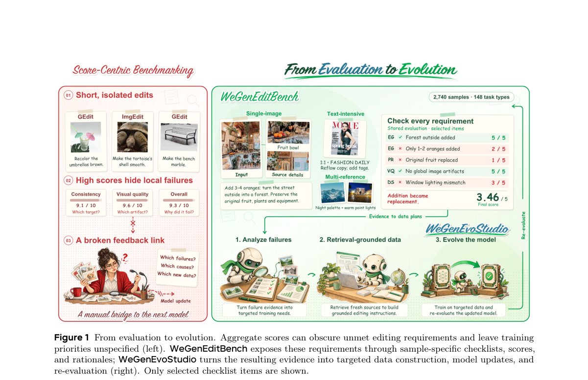

*Result - Taxonomy and characteristics of WeGenEditBench. Left: settings, task families, examples, instance counts (inner), and subtypes (outer). Right: distributions of instruction length (a), tag mul*

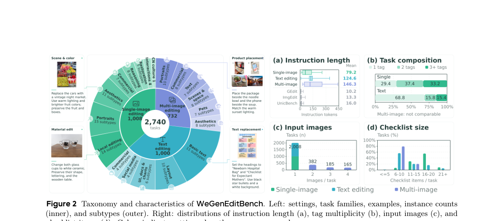

**Why this ranks #3**: 把图像编辑评测拆成逐条 checklist，再把失分项直接喂回多智能体流程驱动模型迭代。

---

### 4. VoxLution: Evolving Voxels for High-Fidelity 3D Scene Generation

**arXiv**: [2610.41501](https://arxiv.org/abs/2610.41501) | **Score**: 9.0 (relevance 9.0 x 0.7 + quality 9.0 x 0.3) | **Tags**: AIGC-visual, AIGC-visual, 3d-scene-generation, sparse-voxel, autoregressive-cascade, super-resolution, Technical University of Munich, Technical | **Categories**: cs.CV | **Pages**: 18

**Authors**: Daoyi Gao; Xinyi Zhang; Alexey Bokhovkin; Lei Li; Angela Dai

**Affiliation**: Technical University of Munich

**Abstract**

> High-resolution 3D indoor scene generation is crucial for immersive applications such as virtual reality, spatial computing, and robotics simulation. We introduce VoxLution, a coarse-to-fine transformer-based approach that generates high-fidelity indoor scenes with rich details, overcoming the overly smooth geometry typical of existing generative models. First, we generate a low-resolution spatial layout; then, based on this structural information, we progressively refine the scene geometry locally in chunks. Key to our approach is formulating 3D super-resolution as a sequence modeling problem over multi-resolution sparse voxel grids. To achieve this, we introduce a training-free, resolution-invariant tokenization scheme that compactly encodes the geometric information of eight octants into a single decimal number. We formulate the transformer sequence to include multiple resolutions, allowing the coarse layout to guide the generation of fine local details. To ensure coherence across local chunks, we incorporate adjacent chunk boundary information directly into the transformer sequencing. VoxLution achieves scene generation at a finer voxel resolution than existing baselines, demonstrating state-of-the-art performance on standard benchmarks with 59.6% lower FPD and 51.1% lower FID on 3D-FRONT, and 70.5% lower FPD and 73.8% lower FID on Scannet++.

**Key findings**

- **Finding**: VoxLution 采用由粗到细的 transformer 级联：先生成低分辨率空间布局，再按块逐级局部细化几何，每级分辨率翻倍。
- **Finding**: 提出免训练的分辨率无关八分体编码 ROC，把一个体素的八个子八分体压成一个字节，所有分辨率共享同一个 256 项 codebook。
- **Finding**: 把相邻块的边界信息直接写进 transformer 序列，以保证块与块之间的几何连贯。
- **Finding**: 生成分辨率从 25 cm 逐级细化到 1.5625 cm，比基线的体素分辨率细 41%。
- **Finding**: 3D-FRONT 上 FPD 降低 59.6%、FID 降低 51.1%；Scannet++ 上 FPD 降低 70.5%、FID 降低 73.8%。
- **Finding**: 论文把 3D 超分形式化为多分辨率稀疏体素网格上的序列建模问题，粗布局因此能指导细粒度局部生成。
- **Inference**: 把 3D 超分写成序列建模，等于用自回归的局部一致性替代全局一次性预测，代价是块级边界必须显式约束。
- **Inference**: 共享 codebook 的免训练编码让所有分辨率共用一套词表，这是能训到 1.56 cm 分辨率的关键。
- **Recommendation**: 推荐。做高分辨率室内场景、机器人仿真环境或 3D 资产生成的读者值得读。

**Key figures**

*Framework - We introduce VoxLution, a sparse autoregressive approach that synthesizes high-resolution 3D indoor scenes through a sparse autoregressive cascade that refines a coarse layout hierarchically*

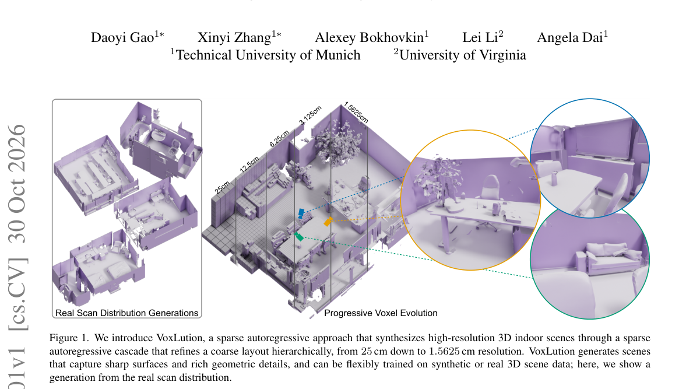

*Result - Overview of VoxLution. We synthesize high-fidelity 3D indoor scenes as a multi-resolution autoregressive cascade, using a sparse resolution-invariant coding (ROC) for tokenization and chunke*

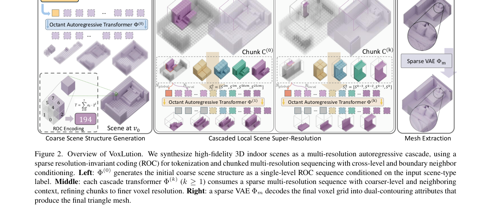

**Why this ranks #4**: 把 3D 超分重写成多分辨率稀疏体素上的序列建模，室内场景能生到 1.5625 cm 体素。

---

### 5. GeoFlip: Benchmarking Geometry-Sensitive Physics in Video Generation

**arXiv**: [2610.42002](https://arxiv.org/abs/2610.42002) | **Score**: 8.8 (relevance 9.0 x 0.7 + quality 8.5 x 0.3) | **Tags**: AIGC-visual, AIGC-visual, video-generation-benchmark, physical-consistency, geometry-intervention, image-to-video, City University of New York, City | **Categories**: cs.CV | **Pages**: 14

**Authors**: Yuqi Li; Junming Liu; Bowen Hu; Ruize Niu; Huiran Duan; Yingli Tian; Hao Wu

**Affiliation**: City University of New York; Sun Yat-sen University; The Chinese University of Hong Kong; Carnegie Mellon University

**Abstract**

> Video generation models synthesize realistic motion, but can they respond correctly to changes in initial geometry? We introduce GeoFlip, a video generation benchmark centered on physical outcome flips induced by geometry. With shared physical settings and textual prompts held fixed, GeoFlip applies controlled interventions to support extent, object placement, and mechanism configuration, constructing paired scenes with contrasting reference events, such as remaining stable versus falling or tipping. These pairs test whether models translate geometric differences in the first frame into correct physical evolution. The benchmark comprises 482 scene pairs and 964 reference videos across six physical categories, with reference outcomes established through procedural scene construction, physics simulation, and numerical validation and verification of physical events. We evaluate 16 models for image to video generation along three dimensions: event correctness, structural integrity, and similarity to reference videos. We examine evaluation consistency with independent vision language judges. On the 442 conditions shared by all models, the highest event correctness averaged across tasks is 27.98%, revealing substantial limitations in physical generation conditioned on geometry. Model strengths vary across physical mechanisms, and the three evaluation dimensions capture distinct capabilities. Typical failures include ignoring geometric changes, generating incorrect object motion, bending rigid objects, and introducing additional components. Rank correlations between judges reach 0.906 for event correctness and 0.929 for structural integrity. By combining controlled geometric interventions, verifiable physical references, and multidimensional evaluation, GeoFlip assesses progress from visual realism toward physical consistency conditioned on geometry.

**Key findings**

- **Finding**: GeoFlip 通过受控几何干预(支撑范围、物体摆放、机构配置)构造配对场景，在提示词与物理设定不变时让参考事件翻转，如保持稳定变为倾倒。
- **Finding**: 基准含 482 组场景对与 964 个参考视频，覆盖六类物理机制，参考结局由程序化场景搭建、物理仿真与数值验证确定。
- **Finding**: 评测 16 个图生视频模型，三个维度分别是事件正确性、结构完整性与参考视频相似度。
- **Finding**: 在 16 个模型共有的 442 个条件上，最高的平均事件正确率只有 27.98%。
- **Finding**: 各模型强弱随物理机制变化，滑轮耦合类平均事件正确率最高(30.1%)、支撑稳定性 28.2%，Wan2.2 在受限引力动力学类别领先(30.6%)。
- **Finding**: 独立视觉语言评委之间的排名相关性在事件正确性上达 0.906、结构完整性上达 0.929。
- **Finding**: 典型失败模式包括忽略几何变化、生成错误的物体运动、弯折刚性物体与凭空引入多余部件。
- **Inference**: 事件正确率不到三成，说明当前视频模型的物理感知仍停留在视觉合理而非几何因果层面。
- **Recommendation**: 推荐。做视频生成评测，或想量化模型几何敏感性的读者必读。

**Key figures**

*Framework - Plausible motion can miss geometry-dependent outcomes. Increasing overhang flips the reference outcome, while Wan2.2-I2V-A14B falls in both conditions. Initial geometry is enlarged (0 s); ou*

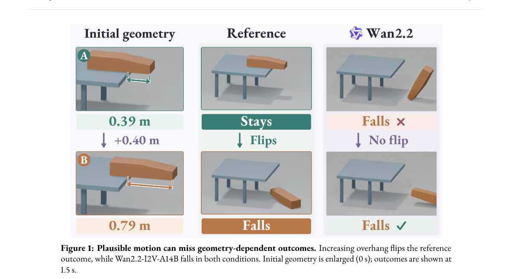

*Result - Benchmark construction and paired evaluation of geometry-induced physical outcome flips.*

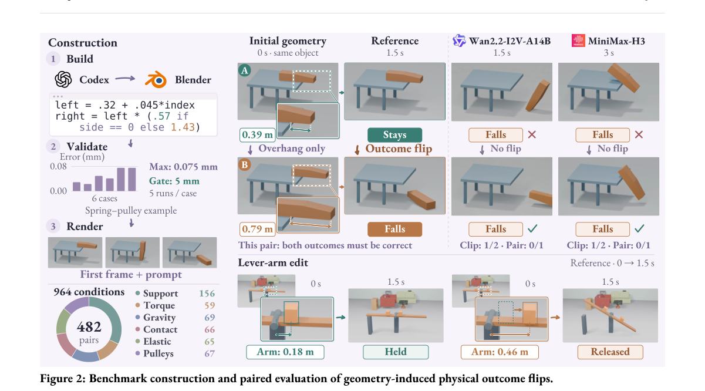

**Why this ranks #5**: 固定提示词只改首帧几何，看模型能否把几何变化翻译成正确的物理结局。

---

### 6. Coarse3D: Controllable and Faithful Sparse Structure Generation for Image-to-3D

**arXiv**: [2610.41231](https://arxiv.org/abs/2610.41231) | **Score**: 8.8 (relevance 9.0 x 0.7 + quality 8.5 x 0.3) | **Tags**: AIGC-visual, AIGC-visual, image-to-3d, sparse-voxel, diffusion-transformer, spatial-prior, Alibaba Group, Alibaba Group | **Categories**: cs.AI, cs.CV | **Pages**: 16

**Authors**: Gaige Wang; Bowen Pan; Hao Ren; Jiangjing Lyu; Chengfei Lyu

**Affiliation**: Alibaba Group

**Abstract**

> Coarse-to-fine 3D-native generation relies heavily on the first-stage sparse structure, which determines the global orientation and overall geometry for subsequent refinement. However, existing coarse generators suffer from two key limitations: their orientation is difficult to control due to ambiguous semantic canonicalization, and their structures are often inconsistent with input images due to weak 2D-3D grounding. We propose Coarse3D, a sparse-structure generation model that produces orientation-controllable and structurally faithful voxel geometry from arbitrary unposed images. Coarse3D introduces three designs: a first-frame anchored canonical space that aligns generation with the first input view while preserving object-centric normalization; a dual-tower DiT that couples generation with auxiliary feed-forward reconstruction to learn spatially grounded features; and spatial-prior guided attention that regularizes cross-attention with pixel-to-voxel correspondence. Coarse3D can directly replace the coarse stage of existing pipelines. Experiments show that it substantially improves sparse structure quality and consistently enhances final 3D generation, achieving state-of-the-art performance.

**Key findings**

- **Finding**: Coarse3D 用首帧锚定的规范空间在保留物体中心化归一化的同时与第一视角对齐，dual-tower DiT 则让生成与辅助前馈重建塔逐层注入特征并端到端训练。
- **Finding**: spatial-prior guided attention 把真值结构栅格化成可见的像素-体素对应，用作 cross-attention 正则，让每个体素 token 只关注它实际投影到的图像区域。
- **Finding**: GSO 上 IoU 0.5101、PA-IoU 0.5364、CD 0.0124；Toys4K 上 0.6315、0.6368、0.0091，均为最佳。
- **Finding**: 相对最强的无位姿基线，PA-IoU 提升约 1.45 倍、CD 不到一半，且两项指标与方向无关；基线的 IoU 与 PA-IoU 差距最大可达 IoU 的 30%，Coarse3D 压到 0.03 以内(低于 6%)。
- **Finding**: 作为即插即用的粗阶段替换，CD 下降 3~6 倍(如 TRELLIS2-MV 在 GSO 上 0.0613→0.0127)，F-Score 提升 0.24~0.44。
- **Finding**: 辅助重建任务上把 VGGT 的旋转误差从 10.54 降到 2.02(约 5 倍)，与专用的 RecGen3D* 相当；结构分辨率设为 64。
- **Inference**: 端到端挂上重建塔后，cross-attention 学到的是可投影的几何对应，而不是很弱的 2D-3D 关联。
- **Inference**: 替换粗阶段后三条流水线的最终几何指标几乎无差别，说明粗结构而非细化阶段才决定最终形状质量。
- **Recommendation**: 推荐。做 image-to-3D 流水线的读者优先读，drop-in 用法很实用。

**Key figures**

*Framework - Coarse3D generates orientation-controllable and structurally faithful sparse structures. Trellis2, ReconViaGen and Pixal3D use their own coarse and refinement stages while Ours+Trellis2 repl*

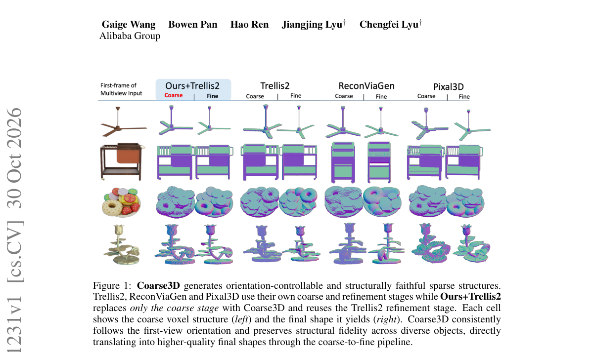

*Result - Comparison of three coordinate definitions: canonical space uses a fixed semantic orien- tation that is ambiguous; pixel-aligned camera space is aligned with the input view but not object- c*

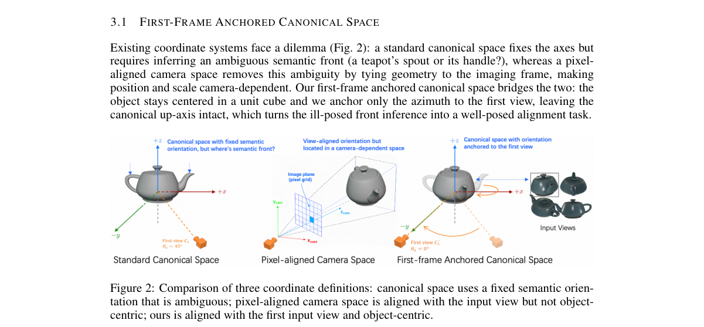

**Why this ranks #6**: 用首帧锚定的规范空间与像素-体素对应先验，直接治好粗阶段的方向失控与结构漂移。

---

### 7. RADI3N: GeometRic ImAge EDiting via ParametrIc 3D CoNtrol

**arXiv**: [2610.40973](https://arxiv.org/abs/2610.40973) | **Score**: 8.7 (relevance 9.0 x 0.7 + quality 8.0 x 0.3) | **Tags**: AIGC-visual, AIGC-visual, image-editing, 3d-part-level, deformation, cross-attention, University of Surrey, University of Surrey | **Categories**: cs.CV | **Pages**: 24

**Authors**: Abdul Wasi; Akhil Gorugantu; Mahesh Bhosale; Anjan Dutta; Junsong Yuan; Sauradip Nag; David Doermann

**Affiliation**: University of Surrey; Simon Fraser University

**Abstract**

> Recent diffusion-based methods have substantially advanced image editing, yet parametric 3D control at the part level remains challenging. Existing approaches either operate on whole objects with manual rigging, or revert to 2D handles at the part level. They also struggle to model appearance and texture under large transformations, leading to unrealistic outputs in geometry-intensive edits. To address these limitations, we introduce RADI3N, a framework for semantically-grounded part-aware object manipulation with parametric 3D control. Our CS-ARAP deformation module suppresses rotation-field discontinuities at part boundaries via neighborhood covariance smoothing, producing structurally consistent deformations under complex part-level edits. We further introduce an inversion-free selective texture transfer mechanism that suppresses high-frequency positional biases and scales up low-frequency semantic cues within cross-image attention. This eliminates strict spatial bias and supports semantic matching, allowing source appearance to follow the edited part onto its new geometry. Experiments demonstrate that RADI3N achieves state-of-the-art performance in geometric fidelity, viewpoint consistency, and controllability.

**Key findings**

- **Finding**: RADI3N 从单张图出发做语义可定位的部件级 3D 参数化编辑，支持部件旋转、平移、多部件编辑、缩放、姿态迁移与带旋转的 inpainting。
- **Finding**: CS-ARAP 形变能量在 SO(3) 投影前做邻域协方差平滑，抑制部件边界的旋转场突变，避免网格细化时留下破面。
- **Finding**: 无反演的调制纹理迁移机制在跨图 attention 中抑制高频位置偏置、放大低频语义线索，让源外观跟随部件的新几何。
- **Finding**: 在 GeoBench 上 WE 0.067、D-RMSE 1.91、MAAE 7.07、Acc@5° 0.789、SUBC 0.835、DINOv2 1874.42 均为最佳。
- **Finding**: 外观与身份维度上 CLIP-I 0.924、FID 148.47、BC 0.949，与 Nano Banana 2 的 0.933/144.08/0.938 互有胜负。
- **Finding**: 论文指出反演容易带来几何漂移与语义泄漏，因此放弃反演路线。
- **Inference**: 部件边界的旋转场突变是 3D 形变编辑最容易崩的地方，协方差平滑相当于给形变场加了一层低通先验。
- **Inference**: 省掉反演既省算力又避免语义泄漏，是把 3D 形变塞进扩散编辑流程的实用折中。
- **Recommendation**: 推荐。做 3D 感知的图像编辑、或对几何一致性要求高的读者值得读。

**Key figures**

*Framework - RADI3N enables parametric Geometric Image Editing. Given an image, our method supports a diverse range of geometric editing operations, including part rotation, part translation, multi-part*

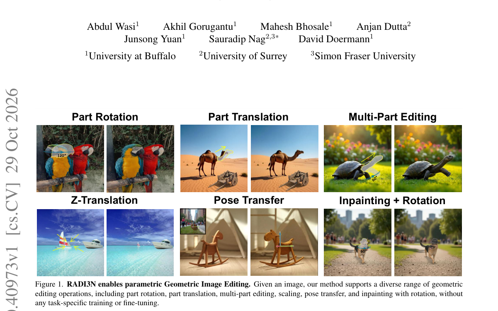

*Result - Overview of the geometric editing pipeline. Stage 1 (Coarse 3D Editing): The input image is lifted to a 3D mesh and deformed using CS-ARAP with covariance smoothing and a bi-Laplacian solve*

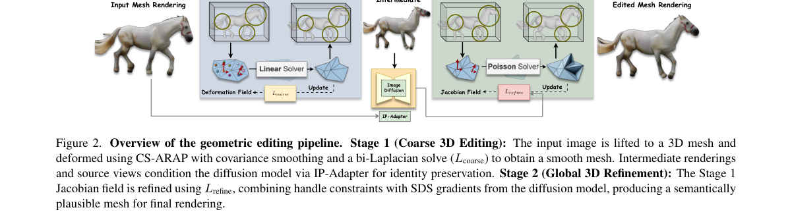

**Why this ranks #7**: 把 3D 部件级形变与无反演纹理迁移合到一起，让编辑后的外观跟着部件的新几何走。

---

### 8. Prior-Guided Single-Exposure HDR Novel View Synthesis via Base-Gain Representation

**arXiv**: [2610.41011](https://arxiv.org/abs/2610.41011) | **Score**: 8.5 (relevance 8.5 x 0.7 + quality 8.5 x 0.3) | **Tags**: AIGC-visual, AIGC-visual, novel-view-synthesis, hdr-reconstruction, gaussian-splatting, camera-response, University of Waterloo, University of Waterloo | **Categories**: cs.CV, cs.MM | **Pages**: 26

**Authors**: Armin Shafiee Sarvestani; Sheyang Tang; Jialu Xu; Zhou Wang

**Affiliation**: University of Waterloo

**Abstract**

> Single-exposure high dynamic range (HDR) novel view synthesis (NVS) recovers HDR scenes from low dynamic range (LDR) views captured at a single exposure and estimates camera response function (CRF) for LDR re-exposure. Without HDR ground-truth, using single-exposure LDR views as the sole source of direct supervision underconstrains HDR reconstruction and cannot ensure its faithful recovery, motivating the need for learned LDR-to-HDR reconstruction priors. Moreover, single-exposure LDR views supervise CRF only over a limited range, necessitating a learnable prior for reliable re-exposure beyond it. We propose PriorGS, a 3D Gaussian Splatting framework that addresses both challenges by (1) guiding HDR recovery with pseudo-HDR supervision from 2D single-exposure HDR reconstruction methods while anchoring it to input LDR views through a closed reconstruction loop; and (2) regularizing CRF modeling with a learnable prior that guarantees monotonicity and promotes plausible responses. Yet cross-view inconsistencies in independently generated pseudo-HDR targets impair scene reconstruction when HDR is encoded directly as Gaussian's color attribute. We therefore introduce a 3D base-gain HDR representation that factors HDR radiance into an LDR base and an overlaid 3D gain field, promoting robustness to such inconsistencies and enabling 3D HDR appearance editing. Extensive experiments demonstrate PriorGS's substantial superiority over baselines.

**Key findings**

- **Finding**: PriorGS 用 2D 单曝光 HDR 重建方法(IntrinsicHDR)产生的伪 HDR 做监督，并通过闭环重建把结果锚回输入 LDR 视图。
- **Finding**: CRF 建模用可学习先验正则，保证单调性并促使响应合理，解决单曝光只监督有限动态范围的问题。
- **Finding**: 提出 3D base-gain HDR 表示，把 HDR 辐亮度分解为 LDR base 与叠加的 3D gain 场，对伪 HDR 的跨视角不一致更鲁棒。
- **Finding**: HDR-NeRF 真实场景重曝光 LDR-NVS 上 PSNR 24.31 / SSIM 0.9248 / LPIPS 0.064，优于 GaussHDR 的 16.28、SeHDR 的 13.75 与 Mono-HDR-GS 的 11.43。
- **Finding**: HDR-Plenoxels 真实场景上 PSNR 23.00 / SSIM 0.9021 / LPIPS 0.092，同样全面领先。
- **Finding**: 合成场景 HDR-NVS 上 PSNR 31.22 / LPIPS 0.038，远高于 GaussHDR 的 26.96 与 0.114。
- **Finding**: 借助 base-gain 表示可用系数 ρ 缩放增益场的球谐系数，在不改动 LDR base 的前提下做 3D HDR 外观编辑。
- **Inference**: 伪 HDR 监督本身带跨视角噪声，把 HDR 拆成 base 与 gain 而不是直接当颜色属性，等于把噪声吸收进低频增益项。
- **Recommendation**: 推荐。做单曝光 HDR 重建、可学习 CRF 或 3D 场景外观编辑的读者值得读。

**Key figures**

*Framework - Given the same single-exposure inputs, methods lacking learned LDR-to-HDR priors re- construct the LDR novel view faithfully but fail at HDR radiance recovery. We leverage this prior to reco*

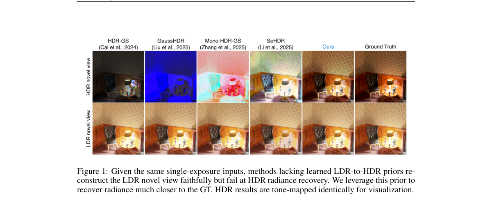

*Result - (top row) Cross-view inconsis- tencies in pseudo-HDR targets (bottom row) produce severe artifacts w/ direct HDR en- coding, while our base–gain representation promotes robustness to such inconsistencies.*

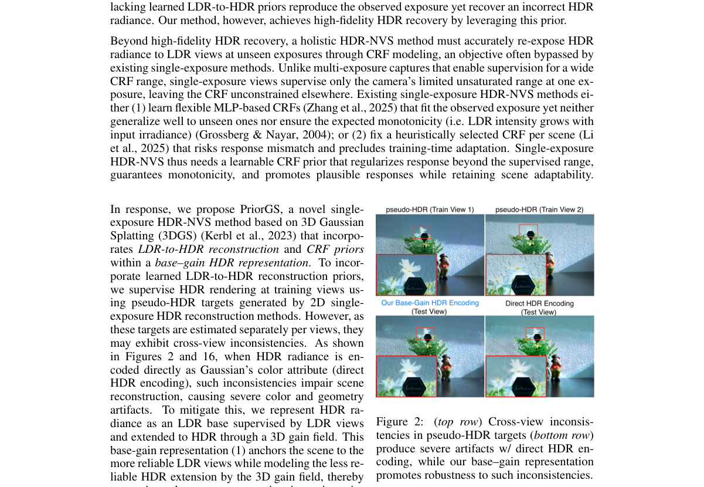

**Why this ranks #8**: 用学到的 LDR 到 HDR 先验与可学习 CRF 先验补上单曝光重建缺的约束，再用 base-gain 抵抗伪 HDR 噪声。

---

### 9. GenDSR: Transferring Representations from Video Generation Models for Dynamic Spatial Reasoning

**arXiv**: [2610.41314](https://arxiv.org/abs/2610.41314) | **Score**: 8.5 (relevance 8.5 x 0.7 + quality 8.5 x 0.3) | **Tags**: AIGC-visual, AIGC-visual, video-generation-model, vision-language-model, dynamic-spatial-reasoning, representation-transfer, Nanjing University, Nanjing | **Categories**: cs.AI, cs.CV | **Pages**: 8

**Authors**: Ke Yang; Zhenyu Zhang; Jun Li

**Affiliation**: Nanjing University

**Abstract**

> Dynamic spatial reasoning is essential for connecting visual intelligence to thephysical world, yet remains challenging for vision-language models (VLMs), which must preserve scene state while tracking how spatial relations evolve over time. Meanwhile, video generation models (VGMs), trained to synthesize temporally coherent world dynamics, offer a rich source of spatiotemporal representations. We present GenDSR, a framework that transfers intermediate representations from VGM into VLM for dynamic spatial reasoning. Rather than treating a VGM feature as a monolithic prior, GenDSR constructs two complementary branches: a raw branch preserving holistic generative context and a delta branch emphasizing temporal variation. Task-conditioned tokenwise gates then fuse both signals and inject the result into the native visual representation. On DSR-Bench, GenDSR achieves 67.2%, surpassing the previous best result and establishing a new state of the art.

**Key findings**

- **Finding**: GenDSR 把视频生成模型的中间特征迁移进 VLM，分成 raw 分支(整体时空上下文)与 delta 分支(相邻观测之间的时序差分)两路。
- **Finding**: 任务条件化的 token 级门控融合两路信号后注入 VLM 原生视觉表示，整个框架是轻量的。
- **Finding**: DSR-Bench 上 Qwen3-VL-8B 的 SFT 基线从 62.0% 提升到 67.2%，超过此前最好结果；4B 变体从 58.8% 提升到 62.7%。
- **Finding**: 消融显示 raw 与 delta 表示各自都能独立提升准确率，两者组合后效果最强。
- **Finding**: 论文把视频生成模型相对 3D 重建先验的优势归结为空间一致性、时序动态与可从海量真实视频学到三点。
- **Finding**: 与几何中心的三维基础模型相比，视频生成模型不需要昂贵的多视角几何标注数据。
- **Inference**: 视频生成模型被迫学会跨帧保持同一场景，这恰好是动态空间推理缺的能力，比几何先验更对症。
- **Inference**: raw 与 delta 两条支路独立有效，说明整体上下文与局部变化确实携带互补信息。
- **Recommendation**: 推荐。做视频表征迁移、或想提升 VLM 动态空间推理能力的读者值得读。

**Key figures**

*Framework - Overview of GenDSR. The frozen native visual encoder and video generation model process the same input video. We construct raw and delta representations from the VGM features and integrate t*

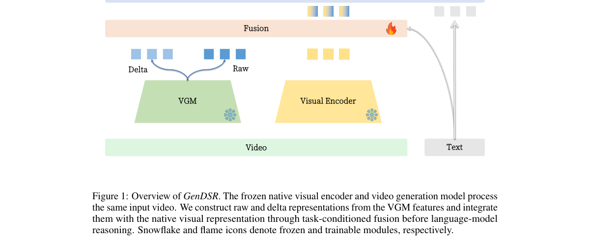

**Why this ranks #9**: 把视频生成模型的中间特征拆成整体上下文与时序变化两支，注入 VLM 做动态空间推理。

---

### 10. PBSR: Pseudo-Burst Super-Resolution via Zero-Shot Novel View Synthesis

**arXiv**: [2610.41258](https://arxiv.org/abs/2610.41258) | **Score**: 8.3 (relevance 8.5 x 0.7 + quality 8.0 x 0.3) | **Tags**: AIGC-visual, AIGC-visual, super-resolution, burst-super-resolution, novel-view-synthesis, image-restoration, Toyota Technological Institute, Toyota Technological | **Categories**: cs.CV, eess.IV | **Pages**: 17

**Authors**: Yuki Kondo; Norimichi Ukita

**Affiliation**: Toyota Technological Institute; Frontier Research Center, Toyota Motor Corporation

**Abstract**

> Burst super-resolution (BSR) achieves higher reconstruction fidelity than single-image super-resolution (SISR) by aggregating sub-pixel information from multiple frames. However, it requires a burst of frames captured under near-static conditions, and such frames are unavailable for single photographs or archival images. We propose Pseudo-Burst Super-Resolution (PBSR), which brings BSR-style reconstruction to the single-image input setting by synthesizing pseudo-burst frames via zero-shot novel view synthesis (NVS). PBSR first generates pseudo-burst frames with realistic parallax using a viewpoint sampling strategy calibrated to the pixel-shift distribution of real burst datasets. The frames are then processed by a BSR backbone equipped with a geometry-aware alignment module that reuses the NVS camera parameters and estimated depth. While the NVS stage is zero-shot, the backbone is fine-tuned with an artifact-aware adaptation so that it can exploit the synthesized frames despite their generative artifacts. Experiments on the BurstSR dataset show that PBSR consistently improves in PSNR, SSIM, and LPIPS over the single-frame baseline with the same reconstruction backbone.

**Key findings**

- **Finding**: PBSR 用零样本 NVS(ZeroNVS)从单张 LR 图合成带真实视差的伪连拍帧，视点采样策略按真实 burst 数据集的像素位移分布标定。
- **Finding**: BSR 骨干加几何感知对齐模块，复用 NVS 的相机参数与 DepthFM 估计的深度。
- **Finding**: 骨干用伪影感知的适配微调以适应合成帧的生成痕迹，从 BurstSR 训练集随机取 646 个样本微调 80 轮。
- **Finding**: BurstSR 验证集 4 倍放大上，DBSR-1 单帧基线 PSNR 44.695 / SSIM 0.971 / LPIPS 0.053，适配后的 PBSR-14 达到 45.633 / 0.976 / 0.044。
- **Finding**: 零样本版本反而更差，PBSR-14 (z/s) 的 PSNR 只有 41.887，低于单帧基线。
- **Finding**: 真实 14 帧 burst 的 DBSR-14 仍是 47.698 / 0.984 / 0.029，PBSR 未达到真实 burst 水平。
- **Inference**: 零样本版本掉分说明伪帧的生成伪影会误导对齐模块，伪影感知适配不是可选项而是必要条件。
- **Inference**: 用生成模型造观测是通用套路，但把伪帧纳入训练分布去适配骨干，比单纯堆参数更实际。
- **Recommendation**: 推荐。关注单图超分、或想复用生成先验做图像复原的读者可读。

**Key figures**

*Framework - Effect of our PBSR. (a) SISR using an LR image. (b) BSR using 14 real burst LR frames. (c) PBSR from an LR image and 13 pseudo-burst LR frames. (d) Ground truth (GT). All results are recon- st*

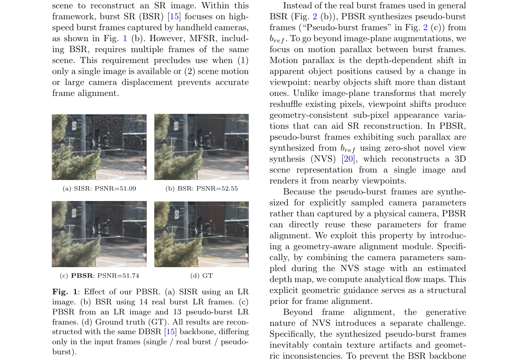

*Result - Conceptual overview of SISR/BSR baselines and our PBSR framework. PBSR generates pseudo-burst frames via zero-shot NVS, enabling BSR-style reconstruction from bref under a single-image input c*

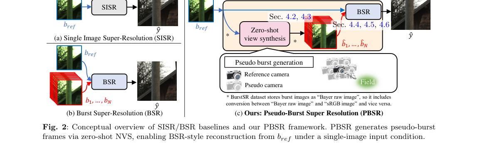

**Why this ranks #10**: 用零样本新视角合成造出伪连拍帧，把 burst 超分的能力搬到单图输入上。

---

## Footer

- Total papers scanned across all 7 tracks: 465（原始 615 条）
- aigc_visual track final top-10: 10
- Wild-cards in this track: 0
- Figure assets: 2026-11-02/res/

Generated by `mine-arxiv-daily-digest` skill. Sister file: `2026-11-02_aigc_visual_entry.md`.
