# ArXiv Daily Digest - 2026-11-02 (音频与语音语言模型, 10 papers)

**Generated**: 2026-11-02 17:30 CST

**Source**: arXiv cs.CV, cs.SD, eess.AS, cs.CL, cs.AI, cs.RO, cs.LG submissions, listing day 2026-10-30 (announced 2026-10-31 00:00 UTC)

**Batch window**: 2026-10-29T18:00:00Z .. 2026-10-30T18:00:00Z（arXiv 公告批次横跨两个 UTC 日：前一日 18:00 UTC 起算，当日 17:59:59 UTC 截止）

**Track**: audio_lm (top 10 of 465 papers scanned, 70 full reads)

**Scope**: 语音 / 音频语言模型、流式语音交互、说话人建模、多语种与低资源语音

⚠️ **Wild-card**: 本批该线 3 篇为 wild-card 补足，已在正文逐条标注并给出理由。

补足原因：该批次真正属于「音频 / 语音语言模型与双工语音交互」的论文只有 7 篇，其余 3 篇为对话质量与人因交互方向的补位，已在正文逐条标注并给出理由。

---

## Top 10 - 音频与语音语言模型

### 1. Hierarchical Dual-Graph Retrieval for Long-form Audio Reasoning

**arXiv**: [2610.41390](https://arxiv.org/abs/2610.41390) | **Score**: 9.2 (relevance 9.5 x 0.7 + quality 8.5 x 0.3) | **Tags**: audio-lm, long-form-audio, rag, dual-graph, hierarchical-index, audio-language-model, multi-hop, Ewha Womans | **Categories**: cs.IR, cs.SD, eess.AS | **Pages**: 5

**Authors**: Eunsang Lee; Taein Ju; Jiyoung Lee

**Affiliation**: Ewha Womans University

**Abstract**

> Large audio language models (LALMs) struggle with long-form audio reasoning, as processing entire recordings often limits to capture query-relevant content distributed across distant segments while incurring substantial computational cost. We introduce AudioHelix, a hierarchical DualGraph framework tailored for LALMs' retrieval-augmented generation (RAG) systems. Unlike existing text-only or non-graph RAG approaches, AudioHelix connects related textual and acoustic evidence across temporally distant segments for multi-hop reasoning. Extensive experiments on TraceAV-Bench, MMAU-Pro, and AudioMarathon demonstrate that AudioHelix consistently outperforms full-audio processing and existing RAG methods. The project site is https://github.com/ewha-mmai/audiohelix.

**Key findings**

- **Finding**: 论文指出长音频理解的核心问题：35 分钟录音约占 5.25 万 token，远超其文字转写所需 token 数量，且查询相关信息常分散在相距很远的片段。
- **Finding**: 作者提出 AudioHelix，为音频语言模型的检索增强生成构建层级 DualGraph，离线把长音频切成定长 chunk 并从中抽取层级化的语言与声学信息。
- **Finding**: 图谱含 chunk、unit 与语义概念三级且与具体查询无关；给定查询后先定位种子概念节点，再把查询相关分数传播到相关音频 unit，最终只取少量 chunk。
- **Finding**: 在 TraceAV-Bench（准确率）、MMAU-Pro（准确率）与 AudioMarathon（F1）上，AudioFlamingo-3 由 56.9 / 50.7 / 57.3 提升到 59.4 / 52.3 / 58.5，Voxtral-3B 由 48.1 / 40.9 / 56.4 提升到 50.6 / 56.5 / 57.9，Qwen3-Omni-30B 由 71.3 / 66.1 / 63.7 提升到 71.6 / 67.2 / 66.1。
- **Finding**: 同一批实验里 LinearRAG 与 PlanRAG-Audio 多数情况低于基座模型，Voxtral-3B 在 MMAU-Pro 上 AudioHelix 提升 15.6% 而朴素 RAG 下降 10.6%。
- **Finding**: 消融显示去掉文本或去掉声学的一支都会掉分，说明文本与声学两条证据链确实互补；实现上 TraceAV-Bench 用 45 秒 chunk 与 5 秒声学 unit，其余基准用 30 秒与 6 秒。
- **Inference**: 长音频的瓶颈不是模型容量而是证据定位，把概念级节点当作跨片段的「路标」，比单纯做文本或声学检索更贴近多跳问题。
- **Recommendation**: 推荐读。做长录音问答、会议或播客理解的读者，建议精读其双图构建与检索算法实现。

**Key figures**

*Framework - Long-form audio reasoning requires concentrating on multi-hops to answer each query.*

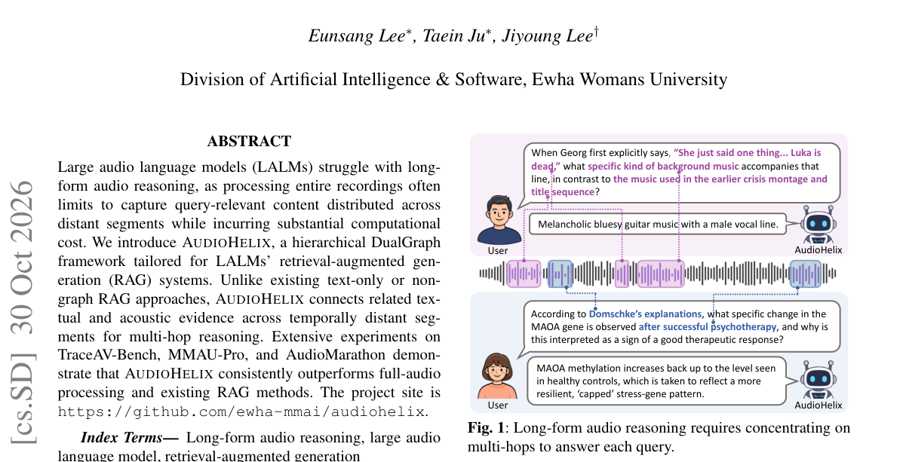

*Result - The pipeline of building DualGraph in AUDIOHELIX. In the offline stage, the long-form audio is divided into fixed- length chunks, from which hierarchical fine-grained language and acoustic inf*

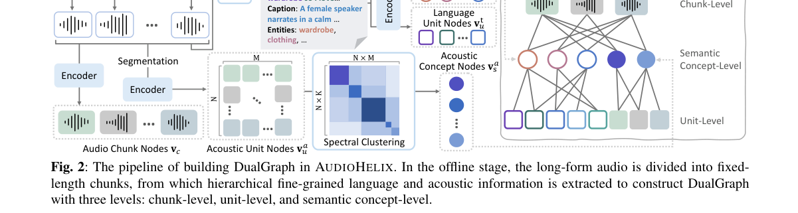

**Why this ranks #1**: 把长音频检索做成层级双图谱，在三个长音频基准上稳定超过整段输入与已有 RAG。

---

### 2. From Transcription to Reformulation: Defining and Benchmarking Grounded Generative Speech Recognition

**arXiv**: [2610.41292](https://arxiv.org/abs/2610.41292) | **Score**: 8.8 (relevance 9.0 x 0.7 + quality 8.5 x 0.3) | **Tags**: audio-lm, grounded-generation, asr-benchmark, reformulation-hierarchy, speech-llm, hallucination, llm-as-judge, China Telecom Artificial Intelligence Technology Co. Ltd | **Categories**: cs.CL, cs.SD, eess.AS | **Pages**: 10

**Authors**: Qing Wang; Qihan Hu; Hang Lv; Yan Yang; Boqing Liu; Xuechao Zhu; Zehan Li; Hongjie Chen; Jian Kang; Jie Li; Yongxiang Li; Lei Xie

**Affiliation**: China Telecom Artificial Intelligence Technology Co. Ltd; Northwestern Polytechnical University

**Abstract**

> Speech language models have expanded automatic speech recognition (ASR) from transcription to general speech-to-text generation. Yet existing benchmarks still assume a single ground-truth transcript per utterance, an assumption that struggles when models produce readable, formatted, or structured outputs. In this work, we introduce Grounded Generative Speech Recognition (GSR), reformulating speech recognition as generating semantically grounded text instead of a single transcript. We define a grounded reformulation space that characterizes all valid textual realizations supported by the input speech, and establish a four-level hierarchy of reformulation capabilities, including literal transcription, canonical reformulation, semantic reformulation and speech-grounded structuring. Based on this formulation, we present GSR-Bench, the first comprehensive benchmark designed to evaluate generative speech recognition systems beyond exact transcript matching. GSR-Bench covers diverse scenarios including refined meeting transcription, cross-dialect translation, context-aware speech understanding, and robustness under silent or noisy acoustic conditions. To address the limitations of word-level evaluation metrics, we develop a multi-dimensional evaluation framework combining speech grounding assessment and LLM-based semantic judgment, whose reliability is validated through human preference studies. Extensive experiments across representative architectures, ranging from conventional ASR systems to end-to-end Speech-LLMs, reveal fundamental trade-offs between transcription fidelity and generative reformulation ability. Our analysis further identifies critical failure modes, including acoustic hallucination, unsupported generation, and instruction drift, providing insights into the design and evaluation of future grounded generative speech systems.

**Key findings**

- **Finding**: 论文提出 Grounded Generative Speech Recognition（GSR），把语音识别重构为生成语义有据的文本而非唯一转写，并定义刻画输入语音所有合法文本实现的 grounded reformulation space。
- **Finding**: 作者建立四级 reformulation 能力层级：字面转写、规范化改写、语义改写与语音支撑的结构化输出。
- **Finding**: 据此发布 GSR-Bench，含五条评测轨道：GSR-PACE（第 0 级）、GSR-Refine（第 1–2 级）、GSR-Dialect（第 2 级）、GSR-Summary（第 3 级）以及声学压力下的 grounding 可靠性测试。
- **Finding**: 压力测试覆盖环境噪声、纯静音、背景音乐与弱语音四个子集，弱语音由 AISHELL-1 衰减到 3% 幅度并加轻微噪声构成，其中任何词法输出都判为声学幻觉。
- **Finding**: 评测框架结合语音 grounding 评估与基于 LLM 的语义判定（GPT-4o 与 DeepSeek-v4 打 1–5 分），其可靠性通过人类偏好研究验证。
- **Finding**: 实验横跨传统 ASR、LLM-ASR、ASR+LLM 级联与通用音频基础模型，并另行开发基于 TeleASR 编码器与 Qwen3-4B 的指令跟随语音大模型 UniGSR。
- **Finding**: 论文指出现有系统面临三类关键失效模式：声学幻觉、无据生成与指令漂移，并揭示转写保真度与生成式改写能力之间的根本权衡。
- **Inference**: 把「允许多种正确输出」写进问题定义，比继续争论 WER 更能反映语音大模型的实际用法。
- **Recommendation**: 推荐读。做语音大模型评测、ASR+LLM 级联或关注幻觉的读者，建议精读其层级定义与压力测试设计。

**Key figures**

*Framework - Overview of GSR-Bench: Data Construction, Quality Assurance, and Hierarchical Task Organization.*

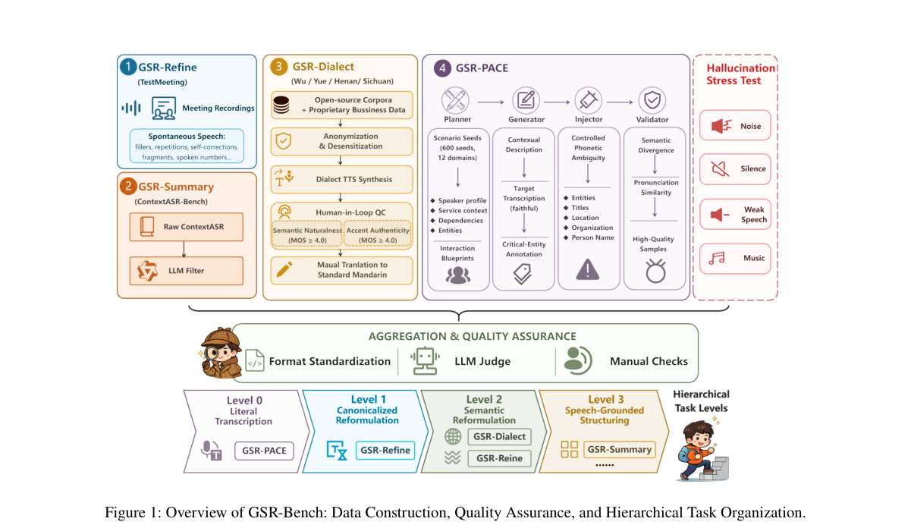

*Result - GSR-Bench Evaluation Framework: Reformulation Hierarchy, System Coverage, and Grounding Reliability.*

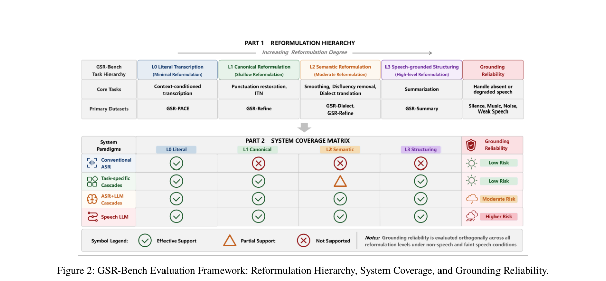

**Why this ranks #2**: 把语音识别从「还原一条转写」改写成「生成有据文本」，并给出配套基准与评测框架。

---

### 3. Incongruence-Aware Evaluation of Multimodal Speech Emotion Recognition in Audio Large Language Models

**arXiv**: [2610.40883](https://arxiv.org/abs/2610.40883) | **Score**: 8.5 (relevance 8.5 x 0.7 + quality 8.5 x 0.3) | **Tags**: audio-lm, speech-emotion-recognition, cross-modal-incongruence, valence-arousal-dominance, error-prediction, audio-llm-evaluation, interpretability, University of Hong Kong | **Categories**: cs.AI, cs.CL, cs.MM, cs.SD, eess.AS | **Pages**: 15

**Authors**: Fengji Jing; Guy Laban

**Affiliation**: The University of Hong Kong; Ben-Gurion University of the Negev

**Abstract**

> Voice-interactive large language models process both what a speaker says and how they say it, yet the two channels do not always agree. We ask whether that disagreement degrades speech emotion recognition. Mapping text and audio into a shared valence-arousal-dominance space, we convert the distance between them into a continuous, threshold-free incongruence score with a two-component Gaussian mixture, and validate the score against human judgement. We evaluate three audiocapable models on acted, conversational and spontaneous speech (eNTERFACE'05, MELD and CMU-MOSEI). With the model held constant across modalities, incongruence raises the odds of error whenever audio is present, in every corpus, after controlling for the ground-truth emotion and for distance in the feature space. Supervised classifiers trained on the same features behave in the opposite way, which suggests that the difficulty lies in how these models combine raw evidence rather than in the signal itself. Text-only effects are unreliable: swapping only the model that reads the transcript reverses their sign on one corpus. Rebuilding the score without the emotion lexicon reproduces the central result, and among six simpler alternatives it is the only label-free score that predicts error in all three corpora. Code, data tables and prompts are released.

**Key findings**

- **Finding**: 论文把文本与音频映射到共享的 valence-arousal-dominance 空间，用双成分高斯混合把两者距离转成连续、无阈值的失配分数，并用人工判断验证该分数。
- **Finding**: 评测覆盖三个语料：eNTERFACE'05（表演式）、MELD（电视多人对话）与 CMU-MOSEI（自发性），并评测三个具备音频能力的模型。
- **Finding**: 核心结论是在模型固定的前提下，只要音频存在，失配就会在全部三个语料上提高出错几率，且控制真实情感与特征空间距离后依然成立。
- **Finding**: 用相同特征训练的监督分类器表现方向相反，说明困难出在这些模型融合原始证据的方式，而不是信号本身。
- **Finding**: 纯文本一侧的关联不可靠：只更换读取转写的模型就会让某一语料上的符号反转。
- **Finding**: 去掉情感词典重建分数后核心结论仍复现，并且在六个更简单的替代分数中，它是唯一在三个语料上都能预测出错的 label-free 分数；代码、数据表与提示词一并公开。
- **Inference**: 失配分数更像是一个「模型遇到冲突证据」的探针，可用于主动挑出模型最可能答错的样本来做数据补强。
- **Recommendation**: 推荐读。做语音情感、音频大模型评测或需要诊断多模态模型错误模式的读者，值得读其统计设计与控制变量。

**Key figures**

*Framework - summarises the pipeline. Both channels of each utterance are mapped into a shared VAD space, their disagree- ment is turned into a continuous incongruence score, and that score is then used t*

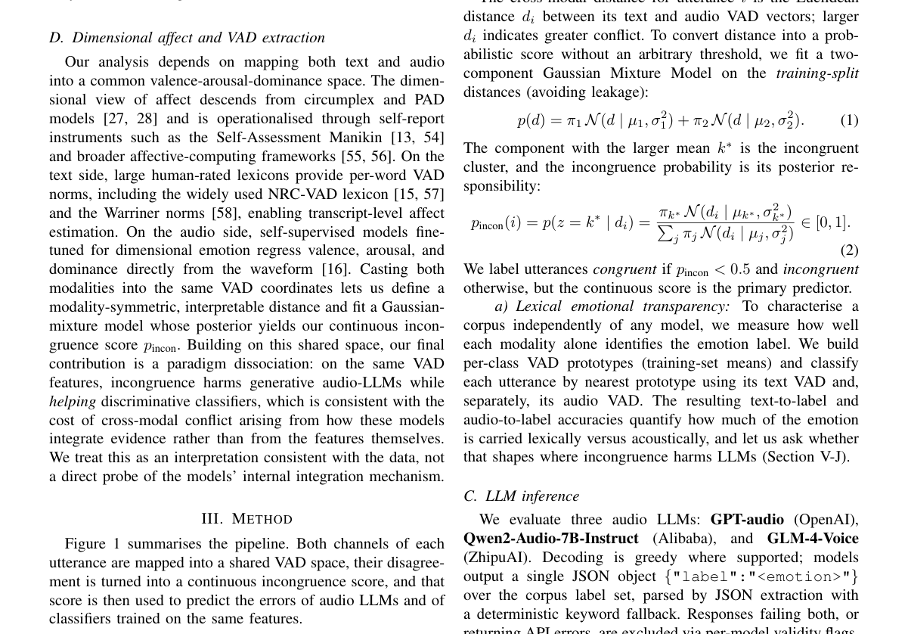

*Result - Distributions of the extracted valence, arousal, and dominance values by modality on eNTERFACE (text from the NRC-VAD lexicon, audio from the fine-tuned wav2vec2 regressor). The two modalities*

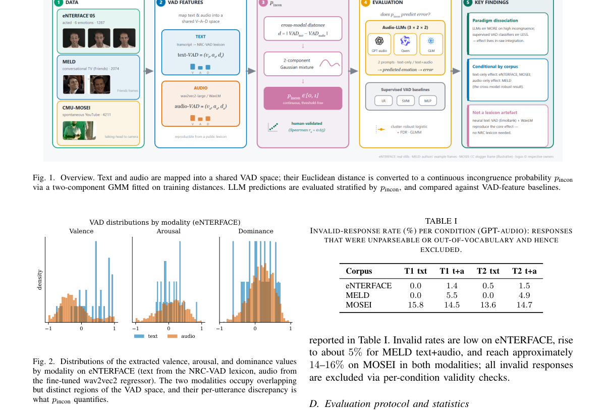

**Why this ranks #3**: 把文本与语音的情感失配量化成一个连续分数，并证明它能预测音频大模型的出错几率。

---

### 4. TurnTurk-GPT: Text-Based Turn-Taking Prediction for Turkish

**arXiv**: [2610.42010](https://arxiv.org/abs/2610.42010) | **Score**: 8.0 (relevance 8.0 x 0.7 + quality 8.0 x 0.3) | **Tags**: audio-lm, end-of-turn, turkish, turn-taking, synthetic-dialogue, streaming-asr-proxy, evaluation-protocol, Ata Technology Platforms | **Categories**: cs.CL | **Pages**: 6

**Authors**: Ahmet Tuğrul Bayrak; Fatma Nur Korkmaz; Nur Yağmur Tuncer; Mustafa Sertaç Türkel

**Affiliation**: Ata Technology Platforms

**Abstract**

> This paper presents TurnTurk-GPT, a text-based turn-taking predictor for Turkish obtained by fine-tuning a Turkish GPT-2 model with the TurnGPT objective on synthetic and real dialogue, and evaluates it on real Turkish conversation against rule baselines, a zero-shot Turkish language model and a widely used multilingual end-of-turn detector. Evaluation uses word-level decision points on unpunctuated, lower-cased text approximating the output of streaming speech recognisers, recording-disjoint and speaker-disjoint folds, nested threshold selection and paired cluster bootstrap tests. TurnTurk-GPT outperforms the multilingual detector under both recording-disjoint and speaker-disjoint evaluation. It outperforms the zero-shot language model only when the test speakers occur in training; on unseen speakers the two are statistically indistinguishable. Removing the suffixes of the turn-final word reduces AP by up to 44%, against 2% for a sentence-internal word, locating the Turkish end-of-turn cue in verb-final morphology. Synthetic dialogue alone yields the weakest trained model, and when a speaker pauses the zero-shot and multilingual baselines remain close to chance. The model and the evaluation protocol are publicly released.

**Key findings**

- **Finding**: 论文用 TurnGPT 目标微调土耳其语 GPT-2 得到文本级轮次结束预测器 TurnTurk-GPT，训练数据含合成对话与真实对话。
- **Finding**: 评测在无标点、全小写的词级决策点上进行，以逼近流式语音识别器的输出，并使用录音隔离与说话人隔离两种划分、嵌套阈值选择与配对 cluster bootstrap 检验。
- **Finding**: 真实语料共有 15522 个决策点、其中 578 个正例，随机预测器平均精度为 0.037；说话人隔离设定下 S2R 方案的 AP 为 0.120，零样本语言模型读取 P(.)/P(?) 风格得分为 AP 0.124（区间 0.100–0.147）、AUC 0.762、F1 0.163。
- **Finding**: TurnTurk-GPT 在录音隔离与说话人隔离两种划分下都超过所用的多语种轮次结束检测器，但只在测试说话人出现在训练集时超过零样本语言模型，面对未见说话人两者统计上不可区分。
- **Finding**: 消融显示去掉轮次末词的后缀会使 AP 最多下降 44%，而句中词只降 2%，据此把土耳其语的结束线索定位到动词后缀的黏着形态。
- **Finding**: 仅用合成对话训练得到的是最弱模型；说话人出现停顿时，零样本与多语种基线都接近随机，论文另在 633 个停顿后的负例上报告误报率。
- **Inference**: 说话人隔离下的不可区分说明该任务的瓶颈在泛化到未见说话人，而非模型容量，合成数据也无法替代真实对话的多样性。
- **Recommendation**: 推荐读。做轮次检测、流式对话系统或低资源语言语音系统的读者，其评测协议可直接借用。

**Key figures**

*Framework - Serialisation and scoring*

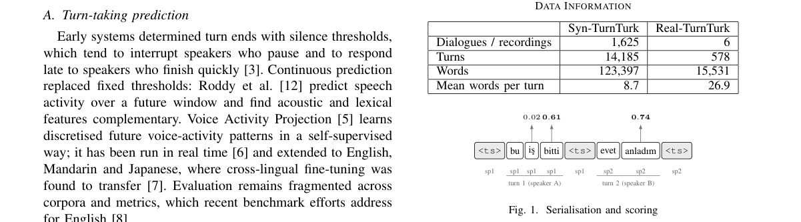

*Result - Average precision*

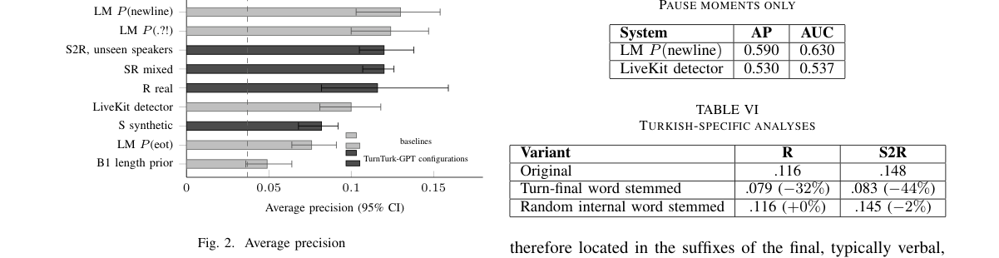

**Why this ranks #4**: 在土耳其语上定位轮次结束线索的形态学来源，并把评测协议做得比模型更难作弊。

---

### 5. GhostPrefix: Synchronization-Free Universal Prefix Attacks for ASR Manipulation

**arXiv**: [2610.42026](https://arxiv.org/abs/2610.42026) | **Score**: 8.0 (relevance 8.0 x 0.7 + quality 8.0 x 0.3) | **Tags**: audio-lm, adversarial-attack, universal-prefix, asr-security, synchronization-free, speech-assistant, downstream-attack, Michigan State | **Categories**: cs.LG | **Pages**: 16

**Authors**: Shengding Liu; Ashwin Innuganti; Qiben Yan

**Affiliation**: Michigan State University

**Abstract**

> We present GhostPrefix, the first synchronization-free universal adversarial prefix attack against automatic speech recognition (ASR) systems. Unlike prior audio attacks, which are typically crafted per utterance, require synchronization with the victim waveform, or target narrow objectives, GhostPrefix learns a short, reusable audio segment prepended to arbitrary live speech to exert real-time control over ASR outputs without knowledge of the future utterance or temporal alignment. A key challenge is maintaining stable adversarial effects across unknown, evolving speech contexts. GhostPrefix combines token-level losses with a novel representation-level objective for stable, input-agnostic effects. GhostPrefix supports three attack modes: (i) prompted prefix attacks for semantic steering, (ii) targeted prefix attacks for transcript hijacking, and (iii) untargeted prefix attacks for transcription degradation. To remain perceptually inconspicuous, we regularize prefixes toward benign environmental-sound distributions and improve robustness against over-the-air distortions. We evaluate GhostPrefix across 13 open-source ASR models from four families. In digital settings, it achieves average attack success rates of 97.6% for prompted steering and 93.4% for targeted hijacking, while driving word error rate to 1.18 under untargeted attacks. Over the air, it achieves success rates of 91.5% and 89.5% for prompted and targeted modes, respectively. These manipulations propagate into downstream AI-assisted pipelines, including voice assistants and AI note-taking tools, causing systematic semantic misinterpretations. GhostPrefix exposes synchronization-free universal prefixes as a practical, under-explored threat to real-world ASR and downstream applications. Artifacts and demos are available at https://ghostprefix.github.io/.

**Key findings**

- **Finding**: 论文提出 GhostPrefix，声称是首个针对 ASR 的免同步、通用、通用目的对抗前缀攻击：学出一段短且可复用的音频，前置到任意实时语音流上即可生效，无需知道未来 utterance 也无需时间对齐。
- **Finding**: 为在未知且不断变化的语音上下文上保持效果，作者把标准 token 级损失与一个新的表示级目标结合起来优化前缀。
- **Finding**: 框架支持三种攻击模式：prompted 前缀攻击做语义引导、targeted 前缀攻击做转写劫持、untargeted 前缀攻击做转写降质。
- **Finding**: 为保持感知隐蔽性，前缀被正则化到良性的环境声分布，并针对空对空失真做鲁棒化。
- **Finding**: 在 13 个开源 ASR 模型、4 个模型家族上，数字域下 prompted 语义引导平均成功率 97.6%、targeted 劫持 93.4%，untargeted 攻击把词错误率压到 1.18；空对空条件下成功率分别为 91.5% 与 89.5%。
- **Finding**: 被诱导的误识别会传导到下游语音助手与 AI 笔记工具，造成系统性的语义误解。
- **Inference**: 免同步加通用化把攻击成本从「需要目标音频」降到「需要一次优化」，这是它相对既有对抗音频工作最危险的地方。
- **Recommendation**: 推荐读。做语音助手安全、ASR 上线防护或对抗鲁棒性评测的读者，值得复现其表示级目标与空对空设置。

**Key figures**

*Framework - Threat scenario for GHOSTPREFIX ’s adversarial prefix attacks against streaming ASR.*

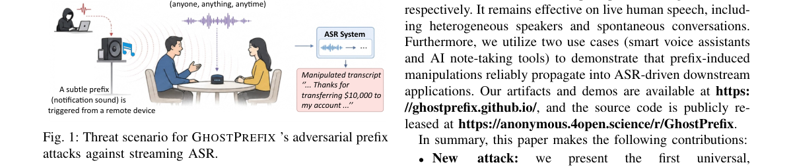

*Result - Overview of a typical ASR pipeline: pre-processing, feature extraction, acoustic modeling, and language modeling jointly map raw speech to text.*

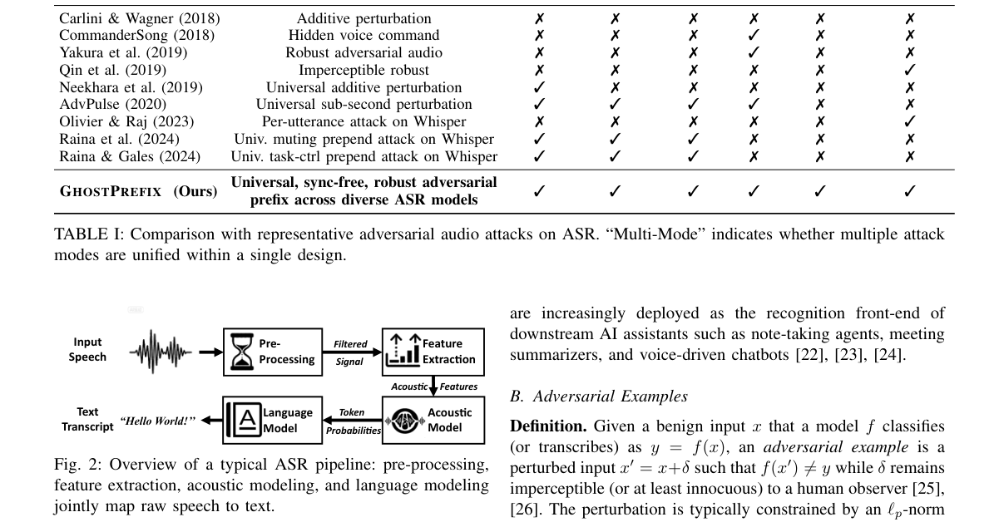

**Why this ranks #5**: 首个免同步的通用前缀攻击，一段短音频就能实时劫持任意实时语音的识别结果。

---

### 6. Parameter-Efficient Fine-Tuning of Transformer Encoders for Audio-Image-Symbolic Music Retrieval

**arXiv**: [2610.41512](https://arxiv.org/abs/2610.41512) | **Score**: 8.0 (relevance 8.0 x 0.7 + quality 8.0 x 0.3) | **Tags**: audio-lm, parameter-efficient-finetuning, lora, qlora, cross-modal-music-retrieval, sheet-music, music-information-retrieval, University of Alicante | **Categories**: cs.CV, cs.SD, eess.AS | **Pages**: 44

**Authors**: Eliseo Fuentes-Martinez; Antonio Hidalgo-Centeno; Jorge Calvo-Zaragoza; Antonio Javier Gallego

**Affiliation**: University of Alicante

**Abstract**

> Score-based multimodal music retrieval requires representations that are both discriminative within each modality and compatible across audio recordings, sheet music images, and symbolic scores. This paper investigates the effectiveness of parameter-efficient fine-tuning (PEFT) for adapting pretrained music encoders and examines whether modality-specific improvements translate into better multimodal representations. We compare full fine-tuning, LoRA, and QLoRA across nine pretrained audio, image, and symbolic score encoders on TriScore and the Musical Theme Dataset. Encoders are first evaluated and selected through supervised unimodal classification, using frozen-encoder linear probing as a reference. We then introduce a controlled 2x2 design crossing encoder adaptation with task-specific shared projection, comparing frozen and adapted representations before and after projection. LoRA or QLoRA is selected in 14 of 18 modality-target combinations, frequently matching or outperforming full fine-tuning while optimizing substantially fewer parameters. However, these unimodal gains do not transfer uniformly to multimodal classification. Adaptation and projection are complementary for composer classification on TriScore, largely redundant for TriScore instrument and the Musical Theme Dataset instrument and ensemble tasks, and partially interfering for composer classification on the Musical Theme Dataset. The final adapted-and-projected title representation on TriScore supports piece-level retrieval, reaching average Top-5 and Top-10 accuracies of 55.32 and 64.68, respectively. Cross-modal exclusion and neighborhood analyses further reveal strong modality-specific local structure in the projected spaces. Overall, PEFT provides an effective and computationally efficient alternative to full fine-tuning, but improved unimodal discrimination alone does not guarantee better multimodal organization.

**Key findings**

- **Finding**: 论文在九个预训练音频、图像与符号乐谱编码器上比较全量微调、LoRA 与 QLoRA，数据集为 TriScore 与 Musical Theme Dataset。
- **Finding**: 编码器先经有监督的单模态分类评估与筛选，冻结编码器加线性探针作为参照，再进入受控的 2×2 设计：编码器适配与任务特定共享投影的交叉组合，比较冻结与适配表征在投影前后的表现。
- **Finding**: 在 18 个模态—目标组合中有 14 个由 LoRA 或 QLoRA 胜出，它们常与全量微调持平甚至更好，同时优化的参数少得多。
- **Finding**: 但单模态增益并不一致地迁移到多模态：适配与投影在 TriScore 的作曲者分类上互补，在 TriScore 乐器与 Musical Theme 的乐器、ensemble 任务上大体冗余，在 Musical Theme 的作曲者分类上部分相互干扰。
- **Finding**: 最终在 TriScore 上适配并投影后的标题表征支持曲级检索，平均 Top-5 与 Top-10 准确率分别为 55.32 与 64.68。
- **Finding**: 跨模态排除与邻域分析进一步显示投影空间中存在明显的模态特定局部结构。
- **Inference**: 结论直接挑战了「先把单模态编码器调好再拼多模态」的常见做法，跨模态空间可能需要单独设计而非继承单模态收益。
- **Recommendation**: 推荐读。做多模态检索、PEFT 方法选型或需要训练多模态音乐表征的读者，建议读其 2×2 对照实验设计。

**Key figures**

*Framework - High-level overview of the proposed evaluation pipeline. In Stage I, modality-specific audio, image, and*

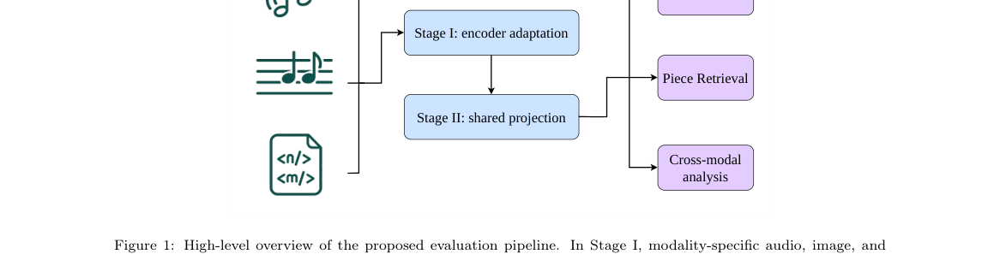

**Why this ranks #6**: 用受控的 2×2 设计把「编码器适配」与「共享投影」的贡献彻底分开，结论是单模态变好不等于跨模态变好。

---

### 7. TalkFlow: Structured Latent Flow Matching for Speech Driven Holistic Motion Generation

**arXiv**: [2610.40972](https://arxiv.org/abs/2610.40972) | **Score**: 7.7 (relevance 7.5 x 0.7 + quality 8.0 x 0.3) | **Tags**: audio-lm, co-speech-motion, flow-matching, structured-latent, holistic-motion, beat2, user-study, Stony Brook | **Categories**: cs.CV, cs.GR | **Pages**: 12

**Authors**: Xinmu Wang; Fumi Honda; Xiang Gao; Xianfeng Gu; Xiyun Song; Heather Yu

**Affiliation**: Stony Brook University; Futurewei Technologies Inc.

**Abstract**

> Holistic co-speech motion generation aims to synthesize coordinated facial expressions, hand gestures, and body movements from speech, which is challenging due to heterogeneous part-specific dynamics, long-range temporal coherence, and cross-part coordination. Directly modeling high-dimensional motion can be unstable, while overly compact or unstructured latent spaces may lose fine-grained motion details. We present \textbf{TalkFlow}, a structured latent flow framework for speech-driven holistic motion generation. TalkFlow learns a continuous three-stream latent representation for upper-body motion, lower-body motion, and facial expressions, preserving part-specific dynamics without forcing heterogeneous motion components into a single latent space. To maintain holistic coordination, lightweight cross-stream interactions are incorporated in both latent representation learning and flow-based generation. Conditioned on multi-level speech features, TalkFlow performs speech-conditioned latent flow matching, learning a continuous transport process from source latents to realistic motion latents. Experiments on the BEAT2 dataset demonstrate strong performance across facial expression accuracy, body gesture quality, and speech-motion synchronization. Qualitative comparisons and user studies further show that TalkFlow generates more natural, expressive, and speech-aligned holistic motion than state-of-the-art methods. The project page is available at https://xinmuwang.github.io/TalkFlow/.

**Key findings**

- **Finding**: 论文提出 TalkFlow，为上半身动作、下半身动作与面部表情分别学习一条连续潜流，理由是三者的时间动态与语义依赖不同，不应被强行塞进同一潜空间。
- **Finding**: 为保持整体协调，作者在潜表示学习与流生成两端都加入轻量跨流交互，全部采用 FiLM 调制与门控残差更新，并让表情在空间阶段调制姿态节点、在瓶颈处做上半身与另两流的双向交互。
- **Finding**: Stage I 训练结构化自编码器（重建损失加一阶与二阶时间一致性损失）后冻结，Stage II 做语音条件潜流匹配，损失为流匹配加解码后的 rollout 损失。
- **Finding**: 语音条件取自预抽取的 HuBERT、Librosa、FastText 与 SBERT 特征，并按分支区分：面部更依赖音素与语义，上半身更依赖韵律与交际强调，下半身主要反映姿态与稳定。
- **Finding**: 在 BEAT2（60 小时、25 位说话人、1762 段序列）上，TalkFlow 的 FGD 5.24、BCS 7.84、DIV 11.48、MSE 5.77、LVD 6.65，其中面部 MSE 与 LVD 最好、FGD 与 BCS 次优（EchoMask 的 FGD 为 4.62，ProbTalk 的 BCS 为 8.10）。
- **Finding**: 论文同时指出真值 BCS 仅 6.86、低于所有整体动作生成方法，说明更高的节拍一致未必更自然，用户研究中 TalkFlow 反而拿到最低的平均真实感排名。
- **Finding**: 推理用 50 步欧拉积分，在单张 RTX 4070 Ti SUPER 上每帧 0.006 秒，长序列用 240 帧窗口、重叠 8 帧并做线性混合与高斯平滑。
- **Inference**: 面部指标与感知真实感同时领先而节拍指标并非最优，说明在语音驱动生成上单一同步指标会误导优化方向。
- **Recommendation**: 推荐读。做语音驱动动作生成、角色动画或需要多部件协同建模的读者，建议精读其三流潜结构与交互设计。

**Key figures**

*Framework - TalkFlow generates coordinated body, hand, and facial motion from speech via structured latent flow matching. Conditioned on speech audio and aligned text features, our method synthesizes spee*

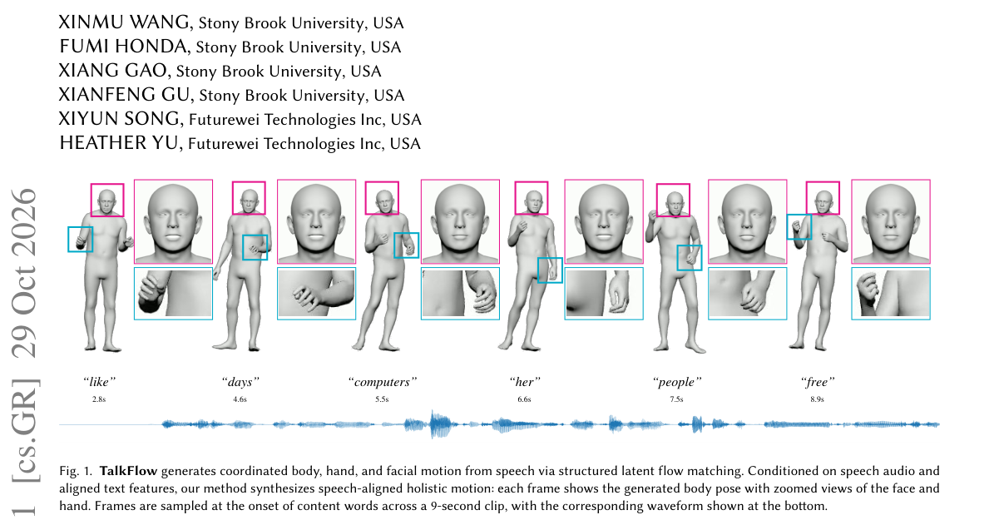

*Result - Overall architecture of TalkFlow. Stage I first encodes full-body pose and expression as two spatial branches and then forms upper-body, lower-body, and expression latent streams through tempo*

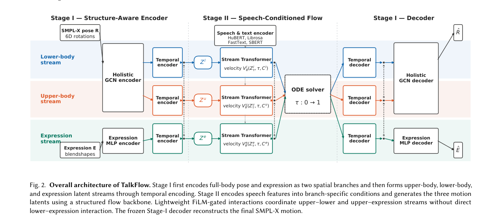

**Why this ranks #7**: 把全身动作拆成三条潜流分别建模再用轻量交互协调，避免异质运动被压进同一空间。

---

### 8. SimXAI: A Simple Drop-in Layer Increases Interaction Quality and Understanding in Conversational XAI

**arXiv**: [2610.41856](https://arxiv.org/abs/2610.41856) | **Score**: 7.1 (relevance 7.0 x 0.7 + quality 7.5 x 0.3) | **Tags**: audio-lm, conversational-xai, tool-calling-llm, drop-in-layer, user-study, faithfulness-evaluation, emnlp-2026, University of Marburg | **Categories**: cs.AI, cs.CL, cs.HC | **Pages**: 18

**Authors**: Van Bach Nguyen; Qianli Wang; Nils Feldhus; Jörg Schlötterer; Christin Seifert

**Affiliation**: University of Marburg; Technische Universität Berlin; University of Groningen; German Research Center for Artificial Intelligence

**Abstract**

> Conversational explainable AI (ConvXAI) agents often use GUS-style architectures with separate modules for intent recognition, dialogue management, and template-based response generation. While faithful to the underlying XAI methods, these pipelines are hard to adapt and often struggle with context-dependent follow-up questions. We present SimXAI, a lightweight LLM-centric conversational layer that replaces these modules with a single tool-calling LLM that bridges access to existing XAI resources. Rather than a standalone agent, SimXAI serves as a modular interface that enables conversational access to external XAI resources. We further introduce an evaluation suite for single- and multi-turn parsing, faithfulness, and contextualization. Across existing and new datasets, SimXAI achieves strong function-selection accuracy and high faithfulness while better handling context-dependent requests. In a user study replacing only the conversational layer of TalkToModel, a representative GUS-based agent, users completed tasks more accurately and in fewer turn. Overall, SimXAI improves GUS-based design while preserving faithfulness and improving conversational quality.

**Key findings**

- **Finding**: 论文指出对话式可解释 AI 代理常用 GUS 式架构，把意图识别、对话管理与模板化响应生成拆成独立模块，虽忠于底层 XAI 方法却难适配，也难处理依赖上下文的追问。
- **Finding**: SimXAI 用一个轻量的 LLM 中心对话层替换这些模块，由单个会调工具的 LLM 桥接已有 XAI 资源，定位是可插拔接口而非独立代理。
- **Finding**: 作者同时交付一套评测套件，覆盖单轮与多轮解析、响应到工具的忠实度以及上下文化三个维度，每项都配有人工标注真值、指标与自动化评测流水线。
- **Finding**: 论文强调其忠实度指标衡量的是对话层是否保真传递 XAI 输出，并不衡量底层解释方法对预测模型本身是否忠实。
- **Finding**: 在 30 名参与者的用户研究中，仅把 TalkToModel 的对话层换成 SimXAI、底层 XAI 资源保持不变，即显著提升了感知交互质量与任务表现，用户完成任务更准确且轮次更少。
- **Inference**: 把对话层与解释资源彻底解耦，使上游 XAI 方法可被逐个替换而不必重写整套代理，工程收益明显大于模型侧的改动。
- **Recommendation**: 推荐读。做对话式解释系统、人机交互评测或想给 LLM 代理做忠实度评估的读者，可参考其评测套件设计。

**Key figures**

*Framework - Comparison of TALKTOMODEL’s traditional GUS architecture with SIMXAI’s LLM-centric conversa- tional component. Traditional systems rely on multiple components that require rules, templates,*

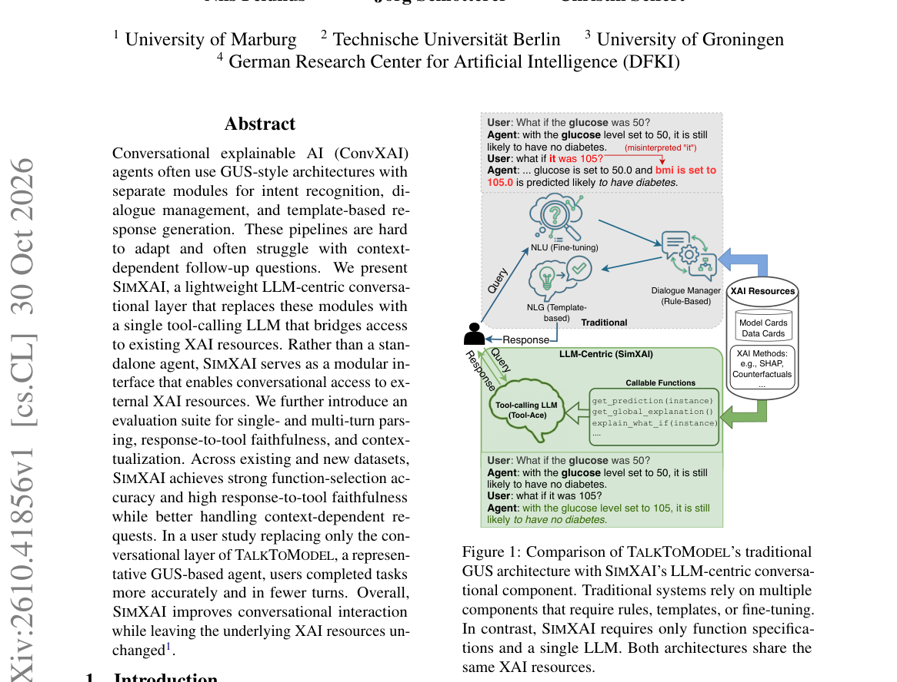

*Result - Template for Function Specification.*

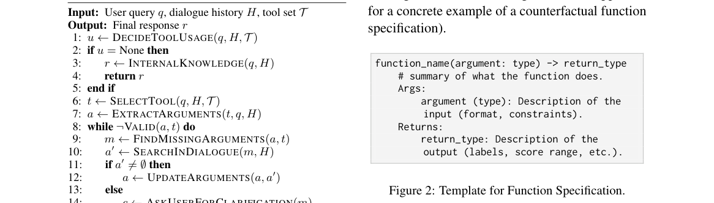

**Why this ranks #8**: 补位进入本线：用单个会调工具的 LLM 替换 GUS 式三件套，做成可插拔的对话层并验证交互质量。  [wild-card=yes] SimXAI 是对话式可解释 AI 的交互质量评测与可解释性层设计，主体是文本对话，补位计入。

---

### 9. PersonaChatBench: Evaluating Chat Assistants with Diverse Simulated Users

**arXiv**: [2610.42060](https://arxiv.org/abs/2610.42060) | **Score**: 7.1 (relevance 7.0 x 0.7 + quality 7.5 x 0.3) | **Tags**: audio-lm, persona-simulation, chat-assistant-evaluation, simulator-fidelity, user-needs, multi-turn, benchmark, Brown | **Categories**: cs.CL | **Pages**: 74

**Authors**: Zheyuan Deng; Taoran Li; Jingwen Zhang; Yuante Li; Dachuan Zhao; Fulei Zhang; Yunkai Zhang; Zhikun Xu; Yajie Liao; Haichao Zhang; Haodi Hu; Cong Wang

**Affiliation**: Brown University; Texas A&M University; Harvard University; Carnegie Mellon University

**Abstract**

> Conversational assistants are expected to help people with diverse backgrounds, preferences, and communication styles. Yet evaluations centered on a single cooperative user provide limited insight into how reliably an assistant serves users with different personas. We introduce PersonaChatBench, a framework for evaluating task competence and responsiveness to diverse user needs. PersonaChatBench pairs the same underlying task with multiple simulated users, each guided by a private persona card that specifies distinct needs, preferences, and interaction behaviors. By holding the task fixed while varying the user, the framework examines how assistant performance changes across user conditions. We evaluate 20 language models across six domains, separately assessing native task outcomes, fulfillment of expressed persona needs, and simulator fidelity. Our results show that task performance and need fulfillment vary across personas and domains. Strong task performance does not necessarily translate into satisfying individual needs, and models' relative strengths in meeting those needs are not consistent across domains. PersonaChatBench makes these differences measurable, revealing gaps obscured by aggregate scores and helping identify which users an assistant serves well and where adaptation is needed. It provides a basis for evaluating consistency across users and guiding the development of assistants that better accommodate diverse needs in everyday applications.

**Key findings**

- **Finding**: 论文提出 PersonaChatBench，把同一批底层任务与多个模拟用户配对，每个模拟用户由一张私有 persona 卡引导，卡片规定其需求、偏好与交互行为。
- **Finding**: 框架整理出 806 个任务，覆盖健康咨询、编程、数学辅导、金融建议、客服与旅行规划六个领域，并配套领域专属的人设面板与显式用户需求。
- **Finding**: 评测覆盖 20 个语言模型，横跨 GPT、Claude、Gemini、Grok、DeepSeek、Kimi、MiniMax、Qwen、GLM 与 Muse 等家族。
- **Finding**: 评估被拆成三部分分别打分：任务本身的结果、用户所表达需求的满足度，以及模拟器保真度；另设不带 persona 卡的中性用户作为参照。
- **Finding**: 模拟器审计检查模拟用户是否遵循所分配人设、是否与授权的任务事实保持一致；需求只在用户表达之后、助手有机会回应之后才被评估。
- **Finding**: 结果显示任务表现与需求满足度都随人设与领域变化，强的任务表现并不自动等于满足了个人需求，各模型满足需求的相对优势在不同领域也不一致。
- **Inference**: 单一合作型用户的聚合分数会把「服务得好不好」与「服务了谁」混为一谈，PersonaChatBench 暴露的正是聚合分数掩盖的差异。
- **Recommendation**: 推荐读。做对话助手评测、用户模拟或需要证明产品对不同人群都有效的读者，建议参考其协议与模拟器审计做法。

**Key figures**

*Framework - Overview of PersonaChatBench. The same task is evaluated with different simulated users through multi-turn conversa- tions, with task performance, persona-needs satisfaction, and simulator f*

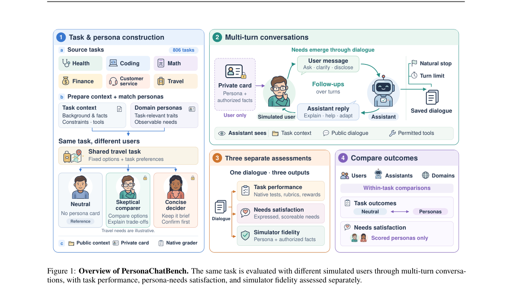

*Result - Task and persona composition across six domains. Inner and outer rings show domains and task sources, with sector sizes proportional to task counts. Cards summarize user conditions and plann*

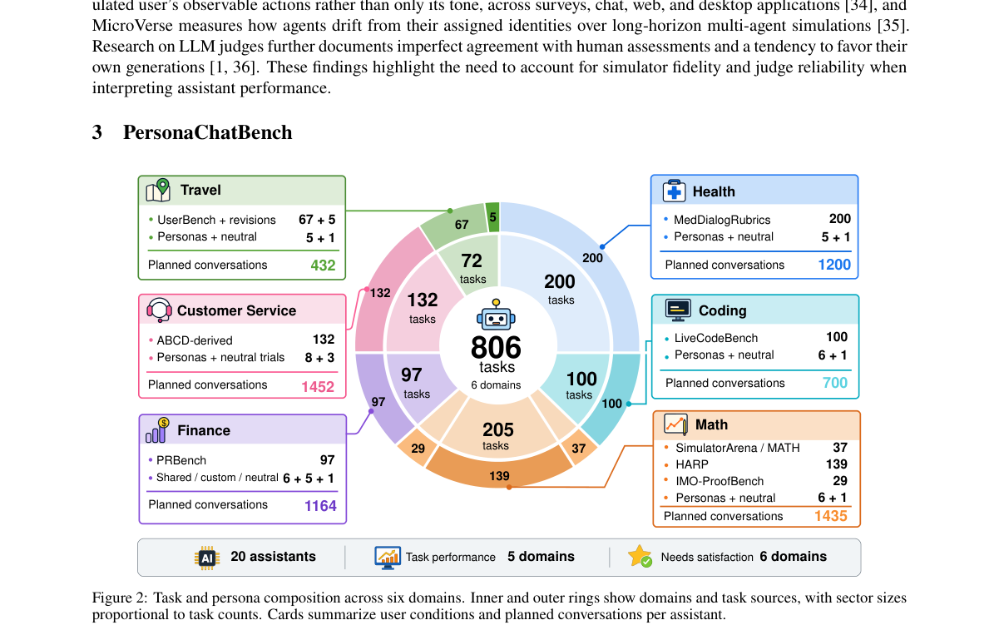

**Why this ranks #9**: 补位进入本线：固定任务只换用户，度量同一助手服务不同人设时的能力与需求满足度。  [wild-card=yes] PersonaChatBench 用多样化模拟用户评测对话助手，属对话评测基准而非语音语言模型，补位计入。

---

### 10. PsyInterviewee: Informational Invariance and Relational Adaptivity in Mental Health Interview Simulation

**arXiv**: [2610.41289](https://arxiv.org/abs/2610.41289) | **Score**: 7.1 (relevance 7.0 x 0.7 + quality 7.5 x 0.3) | **Tags**: audio-lm, mental-health-interview, simulated-interviewee, informational-invariance, relational-adaptivity, dual-channel, llm-judge, Harbin | **Categories**: cs.CL | **Pages**: 38

**Authors**: Jiawei Zhang; Huachuan Qiu; Ruocheng Guo; Zijun Shi

**Affiliation**: Harbin Institute of Technology; Westlake University; Microsoft; The Hong Kong University of Science and Technology

**Abstract**

> LLM-based simulated interviewees support interviewer training and the evaluation of mental health interviewing systems. Existing studies have primarily focused on improving human-likeness through richer patient profiles and behavioral modeling. However, human-likeness alone does not establish their reliability. Reliable simulation requires preserving profile-grounded clinical facts (informational invariance) while adapting disclosure and interaction behavior to the interview (relational adaptivity). To this end, we introduce PsyInterviewee, which separates a protected truth channel from a dynamic interaction channel and verifies generated clinical claims against the profile. Specifically, asymmetric write permissions allow dialogue context to update disclosure and behavioral states without authorizing new clinical facts; these states guide what profile-supported information is revealed and how it is expressed. In an automated evaluation of interactions between LLM-based interviewers and interviewees, PsyInterviewee achieves higher scores than four representative baselines on most metrics across both axes, as assessed by two LLM judges. Ablations suggest that the two channels contribute to clinical grounding and response modulation, respectively.

**Key findings**

- **Finding**: 论文指出既有模拟受访者工作多靠更丰富的患者档案与行为建模来提升真人感，但真人感本身并不能确立可靠性，可靠模拟需要同时满足保留档案事实的信息不变性与随访谈调整披露与行为的关系适应性。
- **Finding**: PsyInterviewee 把受保护的事实通道与动态的交互通道分离，并把生成出的临床论断对照档案进行核验。
- **Finding**: 关键机制是非对称写权限：对话上下文可以更新披露状态与行为状态，但无权授权新的临床事实，这些状态再决定透露哪些有档案支撑的信息以及如何表达。
- **Finding**: 自动评测在 LLM 提问者与受访者之间进行并由两个 LLM 裁判打分，信息不变性在 25 轮访谈上评估，关系适应性在 30 个档案上评估，量表为 1 到 5 分。
- **Finding**: 在两个轴上的多数指标上，方法优于四个代表性基线；消融显示两个通道分别对临床依据与响应调节起作用。
- **Finding**: 论文同时指出，两个 LLM 裁判之间的判定存在差异，说明自动裁判本身也需谨慎对待。
- **Inference**: 把「事实不可被对话改写」做成权限模型而非提示词约束，是这类模拟系统少见的结构性做法，也更容易被审计。
- **Recommendation**: 推荐读。做角色扮演模拟、心理健康对话系统或需要评估模拟可靠性的读者，值得读其双通道与非对称写权限设计。

**Key figures**

*Framework - Conceptual overview of reliability in simulated interviewees for mental health interviewing. (a) A prede- fined patient profile and two complementary reliability axes: Informational Invarian*

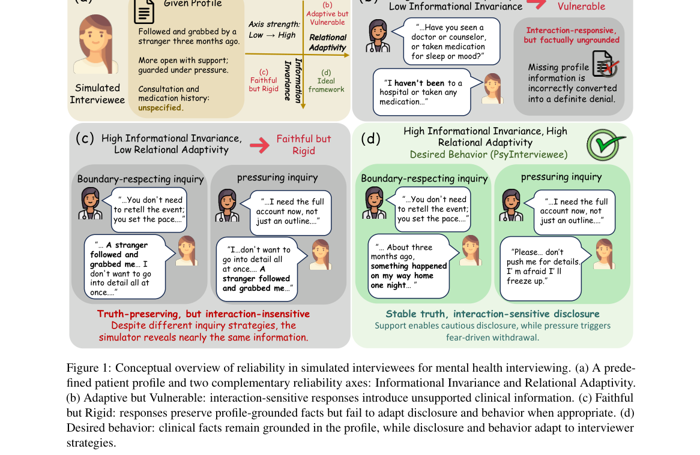

*Result - Overview of PsyInterviewee. The framework separates protected clinical truth from dynamic interaction- dependent disclosure and behavior. Asymmetric write permissions allow interviewer input*

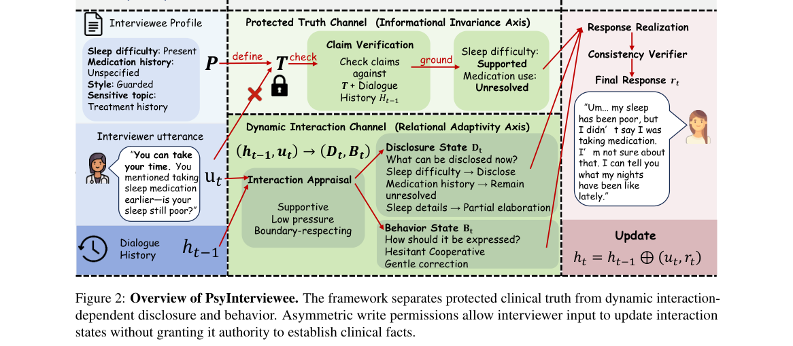

**Why this ranks #10**: 补位进入本线：用受保护事实通道与非对称写权限，把「像真人」与「可靠」这两件事分开。  [wild-card=yes] 心理健康访谈模拟中的信息不变性与关系适应性，是对话人设与心理侧研究，补位计入。

---

## Footer

- Total papers scanned across all 7 tracks: 465（原始 615 条）
- audio_lm track final top-10: 10
- Wild-cards in this track: 3
- Figure assets: 2026-11-02/res/

Generated by `mine-arxiv-daily-digest` skill. Sister file: `2026-11-02_audio_lm_entry.md`.
