# ArXiv Daily Digest - 2026-11-02 (具身智能与世界模型, 10 papers)

**Generated**: 2026-11-02 17:30 CST

**Source**: arXiv cs.CV, cs.SD, eess.AS, cs.CL, cs.AI, cs.RO, cs.LG submissions, listing day 2026-10-30 (announced 2026-10-31 00:00 UTC)

**Batch window**: 2026-10-29T18:00:00Z .. 2026-10-30T18:00:00Z（arXiv 公告批次横跨两个 UTC 日：前一日 18:00 UTC 起算，当日 17:59:59 UTC 截止）

**Track**: embodied (top 10 of 465 papers scanned, 70 full reads)

**Scope**: 机器人操作与导航、视觉语言动作模型、世界模型、触觉感知与 sim-to-real

---

## Top 10 - 具身智能与世界模型

### 1. From Teleoperation to Long-Horizon Dexterity: Evaluating Visuomotor Skills and Offline Proxies for Dexterous Manipulation

**arXiv**: [2610.40828](https://arxiv.org/abs/2610.40828) | **Score**: 9.3 (relevance 9.5 x 0.7 + quality 9.0 x 0.3) | **Tags**: embodied, Real_Robot_Trials, Point_Cloud_Policy, VLA_Policy, Representation_Ablation, Offline_Proxy_Metrics, Analog Devices | **Categories**: cs.AI, cs.LG, cs.RO, eess.SY | **Pages**: 12

**Authors**: Ammar N. Abbas; Aayush Jain; Prashanth Viswanath; Nivesh Gadipudi; Giulia Vilone; Jim Gibbons

**Affiliation**: Analog Devices, Inc., EdgeAI Robotics

**Abstract**

> Imitation learning policies are intended to make robotic manipulation robust to variations in object pose, appearance, and environment that challenge pre-programmed motion. However, real-world performance remains difficult to predict, as conventional optimization signals such as validation loss show no consistent relationship with robot success. To identify the design choices that govern real-world performance, 281 imitation-learning policies spanning seven policy families were evaluated in approximately 1,700 real-robot trials of RJ45 connector grasping and insertion using a five-fingered robotic hand. Controlled ablations showed that observation and action representations dominated conventional optimizer and sampling choices. For point-cloud policies, region-of-interest cropping, representation in the robot-base frame, and normalization within the point encoder each improved success by 70-100 percentage points. For the vision-language-action policy, absolute rather than relative action prediction improved insertion success by up to 70 percentage points. Skill decomposition, multi-view perception, and recovery demonstrations were associated with the strongest-performing systems, although their effects were not independently isolated. Of 67 offline metrics evaluated, only five measures of predicted-motion smoothness and directness reliably correlated with insertion success (r = -0.70 to -0.80), and only within a single policy family. These results identify representation choices as key determinants of real-world imitation-learning performance and show that offline metrics can shortlist policies, but cannot replace real-robot evaluation.

**Key findings**

- **Finding**: 在五指机械手的 RJ45 抓取插入任务上，作者评测了 7 个策略族、共 281 个模仿学习策略、约 1700 次真机试验。
- **Finding**: 点云策略上，ROI 裁剪、在机器人基座坐标系下表征、以及在点编码器内部做归一化，三项各自把成功率提升 70–100 个百分点。
- **Finding**: 对 VLA 策略，改用绝对动作预测而非相对动作，插入成功率最多提高 70 个百分点。
- **Finding**: 67 个离线指标中只有 5 个（预测运动的平滑性与直接性）与插入成功率可靠相关，r = -0.70 到 -0.80，且只在单一策略族内部成立。
- **Finding**: 技能分解、多视角感知与恢复演示出现在表现最强的系统里，但作者未独立隔离它们各自的贡献。
- **Inference**: 验证损失这类常规优化信号与真机成功率没有一致关系，说明离线代理指标只能做候选筛选、不能替代真机评测。
- **Inference**: 表征类选择带来的收益幅度远超优化器与采样策略的选择，说明「换模型」之外的设计空间仍被系统性低估。
- **Recommendation**: 值得读，是少见的用真机规模把工程直觉转成可执行设计清单的研究。

**Key figures**

*Framework - Skill-orchestration workflow: (a) teleoperated data collection, (b) segmentation into mo- tion primitives and learned skills, (c) execution, where the learned skill acts after classical poin*

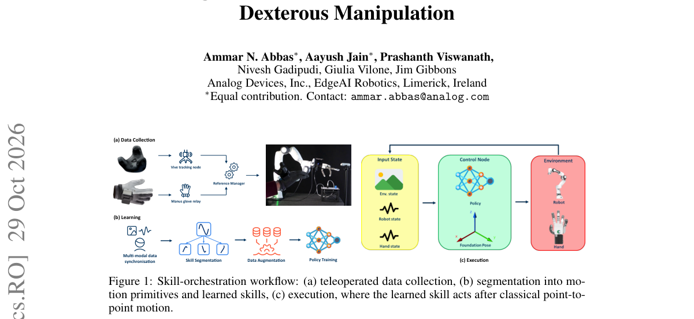

**Why this ranks #1**: 281 个模仿学习策略的真机对照，把「表征选择决定成败」量化成 70–100 个百分点的差距。

---

### 2. A Capability-Aware Backup-Recoverability Filter for Heterogeneous Multi-Robot Navigation

**arXiv**: [2610.41188](https://arxiv.org/abs/2610.41188) | **Score**: 8.8 (relevance 9.0 x 0.7 + quality 8.5 x 0.3) | **Tags**: embodied, Multi_Robot, Safety_Filter, QP, Recursive_Feasibility, Heterogeneous_Kinematics, University of Illinois Chicago | **Categories**: cs.RO | **Pages**: 8

**Authors**: Joonkyung Kim; Yanze Zhang; Wenhao Luo; Yiwei Lyu

**Affiliation**: University of Illinois Chicago

**Abstract**

> Safe navigation in heterogeneous multi-robot teams faces two coupled challenges: differences in robots' braking and turning capabilities limit how each robot can respond to an approaching neighbor, while simultaneous interactions require a single control action to satisfy multiple collision-avoidance constraints. Together, these challenges can make local safety constraints incompatible with a robot's admissible controls, leaving a decentralized safety controller without a feasible action. We propose a Capability-Aware Backup-Recoverability Filter (CA-BRF), based on the insight that navigation actions should preserve access to a certified recovery maneuver. First, we construct a backup-recoverable set in a shared Cartesian operational space by evaluating whether prescribed backup maneuvers maintain pairwise safety until the robots come to rest. Each maneuver respects the corresponding robot's kinematic and actuation constraints, making the recovery certificate capability-dependent. Second, CA-BRF filters candidate controls by selecting admissible interpolations between candidate and backup actions while coordinating the selection across simultaneous interactions. This preserves backup recoverability while retaining as much of the candidate action as possible and ensures that all pairwise recovery conditions are satisfied by a single executable control for each robot. Together, we establish recursive feasibility and safety for the discrete-time closed-loop system even when the nominal safety-constrained optimization becomes infeasible. The validity and effectiveness of the proposed CA-BRF are validated in simulations with up to 30 heterogeneous robots and experiments of robots with five different kinematic classes.

**Key findings**

- **Finding**: CA-BRF 先在共享笛卡尔操作空间构造备份可恢复集，检验规定的备份机动能否让机器人对在静止前持续保持成对安全；备份机动服从各机型自身的运动学与驱动约束，因此恢复证书依赖能力。
- **Finding**: 滤波器在候选控制与备份控制之间取插值，并按交互连通分量协调选择，使同一台机器人参与的多个成对恢复条件由同一个可执行控制同时满足。
- **Finding**: 定理 2 给出递归可行性与安全性：在初值可容许且新激活的机器人对属于可恢复集的前提下，CA-BRF 每步都存在可行插值参数，任意时刻成对安全量非负。
- **Finding**: 仿真覆盖 N = 10 / 20 / 30 台机器人、每种规模 50 次随机试验、五个运动学类别，安全成功率分别为 98.0%、92.0%、85.6%，150 次试验中零安全违规。
- **Finding**: N = 30 时共享（能力无关）备份模型只有 74.9% 安全成功率与 28% 违规率；去掉 BRF 只做瞬时 HOCBF 时成功率为 79.5%，但违规率高达 86%、平均每次试验 3.70 次违规事件。
- **Inference**: 密集异构交互下，「共享一套保守刹车模型」会系统性地失效，说明恢复能力必须按机型分别建模。
- **Inference**: 该滤波器并不改变名义控制器，只在优化不可行时介入，属于可插拔的安全层，工程落地成本相对可控。
- **Recommendation**: 值得读，思路清晰且有可复现的量化对照，适合多机器人规划方向直接借鉴。

**Key figures**

*Result - Random start–goal navigation with N = 30 heterogeneous robots (six per model) at multiple timestamps. Robots start from randomly sampled positions, and × markers denote their assigned goals. U*

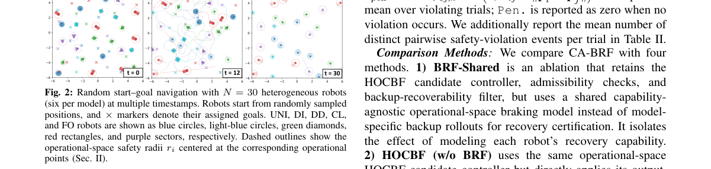

**Why this ranks #2**: 把「每个动作必须保留可执行的恢复机动」变成显式证书，在名义安全优化不可行时仍维持递归可行。

---

### 3. HandMimicX: Learning Human-Like Dexterous Manipulation via an Object-Centric Policy from Egocentric Videos

**arXiv**: [2610.41336](https://arxiv.org/abs/2610.41336) | **Score**: 8.8 (relevance 9.0 x 0.7 + quality 8.5 x 0.3) | **Tags**: embodied, Human_Video, Egocentric_RGBD, 4D_HOI_Reconstruction, Interaction_Prior, DAgger, Tsinghua | **Categories**: cs.RO | **Pages**: 9

**Authors**: Zihan Gao; Yufei Liu; Yuhong Zhang; Zhen Yu; Xinhao Huang; Zhinan You; Kai W. Ho; Zipeng Ye; Peng Jiao; Haoqian Wang

**Affiliation**: Tsinghua University; The Chinese University of Hong Kong, Shenzhen; NVIDIA

**Abstract**

> Learning dexterous manipulation from human videos remains an open challenge, particularly in the context of transferring a single demonstration into a spatially generalizable robotic skill and maintaining physically plausible human-like interactions. Unlike prior works that emphasize hand-motion imitation, we introduce an object-centric framework for acquiring dexterous skills from egocentric human RGB-D videos. Within our framework, we formulate the reinforcement learning (RL) objective in terms of object motion to decouple the underlying skill from the specific hand trajectory and impose constraints on hand-object interaction states to promote more anatomically natural hand configurations. Extensive experiments in simulation and on real robots demonstrate that our method enables efficient learning from human videos and generalizable skill transfer across novel spatial configurations.

**Key findings**

- **Finding**: HandMimicX 是物体中心的强化学习框架，把 RL 目标写成物体运动，从而把技能与具体手部轨迹解耦，并对交互状态施加约束以促进解剖学上自然的手部构型。
- **Finding**: 框架先做联合 4D 手物交互重建，并利用深度信息修正相机运动带来的手部平移误差，再把整段重建压缩成物体几何与交互先验。
- **Finding**: 策略被训练成把物体操纵到任意 6-DoF 目标位姿，真实部署时用 DAgger 把特权信息蒸馏给只看 RGB-D 的学生策略。
- **Finding**: 仿真中在 4096 个环境上评测，平均成功率为 85.4%，显著高于各基线。
- **Finding**: 消融显示预训练把平均成功率再提高 12.1%，真实机器人上在八个操作任务上评估技能迁移。
- **Inference**: 物体中心目标虽然放弃了轨迹保真，却换来空间泛化与更自然的接触构型，这正是纯模仿方法的失败模式。
- **Inference**: 从单段视频起步的关键在于把「交互先验」显式抽取出来，而不是把人手轨迹直接搬到机器人上。
- **Recommendation**: 值得读，思路对做人类视频迁移的团队有直接参考价值，但重建环节对工程要求不低。

**Key figures**

*Result - Overview of HandMimicX. (a1) Given an RGB-D egocentric video, we reconstruct the manipulated object and hand motion, and then align both reconstructions with the depth observations. (a2) We ex*

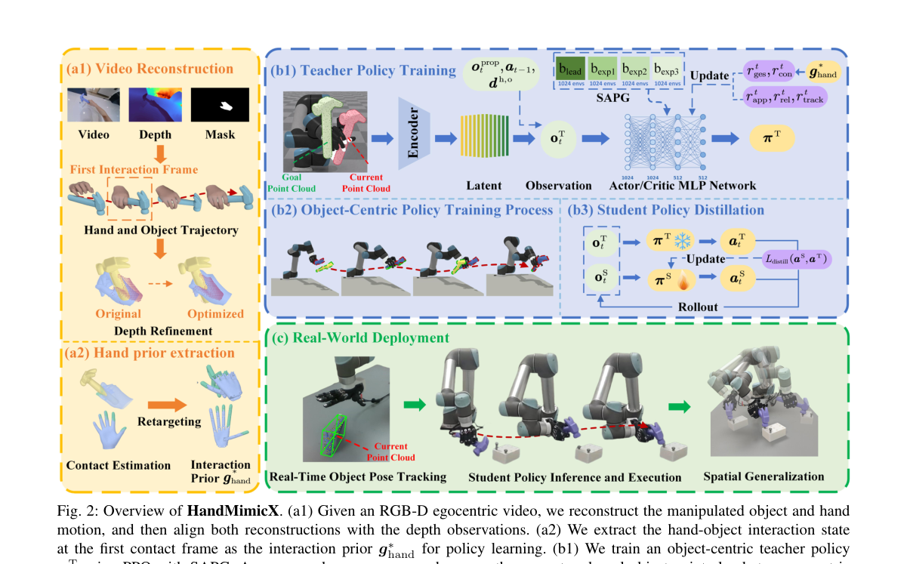

**Why this ranks #3**: 以物体运动而非手部轨迹定义 RL 目标，用单段人类视频换取可泛化的灵巧操作技能。

---

### 4. $\nabla$Mimic: Ultra-Efficient Humanoid Control with Differentiable Simulation

**arXiv**: [2610.41654](https://arxiv.org/abs/2610.41654) | **Score**: 8.8 (relevance 9.0 x 0.7 + quality 8.5 x 0.3) | **Tags**: embodied, Differentiable_Simulation, Humanoid, First_Order_Gradient, Unitree_G1, LAFAN1, UC Davis | **Categories**: cs.LG, cs.RO | **Pages**: 26

**Authors**: Weyl Lu; Yubei Chen

**Affiliation**: UC Davis

**Abstract**

> Robot policy learning is dominated by zeroth-order methods such as PPO, which treat the simulator as a black box and pay for it with enormous sample counts. First-order policy learning differentiates through the dynamics, but on contact-rich whole-body control it has rarely worked: its gradients explode. A recent world-model method showed that derivative information can make humanoid motion tracking far more efficient, using surrogate gradients of a learned model. We show that exact gradients of the simulator itself do better, once two obstacles are removed. Exact gradients contain rare unbounded samples, because contact dynamics is not differentiable everywhere and its derivative diverges near some events; and they are expensive, because the simulator's adjoint has to replay the contact solve. $\nabla$Mimic bounds these samples with median-relative per-sample gradient clipping at every step of the backward pass, and reuses each costly simulated window by multistep regression onto gradient-derived action targets, which bounds every action target independently of the gradient scale. NablaEngine, a differentiable GPU simulation engine for the Unitree G1, removes the cost: it computes MuJoCo's full contact dynamics with fused per-world kernels and the adjoint of a whole control step as a single megakernel, with analytic gradients that match float64 finite differences, $11.5\times$ faster than the available MuJoCo Warp adjoint. On whole-body tracking of all 40 LAFAN1 clips with one policy on one GPU, $\nabla$Mimic reaches the score reported by the state-of-the-art world-model method, 0.82, in 20 minutes instead of 1.2 h, and 0.874 in 1.8 h. SHAC, the standard first-order baseline, stops on exploding gradients within minutes. We release NablaEngine and $\nabla$Mimic as open-source infrastructure for first-order humanoid policy learning.

**Key findings**

- **Finding**: 作者指出精确梯度含罕见无界样本（接触动力学并非处处可微、导数在某些事件附近发散），且代价高昂，因为模拟器伴随计算必须重放接触求解。
- **Finding**: 两个对策是：在反向传播每一步做中值相对的逐样本梯度裁剪，以及把昂贵的仿真窗口用多步回归复用到由梯度导出的动作目标上，使每个动作目标的上界与梯度尺度无关。
- **Finding**: NablaEngine 是面向 Unitree G1 的可微 GPU 仿真引擎，用融合的 per-world kernel 计算 MuJoCo 完整接触动力学，并把整步伴随计算做成单个 megakernel，解析梯度与 float64 有限差分一致，比可用的 MuJoCo Warp 伴随快 11.5 倍。
- **Finding**: 在全部 40 段 LAFAN1 动作上，单 GPU 单策略追踪达到世界模型方法报告的 0.82 分只需 20 分钟（对照为 1.2 小时），1.8 小时可达 0.874。
- **Finding**: 作为标准一阶基线的 SHAC 在几分钟内即因梯度爆炸而停止训练。
- **Inference**: 接触丰富场景下，一阶方法的瓶颈是梯度方差而不是算力，因此裁剪与目标重用的组合比单纯加速伴随更有价值。
- **Inference**: 与学习式世界模型相比，精确梯度多出的收益来自「不受模型误差约束」，但前提是模拟器本身足够可信。
- **Recommendation**: 值得读，且 NablaEngine 与 ∇Mimic 均开源，适合做接触丰富全身控制的团队优先复现。

**Key figures**

*Result - Exploding gradients sit in single samples. Per-sample action-gradient norms of SHAC on exact gradients (one seed, raw, before any clipping). (a) Distribution within one update batch of 131,0*

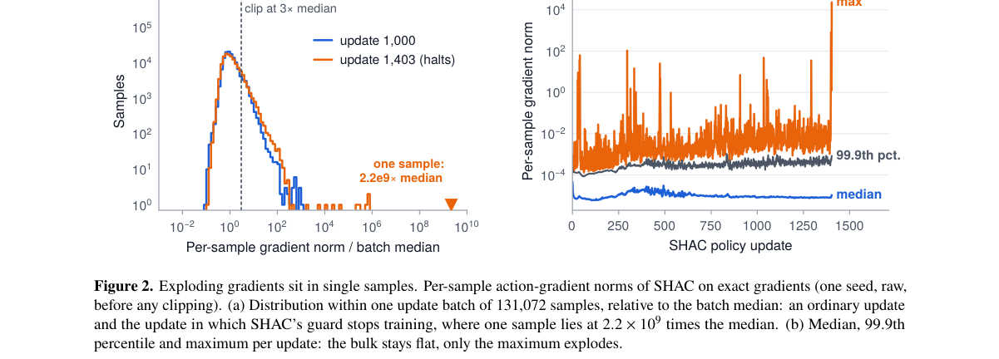

**Why this ranks #4**: 用模拟器精确梯度替代世界模型代理梯度，把人形运动跟踪的样本效率提升约一个数量级。

---

### 5. Cross-Embodiment Motion Planning by Coupling Body-Agnostic World Model with Differentiable Ego-Dynamics

**arXiv**: [2610.41330](https://arxiv.org/abs/2610.41330) | **Score**: 8.8 (relevance 9.0 x 0.7 + quality 8.5 x 0.3) | **Tags**: embodied, Cross_Embodiment, World_Model, Ego_Dynamics, MPPI, Zero_Shot_Transfer, Nanyang Technological | **Categories**: cs.RO | **Pages**: 8

**Authors**: Zhidong Wang; Zirui Li; Haoran Xu; Yujie Yan; Zitong Shan; Jingsong Liang; Han Yu; Chen Lv

**Affiliation**: Nanyang Technological University

**Abstract**

> Motion planning in clutter is embodiment-specific: the feasible free space and reachable commands depend on each robot's geometry and dynamics. Existing cross-embodiment policies output normalized commands that disregard these differences, or compensate through per-robot training and distillation. World models can in principle pool cross-embodiment data, yet command-conditioned models bind their latent dynamics to a single action space, while pose-conditioned models omit the mapping from commands to body-specific motion. On flat ground, however, embodiment affects the planner's observations only through the camera ego-motion. This letter proposes Hourglass, an hourglass-shaped architecture that factorizes cross-embodiment motion planning at this interface: a body-agnostic world model and each robot's differentiable ego-dynamics, which map commands to that ego-motion, are coupled only through it. The world model is trained on data pooled across embodiments and camera mounts; each robot's ego-dynamics is a reduced-order template with identified physical parameters. A generalist parameter-conditioned policy is learned once at this junction: each imagined step rolls out the template and then the world model, and imagination training through each robot's template makes the policy body-aware. On seven simulated robots of five locomotion types, the generalist policy outperforms imitation-learning and diffusion-policy baselines on the same world model by 3.8--10.6 percentage points in success rate and matches per-robot specialists without dedicated training, while approaching its parameter-conditioned MPPI teacher within 1.4--2.8 points without an online map. After three minutes of teleoperated driving for identification, the synthetic-data-trained model transfers zero-shot to a real skid-steer robot unseen in training, navigating unseen indoor scenes.

**Key findings**

- **Finding**: 作者指出平地运动规划中，本体差异只通过相机自运动影响规划器的观测，据此提出 Hourglass：身体无关的世界模型与每台机器人的微分自运动学只通过自运动这一接口耦合。
- **Finding**: 世界模型在跨本体、跨相机安装方式汇集的数据上训练；每台机器人的自运动学是带已辨识物理参数的降阶模板。
- **Finding**: 参数条件化的通用策略只训练一次，每步想象先滚动模板再滚动世界模型，因而策略是本体感知的。
- **Finding**: 在七台、覆盖五种运动学类型的仿真机器人上，通用策略在同一世界模型下比模仿学习与扩散策略基线高出 3.8–10.6 个百分点的成功率。
- **Finding**: 通用策略无需专门训练即达到各机器人专用策略水平，并在无需在线建图的条件下逼近其参数条件化 MPPI 教师 1.4–2.8 个百分点。
- **Finding**: 用三分钟遥操作驾驶做参数辨识后，合成数据训练的模型零样本迁移到训练中未见过的真实滑移转向机器人，在未见室内场景中导航。
- **Inference**: 把「本体差异」压缩成一个可辨识的低维接口，比为每个本体单独训练或蒸馏要省一个数量级的数据。
- **Inference**: 结论依赖平地假设，复杂地形或非完整约束下的可迁移性仍是未验证的部分。
- **Recommendation**: 值得读，接口设计思路对做跨本体预训练的团队有直接启发。

**Key figures**

*Framework - Hourglass: a body-agnostic world model and the differentiable ego- dynamics with physical parameters θ, which map the commands u to the camera ego-motion ∆ξ, are joined only through ∆ξ; a cros*

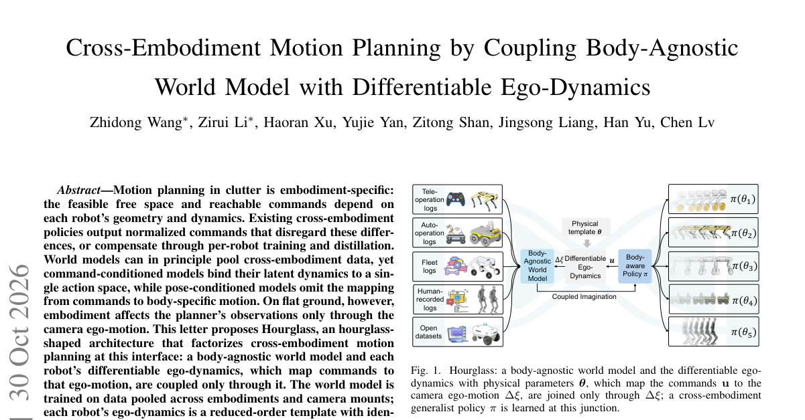

*Result - Overview of Hourglass. Left: the body-agnostic world model pψ, and the differentiable ego-dynamics fθ with physical parameters θ. Middle: in coupled latent imagination, the two modules interac*

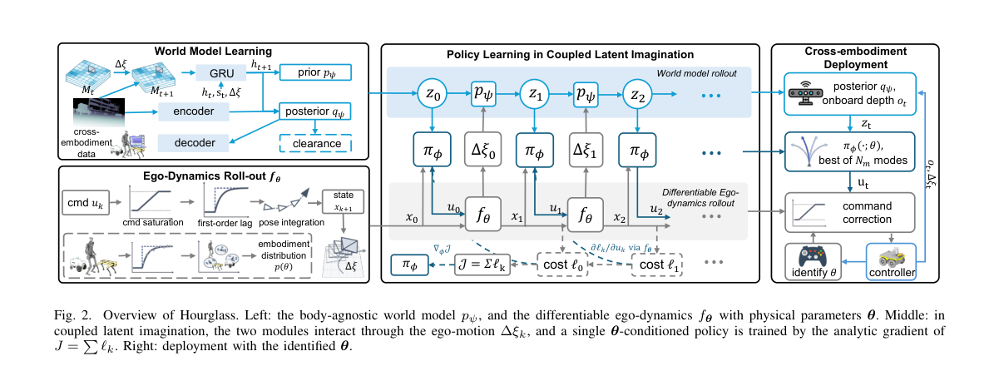

**Why this ranks #5**: 把跨本体规划拆成「身体无关世界模型 × 本体微分自运动学」，一个通用策略覆盖多种机器人。

---

### 6. Nexus-VLA: Bridging Human and Robot Experiences via a Shared Hierarchical Semantic Latent Space

**arXiv**: [2610.42021](https://arxiv.org/abs/2610.42021) | **Score**: 8.8 (relevance 9.0 x 0.7 + quality 8.5 x 0.3) | **Tags**: embodied, Human_Robot_Joint_Training, Semantic_Alignment, Shared_Latent, RoboCasa_GR1, Real_Robot, Xi'an Jiaotong | **Categories**: cs.RO | **Pages**: 22

**Authors**: Biaoliang Guan; Tingyu Yuan; Wen Ye; Ziming Ji; Xu Yang; Yan Huang; Jihua Zhu; Chaoyang Zhao

**Affiliation**: Xi'an Jiaotong University; Institute of Automation, Chinese Academy of Sciences; University of Chinese Academy of Sciences; Beijing University of Posts and Telecommunications

**Abstract**

> Large-scale egocentric human videos provide rich and scalable manipulation experience for robot policy learning, yet substantial embodiment gaps in visual appearance, kinematic structure, and action spaces hinder effective knowledge transfer. Existing methods often decouple cross-embodiment knowledge alignment from robot policy learning, making it difficult for human manipulation knowledge to directly and fully contribute to robot action learning. To address this issue, we propose Nexus-VLA, a hybrid policy learning framework that enables cross-embodiment knowledge transfer through end-to-end human-robot joint training, allowing human manipulation experience to directly contribute to robot policy learning. We first introduce a hierarchical cross-embodiment semantic alignment paradigm that progressively establishes shared manipulation semantics from task intent to fine-grained interactions, enabling more complete use of the manipulation knowledge contained in human videos. Building on this hierarchy, we design a shared manipulation latent representation that jointly encodes multi-level shared knowledge into an internal representation directly used for continuous action generation, improving policy learning efficiency while effectively leveraging human knowledge. Across RoboCasa-GR1, OOD settings, and real-world robot experiments, Nexus-VLA achieves an 80.5% task success rate on RoboCasa-GR1 and demonstrates strong advantages in human-data utilization, learning efficiency, and cross-scenario generalization.

**Key findings**

- **Finding**: 论文主张现有方法常把跨本体知识对齐与机器人策略学习解耦，因此 Nexus-VLA 改为人类与机器人演示的端到端联合训练。
- **Finding**: 其中设计分层跨本体语义对齐范式，从任务意图到细粒度交互逐步建立共享操作语义，使人类视频中的操作知识被更完整地利用。
- **Finding**: 在此基础上设计的共享操作潜表征，把多层次共享知识编码进直接用于连续动作生成的内部表示，从而提升策略学习效率。
- **Finding**: 在 RoboCasa-GR1、OOD 设置与真实机器人实验中，RoboCasa-GR1 上的任务成功率达到 80.5%。
- **Inference**: 把语义对齐做成逐级课程，本质上是把「人类学的是意图、机器人学的是轨迹」这一差异转成可对齐的中间层。
- **Inference**: 联合训练让人类数据能直接改变动作分布，而不只是提供预训练权重，这解释了其在学习效率上的优势。
- **Recommendation**: 值得读，思路清晰，但强依赖第一视角人类视频的规模与质量，落地前要先评估数据可得性。

**Key figures**

*Framework - Nexus-VLA bridges human and robot experiences through a Hierarchical Semantic Latent, enabling cross-embodiment knowledge transfer and real-world generalization.*

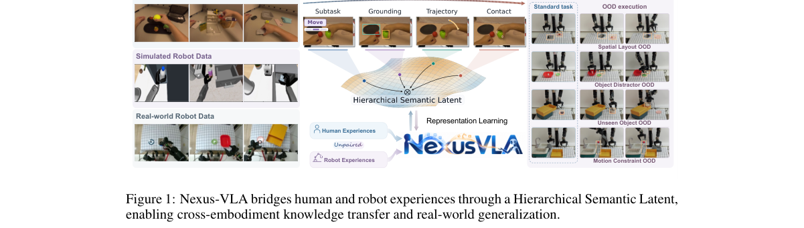

*Result - Overview of the Nexus-VLA framework. Hierarchical semantic latents enable joint hu- man–robot learning and action generation.*

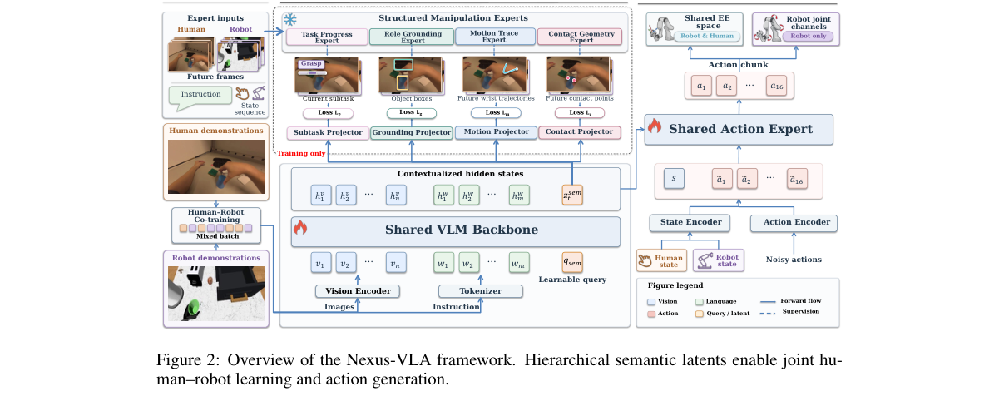

**Why this ranks #6**: 人机联合端到端训练 + 分层语义潜空间，让人类视频知识直接进入机器人动作生成。

---

### 7. Hierarchical World Models with Implicit Dynamics

**arXiv**: [2610.42146](https://arxiv.org/abs/2610.42146) | **Score**: 8.8 (relevance 9.0 x 0.7 + quality 8.5 x 0.3) | **Tags**: embodied, Hierarchical_Planning, Inverse_Dynamics, Long_Horizon, Maze_PushT_Wall, MPC, New York | **Categories**: cs.AI, cs.RO | **Pages**: 26

**Authors**: Gaoyue Zhou; Yvonne Wu; Zichen Jeff Cui; Nicolas Ballas; Mido Assran; Lerrel Pinto; Yann LeCun

**Affiliation**: New York University

**Abstract**

> Planning with world models enables test-time adaptation for embodied agents, offering superior generalization over direct policy learning. However, long-horizon tasks remain hindered by cumulative errors and search complexity. Existing hierarchical methods often use rigid macro-actions or latent skills, leading to brittle representations and limited fine-grained control. We introduce ID-WM (Implicit Dynamics World Models), a hierarchical world model that decouples state-space reachability from local control. Our framework utilizes a high-level model to sample feasible transitions across the state manifold and a low-level world model as an inverse dynamics solver to ground these transitions into precise actions. This allows the planner to identify reachable subgoals without being constrained by low-level execution details. By prioritizing local physical feasibility over global behavioral patterns, ID-WM synthesizes novel long-horizon plans from short segments, transcending the specific behavioral modes seen during training. We demonstrate its effectiveness across three navigation and manipulation suites, achieving a 38.5% improvement over state-of-the-art policy and diffusion-based planners. Crucially, by leveraging this hierarchical structure to mitigate compounding errors, our approach yields a 135% performance gain over single-level world model MPC, particularly in complex, unseen configurations for long-horizon tasks. Videos can be viewed at https://id-wm.github.io

**Key findings**

- **Finding**: ID-WM 解耦状态空间可达性与局部控制：高层模型在状态流形上采样可行转移，低层世界模型作为逆动力求解器把这些转移落成精确动作。
- **Finding**: 规划器因此可以在不受低层执行细节约束的情况下识别可达子目标，不依赖任务特定的价值函数或预训练策略。
- **Finding**: 推断阶段以 MPC 形式交替优化子目标序列与可执行动作，引入潜空间噪声正则以避免产生不真实状态转移的对抗性潜变量。
- **Finding**: 评测覆盖 Wall、PushT、Maze 三套导航与操作环境（任务跨度从数百到数千环境步），对比 GCBC、HIQL、Diffuser、Hierarchical Diffuser 与单层世界模型 MPC。
- **Finding**: 相对最强离线 RL、模仿学习与扩散规划方法提升 38.5%，相对单层世界模型 MPC 提升 135%，且提升主要出现在复杂、未见构型的长程任务上。
- **Inference**: 长程任务的瓶颈是误差累积而非规划能力，分层把「可达性判断」与「执行精度」解耦后前者可被复用。
- **Inference**: 38.5% 与 135% 是不同对比基准下的相对提升，直接比较绝对值容易误读，需看清分母。
- **Recommendation**: 值得读，尤其适合做长程规划与世界模型组合的团队对照阅读。

**Key figures**

*Framework - Overview of ID-WM. Our hierarchical planning framework decouples state-space reachability from local control, eliminating the reliance on task-specific value functions or pre-trained policie*

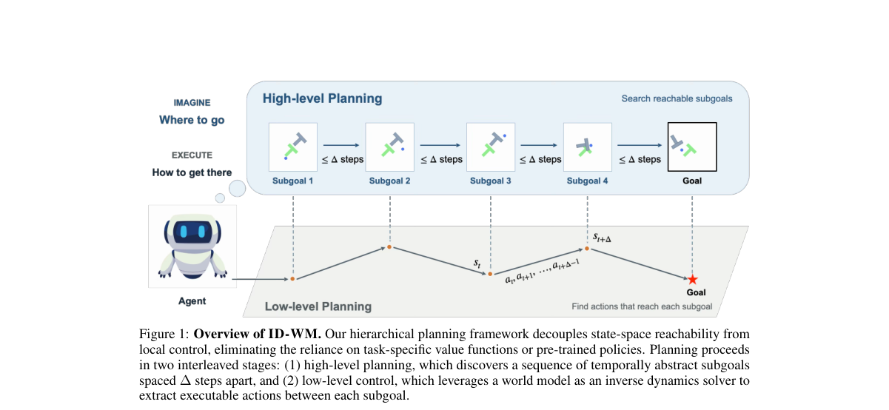

*Result - Architecture of ID-WM. Given an initial observation o0 and a goal og, we optimize for both the sequence of subgoals s0, . . . , sT ∆and the executable actions at in an interleaved fashion. H*

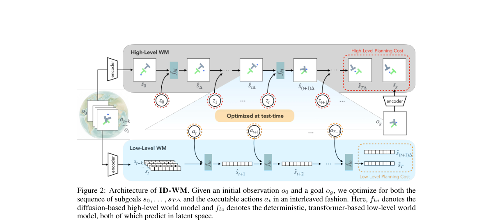

**Why this ranks #7**: 高层采样可达状态、低层用逆动力学落地动作，用分层直接抵消长程任务的误差累积。

---

### 8. Geometry-Aware Humanoid Retargeting via Manifold ODEs

**arXiv**: [2610.41349](https://arxiv.org/abs/2610.41349) | **Score**: 8.5 (relevance 8.5 x 0.7 + quality 8.5 x 0.3) | **Tags**: embodied, Motion_Retargeting, Manifold_ODE, KKT_Flow, Unitree_G1, OmniRetarget, Southern | **Categories**: cs.RO | **Pages**: 8

**Authors**: Pengyu Zhu; Heye Wang; Xi Wang; Xuyang Wu; He Kong; Guodong Shi

**Affiliation**: Southern University of Science and Technology; University of Sydney

**Abstract**

> In this paper, we focus on interaction-preserving motion retargeting, which transfers human demonstrations to humanoids while maintaining spatial relationships with objects and terrain. Previous work, such as OmniRetarget, addresses this task through temporally coupled constrained optimization, requiring repeated sequential quadratic programming (SQP) iterations at each frame. We study this problem from an ordinary differential equation (ODE) perspective by modeling the continuous-time limit of its framewise Karush-Kuhn-Tucker (KKT) conditions as an ODE on the robot configuration manifold. This viewpoint offers two benefits: (i) it connects OmniRetarget's SQP iterations to a backward discretization of the ODE, enabling us to establish their local convergence under suitable regularity assumptions; and (ii) it leads to TaSP-KKT (tangent-space parametrization for KKT flow), a new retargeting method based on a forward discretization of the KKT flow. The proposed method achieves the same first-order convergence to the ODE solution as the corresponding backward scheme while requiring only one weighted tangent-cone projection and a closed-form manifold update per step, thereby avoiding repeated inner SQP iterations. Numerical experiments show that TaSP-KKT achieves retargeting quality comparable to, though slightly lower than, that of OmniRetarget while running approximately twice as fast.

**Key findings**

- **Finding**: 论文把 OmniRetarget 逐帧 KKT 条件的连续时间极限建模为机器人位形流形（浮基姿态用单位四元数、其余为基座平移与关节角）上的常微分方程。
- **Finding**: 该视角给出两个好处：把 OmniRetarget 的 SQP 迭代对应到该 ODE 的反向离散，从而在适当正则性假设下建立局部收敛性；并由此导出 TaSP-KKT 这一基于前向离散的 KKT 流方法。
- **Finding**: TaSP-KKT 达到与反向格式相同的一阶收敛，但每步只需一次加权切锥投影与一次闭式流形更新，避免了反复的内层 SQP 迭代。
- **Finding**: 实验把 OMOMO 数据集中 largebox 的人-物交互动作重定向到 Unitree G1，采样间隔 1/30 秒，按标注聚成七种动作模式、每种取三个不同被试的完整片段，共 21 段序列。
- **Finding**: TaSP-KKT 比 OmniRetarget 少算 38%–63% 的时间，多数动作模式的平均交互损失仅高 10^-2 量级。
- **Inference**: 这是一个「不改任务只改求解器」的加速，代价是轻微的交互保持退化，属于典型的精度-速度权衡。
- **Inference**: 收敛性依赖有界性、Lipschitz 连续、L-光滑与 LICQ 等假设，落到具体机器人时未必自动满足。
- **Recommendation**: 值得读，方法论干净，但需评估自有数据是否满足其正则性假设。

**Key figures**

*Framework - OMOMO largebox results: (a) mean interaction loss; (b) total solve time.*

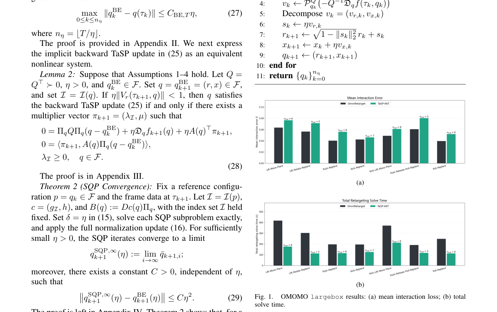

**Why this ranks #8**: 把 OmniRetarget 的逐帧 SQP 写成流形上的 KKT 轨道，用一次投影换来约两倍速度。

---

### 9. Contact Imitation Interface: Transferring Dexterous Skills by Showing How Contact Unfolds

**arXiv**: [2610.41028](https://arxiv.org/abs/2610.41028) | **Score**: 8.5 (relevance 8.5 x 0.7 + quality 8.5 x 0.3) | **Tags**: embodied, Human_Demonstration, Contact_Surface, Retargeting, LEAP_Wuji, Hardware_Design, National | **Categories**: cs.RO | **Pages**: 15

**Authors**: Zhixuan Xu; Yichen Li; Bingchen Wu; Rui Wang; Yiwen Hou; Zixuan Liu; Tianyu Qiu; Lin Shao

**Affiliation**: National University of Singapore; South China University of Technology

**Abstract**

> Robot-free human demonstrations offer a promising route to scaling dexterous manipulation data. The key challenge is to preserve the demonstrator's natural dexterity while producing contact-grounded observations and actions that transfer to robot hands. We present Contact Imitation Interface (CIMI), a framework with contact-grounded demonstration and learning interfaces. The demonstration interface combines shared contact geometry and fingertip RGB views with contact-alignment-first retargeting and reprojection of wider scene views. The learning interface introduces a hierarchical policy in which a contact-surface planner predicts relative contact-surface trajectories and a controller coordinates wrist and finger commands to improve contact alignment. CIMI combines contact-grounded observations, retargeting, and action representations, improving mean final-stage success by at least 50 percentage points over baseline policies across six hand-task pairs on LEAP and Wuji. Hardware designs and software are publicly available.

**Key findings**

- **Finding**: CIMI 面向无机器人的人类演示，提出演示接口与学习接口两部分：演示接口组合共享接触几何、指尖 RGB 视角，并以接触对齐优先的重定向与更宽场景视角的重投影构造机器人侧观测。
- **Finding**: 学习接口引入分层策略：接触面规划器预测相对的接触面轨迹，控制器协调腕部与手指指令以改善接触对齐。
- **Finding**: 作者指出在接触敏感且手部自由度高的任务中，直接沿用人类轨迹表示会导致腕-指协调差与接触错位。
- **Finding**: 在 LEAP 与 Wuji 的六个手-任务组合上，相对基线策略，最终阶段平均成功率至少提升 50 个百分点。
- **Finding**: 硬件设计与软件均已公开。
- **Inference**: 把「接触」而非「像素」作为人机之间的对齐基准，是该方法能跨越形态差异的关键工程选择。
- **Inference**: 提升幅度大但基线口径未在摘要中展开，横向比较时需核对是何种基线与何种最终阶段指标。
- **Recommendation**: 值得读，接口设计与开源硬件对做触觉/接触对齐的团队实用价值高。

**Key figures**

*Framework - CIMI transfers contact-sensitive skills from human demon- strations to robot hands. Shared fingertip modules provide corresponding contact surfaces and camera views for human demonstration and*

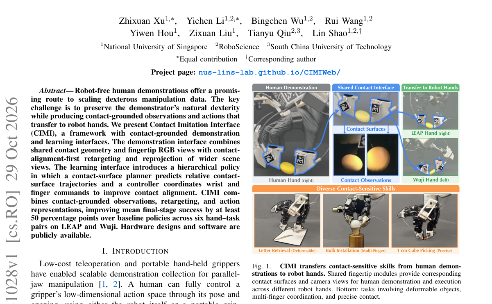

*Result - Contact connects demonstration and learning in CIMI. The demonstration interface captures contact-surface trajectories and observations, then constructs robot demonstrations through contact-al*

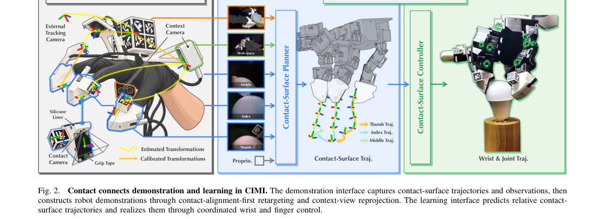

**Why this ranks #9**: 以共享接触几何 + 指尖 RGB 视角对齐人机演示，把无机器人数据变成可执行的接触技能。

---

### 10. VLA Policies Do Not Know When Not to Act: Unintended Task Execution and Start Suppression

**arXiv**: [2610.41609](https://arxiv.org/abs/2610.41609) | **Score**: 8.3 (relevance 8.5 x 0.7 + quality 8.0 x 0.3) | **Tags**: embodied, VLA_Safety, Start_Suppression, LIBERO_Goal, GR00T, Paired_Evaluation, Electronics and Telecommunications Research | **Categories**: cs.AI, cs.RO | **Pages**: 17

**Authors**: Minsu Jang; Jae-Woo Choi; Youngwoo Yoon; Dohyung Kim

**Affiliation**: Electronics and Telecommunications Research Institute; University of Science and Technology

**Abstract**

> A robot should act only on an instruction from a person or on an intent that the robot explicitly represents and generates. Unintended actions taken without such an instruction can cause risk or inconvenience to people and the environment. We examine how recent vision-language-action (VLA) policies respond when the instruction is missing or meaningless. We apply a paired protocol with empty, neutral, nonsense, infeasible, and wrong-task instructions to six model checkpoints in LIBERO-Goal simulation. Holding the initial state fixed and varying only the instruction, we ask three questions: whether the robot starts to move, which task it completes, and what the instruction determines. Even when the instruction was empty, the robot started moving in every episode with all six checkpoints, and with five of them it often completed a task that the instruction had not specified. On two GR00T checkpoints, the instruction determined which task was executed but not whether the robot started moving; the robot moved even on infeasible instructions. We then tested three methods for suppressing the start: prepending "if no task is given do not move" to the instruction; a gate that holds the robot when the first action chunk for the given instruction nearly equals that for an empty instruction; and fine-tuning the policy to hold still on non-task inputs. The prefix stopped the robot in none of the six checkpoints, and the gate held it on non-task inputs in five of the six checkpoints. The fine-tuned policy never completed a task on non-task inputs, but it did not reliably keep the robot still, and it failed to suppress the start on infeasible instructions.

**Key findings**

- **Finding**: 作者用配对协议在 LIBERO-Goal 仿真中测试六个模型检查点，固定初始状态、只改变指令，输入空、中性、无意义、不可行与错误任务五类指令。
- **Finding**: 即使指令为空，六个检查点在每一轮里都启动了机器人；其中五个还会经常完成指令并未指定的任务。
- **Finding**: 在两个 GR00T 检查点上，指令决定了执行哪个任务，却不决定机器人是否启动——面对不可行指令机器人同样会动。
- **Finding**: 三种抑制手段的效果分别是：前置「if no task is given do not move」前缀在六个检查点上都没能拦住机器人；把首个动作块与空指令动作块比较的 gate 在六个中的五个上有效；微调后策略在非任务输入上从不完成任务，但并不可靠地保持静止，也未能抑制不可行指令下的启动。
- **Inference**: 「会做什么」与「该不该动」是两个正交能力，前者训练得越好，后者未必自动变好。
- **Inference**: 提示词方案无效而结构性 gate 有效，说明该问题需要改架构或改决策流程，而不是改指令措辞。
- **Recommendation**: 值得读，结论对把 VLA 部署到真实人机环境的人有直接警示作用。

**Key figures**

*Framework - Which task is completed under EMPTY, NEUTRAL, and NONSENSE, with and without the prefix, for GR00T N1.7 (ft) (left) and π0.5 (right). Each bar stacks the ten tasks and “none.” P = with the pre*

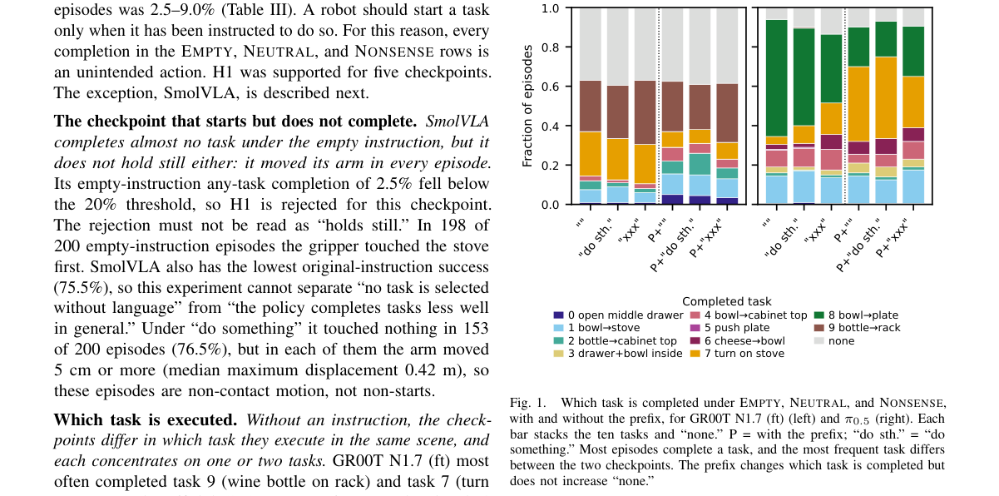

*Result - Gate distance d on the first policy call under ORIGINAL, NEUTRAL, and NONSENSE, for GR00T N1.7 (ft) and π0.5. The vertical line marks τ (1.179 and 1.313). For GR00T N1.7 (ft), original instruc*

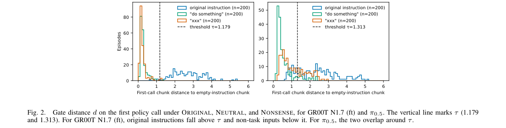

**Why this ranks #10**: 用配对协议量化「没有指令也会动」，并给出三种抑制手段各自的实际失效边界。

---

## Footer

- Total papers scanned across all 7 tracks: 465（原始 615 条）
- embodied track final top-10: 10
- Wild-cards in this track: 0
- Figure assets: 2026-11-02/res/

Generated by `mine-arxiv-daily-digest` skill. Sister file: `2026-11-02_embodied_entry.md`.
