# ArXiv Daily Digest - 2026-11-02 (生成式内容模型强化学习, 10 papers)

**Generated**: 2026-11-02 17:30 CST

**Source**: arXiv cs.CV, cs.SD, eess.AS, cs.CL, cs.AI, cs.RO, cs.LG submissions, listing day 2026-10-30 (announced 2026-10-31 00:00 UTC)

**Batch window**: 2026-10-29T18:00:00Z .. 2026-10-30T18:00:00Z（arXiv 公告批次横跨两个 UTC 日：前一日 18:00 UTC 起算，当日 17:59:59 UTC 截止）

**Track**: rl_aigc (top 10 of 465 papers scanned, 70 full reads)

**Scope**: 针对生成式内容模型（扩散 / 流匹配 / 视频 / 图像 / 音频）的 RL 与偏好优化

⚠️ **Wild-card**: 本批该线 5 篇为 wild-card 补足，已在正文逐条标注并给出理由。

补足原因：该批次真正把 RL / 奖励 / 偏好 / critic 直接用于扩散、流匹配与生成模型后训练的论文只有 5 篇，其余 5 篇为生成流理论、选择式评测与 agentic 合成方向的补位，已在正文逐条标注并给出理由。

---

## Top 10 - 生成式内容模型强化学习

### 1. A Better Critic Matters for Distribution Matching Distillation

**arXiv**: [2610.42135](https://arxiv.org/abs/2610.42135) | **Score**: 9.3 (relevance 9.5 x 0.7 + quality 9.0 x 0.3) | **Tags**: rl-aigc, AIGC-rl, distillation, critic, step-aware, few-step-generation, joint-scaling, Adobe | **Categories**: cs.CV, cs.LG | **Pages**: 35

**Authors**: Zongze Wu; Xianbang Wang; Zhengyang Geng; Mingdeng Cao; Zhoutong Zhang; Richard Zhang; Eli Shechtman; Ruiming Cao

**Affiliation**: Adobe

**Abstract**

> Distribution Matching Distillation (DMD) trains a few-step student using the difference between a teacher's score and an online critic's estimate of the student distribution's score. We investigate what the critic needs, in capacity and in information, to provide a reliable training signal. On the capacity side, controlled experiments across seven SiT model sizes on ImageNet show that increasing teacher size while keeping a small critic fixed can degrade student quality and cause training collapse. Scaling the critic alongside the teacher, a strategy we call joint scaling, prevents collapse in our experiments and allows the student to benefit from larger teachers. On the information side, rather than forcing the critic to model a step-agnostic mixture of student outputs, we introduce a step-aware critic (STAC) that conditions on the student's generation step to estimate step-specific scores. Together, joint scaling and STAC consistently improve few-step distillation across class-conditional ImageNet generation, text-to-image generation with SDXL and FLUX.2, and text-to-video generation with Wan2.1.

**Key findings**

- **Finding**: DMD 用教师分数与在线 critic 对学生分布分数的估计之差来训练少步学生，本文追问 critic 在容量与信息上究竟需要什么。
- **Finding**: 容量侧，在 ImageNet 上对七个 SiT 模型尺寸做对照实验发现：放大教师而固定一个小的 critic，会让学生质量变差甚至训练崩塌。
- **Finding**: 让 critic 与教师同步放大（joint scaling）在其实验中避免了崩塌，并让学生真正受益于更大的教师。
- **Finding**: 只放大 critic 而不动教师帮助有限。
- **Finding**: 信息侧，作者提出 step-aware critic（STAC），让 critic 以学生的生成步为条件（实现中对应调度级别 r_k）来估计逐步的分数，而不是拟合一个与步无关的混合分布。
- **Finding**: 在 FLUX.2 上，4B critic 配 9B 教师会把 HPSv3 从 10.58 降到 10.32、DPG-Bench 只涨 0.50；critic 一并放到 9B 后两者升到 10.92 与 83.70，加上 STAC 后进一步到 11.86 与 84.22。
- **Finding**: 32B 教师配 32B critic 并加 STAC 时，4 步学生达到 HPSv3 12.32 与 DPG-Bench 85.28，在 HPSv3 上超过官方 50 步基线模型。
- **Finding**: 在 SDXL 的纯 DMD 设置下，STAC 把 FID 从 34.71 降到 32.73 且 CLIP 分不变；在 DMD2 配方上继续训练后 FID 从 18.95 降到 16.88、ImageReward 从 71.01 升到 80.00，而同样长的无 STAC 续训让四项指标全部变差。
- **Finding**: 该组合在类别条件 ImageNet、SDXL 与 FLUX.2 文生图以及 Wan2.1 文生视频上均带来一致提升。
- **Inference**: 「小 critic + 大教师」是 DMD 里最容易被忽略的失败配方，joint scaling 的结论对任何用在线 critic 的蒸馏方法都有参考价值。
- **Inference**: critic 的步条件化是信息层面的改动，与容量层面的 joint scaling 互补，两条轴独立可加。
- **Recommendation**: 值得读，做少步蒸馏与 critic 设计的读者必看，消融表格给出的经验规则很实用。

**Key figures**

*Framework - Few-step students distilled with a critic as large as the teacher. Top, samples of a 4-step FLUX.2 [klein] 4B student distilled with a 32B teacher and a 32B critic with STAC. Bottom, three f*

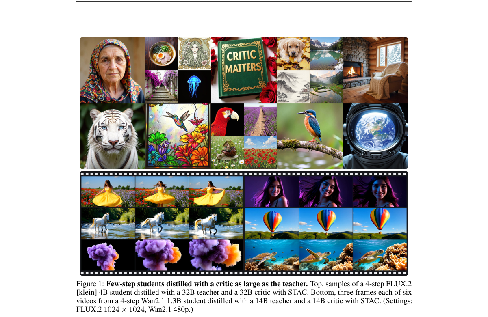

*Result - Overview. We study (a) step conditioning and (b) joint teacher–critic scaling. In (b), T and F denote teacher/critic capacity: T > F can be unstable, T < F inefficient, and T = F favorable h*

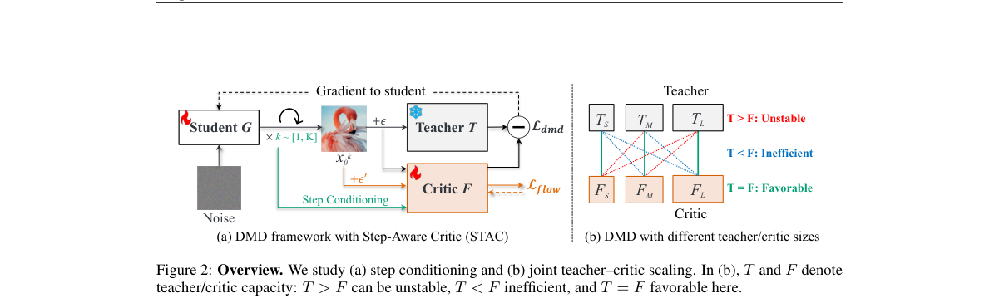

**Why this ranks #1**: 系统回答 DMD 的 critic 需要多大容量、该看到什么信息，给出 joint scaling 与 step-aware critic 两个答案。

---

### 2. Optimizing Stochastic Policy Geometry for Few-Step Flow Reinforcement Learning

**arXiv**: [2610.41949](https://arxiv.org/abs/2610.41949) | **Score**: 9.2 (relevance 9.5 x 0.7 + quality 8.5 x 0.3) | **Tags**: rl-aigc, AIGC-rl, flow-matching, few-step-generation, policy-geometry, GRPO, closed-form, Beihang | **Categories**: cs.AI, cs.LG | **Pages**: 24

**Authors**: Zhuguanyu Wu; Congjia Chen; Ruihao Gong; Yang Yong; Shiqiao Gu; Yi Xu; Xianglong Liu

**Affiliation**: Beihang University; SenseTime Research

**Abstract**

> Few-step flow models generate samples through a handful of large denoising transitions. Applying GRPO to such models requires introducing stochasticity into the denoising transitions, and when a single transition spans a wide range of noise levels, the choice of the resulting stochastic policy becomes a major factor in optimization. Recent constructions constrain the policy to preserve the target flow coefficients, but this constraint admits a family of policies and offers no criterion for choosing among them. We introduce Geo-FSRL (Geometry-Optimized Few-Step Reinforcement Learning), built on a selection principle: at a fixed conditioning state and timestep pair, choose the admissible policy that minimizes the conditional KL divergence induced by any given nonzero velocity-output update. Within a coefficient-preserving family of isotropic Gaussian transitions, this criterion reduces to minimizing a single scalar geometry factor that determines the conditional KL for every velocity-output update. The same factor governs velocity-space Fisher information and conditional transition log-likelihood-ratio variance. We derive the unique closed-form optimizer within this family, shared across all nonzero update magnitudes and directions, with transition coefficients determined by both the source and target noise levels. Because the minimized geometry factor still varies across timesteps, we further adopt gradient-scale matching from prior work and derive closed-form policy-gradient and KL weights that normalize explicit score scales and reference-KL curvature. Geo-FSRL trains on the original few-step schedule and retains the deterministic solver at inference. Our method achieves higher final reward scores than Flow-GRPO and Flow-CPS on both image generation and video generation models under the 4-step setting. Code is available at https://github.com/ModelTC/LightX2V/tree/main/lightx2v_rl

**Key findings**

- **Finding**: 少步流模型只经过少量大跨度去噪跃迁，对其做 GRPO 必须给去噪跃迁注入随机性；当单个跃迁覆盖很宽的噪声区间时，随机策略的选择就成为优化的主要因素。
- **Finding**: 已有构造约束策略保持目标流系数，但该约束允许一族解，没有给出从中挑选的准则。
- **Finding**: Geo-FSRL 的选择原则是：在给定条件状态与时间步对上，选择使任意非零速度输出更新所诱导的条件 KL 散度最小的可行策略。
- **Finding**: 在保系数的各向同性高斯跃迁族内，该准则归结为最小化单个标量几何因子，该因子决定任意速度更新下的条件 KL。
- **Finding**: 同一因子还同时支配速度空间 Fisher 信息与条件跃迁对数似然比的方差。
- **Finding**: 作者在该族内推导出唯一闭式最优解，对所有非零更新幅度与方向共享，跃迁系数由源与目标噪声水平共同决定。
- **Finding**: 由于被最小化的几何因子仍随时间步变化，作者进一步采用既有工作的梯度尺度匹配，并推导出归一化显式分数尺度与参考 KL 曲率的闭式策略梯度权重与 KL 权重。
- **Finding**: 方法在原始少步调度上训练，推理时保留确定性求解器。
- **Finding**: 在 4 步设定下，图像与视频生成模型上的最终奖励分数都高于 Flow-GRPO 与 Flow-CPS。
- **Inference**: 少步流模型的 RL 瓶颈不在奖励设计而在策略几何本身，把 KL 写成可最小化的标量因子是很有效的简化。
- **Inference**: 训练期随机、推理期确定性的组合让该方法能直接替换现有少步流模型的 RL 训练而不改推理链路。
- **Recommendation**: 值得读，做少步生成模型 RL 的读者优先看，几何因子的推导有独立教学价值。

**Key figures**

该论文正文未提取到可用图（图表为纯文本/表格排版）。

**Why this ranks #2**: 把少步流模型的随机策略选择变成一个有唯一闭式解的几何优化问题，从根本上替代试不同噪声注入方式。

---

### 3. Latent Reasoning in Continuous Space for Unified Multimodal Models

**arXiv**: [2610.42149](https://arxiv.org/abs/2610.42149) | **Score**: 9.2 (relevance 9.5 x 0.7 + quality 8.5 x 0.3) | **Tags**: rl-aigc, AIGC-rl, latent-reasoning, unified-multimodal, information-gain-reward, test-time-scaling, RL, KAIST | **Categories**: cs.CL, cs.CV, cs.LG | **Pages**: 22

**Authors**: Byungwoo Jeon; Yoonwoo Jeong; Hyunseok Lee; Minsu Cho; Jinwoo Shin

**Affiliation**: KAIST

**Abstract**

> Unified Multimodal Models (UMMs) achieve remarkable success on diverse multimodal understanding and generation tasks, yet they still struggle to effectively leverage language-based chain-of-thought reasoning for image generation. As a result, existing reasoning-augmented UMMs often fail to inherit the test-time scaling and fine-grained controllability observed in large language models. We attribute this failure to a fundamental modality mismatch: reasoning is performed in a discrete token space, whereas image generation operates in a continuous space. To bridge this gap, we introduce a Latent Reasoning framework in Continuous space (LARC), which alleviates the token-level bottleneck by reasoning over continuous hidden states. Specifically, the training framework consists of two stages: (i) curriculum supervised fine-tuning (SFT), and (ii) information-gain reinforcement learning (RL). First, the curriculum SFT stage gradually converts token-level reasoning into latent reasoning. Subsequently, the information-gain RL stage self-evolves latent reasoning without ground truth supervision. Experiments across diverse text-to-image generation benchmarks show that LARC consistently improves generation quality, prompt following, and compositional fidelity. Notably, LARC achieves state-of-the-art performance on GenEval with a 7%p gain over BAGEL and demonstrates clear test-time scaling behavior, outperforming token-based generation under both parallel and sequential test-time scaling strategies.

**Key findings**

- **Finding**: 论文指出统一多模态模型在图像生成上难以有效利用语言式思维链推理，因此现有的推理增强 UMM 未能继承 LLM 的测试时扩展与细粒度可控性。
- **Finding**: 作者把这一失败归因于模态错配：推理在离散 token 空间进行，而图像生成在连续空间进行。
- **Finding**: LARC 改为在连续隐状态上推理，从而缓解 token 级瓶颈。
- **Finding**: 训练分两阶段：课程式 SFT 逐步把 token 级推理转化为隐式推理，随后信息增益 RL 阶段在没有真值监督的情况下自演化隐式推理。
- **Finding**: RL 面临两个挑战：Coconut 式的推理是确定性的而策略梯度需要随机 rollout，且隐式推理轨迹缺少显式评估器。
- **Finding**: 作者用受控随机性使推理适合 RL，并引入信息增益奖励（量化每个隐式步骤对目标图像预测分布的改善）与崩塌预防奖励，从而不需要真值隐式链。
- **Finding**: 实验在 BAGEL 上用 100 万条交错样本实例化 LARC。
- **Finding**: 在 GenEval 上取得当前最好表现，比 BAGEL 高 7 个百分点。
- **Finding**: 方法呈现清晰的测试时扩展行为，在并行与串行两种测试时扩展策略下都优于基于 token 的生成。
- **Inference**: 把推理搬到连续空间既解决了模态错配，也让每一步的贡献可以用预测分布的改善来度量，信息增益因此成为自监督的自然奖励。
- **Inference**: 崩塌预防奖励与受控随机性的组合，说明隐式推理一旦确定化就会退化成固定模式，需要显式扰动才能持续探索。
- **Recommendation**: 值得读，做统一多模态模型与测试时扩展的读者优先看，信息增益奖励的设计可直接迁移。

**Key figures**

*Framework - Test-time scaling. We investigate the effect of the number of latent during test-time. Under controlled experiments, LARC performs remarkable test-time scaling behavior, outperforming the be*

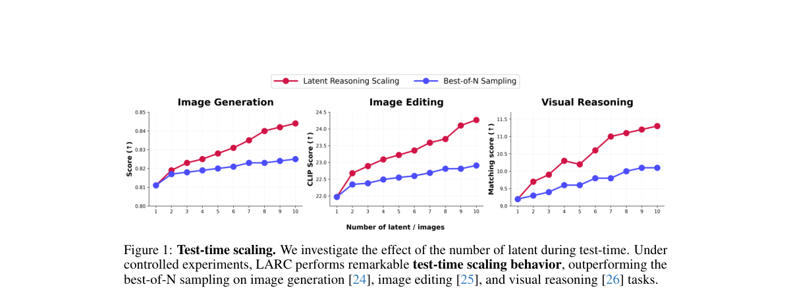

*Result - Overview of LARC. Our framework, LARC, consists of two stages. (1) Stage 1 adapts supervised fine-tuning (SFT) while gradually introducing latent thought on continuous space where the last h*

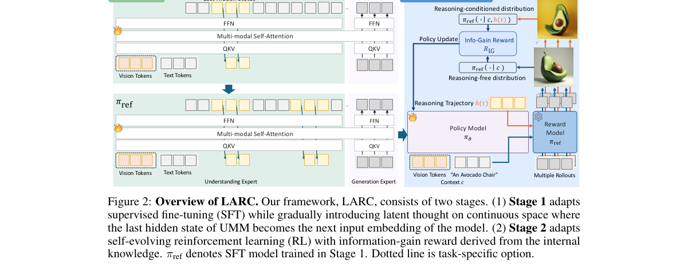

**Why this ranks #3**: 把思维链从离散 token 搬到连续隐空间，并用信息增益奖励让隐式推理自演化出测试时扩展能力。

---

### 4. Coarse-Graining Optimal Transport for Rollout-Free Post-Training of Flow Matching

**arXiv**: [2610.41269](https://arxiv.org/abs/2610.41269) | **Score**: 8.6 (relevance 8.5 x 0.7 + quality 9.0 x 0.3) | **Tags**: rl-aigc, AIGC-rl, flow-matching, optimal-transport, coupling, rollout-free, few-step-generation, KTH Royal | **Categories**: cs.LG, stat.ML | **Pages**: 42

**Authors**: Soon Hoe Lim; Aditi Gupta; Michael W. Mahoney; N. Benjamin Erichson

**Affiliation**: KTH Royal Institute of Technology; Nordita; University of California at Berkeley; International Computer Science Institute

**Abstract**

> Flow matching depends critically on the coupling used to pair source and target samples. Optimal transport (OT) couplings can reduce velocity conflict and straighten trajectories; but, in practice, challenges remain: the source comes from a continuous distribution, only a finite number of target samples data are accessible, and the neural network has finite capacity. For these reasons, making the coupling more OT-like may not consistently improve sampling quality, in particular in the low number-of-function-evaluation (NFE) regime. Motivated by this, we introduce ReCouple, a controllable framework that constructs coarse-grained OT couplings, to better understand rollout-free OT-based post-training. We also consider extensions of this basic framework: ReCouple+ extends this toward the continuous-source setting by increasing source resolution, converging to semi-discrete OT in the appropriate limit; and ReCouple++ further adds spatial regularization, motivated by the observation that straight trajectories need not correspond to spatially simple velocity fields. Empirical validation demonstrates the effectiveness of these methods, and it reveals an NFE-dependent interplay between coupling optimality, neural realizability, and generation quality.

**Key findings**

- **Finding**: 论文指出 flow matching 的效果强烈依赖源与目标样本的配对方式，OT 耦合能减少速度冲突并拉直轨迹。
- **Finding**: 但源分布连续、目标样本有限、神经网络容量有限，因此让耦合更接近 OT 未必持续提升采样质量，尤其在低 NFE 区间。
- **Finding**: 作者提出 ReCouple，一个构造粗粒度 OT 耦合的可控框架，用于理解 rollout-free 的 OT 式后训练。
- **Finding**: 实现上是基于结构化分块分配（blockwise assignment）的 OT 分治近似。
- **Finding**: ReCouple+ 通过提高源分辨率扩展到连续源设定，在适当极限下收敛到半离散 OT。
- **Finding**: ReCouple++ 进一步加入空间正则化，动机是直轨迹并不必然对应空间上简单的速度场。
- **Finding**: 在 25 模态高斯混合的二维任务上，ReCouple 明显优于预训练与独立耦合微调基线，ReCouple+ 在 NFE 1 上取得最佳 W2，ReCouple++ 在 NFE 2–8 上最佳。
- **Finding**: 这些变体在 sW2 上显著低于 OT-CFM 与 SDOT，同时保持较高的 recall 与 coverage。
- **Finding**: 在 CIFAR-10 生成上，ReCouple++ 在 NFE-50 处与同类基线相当，同时在各个 NFE 上取得更好的平衡；ReCouple 本身在 NFE 1–2 上优于噪声注入变体 Noise-ReCouple。
- **Finding**: 结论是低 NFE 质量取决于耦合、诱导速度场的可实现性与数值离散化三者的交互，而非单纯的 OT 最优性。
- **Inference**: 「更 OT 未必更好」这个结论对当下把 OT 耦合当作默认升级路径的做法是一个提醒。
- **Inference**: 空间正则化与源分辨率是两个正交旋钮，为低 NFE 场景提供了可操作的调参方向。
- **Recommendation**: 值得读，做 flow matching 训练与 OT 耦合的读者优先看，理论分析与实验对照都很扎实。

**Key figures**

该论文正文未提取到可用图（图表为纯文本/表格排版）。

**Why this ranks #4**: 把 flow matching 的 OT 耦合做成可控的粗粒度近似，用它厘清耦合最优性、神经网络可实现性与生成质量三者的取舍。

---

### 5. Scout-Refine-Correct: Teaching Flow Models to Refine Their Own Samples

**arXiv**: [2610.41598](https://arxiv.org/abs/2610.41598) | **Score**: 8.3 (relevance 8.5 x 0.7 + quality 8.0 x 0.3) | **Tags**: rl-aigc, AIGC-rl, flow-matching, inference-time-refinement, self-conditioning, best-of-N, training-recipe, FusionBrain | **Categories**: cs.CV | **Pages**: 10

**Authors**: Sergey Karpukhin; Aibek Alanov

**Affiliation**: FusionBrain; HSE University

**Abstract**

> The quality of image generation models trained with diffusion or flow matching is largely fixed by the training budget: at inference, the only available lever is the number of sampling steps, and additional steps improve quality only up to a point. We present a training recipe, Scout-Refine-Correct (SRC), that instead gives a flow-matching generator a genuine inference-time refinement capability. At each sampling step the model takes a scout rollout -- $K$ steps ahead along its own trajectory -- extrapolates a full-sample estimate, and feeds that estimate back to itself as a self-conditioning signal before taking the real step. This can be repeated for $R$ refinement rounds. Two correction losses, applied during training at states the model's own rollouts actually reach rather than only on the ground-truth path, teach the model to use this signal to reach new samples instead of collapsing to a suboptimal one. On ImageNet-256, SRC improves LightningDiT-B from FID~14.5 to FID~7.26 at NFE~550, matching a privileged best-of-$N$ baseline that uses an oracle FID verifier to choose among samples. SRC uses no external verifier, no reward signal, and, after ablation, almost no extra parameters over the base architecture. Combining SRC with best-of-$N$ improves the result further, to FID~3.81 at NFE~4400, showing that the two axes are complementary. We ablate the main design choices -- the architectural pathway for the scout signal, the scout horizon, each correction loss, and the training schedule to demonstrate key working components of training.

**Key findings**

- **Finding**: 论文指出扩散或 flow matching 训练出的图像生成模型质量基本由训练预算决定，推理期唯一的旋钮是采样步数，且加步数的收益很快饱和。
- **Finding**: Scout-Refine-Correct（SRC）给 flow matching 生成器一个真正的推理期精修能力。
- **Finding**: 每个采样步上，模型先沿自身轨迹做一次 scout rollout（向前 K 步），外推出一个完整样本估计，再把该估计作为自条件信号回灌给自己，然后才执行真正的这一步。
- **Finding**: 该过程可重复 R 轮精修。
- **Finding**: 两种纠正损失在训练时施加于模型自身 rollout 实际到达的状态上，而不仅是真值路径。
- **Finding**: 在 ImageNet-256 上，SRC 把 LightningDiT-B 的 FID 从约 14.5 降到约 7.26（NFE 约 550），达到使用 oracle FID 校验器挑选样本的特权 best-of-N 基线水平。
- **Finding**: SRC 不使用外部校验器、不使用奖励信号，且消融后相对基础架构几乎不增加参数。
- **Finding**: SRC 与 best-of-N 结合可进一步把 FID 降到约 3.81（NFE 约 4400），说明两条轴是互补的。
- **Finding**: 消融显示仅做原地精修的基础自条件模型（无 scout、无纠正损失）质量几乎立刻饱和在约 13.3，额外精修算力无处发挥。
- **Inference**: 推理期算力若没有训练期对应的「自我改进」目标支撑，加步数只会重复采样，不会带来新信息。
- **Inference**: SRC 与 best-of-N 互补说明「改模型」与「挑样本」解决的是不同瓶颈，同时做收益可叠加。
- **Recommendation**: 值得读，做推理期算力分配与少步生成的读者优先看，消融结论直接可指导配方设计。

**Key figures**

*Framework - Conceptual scheme of the SRC pipeline. A scout rollout looks ahead to form a more informed estimate ˆx1, and the main rollout then advances the current state under that condition. Correction*

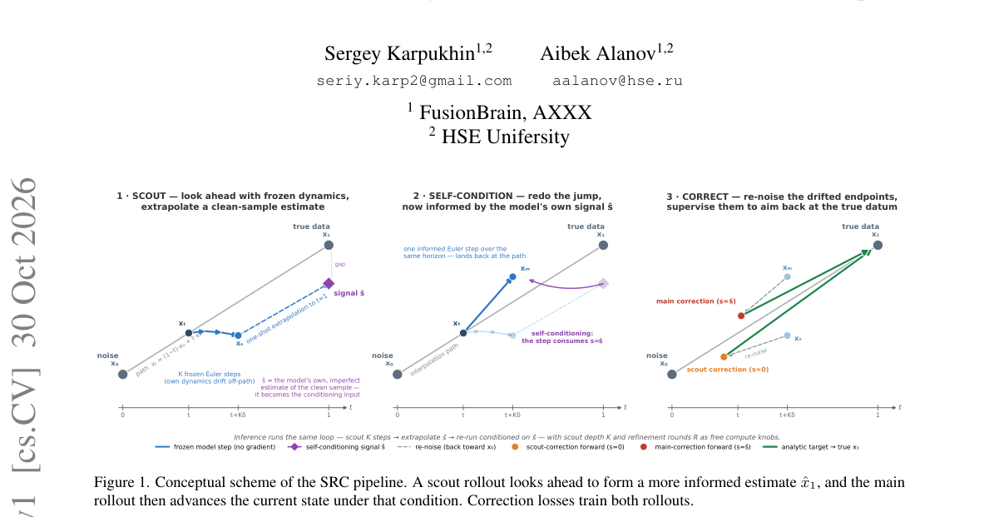

*Result - In-place refinement of a basic self-conditioning model (no scout, no correction loss): FID vs. refinement rounds R. Quality saturates at ≈13.3 almost immediately – extra re- finement compute*

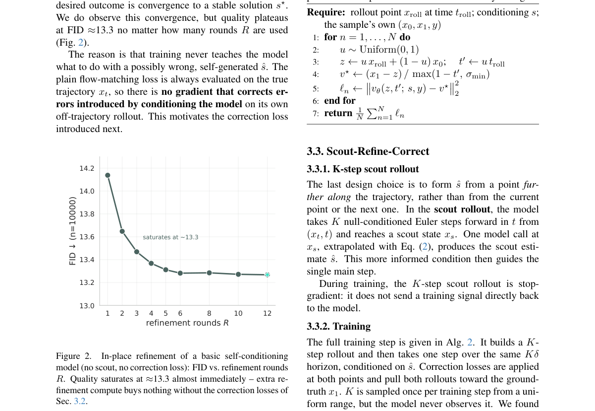

**Why this ranks #5**: 用「侦察—精修—纠正」配方让 flow 模型在推理时真正能自我改进，而不是只能靠加采样步数。

---

### 6. MATS: A Multi-Agent Framework for Controllable and Reflective Tumor Synthesis

**arXiv**: [2610.41159](https://arxiv.org/abs/2610.41159) | **Score**: 8.0 (relevance 8.0 x 0.7 + quality 8.0 x 0.3) | **Tags**: rl-aigc, AIGC-rl, medical-imaging, controllable-synthesis, closed-loop-verification, multi-agent, dataset, Fudan | **Categories**: cs.CV | **Pages**: 7

**Authors**: Zhongnan Shi; Keyang Zhou; Siyi Li; Qichao Ying; Xinchen Ma; Shuyi Gong; Wei Tang; Sheng Li; Zhenxing Qian

**Affiliation**: Fudan University

**Abstract**

> Synthesizing realistic tumors on medical images helps address data scarcity for clinical AI. Existing diffusion-based methods, however, lack fine-grained attribute-level controllability, closed-loop quality verification, and awareness of which morphological patterns are underrepresented in the target distribution. We present MATS, a multi-agent framework for text-controllable, cross-organ tumor synthesis. Given a target disease, MATS first profiles its morphological distribution over a fine-grained attribute space covering tumor geometry and appearance, and constructs a generation plan that amplifies underrepresented subtypes while keeping common ones dominant. It then localizes the target organ, proposes anatomically valid placement, and executes two-stage diffusion to produce the tumor mask and render texture, each conditioned on the corresponding attributes. A closed-loop reflective mechanism verifies attribute alignment at three checkpoints throughout synthesis and provides targeted feedback to guide re-generation when misalignment is detected. Trained exclusively on a single-source pancreatic neuroendocrine tumor dataset, MATS consistently improves downstream segmentation both in-domain and across LiTS, KiTS, and MSD-Pancreas benchmarks, whereas most prior generative augmentation methods fall below real-only training.

**Key findings**

- **Finding**: 论文指出既有扩散方法缺少细粒度的属性级可控性、闭环质量校验，以及对目标分布中哪些形态模式代表不足的感知。
- **Finding**: MATS 面向文本可控、跨器官的肿瘤合成，先在覆盖肿瘤几何与外观的细粒度属性空间上刻画目标疾病的形态分布。
- **Finding**: 据此构造生成计划，放大代表不足的亚型同时保持常见亚型占主导。
- **Finding**: 随后定位目标器官、给出解剖上合理的放置位置，并执行两阶段扩散分别生成肿瘤掩膜与渲染纹理，每一步都以对应属性为条件。
- **Finding**: 闭环反思机制在合成的三个检查点上校验属性对齐，检测到不匹配时向负责环节发送定向反馈以驱动重生成。
- **Finding**: 作者贡献 PNETS 数据集，含 740 例增强 CT、专家掩膜、结构化报告与形态标签，覆盖实性、囊性与混合表现及不同血管模式，划分为 425 训练、174 验证、141 测试。
- **Finding**: 仅用单一来源的胰腺神经内分泌肿瘤数据集训练，MATS 在域内以及 LiTS、KiTS、MSD-Pancreas 上都稳定提升下游分割效果。
- **Finding**: 而多数既有生成式增强方法的效果低于只用真实数据的训练。
- **Inference**: 把「哪些形态被低估」显式建模进生成计划，等于把数据分布层面的偏斜也纳入可控性范畴，这在医学合成上很关键。
- **Inference**: 闭环校验用属性预测而不是美学评分，与本线的奖励式质量校验思路相邻，但论文本身是属性可控的生成规划而非 RL 优化。
- **Recommendation**: 值得读，做医学图像合成与可控生成的读者可参考，数据集与属性体系是主要贡献。

**Key figures**

*Framework - MATS overview. (a) Distribution-aware attribute profiling and generation planning. (b) Sequential mask and image synthesis. (c) Closed-loop feedback with corrective adapters. (d) PNETS samples*

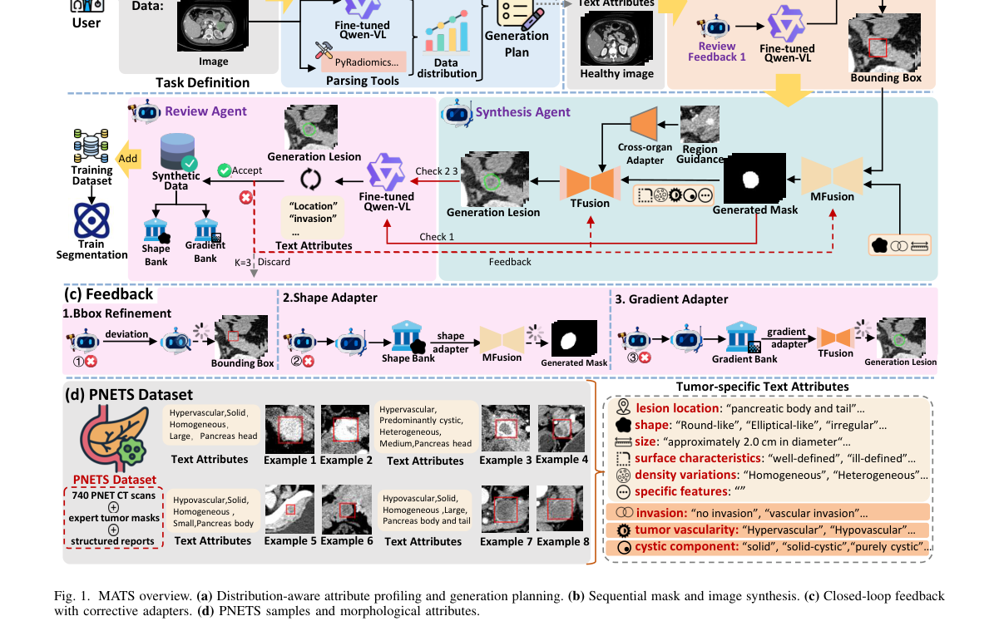

*Result - Agent preparation of MATS. MFusion and TFusion are trained ahead of the adapters, and the fine-tuned VLM for attribute prediction can be prepared separately.*

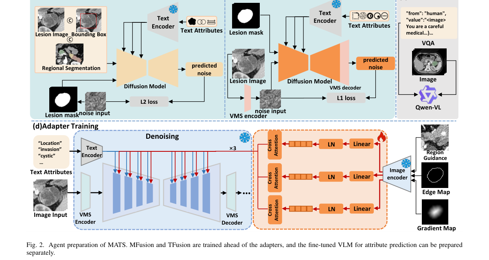

**Why this ranks #6**: 以属性分布画像驱动生成、并在三个检查点闭环校验的可控肿瘤合成，补位进入本线以提供奖励式质量校验的邻近方向。  [wild-card=yes] MATS 用多智能体闭环做可控肿瘤合成，奖励式质量校验与合成闭环相邻，但论文本身不含 RL 优化，补位计入。

---

### 7. StrictPRMBench: A Replayable Evaluation Benchmark for Auditing Fixed-Score PRM Aggregation

**arXiv**: [2610.41333](https://arxiv.org/abs/2610.41333) | **Score**: 8.0 (relevance 8.0 x 0.7 + quality 8.0 x 0.3) | **Tags**: rl-aigc, AIGC-rl, process-reward-model, score-aggregation, best-of-N, evaluation-audit, bootstrap, Independent Researcher | **Categories**: cs.LG | **Pages**: 27

**Authors**: Pengfei Zheng

**Affiliation**: Independent Researcher

**Abstract**

> Process reward models (PRMs) score reasoning steps, but best-of-N selection also requires a rule that aggregates those scores. We study that rule as a separate evaluation object. StrictPRMBench fixes mathematical reasoning pools, scorer evidence, and the source trace of a deletion intervention, so that different reducers face the same recorded selection problem. Across seven scoring checkpoints and two benchmarks, the stored N=32 outcomes give higher deletion-induced selection instability for product than geometric mean (GM) in all 14 cells. The equal-cell difference is +0.0965; a shared-problem bootstrap, conditional on these checkpoints and frozen pools, gives a 95% interval of [0.0846,0.1086]. A pre-injection-defined sensitivity excludes replacement slots that are either reducer's clean winner and retains 4,459 of 4,622 cell-problem records. The retained difference is +0.0986 [0.0875,0.1098]. Effects are heterogeneous: the two Qwen cells have positive percentile-bootstrap intervals on retained support but two-sided exact paired p-values of 0.0625 and 0.0703. Clean-pool Qwen accuracy does not detect a product advantage, but this is not an equivalence result. We provide versioned outcome records, CPU reanalysis, and an explicit evidence-availability contract. The contribution is a diagnostic evaluation protocol and a reproducible audit of recorded selector behavior, not a new PRM, a universally optimal reducer, or evidence of deployment-wide harm. Raw-score replay and outcome-record reanalysis are distinguished: missing primary edited-score vectors limit independent evaluation of new reducers under the same stress.

**Key findings**

- **Finding**: 论文指出过程奖励模型为推理步骤打分，但 best-of-N 选择还需要一条把这些分数聚合起来的规则。
- **Finding**: StrictPRMBench 固定数学推理题池、打分证据与删除干预的来源轨迹，使不同 reducer 面对同一个被记录下来的选择问题。
- **Finding**: 在七个打分检查点与两个基准上，存储的 N=32 结果显示乘积聚合的删除诱导选择不稳定性在全部 14 个单元里都高于几何平均（GM）。
- **Finding**: 等单元差异为 +0.0965，共享题目的 bootstrap 在这些检查点与冻结题池条件下给出 95% 区间 [0.0846, 0.1086]。
- **Finding**: 预先定义的敏感性分析排除那些是任一 reducer 的干净赢家的替换位，保留 4622 条单元—题目记录中的 4459 条。
- **Finding**: 保留子集上的差异为 +0.0986，区间 [0.0875, 0.1098]。
- **Finding**: 效应存在异质性：两个 Qwen 单元在保留支持集上的百分位 bootstrap 区间为正，但双侧精确配对 p 值为 0.0625 与 0.0703。
- **Finding**: 干净题池上的 Qwen 准确率并未显示出乘积聚合的优势，但作者强调这不是等价性结论。
- **Finding**: 作者提供版本化的结果记录、CPU 重分析脚本与显式的证据可得性契约；由于缺少原始编辑后分数向量，限制了独立评估新 reducer。
- **Inference**: 把聚合规则本身作为评估对象、用可重放的固定题池做审计，是把「选择器行为」变成可复现科学对象的关键一步。
- **Inference**: 该工作属于选择式评测与奖励模型聚合家族，与本线的生成式奖励建模相邻，但场景是数学推理而非生成模型。
- **Recommendation**: 值得读，做 PRM、best-of-N 选择或评测审计的读者优先看，方法学审慎度是亮点。

**Key figures**

*Framework - STRICTPRMBENCH overview and evidence boundary. The scorer, candidate pool, and intervention are held fixed when comparing reducers. The 14/14 headline counts positive point estimates, not st*

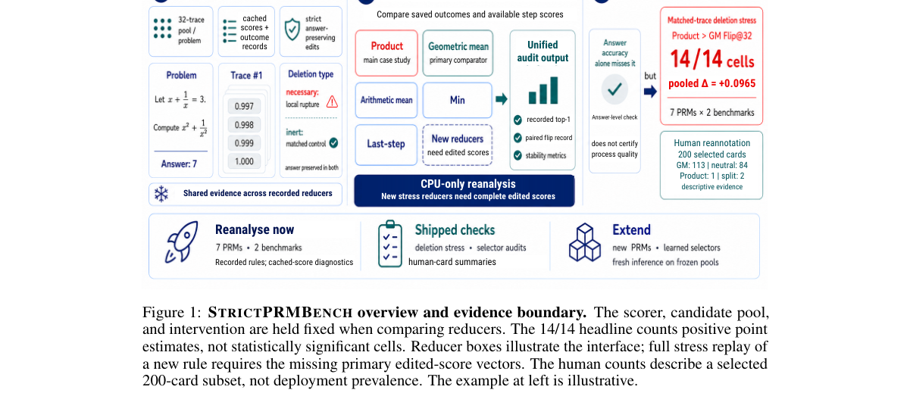

*Result - Product-minus-GM Flip@32 on full recorded support. Every point, interval, and appendix row is generated from the same paired outcome records. Cell intervals use a paired problem bootstrap; t*

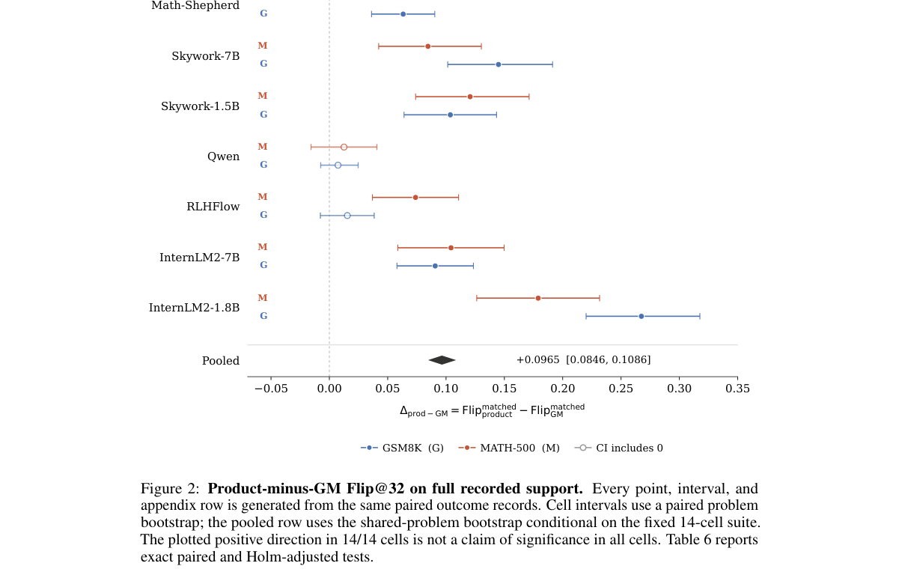

**Why this ranks #7**: 把 PRM 分数的聚合规则当成独立评估对象做可复现审计，补位进入本线以覆盖选择式评测这一侧。  [wild-card=yes] StrictPRMBench 审计过程奖励模型分数聚合规则，PRM 与 BoN 选择机制属生成式奖励建模家族但场景是数学推理，补位计入。

---

### 8. When Does Test-Time Search Help World Action Models? An Empirical Audit of Candidate Selection and Simulator Integrity

**arXiv**: [2610.41970](https://arxiv.org/abs/2610.41970) | **Score**: 8.0 (relevance 8.0 x 0.7 + quality 8.0 x 0.3) | **Tags**: rl-aigc, AIGC-rl, test-time-scaling, candidate-selection, world-action-model, pre-registered-audit, efficiency, Carnegie Mellon | **Categories**: cs.AI | **Pages**: 13

**Authors**: Jun Liu; Dajie Sun; Zhenglun Kong; Zhenjiang Fan; Peiyan Dong; Fan Yang; Wenbin Zhangg; Geng Yuan; Xue Lin; Yanzhi Wang; Dong Huang

**Affiliation**: Carnegie Mellon University; UC Berkeley; Harvard University; Stanford University; MIT

**Abstract**

> World-action models increasingly apply test-time scaling, spending extra inference computation on candidate selection and adaptive allocation to improve control. Such gains are credible only when candidates carry exploitable signal, nominal compute savings become real speedup, and evaluation stays reliable. We audit all three on Cosmos Policy and RoboCasa with a premise-first, pre-registered methodology. On clean data, a learned value selector is 1.66 pp worse than random; a hindsight oracle gains only 1.40 pp, with an episode-level interval spanning zero; and 82% of states show identical candidate outcomes, leaving little selection headroom. Token pruning cuts per-forward FLOPs by up to 47% but yields at most a measured 1.15$\times$ end-to-end speedup on the deployed path (1.25$\times$ on a decode-excluded path), short of a 1.5$\times$ target, and our adaptive-allocation experiment is inconclusive under a power gate. We further identify and fix a silent rendering corruption whose rate rises sharply along compute-heavy planning paths while leaving the official direct-policy result unaffected, and release a detector, fix, and scripts. These findings show why test-time scaling should be audited as a chain of premises (decision signal, realized efficiency, evaluationintegrity) rather than by success rate alone. Conclusions are scoped to the tested configuration.

**Key findings**

- **Finding**: 论文指出世界动作模型越来越多地做测试时扩展，把额外推理算力花在候选选择与自适应分配上，而这些收益只有在候选携带可利用信号、标称算力节省变成真实加速、评测保持可靠时才可信。
- **Finding**: 作者在 Cosmos Policy 与 RoboCasa 上用前提优先、预先注册的审计方法检查这三项。
- **Finding**: 干净数据上，学到的价值选择器比随机选择差 1.66 个百分点。
- **Finding**: 后见之明 oracle 也只带来 1.40 个百分点增益，其 episode 级区间跨过零。
- **Finding**: 82% 的状态下所有候选的结果完全相同，留给选择机制的空间很小。
- **Finding**: token 剪枝最多把每次前向的 FLOPs 降到 47%，但在实际部署路径上端到端加速最多只有 1.15 倍（去掉 decode 的路径为 1.25 倍），达不到 1.5 倍目标。
- **Finding**: 自适应分配实验在功效门槛下结论不确定。
- **Finding**: 作者还发现并修复了一处静默的渲染损坏，其发生率随每次查询的推理算力上升而快速提高，同时不影响官方 direct-policy 的结果，并公开了检测器、修复与脚本。
- **Inference**: 「候选里有差异」是测试时扩展的第一前提，82% 状态无差异这一数字直接否掉了多数候选选择的预期收益。
- **Inference**: 标称 FLOPs 节省与端到端加速的落差，说明评测测试时扩展时必须把真实部署路径算进去。
- **Recommendation**: 值得读，做测试时扩展与机器人策略评测的读者优先看，前提式审计的框架比结论本身更值得学。

**Key figures**

*Framework - The silent rendering corruption, captured on the planning inference path, is reproducible across episodes and tasks. Each row is one example (task, episode, time step); the left column is th*

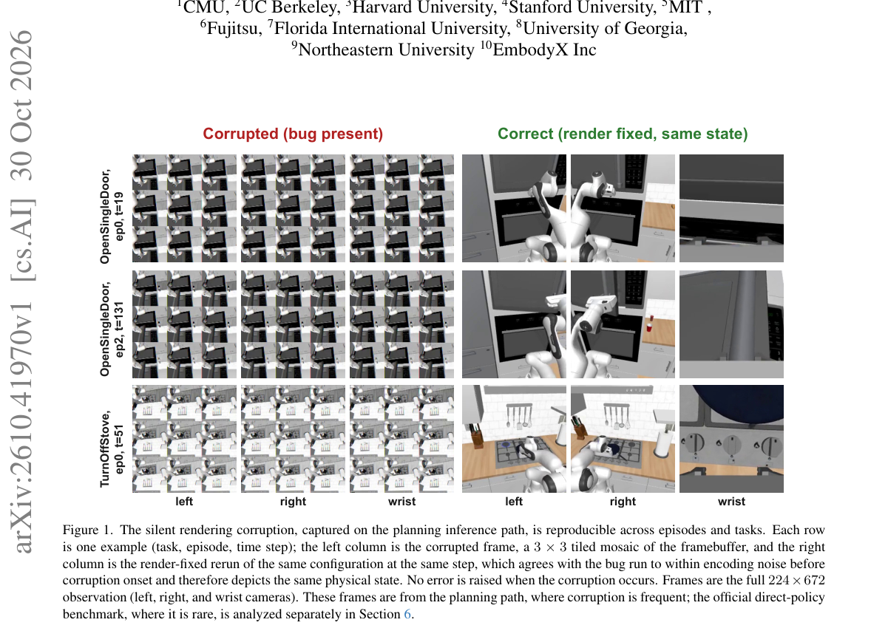

*Result - A premise-first audit of test-time scaling in Cosmos Policy on RoboCasa. (1) Planning selection. Limited variation in candidate outcomes constrains the headroom for selection, and the deploy*

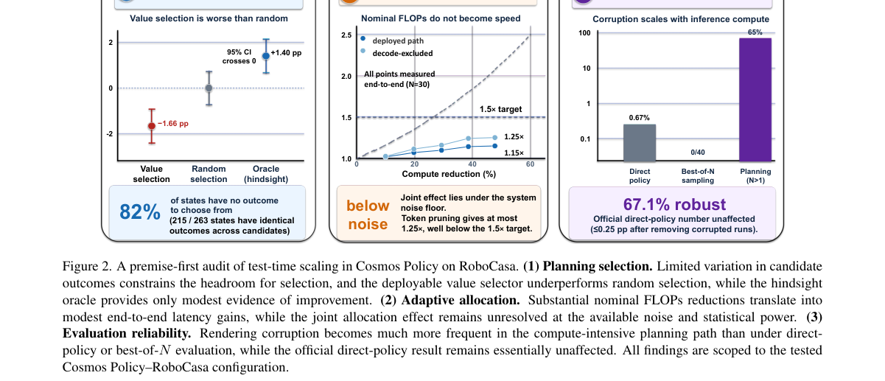

**Why this ranks #8**: 以「前提链」方式审计测试时搜索，指出世界动作模型上的候选选择与算力节省都缺少可信前提。  [wild-card=yes] 世界动作模型的测试时搜索与候选选择审计，是 Best-of-N 式的推理期扩展但不含策略优化，补位计入。

---

### 9. ART of PIV: Agentic Real-Time Particle Image Velocimetry for Active Flow Control

**arXiv**: [2610.41304](https://arxiv.org/abs/2610.41304) | **Score**: 7.7 (relevance 7.5 x 0.7 + quality 8.0 x 0.3) | **Tags**: rl-aigc, AIGC-rl, agentic-selection, measurement-pipeline, reward-driven-control, active-flow-control, latency-budget, ETH Zurich | **Categories**: cs.AI, cs.CV, physics.flu-dyn | **Pages**: 47

**Authors**: Antonio Terpin; Francesco Banelli; Alan Bonomi; Raffaello D'Andrea

**Affiliation**: ETH Zurich

**Abstract**

> Particle image velocimetry (PIV) measures fluid motion from images of tracer particles, but its accuracy depends on choices throughout the estimation pipeline, including image preprocessing, flow estimation, and postprocessing. These choices are typically left to expert tuning, and a fixed configuration can become less accurate as conditions change. This matters especially when PIV supplies feedback for real-time control, where measurements must be both accurate and fast, and flow conditions vary. We introduce ART of PIV -- short for Agentic Real-Time and also a nod to the art of tuning a PIV pipeline -- which automates pipeline choice for each image pair. A learned agent selects a configuration according to a chosen measurement objective from a library assembled for a specified speed budget. Across cross-correlation, classical optical-flow, and learning-based estimators, ART of PIV reduces average end-point error (AEPE) by 12.2-22.4 % relative to the best single estimator at matched speed, with gains extending to 1000-4000 image pair/s. In a simulated local velocity regulation task, it reduces mean normalized closed-loop cost by 13.24-13.59 percentage points relative to a tuned fixed estimator, with the same classical controller in both cases. In a tabletop water channel, we illustrate two ways to tune ART of PIV for a fluidic pinball of three rotating cylinders: selecting between complementary optical-flow tunings for accuracy, and selecting regions of interest with coherent rotation or shear using a common flow estimator. For the first variant, we train a DreamerV3 reinforcement learning controller directly in the physical world and demonstrate tracking of a prescribed flow field in the wake of a fluidic pinball.

**Key findings**

- **Finding**: 论文指出粒子图像测速的精度取决于图像预处理、流动估计与后处理等整条估计链上的选择，这些选择通常靠专家调参，固定配置在工况变化后会失准。
- **Finding**: 当 PIV 为实时控制提供反馈时，测量既需准确又需快速，而流场条件是在变的。
- **Finding**: ART of PIV 为每一对图像自动挑选流程配置：一个学习到的 agent 依据选定的测量目标，从为给定速度预算组建的库中选择配置。
- **Finding**: 跨互相关、经典光流与学习式估计器三类，在同等速度下相对最好的单一估计器把平均端点误差（AEPE）降低 12.2–22.4%。
- **Finding**: 收益在每秒 1000–4000 对图像的区间内依然存在。
- **Finding**: 在模拟的局部速度调节任务中，相对调优过的固定估计器把平均归一化闭环代价降低 13.24–13.59 个百分点，两种设定使用同一个经典控制器。
- **Finding**: 在桌面水槽中，作者给出两种调法：为准确度在互补的光流配置间选择，以及用同一个流动估计器挑选具有一致旋转或剪切的关注区域。
- **Finding**: 对第一种变体，作者直接在水上世界训练 DreamerV3 强化学习控制器，展示了流体陀螺（三根旋转圆柱）尾流中指定流场的跟踪。
- **Inference**: 把「选哪条估计链」建模成带速度预算的逐样本选择问题，比固定管线更贴合工况漂移。
- **Inference**: 该工作属于 RL 邻接的 agentic 选择与反馈控制方向，不涉及生成式内容模型，因此以补位身份计入本线。
- **Recommendation**: 值得读，做流场测量、实验闭环控制或按目标挑选模型流水线的读者可参考，方法迁移性强。

**Key figures**

*Framework - ART of PIV casts flow quantification as an agentic decision: given a pair of tracer-particle snapshots, a lightweight agent selects one estimator from a library A1, . . . , AN and returns th*

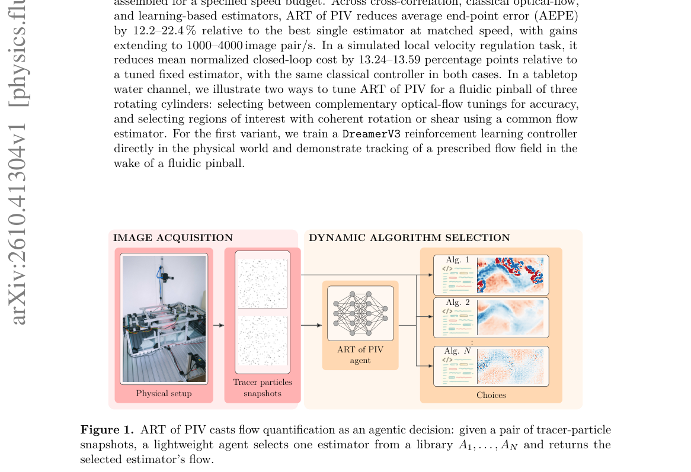

**Why this ranks #9**: 让学习到的 agent 按测速目标逐帧挑选 PIV 估计器，把流场测量与主动流控接到同一套反馈回路上。  [wild-card=yes] PIV 的 agentic 实时流场估计与主动流控，用反馈回路优化测量配置，属 RL 邻接但非生成式内容模型，补位计入。

---

### 10. OT-CAL: Optimal-Transport-Guided Adaptive Sample Selection for Efficient Visual Learning

**arXiv**: [2610.41677](https://arxiv.org/abs/2610.41677) | **Score**: 7.5 (relevance 7.5 x 0.7 + quality 7.5 x 0.3) | **Tags**: rl-aigc, AIGC-rl, sample-selection, optimal-transport, curriculum, compute-efficiency, informativeness-features, Purdue | **Categories**: cs.AI, cs.CV | **Pages**: 9

**Authors**: Suryansh Talukdar; Jin Soung Yoo

**Affiliation**: Purdue University Fort Wayne

**Abstract**

> Deep neural networks for image recognition are typically trained using mini-batches, with a forward pass to compute predictions and losses followed by a more computationally expensive backward pass to update model parameters. However, not all training samples contribute equally to learning, suggesting that computation can be reduced by performing backward passes only on informative samples. The challenge is that sample informativeness changes throughout training: difficult samples may be valuable early on, improving samples become important later, and class diversity becomes increasingly relevant toward the end. Existing methods often rely on fixed selection rules or computationally expensive per-sample gradient calculations. We propose OT-CAL, an adaptive data selection method that automatically adjusts its sampling preferences during training. OT-CAL represents each sample using five informativeness features, including difficulty, learnability, and uncertainty. A curriculum vector describes the currently preferred sample characteristics, and optimal-transport-based matching assigns selection weights according to how closely samples match this target. The curriculum vector is then updated using the selected samples, forming a feedback loop that adapts without a manually defined schedule. Experiments on three standard visual learning benchmarks show that, when selecting 50% of each mini-batch, OT-CAL improves performance by 1.3--2.1 points over AdaSelection while achieving 1.18--1.24 times faster training than full-data training.

**Key findings**

- **Finding**: 论文指出深度网络的 mini-batch 训练中前向算损失、反向更新参数更贵，而并非所有样本对学习贡献相同，因此可以只在有信息量的样本上做反向传播。
- **Finding**: 难点在于样本信息量随训练变化：难样本在早期有价值，变好的样本后期才重要，类别多样性在末期越来越关键。
- **Finding**: 既有方法往往依赖固定选择规则或昂贵的逐样本梯度计算。
- **Finding**: OT-CAL 用五个信息量特征（难度、可学习性、不确定性等）表示每个样本，并用课程向量描述当前偏好的样本特征。
- **Finding**: 基于最优传输的匹配按样本与该目标的接近程度分配选择权重。
- **Finding**: 课程向量随后由被选样本更新，形成无需手工调度表的反馈回路。
- **Finding**: 在三个标准视觉学习基准上，选择每个 mini-batch 的 50% 时，OT-CAL 比 AdaSelection 高 1.3–2.1 个百分点，同时训练速度是全量训练的 1.18–1.24 倍。
- **Finding**: 在 CIFAR-100 的 ResNet-18 上，采样比例 γ ∈ {0.25, 0.5} 时固定 5 维剖面给出 γ=0.5 下 75.4% 的准确率与 1.24 倍加速。
- **Inference**: 用 OT 匹配把「当前该学什么样的样本」变成一个可优化的目标，比按固定阈值筛样本更能跟上信息量漂移。
- **Inference**: 该工作属于最优传输式样本选择与算力效率方向，属于生成模型 RL 的加权采样邻域，因此以补位身份计入本线。
- **Recommendation**: 值得读，做数据选择、课程学习或训练算力优化的读者可参考，方法与生成模型无耦合、迁移成本低。

**Key figures**

*Framework - The OT-CAL loop at iteration t. The curriculum vector ct sets the target for selection; the selected subset St is used for the backward pass and then moves ct through the EMA update (1).*

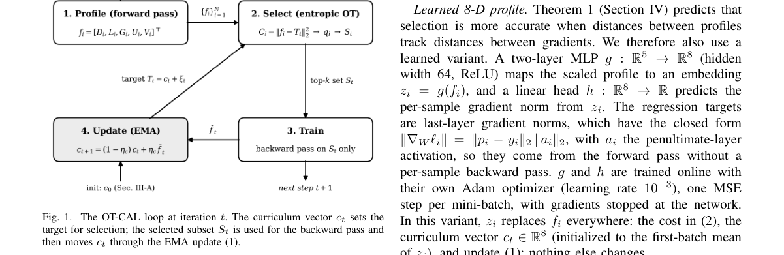

*Result - Accuracy–efficiency tradeoff on CIFAR-100 (ResNet-18) for sampling ratios γ ∈{0.25, 0.5}; upper left is better. OT-CAL points use the fixed 5-D profile (75.4% at 1.24× for γ = 0.5); the learne*

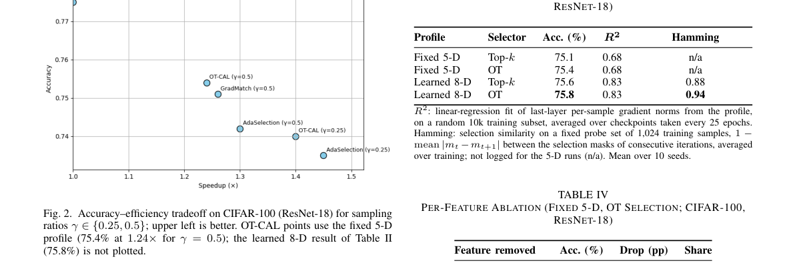

**Why this ranks #10**: 用最优传输式的课程向量自动改写样本偏好，只对信息量高的样本做反向传播，补位进入本线以覆盖加权采样一侧。  [wild-card=yes] OT 引导的自适应样本选择以降低视觉学习算力，是最优传输式选择方法但不含生成模型 RL，补位计入。

---

## Footer

- Total papers scanned across all 7 tracks: 465（原始 615 条）
- rl_aigc track final top-10: 10
- Wild-cards in this track: 5
- Figure assets: 2026-11-02/res/

Generated by `mine-arxiv-daily-digest` skill. Sister file: `2026-11-02_rl_aigc_entry.md`.
