# ArXiv Daily Digest - 2026-11-02 (强化学习 · 核心算法 / 理论 / MARL / sim-to-real, 10 papers)

**Generated**: 2026-11-02 17:30 CST

**Source**: arXiv cs.CV, cs.SD, eess.AS, cs.CL, cs.AI, cs.RO, cs.LG submissions, listing day 2026-10-30 (announced 2026-10-31 00:00 UTC)

**Batch window**: 2026-10-29T18:00:00Z .. 2026-10-30T18:00:00Z（arXiv 公告批次横跨两个 UTC 日：前一日 18:00 UTC 起算，当日 17:59:59 UTC 截止）

**Track**: rl_core (top 10 of 465 papers scanned, 70 full reads)

**Scope**: RL 算法本身与理论、奖励学习、多智能体 RL、规划控制、sim-to-real 与 agentic RL

---

## Top 10 - 强化学习 · 核心算法 / 理论 / MARL / sim-to-real

### 1. Statistical Foundations of Reinforcement Learning: A Non-Asymptotic Perspective

**arXiv**: [2610.41903](https://arxiv.org/abs/2610.41903) | **Score**: 9.3 (relevance 9.5 x 0.7 + quality 9.0 x 0.3) | **Tags**: rl-core, Monograph, Non_Asymptotic, Tabular_MDP, Sample_Complexity, Minimax, University of Pennsylvania | **Categories**: cs.IT, cs.LG, stat.ML | **Pages**: 326

**Authors**: Yuxin Chen; Yuejie Chi; Jianqing Fan; Gen Li; Yuting Wei; Yuling Yan

**Affiliation**: University of Pennsylvania; Yale University

**Abstract**

> Reinforcement learning (RL) embodies a foundational paradigm for sequential decision-making in the face of uncertainty. The rapid growth of model complexity in emerging applications has significantly amplified the challenges of achieving data-efficient RL, particularly in sample-starved scenarios where data collection may be costly, time-consuming, or even high-stakes. Consequently, understanding and improving the data efficiency of RL algorithms has become a central problem of both fundamental theoretical interest and practical importance. Despite decades of research, the statistical underpinnings of RL remained remarkably underdeveloped until relatively recently, particularly in the finite-sample regimes most relevant to modern practice. Over the past few years, there has been a surge of activity advancing the frontiers of non-asymptotic statistical RL theory, drawing on ideas from high-dimensional statistics and probability, information theory, and statistical learning theory. In this monograph, we present a non-asymptotic treatment for RL based on tabular Markov decision processes, focusing on three canonical sampling mechanisms --- RL with a generative model, online RL, and offline RL --- together with two algorithmic paradigms: model-based and model-free approaches. Centered around non-asymptotic sample complexity analysis, our treatment emphasizes minimax-optimal algorithm design, particularly methods that attain statistical optimality without significant burn-in costs, as well as sharp statistical characterizations of several widely used RL algorithms. Whenever possible, we provide largely self-contained analyses together with intuitive explanations. We also briefly discuss several extensions, such as robust RL, competitive multi-agent RL, federated RL, uncertainty quantification, and RL from human feedback.

**Key findings**

- **Finding**: 这是 326 页的专著，以表格型 MDP 为对象，围绕非渐近样本复杂度同时处理三种采样机制（有生成模型的 RL、在线 RL、离线 RL）与两种算法范式（model-based 与 model-free）。
- **Finding**: 全书强调极小极大最优的算法设计，尤其是那些不付出显著 burn-in 代价就能达到统计最优性的方法，以及对若干常用 RL 算法的锐利统计刻画。
- **Finding**: 目录显示章节覆盖 discounted 无限时域 MDP、有限时域分片 MDP、model-based/model-free 对照、集中不等式与多重假设检验的极小极大下界，以及 Q-learning、异步 Q-learning、UCB-VI、MVP 等算法的分析与下界证明。
- **Finding**: 作者说明该领域在有限样本区间直到近年才真正发展起来，并表示尽可能给出自洽分析与直观解释。
- **Finding**: 末尾还简要讨论了鲁棒 RL、竞争性多智能体 RL、联邦 RL、不确定性量化与 RLHF 等扩展方向。
- **Inference**: 表格型设定与深度实践有距离，但其中的极小极大下界与 burn-in 分析可以直接用来判断新算法宣称是否可信。
- **Inference**: 把「数据效率」当作核心问题来组织理论，正好回应了当下大模型后训练对样本成本的敏感。
- **Recommendation**: 值得作为长期查阅的理论底座，而非通读材料，建议配合具体章节按需读。

**Key figures**

该论文正文未提取到可用图（图表为纯文本/表格排版）。

**Why this ranks #1**: 把「有限样本下 RL 的统计基础」系统化，是判断算法最优性的理论底座。

---

### 2. Hyperbolic Inverse Reinforcement Learning

**arXiv**: [2610.42104](https://arxiv.org/abs/2610.42104) | **Score**: 9.2 (relevance 9.5 x 0.7 + quality 8.5 x 0.3) | **Tags**: rl-core, Inverse_RL, Hyperbolic_Geometry, MaxEnt_IRL, LACMA_HUMEX, Interpretability, University of California San Diego | **Categories**: cs.LG | **Pages**: 19

**Authors**: Iulia Rusu; Anoop Praturu; Sergei Gepshtein; Tatyana Sharpee

**Affiliation**: University of California San Diego; Salk Institute for Biological Studies

**Abstract**

> Inverse reinforcement learning (IRL) seeks to infer the reward function underlying observed behavior, but its predictive accuracy and interpretability depend on how that reward is computed from the underlying features. While prior IRL reward functions have been implemented through a variety of techniques including linear weights, neural networks, or other function approximators, none make assumptions about the geometry of the underlying feature space. Inspired by geometric organization observed in neural circuits, we introduce Hyperbolic inverse reinforcement learning (Hyperbolic IRL), which parameterizes reward as a function of Hyperbolic distance between the feature vector and a learned parameter vector, as well as its Euclidean distance variant. We tested our methods against a range of linear and nonlinear IRL baselines under both deterministic and stochastic policies. Our Hyperbolic approach achieved comparable performance to state-of-the-art models on established benchmarks and excelled in the low data limit and across dense environments. Applied to human navigation among multiple exhibits in a museum room, Hyperbolic IRL reveals reward structure that depends not only on individual exhibit-distance features, but also on non-separable conjunctions between them. Together, these results demonstrate that a Hyperbolic reward parameterization can improve both the predictive accuracy and interpretability of IRL, providing a framework for studying how non-separable, conjunctive structure can begin to explain behavior.

**Key findings**

- **Finding**: 论文把奖励参数化为「状态特征向量与学习到的参数向量之间的双曲距离」，并同时给出欧氏距离变体，区别只在于 R 的参数形式。
- **Finding**: 与一系列线性与非线性 IRL 基线在确定性、随机两种策略下对比，双曲方法在标准基准上与 SOTA 相当，在低数据量与稠密环境中表现更好。
- **Finding**: 人类导航实验使用 HUMEX 数据集（LACMA 陶瓷展厅，10 台无感摄像头），地板离散为 0.3 米网格、5 个动作，特征为到 13 件展品的归一化距离加自身归一化坐标，26 段轨迹中 18 训练、4 验证、4 测试。
- **Finding**: 双曲模型 κ = -4 在 ADE 与 FDE 上均为最佳，且只用 15 个奖励参数，而 DeepIRL 需要 1601 个。
- **Finding**: 通过两因素 ANOVA 式拟合扣除主效应后，只有双曲模型的奖励曲面残差非平，表现为特征之间的非可分耦合。
- **Inference**: 把「合取」需求写进奖励函数的参数形式，比事后用非线性网络硬拟合更省参数也更可解释。
- **Inference**: 双曲空间在低数据与稠密环境占优，提示其归纳偏置在稀疏观测下正好补偿了样本不足。
- **Recommendation**: 值得读，方法轻量、结论干净，适合做可解释 IRL 的读者。

**Key figures**

*Framework - Example 8×8 Objectworld environment with 14 objects, C = 2 colors. True reward is +1 (black) within 3 cells of an outer-color-0 object AND within 2 cells of an outer-color-1 object, −1 (whit*

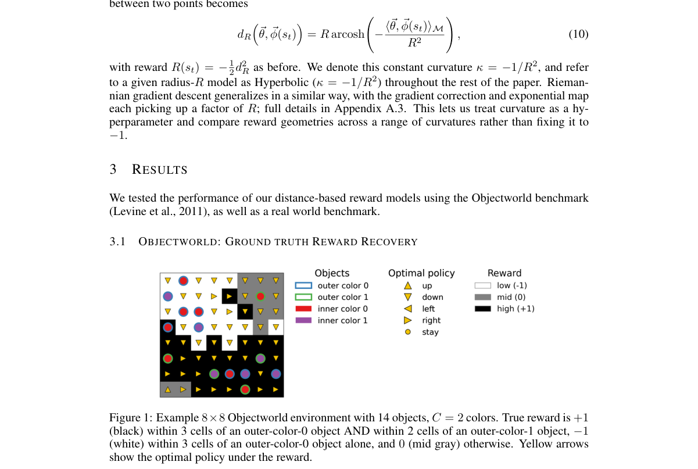

*Result - Expected value difference vs. number of demonstration examples on 32×32 Objectworld with 50 objects, Classic, Euclidean, Hyperbolic (κ = −1), Hyperbolic (κ = −4), and a neural network reward*

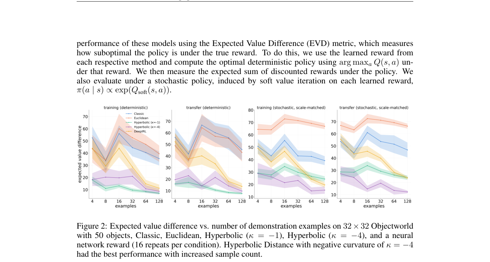

**Why this ranks #2**: 用双曲距离参数化奖励，让不可分的合取结构第一次在 IRL 中被显式拟合出来。

---

### 3. Continual Reinforcement Learning Is an Integration Problem

**arXiv**: [2610.41809](https://arxiv.org/abs/2610.41809) | **Score**: 9.0 (relevance 9.0 x 0.7 + quality 9.0 x 0.3) | **Tags**: rl-core, Continual_RL, Desiderata, Evaluation_Protocol, Benchmark_Design, Opinion_Piece, University College London | **Categories**: cs.LG | **Pages**: 39

**Authors**: Nis Meinert; Jakob Gawlikowski; Edward Grant; Max Cyprys; Nathan Schurr; Neil Boston; Alfredo Ibias; Milind Tambe; Janusz Marecki

**Affiliation**: University College London; Harvard University

**Abstract**

> This paper presents an opinionated set of ten desiderata intended to inform the design and evaluation of reinforcement-learning agents that learn continually throughout a continuing lifetime. We use these desiderata to examine a representative selection of existing approaches. Progress on individual desiderata is valuable, but the longer-term aim should be to integrate all ten within a single agent. To our knowledge, no published evaluation has yet provided evidence for such an integration. Likewise, the representative benchmarks we review probe different parts of this target, but separate evaluations do not establish that the corresponding properties coexist within one agent throughout a continuing lifetime. As a secondary contribution, we therefore present a compact persistent-world scenario as a playable companion to the desiderata and outline a proposed benchmark that examines a broad range of associated behavioral capabilities together within one such lifetime.

**Key findings**

- **Finding**: 论文给出十条被称为 desiderata 的性质（D1–D10），按主要证据形式分为协议层、系统层与行为层：协议层的 D1 界定交互条件，D3–D5 主要是系统层，D2 与 D6–D10 有行为内核。
- **Finding**: 目标设定要求 agent 在一次连续生命周期中在线学习，没有外部给定的任务身份或边界，也没有会抹掉状态与动作后果的重置。
- **Finding**: 作者批评现有做法：把非平稳性表示为有限的、外部分段的任务序列，往往固定状态与动作空间并给出任务身份或边界，还常用分片重置与全生命周期超参调优，这些便利可能泄漏真实 agent 拿不到的信息。
- **Finding**: 作者指出，尚无任何已发表的评测提供过把十条性质整合进单个 agent 的证据；现有基准各测一部分，分开评测无法说明这些性质在同一 agent 的一次生命周期内共存。
- **Finding**: 作为附带贡献，论文给出一个紧凑的持久世界场景作为可玩伴侣，并勾勒了一个考察广泛行为能力的基准提案。
- **Inference**: 这是一篇立场论文而非新算法，价值在于把「终身学习」这类模糊口号拆成可分别证伪的十个问题。
- **Inference**: D1 所设想的实验范式（无任务边界、无重置、算力受约束）对现有基准生态是根本性挑战，短期难以落地。
- **Recommendation**: 值得读，适合在设计持续学习评测方案时作为清单使用。

**Key figures**

*Framework - Overview of the ten desiderata, grouped by their primary evidential perspective. D1 defines the interaction protocol under which evidence for all others is interpreted. D3–D5 primarily concern*

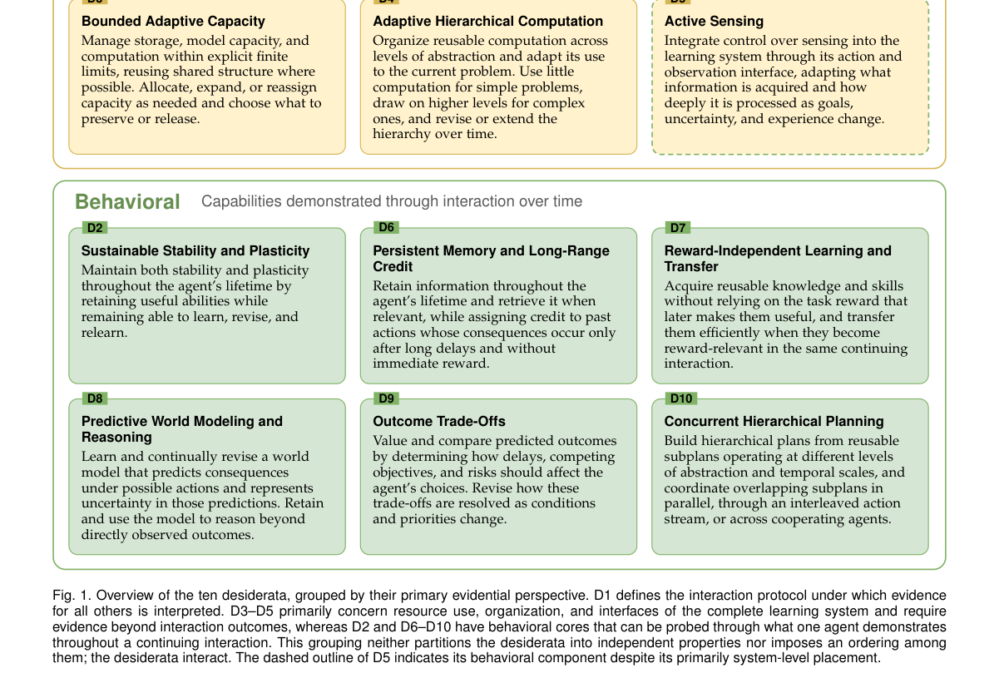

**Why this ranks #3**: 提出十条持续 RL 的设计准则，并指出：现有评测从未证明这些能力能在同一个 agent 上共存。

---

### 4. When Is a Game a Markov Decision Process? Correspondences Between Game Theory and Reinforcement Learning

**arXiv**: [2610.41962](https://arxiv.org/abs/2610.41962) | **Score**: 8.8 (relevance 9.0 x 0.7 + quality 8.5 x 0.3) | **Tags**: rl-core, Monograph, Game_Theory, Nash_Equilibrium, Markov_Decision_Process, No_Regret, Universidad Pontificia Comillas | **Categories**: cs.GT, cs.LG | **Pages**: 145

**Authors**: Eduardo C. Garrido-Merchán

**Affiliation**: Universidad Pontificia Comillas

**Abstract**

> Reinforcement learning and game theory describe the same object from two sides. Game theory says what a rational outcome of a strategic interaction is; reinforcement learning says how an agent could reach one through experience. The two literatures nevertheless keep separate vocabularies for identical structures, and the treatments that bridge them present the correspondence as analogy rather than theorem. This monograph supplies the theorems. A game is a Markov decision process in three distinct senses, and every table entry is labelled with the one that applies: a definitional identity, an exact reduction carried by a value- and solution-preserving map, or a structural analogy that fails under identifiable conditions. We take every standard class of game, from normal-form through repeated, stochastic, partially observable, extensive-form with imperfect information, Bayesian, graphical, Stackelberg, potential, coalitional, mean-field and evolutionary games, and identify for each the decision-theoretic model that reinforcement learning already studies under another name. The same treatment is applied to solution concepts: Nash equilibrium and the fixed point of the Bellman optimality operator, quantal response equilibrium and the soft Bellman operator, the Shapley value and credit assignment, Blackwell approachability and no-regret learning. We map each model class onto the training procedures sound for it and record the complexity of the associated solution problems. A final part collects the correspondences that do not hold: the non-stationarity that invalidates the independent-learner reduction, the impossibility results that forbid uncoupled convergence to Nash equilibrium, and the gap between the coarse correlated equilibria that no-regret self-play reaches and the correlated equilibria it is credited with.

**Key findings**

- **Finding**: 这部 145 页的专著回答「博弈何时是 MDP」，并严格区分三种对应强度：定义性同一（同一元组换名）、精确归约（存在保值与保解的映射）、结构类比（共享形式但映射会破坏解或需一般情形不满足的假设）。
- **Finding**: 专著逐一处理从正规式、重复博弈、随机博弈、部分可观测博弈、带不完全信息的扩展式到贝叶斯、图式、Stackelberg、势博弈、联盟、均场与演化博弈，并指出每个都有 RL 早已研究的对偶模型。
- **Finding**: 解概念同样成对处理：纳什均衡与 Bellman 最优算子的不动点、量化响应均衡与软 Bellman 算子、Shapley 值与信用分配、Blackwell 可达性与无遗憾学习。
- **Finding**: 最后一章收集不对应的对应关系：使独立学习者归约失效的非平稳性、禁止无耦合收敛到纳什均衡的不可能性结果，以及无遗憾自博弈达到的粗相关均衡与它被记功的相关均衡之间的落差。
- **Finding**: 书中还给出模型类的格（lattice of models）与各解问题的复杂度刻画。
- **Inference**: 把「类比」与「定理」分层标注，实际上是在给多智能体 RL 的常见说辞做一次严谨性审计。
- **Inference**: 对 RL 从业者最有用的部分可能是那些「不成立的对应」，因为它们直接对应实践中把其他 agent 当环境的失败。
- **Recommendation**: 值得作为工具书查阅，建议按章节读而非通读。

**Key figures**

*Framework - The lattice of models. Arrows denote inclusion of model classes: the tail is a special case of the head. Moving right relaxes the reward structure from a single agent to a shared payoff to a*

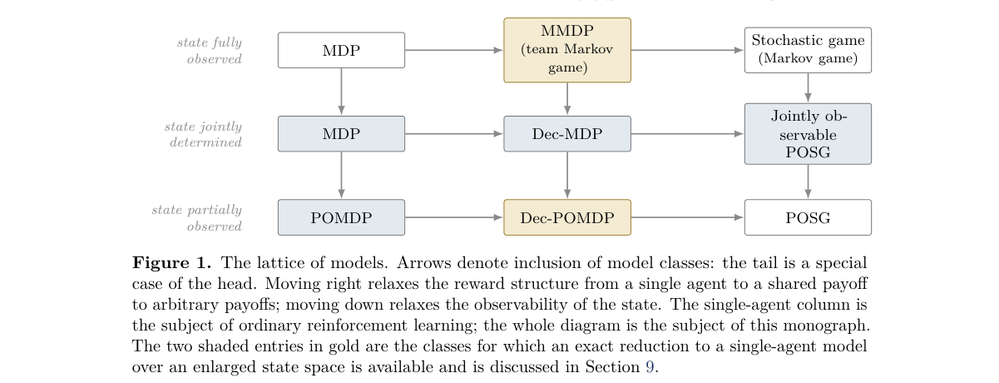

**Why this ranks #4**: 把博弈论与 RL 的对应关系逐条标注为「定义等价 / 精确归约 / 结构类比」，杜绝类比冒充定理。

---

### 5. Density-Guided Bootstrap Boundaries for Latent World-Model Reinforcement Learning

**arXiv**: [2610.41022](https://arxiv.org/abs/2610.41022) | **Score**: 8.8 (relevance 9.0 x 0.7 + quality 8.5 x 0.3) | **Tags**: rl-core, Latent_World_Model, DreamerV3, Bootstrap_Boundary, Contraction_Mapping, Atari_Pong, University of Michigan | **Categories**: cs.LG, stat.ML | **Pages**: 37

**Authors**: Shashank Gupta; Pilhwa Lee

**Affiliation**: University of Michigan; Morgan State University

**Abstract**

> Latent world models allow reinforcement learning agents to learn policies from imagined trajectories, yet determining the optimal depth of model reliance remains a fundamental challenge. Fixed imagination horizons apply uniform prediction depths regardless of trajectory reliability, exposing target values to compounding model error or over-relying on critic approximations. We introduce density-guided bootstrap boundaries, a trajectory-dependent mechanism that adapts the depth of imagined returns using a score-informed relative density proxy. The proxy accumulates the estimated divergence of a score-corrected auxiliary field formed by a feature displacement network and a noise-conditioned score estimator along imagined paths. We propose two gating mechanisms: a hard boundary that halts return expansion at a discrete state, and a soft boundary that continuously shifts the return recursion toward critic bootstrapping. Both variants preserve boundary value estimates and apply corresponding survival weights to actor and critic losses. Formulated independently of specific dynamics models and instantiated within Dreamer V3, we prove that the resulting gated Bellman operator is a strict contraction mapping and that early bootstrapping monotonically reduces conditional target variance. We clarify the theoretical assumptions distinguishing our expansion proxy from exact path likelihoods. Across continuous-control tasks and Atari Pong, empirical evaluations show that dynamic boundary selection enhances sample efficiency and late-training performance over fixed-horizon and auxiliary-enabled baselines.

**Key findings**

- **Finding**: 论文提出密度引导的 bootstrap 边界：固定想象时长的做法无论轨迹可靠与否都采用统一的预测深度，使目标值要么承受模型误差累积，要么过度依赖 critic 近似。
- **Finding**: 其密度代理由一个特征位移网络与一个噪声条件分数估计器构成的打分修正辅助场，沿想象路径累积估计散度得到。
- **Finding**: 两种门控形式：硬边界在离散状态处停止回报展开，软边界把回报递归连续地移向 critic 自举；两者都保留边界处的价值估计，并对 actor 与 critic 损失施加相应的存活权重。
- **Finding**: 作者在 DreamerV3 上实例化（保留其随机潜变量动力学与 actor-critic 训练流程），证明门控后的 Bellman 算子是严格压缩映射，且提前自举会单调降低条件目标方差。
- **Finding**: 经验评估覆盖连续控制任务与 Atari Pong，动态边界选择相对固定时长的基线与带辅助项的基线都提升了样本效率与训练后期表现。
- **Finding**: 论文明确说明代理量不等于精确的路径似然：分解出平滑位移、Euler 求积残差与结构路径漂移三项误差，代理只能当作启发式的特征空间膨胀诊断。
- **Inference**: 这是把「想象多深」显式化的少见尝试，理论部分（压缩性、方差单调性）比方法本身更值得引用。
- **Inference**: 作者自陈代理量与路径似然之间存在结构性差距，因此结论应理解为经验有效而非概率上正确。
- **Recommendation**: 值得读，但读者需自己判断启发式代理在具体潜空间里的可靠性。

**Key figures**

该论文正文未提取到可用图（图表为纯文本/表格排版）。

**Why this ranks #5**: 让想象轨迹的展开深度随轨迹可靠性自适应，把固定 horizon 的误差累积变成显式决策。

---

### 6. Risk-Sensitive Mission Planning for Multi-Target On-Orbit Inspection via Distributional Reinforcement Learning

**arXiv**: [2610.41647](https://arxiv.org/abs/2610.41647) | **Score**: 8.5 (relevance 8.5 x 0.7 + quality 8.5 x 0.3) | **Tags**: rl-core, Distributional_RL, Risk_Sensitive, QR_DQN, On_Orbit_Servicing, Mean_Variance, Université Paris-Saclay | **Categories**: cs.AI, math.OC | **Pages**: 10

**Authors**: Adam Abdin

**Affiliation**: Université Paris-Saclay, CentraleSupélec

**Abstract**

> Multi-target on-orbit servicing missions require planning tools that can adapt to evolving operational conditions while accounting for the outcome variability inherent to safety-critical spaceflight. This paper presents an adaptive planning approach for multi-target servicing campaigns in low Earth orbit and applies it to inspection missions flown by a low-thrust servicer. The approach is based on Distributional Reinforcement Learning, which learns the full distribution of mission returns and thereby supports explicit risk-sensitive decision-making at each planning step. Specifically, a Quantile-Regression Deep Q-Network (QR-DQN) agent selects which target to inspect next by jointly considering the expectation and the variance of the predicted return through a mean-variance criterion. The mission environment models circular orbits with a spread in inclination and uses Edelbaum's combined-manoeuvre low-thrust transfer estimates. The observation comprises the orbital elements, the visit history, the observed risk state of each target and the remaining mission-time budget. The risk state of each target changes stochastically during the campaign, making the outcome of an inspection uncertain and creating operationally meaningful distinctions between risk-neutral and risk-averse planning strategies. Because the mission-time budget generally admits only a subset of the candidate targets, the planner must also select which targets to inspect. Numerical experiments on scenarios with five target satellites show that one risk-aversion weight moves the policy across a range of mean return and return variance, over an unchanged environment and reward. Risk-averse agents reduce the variance of the episodic return by approximately one half relative to risk-neutral agents and lower the probability of a mission loss, at a cost in mean return. To validate the learned policies, the efficient frontier, which gives the highest mean return attainable at each level of return variance, is computed exactly by enumerating the admissible visit orders. At equal variance, the learned policies lie close to this frontier in mean return, and the risk-averse policies have a lower probability of a mission loss than the frontier policies.

**Key findings**

- **Finding**: 论文用分位数回归 DQN 学习任务回报的完整分布，从而在每个规划步支持显式的风险敏感决策；agent 依据 mean-variance 准则联合考虑预测回报的期望与方差来选择下一个巡检目标。
- **Finding**: 任务环境建模带倾角分布的圆轨道，并使用 Edelbaum 的低推力组合机动估计；观测包含轨道要素、访问历史、各目标的观测风险状态与剩余任务时间预算。
- **Finding**: 由于任务时间预算通常只允许访问候选目标的一部分，规划器还必须决定放弃哪些目标；各目标的风险状态在任务过程中随机变化。
- **Finding**: 五个目标卫星的数值实验显示，只用一个风险厌恶权重就能在环境与奖励不变的前提下，让策略在平均回报与回报方差之间移动。
- **Finding**: 相对风险中性 agent，风险厌恶 agent 把回合回报方差降低约一半并降低任务失败概率，代价是平均回报下降。
- **Finding**: 作者通过枚举可行访问顺序精确算出有效前沿；在同等方差下，学到的策略在平均回报上接近该前沿，且风险厌恶策略的任务失败概率低于前沿策略。
- **Inference**: 用同一条策略参数扫出风险-收益前沿，比训练多个独立策略更便于工程上做单一旋钮的权衡。
- **Inference**: 场景规模只有五个目标，结论在更大规模或更长任务链上的表现尚未验证。
- **Recommendation**: 值得读，作为安全关键领域里风险敏感 RL 的干净范例，场景规模偏小是主要局限。

**Key figures**

*Framework - Mission concept overview. A low-thrust servicer transfers between circular orbits with varying semi-major axes*

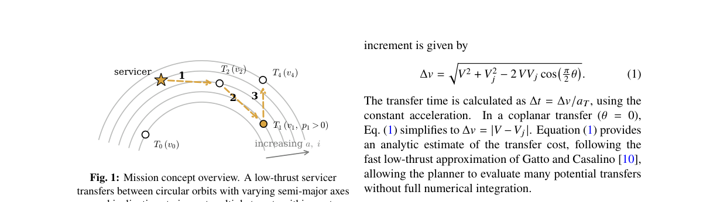

*Result - Solution architecture. The observation 𝑠𝑡is formed in*

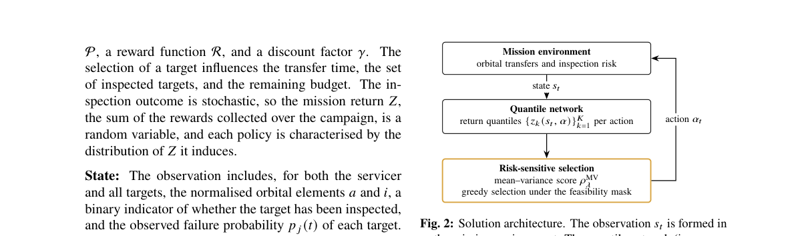

**Why this ranks #6**: 用分位数回报把「选哪个目标、承担多大风险」变成同一套 mean-variance 决策。

---

### 7. TalentRL: Strategy-Guided Reinforcement Learning for Hierarchical Skill Routing

**arXiv**: [2610.41143](https://arxiv.org/abs/2610.41143) | **Score**: 8.5 (relevance 8.5 x 0.7 + quality 8.5 x 0.3) | **Tags**: rl-core, Skill_Routing, Reward_Contrast, Group_Relative_Advantage, QA_Benchmarks, Procedural_Memory, Microsoft AI | **Categories**: cs.LG | **Pages**: 17

**Authors**: Huancheng Chen; Xiaodi Sun; Zhaoqiong Huang; Michelle Chang; Jingwen Lu

**Affiliation**: Microsoft AI

**Abstract**

> Natural-language skills enable large language model (LLM) agents to reuse procedures across tasks, yet most systems retrieve individual skills from a flat SkillBank without explicitly modeling the high-level strategy that governs their selection and use. We introduce TalentRL, a strategy-guided reinforcement learning framework for hierarchical routing over procedural memory. Coarse-grained talents represent recurring strategies for skill use, while fine-grained skills provide executable procedures. For each task, the policy model selects a talent that guides execution and softly prioritizes its associated skills during similarity-based retrieval. However, since task outcomes depend jointly on talent selection, retrieved skill context, and downstream execution, terminal rewards alone cannot isolate the contribution of the routing decision. TalentRL therefore trains talent routing with reward contrasts between rollouts of the same task under matched interventions on the talent-conditioned context, and optimizes downstream execution with group-relative advantages. Across seven open-domain and multi-hop question-answering benchmarks, talent-aware supervised fine-tuning improves average success rate by 7.53%, 6.71%, and 9.21% over the corresponding zero-shot baselines for Qwen2.5-7B, Qwen3-8B, and Llama-3.1-8B, respectively. Reinforcement learning further improves these SFT checkpoints by 7.58% to 9.32%, and TalentRL achieves the highest average success rate among all compared methods on all three backbones. On the agentic benchmarks ALFWorld and WebShop, TalentRL achieves the highest ALFWorld success rate (99.3%) and the highest WebShop score (90.7) among all compared methods.

**Key findings**

- **Finding**: 多数系统从扁平的 SkillBank 里检索单个技能，没有显式建模支配技能选择与使用的高层策略；TalentRL 用粗粒度 talent 表示反复出现的使用策略，细粒度 skill 提供可执行流程。
- **Finding**: 对每个任务，策略模型先选一个 talent，由它引导执行并在基于相似度的检索中软性优先其关联技能。
- **Finding**: 由于任务结果同时取决于 talent 选择、检索到的技能上下文与下游执行，终身奖励无法单独归因路由决策，因此作者用同一任务下匹配干预的奖励对比来训练 talent 路由，并用 group-relative 优势优化下游执行。
- **Finding**: 在七个开放域与多跳问答基准上，带 talent 的监督微调相对对应零样本基线分别把 Qwen2.5-7B、Qwen3-8B、Llama-3.1-8B 的平均成功率提高 7.53%、6.71%、9.21%。
- **Finding**: 强化学习在此 SFT 检查点之上再提升 7.58%–9.32%，且在三个骨干上都取得所有对比方法中最高的平均成功率。
- **Finding**: 在 agentic 基准上，TalentRL 取得最高的 ALFWorld 成功率 99.3% 与最高的 WebShop 分数 90.7。
- **Inference**: 配对干预 + 奖励对比是这篇最可迁移的技术点，它解决了 credit assignment 中「上层选择被下游淹没」的老问题。
- **Inference**: 该框架同时依赖 LLM 的判断能力与 RL 优化器，因此结果更多体现的是工程组合而非单一算法突破。
- **Recommendation**: 值得读，credit assignment 的处理方式对做分层 agent RL 的团队有直接借鉴价值。

**Key figures**

*Framework - Overview of TalentRL. (A) The policy model selects a talent that guides downstream execution and provides a soft prior for similarity-based skill retrieval. (B) Reward contrasts across match*

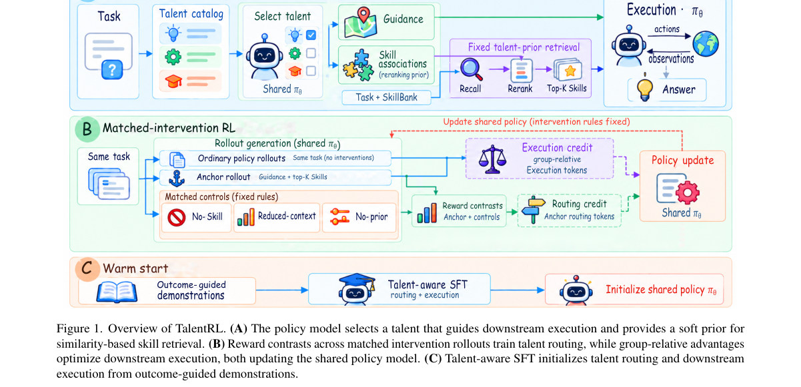

*Result - Talent selection of the final TalentRL policies. (a) Search7 test sets, as % of questions per dataset. (b) ALFWorld by task type over the seen (140) and unseen (134) splits. (c) WebShop on 5*

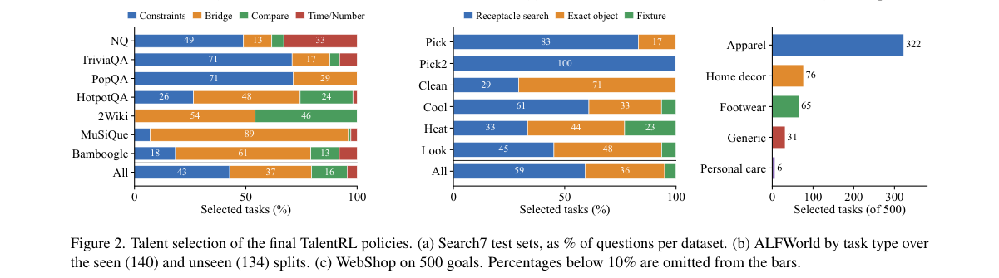

**Why this ranks #7**: 用同任务配对干预构造奖励对比，把「策略选错」从下游执行的收益中分离出来。

---

### 8. Joint-Health-Aware Reinforcement Learning for Robust Robot Control Under Actuator Degradation

**arXiv**: [2610.41348](https://arxiv.org/abs/2610.41348) | **Score**: 8.5 (relevance 8.5 x 0.7 + quality 8.5 x 0.3) | **Tags**: rl-core, Actuator_Degradation, HealthNet, Action_Attenuation, Locomotion, ManiSkill, Tianjin | **Categories**: cs.CV, cs.RO | **Pages**: 9

**Authors**: Haifa Zhang; Yijing Wang; Zhiqiang Zuo

**Affiliation**: Tianjin University

**Abstract**

> Robots deployed in unstructured environments are susceptible to actuator-authority degradation, which reduces the effective control authority of individual actuators and can cause reinforcement learning policies trained under nominal dynamics to fail. Existing robustness approaches rely on discrete fault labels, broad domain randomization, or global latent variables, often without explicitly modeling continuous per-joint residual actuation capability. We propose a joint-health-aware reinforcement learning framework for robust robot control under simulated actuator degradation. Our framework encodes actuator condition in a continuous joint-health vector and models degradation as multiplicative attenuation of executed actions. A dedicated HealthNet estimator infers per-joint health from recent observations and actions, allowing the policy to redistribute control effort across healthy and degraded joints. We evaluate the method on Walker, Go2, Cassie, and Panda-based ManiSkill manipulation tasks under diverse degradation masks and severity levels. The method outperforms nominal and degradation-trained no-health baselines on the main evaluated metrics. Relative to the nominal baseline, task-level locomotion returns improve by up to 250.1\% and manipulation success rates by up to 15.2 percentage points; in the high-degradation Cassie group, return increases from 3.94 to 40.50 (+928.0\%). Ablations support the contribution of per-joint health estimation, action-degradation modeling, and health-conditioned control.

**Key findings**

- **Finding**: 论文指出既有鲁棒方法依赖离散故障标签、宽泛的域随机化或全局潜变量，没有显式建模逐关节的连续残余驱动能力。
- **Finding**: 框架用连续的关节健康向量编码执行器状态，把退化建模为对执行动作的乘性衰减；专门的 HealthNet 从近期的观测与动作推断逐关节健康，使策略能在健康与退化关节之间重新分配控制力。
- **Finding**: 评测覆盖 Walker、Unitree Go2、Cassie 与基于 Panda 的 ManiSkill 操作任务，施加多样的退化掩码与严重程度；Cassie 上评估了 1,840 种健康条件、覆盖 d = 1–8 个退化关节。
- **Finding**: 相对名义基线，任务级移动回报最高提升 250.1%，操作成功率最高提升 15.2 个百分点；高退化 Cassie 组中回报从 3.94 提升到 40.50（+928.0%）。
- **Finding**: 消融支持逐关节健康估计、动作退化建模与健康条件化控制三者的贡献；Isaac Lab 移动任务沿用 PPO（RSL-RL）训练流程并把 HealthNet 预测并入策略观测。
- **Finding**: 作者明确指出框架在模拟的退化下评测，真实硬件与时变退化、关节锁死、响应延迟等失效模式留待未来工作。
- **Inference**: 把「故障」当作连续可观测量而非离散标签，使得健康估计可以复用已有的系统辨识思路。
- **Inference**: +928.0% 这类数字来自极低基线（3.94），绝对值很小，评估时应同时看高基线任务上的提升幅度。
- **Recommendation**: 值得读，思路可迁移到真实机器人，但真机验证尚缺。

**Key figures**

*Framework - Same joint degradation, different response: the baseline degrades, while the health-conditioned policy adapts.*

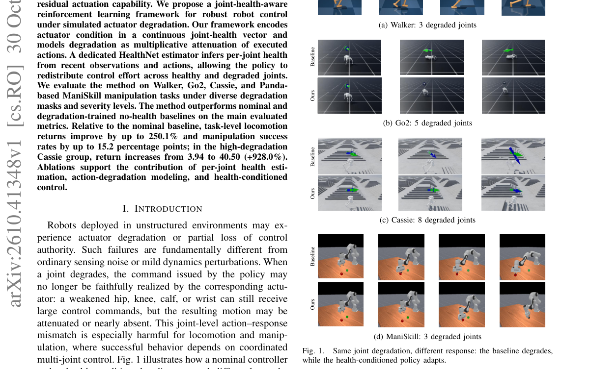

*Result - Overview of joint-health-aware control. HealthNet estimates ˆht from recent action–response history, and the controller conditions on (ot, ˆht) under actuator degradation. During training, sam*

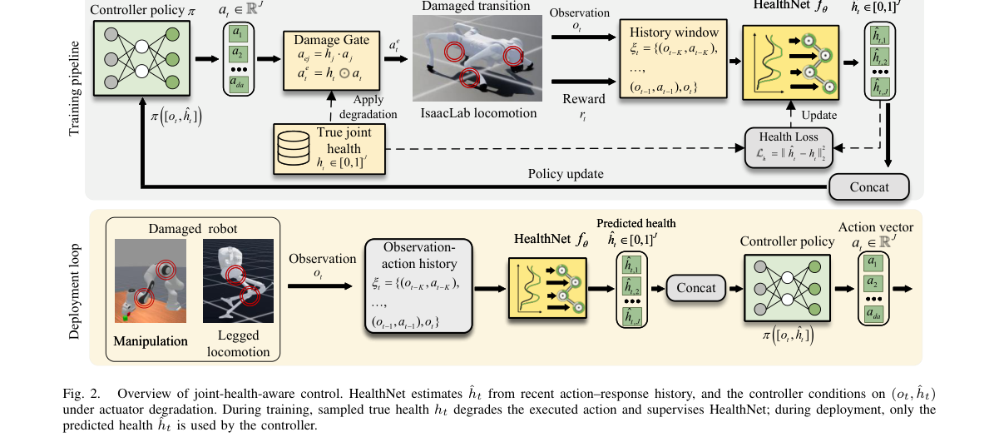

**Why this ranks #8**: 用连续关节健康向量替代离散故障标签，让策略在执行器衰减时重新分配控制力。

---

### 9. Towards Understanding the Impact of Plasticity Loss on Reinforcement Learning in Stochastic Environments

**arXiv**: [2610.42100](https://arxiv.org/abs/2610.42100) | **Score**: 8.5 (relevance 8.5 x 0.7 + quality 8.5 x 0.3) | **Tags**: rl-core, Plasticity_Loss, Observation_Noise, Periodic_Resets, DeepMind_Control, EWRL_2026, University of Freiburg | **Categories**: cs.LG | **Pages**: 24

**Authors**: Philipp Bordne; André Biedenkapp

**Affiliation**: University of Freiburg; Karlsruhe Institute of Technology

**Abstract**

> Deep reinforcement learning (RL) is a powerful framework for sequential decision-making. Despite many high-profile successes in recent years, deep RL is known to be brittle. An emerging line of research attributes this brittleness to a loss of plasticity in neural networks. However, plasticity loss has so far been understudied in stochastic environments. We study this interplay systematically, training SAC agents on three DeepMind Control tasks augmented with controlled levels of observation and action noise. We find that plasticity-preserving methods increase learning robustness on the two harder tasks, with their advantage growing as observation noise increases, while combining resets with layer normalization underperforms resets alone at every observation noise level tested. Further, stochasticity can accelerate the loss of plasticity in harder environments, whereas in easier settings noise can act as a regularizer that sustains plasticity. Lastly, plasticity loss is most pronounced in the early stages of training. In the most challenging stochastic settings, TD instability rather than gradual plasticity loss becomes the dominant failure mode.

**Key findings**

- **Finding**: 作者在加入受控观测噪声与动作噪声的三个 DeepMind Control 任务上训练 SAC，系统研究可塑性流失与随机性的关系；论文发表于 EWRL 2026。
- **Finding**: 可塑性保持方法（尤其是 periodic reset）在两个更难的任务上提升了学习鲁棒性，且其优势随观测噪声增大而扩大。
- **Finding**: 相反地，在容易的任务（walker-run）上加入观测噪声反而让学习者保持更高可塑性，噪声起到了正则化作用。
- **Finding**: 组合 resets 与 layer normalization 在测试过的每个观测噪声水平上都劣于单独使用 resets。
- **Finding**: 在最具挑战的随机设定下，主导失效模式变成了 TD 不稳定而非渐进的可塑性流失；baseline SAC 在 quadruped-run、σo = 0.05 下出现严重价值高估，训练未能恢复。
- **Finding**: 实验上每个方法、任务与噪声水平以 5 个种子评估，结果用归一化分数（IQM 与 95% 置信区间）汇总，并按最佳 replay ratio 选取。
- **Inference**: 噪声与可塑性流失是双向耦合的，单纯加正则或加 reset 的收益高度依赖任务难度，不能一刀切。
- **Inference**: 「reset + layer norm」反而更差这一反直觉结果，说明两类机制之间存在冲突，值得在自有实验里单独验证。
- **Recommendation**: 值得读，结论具体且可操作，适合做噪声环境 RL 的团队直接复用其评测设置。

**Key figures**

*Framework - Illustration of the probing task. As implemented in this study (left); as originally proposed by Lyle et al. [2023] (right).*

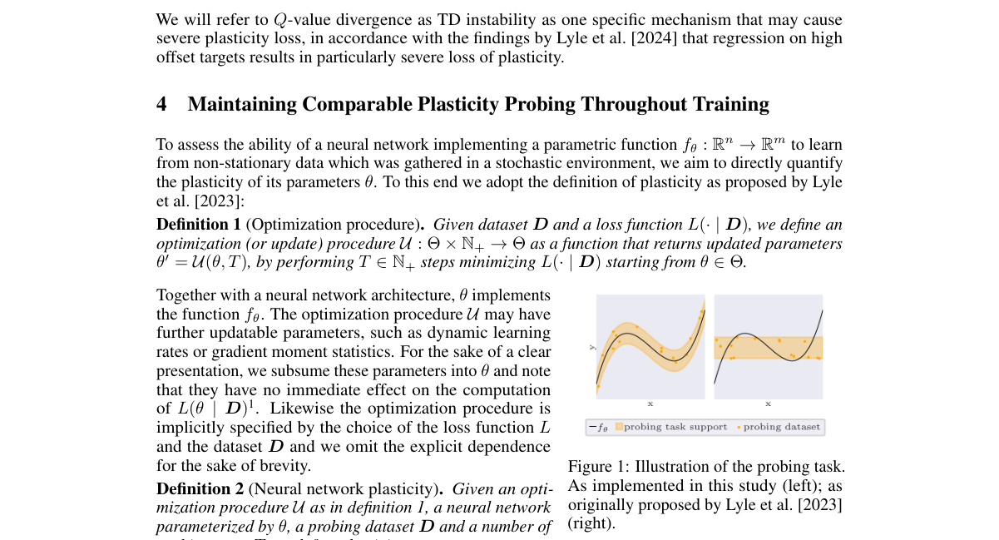

*Result - Final performance of SAC under increasing observation noise (left) and action noise (right) after 106 training steps.*

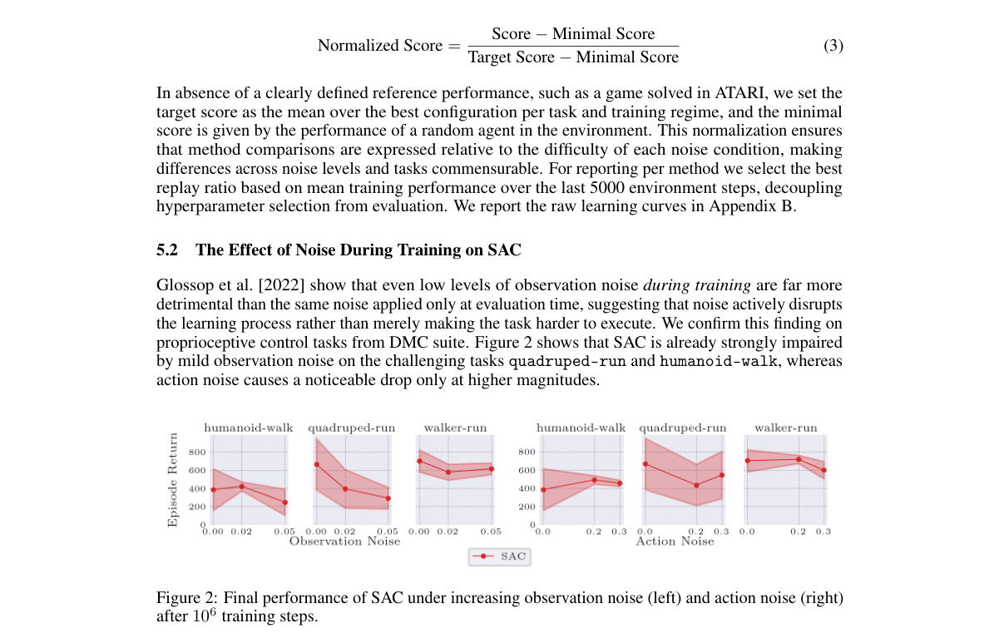

**Why this ranks #9**: 首次在随机环境下系统检验可塑性保持方法，给出「噪声越大越该 reset」的实证结论。

---

### 10. CausalXRL: Explainable Reinforcement Learning through Causal Graph Reasoning

**arXiv**: [2610.42028](https://arxiv.org/abs/2610.42028) | **Score**: 8.3 (relevance 8.5 x 0.7 + quality 8.0 x 0.3) | **Tags**: rl-core, Explainable_RL, Causal_Graph, Rubin_Causal_Model, MicroRTS, Expert_Study, Stony Brook | **Categories**: cs.LG | **Pages**: 17

**Authors**: Yanming Zhang; Eric Papenhausen; Klaus Mueller

**Affiliation**: Stony Brook University

**Abstract**

> Reinforcement learning is a powerful paradigm for training autonomous agents and has achieved impressive performance in complex environments. However, this success often comes at the cost of interpretability, diminishing trust and complicating efforts to debug and improve agent behavior. To address these challenges, we introduce CausalXRL, a novel framework for explainable reinforcement learning (XRL). A key feature of CausalXRL is its use of causal graph reasoning, which provides transparent, structured, multi-level explanations of agent decision-making. We validate CausalXRL through comprehensive case studies and a two-part evaluation: (1) a quantitative analysis of explanation fidelity and causal-structure learning efficiency in benchmark RL environments, and (2) a qualitative expert study assessing explainability in the real-time strategy (RTS) benchmark MicroRTS. The quantitative results show that CausalXRL can provide faithful explanations while efficiently learning causal structures, and the qualitative expert study suggests that participants found CausalXRL useful for inspecting high-level RTS strategies.

**Key findings**

- **Finding**: CausalXRL 的管线分为三段：表示抽取、因果依赖推断与可解释因果模型；作者用 Rubin 因果模型从表示池中推断因果结构，不再需要预定义结构或条件独立检验。
- **Finding**: 论文指出 AIM 类方法把因果边直接绑定到动作，在 RTS 这类多单元环境中会退化为确定性依赖、反而丧失高层解释力；而基于 CIT 的结构学习最坏时间复杂度为 O(n^{k+2})，开销极大。
- **Finding**: 四个基准上的定量结果为：CartPole 准确率 91.4%（LM 88.5%、DT 94.1%），PongDuel 90.2%（81.5% / 88.3%），MicroRTS-Lite 86.0%（75.3% / 80.3%）。
- **Finding**: 结构学习效率上，CartPole 仅需 0.1 秒（对照 1.7 秒 / 0.8 秒），MicroRTS-Lite 需 0.5 秒（对照 20.9 秒 / 7.4 秒）。
- **Finding**: 作者在 MicroRTS 上做了定性专家研究，要求 RTS 领域专家边看边说，以评估解释是否帮助理解 agent 的策略与是否提升信任。
- **Finding**: 作者自评在简单环境中与基线相当、在 PongDuel 与 MicroRTS 上优势更明显，效率上则全面占优。
- **Inference**: 效率差距随表示数量增长而放大，说明「可解释表征」是这个框架真正的成本优势来源。
- **Inference**: 专家研究是探索性设计，参与者规模与任务面限制了结论强度，宜当作方向性证据。
- **Recommendation**: 值得读，ICML 2026 主会论文，适合做 XRL 与策略解释方向的团队参考。

**Key figures**

*Framework - The architecture of CausalXRL. SLA is the Structural Learning Algorithm.*

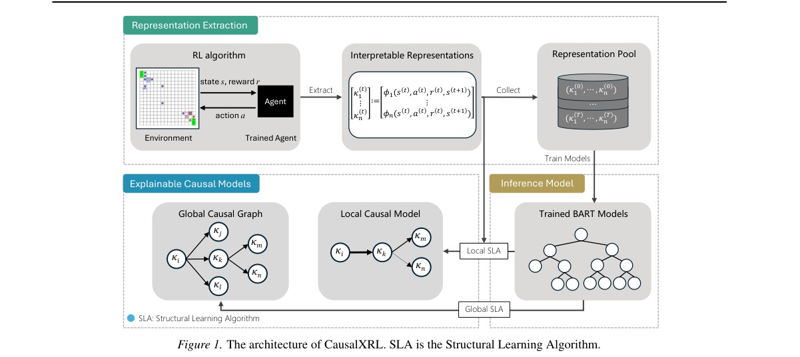

*Result - Graphical representations of units and actions. HP (Hit*

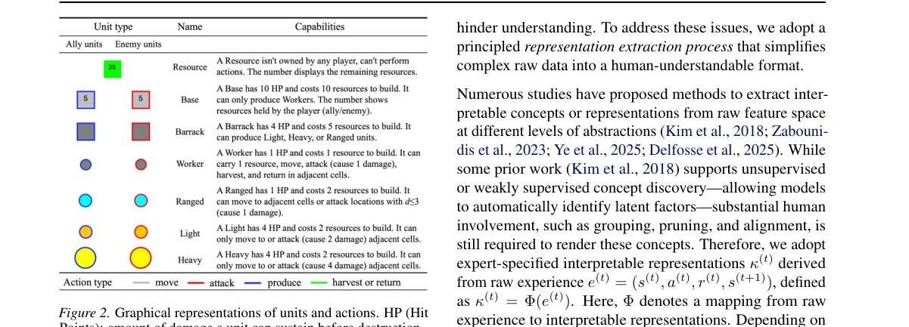

**Why this ranks #10**: 用可解释表征与 Rubin 因果模型替代条件独立检验，把结构学习耗时压到秒级。

---

## Footer

- Total papers scanned across all 7 tracks: 465（原始 615 条）
- rl_core track final top-10: 10
- Wild-cards in this track: 0
- Figure assets: 2026-11-02/res/

Generated by `mine-arxiv-daily-digest` skill. Sister file: `2026-11-02_rl_core_entry.md`.
