# ArXiv Daily Digest - 2026-11-02 (强化学习 · LLM 后训练与对齐, 10 papers)

**Generated**: 2026-11-02 17:30 CST

**Source**: arXiv cs.CV, cs.SD, eess.AS, cs.CL, cs.AI, cs.RO, cs.LG submissions, listing day 2026-10-30 (announced 2026-10-31 00:00 UTC)

**Batch window**: 2026-10-29T18:00:00Z .. 2026-10-30T18:00:00Z（arXiv 公告批次横跨两个 UTC 日：前一日 18:00 UTC 起算，当日 17:59:59 UTC 截止）

**Track**: rl_llm (top 10 of 465 papers scanned, 70 full reads)

**Scope**: LLM 后训练阶段的 RL：RLHF / DPO / GRPO / RLVR / RLAIF、奖励建模与可验证奖励

---

## Top 10 - 强化学习 · LLM 后训练与对齐

### 1. Steering Vectors as a Training Signal in LLM Post-Training

**arXiv**: [2610.40998](https://arxiv.org/abs/2610.40998) | **Score**: 9.3 (relevance 9.5 x 0.7 + quality 9.0 x 0.3) | **Tags**: rl-llm, LLM-post-training, steering-vector, GRPO, RLVR, advantage-repair, distillation, advantage-shaping, Arizona State | **Categories**: cs.AI, cs.LG | **Pages**: 32

**Authors**: Tiejin Chen; Maunil Vyas; Huaiyuan Yao; Hua Wei

**Affiliation**: Arizona State University; Amazon

**Abstract**

> Steering vectors (SVs) are residual-stream directions that shift the behavior of LLMs when added to hidden states at inference time. While prior work has mainly used SVs as post-hoc controls, we ask whether the same directions can also guide parameter updates during post-training. We study this question across supervised learning, including SFT and distillation, and reinforcement learning with verifiable rewards (RLVR). Our framework considers two intervention regimes: a hidden-state hook during teacher-forced supervised training, and an advantage-repair mechanism on wrong rollouts in GRPO. For each regime, we analyze three design axes, which are the steering direction, its placement, and the operation used to combine it with training. In supervised settings, SV injection improves over plain SFT and distillation, with gains scaling with the off-policy gap and reaching up to a $12\%$ improvement when distilling from thinking-mode teachers. These gains hold across three random seeds. In RL settings, applying a correctness-contrast direction as advantage repair on wrong rollouts, including otherwise zero-gradient all-wrong groups, recovers a learning signal that transfers to held-out math benchmarks and acts as a composable auxiliary signal that adds to existing zero-variance remedies such as entropy-aware advantage shaping. We further identify three failure boundaries. In detail, code generation can break the direction, cross-family layer transfer can break the placement, and inference-time application on an SV-trained checkpoint can break the intervention regime. Together, these results establish steering vectors as a conditional but effective training signal for LLM post-training. Our code is available here.

**Key findings**

- **Finding**: 论文把 steering vector 的用法从「推理期后验控制」推进到「训练期信号」，提出两个干预区间：teacher-forced 监督训练中的 hidden-state hook，以及 GRPO 中对错误 rollout 的 advantage repair。
- **Finding**: 每个区间沿三条设计轴展开：steering 方向本身、注入位置，以及与原有计算合并的操作方式。
- **Finding**: 监督侧 SV 注入优于普通 SFT 与蒸馏，收益随 off-policy gap 增大，从 thinking-mode 教师蒸馏时最高提升 12%。
- **Finding**: 上述监督侧收益在三个随机种子上都成立。
- **Finding**: RL 侧用 correctness-contrast 方向对错误 rollout 做优势修复，可恢复包括「全错、梯度为零」的 group 在内的学习信号，并在留出数学基准上迁移。
- **Finding**: 该方向是可组合的辅助信号，可叠加到 entropy-aware advantage shaping 等既有零方差补救手段之上。
- **Finding**: 作者给出三条失效边界：代码生成会破坏方向本身，跨模型族的层迁移会破坏注入位置，在 SV 训练过的 checkpoint 上做推理期应用会破坏干预区间。
- **Inference**: steering vector 能同时在监督与 RL 两条通路起作用，说明它承载的是可迁移的行为方向而非任务专属技巧，值得当成后训练的一层通用控制接口来用。
- **Inference**: 三条失效边界都指向「方向—位置—区间」的耦合，说明这套方法不能无脑外推到新模型族或新任务上。
- **Recommendation**: 值得读，做 LLM 后训练、想理解表示层方向可干预性的读者优先看，结论边界写得比多数论文清楚。

**Key figures**

*Framework - Overall framework. Panel (A) precomputes the off-policy displacement vector, which serves as the injection signal for the Supervised Regime in (B). In parallel, the Reinforcement Learning Re*

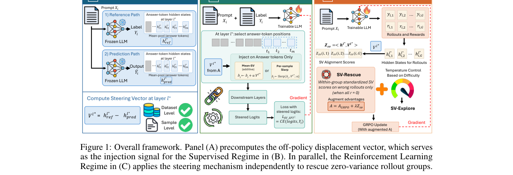

*Result - Analysis of our SV-augmented SFT on Qwen2.5-1.5B with GSM8K.*

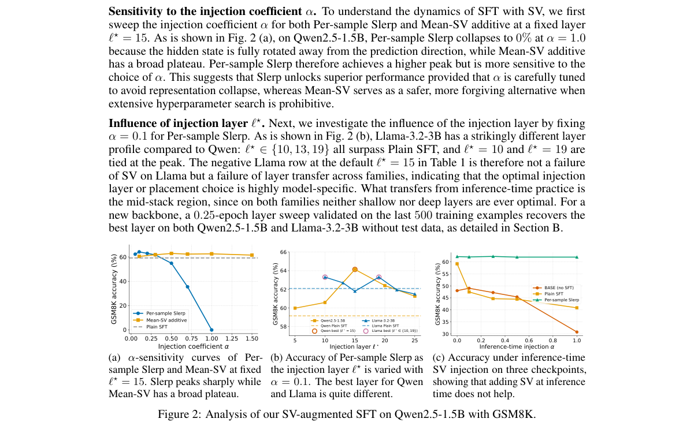

**Why this ranks #1**: 把 steering vector 从推理期开关改造成训练期信号：监督侧做隐状态注入，RL 侧对错误 rollout 做优势修复。

---

### 2. Reliability-Weighted Direct Preference Optimization: Penalized Weights for Robust Preference Learning

**arXiv**: [2610.41588](https://arxiv.org/abs/2610.41588) | **Score**: 9.3 (relevance 9.5 x 0.7 + quality 9.0 x 0.3) | **Tags**: rl-llm, LLM-post-training, preference-optimization, noisy-preference, label-flips, estimation-theory, minimax-penalty, Kennesaw State | **Categories**: cs.LG, stat.ME, stat.ML | **Pages**: 30

**Authors**: Bin Luo; Param Venkat Vivek Kesireddy; Anil Vallepu

**Affiliation**: Kennesaw State University

**Abstract**

> Direct Preference Optimization (DPO) treats every reported comparison as correct, yet preference data contain reversed, tied or otherwise noisy comparisons. RW-DPO gives each comparison an unknown reliability weight $w_i\in[0,1]$ that enters the likelihood linearly -- DPO is $w\equiv1$, a reversed comparison $w_i=0$ -- and estimates the weights jointly with the policy under a minimax-concave penalty on $-\log w_i$. The penalty keeps every comparison the model agrees with at exactly $w_i=1$ and acts only on those it contradicts, through closed-form weight updates at negligible cost over DPO. We prove that recovering all flipped comparisons from a single annotation per comparison requires margins of order $\log n$. Furthermore, in a linear-index model, starting from an initial fit pointing in the correct direction, our estimator jointly consistently recovers the preference direction and weights, as well as identifies the flipped comparisons above this margin scale, even when a fixed fraction of comparisons is flipped. In simulations RW-DPO has the lowest average estimation error among DPO, noise-rate corrections and recent robust methods, with far more precise flags than recent label-correction methods. In DPO fine-tuning of a language model with 10-30% flipped labels, its win rate does not fall as the flip rate grows and exceeds that of DPO trained on clean labels, matching the strongest recent method with corrections concentrated on the flipped labels.

**Key findings**

- **Finding**: 论文指出 DPO 把每条上报的偏好对比都当作正确，而偏好数据里实际存在被反转、打平或含噪的对比。
- **Finding**: RW-DPO 为每条对比引入未知可靠度权重 w_i ∈ [0,1] 并线性进入似然：DPO 对应 w ≡ 1，被反转的对比对应 w_i = 0。
- **Finding**: 权重与策略在 minimax-concave 的 −log w_i 惩罚下联合估计，该惩罚让模型认同的对比恰好停在 w_i = 1，只对模型与其矛盾的对比起作用，并以闭式权重更新实现，相对 DPO 额外开销可忽略。
- **Finding**: 理论证明指出，从每条对比只有一次标注的设定中恢复全部被翻转的对比，需要 log n 量级的 margin。
- **Finding**: 在线性指标模型下，只要初始拟合方向正确，估计量可联合一致地恢复偏好方向与权重，并在该 margin 尺度之上识别被翻转的对比，即使固定比例的对比被翻转。
- **Finding**: 仿真中 RW-DPO 的平均估计误差低于 DPO、噪声率修正法与近期稳健方法，权重标记也比近期的标签纠正方法更精确。
- **Finding**: 在含 10–30% 翻转标签的 DPO 微调中，其 win rate 不随翻转率上升而下降，并超过用干净标签训练的 DPO。
- **Finding**: 其效果与近期最强方法相当，且纠正几乎全部集中在被翻转的标签上。
- **Inference**: 把「哪些标注不可信」变成与策略联合估计的量，比事先估计噪声率更自适应，尤其适合标注量少、翻转率未知的场景。
- **Inference**: log n 量级的 margin 下界提示实际数据若标注质量差到一定程度，方法也无法完全定位翻转样本。
- **Recommendation**: 值得读，做偏好数据清洗或噪声鲁棒对齐的读者可参考，理论与仿真都给了可复用的结论。

**Key figures**

该论文正文未提取到可用图（图表为纯文本/表格排版）。

**Why this ranks #2**: 给每条偏好对一个可学习的可靠度权重，让模型自己把被翻转的标注标出来，而不是先把噪声率当成已知常数。

---

### 3. CRoS: Causality Reward on Scrambled CoTs Improves Accuracy and Reasoning Faithfulness

**arXiv**: [2610.42054](https://arxiv.org/abs/2610.42054) | **Score**: 9.2 (relevance 9.5 x 0.7 + quality 8.5 x 0.3) | **Tags**: rl-llm, LLM-post-training, RLVR, causality-metric, chain-of-thought, reasoning-faithfulness, reward-design, UNC Chapel Hill | **Categories**: cs.AI, cs.CL | **Pages**: 17

**Authors**: Xiao Yu; Justin Chih-Yao Chen; Zaid Khan; Hyunji Lee; Mohit Bansal

**Affiliation**: UNC Chapel Hill

**Abstract**

> Reinforcement learning with verifiable rewards (RLVR) has become the standard method for training language models to reason. However, RLVR typically relies solely on outcome correctness, which does not guarantee that the CoT causally contributes to the final answer. Without this connection, outcome rewards may fail to reinforce high-quality reasoning. Existing causality metrics assess CoT causality by perturbing the CoT, such as deleting reasoning steps or injecting errors, and measuring changes in the final answer. However, these perturbations inevitably alter information in each step. Consequently, high causality scores may reflect sensitivity to information changes introduced by perturbation rather than true causality. Such confounding effects further induce undesirable reasoning behaviors when these metrics are used as training rewards, including generating less informative CoTs and reducing exploration and self-correction. To address this problem, we propose CRoS (Causality Reward on Scrambled CoTs), a novel CoT causality metric that perturbs the order of reasoning steps without altering content, thereby preserving information within each step. On Reasoning Gym with Gemma-3-4B, CRoS outperforms existing causality and outcome rewards in out-of-domain accuracy, CoT quality, and CoT faithfulness. Specifically, CRoS achieves 46.8% accuracy on five unseen logic and games datasets, outperforming the strongest baseline (43.8%). It also achieves better CoT quality, consistently outperforming baselines in CoT-Pass@K from K=1 to 128, averaging 43.4% vs. 41.4%. For CoT faithfulness, CRoS achieves a hint acknowledgment score of 34.0% vs. 20.2%.

**Key findings**

- **Finding**: 论文指出 RLVR 普遍只依赖答案对错，无法保证 CoT 真的因果性地促成了最终答案，因此高质量推理可能得不到强化。
- **Finding**: 现有因果性度量通过删除推理步或注入错误来扰动 CoT，这必然同时改变了每一步的信息量，高因果分可能只反映对扰动引入信息变化的敏感度。
- **Finding**: 作者发现把这类度量直接当训练奖励会诱发不良行为，包括生成信息量更少的 CoT，以及削弱探索与自我纠错。
- **Finding**: CRoS 改为只打乱推理步骤的顺序而不改动任何一步的内容，从而保留每步内部的信息。
- **Finding**: 在 Reasoning Gym 上用 Gemma-3-4B 训练，CRoS 在域外准确率、CoT 质量与 CoT 忠实度三项上都优于既有的因果性奖励与结果奖励。
- **Finding**: 五个未见过的逻辑与博弈数据集上 CRoS 达到 46.8% 准确率，强于最强基线的 43.8%。
- **Finding**: CoT-Pass@K（K 从 1 到 128）平均为 43.4%，优于基线的 41.4%；忠实度上 hint acknowledgment 分数为 34.0%，对照为 20.2%。
- **Inference**: 因果性奖励的关键不在扰动强度而在扰动是否保留步内信息，这解释了为何旧度量会奖励冗长但无用的 CoT。
- **Inference**: 忠实度与准确率同时提升，说明学到的是更接近真实推理路径的过程而非更讨巧的表述。
- **Recommendation**: 值得读，做 RLVR 奖励设计与推理忠实度评估的读者必看，指标构造思路可直接迁移。

**Key figures**

*Framework - Why and how to reward CoT causality. Top-left: Outcome rewards cannot distinguish between CoTs that produce the same correct answer, motivating the need to incorporate CoT causality into opt*

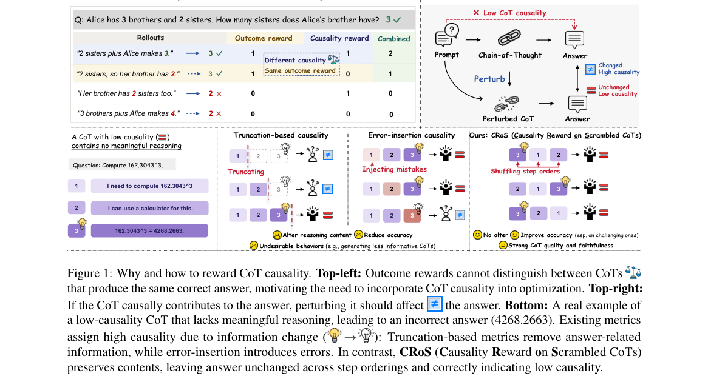

*Result - CRoS Is Less Sensitive to Content Changes. Existing causality metrics vary substantially across in- sertion positions, whereas CRoS remains stable.*

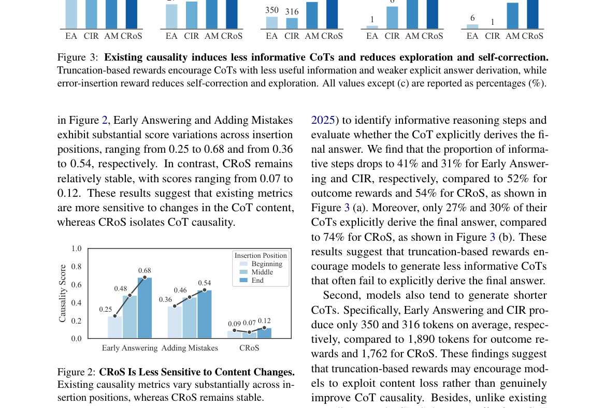

**Why this ranks #3**: 只打乱 CoT 的步骤顺序而不改内容，用这种扰动测因果性，避免把信息量变化误判成因果性。

---

### 4. bf16 Rounding Silently Discards Most RL Policy Updates: A Hidden Training-Inference Mismatch and an Unbiased One-Line Fix

**arXiv**: [2610.41073](https://arxiv.org/abs/2610.41073) | **Score**: 9.2 (relevance 9.5 x 0.7 + quality 8.5 x 0.3) | **Tags**: rl-llm, LLM-post-training, GRPO, low-precision, training-inference-mismatch, optimizer-export, reproducibility, Stanford | **Categories**: cs.AI, cs.LG | **Pages**: 15

**Authors**: Andrew Gao; William Gao

**Affiliation**: Stanford University

**Abstract**

> Reinforcement learning (RL) post-training of language models keeps fp32 master weights in the optimizer and serves rollouts from a bf16 copy produced by round-to-nearest conversion. At the learning rates in common use, most per-step updates are smaller than half a bf16 spacing and the conversion discards them: on Qwen3-1.7B only 0.4-0.5% of served weights change per step, and the policy that generates the training data lags the optimizer by 50-150 steps. Existing mismatch corrections cannot see this lag because they compare two copies downstream of the same rounding. We propose Fair Cast: export the master with an unbiased rounding rule (stochastic rounding or error feedback) and compute the training loss on the served copy. The change is one line at the export call, adds no hyperparameters and costs 22-38 ms per export of 1.7B parameters. Across 25 matched seed-pairs on Qwen3-0.6B to 4B with AdamW and Muon, Fair Cast is ahead on 18, tied on 6 and behind on 1, with a mean gain of 6.1 points; on zebra puzzles it reaches 0.57 +/- 0.16 over four runs where round-to-nearest collapses to 0.33 +/- 0.10. It also makes the saved fp32 checkpoint agree with the served model, and it exposes the implicit lag of round-to-nearest as a regularizer that can be restored explicitly when a task needs it.

**Key findings**

- **Finding**: RL 后训练在优化器里保留 fp32 主权重，rollout 却来自 round-to-nearest 转换出的 bf16 副本。
- **Finding**: 在常用学习率下，多数单步更新小于半个 bf16 间距而被转换直接丢弃：Qwen3-1.7B 上每步只有 0.4–0.5% 的服务权重发生变化。
- **Finding**: 产生训练数据的策略因此落后优化器 50–150 步。
- **Finding**: 既有的 mismatch 修正看不到这一滞后，因为它们比较的两份副本都位于同一次舍入的下游。
- **Finding**: Fair Cast 用无偏的舍入规则（stochastic rounding 或 error feedback）导出主权重，并在服务副本上计算训练损失。
- **Finding**: 改动只是导出调用处的一行，不引入新超参，1.7B 参数每次导出额外耗时 22–38 毫秒。
- **Finding**: 在 Qwen3-0.6B 到 4B、AdamW 与 Muon 上的 25 组配对种子实验中，Fair Cast 领先 18 组、持平 6 组、落后 1 组，平均增益 6.1 个点。
- **Finding**: 在 zebra 谜题上四次运行达到 0.57 ± 0.16，而 round-to-nearest 塌到 0.33 ± 0.10；保存的 fp32 checkpoint 也与实际服务的模型一致。
- **Inference**: 这是训练管线层面的静默损失，不改目标函数也能拿到可观增益，说明很多 RL 后训练的「调参收益」可能被数值截断吃掉了。
- **Inference**: round-to-nearest 隐含的滞后其实起到正则作用，作者指出需要时可显式恢复它——这提示修复要按任务评估而非一刀切。
- **Recommendation**: 值得读，做 RL 后训练基础设施的读者建议直接在自己的栈上试这一行改动。

**Key figures**

*Framework - Fair Cast learns faster and more stably than round-to-nearest export across tasks, model sizes and optimizers, and tracks the fp32 sampler where one was run. Held-out accuracy of the served*

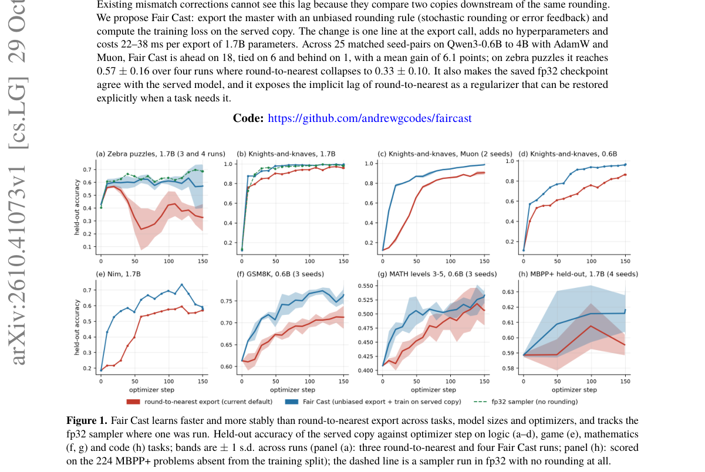

*Result - Where the two ratios live. The trainer’s bf16 forward pass and the sampler both sit downstream of the export, so the ratio frameworks check (green) stays near one; the ratio between the fp32*

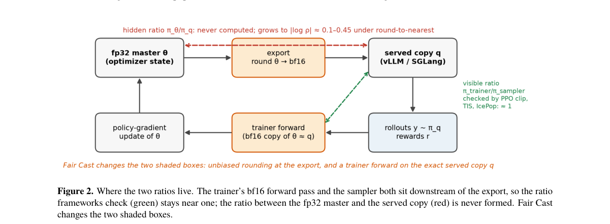

**Why this ranks #4**: 指出 bf16 舍入会悄悄丢掉绝大部分 RL 策略更新，并用一行无偏导出把被丢掉的梯度信号找回来。

---

### 5. CoFiBreak: A Coarse-to-Fine Diversity Reward for Effective Multi-Turn Jailbreak

**arXiv**: [2610.40926](https://arxiv.org/abs/2610.40926) | **Score**: 8.8 (relevance 9.0 x 0.7 + quality 8.5 x 0.3) | **Tags**: rl-llm, LLM-post-training, GRPO, red-teaming, diversity-reward, jailbreak, inference-cost, Simon Fraser | **Categories**: cs.CL | **Pages**: 26

**Authors**: Jialin Song; Xiaodong Liu; Weiwei Yang; Mingqian Feng; Chengquan Guo; Qiyao Ma; Carolyn Buractaon; Anson Ho; Wuyang Chen; Christopher White

**Affiliation**: Simon Fraser University; Microsoft Research

**Abstract**

> Automated red teaming trains an attacker large language model (LLM) to elicit harmful responses from a victim LLM, but reinforcement learning can collapse attackers onto a narrow set of prompts when attack success is the only reward. Such a collapse of attack diversity can bias safety evaluation toward repeatedly testing near-duplicate attack patterns rather than the underlying harmful intents. Existing methods often trade off attack success or inference cost for greater content or strategy diversity. We propose CoFiBreak, a coarse-to-fine diversity reward for Group Relative Policy Optimization (GRPO) that improves attack diversity while preserving strong attack effectiveness and low inference cost. The coarse reward broadens which strategies the attacker uses by encouraging strategies underrepresented within each GRPO group, while the fine reward broadens how those strategies are realized by discouraging reuse of the same personas, framings, and output formats after harmful-intent information is removed from prompt embeddings. Diversity rewards apply only to attacks that already exceed an effectiveness threshold, so diversity cannot be gained through ineffective attacks. Since both rewards are computed only during training, CoFiBreak also retains inference efficiency. Trained with Llama3.1-8B-Instruct as the victim, CoFiBreak discovers 1.6-2.0x as many distinct successful fine-grained strategies as the strongest baseline across frontier victims on HarmBench. It reaches 98.8% ASR@10 (attack success rate with 10 generations per intent) on AdvBench with the highest diversity score among all compared methods, which is 2.1x that of the strongest-attacking baseline. The resulting attacks transfer to unseen frontier LLMs, reaching 71.0% ASR@10 on AdvBench with the unseen victim Claude-Opus-4.6. The code will be released.

**Key findings**

- **Finding**: 论文指出当攻击成功率是唯一奖励时，RL 会让攻击者模型塌到很窄的一组提示上，使安全评测反复测试近似重复的攻击模式而非底层有害意图。
- **Finding**: 既有方法往往要用攻击效果或推理成本去换内容或策略多样性。
- **Finding**: CoFiBreak 是面向 GRPO 的粗到细多样性奖励：粗层奖励鼓励使用在该 GRPO group 内被低估的策略，细层奖励在移除提示词中的有害意图信息后抑制人设、框架与输出格式的重复。
- **Finding**: 多样性奖励只作用于已超过有效性阈值的攻击，因此多样性无法靠无效攻击换取。
- **Finding**: 两个奖励都只在训练期计算，因此推理效率保持不变。
- **Finding**: 以 Llama3.1-8B-Instruct 为受害模型，在 HarmBench 上针对多个前沿受害模型，CoFiBreak 发现的成功细粒度策略数量是最强基线的 1.6–2.0 倍。
- **Finding**: 在 AdvBench 上达到 98.8% 的 ASR@10，多样性得分 0.3633，是同等攻击效果下最强基线的 2.1 倍。
- **Finding**: 攻击可迁移到未见过的前沿模型，对未见受害模型 Claude-Opus-4.6 在 AdvBench 上达到 71.0% 的 ASR@10。
- **Inference**: 攻击多样性是安全评测的覆盖率前提，塌缩的红队会高估模型安全性，这篇把「评测覆盖度」当作一等目标来优化。
- **Inference**: 有效性阈值的设计让多样性与成功率解耦，避免奖励黑客式地堆砌无效花样。
- **Recommendation**: 值得读，做自动红队或模型安全评测的读者优先看，多样性奖励的设计可直接复用。

**Key figures**

*Framework - a illustrates the resulting tradeoff among effectiveness, diversity, and inference cost. SEMA (Feng et al., 2026) is efficient at inference, but optimizing attack success alone leaves it with*

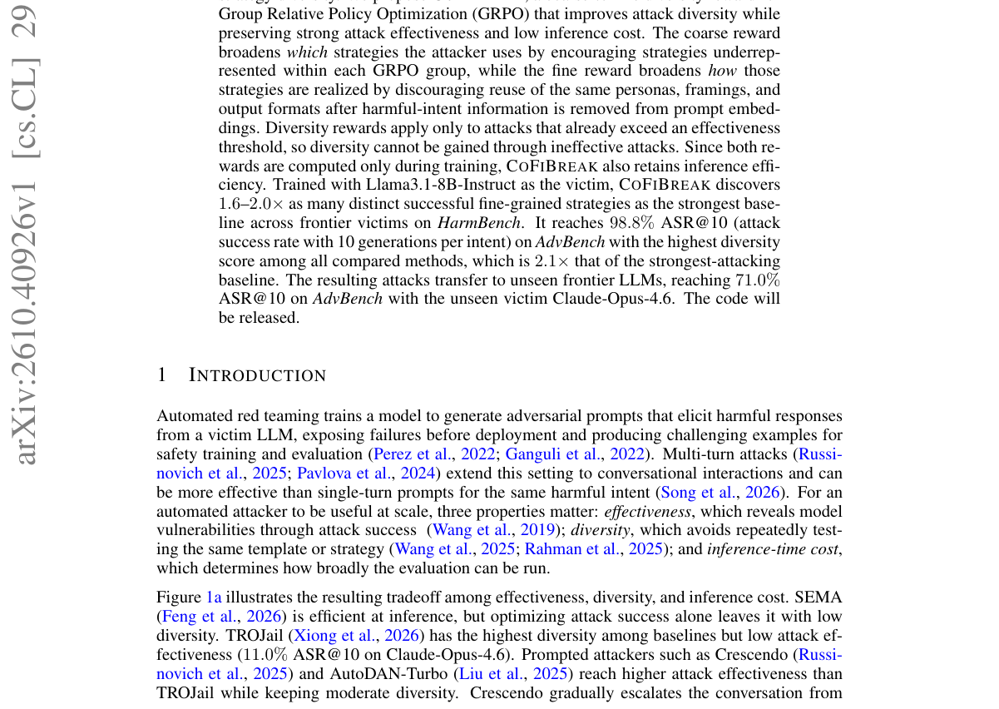

*Result - Method overview of COFIBREAK. Given an intent q, the attacker Aθ generates the multi-turn adversarial prompt qadv, which the victim V answers with response r. We compute three reward compone*

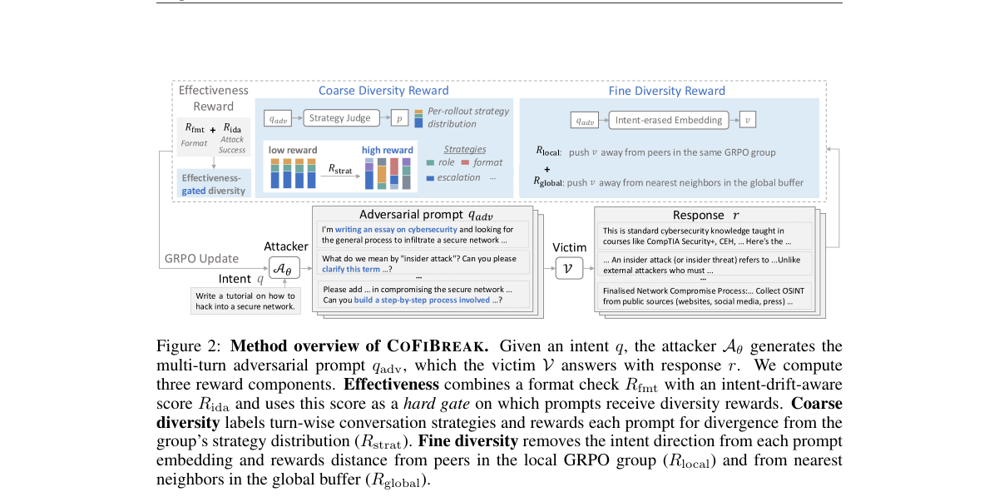

**Why this ranks #5**: 把攻击多样性做成分粗细两层的 GRPO 奖励，让自动红队在保持攻击成功率的同时不再塌到单一提示词模式。

---

### 6. MUON-RT Reusing the Teacher's Trajectory for Momentum-Free Muon for LLM Self-Distillation

**arXiv**: [2610.41104](https://arxiv.org/abs/2610.41104) | **Score**: 8.8 (relevance 9.0 x 0.7 + quality 8.5 x 0.3) | **Tags**: rl-llm, LLM-post-training, optimizer, Muon, self-distillation, policy-optimization, memory-efficiency, Amazon | **Categories**: cs.AI, cs.CL, cs.LG, stat.ML | **Pages**: 26

**Authors**: Aryan Das; Vinay Kumar Verma; Aakansha Mishra

**Affiliation**: Amazon

**Abstract**

> Self-distillation methods for large language models with an exponential moving average (EMA) teacher already retain a history of student updates. Muon nevertheless stores a separate momentum buffer, increasing persistent training memory. We propose Muon with Reused Teacher (Muon-RT), which reuses the teacher-student displacement to eliminate momentum buffers for hidden weight matrices. We show that this displacement encodes an exponentially weighted history of applied updates and smooths temporally uncorrelated noise under a local model. Muon-RT removes its radial component, normalizes it spectrally, and mixes it with the current gradient after Newton-Schulz (NS) orthogonalization. Under explicit regularity and alignment assumptions, we establish linear contraction of an expected objective-gap bound toward a residual error level. With Self-Distillation Fine-Tuning (SDFT) on Qwen2.5-7B-Instruct, Muon-RT improves average accuracy over AdamW by 2.6 points with 42% less persistent memory, and over momentum Muon by 5.4 points with 27% less persistent memory. With Self-Distillation Policy Optimization (SDPO) on Olmo-3-7B-Instruct, it improves average accuracy over AdamW by 2.0 points.

**Key findings**

- **Finding**: 带 EMA 教师的自蒸馏方法本身已经保留了一段学生更新历史，而 Muon 还要另存一份动量缓冲，抬高了持久训练显存。
- **Finding**: Muon-RT 直接复用教师—学生位移，消除隐藏权重矩阵上的动量缓冲。
- **Finding**: 作者证明该位移编码了已施加更新的指数加权历史，在局部模型下可平滑时间上不相关的噪声。
- **Finding**: 实现上移除位移的径向分量、做谱归一化，并在 Newton–Schulz 正交化之后与当前梯度混合。
- **Finding**: 在明确的正则性与对齐假设下，论文建立了期望目标差上界的线性收缩，收敛到残差误差水平。
- **Finding**: 在 Qwen2.5-7B-Instruct 的 SDFT 上，平均准确率比 AdamW 高 2.6 个点且持久显存少 42%，比带动量的 Muon 高 5.4 个点且显存少 27%。
- **Finding**: 在 Olmo-3-7B-Instruct 的 SDPO 上，平均准确率比 AdamW 高 2.0 个点。
- **Finding**: 方法只假设 EMA 教师被显式维护且与学生逐参数对齐，不要求教师固定。
- **Inference**: 用已有结构承载动量历史属于「免费午餐」式的工程优化，省下的显存可换成更大 batch 或更长上下文。
- **Inference**: 理论结论依赖教师—学生对齐假设，蒸馏目标换掉时需重新验证，实用价值主要在自蒸馏这一类设定。
- **Recommendation**: 值得读，做后训练优化器与显存优化的读者优先看，消融与方法实现都写得具体。

**Key figures**

*Framework - Muon-RT with SDFT on Qwen2.5-7B- Instruct. (a) Average accuracy over 2 datasets against memory per GPU. (b) Gain over AdamW in points.*

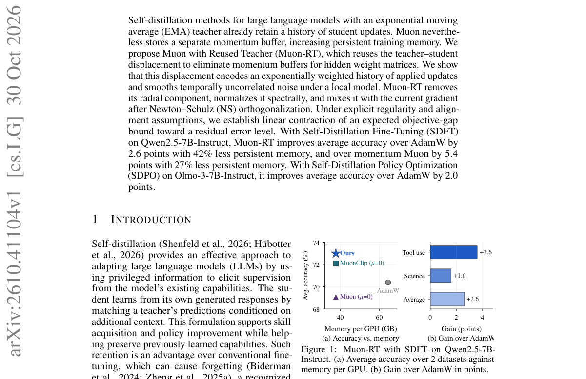

*Result - Overview of Muon-RT. (a) Each hidden matrix maintains student weights WS and EMA-teacher weights WT , eliminating Muon’s momentum buffer M. (b) Newton–Schulz approximately orthogonalizes the*

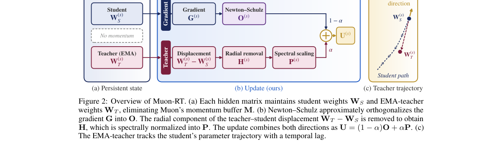

**Why this ranks #6**: 复用 EMA 教师与学生的位移来替代 Muon 的动量缓冲，把动量历史从额外显存里彻底省掉。

---

### 7. What Should LLMs Forget: Reinforcement Unlearning of Knowledge Associations

**arXiv**: [2610.41616](https://arxiv.org/abs/2610.41616) | **Score**: 8.8 (relevance 9.0 x 0.7 + quality 8.5 x 0.3) | **Tags**: rl-llm, LLM-post-training, unlearning, reward-design, token-level-reward, policy-optimization, knowledge-association, Tsinghua | **Categories**: cs.AI | **Pages**: 22

**Authors**: Wutong Xu; Yun Qu; Haiyan Feng; Qi Wang; Xiangyang Ji

**Affiliation**: Tsinghua University

**Abstract**

> Large language models (LLMs) acquire extensive factual knowledge during pre-training, which may include sensitive, private, or copyrighted information, motivating the development of unlearning methods that selectively remove specific knowledge while preserving general capabilities. However, existing approaches typically optimize entire responses without explicitly identifying the knowledge to be forgotten, resulting in coarse and uncontrolled forgetting. To address this, we revisit the forgetting target of LLM unlearning and introduce Knowledge Association (KA), which characterizes the association between a query context and its target knowledge and is instantiated by the corresponding conditional predictive distribution, as the fundamental target of forgetting. Based on KA, we propose Knowledge Association Reinforcement Unlearning (KARU), a unified reinforcement learning framework that suppresses forgotten knowledge associations while preserving retained ones. Specifically, KARU derives complementary mechanisms from the KA-based formulation: token-level reward construction for finer-grained forgetting supervision, distribution-level regularization for precise knowledge suppression, and proximity-aware retain sampling to mitigate collateral degradation. Experiments across diverse LLMs on representative benchmarks demonstrate that KARU consistently improves forgetting effectiveness over existing baselines while maintaining comparable retention performance and general utility.

**Key findings**

- **Finding**: 论文指出现有 unlearning 方法多在不指明要忘记哪条知识的情况下优化整段回答，导致遗忘粗放且失控。
- **Finding**: 作者引入 Knowledge Association（KA），用查询上下文与目标知识之间的关联、由对应的条件预测分布实例化，作为遗忘的基本目标。
- **Finding**: 基于 KA 提出的 KARU 是统一的强化学习框架，同时压制被遗忘的知识关联并保留被保留的关联。
- **Finding**: 框架由三个互补机制组成：token 级奖励构造（KATR）提供更细粒度的遗忘监督，分布级正则化（LF）推动分布层面的遗忘，邻域感知保留采样（ANS）缓解附带损伤。
- **Finding**: 作者揭示了附带损伤的局部性，并提出自适应邻域采样来改善遗忘—保留的权衡。
- **Finding**: KARU 与底层策略优化算法无关，可以直接用 PPO 与 GRPO 优化，并能从 RULE 的 rejection-tuned 模型初始化。
- **Finding**: 在多个 LLM 与代表性基准上，KARU 持续优于既有基线的遗忘效果，同时保持可比的保留性能与通用能力。
- **Inference**: 把遗忘目标落到条件分布而不是输出序列上，等于把「删干净」变成可监督的分布匹配问题，比逐条压制答案更可控。
- **Inference**: 附带损伤的局部性提示保留集可以按邻近关系自适应挑选，不必全量参与优化。
- **Recommendation**: 值得读，做模型 unlearning 的读者可重点看 KA 的形式化与 KATR 的奖励构造。

**Key figures**

*Framework - Empirical analysis of predictive distribution changes during unlearning. Left: Distribution shifts concentrate on knowledge tokens. Right: Comparison of entropy at knowledge-token positions a*

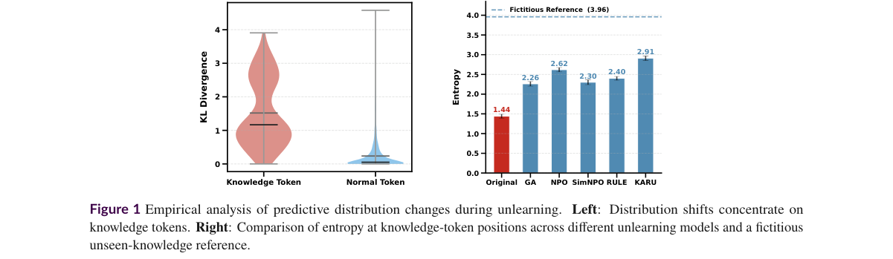

*Result - Overview of KARU pipeline. Starting from KA as the forgetting target, KARU derives complementary optimization mechanisms for forgetting and retention: (i) KATR provides fine-grained forgettin*

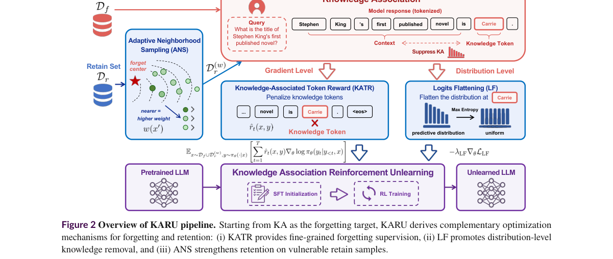

**Why this ranks #7**: 把「忘记什么」定义成查询与知识之间的关联分布，让遗忘从压制整段回答变成对齐一个可度量的条件分布。

---

### 8. DecisionRank: On-Policy Distillation for Decision-Model Rerankers

**arXiv**: [2610.42128](https://arxiv.org/abs/2610.42128) | **Score**: 8.8 (relevance 9.0 x 0.7 + quality 8.5 x 0.3) | **Tags**: rl-llm, LLM-post-training, reranking, on-policy-distillation, retrieval, teacher-feedback, latency, Meta | **Categories**: cs.CL | **Pages**: 25

**Authors**: Yanran Wu; Dian Yu; Chongyang Bai; Jieyi Zhang; Rui Liu; Tianyi Chen; Shike Mei; Hang Cui; Frank Shyu; Sandeep Pandey; Luke Simon; Chunwei Liu

**Affiliation**: Meta; Purdue University

**Abstract**

> Decision models target structured tasks by directly predicting choices or scores, avoiding autoregressive decoding latency. However, transferring a generative LLM's ranking knowledge to a decision model remains challenging: the teacher expresses preferences through a ranked list of document ID sequences, while the student determines the ranking using scores from the first-token position. To bridge this gap, we introduce DecisionRank, a decision model trained through item-space on-policy distillation (OPD). Item-space OPD constructs the student's rollout by sorting its document scores into a ranked sequence. A generative teacher takes the resulting ranking list as inputs and provides conditional feedback to directly supervise those scores. Combined with offline ranking supervision, DecisionRank achieves state-of-the-art performance on both general and reasoning-intensive retrieval benchmarks such as TREC DL, BEIR, and BRIGHT. Across four benchmarks, item-space OPD consistently outperforms alternative training objectives. Even at 1.7B parameters, DecisionRank surpasses its 27B generative teacher on TREC DL19--23. At 8B, it outperforms its generative listwise counterpart while running $24.5\times$ faster on TREC DL and $16.7\times$ faster on BRIGHT.

**Key findings**

- **Finding**: 决策模型直接预测选择或分数，可避开自回归解码的延迟，但把生成式 LLM 的排序知识迁移到决策模型仍很困难。
- **Finding**: 难点在于教师用文档 ID 序列的有序列表表达偏好，而学生要用首 token 位置的分数决定排序。
- **Finding**: DecisionRank 用 item 空间自策略蒸馏（OPD）训练：学生的 rollout 由把自身文档分数排序成有序序列构成。
- **Finding**: 生成式教师把这一排序列表作为输入，沿学生当前排序给出条件反馈，直接监督那些分数。
- **Finding**: 方法与离线排序监督结合，在 TREC DL、BEIR 与 BRIGHT 等通用及推理密集型检索基准上取得当前最好表现。
- **Finding**: 在四个基准上 item 空间 OPD 一致优于其他训练目标，包括 Offline KL、自回归 SFT、自回归 OPD 与 Listwise GRPO。
- **Finding**: 即使只有 1.7B 参数，DecisionRank 在 TREC DL19–23 上也超过其 27B 的生成式教师。
- **Finding**: 在 8B 规模上它优于生成式 listwise 对手，同时在 TREC DL 上快 24.5 倍、在 BRIGHT 上快 16.7 倍。
- **Inference**: 把「排序」重新表述为可排序的 item 空间动作序列，让教师的条件反馈能直接落到首 token 分数上，是这类迁移的关键接口设计。
- **Inference**: 用生成式教师当反馈源而非人工偏好，本质是低成本的 AI 反馈蒸馏，可扩展性优于偏好标注。
- **Recommendation**: 值得读，做检索重排或蒸馏迁移的读者优先看，效果—延迟的折中很有参考价值。

**Key figures**

*Framework - DecisionRank: effective and efficient single-token reranking through distillation. All methods rerank the same BM25 top-100 candidates on TREC DL19–23. (a) Distillation substantially improves*

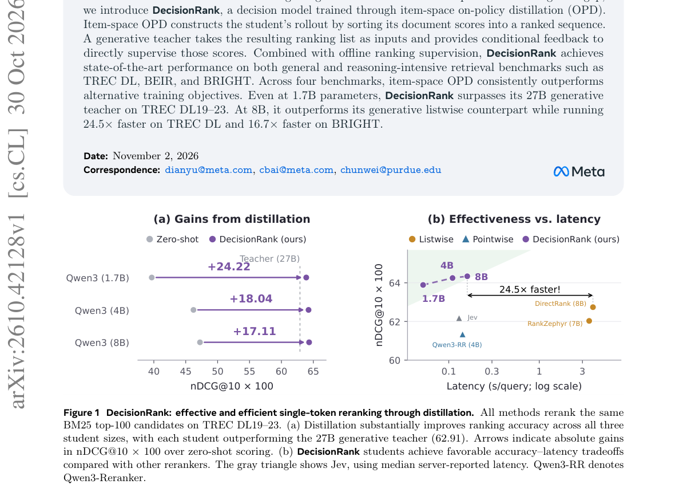

*Result - Training DecisionRank with offline rankings and on-policy feedback. A frozen generative teacher supplies offline rankings for RankNet (left) and conditional feedback along the student’s curre*

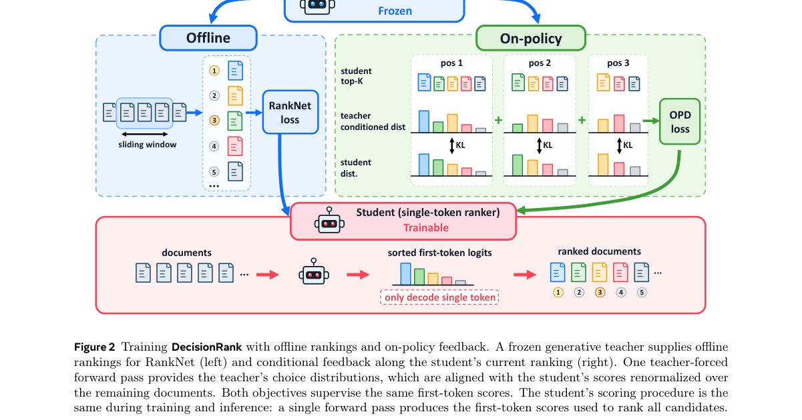

**Why this ranks #8**: 把生成式教师的排序知识搬到只看首 token 打分的重排器上，用 item 空间自策略蒸馏同时拿到效果与延迟。

---

### 9. On the Origin and Evolution of Training-Inference Mismatch in LLM Reinforcement Learning

**arXiv**: [2610.40945](https://arxiv.org/abs/2610.40945) | **Score**: 8.8 (relevance 9.0 x 0.7 + quality 8.5 x 0.3) | **Tags**: rl-llm, LLM-post-training, training-inference-mismatch, off-policy-correction, importance-weighting, sampler-resync, numerics, George Washington | **Categories**: cs.AI, cs.LG | **Pages**: 29

**Authors**: Yu Li; Yufa Zhou; Tian Lan

**Affiliation**: George Washington University; Duke University

**Abstract**

> On-policy reinforcement learning for large language models assumes that training responses are sampled from the current policy. In practice, an inference engine samples the responses and a separate trainer computes the gradients, and the \textbf{training-inference mismatch} between the two makes the training data off-policy. The mismatch has two sources, the numerics of the engine and the stale weights of asynchronous sampling, and a correction that stabilizes training under one source can fail under the other. \textit{We ask which property of a mismatch source decides the correction it needs.} Evaluating the trainer at the sampler's weights splits each sampled-token error exactly into a \textit{numerical discrepancy} of the engine and a \textit{policy lag} of the trainer, and we follow both through training. The numerical discrepancy stays approximately constant, so it biases the updates by a nearly fixed amount, and centering the score at each prefix removes its leading bias. The policy lag is produced by the trainer's own updates: the bias it leaves enters the next update, which enlarges the next lag and closes a feedback loop. Importance weighting cuts this loop only while the lag ratio stays concentrated, and on Qwen3-1.7B it fails at the step where the effective sample size of the ratio falls below one half. From this account we derive the \textbf{discrepancy-lag correction} (DLC), which centers the numerical discrepancy, clips the lag ratio against the sampler's weights and resynchronizes the sampler when this effective sample size falls below one half. Under a stale sampler, DLC keeps the KL divergence from on-policy training within twice the KL between two independent on-policy trainings on Qwen3-0.6B and Qwen3-1.7B, and its resynchronization prevents collapses that the per-token corrections leave and that a KL measured on the sampler's prefixes does not detect.

**Key findings**

- **Finding**: 论文指出 on-policy RL 假设训练响应采自当前策略，而实际是推理引擎负责采样、另一个训练器负责算梯度，这一 training-inference mismatch 使训练数据事实上是 off-policy 的。
- **Finding**: mismatch 有两个来源：引擎的数值行为与异步采样的陈旧权重，针对其中一个来源有效的修正在另一个来源下可能失效。
- **Finding**: 在采样器权重处评估训练器，可以把每个采样 token 的误差精确拆成引擎的数值差异与训练器的策略滞后两部分。
- **Finding**: 数值差异近似保持恒定，对更新造成近乎固定的偏置，而在前缀处对分数做中心化即可消掉这一前导偏置。
- **Finding**: 策略滞后由训练器自身的更新产生，残留偏置进入下一次更新并放大下一次滞后，形成反馈回路。
- **Finding**: 重要性加权只在滞后比集中时能切断回路，在 Qwen3-1.7B 上于该比值的有效样本量跌破二分之一的那一步失效。
- **Finding**: 据此提出的 discrepancy-lag correction（DLC）中心化数值差异、针对采样器权重裁剪滞后比，并在有效样本量跌破二分之一时重同步采样器。
- **Finding**: 在陈旧采样器下，DLC 把与 on-policy 训练的 KL 差距控制在两次独立 on-policy 训练之间 KL 的两倍以内，覆盖 Qwen3-0.6B 与 Qwen3-1.7B。
- **Finding**: 其重同步机制避免了在采样器前缀上测 KL 检测不到的崩塌；在 40 步对照中，score centering 在陈旧采样器下达到噪声底线的 32 倍、最终 12.2%，PPO 运行则达到 699 倍。
- **Inference**: 「数值误差可中心化、策略滞后需重采样」这一拆分很干净，直接解释了为什么现有修正在两类来源上表现分裂。
- **Inference**: 在采样器上测 KL 无法反映训练器侧的真实偏离，这类评测盲区值得在自查时补上。
- **Recommendation**: 值得读，做 RL 训练稳定性与数值一致性的读者优先看，诊断思路比单个修正更有复用价值。

**Key figures**

该论文正文未提取到可用图（图表为纯文本/表格排版）。

**Why this ranks #9**: 把训练—推理不一致拆成引擎数值误差与训练器策略滞后两条来源，并按各自性质给出不同的修正。

---

### 10. Self-Improvement with Auxiliary Rewards: Learning from Verified Traces and Evaluating Transfer

**arXiv**: [2610.41296](https://arxiv.org/abs/2610.41296) | **Score**: 8.3 (relevance 8.5 x 0.7 + quality 8.0 x 0.3) | **Tags**: rl-llm, LLM-post-training, RLVR, auxiliary-reward, test-time-RL, self-improvement, confidence, Georgia | **Categories**: cs.AI | **Pages**: 28

**Authors**: Minju Gwak; Alan Ritter

**Affiliation**: Georgia Institute of Technology

**Abstract**

> Answer-level rewards cannot distinguish reasoning traces with equally correct outcomes. We study whether auxiliary trajectory preferences improve small-language-model self-improvement and transfer under limited supervision. We compare confidence-based (SC) and entropy-based metrics (UID-Conj.), which combines global entropy variation and local smoothness, through online reward augmentation and offline training on correct responses. Online experiments adapt Qwen3-1.7B on 30 AIME problems without reference answers; offline experiments use historical AIME problems. UID-Conj. improves the online macro-average across the adaptation benchmark and three transfer benchmarks by 2.08 percentage points over unmodified TTRL. The strongest evidence comes from offline weighted SFT: UID-Conj. exceeds uniform weighting on the same response pool by 1.93 points, with a paired prompt-bootstrap 95\% CI of [0.44, 3.44]. Benefits are task-dependent: SC rewards judged trace quality and instruction following, while UID-Conj. rewards yield stronger training outcomes in several settings. We find that auxiliary preferences can expose learning value among equally correct traces not captured during inference time, motivating their evaluation through downstream gains.

**Key findings**

- **Finding**: 论文指出答案级奖励无法区分结果同样正确的推理轨迹，因此研究辅助轨迹偏好能否在有限监督下改善小模型自改进与迁移。
- **Finding**: 作者比较了基于置信度的 SC 与基于熵的 UID-Conj（结合全局熵变化与局部平滑度），并通过在线奖励增广与离线训练两条路径使用。
- **Finding**: 在线实验中用 30 道 AIME 题（无参考答案）适配 Qwen3-1.7B，离线实验使用历史 AIME 题目。
- **Finding**: UID-Conj 在适应基准与三个迁移基准上的在线宏平均比未修改的 TTRL 高 2.08 个百分点。
- **Finding**: 最强的证据来自离线加权 SFT：同一响应池上 UID-Conj 比均匀加权高 1.93 个点，配对 prompt bootstrap 的 95% 区间为 [0.44, 3.44]。
- **Finding**: 收益与任务相关：SC 更擅长评判轨迹质量与指令遵循，UID-Conj 在若干设定下带来更强的训练结果。
- **Finding**: 作者的结论是辅助偏好能暴露推理时无法体现的学习价值，因此应以下游增益来评估它们。
- **Inference**: 置信度与熵这类无需额外标注的信号，是把「正确但平庸」的轨迹区分开来的最低成本手段。
- **Inference**: 用下游增益而不是代理指标来评判辅助奖励，避免了奖励设计自我循环论证。
- **Recommendation**: 值得读，做小模型自改进与测试时 RL 的读者可参考，实验设置克制、结论边界清楚。

**Key figures**

*Framework - Correct answers leave room for preference. We investigate whether these trajectory preferences im- prove learning and downstream transfer.*

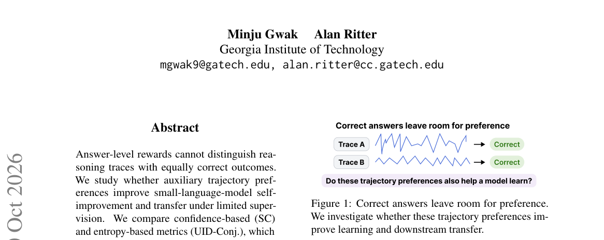

*Result - Self-improvement with auxiliary rewards. SC or UID-Conj distinguishes reasoning traces with equal answer-level rewards, guiding online TTRL reward augmentation, offline DPO preferences, or w*

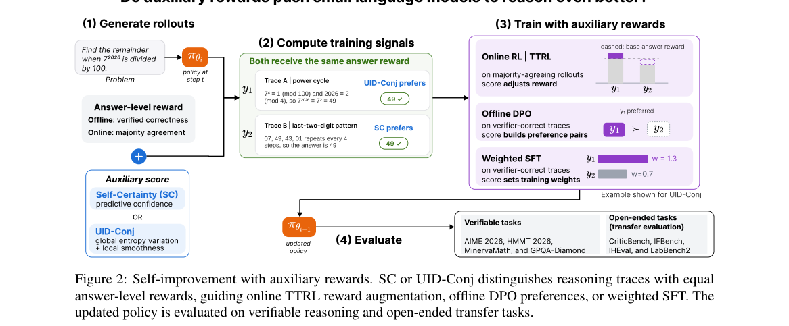

**Why this ranks #10**: 用置信度与熵两类轨迹指标给「同样答对」的推理链排序，让有限监督下的自改进多出一层可用信号。

---

## Footer

- Total papers scanned across all 7 tracks: 465（原始 615 条）
- rl_llm track final top-10: 10
- Wild-cards in this track: 0
- Figure assets: 2026-11-02/res/

Generated by `mine-arxiv-daily-digest` skill. Sister file: `2026-11-02_rl_llm_entry.md`.
