# ArXiv Daily Digest - 2026-11-03 (AIGC 音频生成, 10 papers)

**Generated**: 2026-11-03 17:30 CST

**Source**: arXiv cs.CV, cs.SD, eess.AS, cs.CL, cs.AI, cs.RO, cs.LG submissions, listing day 2026-11-02 (announced 2026-11-03 00:00 UTC)

**Batch window**: 2026-11-01T18:00:00Z .. 2026-11-02T18:00:00Z（arXiv 公告批次横跨两个 UTC 日：前一日 18:00 UTC 起算，当日 17:59:59 UTC 截止）

**Track**: aigc_audio (top 10 of 564 papers scanned, 70 full reads)

**Scope**: 音频 / 语音 / 音乐的生成、合成、编辑与生产工具链，含 TTS、神经音频编码与空间音频

⚠️ **Wild-card**: 本批该线 4 篇为 wild-card 补足，已在正文逐条标注并给出理由。

补足原因：该批次 cs.SD 仅 12 篇、eess.AS 仅 13 篇，真正属于「音频生成 / TTS / 音乐（仅生成）」的论文只有 6 篇，其余 4 篇为声学测量、音频取证、数据标注与音乐交互方向的补位，已在正文逐条标注并给出理由。

---

## Top 10 - AIGC 音频生成

### 1. Zero-Shot Voice Cloning for Synthetic Data Augmentation in Children's ASR

**arXiv**: [2611.03050](https://arxiv.org/abs/2611.03050) | **Score**: 9.2 (relevance 9.5 x 0.7 + quality 8.5 x 0.3) | **Tags**: AIGC-audio, voice-cloning, asr-augmentation, zero-shot-tts, children-speech, data-synthesis, Fraunhofer Institute for Digital Media | **Categories**: eess.AS | **Pages**: 5

**Authors**: Mohammad Mohsen Goodarzi; Stefan Wabnik; Matthias Stennes; Stephanus Volke; Alexander Schwarz

**Affiliation**: Fraunhofer Institute for Digital Media Technology IDMT

**Abstract**

> Children's automatic speech recognition (ASR) lags behind adult ASR due to theacoustic mismatch between adult-trained acoustic models and children's speech, as well as the scarcity of labelled children's speech corpora. We investigate whether zero-shot text-to-speech (TTS) synthesis with voice cloning, requiring only a short reference clip per speaker, can serve as a practical substitute for real children's speech when fine-tuning large pre-trained ASR models. Using the OmniVoice multilingual TTS system we synthesise up to 16,000 child-like utterances from two English corpora (ENNI, clinical narrative samples, ages 7-12, and MyST, conversational science-tutor speech, grades 3-5) and fine-tune Whisper-small under different experimental conditions covering real data, synthetic data, cross-corpus data, and all-data combination. A systematic sensitivity analysis over speaker count, text-pool size, and utterances per speaker reveals that synthetic data alone reduces word error rate (WER) from a 19.8 % zero-shot baseline to 16.4 % on ENNI, recovering approximately 30 % of the gap to real-data fine-tuning (8.8 %). Combining synthetic with real data is essentially indistinguishable from real-data-only fine-tuning (9.2 % vs. 8.8 %). Speaker count plateaus at ~40 speakers for cross-domain transfer, while multi-speaker acoustic diversity per transcript, rather than raw text coverage, emerges as the primary determinant of cross-domain generalisation; out-of-vocabulary (OOV) rate proves to be a poor proxy for WER given Whisper's pre-trained language modelling capacity.

**Key findings**

- **Finding**: 用 OmniVoice 多语种 TTS 从 ENNI（7–12 岁临床叙事）与 MyST（3–5 年级科学辅导对话）两个英文语料合成最多 16,000 条童声，微调 Whisper-small；在 ENNI 上仅用合成数据把 WER 从零样本基线 19.8% 降到 16.4%，回收了到真实数据微调（8.8%）差距的约 30%，合成与真实混合为 9.2%、与纯真实 8.8% 基本无差别；敏感性分析显示跨域迁移的说话人数在约 40 人处饱和，决定跨域泛化的主要因素是每条转写的多说话人声学多样性而非原始文本覆盖，而 OOV 率因 Whisper 自带语言模型能力成为 WER 的劣质代理。
- **Inference**: 这条结论把「合成数据补不上域差」的直觉证伪了——合成数据能把域差补掉三成，与真实数据混合后几乎无损，说明真正稀缺的不是儿童语音的分布而是带标签的样本数量；同时说话人数饱和提示采集端应把预算花在每位说话人的多样本上。
- **Recommendation**: 若做低资源或儿童场景 ASR，可直接用零样本音色克隆构造合成集并按「约 40 位说话人 × 每条转写多说话人采样」的方式组织数据分布；同时不要拿 OOV 率当筛选指标，改用合成集微调后的 WER 反馈来调文本池。

**Why this ranks #1**: 儿童语音识别难的原因之一是语料稀缺，这篇给出一条几乎零成本的替代路线：零样本音色克隆 TTS，只要每位说话人一段短参考音频就能合成上万条童声数据。结论对做数据的人很有参考价值——说话人数量到约 40 就饱和，而每条文本的多说话人声学多样性比文本覆盖量更能决定跨域泛化。

---

### 2. Spatial Transfusion: From Structured Spatial Scene Understanding to Generation and Editing

**arXiv**: [2611.02330](https://arxiv.org/abs/2611.02330) | **Score**: 9.0 (relevance 9.0 x 0.7 + quality 9.0 x 0.3) | **Tags**: AIGC-audio, spatial-audio, ambisonics, flow-matching, lora-routing, audio-editing, Carnegie Mellon University | **Categories**: cs.AI, cs.SD, eess.AS | **Pages**: 5

**Authors**: Jaeyeon Kim; Sebastian Braun; Hannes Gamper

**Affiliation**: Carnegie Mellon University; Microsoft Corporation

**Abstract**

> Spatial audio conveys not only what sounds are present, but where they originate and how they interact with the environment. Recent audio-language models increasingly understand and reason about such scenes, yet spatial audio understanding, generation, and editing remain largely separate. We present Spatial Transfusion, a unified first-order ambisonics (FOA) framework that extends a pretrained spatial audio understanding model to generation and editing through flow matching over VAE latents. We formulate editing as a structured scene transformation over a taxonomy of atomic edits. Keeping the pretrained backbone frozen, we introduce modality-based LoRA routing and a curriculum that progressively adds generation, editing, and natural-language interaction. Experiments show that Spatial Transfusion largely preserves spatial understanding while outperforming full fine-tuning in generation and editing. The resulting model supports controllable FOA generation and editing through both structured and natural-language interfaces. Audio samples are available at https://microsoft.github.io/spatial-transfusion/

**Key findings**

- **Finding**: Spatial Transfusion 基于 Sci-Phi 变体构建，冻结共享 Transformer 骨干并用 VAE 潜空间流匹配做生成与编辑，引入模态路由 LoRA 与课程（Stage 3 保留 1.0M 数据、Stage 4 用 GPT-5.4-mini 扩到自然语言问答）；生成上 FAD-PSELD 从全量微调的 3.82 降到 0.964、FAD-CLAP 从 379 降到 229、CLAP-TA 从 0.232 升到 0.264（FOA-VAE 重建上界为 0.103 / 47.6 / 0.340 / 0.013）；编辑上 EditFLAM 17.8、FAD-PSELD 0.323、CLAP-AA 0.841、CLAP-TA 0.306，优于全量微调的 15.5 / 0.596 / 0.795 / 0.275，接近真值上界 28.9 / 0.000 / 0.913 / 0.344；理解能力基本保持，路由消融显示按模态路由最均衡。
- **Inference**: 冻结骨干加模态路由 LoRA 在「多模态共享结构、训练数据各不相同」的场景下比全量微调更优，说明全量微调在这类扩展里主要在破坏预训练的空间理解先验；这套「骨干冻结 + 模态路由 + 课程」也是给已有音频大模型加新能力的可复用模板。
- **Recommendation**: 想给已有音频大模型加生成或编辑能力时，优先试模态路由 LoRA 加分阶段课程，而不是全量微调；评测按论文口径分开报 FAD-PSELD（空间语义保真）、FAD-CLAP（音频保真）与 CLAP-TA（文本对齐），并保留理解任务的指标做回归检查。

**Key figures**

*Framework - Overview of Spatial Transfusion. A shared Transformer backbone serves (a) understanding with a cross-entropy loss on text, and (b) generation and (c) editing with a flow-matching loss on targe*

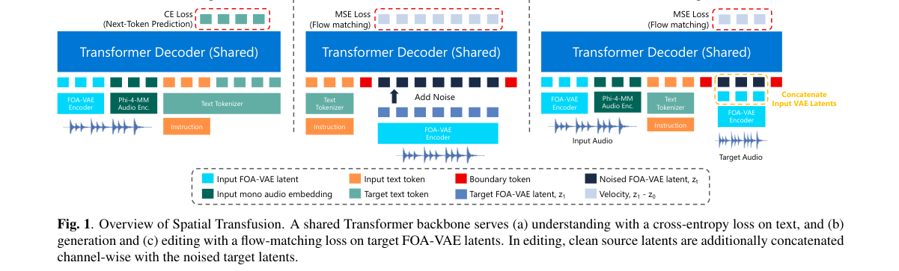

*Result - Structured representations used in Stages 1–3. (a) A scene description lists directional sources with their attributes plus room and background fields; it is the understanding output and the g*

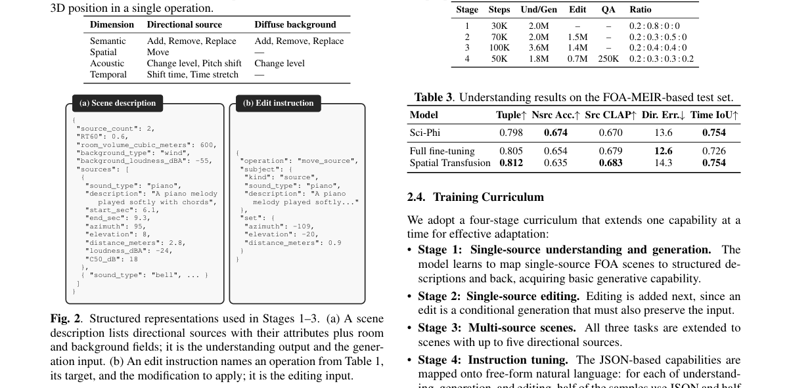

**Why this ranks #2**: 空间音频的理解、生成与编辑长期是三件事，这篇把它们接进同一个首阶 ambisonics 框架：在一个冻结的空间音频理解模型上用 VAE 潜空间的流匹配扩展出生成与编辑能力。它的关键工程选择是模态路由 LoRA + 分阶段课程——冻结骨干、按模态分派 LoRA、逐步加入生成/编辑/自然语言交互。结果是在几乎不损失空间理解的前提下，生成与编辑都优于全量微调。

---

### 3. High Frequency Safeguard and Weighted Objective Scoring Bandwidth Extension

**arXiv**: [2611.02235](https://arxiv.org/abs/2611.02235) | **Score**: 8.8 (relevance 9.0 x 0.7 + quality 8.5 x 0.3) | **Tags**: AIGC-audio, bandwidth-extension, adversarial-training, swin-transformer, perceptual-quality, discriminator-design, [unverified] | **Categories**: cs.SD, eess.AS | **Pages**: 9

**Authors**: Tarikul Islam Tamiti; Sajid Fardin Dipto; Anomadarshi Barua

**Affiliation**: [unverified]

**Abstract**

> Speech Bandwidth Extension (BWE) reconstructs missing high frequencies from a band-limited signal. Please note that perceptually important information is often concentrated in short high-frequency (HF) events. Therefore, an effective BWE requires both accurate HF generation and explicit control over where, how often, and in what spectral form HF energy should be produced. To address the above HF supervision, we present HFSWO, a compact complex-spectral Swin-based dual-stream adversarial framework with two newly proposed specialized discriminators: 1. High-Frequency Safeguard Discriminator (HFSD) converts excessive framewise HF-energy ratios into a differentiable safeguard-constraint penalty optimized through a projected primal--dual augmented-Lagrangian update; 2. Weighted Objective Scoring Discriminator (WOSD) learns an interpretable convex objective scoring over spectral flatness, centroid, and rolloff. Our rigorous experiments on VCTK English and MLS French datasets across multiple frequency ranges, including noisy conditions, show significantly improved perceptual scores with 74.6% fewer parameters than the existing baseline AP-BWE, establishing a new baseline in the BWE task in multilingual and multispeaker setups.

**Key findings**

- **Finding**: HFSWO 是复频谱 Swin 双流对抗框架，提出两个专用判别器——高频保护判别器 HFSD 把逐帧高频能量比超限量转成可微约束罚项并用投影原始—对偶增广拉格朗日更新优化，权重目标评分判别器 WOSD 对谱平坦度、质心与滚降学习可解释的凸目标评分；实验覆盖 VCTK 英文与 MLS 法文、多频率范围并含噪声条件，验证 4–16 kHz 高频成分被有效恢复，感知指标显著提升；相对最强基线 AP-BWE 少 74.6% 参数、少 63.6% MACs 与 FLOPs，效率来自紧凑的一维 Swin 生成器与新设计的判别器，作者称首次证明专用高频监督可作为参数高效 BWE 的有效归纳偏置。
- **Inference**: 把「高频不该被凭空造出来」显式写成能量约束而不是交给对抗损失自发平衡，是在语音这种高频稀疏信号上更稳的做法；判别器结构差异带来的参数收益说明 BWE 方向的模型容量此前被浪费在了低频冗余上。
- **Recommendation**: 复现时建议先实现 HFSD 的约束项并单独观察高频能量比随训练的变化，再接 WOSD；评测除常规感知指标外，务必加上高频能量比与 4–16 kHz 频段恢复的定性检查，否则容易被整体 MOS 掩盖过量高频的问题。

**Key figures**

*Framework - Architecture of (a,b) Swin-1D stacks, CSF, and newly proposed discriminators - (c) HFSD and (d) WOSD.*

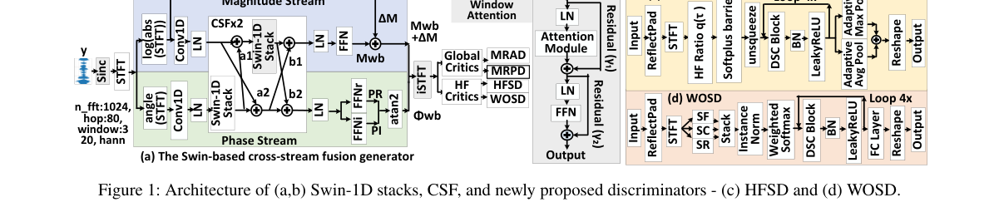

*Result - Proof of recovered HF components for 4–16 kHz.*

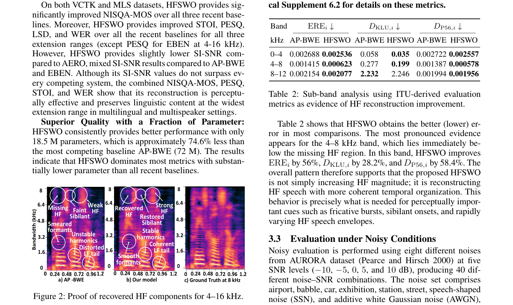

**Why this ranks #3**: 带宽扩展真正难的地方在于高频信息集中于短暂的瞬态事件，模型既要重建得准，又要能控制高频能量出现在哪里、出现多频繁、呈什么频谱形态。这篇把这两个约束做成两个专门判别器：高频保护判别器把逐帧高频能量超限量化为可微的约束罚项，权重目标评分判别器则对平坦度、质心和滚降这类可解释谱特征打分。结果是在多语种多说话人设定下用少一大截参数赢了基线。

---

### 4. Q-BWE: Quantum Chaos-Informed Speech Bandwidth Extension

**arXiv**: [2611.02250](https://arxiv.org/abs/2611.02250) | **Score**: 8.3 (relevance 8.5 x 0.7 + quality 8.0 x 0.3) | **Tags**: AIGC-audio, bandwidth-extension, quantum-inspired, discriminator-design, feature-interaction, parameter-efficiency, [unverified] | **Categories**: cs.SD | **Pages**: 38

**Authors**: Tarikul Islam Tamiti; Sajid Fardin Dipto; David Vergano; Luke Baja-Ricketts; Anomadarshi Barua

**Affiliation**: [unverified]

**Abstract**

> High-frequency reconstruction in bandwidth extension (BWE) depends on joined interactions among nonlinear spectral, temporal, and perceptual features; assigning a separate discriminator to each such feature may be redundant and may fail to model their joint interactions. We introduce quantum-informed generative model Q-BWE, where we design a five-qubit Quantum Chaos Discriminator (QCD) instead of using separate discriminator for every features, for modeling nonlinear joined-feature interactions efficiently. Our QCD explores a compact five-qubit quantum-inspired inductive bias based on data re-uploading circuit, trainable controlled NOT (CNOT) rotations, quantum entangling gates, and statevector measurement map. Five features for five qubits are selected from a 26-dimensional speech-dynamics bank and are encoded by a two-layer statevector circuit, producing 31 measurements map of local behavior, correlations, mixedness, and Born entropy. QCD guides a Lattice-ConformerNeXt generator with FiLM conditioning and a cosine-masked residual pathway, while delayed-reward Thompson sampling adaptively controls its contribution. The circuit is simulated on classical hardware. Overall, Q-BWE achieves competitive performance on VCTK English, and MLS French datasets in multilingual and multi speaker setups under clean and noisy conditions across a broad set of evaluation metrics with approximately 1.72x fewer parameters (33.5M vs. 19.4M) compared to recent CIS-BWE baseline published in ACL.

**Key findings**

- **Finding**: Q-BWE 用五量子比特 Quantum Chaos Discriminator 取代逐特征判别器：从 26 维语音动力学特征库中自动选出 5 个特征送入两层态矢量线路（数据重上传电路、可训练 CNOT 旋转、量子纠缠门、态矢量测量），产生 31 维测量覆盖局部行为、相关性、混合度与 Born 熵；判别器仅作训练期 critic，生成器为带 FiLM 条件与升余弦掩码残差路径的 Lattice-ConformerNeXt，其贡献权重由延迟奖励 Thompson 采样自适应调节；线路在经典硬件上模拟；在 VCTK 英文与 MLS 法文、多语种多说话人、含噪声条件下取得有竞争力的表现，参数量约 19.4M，相对 ACL 上 CIS-BWE 基线的 33.5M 少约 1.72 倍。
- **Inference**: 用一个联合建模器替代多个单特征判别器，说明在 BWE 这类特征强耦合的问题上，特征选择的组合空间比判别器的表达形式更关键；作者同时强调电路经典可模拟，意味着这类量子启发结构的收益主要来自归纳偏置与特征交互约束，而非真实量子算力。
- **Recommendation**: 想试这条路线，先复现 26 维特征库加自动选 5 维的流程并检查选中的特征是否稳定可解释，再接生成器；训前务必确认 19.4M 与 33.5M 两个参数量口径一致（含判别器与否），否则效率结论无法对齐。

**Key figures**

*Framework - Overall Q-BWE architecture with FiLM conditioning and raised cosine mask and QCD.*

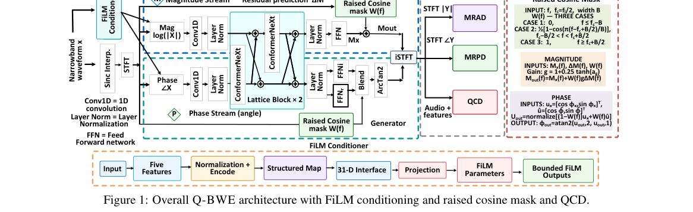

*Result - Overall QCD architecture: feature-bank selection, normalization, bounded angle encoding, simulated statevector map, and the scorer and matching heads.*

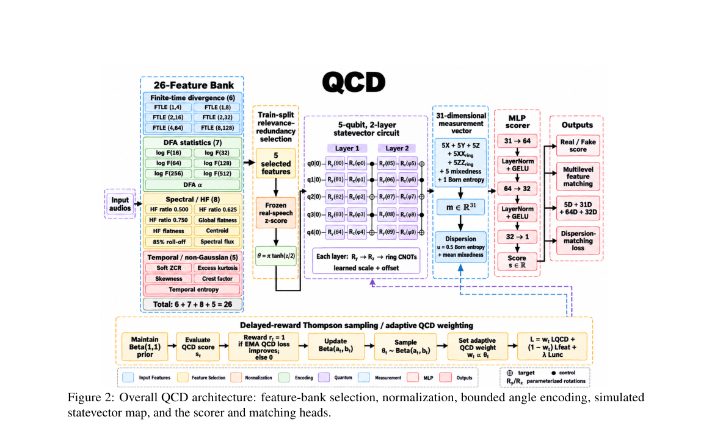

**Why this ranks #4**: 同一组作者的姊妹篇，把 BWE 判别器的问题又推了一步：高频重建依赖非线性谱、时间与感知特征的联合交互，给每个特征配一个判别器既冗余又学不动联合关系。这篇用一个五量子比特的 Quantum Chaos Discriminator 统一建模，数据重上传线路加可训练 CNOT 旋转与态矢量测量，把 26 维特征库里最相关的 5 维映射成 31 维测量。思路前沿但代码可跑、电路在经典硬件上模拟。

---

### 5. A Compact Statistical View of Musical-Instrument Directivity

**arXiv**: [2611.02927](https://arxiv.org/abs/2611.02927) | **Score**: 8.0 (relevance 8.0 x 0.7 + quality 8.0 x 0.3) | **Tags**: AIGC-audio, instrument-directivity, spatial-audio, data-compression, acoustics, wave-field-synthesis, Politecnico di Milano | **Categories**: cs.SD, eess.AS, physics.class-ph | **Pages**: 10

**Authors**: Gioele Greco; Mirco Pezzoli; Raffaele Malvermi; Gian Marco Ricci; Fabio Antonacci

**Affiliation**: Politecnico di Milano

**Abstract**

> Directivity is a defining feature of musical-instrument radiation and is known to vary strongly with frequency. With the growing availability of measured directivity datasets and their use in sound-field simulation and spatial audio, there is a practical need for representations that are both compact and comparable across sources. This work addresses that need by proposing a statistically grounded description of frequency-dependent directivity that reduces complex radiation patterns to a small set of meaningful descriptors. The approach enables directivity patterns to be summarized in an interpretable way and compared consistently across frequency bands, even when the radiation is not well described by a single dominant direction. The resulting representation supports tasks such as analysis, categorization, and model building, providing a bridge between detailed measurements and higher-level descriptors useful for musical acoustics and audio rendering. Experiments on a corpus of 41 orchestral instruments show that the proposed method preserves the distance geometry well while reducing the full order-4, 30-band corpus from about 492~kB to about 100~kB in double-precision storage.

**Key findings**

- **Finding**: 论文提出基于统计的频率相关指向性描述方法，把复杂的辐射图案压缩为少数可解释描述子，支持跨频段一致比较，即使辐射不存在单一主导方向也适用；在 41 件管弦乐器、四阶 30 频带的完整语料上，双精度存储从约 492 kB 降到约 100 kB，同时较好保持距离几何；逐点压缩比为 50% 工作点约 6.3 倍、70% 约 4.9 倍、90% 约 2.5 倍、95% 约 1.7 倍；作者明确指出该表示面向分析、归类与建模等任务，充当详细测量与更高层描述子之间的桥梁。
- **Inference**: 指向性数据是空间音频渲染里体量最大、最难共享的资产，压缩比与距离几何保持率一起给出，说明这套描述子可作为乐器数据集的交换格式；对做音乐声学或乐器音色建模的人，它把「存全量高阶指向性」变成可行选项。
- **Recommendation**: 若要做乐器音色或房间声学模拟，可按论文的描述子方案先对目标乐器库做压缩并在 70% 工作点验证距离几何误差；注意这是描述性统计表示而非可微渲染模块，若要接进生成管线需自行补上从描述子到可渲染幅度的重建环节。

**Key figures**

*Framework - Example of a directivity pattern of a Genelec 8030A loudspeaker at 1.4 kHz taken from.16 The*

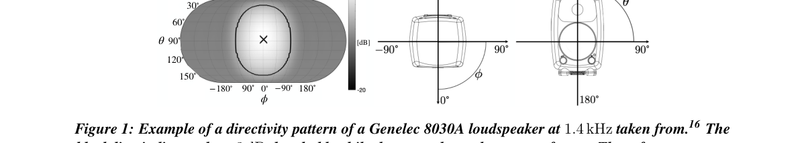

*Result - states the core result of the paper. The mean compression factor is about 6.3 at 50%, 4.9 at 70%, 2.5 at 90%, and 1.7 at 95%. The 70% operating point therefore reduces the full order-4 corpus*

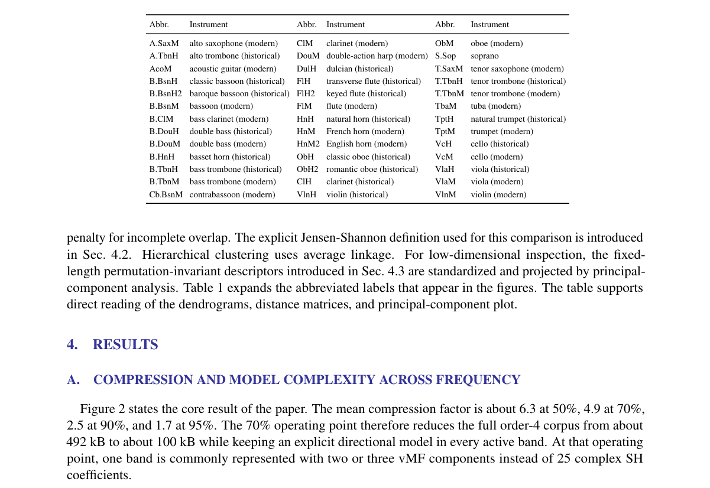

**Why this ranks #5**: 补位说明：本批次「音频生成 / TTS / 音乐（仅生成）」方向的硬核供给不足 10 篇，这篇是同属音频线、但偏乐器辐射特性与空间渲染的论文，用来补足名额。它不生成音频，但做的是这条线上最缺的那块地基：把 41 件管弦乐器的四阶 30 频带指向性语料从约 492 kB 压到约 100 kB 且保持距离几何，给出跨乐器可比较的统计描述子。任何乐器音色合成或房间模拟的前端都能受益，值得作为上游参考一看。  [wild-card=yes] 该论文是乐器辐射指向性的统计刻画与声场建模，属于声学测量与建模底座而非生成模型，补位计入。

---

### 6. Ananas: A Networked Audio System for Distributed Spatial Audio Applications

**arXiv**: [2611.03077](https://arxiv.org/abs/2611.03077) | **Score**: 8.0 (relevance 8.0 x 0.7 + quality 8.0 x 0.3) | **Tags**: AIGC-audio, spatial-audio, networked-audio, ptp-synchronisation, ambisonics, wave-field-synthesis, Inria | **Categories**: cs.SD, eess.AS | **Pages**: 7

**Authors**: Thomas Rushton; Romain Michon; Tanguy Risset

**Affiliation**: Inria; INSA Lyon

**Abstract**

> Spatial audio has an accessibility problem. Largescale spatial and immersive audio installations remain costly and exclusive, with high barriers to entry. We propose ''Ananas,'' a networked audio system consisting of network protocols, control software and microcontroller firmware, with the aim of rendering spatial audio applications accessible to a broad cohort of potential users. Based on a network of low-cost microcontroller development boards programmed in the Faust programming language, synchronised to nanosecond order via IEEE 1588 Precision Time Protocol, and controlled by approachable, digital audio workstation-based tooling, Ananas represents an opportunity to disrupt and democratise the spatial audio landscape. In this paper we demonstrate Ananas's protocols for audio and control data transmission and device discovery, its methods for media clock and presentation time recovery, and its applications to wave field synthesis and higher order ambisonics in a modular, scalable form.

**Key findings**

- **Finding**: Ananas 包含网络协议、控制软件与微控制器固件三层：基于低成本微控制器开发板（iMXRT1062，含专用音频子系统与 SAI1 时钟分频寄存器）、用 Faust 编程，经 IEEE 1588 PTP 实现纳秒级模块间同步，并以多播 UDP 承载音频与控制数据传输及设备发现；论文给出媒体时钟与呈现时间恢复方法（含漂移 α、时延 δ 与偏移 θ 的估计与 PI 环路补偿），并演示了波场合成与高阶 ambisonics 两种应用的可模块化扩展形态，作者定位其为对现有毫秒级同步系统与闭源专有方案的低门槛替代。
- **Inference**: 把同步精度从毫秒级推到纳秒级，让分布式波场合成这类依赖严格时间对齐的空间音频技术第一次有了可负担的实现路径，这对音乐厅级装置与沉浸式现场演出的意义远大于对生成算法本身的意义。
- **Recommendation**: 要搭分布式空间音频系统，可直接以该设计为基线：先在 PTP 主从网络上实测跨节点抖动与呈现时间偏差，再评估波场合成与高阶 ambisonics 各自的硬件需求；若只做小规模部署，可先按论文的媒体时钟恢复逻辑确认丢包与多播抖动下的表现。

**Key figures**

*Result - PTP packet flow.*

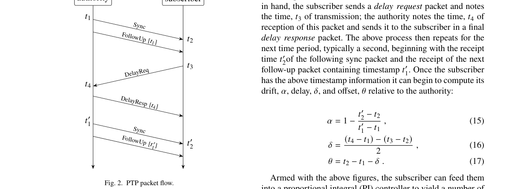

**Why this ranks #6**: 空间音频的门槛在于硬件：大型沉浸式系统贵且封闭，这篇把整套东西做成低成本开源方案——用 Faust 编程的微控制器开发板组网，靠 IEEE 1588 精密时间协议做到纳秒级模块间同步，并用多播 UDP 处理媒体时钟与呈现时间恢复。对做生成式音频落地的人，它回答的是生成之后如何在大空间里低延迟、可扩展地播出来这个常被忽略的工程问题。

---

### 7. VidDub: Replacement-Aware Distillation for Two-Step Video Dubbing

**arXiv**: [2611.03404](https://arxiv.org/abs/2611.03404) | **Score**: 8.0 (relevance 8.0 x 0.7 + quality 8.0 x 0.3) | **Tags**: AIGC-audio, video-dubbing, lip-sync, two-step-distillation, masked-supervision, identity-preservation, HKUST | **Categories**: cs.CV | **Pages**: 48

**Authors**: Yexin Liu; Yunlong Lin; Zehan Wang; Guangxin He; Xinli Xu; Jiajun Zha; Yaofu Liu; Yueze Wang; Bowen Ping; Yuanming Li; Amie Wang; Bernard Ghanem

**Affiliation**: HKUST; Tencent; Zhejiang University; Tsinghua University

**Abstract**

> Video dubbing aims to synthesize lip movements that match target speech while preserving the speaker identity, head pose, and background of a source video. Existing editors are predominantly trained via self-reconstruction under original paired audio, even though the source mouth becomes a conflicting target when driving speech is replaced. We introduce replacement-aware cross-audio supervision: paired-audio samples use full-frame reconstruction, whereas unpaired replacement-audio samples mask out source-mouth reconstruction losses and supervise the mouth solely through audio-visual synchronization while preserving unmasked facial regions and background. Because offline dubbing provides the complete source video and target speech beforehand, we present VidDub, a full-context diffusion editor distilled into two denoising steps (2 NFE). Our replacement-aware teacher first learns accurate lip synchronization without regressing toward conflicting source mouth movements. Matched trajectory regression then transfers the teacher's CFG-guided trajectories to a two-step student, and distribution matching distillation recovers visual quality after step compression. We will release the curated training dataset, VidDub-Bench, fixed paired- and cross-audio evaluation manifests, preprocessing outputs, and unified evaluation code. Across three training seeds, masking out conflicting source-mouth reconstruction improves cross-audio Sync-C by 0.833; the final two-step model combines strong lip synchronization with superior visual quality, identity preservation, and visual speech recognition across four benchmarks.

**Key findings**

- **Finding**: VidDub 提出替换感知的跨音频监督——成对音频样本走全帧重建，替换音频样本屏蔽源嘴部重建损失、仅以音视同步监督嘴部并保持未屏蔽区域与背景；在此基础上把全上下文扩散编辑器蒸馏为两步学生（2 NFE），先用替换感知教师学会在不回归源嘴部的前提下做到唇同步，再用匹配轨迹回归迁移教师的 CFG 轨迹、用分布匹配蒸馏在压缩步数后恢复视觉质量；三个训练种子上屏蔽源嘴部重建损失使跨音频 Sync-C 提升 0.833，最终两步模型在四个基准上兼顾唇同步、视觉质量、身份保持与视觉语音识别；数据集 VidDub-Bench、配对与跨音频评测清单、预处理产物与统一评测代码均承诺发布。
- **Inference**: 同一份源视频既是要编辑的对象又是自重建的监督源，这是配音任务特有的目标冲突，屏蔽源嘴部相当于把重建损失重新对齐到真正要优化的量；两步蒸馏之所以可行，是因为离线配音场景恰好提供了完整上下文与目标语音这一额外条件。
- **Recommendation**: 做配音或语音替换类编辑时，先统计现有训练里源嘴部带来的冲突梯度，再按论文分别设计成对与跨音频两条损失分支；推理侧可复用其两步蒸馏思路压缩 NFE，但注意结论依赖离线提供完整源视频这一前提。

**Key figures**

*Framework - Replacement-speech dubbing across diverse video domains. Frames show VidDub on captured, web, generated, and 60-second inputs, while the lower right compares inference speed on one H20 acros*

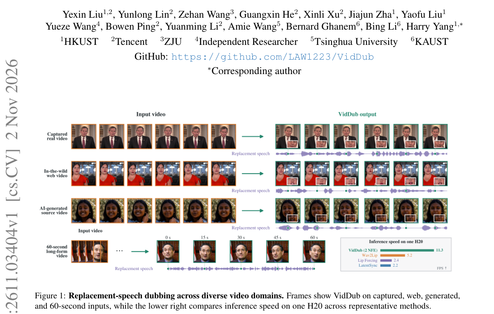

*Result - Full-context two-step dubbing architecture. Masked source frames and a reference image preserve speaker appearance and pose, target-audio tokens drive lip articulation, and bidirectional sel*

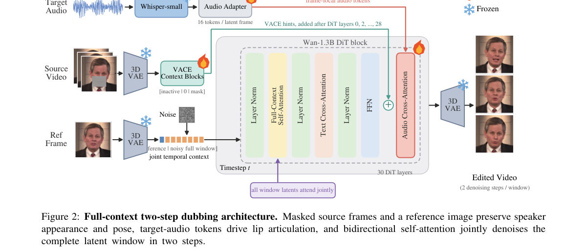

**Why this ranks #7**: 视频配音的编辑模型普遍用自重建训练，但一旦替换语音，源嘴部就成了与目标冲突的监督信号，这篇指出并修掉了这个错配：成对音频用全帧重建，替换音频则屏蔽源嘴部重建损失、只靠音视同步监督嘴部，其余脸部与背景照旧约束。另一个亮点是两步蒸馏：离线配音本来就给全上下文与目标语音，因此可以把全上下文扩散编辑器压到 2 NFE。

---

### 8. ReplayFactor: Replay-Aware Dual-Attribute Learning for Practical Speech Deepfake Detection

**arXiv**: [2611.02628](https://arxiv.org/abs/2611.02628) | **Score**: 7.7 (relevance 7.5 x 0.7 + quality 8.0 x 0.3) | **Tags**: AIGC-audio, deepfake-detection, replay-attack, self-supervised, contrastive-learning, dataset, Zhejiang University | **Categories**: cs.SD, eess.AS | **Pages**: 5

**Authors**: Miao He; Jiayi Zhou; Yu Zheng; Zhongjie Ba; Peng Cheng; Yuxi Zhou; Junjie Zhu; Changhao Zhang; Jian Liu

**Affiliation**: Zhejiang University; Hangzhou High-Tech Zone (Binjiang) Institute of Blockchain and Data Security; Ant Group

**Abstract**

> Advances in synthesis techniques have made deepfake speech increasingly realistic, amplifying voice security threats, including unauthorized voice cloning and impersonation. Although existing deepfake detectors perform well on digitally generated speech, their performance often degrades on physically replayed deepfakes, which constitute a low-cost and practical threat to real-world systems. Existing research focuses primarily on dataset construction and evaluation, while available dataset diversity and replay-aware detector design remain limited. We propose ReplayFactor, a dual-attribute framework that enhances replay evidence by fusing self-supervised learning (SSL) representations with an acoustic prior, while leveraging multi-task learning and supervised contrastive learning to promote robust, generalizable representations. We also construct ReplayFake-CN, a large-scale, multi-device Chinese dataset comprising approximately 185k replayed synthetic utterances to complement public benchmarks. Our framework improves macro-F1 from 60.99% to 76.44% and reduces EER from 11.86% to 3.05% on the EchoFake open set over the baseline, demonstrating strong potential for practical replayed deepfake detection.

**Key findings**

- **Finding**: ReplayFactor 提出双属性框架，把自监督学习表征与声学先验融合以强化重放证据，并结合多任务学习与监督对比学习获得更鲁棒泛化的表征；作者同时构建 ReplayFake-CN，一个包含约 18.5 万条多设备重放合成语音的中文大规模数据集，以补充公开基准；在 EchoFake 开集上相对基线把宏 F1 从 60.99% 提升到 76.44%，EER 从 11.86% 降到 3.05%；闭集上的 t-SNE 分析分别展示了联合、源与重放三种表征的可分性。
- **Inference**: 数字合成语音易检而物理重放难检，说明重放线索（如设备传输链路带来的频谱与相位痕迹）与合成线索属于不同的证据通道，用同一套表征硬吃两者会互相拖累；把两者做成双属性分支再融合，是针对这一物理事实的结构选择。
- **Recommendation**: 若要评估自家 TTS 或音色克隆的滥用风险，可直接用 EchoFake 开集协议跑一遍并关注宏 F1 与 EER 两个口径，同时把自建的多设备重放录制纳入测试集；论文的中文重放语料约 18.5 万条可作为跨语言复现的起点。

**Key figures**

*Framework - Overview of the proposed framework, comprising (I) Representation extraction with SSL and acoustic-prior fusion; and (II) multi-task and supervised contrastive learning.*

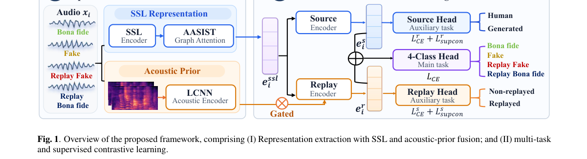

*Result - t-SNE visualizations on the EchoFake closed set: (a) joint, (b) source, and (c) replay representations.*

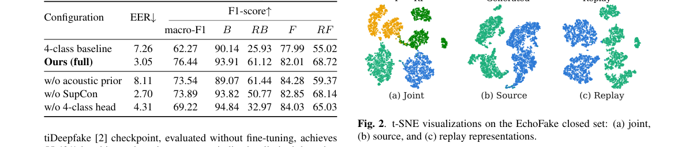

**Why this ranks #8**: 补位说明：本批次该线「仅生成」的硬核论文不足 10 篇，这篇重放式语音深伪检测属于相邻方向补位。生成侧的真实威胁正落在这里——数字合成语音已成熟，但用扬声器播放的物理重放同样能冒充，而现有检测器在这种低成本攻击上明显退化。它既补位又实用：约 18.5 万条多设备中文重放语料加上 SSL 与声学先验融合的判别器，可直接当作做音色克隆团队的合规基线。  [wild-card=yes] 该论文是语音深伪检测与回放因子建模，属于音频取证与安全方向而非生成模型，补位计入。

---

### 9. A Human-Verified AI Workflow for Annotating Environmental Sound Data

**arXiv**: [2611.03271](https://arxiv.org/abs/2611.03271) | **Score**: 7.5 (relevance 7.5 x 0.7 + quality 7.5 x 0.3) | **Tags**: AIGC-audio, annotation-workflow, audio-classification, ast, human-in-the-loop, field-study, Strathmore University | **Categories**: cs.LG, cs.SD | **Pages**: 14

**Authors**: Michael Barasa Murunga; Allan Vikiru

**Affiliation**: Strathmore University

**Abstract**

> Large-scale annotation of environmental sound recordings presents significant challenges under time and resource constraints, particularly when sound categories are imbalanced and only part of a dataset has been labeled. This paper describes the development and evaluation of a human-AI workflow used during annotation of the Kenya Forest Sounds Dataset (KFSD), using a project-stage working collection of 7,531 audio recordings across 21 categories. We investigated zero-shot classification, a feature-based ensemble, and a fine-tuned Audio Spectrogram Transformer (AST). The fine-tuned AST achieved 89.36% accuracy, 85.98% precision, 89.24% recall, and 87.58% F1 on held-out test data for binary classification of Person talking. Because this result remained below the predefined 95% threshold for autonomous annotation, model predictions were used as suggestions and subjected to human verification. Of the 5,026 initially unlabeled recordings, 2,337 were routed to a speech-verification queue and 2,689 remained for ordinary manual annotation. The verifier reviewed all 2,337 machine-labeled files and detected zero false positives, yielding 100% verification accuracy. The observed average verification time was approximately 4.2 seconds per file. At an average rate of 35 seconds per file for manual annotation, the hybrid workflow reduced work on the remaining queue from approximately 48.9 to 28.9 person-hours, saving about 20.0 hours (41%). The study documents the model-selection process, provenance-aware file organization, verification procedure, observed errors, practical limitations, and opportunities for extending AI assistance beyond one category.

**Key findings**

- **Finding**: 工作基于 Kenya Forest Sounds Dataset（KFSD）的项目阶段工作集，含 7,531 条录音、21 个类别，对比了零样本分类、特征集成与微调 Audio Spectrogram Transformer 三种方案；微调 AST 在 Person talking 二分类的留出测试集上取得 89.36% 准确率、85.98% 精确率、89.24% 召回率、87.58% F1，因低于预设的 95% 自治标注阈值，模型预测被降级为建议并交人工核验；5,026 条未标录音中 2,337 条进入语音核验队列、2,689 条保持常规人工标注，核验员复查全部 2,337 条机器标注文件、误报为零、核验准确率 100%，平均每条约 4.2 秒；对比每条约 35 秒的人工标注速度，混合流程把剩余队列工作量从约 48.9 人时降到 28.9 人时，节省约 20.0 小时（41%）。
- **Inference**: 这篇的价值在于把「AI 标注」拆成了可审计的两段式：模型只做分流与建议，最终正确性由人工兜底，因而零误报的可验证性比模型精度更能支撑上线；41% 的工时节省来自把置信度排序的高价值样本交给人，而不是把人机做成竞争关系。
- **Recommendation**: 做自建音效数据集时照抄这套分流逻辑：先给自治阈值定一个明确数字，达不到就把模型输出当建议并保留人工核验环节，再按每条耗时核算净收益；同时用 t-SNE 或逐类核查确认零误报不是抽样偏差造成的。

**Key figures**

*Framework - KFSD recording-routing logic. Human labels are retained; model-predicted speech enters a verification queue; all other unlabeled sounds follow conventional annotation.*

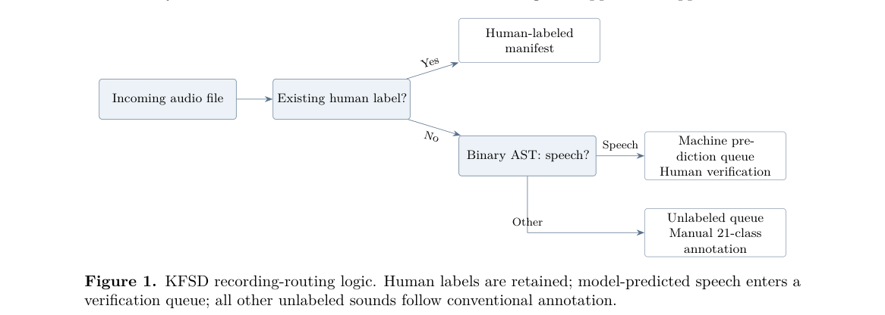

**Why this ranks #9**: 补位说明：本批次该线「音频生成 / TTS / 音乐」的硬核新稿不足 10 篇，这篇环境声标注工作流是相邻方向补位。生成侧论文密度低的当天，它给的是另一类同样稀缺的工程证据：模型精度不足以自治标注时，人机怎么分工才划算。微调 AST 在目标类别上 89.36% 准确率，低于预设的 95% 自主阈值，于是转人工核验，2337 条核验零误报、每条约 4.2 秒，把剩余队列从 48.9 人时压到 28.9 人时——这套成本账对自建音效数据集的人直接可用。  [wild-card=yes] 该论文是环境声数据的人工校验标注工作流，属于数据生产与评测底座而非生成模型，补位计入。

---

### 10. CrowdForge: Effects of Audio and Visual Audience Participation Modalities on Agency, Collaboration, and Engagement in AI-Mediated MR Performances

**arXiv**: [2611.03389](https://arxiv.org/abs/2611.03389) | **Score**: 7.1 (relevance 7.0 x 0.7 + quality 7.5 x 0.3) | **Tags**: AIGC-audio, generative-music, audience-participation, mixed-reality, live-performance, hci-study, SolJAMM Research and ATLAS Institute | **Categories**: cs.AI, cs.HC, cs.NI, cs.PF, cs.SI | **Pages**: 10

**Authors**: Torin Hopkins; Shih-Yu Ma; Zander Trafton-Hancock; Ellen Yi-Luen Do; Luca Turchet

**Affiliation**: SolJAMM Research and ATLAS Institute; University of Colorado Boulder

**Abstract**

> Technology-mediated audience participation (TMAP) enables audiences to influence live performances, yet balancing interaction with meaningful agency remains challenging. While AI-generated music and MR enable new forms of audio and visual audience participation, little is known about how these participation modalities influence audience experiences during live musical performance. In particular, it remains unclear how they shape perceived agency, collaboration, and engagement, and how they complement one another within TMAP systems. We present CrowdForge, an AI- and MR-mediated paradigm where audiences collectively control generative music and virtual environments during a live performance featuring a guitarist and DJ. Through a mixedmethods concert study evaluating three interaction conditions (audio, visual, and combined audio-visual), we demonstrate that observability is the primary driver of audience agency. While visual interaction provided easily observable feedback, audio parameters offered macro-structural control over the music. Audiences tended to use the control enabled by AI audio generation to test musical boundaries, introducing a productive adversarial tension between the crowd and the musicians. This dynamic pushed creative limits, deepened engagement, and generated moments of musical coherence when performers successfully resolved audience-induced challenges. We argue future TMAP systems should prioritize human-centered, highly observable interactions to build agency, while combining the expressiveness of music with the clarity of visual feedback.

**Key findings**

- **Finding**: CrowdForge 是 AI 与 MR 介导的观众参与范式，观众用手机网页投票，选项被聚合成包含音乐性格、速度、配器与舞者等维度的集体配置，再驱动生成音乐与虚拟环境；研究为混合方法现场研究，每场演出 3 个音乐组（每组约 7 分钟）分别对应仅音频、仅视觉、视听联合三种交互条件，一天内做了两场演出（N=19 名观众，演出 1 为 5 人、演出 2 为 14 人，17 男 2 女，平均年龄 28.89），演出后 6 名观众参加 10–20 分钟半结构化访谈；生成片段约 10 秒内被 DJ 载入 Ableton Live 现场演奏；结论是可观性是掌控感的主要来源，视觉交互反馈易观测，音频参数提供宏观结构控制，观众倾向用它试探音乐边界，与乐手形成对抗性张力并在成功化解时产生音乐上的连贯时刻。
- **Inference**: 交互式生成音乐系统的瓶颈往往不是生成质量而是反馈可见性——同样的控制能力，视觉化呈现就更容易被观众感知为「有影响力」；音频作为控制通道虽然更富表达力，却因为难以观测而输掉了掌控感，这对设计参数映射与反馈通道有直接指导意义。
- **Recommendation**: 做面向公众的交互式生成音乐或视觉系统时，按论文把反馈的可观测性当作第一设计目标，先做小规模 A/B 比较哪种通道的操控感更强；若沿用音频参数通道，注意提供可视化映射，否则参数虽生效却不会被观众感知为有效参与。

**Key figures**

*Framework - Overview of the audience participation workflow in CrowdForge. (A) Audience selections are aggregated into a collective configuration spanning musical character, tempo, instrumentation, dancer*

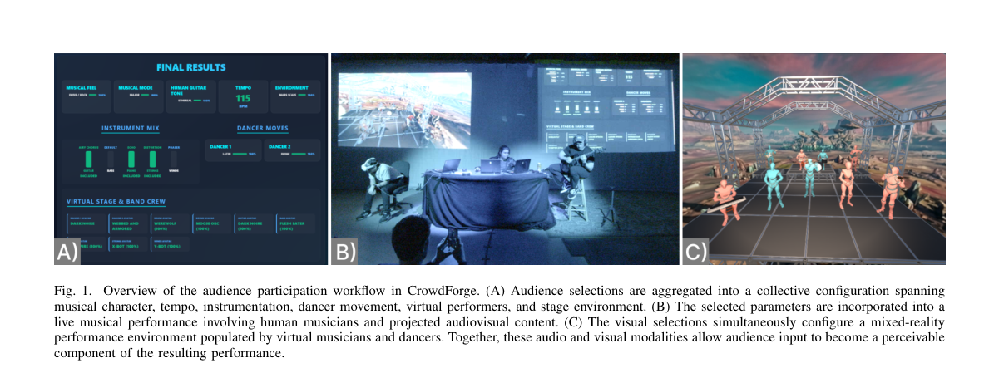

*Result - System diagram and signal flow illustrating the control audience members had over elements of the performance (from left to right). Audience members visit a web page on their mobile devices an*

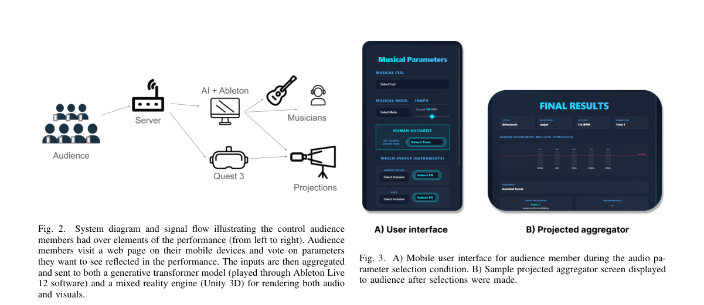

**Why this ranks #10**: 补位说明：本批次该线「仅生成」方向的硬核供给不足 10 篇，这篇 AI 介导的现场演出研究属相邻方向补位。它不是新生成模型，但正面回答了生成音乐在真实场景里是否有用：N=19 名观众、三种交互条件（音频 / 视觉 / 音视）的现场演出实验发现可观测性才是掌控感的主要来源，音频参数提供的是宏观结构控制并与乐手形成对抗性张力。对做交互式音乐生成系统的人机接口设计，这是现成的一手结论。  [wild-card=yes] 该论文以 AI 生成音乐为载体研究 MR 演出中的观众参与机制，生成模型是被研究对象而非贡献主体，补位计入。

---

