# ArXiv Daily Digest - 2026-11-03 (AIGC 视觉生成, 10 papers)

**Generated**: 2026-11-03 17:30 CST

**Source**: arXiv cs.CV, cs.SD, eess.AS, cs.CL, cs.AI, cs.RO, cs.LG submissions, listing day 2026-11-02 (announced 2026-11-03 00:00 UTC)

**Batch window**: 2026-11-01T18:00:00Z .. 2026-11-02T18:00:00Z（arXiv 公告批次横跨两个 UTC 日：前一日 18:00 UTC 起算，当日 17:59:59 UTC 截止）

**Track**: aigc_visual (top 10 of 564 papers scanned, 70 full reads)

**Scope**: 图像 / 视频 / 3D 内容的生成与编辑，含扩散与流匹配模型的训练方法、加速、评测基准

---

## Top 10 - AIGC 视觉生成

### 1. MoviEdit: Long-form Multi-Shot Video Editing Made Easy

**arXiv**: [2611.02737](https://arxiv.org/abs/2611.02737) | **Score**: 9.3 (relevance 9.5 x 0.7 + quality 9.0 x 0.3) | **Tags**: AIGC-visual, long-video-editing, multi-shot, causal-diffusion, paired-data, benchmark, Adobe | **Categories**: cs.AI, cs.CV, cs.LG | **Pages**: 26

**Authors**: Suhyeon Lee; Zhengang Li; Soo Ye Kim; Peihao Zhu; Jong Chul Ye; Chun-Hao Paul Huang; Duygu Ceylan; Yan Kang; Hyeonho Jeong

**Affiliation**: Adobe; KAIST

**Abstract**

> Long-form multi-shot video editing requires an intended edit to remain coherent across abrupt changes in scene, viewpoint, and subject appearance, while processing substantially longer visual context than conventional single-shot editors. We introduce MoviEdit, an end-to-end framework for scalable long-form multi-shot video editing that jointly addresses the challenges of data, modeling, and evaluation. To provide cross-shot supervision data at scale, we develop automatic data-generation pipelines spanning synchronized multi-view footage, real-world multi-shot videos, and generated multi-shot content, yielding 87K paired editing videos without manual annotation. Architecturally, MoviEdit employs a cascaded bidirectional-autoregressive design: a lightweight bidirectional stage first establishes a globally coherent editing draft over a spatiotemporally compressed representation, which is then autoregressively propagated and refined over the full video. We further introduce MoviEdit-Bench, a dedicated benchmark for systematic evaluation of long-form multi-shot video editing. Extensive experiments show that MoviEdit substantially outperforms existing open-source models and performs on par with industry frontier models across text-guided and image-guided editing. Visit our project page for complete results and to access the benchmark: https://multi-shot-edit.github.io/

**Key findings**

- **Finding**: MoviEdit 用同步多视角素材、真实多镜头视频和生成内容三条自动流水线合成 87K 条配对编辑视频，全程无人工标注；架构上共享权重的 Draft Editor 先对 M=N/2 的降采样序列做全序列双向扩散产出编辑草稿，Render Editor 再以块因果因果扩散（KV 缓存）在全分辨率逐块推进；新基准 MoviEdit-Bench 含 64 段生成式多镜头视频、128 个编辑场景、8 个跨镜头难度类别，从非主体保持、编辑定位、主体保持、跨镜头一致性、指令对齐、视频质量、编辑帧保真七个维度加 VLM 判分。
- **Inference**: 把「全局一致性」与「局部细节」拆成共享权重的两级级联，而不是靠一个模型硬扛长上下文，是在有限算力下同时拿到跨镜头一致与画面质量的一条可复制路线；更关键的是 87K 配对数据全部自动生成，说明多镜头编辑的瓶颈已经从标注人力转移到流水线设计。
- **Recommendation**: 复现时先照搬 MoviEdit-Bench 的 8 类难度场景做评测，再按 Draft 12 步 / Render 4 步的非对称蒸馏加 KV 缓存压延迟；数据侧优先复现三条自动配对流水线，不要从零人工标注，可先在 8 场景基准上验证草稿阶段是否真的抑制了长程漂移。

**Key figures**

*Framework - Long-form multi-shot video editing with MoviEdit. MoviEdit supports (a) text-guided and (b) edited-frame-guided multi-shot video editing, enabling consistent edits across shots, and (c) gener*

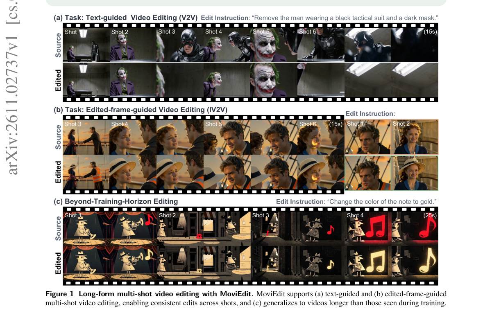

*Result - Scalable paired-data generation for multi-shot video editing. Three annotation-free pipelines transform diverse video sources into large-scale paired data for consistent multi-shot editing. P*

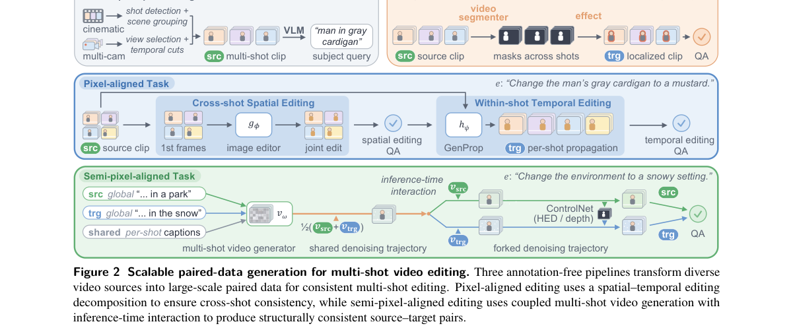

**Why this ranks #1**: 长片多镜头编辑此前几乎只有闭源工业模型能做，这篇把整条链路开源：87K 条无人工标注的配对编辑视频、级联双向—自回归架构、配套的 MoviEdit-Bench 一次给全。Draft Editor 在 M=N/2 的时空下采样序列上做全序列双向扩散定全局编辑草稿，Render Editor 再以块因果自回归在全分辨率上展开并配 KV 缓存，推理端还做了 Draft 12 步 / Render 4 步的非对称蒸馏。对做长视频编辑的团队，它同时提供了数据流水线、架构和评测基准三件套。

---

### 2. SeMo3D: Unifying 3D Generation, Editing, and Completion via Selective Modeling

**arXiv**: [2611.02568](https://arxiv.org/abs/2611.02568) | **Score**: 9.3 (relevance 9.5 x 0.7 + quality 9.0 x 0.3) | **Tags**: AIGC-visual, 3d-generation, 3d-editing, 3d-completion, diffusion-transformer, unified-model, Nanjing University | **Categories**: cs.CV | **Pages**: 21

**Authors**: Xiaokun Sun; Jian Yang; Zhenyu Zhang

**Affiliation**: Nanjing University

**Abstract**

> 3D generation, editing, and completion are typically treated as regenerating the complete 3D asset under task-specific constraints, even when only a local region needs modification. This leads to task isolation, inconsistency in content that should remain unchanged, and dependence on task-specific paired data. We address these issues with a key observation: the three tasks all synthesize a designated region while keeping the rest intact---the full region for generation, the target region for editing, and the missing region for completion. We term this paradigm Selective Modeling and build SeMo3D upon it; it naturally unifies the three tasks, preserves unchanged content by construction, and enables training without paired editing or completion data, since any 3D asset can be partitioned into a selected region and its context. For training, we propose region-selective denoising, which randomly selects regions of varying sizes on standard 3D assets and applies noise and loss only to them, jointly learning all three tasks. For architecture, we propose Omni3DiT, a multi-condition 3D diffusion transformer that distinguishes regions to create from those to retain and fuses image, text, and point guidance for fine-grained control. Experiments across three benchmarks show SeMo3D surpasses state-of-the-art methods on all tasks, delivering multimodal controllability in generation and strong consistency and accuracy in editing and completion. SeMo3D further serves as a unified modeling tool for agents, enabling efficient 3D creation through natural-language interaction. Project page: https://xiaokunsun.github.io/SeMo3D.github.io/.

**Key findings**

- **Finding**: SeMo3D 把 3D 生成、编辑、补全统一为 Selective Modeling，训练时在标准 3D 资产上随机选区、只对选中区域加噪与计算损失；在 Toys4K 生成基准上取得 LPIPS 0.079、FID 4.99、DINO 相似度 0.926、Chamfer Distance 0.0118，四项最优，KID 次优，优于 Trellis2（LPIPS 0.111 / CD 0.0330）、HY3D-Omni（CD 0.0317）与 TIGON（CD 0.0429）；在 Edit3D-Bench 编辑上 CD、PSNR、SSIM、LPIPS、FID/FVD、DINO/CLAP 三组指标全面领先，在 Omni-Comp 补全上 CD、EMD、F-Score 最优。
- **Inference**: 「只改局部、其余按构造保留」把任务间的负迁移问题转成了数据问题——训练只需要普通 3D 资产，配对编辑/补全数据的稀缺不再是瓶颈；而一个模型同时吃图像、文本和点三种条件，意味着下游可控生成不必再叠加多个专用模型。
- **Recommendation**: 如果在做 3D 编辑或补全，先用 region-selective denoising 在现有 3D 资产上试训一版，验证「按构造保留不变区域」能否替代你的成对数据；在三个 benchmark 上同时报 CD 与 LPIPS 两组指标，因为单一指标很容易掩盖未编辑区域的漂移。

**Key figures**

*Framework - SeMo3D unifies 3D generation, editing, and completion via Selective Modeling with image guidance and optional text and points, learning from standard 3D assets without paired editing or comp*

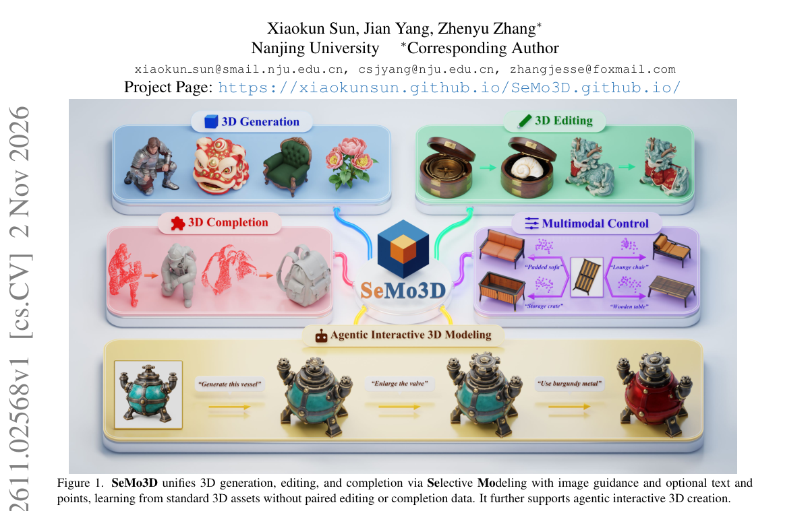

**Why this ranks #2**: 它用一个观察把三个通常被拆开做的任务并到一起：生成、编辑、补全本质上都是「合成指定区域、其余保持不动」，因此可以只靠标准 3D 资产训练，不需要任何成对编辑或补全数据。训练侧用 region-selective denoising 只对随机选中的区域加噪与回损失，架构侧用多条件 3D DiT（Omni3DiT）区分「要生成」和「要保留」的 token 并融合图像、文本、点云引导。对做 3D 资产生产的团队，这直接省掉了三条数据线。

---

### 3. TaoMate-HD: Progressive-Resolution Autoregressive Audio-Video Generation

**arXiv**: [2611.03394](https://arxiv.org/abs/2611.03394) | **Score**: 9.0 (relevance 9.0 x 0.7 + quality 9.0 x 0.3) | **Tags**: AIGC-visual, audio-video-generation, streaming, progressive-resolution, autoregressive, digital-human, Alibaba Group | **Categories**: cs.CV | **Pages**: 14

**Authors**: Qijun Gan; Chenwei Zhang; Xinyang Li; Meiguang Jin; Junfeng Ma; Shen Qiu

**Affiliation**: Alibaba Group; Nanjing University

**Abstract**

> Streaming digital humans produce detailed video while continuing speech as new text arrives. High-resolution denoising is costly, and text updates can cause repeated or interrupted speech. We present TaoMate-HD, an autoregressive model for high-resolution audio-video streaming. For each short segment, or chunk, two denoising steps establish coarse video structure at low resolution. A final step refines the video to high resolution, with audio generated throughout the same trajectory. Each stage passes its audiovisual predictions to the same stage of the next chunk as history. Across text updates, the model retains this history to infer what has already been spoken. Continuation training utilizes asymmetric text conditioning, with separate text windows for generation and distillation. Experiments show a 1.6x speedup over direct high-resolution generation with the same model and hardware. Optimized stage-parallel deployment provides a further 1.9x overall speedup over serial progressive generation. Our continuation training reduces character error rate by 11.18 percentage points relative to the baseline. The model also supports hour-long audiovisual generation. Our project page is https://taoliveaigc.github.io/TaoMate-HD.

**Key findings**

- **Finding**: TaoMate-HD 对每个 chunk 做 N=3 的渐进去噪（两次粗网格结构估计加一次高分辨率精修），每个阶段的视听预测作为下一 chunk 同阶段的历史传给模型，跨文本更新时模型据此推断已说内容；续写训练采用生成与蒸馏分离的非对称文本窗口，字符错误率相对基线下降 11.18 个百分点；相对同模型同硬件的直接高分辨率生成提速 1.6 倍，阶段并行部署再带来 1.9 倍总加速，并支持长达一小时的视听生成。
- **Inference**: 把昂贵的细节预算集中在最后一步、低分辨率阶段只负责结构，等于在时间维度上重新分配了算力，这比单纯蒸馏少步数更省；非对称文本窗口则把「生成时看到的内容」和「蒸馏时看到的内容」解耦，是解决文本续写重复或断裂的一个可迁移的技巧。
- **Recommendation**: 做流式数字人时可直接照搬「粗网格定结构 + 高分辨率一步精修」的三段式采样并统计每段耗时，再评估是否需要阶段并行部署；若存在文本动态追加场景，务必单独设计生成用与蒸馏用两套文本窗口并用字错率验证续写质量。

**Key figures**

*Framework - Progressive audiovisual generation sustained over an hour. Top: MiniMax-H3 denoises high-resolution clips and passes a frame to the next clip, while TaoMate uses few-step fixed-resolution ge*

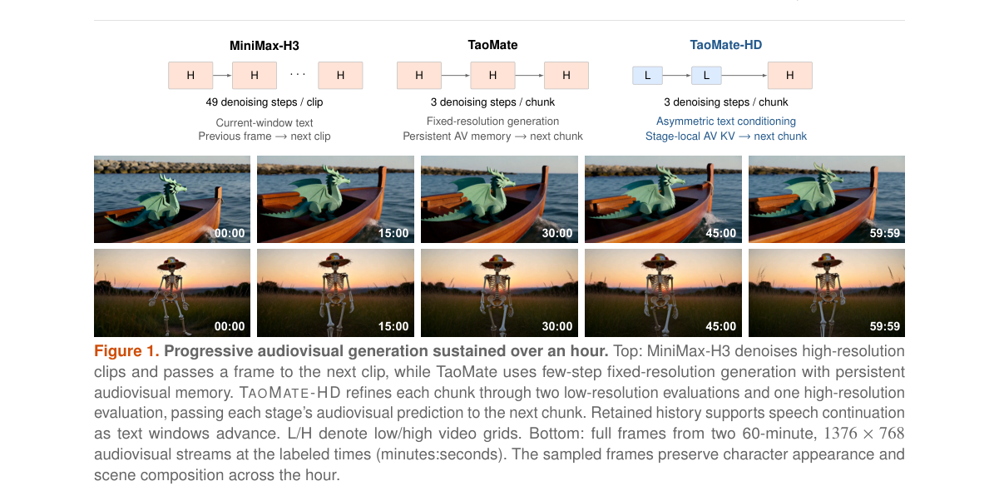

*Result - A chunk’s refinement becomes the next chunk’s history. The 𝑁= 3 configuration shown here uses two coarse-grid evaluations followed by high-resolution refinement. Each stage estimates a clean*

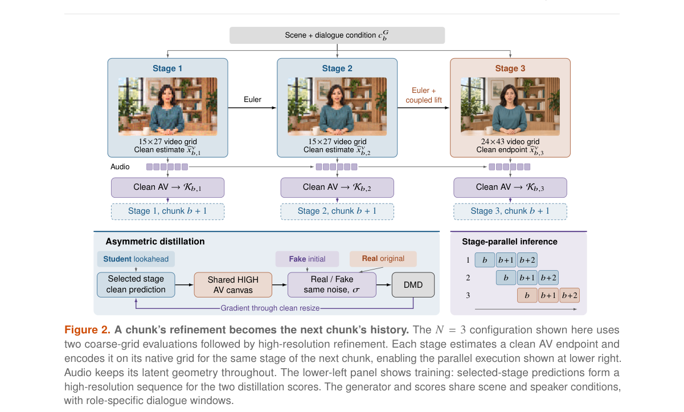

**Why this ranks #3**: 数字人直播的核心痛点是「文本要不断追加」与「高分辨率去噪太贵」，这篇把两件事一起解：每个 chunk 用两步在低分辨率粗网格上定结构、最后一步才升到高分辨率精修，音频在整个去噪轨迹上同步生成。它给出的加速是叠乘的——相对同模型同硬件的直接高分辨率生成 1.6 倍，再靠阶段并行部署把总耗时压到串行版本的 1/1.9，支持小时级音视频连续生成。

---

### 4. UniCross3D: Unified Cross-View and Cross-Domain Diffusion for Consistent Single-Image 3D Generation

**arXiv**: [2611.02631](https://arxiv.org/abs/2611.02631) | **Score**: 8.8 (relevance 9.0 x 0.7 + quality 8.5 x 0.3) | **Tags**: AIGC-visual, single-image-3d, novel-view-synthesis, cross-view, mutual-information, normal-map, Sookmyung Women's University | **Categories**: cs.CV, cs.GR | **Pages**: 19

**Authors**: U-Chae Jun; Jaeeun Ko; Jiwoo Kang

**Affiliation**: Sookmyung Women's University

**Abstract**

> Reconstructing detailed geometry and realistic appearance from a single RGB image is essential yet fundamentally challenging due to inherent ambiguities such as occlusion, lighting variations, and texture-geometry entanglement. While recent diffusion-based generative models have significantly improved novel view synthesis, existing approaches suffer from two critical limitations: lack of cross-view geometric consistency and insufficient cross-domain semantic alignment. To address these issues, we introduce UniCross3D, a unified cross-view and cross-domain diffusion framework designed explicitly for consistent and physically coherent 3D generation. UniCross3D features two novel contributions: (1) a cross-view latent regularization that enforces cross-view geometric consistency across synthesized viewpoints by penalizing latent variance, and (2) a cross-domain mutual information objective grounded in the physics of image formation, explicitly aligning synthesized color and normal maps. Extensive experiments demonstrate that UniCross3D achieves significantly improved view consistency and semantic alignment over state-of-the-art methods and yields higher-fidelity reconstructions, particularly under challenging textures and ambiguous viewpoints.

**Key findings**

- **Finding**: UniCross3D 在单图输入下生成六组多视图颜色图与法线图（固定仰角、方位角偏移 ±30°/±90°/±150°），再由颜色—法线对重建 3D；表 1 对比 2D-to-3D 方法取得 PSNR 21.8354、SSIM 0.9642、LPIPS 0.1061、CD 0.0125、IoU 0.6125，五项全部最优，优于 Wonder3D（18.0932 / 0.8995 / 0.1536 / 0.0261 / 0.4663）、CRM（18.4407 / 0.9088 / 0.1366 / 0.0141 / 0.5218）与 One-2-3-45（16.1058 / 0.8874 / 0.1812 / 0.0313 / 0.4142）；模型基于 SDXL 训练 60K 步、4 天、8 张 A100、batch 192，推理用 50 步 DDIM 与 classifier-free guidance。
- **Inference**: 把几何一致性与颜色—法线对齐拆成两个可分别施力的显式正则，比端到端单图 3D 更可控，也解释了为什么在有挑战纹理和歧义视角下增益更明显；这一点对做 3D 数据合成的团队比刷榜本身更有用，因为合成数据的法线质量直接决定下游重建的上限。
- **Recommendation**: 若要复现，按「多视图扩散 + 颜色法线重建」两阶段搭好，先在公开 2D-to-3D 基准上核对 PSNR/CD/IoU 三项；同时用你自己的纹理与遮挡场景检查视角一致性，因为这类失败的模式在单一 IOU 指标上不明显。

**Key figures**

*Framework - Comparisons with the state-of-the-art 2D-to-3D method [LLL*24]. The proposed method, UNICROSS3D, addresses two fun- damental limitations of the previous 2D-to-3D generation methods: (a) cros*

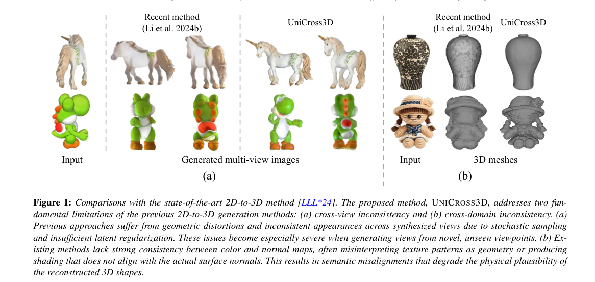

*Result - provides an overview of the proposed pipeline. UNI- CROSS3D takes a single-view image as input and generates mul- tiview data from diverse viewpoints, which is then used to recon- struct a 3D*

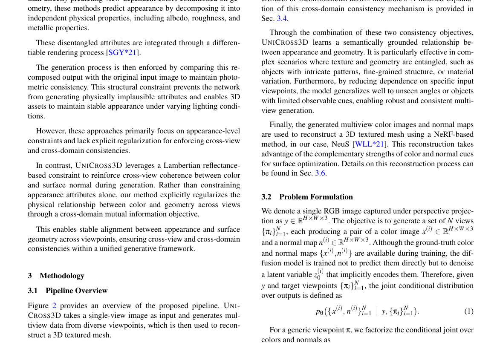

**Why this ranks #4**: 单图 3D 的两个老问题被这篇同时处理：跨视角几何不一致和跨域语义不对齐。它用跨视角潜变量正则惩罚不同视角潜变量的方差来锁几何，用基于成像物理的跨域互信息目标显式对齐合成的颜色图与法线图，而不是靠网络自己隐式学。效果是单图 2D-to-3D 全指标领先，且这套 SDXL 多视图扩散加 3D 重建的两阶段流程是公开的，工程上容易照搬。

---

### 5. VideoEditor-MoE: Scaling Complex Video Editing with Mixture of Experts

**arXiv**: [2611.03043](https://arxiv.org/abs/2611.03043) | **Score**: 8.5 (relevance 8.5 x 0.7 + quality 8.5 x 0.3) | **Tags**: AIGC-visual, mixture-of-experts, video-editing, complex-instruction, routing-analysis, open-source, Tencent | **Categories**: cs.AI, cs.CV | **Pages**: 19

**Authors**: Xiao Cao; Fuchen Long; Yansong Qu; Wen Xiao; Xin Zhang; Xinlong Sun; Xi Chen; Zhiyong Huang

**Affiliation**: Tencent; National University of Singapore; Xiamen University

**Abstract**

> Complex video editing requires understanding complex instructions while jointly fulfilling multiple editing requests. Meeting these demands through dense model scaling substantially increases computational cost. We introduce VideoEditor-MoE, the first open-source mixture-of-experts framework for video editing. Beyond sparse MLP-MoE layers, MoE-Attention expands attention capacity through routed key--value experts while preserving global interactions among video tokens. Initialized from a 5B video editing model, VideoEditor-MoE scales to 14B and 56B parameters, with approximately 8B parameters activated per token in both variants. Comparisons with existing methods and two complementary baselines, Explicit-MoE and MLP-MoE, assess its benefits over explicit expert guidance and MLP-only expert architectures. Further analyses demonstrate that all experts remain active and reveal that learned routing responds more strongly to sample content and diffusion noise levels than to human-defined editing categories. Spatial analysis further indicates sensitivity to object-level semantic features. We also identify decoupled weight decay as a strategy for stabilizing expert scaling.

**Key findings**

- **Finding**: VideoEditor-MoE 从 5B 视频编辑模型初始化，扩出 14B-A8B 与 56B-A8B 两个变体（每 token 激活约 8B）；表 1 中 56B-A8B 的 Edit Execution Rate 94.70、Edit Fulfillment 94.70、Video Quality 77.27，14B-A8B 为 90.15 / 90.72 / 71.59，两者在三项指标上均超过 Kiwi-Edit（73.60 / 73.11 / 61.36）、MiniMax-H3（76.82 / 76.06 / 61.36）、CoinVE-Edit（87.99 / 88.23 / 69.89）、Explicit-MoE（81.67 / 81.69 / 69.89）与 MLP-MoE 19B-A8B（88.45 / 88.78 / 68.75）；分析显示 196 个专家全部保持活跃，MLP-MoE 平均选择份额 7.1%、MoE-Attention 为 10.9%，并用解耦权重衰减稳定专家扩张。
- **Inference**: 路由对内容与噪声水平敏感、对人工编辑类别不敏感，意味着社区普遍假设的「专家按任务分工」在这类模型里基本不成立，硬做类别对齐的专家路由可能是在给不存在的结构加约束；MoE-Attention 相对纯 MLP-MoE 的增益也说明容量必须扩进注意力而非只扩前馈。
- **Recommendation**: 做复杂多指令编辑时优先考虑 MoE-Attention 结构而非标准 MLP-MoE，并按解耦权重衰减设置训练正则；复现时务必统计专家使用分布与 JS 散度，若出现专家塌缩应先查权重衰减耦合，而不是直接加负载均衡系数。

**Key figures**

*Framework - contrasts explicit task-guided expert composition with token-level MLP routing.*

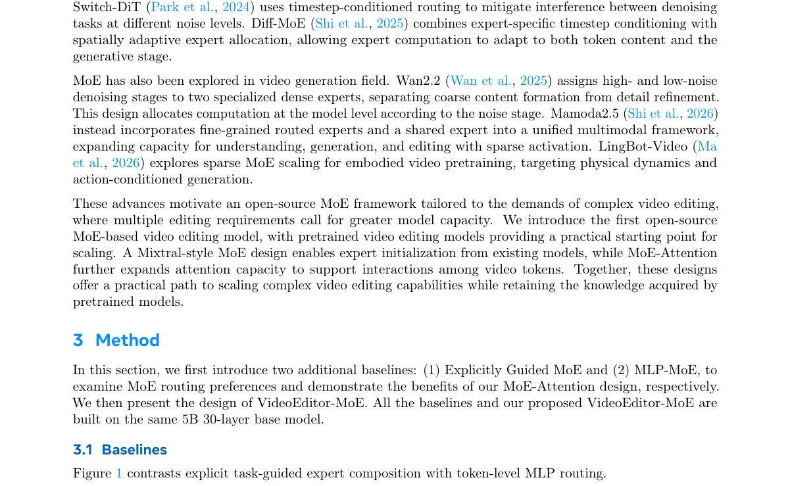

*Result - VideoEditor-MoE. (a) Dense and MoE DiT blocks alternate through 28 layers, followed by two dense blocks. (b) Shared queries attend to routed key–value pairs from all video tokens. (c) Each Mo*

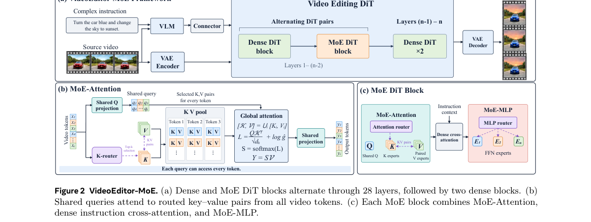

**Why this ranks #5**: 复杂视频编辑要求同时满足多个编辑指令，用稠密堆参数换能力代价太高，这篇给出开源解法：把稀疏专家容量从 MLP 扩进注意力层（MoE-Attention，用路由的 key-value 专家扩展注意力容量，同时保留视频 token 间的全局交互）。从 5B 基座扩到 14B 与 56B、每 token 激活约 8B，三项指标全面超过所有基线。更值得注意的是它对路由行为的剖析：196 个专家全部保持活跃，路由对样本内容与噪声水平的敏感度远高于人工定义的编辑类别。

---

### 6. Disen-Forcing: Disentangling Semantic Anchoring from Motion for Autoregressive Video Diffusion

**arXiv**: [2611.02822](https://arxiv.org/abs/2611.02822) | **Score**: 8.5 (relevance 8.5 x 0.7 + quality 8.5 x 0.3) | **Tags**: AIGC-visual, autoregressive-video, distillation, attention-analysis, long-horizon, motion-dynamics, Australian National University | **Categories**: cs.CV, cs.LG | **Pages**: 24

**Authors**: Zhengyang Yu; Akio Hayakawa; Masato Ishii; Qingtao Yu; Xuesong Li; Takashi Shibuya; Yuki Mitsufuji; Jing Zhang

**Affiliation**: Australian National University; Sony AI; CSIRO; Sony Group Corporation

**Abstract**

> Autoregressive video diffusion models (AR-VDMs) enable real-time, long-horizon video generation but degrade rapidly once the inference horizon outruns the training horizon, due to compounding exposure bias. To stabilize long rollouts, recent methods heuristically adopt frame sink, keeping initial frames as a persistent model context, inspired by attention sinks in LLMs. We revisit this design and find that the mechanism by which initial frames stabilize long-range consistency in AR-VDMs is not an LLM-style attention sink; instead, long-range consistency is anchored through a sparse subset of attention heads, while the majority of heads predominantly capture local temporal dynamics. This observation reveals an over-conditioning pathology in existing frame-sink strategies: by universally exposing every head to the pinned initial-frame context, the model becomes prone to collapsing motion toward the low-dynamic modes of the teacher during model distillation. We propose Disen-Forcing, a distillation-time plug-in for AR-VDMs that disentangles and reinforces this head specialization through disentangled context routing and motion-disentangling regularization. On long-horizon video generation benchmarks, Disen-Forcing simultaneously improves long-range consistency and motion dynamics of base AR-VDMs, a trade-off that sink-based methods fail to balance.

**Key findings**

- **Finding**: 作者分析 AR-VDM 的时序注意力发现初始帧并非普遍注意力汇，而是被稀疏稳定的 anchor heads 用来锚定语义，掩掉 top-20% anchor heads 会破坏一致性；在 200 条 MovieGenBench 提示上按 VBench-Long 六个维度评测，Self-Forcing 上 Disen-Forcing 把 Dynamic Degree 从 frame sink 的 35.66 / 35.83 提到 73.12 / 73.95（30 秒 / 1 分钟），同时把首尾画质差 ΔQ Drift 从 base 模型的 7.23 / 12.73 降到 4.03 / 4.04；Causal-Forcing 上 Dynamic Degree 从 17.75 / 16.06 提到 69.72 / 69.64，ΔQ Drift 从 9.38 / 12.96 降到 4.83 / 5.10，而 sink 类方法会把 Dynamic Degree 从 65.00 压到 37.00。
- **Inference**: 一致性和动态性在现有长视频方案里被默认为不可兼得，这篇给出的证据表明二者并非硬冲突，真正的问题是上下文被无差别地广播给了所有注意力头；把「锚定」和「时序」在头层面拆开，是比调 sink 长度更本质的修法。
- **Recommendation**: 用长视频蒸馏时可以把它当作即插即用的补丁先跑一版，并同时盯 Dynamic Degree 与 ΔQ Drift 两个指标——只看一致性会误判为改进；复现其注意力分析时按论文用 200 条 MovieGenBench 提示统计每头注意力分布，再据此定位自己模型的 anchor heads。

**Key figures**

*Framework - Training dynamics and long-horizon comparison. (a) Dynamic Degree over the first 5s and Imaging Quality over 30s across 5s-horizon training iterations. (b) Qualitative comparison of 30s gene*

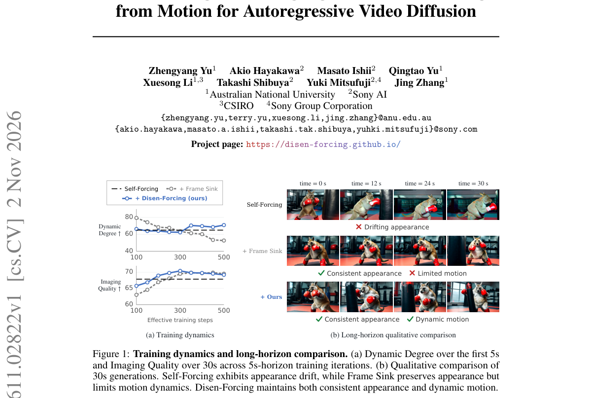

*Result - Temporal attention patterns across models and heads. (a) Per-head attention to the initial and current frames across AR-VDMs, averaged over 50 MovieGenBench [32] prompts and denoising timest*

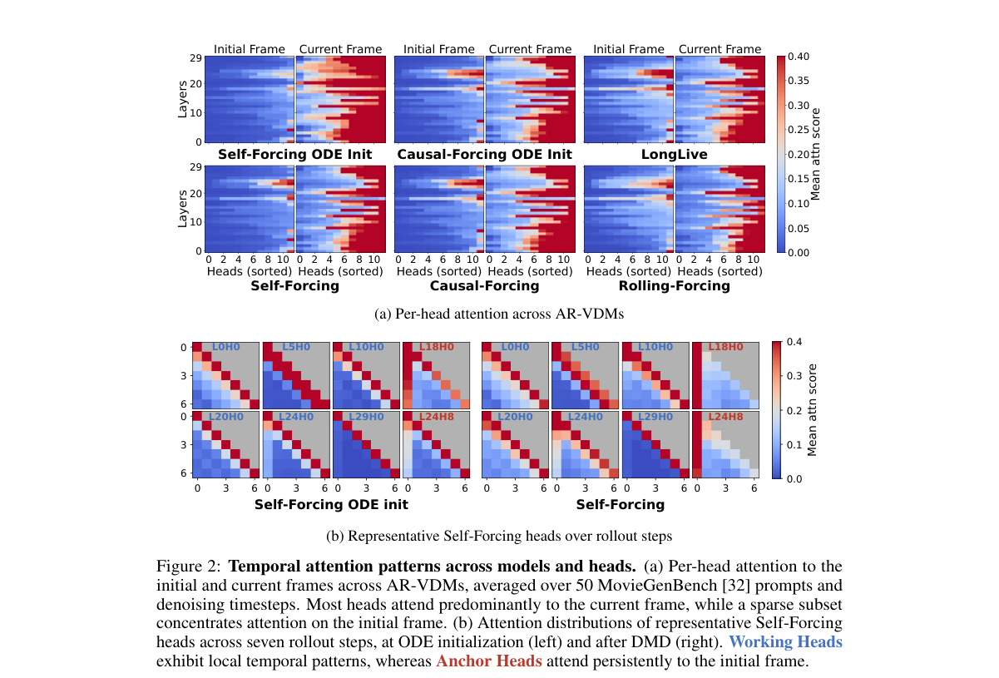

**Why this ranks #6**: 自回归视频扩散靠 frame sink 钉住初始帧来稳住长视频，但这篇证明机制解释是错的：初始帧不是 LLM 式注意力汇，而是由一小部分 anchor heads 专门做语义锚定，其余 head 管局部时序动态。把所有 head 都暴露在固定上下文里，会在蒸馏时把运动压向教师的低动态模式。它据此提出解耦上下文路由加运动解耦正则，在同一批 base model 上同时改善长程一致性与运动量，这是 sink 类方法没能做到的取舍。

---

### 7. When Optimization Meets Human Intent: Human-Centered Diffusion Model Optimization

**arXiv**: [2611.03140](https://arxiv.org/abs/2611.03140) | **Score**: 8.3 (relevance 8.5 x 0.7 + quality 8.0 x 0.3) | **Tags**: AIGC-visual, survey, human-intent, diffusion-optimization, reward-design, evaluation-gap, Peking University | **Categories**: cs.CV | **Pages**: 33

**Authors**: Renye Yan; Jikang Cheng

**Affiliation**: Peking University

**Abstract**

> Diffusion models are evolving from general tools into personalized systems that adapt to user needs through fine-tuning and guidance. However, diffusion optimization mainly targets measurable objectives such as aesthetics, rarely examining whether they align with human intent. Human needs are multidimensional, contextual, and dynamic, whereas existing methods approximate them with fixed metrics. Because these metrics capture human needs only partially and may amplify deviations from true intent during optimization, higher scores need not yield results better matching human expectations. To understand how human needs enter and influence optimization, we systematically analyze how human intent is expressed, translated into optimizable objectives, applied to model behavior or generation, and evaluated through outputs. We further discuss trade-offs affecting human-intent alignment in personalized image generation and gaps between automated metrics and real user judgments. This human-centered synthesis reorganizes diffusion optimization and provides a systematic reference for personalized generation systems designed for human preferences.

**Key findings**

- **Finding**: 论文（33 页）用四个相互关联的维度重构扩散模型优化：意图表示、优化机制、失效模式与权衡、以人为中心的验证，并据此提出 RQ1–RQ4 四个研究问题；核心论点被形式化为三个挑战——意图需先外化为文本、选择或评分等代理表示再翻译成可优化目标，多维需求（美学、语义一致性、真实感、多样性）常以固定权重静态合并而难以随偏好调整，自动化评估器与优化目标共享假设导致分数提升未必对应用户感知；文中同时给出权衡与失效模式的分类与研究路线图。
- **Inference**: 综述把「优化分更高但用户更不满意」归因于代理表示的信息损失，而不是算法不够强，这提示多数个性化微调的瓶颈在目标设计而非优化器选择；四个维度的框架也意味着当前大量工作其实只覆盖了其中一维。
- **Recommendation**: 读它来给自己的 pipeline 做一次体检——把用户反馈表示、优化目标组合方式、失效案例、验证方式各列一遍，看哪一维是空的；若要动手，优先补「以人为中心的验证」这一维，因为优化目标和评估指标往往共享同一套假设。

**Key figures**

*Framework - The framework illustrates how human intent originates from users and creators, researchers and developers, and domain experts; is represented and translated into machine-optimizable objectives*

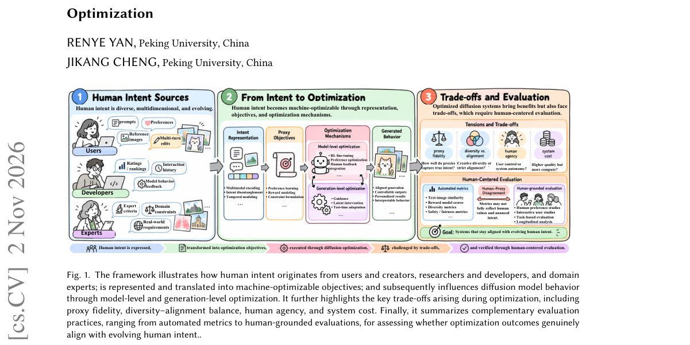

*Result - Overview of the Survey and Research Roadmap*

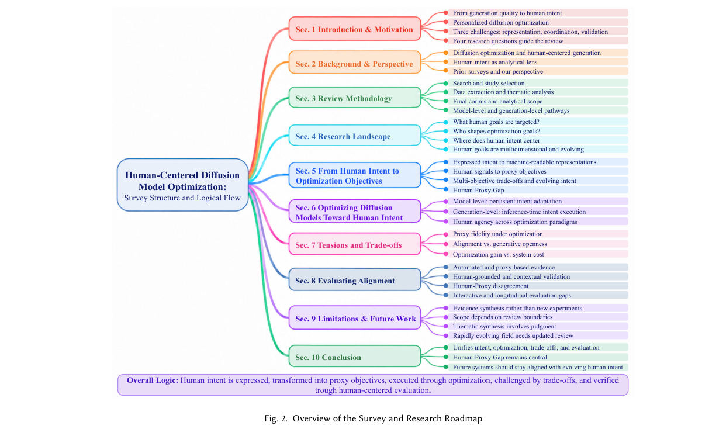

**Why this ranks #7**: 这是本批次少见的综述型论文，价值在于它把扩散模型优化整个领域按「人怎么想、意图怎么被翻译、哪里会失效、怎么验证」重新排了一遍，而不是再按算法罗列一遍。它提出的三个挑战值得每个做个性化生成的人对着自查：用户意图必须先被表达成可计算目标、多目标之间的固定权重会在偏好变化时失效、自动化指标涨分并不等于用户真的更满意。

---

### 8. OctreeSplat: Hierarchical Octree-Guided Feed-Forward Gaussian Splatting

**arXiv**: [2611.02658](https://arxiv.org/abs/2611.02658) | **Score**: 8.3 (relevance 8.5 x 0.7 + quality 8.0 x 0.3) | **Tags**: AIGC-visual, gaussian-splatting, feed-forward, octree, densification, vfm-prior, East China University of Science and | **Categories**: cs.CV | **Pages**: 12

**Authors**: Yibin Zhao; Yihan Pan; Wenli Yang; Jun Nan; Jianjun Yi

**Affiliation**: East China University of Science and Technology; Shanghai Open University

**Abstract**

> 3D Gaussian Splatting (3DGS) has shown considerable potential for novel view synthesis (NVS) and 3D reconstruction. Feed-forward methods avoid costly per-scene optimization, but fixed image or spatial resolutions limit their ability to allocate primitives according to local complexity. We present OctreeSplat, a hierarchical octree-guided feed-forward Gaussian splatting. OctreeSplat extracts multi-view features and geometric priors from a frozen visual foundation model (VFM), constructs a hierarchical octree, and predicts densification scores. The resulting representation allocates Gaussian primitives at spatially varying densities according to local complexity. Stochastic solids volume rendering improves depth rendering, strengthens geometric supervision, and supports surface reconstruction. When camera parameters are available, an optional test-time optimization (TTO) module improves agreement between predicted and ground-truth parameters. Training updates only 76 million additional parameters and requires 35 GPU-hours. Experiments on Replica, TUM, Tanks and Temples, and DTU demonstrate competitive RGB view synthesis, depth synthesis, and surface reconstruction. OctreeSplat reduces the number of Gaussian primitives while maintaining high reconstruction quality.

**Key findings**

- **Finding**: OctreeSplat 从冻结 VFM 抽取多视角特征与几何先验，用 DPT 与 SPUNet 构造多分辨率体素特征预测致密化分数并按八叉树节点分配高斯原语；随机实心体（stochastic solids）体渲染被用于改进深度渲染并加强几何监督；训练只更新 76M 额外参数、耗时 35 GPU 小时（RTX PRO 6000）；在 Replica、TUM、Tanks and Temples、DTU 上同时评测 RGB 视图合成、深度合成与表面重建，相比像素对齐与体素对齐方法用更少的原语达到有竞争力的质量；相机参数可用时，附加的测试时优化模块进一步对齐预测与真值参数。
- **Inference**: 把「哪些区域需要更多原语」交给一个可预测的分数，而不是靠自适应密度控制在优化中后验增删，是把优化期技巧前移到前馈建模的一个方向，对需要批量、快速重建的流水线价值更大；代价是训练仍依赖 VFM 的几何先验，冷启动场景下需自行验证。
- **Recommendation**: 若在搭前馈式 3DGS 流水线，可先按论文复现八叉树致密化分数预测并统计原语数与 PSNR/深度误差的帕累托曲线，重点看稀疏区域是否少铺原语；有相机参数时务必打开 TTO 测一次收益，因为真实采集端通常拿得到内外参。

**Key figures**

*Framework - Given a variable number of images and optional camera parameters, OctreeSplat reconstructs a geometrically accurate 3DGS scene through feed- forward inference. Predicted densification scores g*

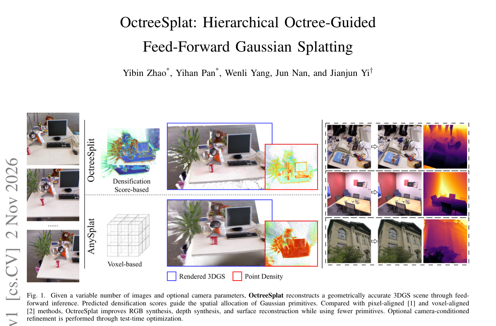

*Result - Overview of the OctreeSplat pipeline. A frozen visual foundation model extracts multi-view features and predicts geometry. DPT and SPUNet construct multi-resolution voxel features and predict*

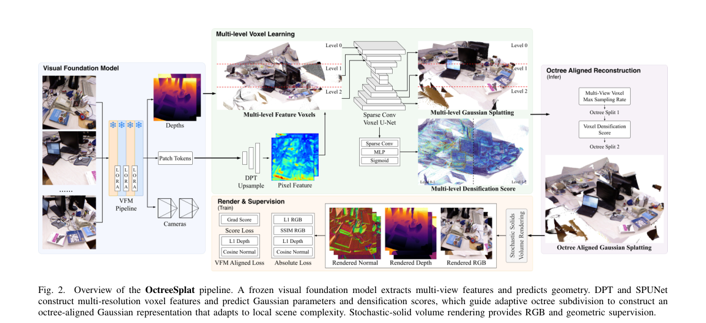

**Why this ranks #8**: 前馈式 3DGS 的老问题是分辨率固定，高斯原语无法按局部复杂度分配，这篇用分层八叉树来解决：从冻结视觉基础模型抽多视角特征与几何先验，构建八叉树并预测致密化分数，由此按局部复杂度铺不同密度的高斯。它还顺手用随机实心体渲染改进深度与表面重建，并在有相机参数时加可选的测试时优化。训练成本也友好：只训 76M 额外参数、35 GPU 小时。

---

### 9. One Image Is Enough: Self-Generated Supervision for Personalizing Human Video Diffusion at Test Time

**arXiv**: [2611.02964](https://arxiv.org/abs/2611.02964) | **Score**: 8.1 (relevance 8.0 x 0.7 + quality 8.5 x 0.3) | **Tags**: AIGC-visual, human-video, test-time-adaptation, pseudo-supervision, identity-preservation, lora, Concordia University | **Categories**: cs.CV, cs.GR, cs.LG | **Pages**: 23

**Authors**: Sadman Rakib Pinon; Adamo Orsini; Yanis Falaki; Linlian Jiang; Jacob Kingi; Yang Wang; Xinxin Zuo

**Affiliation**: Concordia University; Mila - Quebec AI Institute

**Abstract**

> Pose-driven human video diffusion animates a person from a single reference image and a target pose sequence, yet it struggles to preserve identity, rendering the face and garments unfaithfully as the pose departs from it. Personalization is the standard remedy, but its supervision is missing: one image fixes identity at a single pose, while a multi-pose subject video cannot be assumed in practice. Instead, we synthesize the missing supervision. A domain-tuned, pose-conditioned generator produces pseudo-ground-truth frames at selected key poses. An inference-time reference-only sampler steers these candidates toward the subject and keeps the most identity-consistent. A per-subject low-rank adapter then trains on static clips of them, configured from the reference alone, with no subject video, ground truth, or labels. Although lower in fidelity, these synthetic frames supervise more effectively than real ones. Real frames as captured carry motion that erodes the temporal prior, while a static clip conveys appearance alone. On TikTok and UBC Fashion, the adapted model improves the base on every metric, inverts the identity-versus-motion trade-off, and matches or surpasses adaptation on five real frames despite using none. Code and weights are available at https://github.com/SadmanPinon/one-image-is-enough.

**Key findings**

- **Finding**: 方法先由姿态条件生成器合成伪真值帧，再用参考图引导的采样器按身份一致性筛选，最后训练每主体 LoRA；表 1 在 TikTok / UBC Fashion 上取得 PSNR 21.20 / 24.56、SSIM 0.847 / 0.931、LPIPS 0.206 / 0.059、FID 26.74 / 8.71、FVD 133.5 / 53.88、FID-VID 8.42 / 5.79，全面优于基座 UniAnimate-DiT（19.35 / 23.52、0.765 / 0.907、0.235 / 0.060、28.47 / 12.79、402.14 / 88.36、9.12 / 6.12），并优于 StableAnimator、MTVCraft 等已适配方法；监督来源消融显示伪 GT 的 FVD 133.5 优于真实 5 帧的 157.3，FaceID 0.617 亦不低于 0.615；跨域 Unseen100-Val 上是唯一 FVD 低于 100（92.5）的方法；伪帧数 K=5 为最佳平衡点。
- **Inference**: 真实视频帧自带运动，会同时把身份和动作两件事压进同一段监督，从而抵消姿态条件的先验；换成静态的合成伪帧相当于把「身份」与「运动」解耦监督，这是身份—运动权衡能被同时改善的机制性原因，而不是调参调出来的。
- **Recommendation**: 做单图人物个性化时可直接照此流程：生成器出伪帧、参考图引导筛选、静态片段训 LoRA，并优先试 K=5；评测时务必单独看 FaceID 与 FVD 两项，只看 PSNR 会掩盖身份退化，也建议在非训练域上验证泛化。

**Key figures**

*Framework - One image is enough. From a single reference image and a driving pose sequence, our method personalizes a pose-driven video diffusion model to the subject at test time, with no subject video*

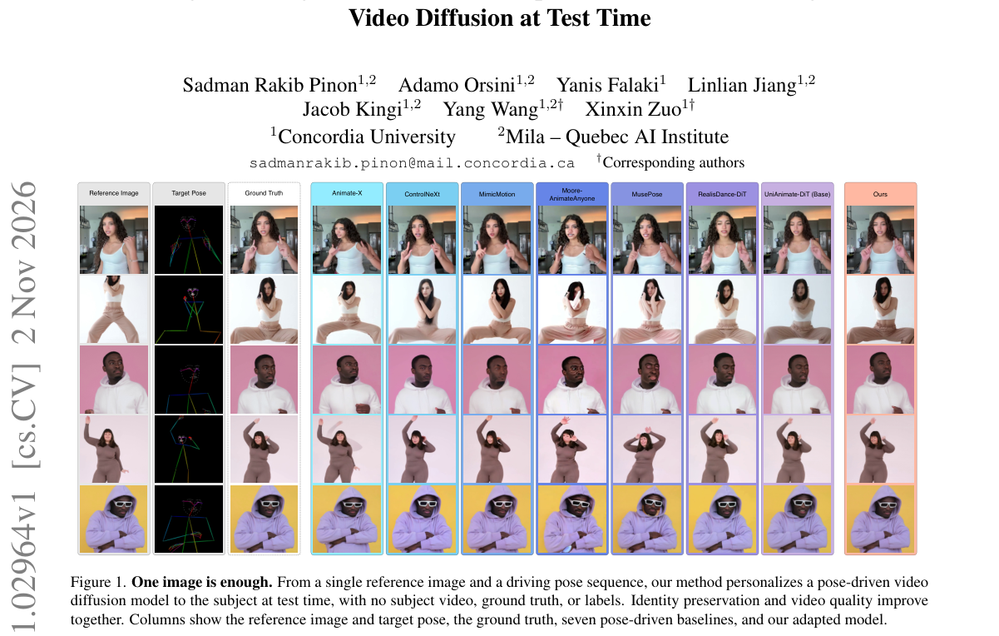

*Result - Method overview. From one reference image xref and a driving pose sequence P, a pose-conditioned generator G synthesizes pose-targeted pseudo-ground-truth frames Dpseudo of the subject. (a)*

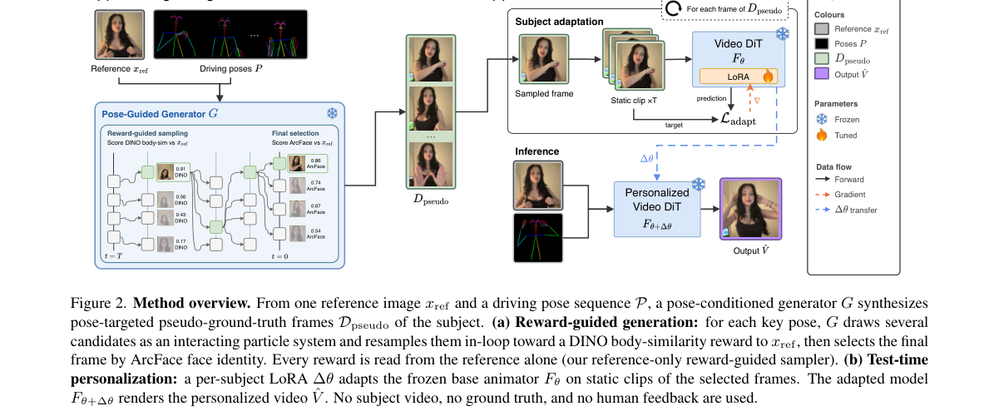

**Why this ranks #9**: 姿态驱动的人物视频扩散在姿态偏离参考图时保不住身份，标准解法是拿主体视频做个性化，但实践上拿不到。这篇把缺失的监督自己造出来：用域内姿态条件生成器在关键姿态合成伪真值帧，推理期用参考图做引导并按身份一致性筛选，再用这些伪帧训练每主体低秩适配器。它证明了一件反直觉的事——保真度更低的合成帧反而比真实帧 supervision 更好，因为真实帧带的运动会侵蚀时序先验。

---

### 10. Intent2CAD: How Semantic-Parametric Supervision Shapes Text-to-CAD Generation

**arXiv**: [2611.03449](https://arxiv.org/abs/2611.03449) | **Score**: 8.0 (relevance 8.0 x 0.7 + quality 8.0 x 0.3) | **Tags**: AIGC-visual, text-to-cad, code-generation, semantic-lifting, parametric-relation, dataset, Beijing Institute of Technology | **Categories**: cs.CV | **Pages**: 25

**Authors**: Jinbo Yang; Mingyue Yuan; Shikai Jing

**Affiliation**: Beijing Institute of Technology; University of New South Wales

**Abstract**

> Text-to-CAD generation aims to make CAD modeling more accessible by generating executable CAD programs from natural-language descriptions. However, practical CAD workflows require more than executable geometry: generated programs should also expose reusable structure that supports later modification. We introduce intent-oriented text-to-CAD generation, where design intent is expressed as recoverable code-level signals: semantic features, reusable parameters, and lightweight parametric relations. Rather than changing the model architecture or decoding procedure, we investigate how supervision representation granularity affects both CAD generation and zero-shot intent-preserving editing. To enable this study, we construct IntentCAD-100K, a 100K paired text--code dataset built by converting low-level CAD construction traces into executable CadQuery programs. We further construct IntentCAD-Edit-1K to evaluate zero-shot intent-preserving editing from the same representation perspective. Intent2CAD uses a two-stage conservative lifting pipeline: semantic lifting rewrites reliable primitive groups into feature-level operations, while parametric lifting exposes lightweight parametric relations. Under controlled fine-tuning, semantic lifting mainly improves generation reliability and feature recovery, reducing IR from 2.39% to 0.22% and achieving 99.96% API Recovery, while parametric lifting makes reusable relation structure explicit and further improves relation-aware zero-shot editing. Datasets and code are available at https://github.com/JinboYang94/Intent2CAD.

**Key findings**

- **Finding**: 论文构建 IntentCAD-100K（10 万对文本—代码，由 DeepCAD 低层构造轨迹转成可执行 CadQuery 程序）与 IntentCAD-Edit-1K 用于零样本意图保持编辑评测；两阶段保守提升管线中，语义提升（把可靠基元组改写为特征级操作）主要改善生成可靠性与特征恢复，把无效程序率（IR）从 2.39% 降到 0.22%、API 恢复率达 99.96%；参数化提升（暴露轻量参数化关系）不改变几何质量，但让可复用关系结构显式化，进一步改善关系感知的零样本编辑；全程仅做受控微调，未改架构与解码过程。
- **Inference**: IR 从 2.39% 降到 0.22% 说明无效程序的来源主要是监督表示而非模型容量，这与文本到 CAD 领域普遍的「靠更大模型解决」思路相反；把可复用关系写进代码则让生成结果直接成为下游编辑的起点，改变了任务的价值定义。
- **Recommendation**: 做文本到 CAD 时优先投资监督表示的改写而非换模型：先统计自己系统的 IR 与 API 恢复率，再评估语义提升与参数化提升各自带来的收益；建数据时按论文把低层构造轨迹转成可执行代码，并单独留一份零样本编辑集来验证意图保持。

**Key figures**

*Framework - Illustration of the representation gap between primitive-only and semantic– parametric CAD supervision.*

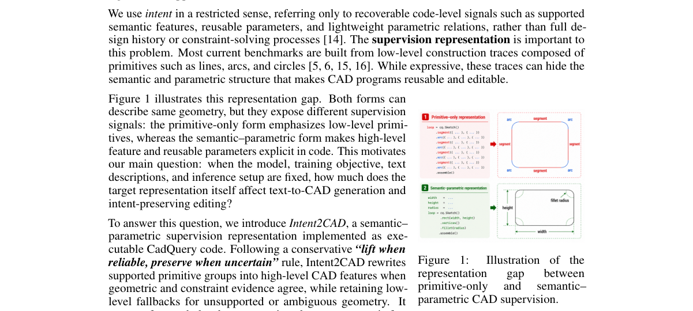

*Result - Illustration of the Intent2CAD semantic–parametric representation. (a) Intent-oriented text description of a CAD model. (b) Corresponding program using primitive-only supervision. (c) Corres*

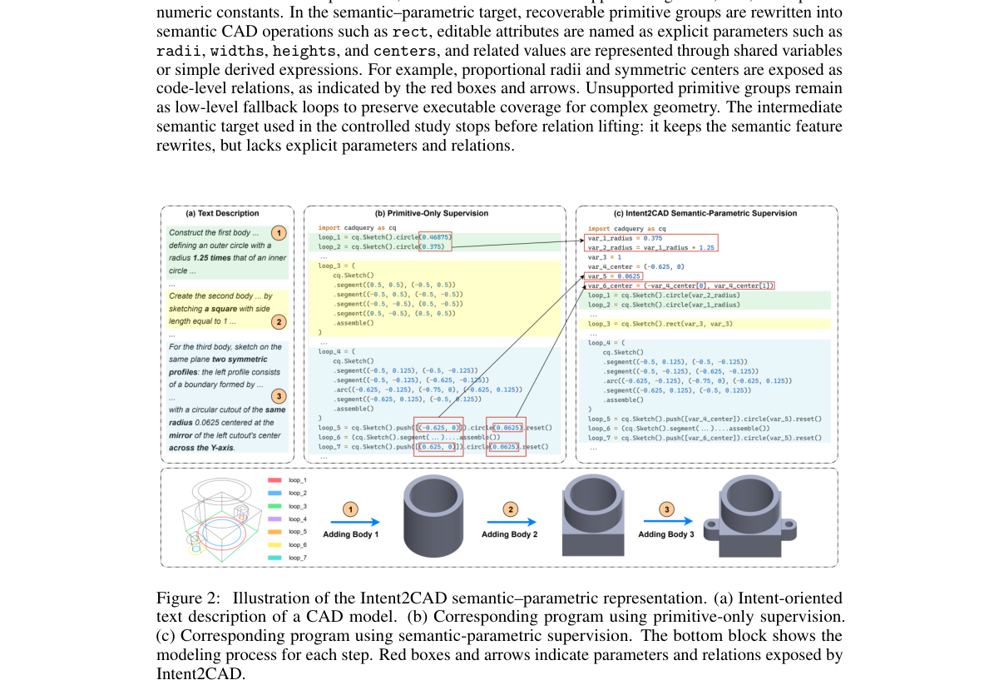

**Why this ranks #10**: 文本生成 CAD 程序只要能跑通就算完成，但真实工作流要求生成的程序保留可复用结构以便后续修改，这篇把这件事定义成 intent-oriented text-to-CAD，并给出一个很干净的结论：不必改架构或解码，改监督表示的粒度就够。配套的 IntentCAD-100K 由 DeepCAD 构造轨迹转换而来，规模与数据来源都交代清楚，工程上可直接拿来比对。

---

