# ArXiv Daily Digest - 2026-11-03 (音频与语音语言模型, 10 papers)

**Generated**: 2026-11-03 17:30 CST

**Source**: arXiv cs.CV, cs.SD, eess.AS, cs.CL, cs.AI, cs.RO, cs.LG submissions, listing day 2026-11-02 (announced 2026-11-03 00:00 UTC)

**Batch window**: 2026-11-01T18:00:00Z .. 2026-11-02T18:00:00Z（arXiv 公告批次横跨两个 UTC 日：前一日 18:00 UTC 起算，当日 17:59:59 UTC 截止）

**Track**: audio_lm (top 10 of 564 papers scanned, 70 full reads)

**Scope**: 音频 / 语音语言模型与双工语音助手，含全双工交互、语音理解与实时多模态助手

⚠️ **Wild-card**: 本批该线 2 篇为 wild-card 补足，已在正文逐条标注并给出理由。

补足原因：该批次音频域总量有限（cs.SD 12 篇 + eess.AS 13 篇），其中多数属生成或信号处理方向，真正命中「音频与语音语言模型 / 双工语音助手」的只有 8 篇，其余 2 篇为手语翻译数据集与脑电内言语解码的补位，已在正文逐条标注并给出理由。

---

## Top 10 - 音频与语音语言模型

### 1. InteractionBench: Measuring Timing, Task Accuracy, Whisper and Volume, and Grounding in Real-Time Voice Systems

**arXiv**: [2611.02430](https://arxiv.org/abs/2611.02430) | **Score**: 9.5 (relevance 9.5 x 0.7 + quality 9.5 x 0.3) | **Tags**: audio-lm, full-duplex, voice-agent, benchmark, turn-taking, groundedness, AveraLabs | **Categories**: cs.CL, cs.SD, eess.AS | **Pages**: 21

**Authors**: Richard Yucheng He; Chen Xu; Yihang Liu; Tairan Chen; Baodong Cao

**Affiliation**: AveraLabs

**Abstract**

> Most benchmarks for real-time voice systems focus on one aspect, such as turn-taking, instruction following, paralinguistic control, or conversational memory, each with its own data and set of systems. We present InteractionBench, a benchmark and evaluation harness that measures four dimensions on the same systems from the same recorded user audio: conversational timing, spoken-task accuracy, whisper and volume, and groundedness in conversations of more than twenty turns. The benchmark contains 221 items per system in thirteen scenarios. Before any system runs, we fix the expected floor-control actions for spoken tasks by rule and take the expected answers from scripted dialogues. We score whispering from the audio signal. We evaluate GPT-Live, GPT-Realtime, Gemini Live, Moshi, PersonaPlex, Freeze-Omni, and a turn-based cascade in 1,519 graded runs. Among the six full-duplex systems, timing and spoken-task accuracy are rank-correlated ($ρ= 0.83$), while the cascade has the highest spoken-task score (38/50) and the second-lowest timing score. No system corrects a user's grammar within the required window. Only Gemini Live whispers on most requests (8/10). Hosted systems pass 67-88% of groundedness probes, compared with 14-35% for open full-duplex models. Timing is measured where the client hears each system, so the timing of hosted systems includes network delay: for GPT-Live, whose server reports its own clock, removing a delay of about 1.5 s lowers its timing score from 86% to 56%. We also document where the protocol differs across systems, including the text instructions.

**Key findings**

- **Finding**: InteractionBench 在 13 个场景下对每个系统评 221 项、共 1519 次评分运行，同时覆盖 GPT-Live、GPT-Realtime、Gemini Live、Moshi、PersonaPlex、Freeze-Omni 与一个级联系统；6 个全双工系统的时序分与口语任务准确率 rank 相关 ρ=0.83，级联系统拿到最高口语任务分 38/50 却是倒数第二的时序分；没有系统能在要求窗口内纠正用户语法错误，只有 Gemini Live 在 8/10 的请求上真的压低音量耳语；groundedness 探针托管系统通过率 67-88%，开放全双工模型只有 14-35%；GPT-Live 去掉约 1.5 秒延迟后时序分从 86% 降到 56%。
- **Inference**: 时序与任务准确率 ρ=0.83 的强耦合说明能听清和接得上话在全双工系统里是同一套能力的两面，级联系统正是靠牺牲时序换取任务分；而 groundedness 从 14-35% 到 67-88% 的断层说明开放全双工模型目前还不敢在长对话里引用上下文，hosted 与 open 的差距里有一半来自检索与约束实现而非语音能力本身。
- **Recommendation**: 想评测全双工系统就直接复用这套 221 项协议，并且把时序分和任务分一起报，不要只报其中之一；自建服务务必把端到端网络延迟计入时序分，否则与 GPT-Live 这类托管模型不可比；排查 groundedness 失败时先查引用与检索约束，不要先换声学模型。

**Key figures**

*Framework - The evaluation harness. Every system hears the same recorded user audio through its own driver, and both tracks are recorded on one timeline, transcribed, and scored by the same graders.*

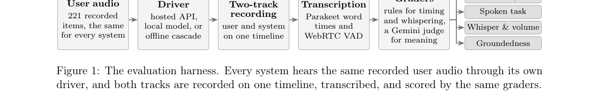

**Why this ranks #1**: 把时序、口语任务准确率、耳语与音量、20 轮以上长对话的 groundedness 四个维度放在同一批录音、同一套评分器上同时测，是目前少见的全双工系统横向对比。13 个场景、每系统 221 项、1519 次评分运行覆盖 6 个全双工模型加 1 个级联系统，时序分与口语任务分 rank 相关 ρ=0.83，说明这两件事其实是同一个能力。更扎眼的是 GPT-Live 去掉约 1.5 秒网络延迟后时序分从 86% 掉到 56%，说明托管系统的榜单名次有相当一部分是网络在贡献。

---

### 2. Voice-Native LLMs Hear Frustration but Do Not Listen to It

**arXiv**: [2611.02893](https://arxiv.org/abs/2611.02893) | **Score**: 9.3 (relevance 9.5 x 0.7 + quality 9.0 x 0.3) | **Tags**: audio-lm, paralinguistics, affect-detection, voice-native-llm, linear-probe, robustness, New York University Abu Dhabi | **Categories**: cs.AI, cs.SD, eess.AS | **Pages**: 27

**Authors**: Hanjun Luo; Yuhan Lu; Hanan Salam

**Affiliation**: New York University Abu Dhabi

**Abstract**

> Users convey frustration in what they say and in how they say it, and voice-native models, which hear speech instead of an ASR transcript, can register both. Existing evaluations read unchanged performance as robustness without checking perception. Following Brunswik's lens model, we measure on identical audio whether frustration is expressed, perceived, and utilized. We cross frustrated wording with frustrated voice in a within-item 2x2 design over 353 tasks and release the 1,412 clips as VoxAffect. Across 8 models, outputs look robust, with no detectable vocal effect on accuracy for 7. With neutral wording, all 8 label the frustrated voice frustrated in at most 3.1% of clips, although 7 of them detect acted anger in 73-100% of clips and human listeners classify the voice correctly in 65.3% of judgments. Yet linear probes decode the frustrated voice from the audio encoders of the 2 open-weight models, with paired accuracy 0.67 and 0.69, and in proprietary models too the voice raises perceived frustration once the words agree. The models thus hear the frustrated voice but do not listen to it, whereas their invariance to frustrated wording, perceived in 40-75% of clips, is genuine robustness. Our work is openly accessible at https://github.com/Astarojth/hear-not-listen.

**Key findings**

- **Finding**: 作者按 Brunswik 透镜模型把表达、感知、利用三层拆开测量，在 353 个任务上做措辞（中性/不满）与声音（中性/不满）的被试内 2x2 设计，发布 1412 条 clip 为 VoxAffect；8 个语音原生模型中 7 个检测不到任何可辨识的声音对准确率的影响，措辞为中性时 8 个模型对不满声音的标注正确率最高只有 3.1%，而 7 个模型对表演式愤怒的检出率在 73-100%、人类听者判对 65.3%；对两个开源模型的音频编码器做线性探针，配对准确率分别为 0.67 和 0.69。
- **Inference**: 表象上的鲁棒性其实掩盖了感知缺失，模型不是抗扰动，而是根本没在用副语言通道，只有当文字内容与声学一致时才把它读成感知到的不满。这对语音助手的产品含义很直接，用户压低声音表达不满时，系统会照字面执行而不做情绪补救。
- **Recommendation**: 评估任何语音模型时都补一组同一句内容、不同韵律的对照，别只看文字改写；做语音助手的话把情绪或不满的感知单独做成一个探针指标，并优先修编码器侧的信息利用（微调或显式引入副语言监督），而不是继续加数据量；VoxAffect 的 1412 条 clip 与评测脚本可以直接当基线。

**Key figures**

*Framework - The same spoken question in 3 conditions. An ALLM reads frustration in the words but not in the voice, and its answer stays unchanged.*

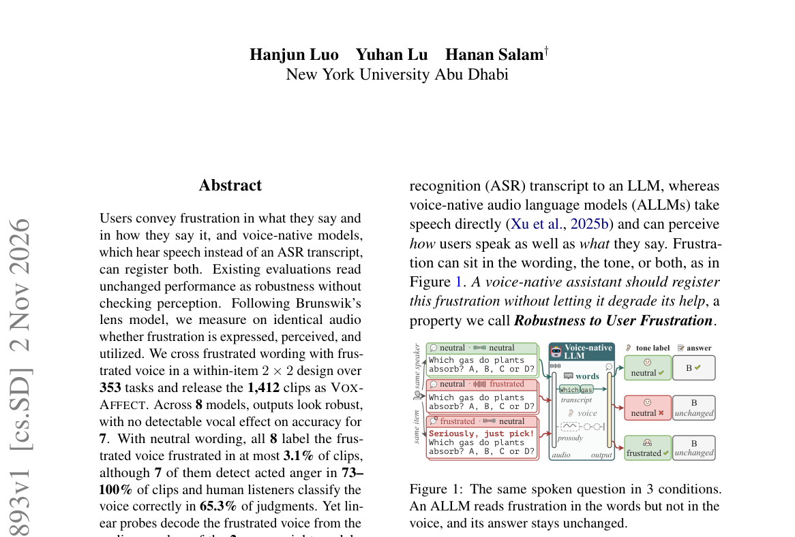

*Result - Our protocol. We build VOXAFFECT as a within-item 2 × 2 design of wording (B: neutral, A: frustrated) and voice (N: neutral, V: frustrated), verify that the frustration is expressed in the a*

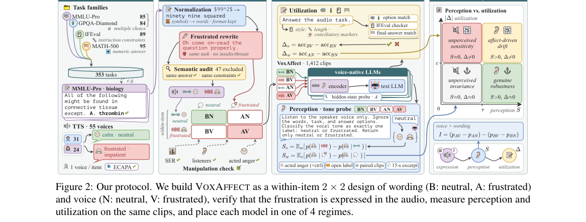

**Why this ranks #2**: 353 个任务、1412 条 clip 的 2x2 被试内设计（措辞不满 x 声音不满）把模型是否听出不满从回答是否变好里剥出来，这是语音大模型评测里很少有人认真做的一步。结果非常反直觉：8 个模型里有 7 个对声音不满毫无反应，只有当措辞也不满时模型才把它翻译成感知到的挫败；而线性探针能从两个开源模型的音频编码器里以 0.67/0.69 的配对准确率解出不满声音。也就是说特征在，模型不用。

---

### 3. GigaSpeech 3: Scaling Multi-Dialect Arabic Speech Recognition with Weakly Labeled Data

**arXiv**: [2611.02476](https://arxiv.org/abs/2611.02476) | **Score**: 9.0 (relevance 9.0 x 0.7 + quality 9.0 x 0.3) | **Tags**: audio-lm, arabic-asr, weak-supervision, dialect-variation, speech-corpus, asr, Shanghai Jiao Tong University | **Categories**: cs.CL | **Pages**: 13

**Authors**: Junzhe Liu; Yujie Tu; Yifan Yang; Peng Wang; Haoran Wang; Guodong Lin; Leyan Liao; Chengquan Zhang; Zhifu Gao; Xiangang Li; Qinyuan Cheng; Xipeng Qiu

**Affiliation**: Shanghai Jiao Tong University; Shanghai Innovation Institute; University of Chinese Academy of Sciences; The Chinese University of Hong Kong, Shenzhen

**Abstract**

> Dialectal Arabic speech recognition remains constrained by the scarcity of dialect-resolved transcribed speech despite the abundance of web audio. We introduce GigaSpeech 3, a corpus of 39,000 hours and 10 million weakly transcribed speech segments covering Algerian, Egyptian, Iraqi, Saudi, and Syrian Arabic. Starting from 60 hours of manual transcription per dialect, we train labeling models using speech-recognition-biased self-supervised learning and apply them to dialect-matched web audio. Data selection and four rounds of noisy-student refinement for Saudi and Syrian Arabic yield the final corpus. We validate its utility through dialect-specific and multi-dialect speech recognition training and cross-domain evaluation. On GigaSpeechBench, the final dialect-specific models outperform their labeling models across all five dialects and achieve a macro-average word error rate of 23.86%, a 16.6% relative reduction from the strongest third-party system covering all five dialects, while outperforming the best third-party result on three dialects. A multi-dialect model using self-predicted dialect identities achieves a macro-average word error rate of 25.51% while also supporting Modern Standard Arabic. Across eight conditions from three external corpora, a GigaSpeech 3-trained Zipformer achieves the lowest word error rate among six evaluated models in every condition, while adapting the Qwen3 speech recognizer on GigaSpeech 3 improves performance across all eight conditions. We release the corpus and recipes as a foundation for dialect-aware Arabic speech processing.

**Key findings**

- **Finding**: GigaSpeech 3 覆盖阿尔及利亚、埃及、伊拉克、沙特、叙利亚五种方言，共 39000 小时、1000 万条弱转写语音片段；每方言从 60 小时人工转写出发，用 ASR 偏置的自监督学习训标注模型再对配对网络音频打标，经数据筛选与四轮 noisy-student 精化得到最终语料；在 GigaSpeechBench 上方言专属模型在全部五个方言上都超过自己的标注模型，macro WER 23.86%，相对覆盖五方言的最强第三方系统下降 16.6%，并在三个方言上超过第三方最好结果；用自预测方言身份的多方言模型 macro WER 25.51% 且同时支持标准阿拉伯语；在三个外部语料的八种条件下，GigaSpeech 3 训练的 Zipformer 在六个模型中每次都是 WER 最低，迁移到 Qwen3 语音识别器也在全部八种条件下有提升。
- **Inference**: 弱监督自举能把方言语音从没法标变成可标，39000 小时这个量级说明网络音频配合方言匹配比纯人工标注更可能撑起方言 ASR；而 Zipformer 与 Qwen3 两种规模迥异的模型都能吃到收益，说明瓶颈在数据覆盖而不在模型容量，盲目换大模型不会有额外回报。
- **Recommendation**: 做阿语或其他低资源方言 ASR 时，先按这套流程建方言专属标注模型再自举，不要直接微调通才模型；macro WER 23.86% 与多方言 25.51% 可作为本轮参考基线；用现成多语识别器时把 GigaSpeech 3 当适配数据源，先跑通八条件外部语料评测再谈提升幅度。

**Key figures**

*Framework - Overview of GigaSpeech 3 construction and validation. Channel-disjoint manual and web data train dialect-specific VietASR labeling models, whose hypotheses are filtered to form the five-dialec*

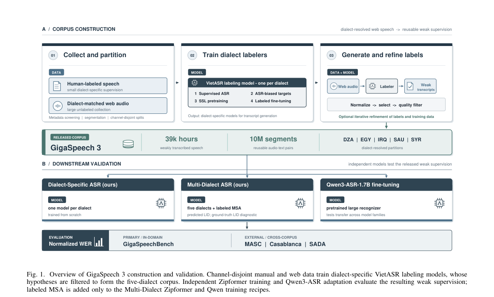

**Why this ranks #3**: 方言是阿拉伯语 ASR 真正卡住的地方，而手标注的方言语音稀缺。作者从每方言 60 小时人工转写起步，用 ASR 偏置的自监督学习训标注模型，再对配对的网络音频打标，配合数据筛选与四轮 noisy-student 精化，得到 39000 小时、1000 万条弱标注片段的语料。成色也扎实：方言专属模型 macro WER 23.86%，相对覆盖全部五个方言的最好第三方系统下降 16.6%。

---

### 4. Omni-Life: Benchmarking Omnimodal Real-Time AI Assistants in People's Daily Lives

**arXiv**: [2611.02835](https://arxiv.org/abs/2611.02835) | **Score**: 8.8 (relevance 9.0 x 0.7 + quality 8.5 x 0.3) | **Tags**: audio-lm, omni-modal, benchmark, proactive-assistance, response-latency, real-life, Hong Kong Polytechnic University | **Categories**: cs.CL | **Pages**: 36

**Authors**: Mengze Hong; Ziwei Shang; Di Liang; Zijian Li; Liang Zhu; Hongyu Shan; Robin Zhou; Minlong Peng; Zhiqiang Kou; Jia Wang; Di Jiang; Chen Jason Zhang

**Affiliation**: Hong Kong Polytechnic University; Today AI; Fudan University; Beijing University of Posts and Telecommunications

**Abstract**

> Real-time omnimodal assistants are expected to support people in everyday life, but audiovisual understanding alone does not establish whether they can provide timely and appropriate help. We introduce Omni-Life, a benchmark grounded in real-world user needs, deployment scenarios, and device-dependent observations. It combines controlled video synthesis for hazardous situations and edge cases with annotated real-world videos under a shared temporal protocol. The benchmark contains 400 videos: 290 requiring assistance, with 555 required intervention events, and 110 requiring silence throughout to test whether models can withhold unnecessary responses when no assistance is needed. We evaluate twelve configurations featuring mainstream real-time omnimodal models, jointly assessing event coverage, response content, timing, and unwanted output. At most 4.48% of videos requiring assistance are handled completely correctly. To examine practical deployment strategies, we study task reminders and response-latency tolerance. Reminders can improve recall by 17.12 percentage points but add approximately 4.6 unwanted responses per minute of reference silence. Increasing latency tolerance by 10s improves recall by at most 5.95 percentage points. These results show that existing models remain insufficient to deliver reliable assistance in real-life applications, calling for tailored model optimization in instruction following, timely proactive intervention, and withholding responses when assistance is not needed.

**Key findings**

- **Finding**: Omni-Life 用受控视频合成覆盖危险场景与边缘情况，配上带标注的真实视频，在统一时间协议下共 400 个视频（290 个需要协助、含 555 个必须介入的事件，110 个要求全程沉默），评测 12 种主流实时全模态模型配置，同时考察事件覆盖、响应内容、时序与多余输出；至多只有 4.48% 的需协助视频被完全正确处理；任务提醒可把召回提高 17.12 个百分点，但每分钟参考静音会增加约 4.6 次非必要响应；把响应延迟容忍度放宽 10 秒，召回最多只提升 5.95 个百分点。
- **Inference**: 4.48% 的天花板说明当前瓶颈不在识别，而在该不该说话、何时说、说到什么程度这三件事上；17.12 个百分点的召回增益要配上每分钟 4.6 次多余响应，等于用打扰换覆盖；而放宽延迟只换来不到 6 个百分点，说明单纯把模型调慢解决不了实时性问题。
- **Recommendation**: 做实时全模态助手时把沉默和多余响应当成独立指标一起报，不要只算事件召回；先复现 Omni-Life 的三档干预策略再定产品取舍，若用户场景对打扰敏感，提醒带来的召回增益不值得那 4.6 次每分钟；延迟预算不要指望靠放宽容忍度换召回，应从抑制机制与指令遵循上找收益。

**Key figures**

*Framework - Illustration of real-life use cases for om- nimodal real-time AI assistants.*

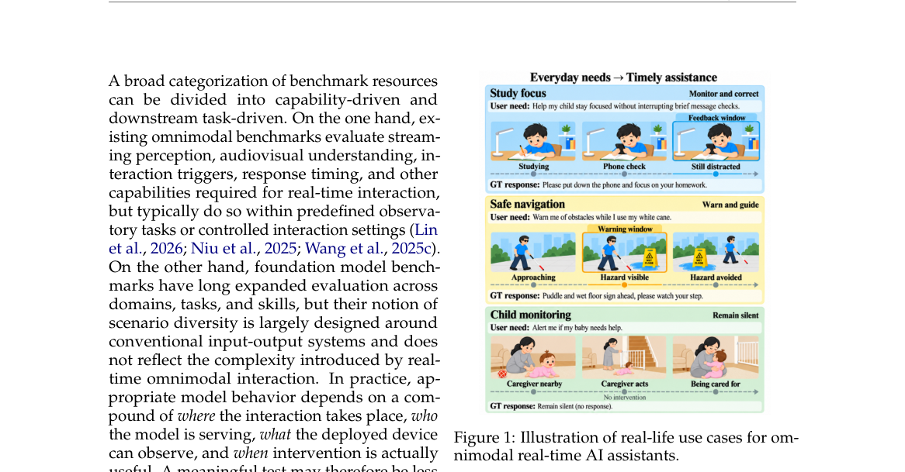

*Result - Five scenario domains and twelve ser- vice groups. Counts are videos; rings encode separate dimensions with schematic angles.*

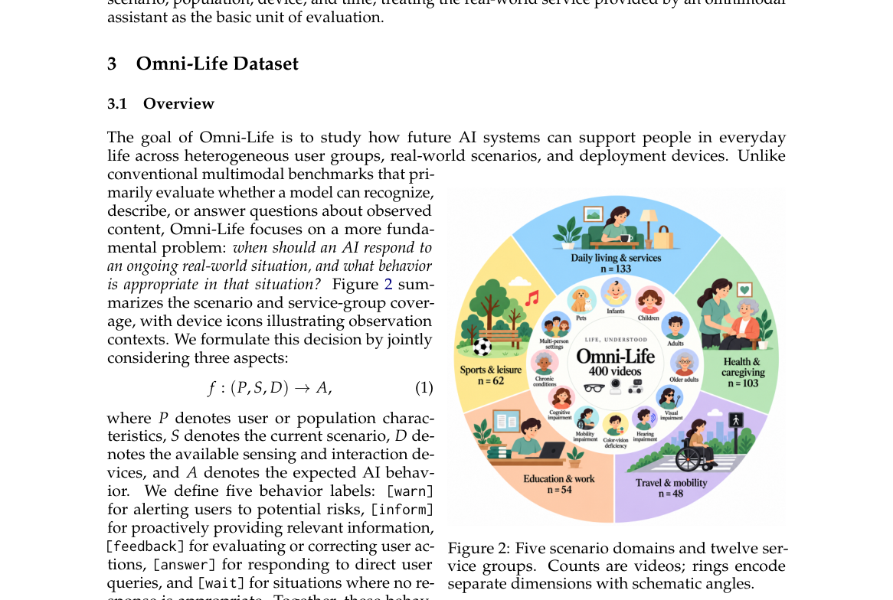

**Why this ranks #4**: 这是第一个把日常生活里到底要不要说话当成评测目标的全模态实时助手基准：400 个视频里 110 个要求全程沉默，其余 290 个含 555 个必须介入的事件。结果毫不留情，完全处理正确的视频最多只有 4.48%。而工程侧的结论更有用：任务提醒能把召回提高 17.12 个百分点，但每分钟参考静音要多出约 4.6 次多余响应。

---

### 5. How Much Prosody Does Your ASR Encoder Already Know

**arXiv**: [2611.02602](https://arxiv.org/abs/2611.02602) | **Score**: 8.5 (relevance 8.5 x 0.7 + quality 8.5 x 0.3) | **Tags**: audio-lm, end-of-turn, prosody, turn-taking, encoder-analysis, asr, Uniphore | **Categories**: eess.AS | **Pages**: 8

**Authors**: Rini Sharon; Kadri Hacioglu; Andreas Stolcke

**Affiliation**: Uniphore

**Abstract**

> End-of-turn (EoT) detection decides in real-time whether a speaker has finished. Traditional detectors rely on hand-built prosodic features (pitch, speaking rate, pauses), while modern detectors run on a neural ASR encoder that has processed the same audio. Because the encoder reads the signal those features are computed from, it may already hold much of the information they were meant to supply. We test this three ways, reading a streaming Zipformer encoder at four depths from raw input to the final layer. First, we measure how much prosody helps over the encoder alone. Second, we test whether prosody can be recovered from the encoder. Third, we ask whether any single feature still helps given the encoder. The three tests agree; prosody adds a large gain on raw audio, but that gain collapses once the signal passes through even the first encoder layer. The same pattern holds for two open-source encoders, wav2vec2 and Whisper, both of which are offline.

**Key findings**

- **Finding**: 作者在流式 Zipformer 编码器的四个深度上做三项检验，分别是韵律还能加多少、韵律能否从编码器反解出、给足编码器后单个特征是否还有用；原始滤波器组输入上韵律带来 Δbits=+0.053，一层编码器后只剩 +0.021，最终层总 ΔAUC=+0.006、经时间平移对照剔除说话人身份捷径后真实增量仅 +0.0015；编码器单独 AUC 从 0.685 升到 zip-early 0.874、zip-mid 0.908、zip-final 0.893，换第二个更强检测器结论不变；开源编码器上 Whisper 的正确增量从输入端 +0.040 降到几层内 +0.0035，wav2vec2 各层始终低于 0.003（其编码器单独 AUC 已达 0.95-0.98）；在公开 CASPER 语料上同样复现，原始 log-mel 韵律 ΔAUC=+0.085、其中 +0.059 为真实时序，而学到层上正确增量最多只有 0.002。
- **Inference**: 韵律不是对端点没用，而是对编码器没用，它在原始波形上确实是有效的轮次边界信号（AUC 0.79，远高于静音阈值的 0.63），但只要前面挂一个 ASR 编码器这层信息就已被吸收，再单独喂进去只剩说话人身份捷径。这是编码器已把韵律学进去的直接证据，而不是探针方法失灵的解释。
- **Recommendation**: 如果你的 EoT 已经搭在 ASR 编码器之上，优先做一次消融，把手工韵律支路拆掉看是否掉点，掉了多半只是说话人相关量；确实需要韵律时直接基于编码器表示训练而不是外接手工特征，省掉抽取延迟与按说话人调参；复用本文结论时把时间平移对照与第二个检测器这两条设计一并复刻，避免把说话人捷径误当成韵律增益。

**Key figures**

*Framework - A turn end from the data. The top panel shows the waveform with normalised energy and pitch contours falling into the boundary t∗before silence. The bottom panel shows the native reference lab*

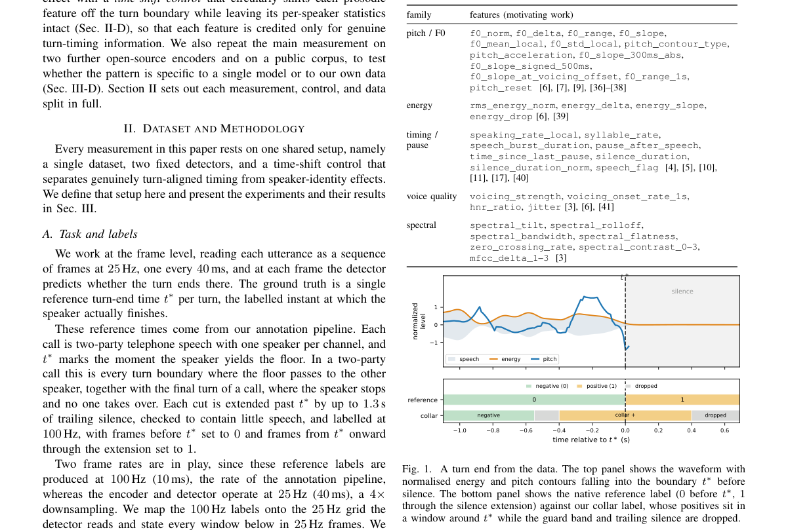

*Result - Encoder-alone accuracy (AUC, green) and the extra accuracy from hand-built prosody, by depth. The prosody increment splits into genuine timing (orange, removed by the time-shift control) and a*

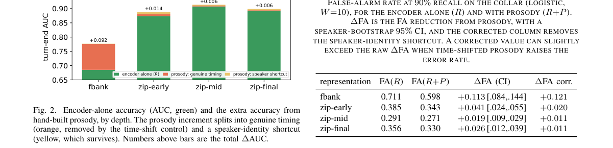

**Why this ranks #5**: 这篇把一个被默认了几十年的工程惯例做了实证拆解：手工韵律特征到底还给端点检测带来了什么？在流式 Zipformer 编码器上逐层测下来，答案是几乎没有，原始滤波器组上韵律能加 Δbits=+0.053，经过一层编码器就掉到 +0.021，最终层去掉说话人捷径后的真实增量只有 ΔAUC=+0.0015。对正在维护 EoT 前端的团队，这直接关系到要不要继续付特征抽取、延迟和按说话人调参的成本。

---

### 6. R$^2$-Omni: Reducing Structural and Precision Redundancy in Omni-LLMs for Long-Form Generation

**arXiv**: [2611.03247](https://arxiv.org/abs/2611.03247) | **Score**: 8.5 (relevance 8.5 x 0.7 + quality 8.5 x 0.3) | **Tags**: audio-lm, kv-cache, token-pruning, quantization, omni-llm, inference-efficiency, InfRec Cardinal AI Lab | **Categories**: cs.CV | **Pages**: 32

**Authors**: Bolong Feng; Pengfei Zhou; Zhenglin Wan; Wei Wang; Wangbo Zhao

**Affiliation**: InfRec Cardinal AI Lab; Shanghai Jiao Tong University; National University of Singapore; The Hong Kong University of Science and Technology

**Abstract**

> Omni-modal large language models (Omni-LLMs) typically process large numbers of multimodal tokens from audio-visual inputs, incurring substantial computational costs and a large memory footprint for the key-value (KV) cache. Aggressive token pruning can alleviate this problem while maintaining competitive performance on multiple-choice tasks, which require only a single option as output. However, we observe substantial quality degradation when generating long-form, open-ended responses. We attribute this gap to query-guided selection, which can retain sufficient evidence for answer selection while discarding details needed for comprehensive generation. This motivates reducing overlapping information across tokens, termed structural redundancy, while preserving diverse content. However, the retained representations may still contain precision redundancy due to unnecessarily high numerical precision in their cached values. To address these two levels of redundancy in token representations, we introduce a training-free framework named R$^2$-Omni. First, Structure-Aware Token Consolidation (STC) consolidates redundant representations using spatiotemporal similarity in video and local continuity in audio. Then, Semantic-Sensitivity Guided Precision Allocation (SSPA) allocates value precision to the retained representations according to the estimated reduction in attention-output error under quantized keys, with query attention and audio-visual alignment providing a semantic prior. Extensive experiments on long-form generation benchmarks demonstrate an average 5.0$\times$ reduction in the memory footprint while preserving 97.98% of baseline generation quality and achieving a 1.48$\times$ end-to-end speedup, highlighting the benefits of jointly reducing structural and precision redundancy.

**Key findings**

- **Finding**: R2-Omni 指出 query-guided token 剪枝在长文生成上质量明显退化，在 Video-SALMONN 2 测试集上的退化比 Daily-Omni 的多选任务严重得多；据此提出免训练的两级冗余削减，结构感知 token 合并（STC）按视频的时空相似度与音频的局部连续性合并冗余表示，语义敏感度引导的精度分配（SSPA）按量化 key 时注意力输出误差的估计给保留表示分配数值精度；在长文生成基准上平均显存占用降到基线的五分之一，同时保留 97.98% 的生成质量，并取得 1.48 倍端到端加速。
- **Inference**: 剪枝类方法的评测口径选错就会给出错误结论，用多选题验剪枝会系统性高估剪枝在真实生成场景的可用性。STC 加 SSPA 把丢哪些 token 和留的 token 用几位精度解耦成两个可分别优化的问题，这是比一刀切剪枝更通用的降显存思路。
- **Recommendation**: 准备压长音视频上下文时，先在你自己的长文生成任务上跑一遍剪枝基线，不要信多选任务上的结论；R2-Omni 是 training-free 的，可以直接挂在现有 Omni-LLM 上试显存与质量曲线；若你的场景以短答 QA 为主而非长文生成，剪枝收益可能有限，此时更值得先试 KV cache 低比特量化这类不丢 token 的路径。

**Key figures**

*Framework - Motivation of R2-Omni. (a) Aggressive token pruning degrades long-form generation on the Video-SALMONN 2 testset [6] more severely than multiple-choice performance on Daily-Omni [16]. Detai*

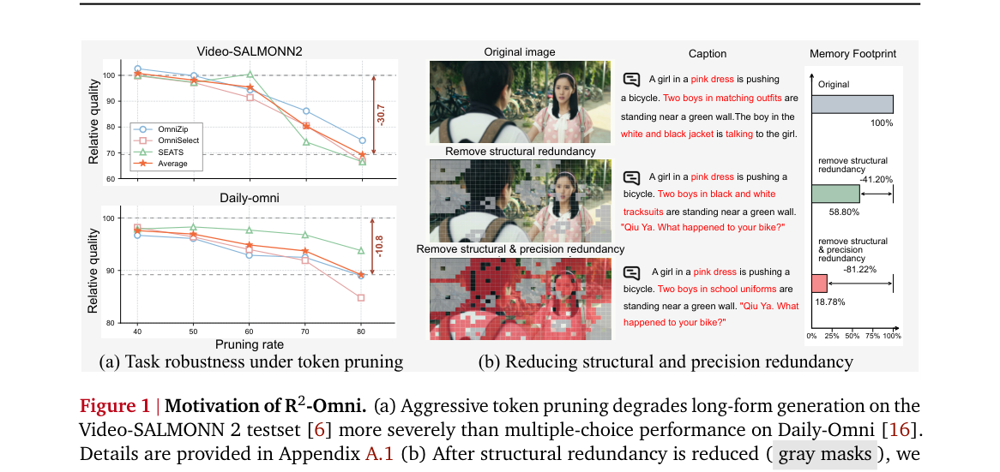

*Result - Overview of R2-Omni. Structure-Aware Token Consolidation(STC) reduces overlapping information across audio-visual tokens before prefill. Semantic-Sensitivity Guided Precision Alloca- tion(S*

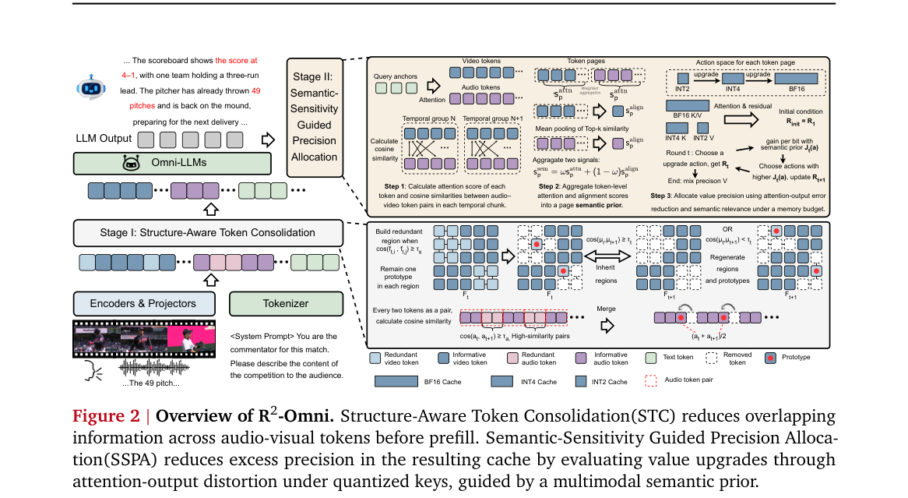

**Why this ranks #6**: 多模态大模型的 KV cache 显存开销在长视频长音频输入下是硬约束，但现有 token 剪枝大多是在多选题上评的，一旦让模型写长回答质量就崩。作者用结构冗余与精度冗余两级拆解给出解法：结构感知 token 合并加语义敏感度驱动的精度分配，全程 training-free，平均显存降 5.0 倍、保留 97.98% 生成质量、端到端加速 1.48 倍。这对要部署长上下文音视频模型的团队是直接可用的省显存手段。

---

### 7. Sequence-to-Sequence Refinement for EEND-VC Diarization with a Shared Encoder

**arXiv**: [2611.02709](https://arxiv.org/abs/2611.02709) | **Score**: 8.0 (relevance 8.0 x 0.7 + quality 8.0 x 0.3) | **Tags**: audio-lm, diarization, self-supervised-features, speaker-confusion, chime-8, real-time-factor, University of Science and Technology of | **Categories**: eess.AS | **Pages**: 5

**Authors**: Ruoyu Wang; Jun Du; Weixin Zhu; Yannan Wang

**Affiliation**: University of Science and Technology of China; Ethereal Audio Lab

**Abstract**

> End-to-end neural diarization with vector clustering (EEND-VC) separates local segmentation from global speaker assignment, leaving speaker confusion (SC) despite strong segmentation. We propose shared-encoder sequence-to-sequence (S2S) refinement, which reuses DiariZen's self-supervised learning (SSL) representations for speaker-conditioned decoding and prior-constrained assignment. We study frozen-feature refinement with WavLM and structurally pruned w2v-BERT 2.0, and extend the latter to joint training of local segmentation and refinement heads. The heads learn separate layer mixtures while their losses update one acoustic encoder. Across eight domains, frozen-feature refinement reduces macro diarization error rate (DER) from 12.95% to 12.40% with WavLM and from 12.35% to 12.08% with w2v-BERT 2.0, with relative SC reductions of 17.4% and 14.6%. It adds approximately 15% to system real-time factor. The joint system further lowers macro DER to 11.90%, improving seven of eight domains over non-joint refinement. Error decomposition separates SC-driven refinement gains from detection-driven joint-system gains.

**Key findings**

- **Finding**: 该方法用共享编码器替换 NSD-MS2S 的声学编码器，复用 DiariZen 的自监督表征做说话人条件解码与先验约束指派，并在 8 个域上评测；冻结 WavLM 特征把宏平均 DER 从 12.95% 降到 12.40%、说话人混淆相对下降 17.4%，结构化剪枝的 w2v-BERT 2.0 从 12.35% 降到 12.08%、混淆相对下降 14.6%，代价是系统实时率增加约 15%；再让局部切分头与精修头联合训练共享一个声学编码器后，宏平均 DER 进一步降到 11.90%，在 8 个域中的 7 个优于非联合精修；作者还用误差分解把精修带来的混淆下降与联合系统带来的检测收益分开。
- **Inference**: EEND-VC 剩下的错误主要是说话人混淆而非检测错误，所以拿检测能力更强的模块去硬提检测收益是错配的；用现成自监督表征做冻结特征精修，能以约 15% 实时率换取接近两成的混淆相对下降，说明已有 ASR 或 SSL 前端可以顺手复用，这条路径工程性价比很高。
- **Recommendation**: 想提 DER 又不想重训声学前端时，先在 DiariZen 类 SSL 表征上接一个冻结特征的 S2S 精修头做基线，成本远低于换主干；评测时务必同时看混淆与检测分解，否则会被检测项的改动误导；实时率紧张的场景可先只对混淆严重的域启用精修，约 15% 的整体实时率代价通常可接受。

**Key figures**

*Framework - DiariZen and shared SSL features (a), speaker-conditioned decoding and training (b), and prior-constrained inference (c). Gray-green dashed arrows denote conditioning; blue/red dashed arrows d*

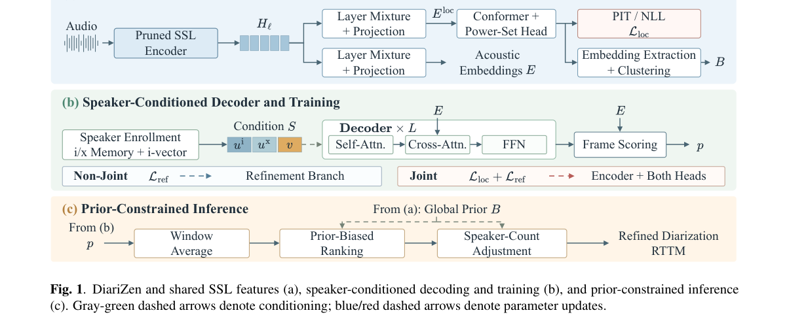

*Result - Highlighted fixed-count identity corrections with non- joint w2v-BERT 2.0: (a) AliM and (b) AIS.*

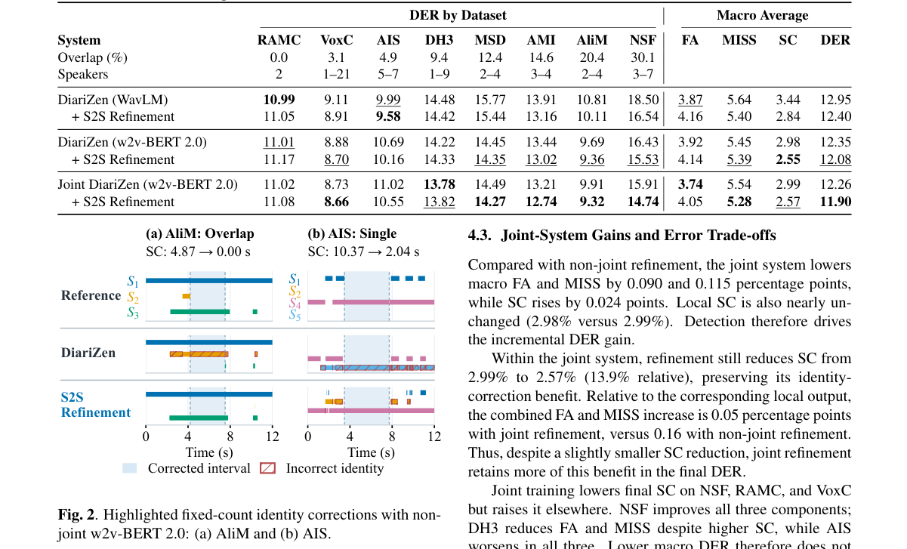

**Why this ranks #7**: 端到端神经分离加向量聚类（EEND-VC）把切分和全局说话人指派分开做，分得再好也会留下说话人混淆。这篇不重训前端，而是把 DiariZen 的自监督表征接到序列到序列精修头上，用说话人条件解码和先验约束指派去打混淆：WavLM 冻结特征下宏平均 DER 从 12.95% 降到 12.40%，说话人混淆相对下降 17.4%，代价只是约 15% 的实时率上升；联合训练后宏平均 DER 到 11.90%。

---

### 8. SPATEX: Array-Flexible Multichannel-to-Multichannel Target Speech Extraction using Direction Clue

**arXiv**: [2611.03119](https://arxiv.org/abs/2611.03119) | **Score**: 8.0 (relevance 8.0 x 0.7 + quality 8.0 x 0.3) | **Tags**: audio-lm, target-speech-extraction, multichannel, array-flexibility, doa, si-snri, Shanghai Jiao Tong University | **Categories**: eess.AS | **Pages**: 5

**Authors**: Wen Wen; Changda Chen; Yu Xi; Haoyu Li; Qiang Zhou; Guanyu Chen; Xiaoyu Gu; Bohan Li; Shuai Wang; Kai Yu

**Affiliation**: Shanghai Jiao Tong University; Waseda University; Nanjing University; AISpeech

**Abstract**

> Multichannel-to-multichannel target speech extraction (MIMO TSE) aims to recover the target speech signal at each microphone while preserving interchannel spatial information. However, existing MIMO TSE systems generally assume a fixed microphone configuration, limiting their applicability to recording devices with varying microphone configurations. In this work, we propose SPATEX, the first array-flexible MIMO TSE framework that reconstructs microphone-wise target speech signals across microphone counts and array geometries. Given microphone coordinates and a target direction-of-arrival (DOA), SPATEX combines geometry-aware channel exchange and shared temporal attention to jointly reconstruct microphone-wise target signals while maintaining permutation equivariance. Experiments show that SPATEX outperforms array-flexible single-output baselines under most test conditions and consistently improves extraction quality and spatial fidelity over fixed-array MIMO baselines. Ablation studies further validate the benefits of temporal coordination and spatial supervision, while additional evaluations demonstrate robustness to target DOA errors. Our code and dataset are available at https://github.com/Wenanzhi/SPATEX.

**Key findings**

- **Finding**: SPATEX 是首个阵列可变的 MIMO 目标语音提取框架，给定麦克风坐标与目标 DOA，用几何感知通道交换与共享时序注意力联合重建各通道目标语音并保持置换等变；在未见阵列上最高取得 15.98 dB SI-SNRi，多数测试条件下优于阵列可变的单输出基线，且在提取质量与空间保真度上稳定超过固定阵列 MIMO 基线，SI-SNRi 最多提升 3.06 dB；消融显示空间亲和机制分别带来 2.92 dB 与 3.63 dB 的 SI-SNRi 增益，训练用输入 SIR 从 -5 到 5 dB 采样；额外评测显示对目标 DOA 估计误差鲁棒。
- **Inference**: 之前 MIMO TSE 之所以绑定固定阵列，是因为网络默认通道顺序与几何有意义；用几何感知通道交换把通道身份从参数里解耦出来，参数才能在不同麦克风数间共享，这比通道 padding 或逐阵列微调更根本，对硬件形态多变的消费级阵列产品是把每个型号重新标定的成本降到最低的路径。
- **Recommendation**: 有多形态麦克风阵列产品线的团队可直接按几何感知通道交换加共享时序注意力的结构做基线，训练时把 SIR 在 ±5 dB 间采样以获得 DOA 误差鲁棒性；评测务必同时看 SI-SNRi 与空间保真度指标，只看信噪比会掩盖空间信息损失；部署前用错误 DOA 偏移做一次鲁棒性测试，目标方向估计器的误差往往比网络本身更致命。

**Key figures**

*Framework - Overview of SPATEX. The network reconstructs the target speech image at each microphone using array geometry and target DOA as auxiliary cues. Encoder and decoder parameters are shared across*

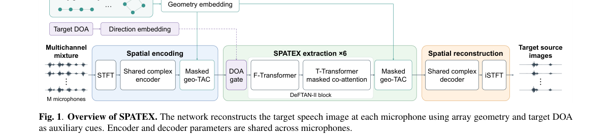

*Result - Robustness to target-DOA cue errors on the Fixed 4-Mic Array. Results are averaged over positive and negative offsets of equal magnitude. Shaded regions show the range of the four external bas*

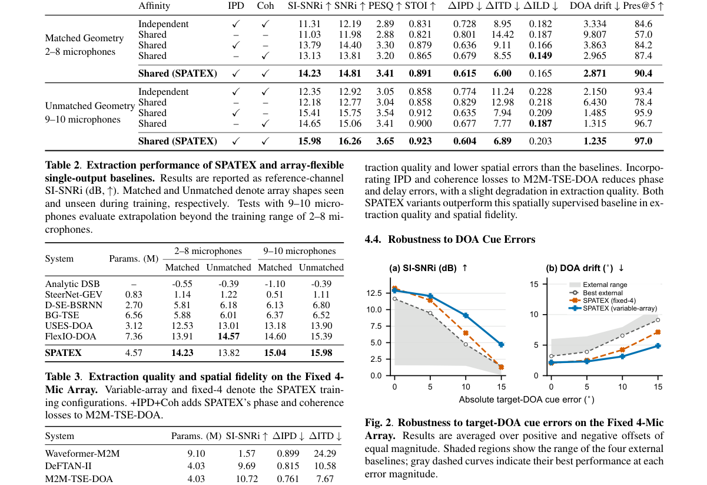

**Why this ranks #8**: 现有 MIMO 目标语音提取都假设麦克风阵列配置固定，换设备就得重训。作者用几何感知的通道交换加共享时序注意力，让同一个网络在不同麦克风数与阵列几何下重建每个通道的目标语音，同时保持置换等变性：在未见阵列上最高拿到 15.98 dB SI-SNRi，相对固定阵列 MIMO 基线最多提升 3.06 dB。对做会议设备、耳机阵列这类硬件形态多变的团队，这是直接可用的架构。

---

### 9. Maswao: An automatically collected, prepared, and benchmarked dataset for the South African Sign language

**arXiv**: [2611.02903](https://arxiv.org/abs/2611.02903) | **Score**: 7.5 (relevance 7.5 x 0.7 + quality 7.5 x 0.3) | **Tags**: audio-lm, sign-language, weak-alignment, dataset-construction, sign-to-text, low-resource, University of Pretoria | **Categories**: cs.AI, cs.CL | **Pages**: 16

**Authors**: Thapelo Sindane; Unarine Netshifhefhe; Vukosi Marivate; Abiodun Modupe; Herkulaas Combrink; Ketro Sithole

**Affiliation**: University of Pretoria

**Abstract**

> Recent advancements in sign language processing can be attributed to developments in both large-scale dataset collection and algorithmic complexity in areas such as pose estimation techniques, signal processing through Transformer models, and model optimization. However, only a handful of sign languages, such as the American, British, and German, from over 200 globally recognized sign languages, reap the benefits of such advancements, while the rest lag behind. In this study, we aim to address this technological disparity by proposing a framework for the automatic collection and preparation of sign language datasets, with very minimal human-labour intervention, using the South African Sign Language (SASL) as a testbed. Specifically, we automatically collect SASL video content using public resources such as news broadcasts. Additionally, we convert their accompanying audio streams into text using available Automatic Speech Recognition (ASR) tools. Furthermore, we crop the sign language area in the videos and use gradient descent to locate valleys of non-motion to determine end-of-sentence points within long videos to create our weakly sentence-aligned parallel corpora -- the Maswao (Signs) dataset. Finally, we benchmark the weakly aligned dataset on the task of Sign-to-text Translation using Recurrent Neural Networks and Transformer models to compare their individual intricacies. Our results show that Transformer models proposed in the literature outperform recurrent baselines, with the best-performing Transformer achieving BLEU-1 to BLEU-4 scores of 13.78, 5.21, 2.52, and 1.54, respectively, as well as ChrF = 18.09 and ROUGE-L = 10.51. These results indicate that the task remains promising and warrants further investigations.

**Key findings**

- **Finding**: Maswao 框架用 yt-dlp 从南非广播公司（SABC）抓到约 2000 个视频并过滤出含手语解读的片段，用人脸检测定位解读员后裁剪手语区域，用 Whisper-large-v3 转写音轨得到句子文本，再以梯度下降寻找运动差异的谷底来推断长视频内的句末断点，产出首个南非手语弱句对齐平行语料 Maswao，包含 2944 个口语句子与手语句子的配对；在手语转文本任务上比较了姿态估计工具、CNN、RNN 与 Transformer，最好的 AlexNet 加 Transformer 取得 BLEU-1 至 BLEU-4 为 13.78、5.21、2.52、1.54，ChrF 18.09，ROUGE-L 10.51，优于所有循环网络基线。
- **Inference**: 手语研究长期被数据卡住，而这套流程说明对有官方手语解读的新闻流而言，自动采集加弱对齐加首个基准这条路是走得通的，成本几乎只是人工；不过 BLEU-4 只有 1.54 也说明弱对齐噪声直接压在翻译质量上，弱监督拿到的是语料，不等于拿到了准确对齐。
- **Recommendation**: 做低资源手语或口语翻译时先把自动采集加弱对齐这条流程复刻一遍，新闻广播比众包标注便宜得多，拿到语料后再补人工校验；引用这批数据时注意它来自广播转述语域而非日常对话，BLEU-1 13.78 的水平不要当成 SASL 翻译能力的上限；若目标是可用系统而非数据集，优先把精力放在提升句级对齐精度上，BLEU-4 1.54 的主要损失在对齐而非建模。

**Key figures**

*Framework - News video example with sign language interpretation example (left) with topic model for all collected videos (right).*

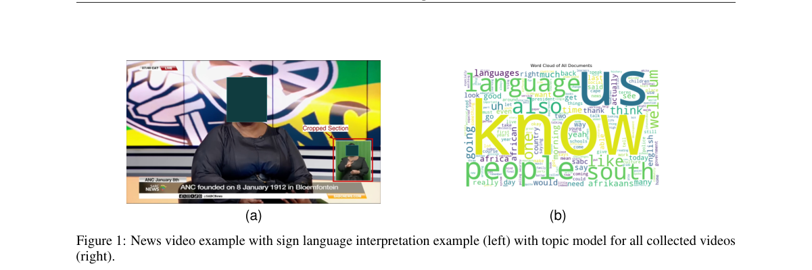

*Result - Overview of the framework used to create the Maswao dataset.*

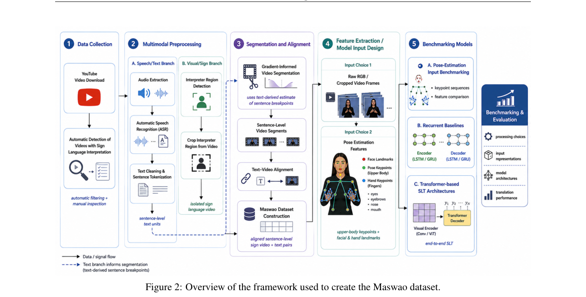

**Why this ranks #9**: 先说清补位这件事：本批次音频与语音语言模型与双工语音助手这条线的硬供给不足 10 篇，手语-文本翻译属于同族的相邻方向，是为凑满前 10 而补进来的，它并不是严格意义上的语音 LM 论文。仍然值得看的原因是它把 200 多种手语里长期被忽略的南非手语，用新闻广播做全自动采集与弱对齐，产出首个 SASL 弱对齐平行语料（2944 个句对），并给出首个基准，把语料建设成本压到了接近人工的程度。  [wild-card=yes] 该论文是手语-文本翻译数据集与对齐方法，属于语音-语言理解方向但不是语音语言模型本身，补位计入。

---

### 10. Inner-Speech Decoding from EEG Across Three Corpora Under a Fixed Architecture and Protocol

**arXiv**: [2611.02180](https://arxiv.org/abs/2611.02180) | **Score**: 7.1 (relevance 7.0 x 0.7 + quality 7.5 x 0.3) | **Tags**: audio-lm, eeg, inner-speech, bci, cross-dataset, reproducibility, American International | **Categories**: cs.AI, cs.LG, eess.SP | **Pages**: 30

**Authors**: Md Wahiduzzaman Suva; Md Imtiaj Alam Sajin; Esm E Moula Chowdhury Abha; Susham Moula Choudhury Akash; Md Tauhidul Islam; Abhijit Bhowmik; Md Manirul Islam; Debajyoti Karmaker

**Affiliation**: American International University-Bangladesh; N.I. Lobachevsky National Research Nizhny Novgorod State University; RMIT University

**Abstract**

> Inner-speech decoding from electroencephalography could support non-invasive communication for people with severe motor impairment, but comparison across studies is hindered by dataset- and protocol-specific evaluation. We present a controlled cross-dataset study using one preprocessing pipeline, one within-subject five-fold cross-validation protocol, and a compact dual-attention Transformer (VC-DATNet; approximately 131,000 parameters) across three public corpora: Thinking Out Loud (10 participants), BISpeech (4), and SyncSpeech (3). VC-DATNet achieved per-participant sensor/source hybrid accuracies of 39.48% on the four-class Thinking Out Loud task, 20.60% on the eight-word BISpeech task, and 25.53% on the eight-word SyncSpeech task, for which we report the first decoding result. Sensor-space and cortical source-space representations were complementary, with each performing better for different participants; this pattern replicated across all three corpora and nine architectures. Moreover, ten decoders spanning convolutional, recurrent, temporal-convolutional, hybrid Transformer, and pretrained foundation-model families converged within a narrow accuracy range on every dataset. These findings indicate that representation choice should be individualized and suggest that performance on these public corpora is constrained more by signal quality and dataset scale than by model capacity. The released pipeline provides a reproducible benchmark for future inner-speech decoding studies

**Key findings**

- **Finding**: 作者用同一套预处理、被试内五折交叉验证协议和约 131000 参数的双注意力 Transformer（VC-DATNet：多尺度时域卷积前端加均值与对数方差双池化加门控自注意力编码器）在三个公开内言语 EEG 语料上评测：Thinking Out Loud（10 名被试、4 类）逐被试传感器与源空间混合准确率 39.48%，BISpeech（4 名被试、8 词）20.60%，SyncSpeech（3 名被试、8 词）25.53%，后者是首次报告解码结果；传感器空间与皮层源空间表示互补，各自在不同被试上更好，这一模式在三个语料与九种架构上都复现；十种解码器（卷积、循环、时域卷积、混合 Transformer 与 2500 万参数预训练基础模型）在每个语料上都收敛到狭窄准确率区间；作者还在 ToL 上把最强已发表基线独立复现到 0.1 个百分点以内。
- **Inference**: 架构固定之后跨语料的一致上限说明内言语解码的瓶颈是信号质量与语料规模而不是模型容量，这也解释了为什么各家论文的准确率差异主要来自协议与数据集；传感器空间与源空间互补则意味着只报告单一表示的结果没有可比性，必须按被试选择表示。
- **Recommendation**: 做内言语 BCI 时不要先换模型，先固定协议并按被试在传感器空间与源空间之间做选择；把 VC-DATNet 这类约 13 万参数的小模型当基线而不是嫌它小，同协议下大模型基本不涨点；要发论文先用公开语料和统一协议做跨语料基线，否则数值无法与他人比较；真实产品场景应把重心放在信号质量与采集时长，而不是堆解码器。

**Why this ranks #10**: 同样是补位：本批次音频与语音语言模型与双工语音助手这条线的硬供给不足 10 篇，EEG 内言语解码属于同一族的相邻方向被拿来补位，严格说它不是语音 LM 论文。它仍值得看的地方在方法学：固定一套预处理和被试内五折协议、只用一个 13.1 万参数的解码器横跨三个公开语料做对比，而十种不同族系的解码器收敛到同一狭窄准确率区间，这是对内言语解码到底卡在哪给出的一个相当硬的答案。  [wild-card=yes] 该论文是脑电内言语解码，属于神经信号到文本的语音理解前端，不是语音语言模型，补位计入。

---

