# ArXiv Daily Digest - 2026-11-03 (具身智能与世界模型, 10 papers)

**Generated**: 2026-11-03 17:30 CST

**Source**: arXiv cs.CV, cs.SD, eess.AS, cs.CL, cs.AI, cs.RO, cs.LG submissions, listing day 2026-11-02 (announced 2026-11-03 00:00 UTC)

**Batch window**: 2026-11-01T18:00:00Z .. 2026-11-02T18:00:00Z（arXiv 公告批次横跨两个 UTC 日：前一日 18:00 UTC 起算，当日 17:59:59 UTC 截止）

**Track**: embodied (top 10 of 564 papers scanned, 70 full reads)

**Scope**: 具身智能与世界模型，含机器人操作与导航、VLA 策略、触觉与世界模型评测

---

## Top 10 - 具身智能与世界模型

### 1. ForceLDM: A Force-aware Latent Dynamics Model for Contact-Rich Manipulation

**arXiv**: [2611.03294](https://arxiv.org/abs/2611.03294) | **Score**: 9.3 (relevance 9.5 x 0.7 + quality 9.0 x 0.3) | **Tags**: embodied, contact-rich, force-sensing, world-model, distillation, vla, Xi'an Jiaotong University | **Categories**: cs.RO | **Pages**: 23

**Authors**: Peiyuan Tang; Yao Li; Xiaodong Zhang; Wuyang Zhang; Qin Xia; Yanyong Zhang; Zijiang Yang

**Affiliation**: Xi'an Jiaotong University; University of Science and Technology of China; Suzhou Artificial Intelligence Laboratory

**Abstract**

> Contact-rich manipulation requires fine-grained control and complex physical interactions with the environment, posing significant challenges for robot policy learning. Vision-only policies struggle with such tasks, as contact states and interaction forces are difficult to infer from visual observations alone. Existing methods mitigate this issue by incorporating force or tactile sensing. However, they often treat these signals as auxiliary observations without fully exploiting their role in modeling future interaction dynamics. To address this, we propose ForceLDM, a force-aware latent dynamics model that learns future contact and motion dynamics to guide action generation. Rather than directly predicting future observations, which can entangle task-relevant dynamics with irrelevant sensory details, ForceLDM learns a compact representation of future dynamics through knowledge distillation. Specifically, a teacher network with privileged future force/torque and optical flow signals extracts future dynamic features, which are then distilled into a student network trained only on current observations. This enables the student model to reason about upcoming contacts and physical dynamics without relying on future sensory inputs at deployment. To improve robustness and generalization, we further introduce a curriculum-based progressive noise injection strategy to mitigate over-reliance on future features. Experiments on five real-world contact-rich manipulation tasks demonstrate that ForceLDM outperforms state-of-the-art baselines, generalizes effectively to novel objects, and remains robust to environmental perturbations. Project page and code are available at https://tpy001.github.io/ForceLDM/.

**Key findings**

- **Finding**: ForceLDM 用未来动力学蒸馏框架，把特权教师（额外接收未来 6D 力力矩与 RAFT 光流）通过动作预测学到的紧凑未来动力学表示，用可学习查询 token 蒸馏给只看当前观测的学生，并以课程式渐进噪声注入防止学生过度依赖未来特征；基于 pi0 构建，双视角图像加 10 步力矩历史、16 个运动查询加 1 个力查询，在第 8、12、16 层做蒸馏、蒸馏权重 0.5，微调 30K 步，推理时用 10 步流匹配生成 32 步动作块；在 USB 插入、齿轮装配、翻箱、擦板、VGA 插接五个真机任务上平均成功率 87.1%，比最强基线 Seer 高 14.9 个百分点，USB 插入 92.0%、VGA 插接 85.0%，每任务采集 80-100 条成功演示、每方法评测 20-30 次真机 rollout；齿轮装配上仍弱于 TA-VLA，作者归因于空间感知不足导致工作区边界附近抓取失败。
- **Inference**: 直接预测未来观测会把任务无关的背景、外观和传感器噪声一起学进去，这是视频类世界模型难以落地到接触任务的根本原因；用特权教师看未来、只学对未来动作有用的那部分表示绕开了这个问题，同时保留了对接触的建模能力。齿轮装配输给 TA-VLA 也说明力觉世界模型解决的是接触动力学、不解决几何感知，两者得叠着用。
- **Recommendation**: 做插入与装配类任务时，把这条特权教师加未来动力学蒸馏加学生单模态部署的路线作为力觉策略的强基线，先在 pi0 上复现再改；评测务必留出未见物体与遮挡等 OOD 条件，力觉策略的泛化差距主要出现在这些设置；引入力通道时同时准备空间感知方案，作者自己就在齿轮装配上被 TA-VLA 反超，别指望力觉一路包办。

**Key figures**

*Framework - Comparison with prior methods. (a) Force-aware VLAs incorporate force feedback but lack explicit modeling of future interaction dynamics. (b) Video-based WAMs model future dynamics through v*

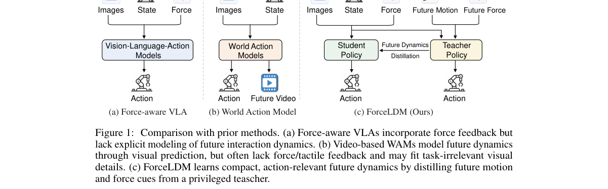

*Result - Overview of ForceLDM. (a) Both teacher and student generate actions from current multimodal observations and language instructions. The teacher additionally receives future force and motion*

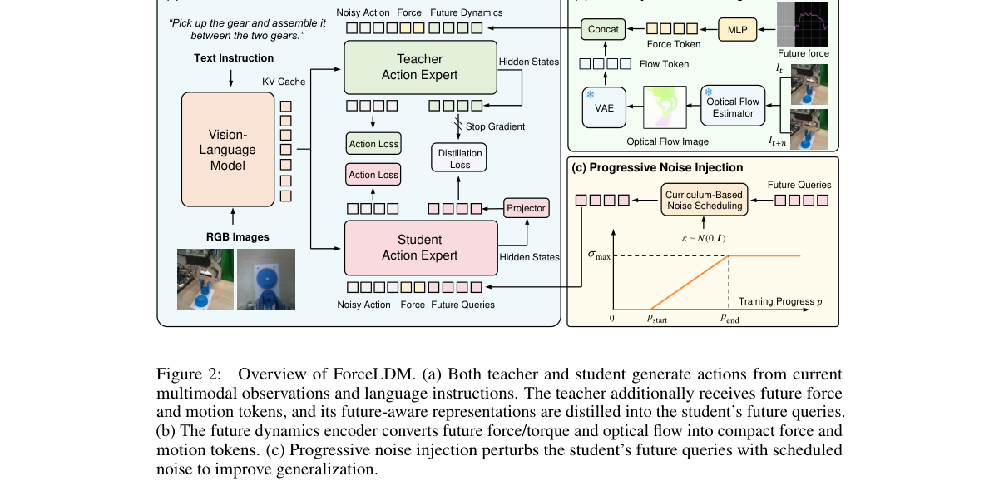

**Why this ranks #1**: 带力或触觉的 VLA 大多把力信号当成额外一路观测拼进去，却不建模下一步会发生什么接触。ForceLDM 的思路很直接：让一个能看到未来力矩与光流的特权教师，把未来动力学压进紧凑潜表示，再蒸馏给只看当前观测的学生，部署时教师和未来编码器全部撤掉。在五个真机接触丰富任务上平均成功率 87.1%，比最强基线 Seer 高 14.9 个百分点，USB 插入 92.0%，这是 NeurIPS 2026 的工作，值得作为力觉世界模型的参考实现。

---

### 2. DexArena: A Unified Benchmark for Long-Horizon Dexterous Manipulation

**arXiv**: [2611.02629](https://arxiv.org/abs/2611.02629) | **Score**: 9.3 (relevance 9.5 x 0.7 + quality 9.0 x 0.3) | **Tags**: embodied, benchmark, dexterous-manipulation, bimanual, teleoperation, long-horizon, Shanghai Jiao Tong University | **Categories**: cs.RO | **Pages**: 38

**Authors**: Haonan Ping; Jianshu Hu; Yimin Wang; Yi Zhu; Pai Liang; Qiyan Jin; Qirui Bao; Ying Qian; Xinyang Ding; Hongfei Qiao; Tianle Xue; Yucheng Bai

**Affiliation**: Shanghai Jiao Tong University; Tsinghua University; Elastic Robotics; Shanghai Institute for Physical Artificial Intelligence and Robotics

**Abstract**

> Long-horizon dexterous manipulation remains a fundamental challenge for robot learning, requiring the composition of multiple skills, precise bimanual coordination, generalizable visual understanding, and robust skill transitions. Yet existing manipulation benchmarks largely emphasize isolated skills or support only a limited range of end-effectors, making these capabilities difficult to evaluate systematically. We introduce DexArena, a benchmark designed to evaluate learning and generalization in long-horizon bimanual dexterous manipulation. DexArena features 10 long-horizon tasks and 30 stage-level tasks spanning diverse household and industrial scenarios. Each long-horizon task is composed of explicitly defined stages with physically grounded success conditions, enabling reliable evaluation of both intermediate progress and end-to-end task completion. A unified benchmark interface and verified human-teleoperated demonstrations enable testing different policy learning algorithms, with standardized simulation configurations, scene randomization, trajectory replay, and task-level evaluation. Through extensive baseline experiments, we identify substantial challenges in precise manipulation, generalization to scene variation, and skill composition. DexArena establishes a challenging and reproducible benchmark for developing robot learning methods that move toward generalizable long-horizon dexterous behavior.

**Key findings**

- **Finding**: DexArena 含 10 个长程双手灵巧任务与 30 个阶段级任务，每个长程任务由带物理判据的显式阶段组成；环境、臂与手层跨任务固定，新增任务只改任务层；用 Quest 3 头显配 MANUS Meta Gloves Pro 遥操作采集，单双手动作空间为 29 与 58 维，30 个阶段级任务各发布 100 条重放成功的演示，共 3000 条 episode、9.1 小时，从 4112 条已接受 episode 中筛出，开环重放成功率从开合类 98% 降到插入装配类 65%；在 30 个阶段级任务、每任务 50 次评测下平均成功率为 PPO 27.9%、RLPD 54.3%、ACT 58.0%、Diffusion Policy 39.2%、GR00T 61.4%、pi0.5 加 LoRA 52.1%，其中插插头、旋螺母、敲键盘、装配导轨、吸液、倒料等任务被多家基线打成 0。
- **Inference**: 阶段级任务都还有近一半失败率，说明当前灵巧操作的基础能力远未解决，长程任务更无从谈起；阶段化拆解加物理成功判据的意义在于能把没做成定位到具体阶段，避免长程 RL 里奖励被稀释；VLA 也不自动占优，GR00T 领先但 pi0.5 的 LoRA 微调低于 ACT 和 DP，说明接口对齐与数据量对高维手部控制的干扰可能大于骨干模型差异。
- **Recommendation**: 评测灵巧策略时优先用阶段级任务分阶段看失败原因，再看长程端到端；不要因为用了 pi0.5 之类的 VLA 骨干就默认更强，公开数据显示它在这套接口下只排第三；训练时用演示做 BC 预热并保留 BC loss、混合演示轨迹重置，这些是稀疏奖励下能训起来的必要条件；引用其数据集时注意 3000 条 episode 只有 9.1 小时，规模不足以支撑复杂长程行为。

**Key figures**

*Framework - DexArena overview. A benchmark for long-horizon bimanual dexterous manipulation with multi-stage tasks, diverse scenarios, teleoperated demonstrations, and multiple embodiments.*

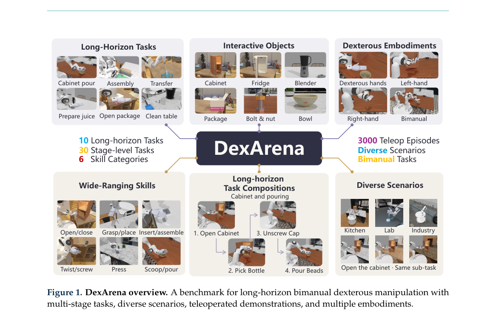

*Result - Long-horizon tasks and their stages.*

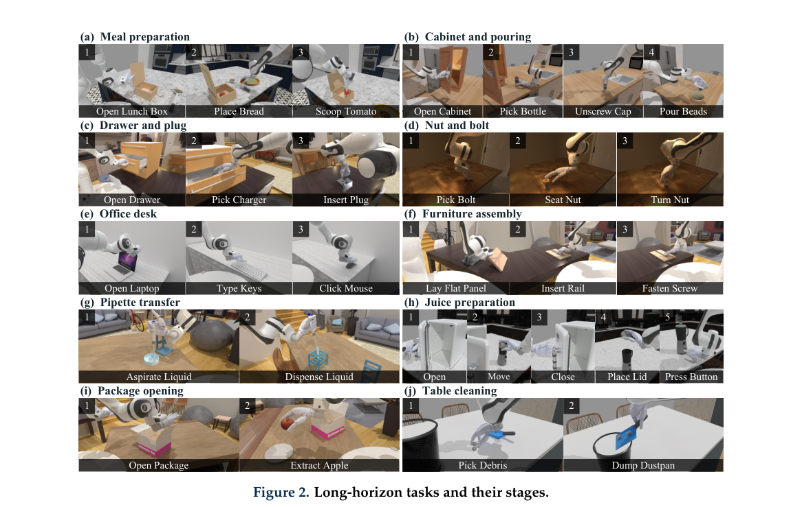

**Why this ranks #2**: 长程灵巧操作此前要么只测孤立技能、要么只支持一两种手，DexArena 用统一的仿真接口把 10 个长程任务和 30 个阶段级任务放进同一套物理框架，还配了经人工遥操作验证的演示数据。基线结果很说明问题：六个策略里最好的 GR00T 阶段级平均成功率也只有 61.4%，PPO 只有 27.9%，30 个任务里有一半被大面积打成 0%。

---

### 3. Visuo-tactile Diffusion Policy for Robotic Manipulation with Auxiliary Tactile Dynamics Prediction

**arXiv**: [2611.02677](https://arxiv.org/abs/2611.02677) | **Score**: 8.8 (relevance 9.0 x 0.7 + quality 8.5 x 0.3) | **Tags**: embodied, diffusion-policy, visuotactile, tactile-prediction, assembly, mujoco, Harbin Institute of Technology | **Categories**: cs.RO | **Pages**: 7

**Authors**: Kaihong Ouyang; Zihao Su; Chengxuan Zheng; Weiyi Lai; Dong Zhou

**Affiliation**: Harbin Institute of Technology

**Abstract**

> Long-horizon robotic assembly requires reliable perception and action across grasping, alignment, and insertion. Vision captures global object pose and scene context, where as fingertip touch provides local contact cues that are especially useful as contact states change. We present a visuotactile diffusion policy that combines four-step histories from two camera views and two fingertip tactile images to condition action-sequence generation. A recurrent temporal representation integrates recent observations from both modalities. To encourage it to capture how contact evolves under action, an auxiliary objective predicts fingertip-image changes two steps ahead from the temporal representation and demonstrated actions. This objective is used only during training and adds no inference-time computation. Across three independent training seeds in MuJoCo assembly experiments, the full model achieves an average success rate of $59.0\% \pm 2.6\%$, improving on the visual-only baseline ($42.7\% \pm 1.5\%$) by 16.3 percentage points.

**Key findings**

- **Finding**: 该策略把两个相机视角与两个指尖触觉图像各取 4 步历史做条件，用循环时序表示融合两模态，并加一个辅助目标从时序表示与已示范动作预测两步后的指尖图像变化；该目标只在训练时使用，推理时零额外计算；在 MuJoCo 装配实验中三个独立随机种子下完整模型平均成功率 59.0% ± 2.6%，比视觉-only 基线 42.7% ± 1.5% 高 16.3 个百分点。
- **Inference**: 16.3 个百分点的增益来自让表示知道接触会怎么变，而不是单纯多加一路观测，同样的触觉图像直接拼进策略时未必被用好，用一个便宜的辅助预测任务逼时序表示编码接触演化是更有效的接入方式；而且这个辅助目标推理时不花钱，工程上几乎无代价。
- **Recommendation**: 要做接触装配，先按历史帧加训练期辅助预测的模式接一遍触觉，不要指望换更大的策略骨干；评估务必跑多个随机种子并报方差，触觉策略对初始化与数据量敏感；辅助目标要选与下游动作直接相关的量，这里是接触状态变化，随机加辅助任务通常无效；如果没有指尖触觉硬件，可用视觉代理方案先验证模态融合的收益再上真传感器。

**Key figures**

*Framework - Visuotactile diffusion policy with auxiliary tactile-dynamics prediction. (a) Encoding the dual-view visual history and dual-fingertip tactile history; (b)*

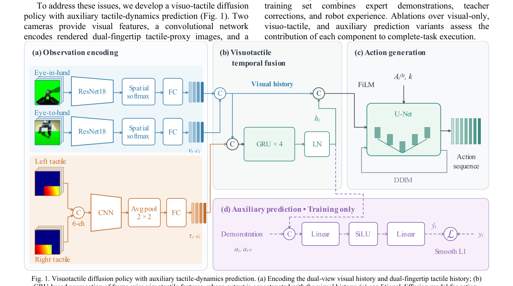

*Result - Visual and fingertip observations at the same time step. The top row shows the Eye-to-hand and Eye-in-hand camera images, and the bottom row shows the left and right fingertip tactile-proxy*

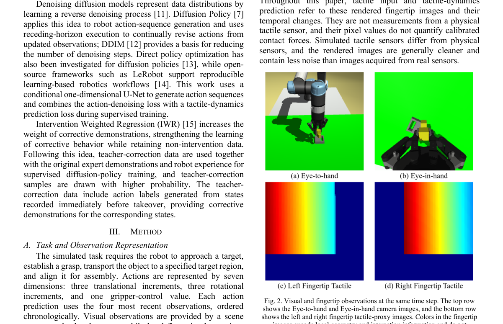

**Why this ranks #3**: 长程装配在抓取、对齐、插入三个阶段要靠不同的信息源：视觉给全局位姿，指尖触觉给接触变化。这篇把两路四帧历史一起喂进扩散策略，再加一个只在训练时存在、零推理开销的辅助目标去预测两步后的指尖图像变化，MuJoCo 装配实验在三个随机种子上从视觉-only 的 42.7% 提到 59.0%，提升 16.3 个百分点。

---

### 4. ReContact: Reconstruct and Retarget Human Contacts from Video for Contact-Rich Humanoid Manipulation

**arXiv**: [2611.02968](https://arxiv.org/abs/2611.02968) | **Score**: 8.8 (relevance 9.0 x 0.7 + quality 8.5 x 0.3) | **Tags**: embodied, humanoid, contact-plan, human-video-retargeting, unitree-g1, loco-manipulation, Tohoku University | **Categories**: cs.RO | **Pages**: 14

**Authors**: Zhongkai Gu; Yang Liu; Wei Zhu; Mitsuhiro Hayashibe

**Affiliation**: Tohoku University

**Abstract**

> Contact transitions allow humanoid robots to redistribute object support across the whole body, enabling manipulation beyond hand-only grasps. Human videos provide a scalable source of such transitions for robots to learn from. However, body occlusion disrupts object pose tracking and corrupts retargeted motion. Moreover, accurately reproducing the object trajectory does not ensure that the robot applies stabilizing forces at the intended contacts, risking slips or drops in later phases. To address these challenges, we propose ReContact, which reconstructs and retargets human-object interactions through an object-centric contact plan. The plan specifies contact phases, contact pairs, anchors, pressing directions, and sticking or sliding modes. Contact priors stabilize object pose reconstruction through occlusion. A residual policy over a frozen whole-body tracker is rewarded for making contact at planned anchors with forces aligned to the specified directions. In simulation, on a thigh-supported regrasp task, ReContact achieves the planned two-palm bottom hold in 83.5 of episodes over three training seeds, versus 0.16% for the best adapted baseline. One policy trained on 247 references re-solved for new placements raises in-workspace tube-transfer success from 20.4% (source reference only) to 97.8%. On a real Unitree G1, policies execute seven contact-rich manipulation and two loco-manipulation tasks.

**Key findings**

- **Finding**: ReContact 用物体中心的接触计划（接触阶段、接触对、锚点、施力方向、粘着或滑动模式）来重建并重定向人-物交互，接触先验在遮挡下稳定物体位姿，再由冻结全身追踪器之上的残差策略按计划锚点与力方向获得奖励；在仿真的大腿托举再抓取任务上，三个训练种子下达到计划的双手底部托住的 episode 比例为 83.5% ± 5.2%，最好适配基线仅 0.16%；一个用 247 条参考动作训练、并针对新摆放位置重解的策略，把工作区内管件转移成功率从 20.4%（仅用源参考）提到 97.8%；在真机 Unitree G1 上执行了 7 个接触丰富操作与 2 个 loco-manipulation 任务。
- **Inference**: 0.16% 到 83.5% 的落差说明轨迹重定向和接触重定向是两件完全不同的事，后者必须显式指定施力方向与接触模式；同时 247 条参考加重解就能把新摆放的成功率从 20.4% 拉到 97.8%，说明接触计划是可复用的高层接口，不必为每个新摆放重新采集演示。
- **Recommendation**: 从人类视频学接触时先定义物体中心的接触计划（锚点、力方向、粘滑模式）再谈策略学习，否则学到的只是看起来像的轨迹；评估要分开量位姿是否对齐和是否在计划锚点按方向施力两个指标，轨迹对了并不代表接触对了；用少量参考加针对新摆放重解接触计划的流程性价比很高，比大规模重采数据更现实。

**Key figures**

*Result - Egocentric route, shown for a spray bottle and a banana. Recovered hand–object segments are retargeted to the Inspire RH56F1 hand; planning generates the approach and the remaining G1 body mot*

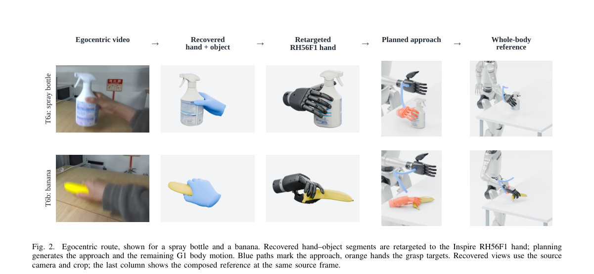

**Why this ranks #4**: 让机器人从人体视频学接触而不是只学动作，难点在于视频里的物体位姿被身体遮挡搞坏，而且轨迹对了不等于力对了。这篇用物体中心的接触计划（接触阶段、接触对、锚点、施力方向、粘或滑模式）先稳住位姿重建，再用冻结全身追踪器之上的残差策略去按计划施力，在仿真里大腿托举再抓取的任务上把计划中的双手底部托住做到 83.5% ± 5.2%，最好基线只有 0.16%。

---

### 5. FineCraft: Enhancing VLA Models for Fine-Grained Manipulation

**arXiv**: [2611.03163](https://arxiv.org/abs/2611.03163) | **Score**: 8.5 (relevance 8.5 x 0.7 + quality 8.5 x 0.3) | **Tags**: embodied, vla, fine-grained-manipulation, policy-mixture, leaderboard, replanning, Harbin Institute of Technology Shenzhen | **Categories**: cs.RO | **Pages**: 6

**Authors**: Shuaike Zhang; Ziheng Quan; Junhao Ran; Muhe Ding; Shaokun Wang; Jianlong Wu

**Affiliation**: Harbin Institute of Technology Shenzhen; Xi'an Jiaotong University; Shenzhen Loop Area Institute

**Abstract**

> Fine-grained manipulation couples instruction grounding, local visual precision, and sustained execution. We present FineCraft, a framework that adapts pretrained models for fine-grained manipulation in the MetaFine Challenge. A task-routed mixture of policies selects independently adapted DINOv2-DiT or pretrained $π_{0.5}$ policies through a common observation-action interface. Local visual features help identify the instructed object parts, demonstrations and expert continuations teach the required actions, and new observations guide replanning during execution. FineCraft ranks fourth with an overall score of $0.878$, exceeding the published reference on all five tasks. Official results and local diagnostics characterize performance across visual perturbations, instruction changes, and multi-stage manipulation. Code is available at https://github.com/eqcy/FineCraft

**Key findings**

- **Finding**: FineCraft 在 MetaFine 挑战赛上把 DINOv2-DiT 与预训练 pi0.5 组织成任务路由的策略混合（MoP），用任务 ID 选出各自独立适配的策略，五个任务实例对应两条骨干分支（T1 与 T5 用 DINOv2-DiT，T2/T3/T4 用 pi0.5 加 LoRA），动作块执行时依据新观测重规划；官方五任务成绩中 T1 瓶子部位抓取 P 0.787、U 0.800、B 0.800、总分 0.796，T2 杯子搬运三项全为 1.000，T3 开关拨动 P 0.925，总分 0.878 排名第四，在五个任务与所有维度上都超过官方发布的 pi0 参考（其均值为 0.430，领先 44.8 个百分点）；本地诊断加 560 次相机与光照扰动 rollout 后感知分 0.874、综合分 0.883，共 720 次 rollout；T5 上感知与理解分相对参考分别提升 56.9 与 67.5 个百分点。
- **Inference**: 排行榜名次是相对量，参考基线的强弱才是信息本身，同一套 pi0 参考在本框架下从 0.430 被推到 0.878，说明精细操作的差距主要来自适配与重规划的工程细节而非骨干规模；扰动下感知分明显低于理解分，说明瓶颈仍在局部视觉定位而非指令理解。
- **Recommendation**: 做精细操作时先按任务做独立适配加路由执行，再用重规划闭环，这套在公开榜上已验证比单一模型泛化更稳；评测时务必同时看感知与理解两个分项，只看总分会掩盖定位失败；相机扰动 rollout 值得单独做，数据显示扰动下成功率曲线面积明显小于光照变化，硬件上给个稳定视角的收益可能比换算法更直接。

**Key figures**

*Framework - FineCraft as a task-routed mixture of policies (MoP). The task ID selects one independent task policy for the rollout. Two backbone families summarize five task instances, including their ta*

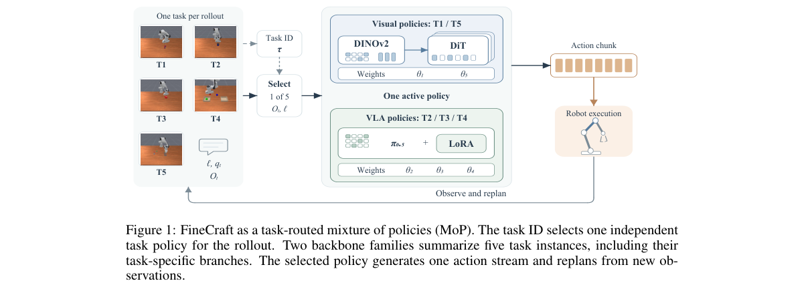

*Result - Capability gains and local perception diagnostics. (a) Official improvements in P, U, and B over the published π0 reference, in percentage points (pp) [15]. (b) Local T1 cap success under ca*

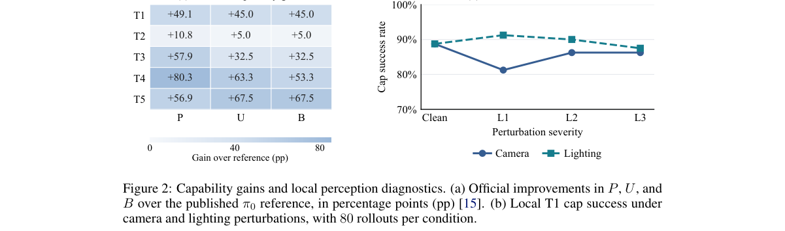

**Why this ranks #5**: MetaFine 挑战赛考察的是精细操作，要么抓瓶子上的某个部位，要么在指令改写、光照与相机扰动下仍要对准目标部件。FineCraft 的做法朴素但有效，按任务 ID 路由到各自独立适配的策略，DINOv2-DiT 或 pi0.5 骨干共用一套观测-动作接口，执行时用新观测重规划。公开榜上总分 0.878 排第四，但五个任务全面超过官方 pi0 参考（参考均值 0.430，领先 44.8 个百分点），这个对照比名次更有参考价值。

---

### 6. History Forcing: Distilling History-Dependent Continuations for Long-Horizon Video World Models

**arXiv**: [2611.02782](https://arxiv.org/abs/2611.02782) | **Score**: 8.5 (relevance 8.5 x 0.7 + quality 8.5 x 0.3) | **Tags**: embodied, video-diffusion, distillation, long-video, few-step, world-model, Zhejiang University | **Categories**: cs.CV | **Pages**: 21

**Authors**: Hangyi Kuang; Chengzhi Wang; Yefei He; Weijie Wang; Yuke Zhao; Zhuokun Chen; Zisu Huang; Yifan Yang; Xiaoxuan He; Feng Chen; Bohan Zhuang

**Affiliation**: Zhejiang University; Microsoft Research; Monash University; Adelaide University

**Abstract**

> Few-step autoregressive video diffusion enables efficient generation, yet maintaining consistency over long rollouts remains challenging, especially when subjects or scenes reappear after going out of sight. Despite progress in fidelity and rollout robustness, existing distillation methods do not fully exploit richer historical information to constrain the student's current prediction. To address this gap, we introduce \textbf{History Forcing}, a unified on-policy distillation framework that strengthens historical supervision for few-step autoregressive video generators. The framework uses the residual between teacher predictions with and without informative historical context to decouple this supervision. Such a historical context can be obtained using earlier generated chunks with less accumulated drift or a fixed-view teacher rollout that keeps the scene visible while the student looks away. The residual is then weighted and added to the score or velocity prediction used for distillation, forming a corrected target. By aligning the student with this corrected target through distillation, History Forcing incorporates long-range historical constraints into autoregressive generation. Our method achieves state-of-the-art performance among 1.3B models, with a VBench quality score of 85.07 for 15s video generation and a VBench-Long aggregate score of 79.82 for 60s generation. For out-of-sight world modeling, evaluations further demonstrate more plausible scene evolution and more consistent states when the camera returns, with Evolution Quality improving from 2.35 to 2.70 on PlayWorld and Object Consistency from 58.43 to 62.18 on MemoBench.

**Key findings**

- **Finding**: History Forcing 用有无历史上下文的教师预测残差解耦历史监督与生成监督，历史上下文可取漂移更小的早期生成块或固定视角的教师 rollout，残差加权后加到 score 或 velocity 的蒸馏目标上形成修正目标；在 1.3B 规模模型中取得 15 秒生成 VBench 质量分 85.07、60 秒生成 VBench-Long 综合分 79.82；在离开视野的世界建模评测中，PlayWorld 上 Evolution Quality 从 2.35 提升到 2.70，MemoBench 上 Object Consistency 从 58.43 提升到 62.18。
- **Inference**: 长视频一致性的失败不在单帧质量而在历史约束没有进入损失，直接用历史条件的教师预测当蒸馏目标会把历史监督和生成监督混在一起；用残差把两者分开，是一种可以即插即用到其他少步蒸馏框架上的配方，对需要长时程一致性的世界模型有直接价值。
- **Recommendation**: 做长视频生成或少步自回归蒸馏时，先确认你的蒸馏目标是否真的携带了历史约束，对比有无历史的教师预测差，再决定要不要换 backbone；History Forcing 是 on-policy 蒸馏，可以作为训练时的修正项加进现有框架而非整体重训；评测务必加上主体离开视野再回来这类定向测试，通用 VBench 分很难暴露这类漂移。

**Key figures**

*Framework - History Forcing for long-horizon video world models. Left: Long-video generation. Our method maintains appearance consistency and scene continuity, while the baseline exhibits appearance drif*

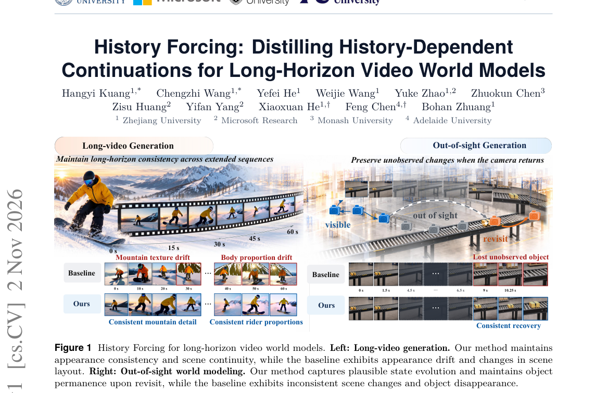

*Result - Comparison of distillation strategies. (a) DMD uses a bidirectional teacher’s prediction as the reference for the current chunk. (b) AR distillation directly uses the history-conditioned pred*

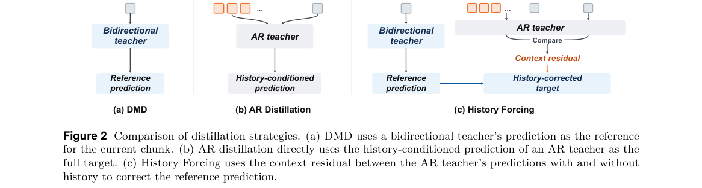

**Why this ranks #6**: 少步自回归视频扩散在长 rollout 上最典型的失败是主体出了视野再回来就变了样。这篇的做法很有意思：用教师在有历史上下文和无历史上下文两种设定下的预测残差，把历史监督从生成监督里解耦出来，再加权加到蒸馏目标上。1.3B 模型规模下拿到 15 秒 VBench 85.07、60 秒 VBench-Long 79.82，且在离开视野再回来这类场景评测上 Evolution Quality 从 2.35 提到 2.70、Object Consistency 从 58.43 提到 62.18。

---

### 7. Beyond Policy Patches: Distilling RL Specialists into Vision-Language-Action Policies

**arXiv**: [2611.02777](https://arxiv.org/abs/2611.02777) | **Score**: 8.5 (relevance 8.5 x 0.7 + quality 8.5 x 0.3) | **Tags**: embodied, vla, distillation, rl-specialist, flow-matching, real-robot, University of Chinese Academy of Sciences | **Categories**: cs.RO | **Pages**: 19

**Authors**: Zhennan Jiang; Tingying Xie; Shilong Ji; Shu'ang Yu; Tianxing Zhou; Yuhui Chen; Jiahuan Gao; Kaizhi Xie; Yuanfan Xu; Feng Gao; Yu Wang; Haoran Li

**Affiliation**: University of Chinese Academy of Sciences; Striding AI; Tsinghua University; Institute of Automation Chinese Academy of Sciences

**Abstract**

> Vision-language-action (VLA) policies can handle noncritical stages of long-horizon manipulation yet fail during short precision-critical phases. Lightweight reinforcement learning (RL) specialists can address these failures without directly applying RL to the full VLA, but retain auxiliary controllers and switching mechanisms at deployment. We study how to transfer their capabilities into a single flow-matching VLA. Direct imitation of specialist rollouts can reproduce action jitter and leave the VLA unprepared for states encountered during its own execution. We introduce REPAIR, a value-guided distillation framework that combines offline initialization with on-policy refinement. At each critical-phase observation, REPAIR queries the corresponding specialist for multiple action candidates and weights them using its critic to construct a supervision distribution. A shared weighted flow-matching objective trains the VLA first on observations from specialist-assisted rollouts, then on observations collected through its own execution. Specialists provide supervision without taking control during on-policy collection and are removed at deployment. Across six real-robot tasks with 30 evaluation trials per task, REPAIR achieves 100% success on all six tasks, with lower mean end-effector jerk than specialist-assisted execution on every task.

**Key findings**

- **Finding**: REPAIR 在每个关键阶段观测处向对应 RL 专家索取多个动作候选，用专家 critic 加权构造监督分布，用共享的加权流匹配目标先在专家辅助 rollout 的观测上离线初始化、再在 VLA 自己执行得到的观测上在线精修；在线收集阶段专家只提供监督不接管控制，部署时专家与切换机制全部移除；跨六个真机任务、每任务 30 次评测，六个任务全部达到 100% 成功率，且每个任务上的平均末端 jerk 都低于专家辅助执行。
- **Inference**: 直接模仿专家 rollout 会继承动作抖动并让 VLA 对自己执行中遇到的状态毫无准备，REPAIR 用 critic 做候选加权把哪种动作更好的排序信息转成监督分布，再靠 on-policy 阶段补上状态分布错配，这两点正是它能拿到 100% 且 jerk 更低的原因，而不是简单的行为克隆加权重。
- **Recommendation**: 想给 VLA 补精度关键阶段，不必再保留双控制器切换，直接走 RL 专家给候选加 critic 加权加在线精修这条路线；关键是专家在 on-policy 阶段只能当监督者不能接管，否则 VLA 学到的仍是别人的状态分布；评估除成功率外一定要看 jerk 这类平滑性指标，纯模仿带来的抖动在高精度阶段往往就是失败主因。

**Key figures**

*Framework - Overview of REPAIR. Local RL expertise provides value-guided supervision for offline initialization and on-policy repair. The VLA acts without specialist takeover during online distillation*

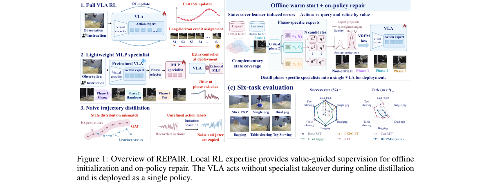

*Result - Specialist deployment across task horizons. (a) Peg-insertion settings. (b) Suc- cess rates for full and critical-phase takeover. (c) Position traces with local magnification.*

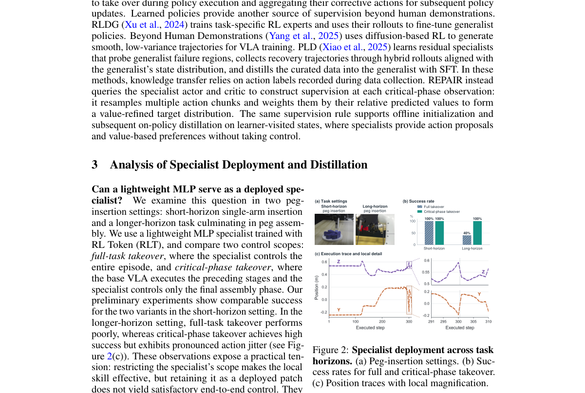

**Why this ranks #7**: VLA 策略能做完长程任务里的普通阶段，却在短暂的精度关键阶段崩掉；轻量 RL 专家能补，但部署时得带着辅助控制器和切换逻辑，很别扭。这篇把 RL 专家的能力蒸进单个流匹配 VLA：离线初始化加在线精修，关键阶段由专家提供多个候选动作并用 critic 加权成监督分布，在线收集时专家只给监督不接管控制。六个真机任务各 30 次评测全部 100% 成功，且末端 jerk 还更低。

---

### 8. Right Ranking, Wrong Scale: Reproducing the Robotic World Model's Dynamics Model and Testing the Uncertainty of Its Follow-up

**arXiv**: [2611.02699](https://arxiv.org/abs/2611.02699) | **Score**: 8.1 (relevance 8.0 x 0.7 + quality 8.5 x 0.3) | **Tags**: embodied, replication, uncertainty-estimation, ensemble, world-model, offline-rl, Independent Researcher | **Categories**: cs.LG, cs.RO | **Pages**: 56

**Authors**: Joyjeet Singh

**Affiliation**: Independent Researcher

**Abstract**

> We reimplement the dynamics model of the Robotic World Model (RWM) and test the uncertainty estimate that its follow-up, RWM-U, uses to penalize reward in offline policy optimization. Our implementation matches the released model's gradients. On held-out data, training on the model's own rollouts beats one-step training at the preregistered long horizon for all ten episodes, but loses on short one-step windows. RWM-U's ensemble disagreement ranks rollout errors better than forecast step (Spearman rho = 0.90 at 100 steps), yet its spread substantially understates error: one-sigma coverage on the released checkpoint is 4.6% at 100 steps, versus 68% for a calibrated Gaussian. Rolling ensemble members on their own predictions raises coverage to 33%. The implemented squared-error loss on sampled predictions drives each member's variance toward zero. A horizon-specific rescaling restores one-sigma coverage under leave-one-episode-out evaluation, but not two-sigma coverage. We also identify two defects in the released evaluation pipeline. The study covers one robot, one gait and one dataset; it trains no policy.

**Key findings**

- **Finding**: 作者复现 Robotic World Model (RWM) 的动力学模型并检验其后续工作 RWM-U 用于离线策略优化时惩罚奖励的不确定性估计，实现与发布模型的梯度一致；留出数据上用模型自身 rollout 训练在预注册的长时域上十个 episode 全部优于一步训练，但在短的一步窗口上反而更差；RWM-U 的集成分歧比预测步长更能排序 rollout 误差（100 步处 Spearman ρ=0.90），但幅度显著低估误差，发布 checkpoint 上 1σ 覆盖率在 100 步只有 4.6%，标定高斯为 68%；让集成成员在各自预测上滚动训练把覆盖率提到 33%；作者发现用采样预测的平方误差损失会把每个成员方差推向零，按时域做重标定能在留一 episode 交叉验证下恢复 1σ 覆盖，但恢复不了 2σ；此外还指出发布评测流水线存在两处缺陷；研究范围限于一台机器人、一种步态、一个数据集，且未训练任何策略。
- **Inference**: 能排序与幅度可信是两回事，RWM-U 用集成分歧惩罚奖励时，如果只用排序信息去调惩罚强度（即相对权重）尚可一试，若把分歧当绝对误差尺度用（例如设硬阈值）会严重失真。作者指出的方差塌缩是集成不确定性方法在采样式平方误差损失下的典型失效模式，属于方法论缺陷而非实现 bug。
- **Recommendation**: 如果你要用世界模型的不确定性做离线 RL 的奖励惩罚，只用它的相对排序，别把分歧绝对值当误差尺度；用采样预测训练时避免直接最小化平方误差，否则成员方差会塌到接近零，需要额外方差正则或保序校准；若要引用 RWM 与 RWM-U 的结论，注意原文的覆盖率问题与评测流水线缺陷，必要时先复现再采信。

**Key figures**

*Result - The 75 collapse-record runs of 2,500 iterations. (a) The lower (solid) and upper (dashed) bound of σ per logged iteration; 342 saved checkpoints reproduce them. (b) Change in log ∆per iterat*

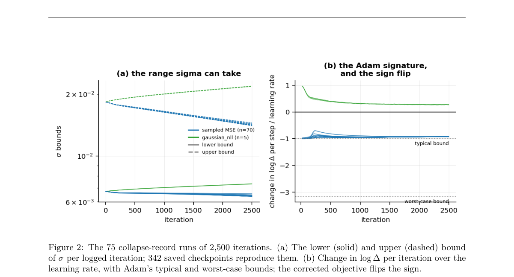

**Why this ranks #8**: 这是一篇复现与审计型论文，价值在于它检验了世界模型的不确定性估计能不能用来做离线策略优化这个常见假设。复现结论是：排序能力还行，RWM-U 的集成分歧比预测步长更能排序 rollout 误差（100 步处 Spearman ρ=0.90）；但幅度严重失准，发布 checkpoint 的 1σ 覆盖率在 100 步只有 4.6%，标定高斯是 68%。论文还指出了原评测流水线的两处缺陷。

---

### 9. Control Foundation Models across Changing Block Diagrams: Generalizing Time-Series Prediction to Dynamic Graphs

**arXiv**: [2611.02900](https://arxiv.org/abs/2611.02900) | **Score**: 8.0 (relevance 8.0 x 0.7 + quality 8.0 x 0.3) | **Tags**: embodied, control, time-series-foundation-model, dynamic-graph, closed-loop, system-identification, RIKEN | **Categories**: cs.LG, eess.SY | **Pages**: 19

**Authors**: Yuji Okamoto; Kenta Hoshino; Masaki Inoue

**Affiliation**: RIKEN; Institute of Science Tokyo; Keio University

**Abstract**

> In the prediction and control of physical systems, combining records from different experiments and operations is expected to supply information that no single experiment provides on its own. Time-series foundation models, which learn a shared predictor from diverse time series, offer a framework for treating such records as a common training resource. Moreover, query-based prediction models, which switch between known and target signals within the same time series, make it possible to handle response prediction and control-input generation in a unified manner. However, in control-experiment data, the connections between signals change with the experimental stage, such as system identification, filtering, and feedback control, which calls for a formulation that handles signal values and connection structures dynamically and in a unified way. We formulate a control foundation model that defines a data space of dynamic graphs containing connections, signal values, and missing values, together with an operation on this space that specifies the known signals and the prediction targets. This allows response prediction and control-input generation to be described as a common masked prediction problem, even for experimental data with different connections and recorded signals. The Block Diagram Transformer (BDT), which implements this formulation, combines attention along the time axis with a graph neural network that follows the block-diagram connections, and can be initialized with the pretrained parameters of existing time-series foundation models. Trained on control-experiment data that mix multiple experimental settings, the proposed model stabilized an unstable system through feedback control, which is difficult to achieve by fine-tuning existing time-series foundation models. Ongoing work applying this approach to a wide range of target systems is also yielding promising results.

**Key findings**

- **Finding**: 作者把控制实验数据形式化为动态图，顶点是信号、边是连接、掩码表示是否记录，把响应预测与控制输入生成统一为掩码预测问题；Block Diagram Transformer 沿时间轴用注意力、沿通道轴用按框图连接的图神经网络，可用现成时间序列基础模型（如 Chronos-2）的预训练参数初始化；在覆盖辨识到控制的单条不稳定线性系统轨迹上，输出预测 RMSE 为 Chronos-2 0.4235 ± 0.2507、微调 Chronos-2 0.0289 ± 0.0042、BDT 0.0290 ± 0.0035，而输入预测 RMSE 分别为 1.8814 ± 0.8008、1.6793 ± 0.7333、0.7772 ± 0.0271，均为 100 条测试轨迹的均值加减样本标准差；闭环实验中微调 Chronos-2 保留大幅振荡且未能稳定被控对象，BDT 的闭环响应接近 LQG 参考并实现稳定，六种超参配置下闭环输出 RMS 均更小。
- **Inference**: 响应预测误差接近而输入预测误差差一倍以上，说明差别不在拟合能力而在问题表述，模型必须知道这个输入是外部加的还是由状态估计反馈算出来的，也就是必须显式承载连接结构而不仅是信号数值。这对任何把多阶段多装置实验混在一起训练的基础模型都是通用结论。
- **Recommendation**: 要把不同实验阶段的数据合起来训预测模型时，先把每个阶段的连接结构显式编码进输入，哪怕只是 attention mask，别指望模型从数值里猜出来；用现成时间序列基础模型做迁移时注意块图注意力可作为其分组注意力的特例共享参数，迁移成本低；评价这类模型必须看闭环行为而非只看预测 RMSE，本文的差距恰恰只在闭环控制上显现。

**Key figures**

*Framework - Changes in signal connections and available data across experimental stages. The top row shows the block diagrams for identification, state estimation, stabilization, and tracking, and the b*

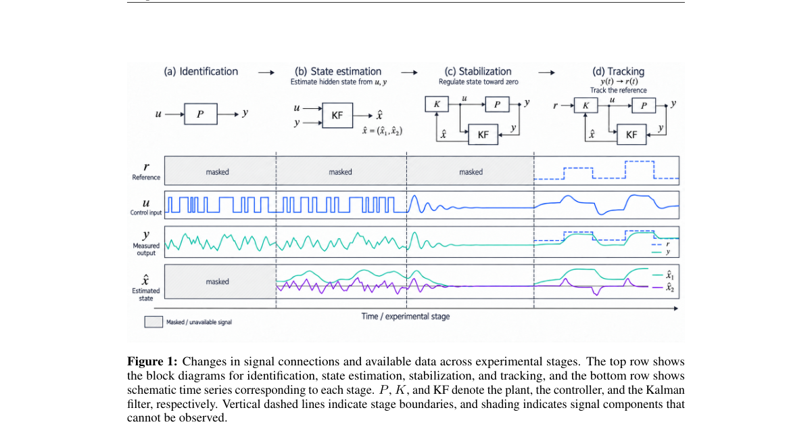

*Result - Unified representation of control time-series data using block diagrams, and the control foundation model.*

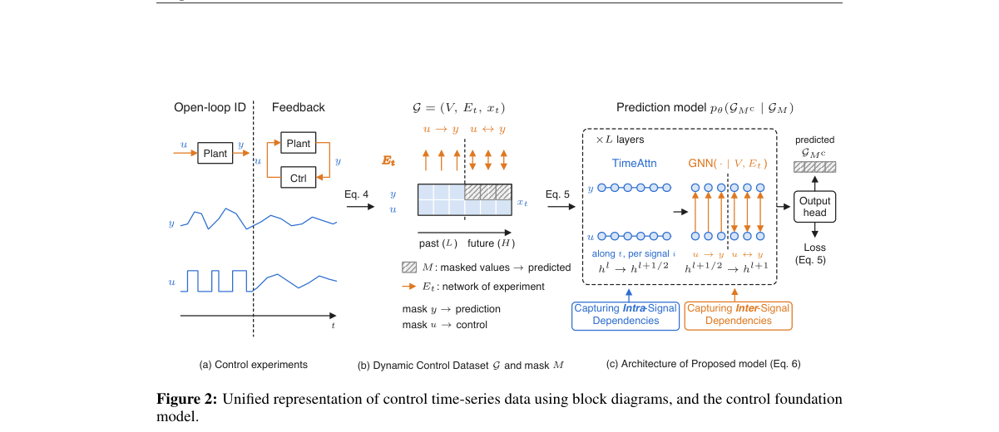

**Why this ranks #9**: 这是本线里偏控制理论的一篇：把控制系统实验的框图（信号之间的连接结构）连同信号值一起表示成动态图，于是不同实验阶段（辨识、状态估计、稳定化、跟踪）可以当成同一个掩码预测问题来学。BDT 沿时间轴做注意力、沿通道轴按框图连接做图注意力，并且能直接继承已有时间序列基础模型的权重。在一个不稳定线性系统上，微调后的 Chronos-2 闭环发散，BDT 却把系统稳住了。

---

### 10. GoalDex: Learning Image-Goal-Conditioned Policies for Dexterous In-Hand Manipulation

**arXiv**: [2611.02171](https://arxiv.org/abs/2611.02171) | **Score**: 8.0 (relevance 8.0 x 0.7 + quality 8.0 x 0.3) | **Tags**: embodied, dexterous-manipulation, image-goal, sim-to-real, visuomotor-distillation, in-hand-reorientation, ETH Zurich | **Categories**: cs.RO | **Pages**: 19

**Authors**: Arjun Bhardwaj; Mayank Mittal; Maximum Wilder-Smith; Vaishakh Patil; Marco Hutter

**Affiliation**: ETH Zurich; NVIDIA

**Abstract**

> Dexterous in-hand manipulation is commonly formulated around explicit object pose estimation, yet reliable pose tracking is challenging under severe hand-object occlusions and often requires object-specific supervision. This dependence creates a bottleneck between perception and control that can limit robustness and scalability. We present an end-to-end visuomotor framework for dexterous in-hand reorientation that operates on RGB observations and proprioception without intermediate pose estimation. Our approach jointly learns visual representations and control policies through behavior distillation from privileged state teachers and auxiliary reconstruction objectives. Furthermore, we introduce image-goal-conditioned reorientation, allowing desired object configurations to be specified directly through images rather than canonical pose representations. We evaluate our approach across a diverse set of object geometries and instances in simulation, where it consistently outperforms pose-based methods and policies built on pretrained visual encoders. Finally, we demonstrate direct sim-to-real transfer of a single image-goal-conditioned policy across five real-world objects, showing that accurate dexterous reorientation can be achieved without explicit pose estimation. For videos and code release, please refer to the project website: https://rffr.leggedrobotics.com/works/goaldex/

**Key findings**

- **Finding**: GoalDex 的策略把单目 RGB、本体感知与目标图像直接映射到关节目标，不做中间位姿估计；表示与控制策略通过特权状态教师的行为蒸馏与辅助重建目标联合学习，并引入图像目标条件让目标构型用图片而非规范位姿表示；仿真中在多种物体几何与实例上一致优于基于位姿的方法与使用冻结预训练视觉编码器的策略；把训练扩到 25 个物体后 Image-Goal Conditioned 2x 变体的连续成功次数从 10.11 ± 2.06 提到 41.42 ± 0.00，达到成功的时间为 5.30 ± 0.00 秒，成功预测 F1 为 0.882 ± 0.000、失败率 9.61 ± 0.00%；真机上单个在仿真训练的图像目标策略零样本迁移到 5 个真实物体，100 次硬件试验成功率 80%，最强位姿基线为 27%。
- **Inference**: 80% 对 27% 说明表示瓶颈确实可以被绕开，把状态估计从流水线上拿掉后，视觉加本体加重建监督的联合学习反而更稳；图像目标条件进一步把目标从位姿参数这种需要标定的接口变成给张图就行，让自然语言选图就能驱动手操作。冻结的 ImageNet、DINOv2、Depth Anything V2 在特权状态重建和任务执行上双双失败，说明这里需要的视觉表示必须为交互而训，不能直接迁移。
- **Recommendation**: 做灵巧手操作若被位姿估计卡住，直接走无位姿加重建辅助监督的路线；选目标构型用图像而非位姿参数，能省掉大量标定并允许用 VLM 从语言指令里挑目标图；不要指望冻结的通用视觉编码器，它们的视觉特征与交互相关信息对齐得很差；把训练物体数从单类扩到几十个实例收益明显，并行环境加倍后连续成功次数从 10.11 提到 41.42，但真机迁移前务必做 sim-to-real 验证。

**Key figures**

*Framework - Overview of the proposed image-goal-conditioned framework for dexterous in-hand reorientation. The policy maps RGB observations, proprioception, and visual goal images directly to joint acti*

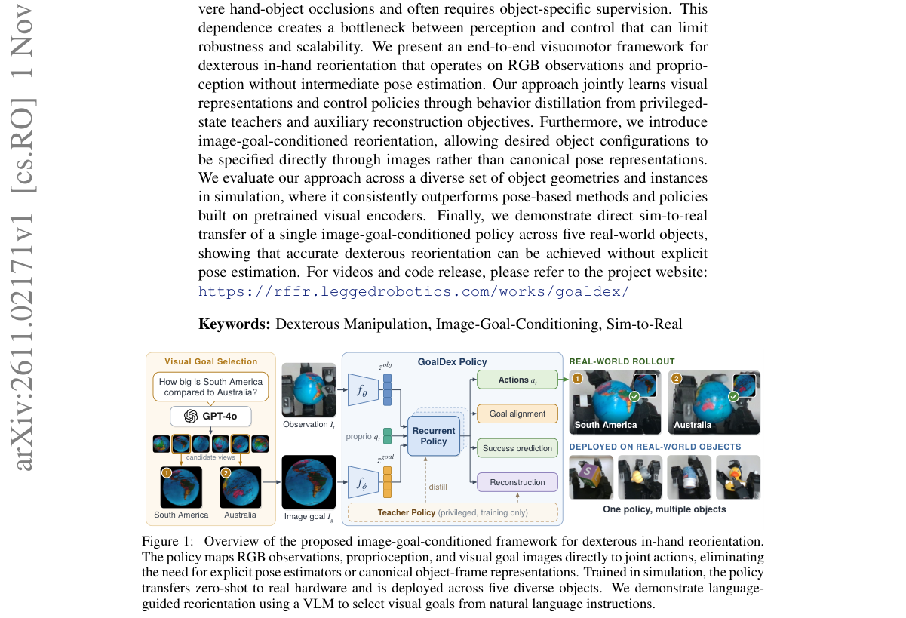

*Result - Training architecture for image-goal-conditioned visuomotor distillation. Current RGB observations and goal images are encoded into visual representations and fused with proprioceptive input*

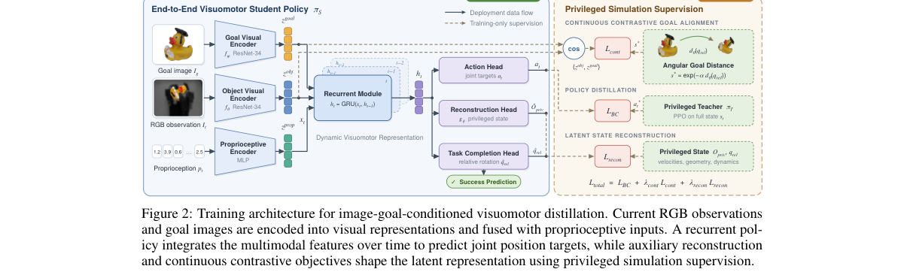

**Why this ranks #10**: 在手操作里显式估计物体位姿是个瓶颈，遮挡严重、还要物体专属监督。GoalDex 直接把这条链路砍掉，策略只看单目 RGB 加本体感知加一张目标图，靠特权状态教师蒸馏加辅助重建任务学表示，还提出用图像指定目标构型而不是用规范位姿参数。在 5 个真机物体、100 次硬件试验上做到 80% 成功率，而最强位姿基线是 27%。

---

