# ArXiv Daily Digest - 2026-11-03 (生成式内容模型的 RL, 10 papers)

**Generated**: 2026-11-03 17:30 CST

**Source**: arXiv cs.CV, cs.SD, eess.AS, cs.CL, cs.AI, cs.RO, cs.LG submissions, listing day 2026-11-02 (announced 2026-11-03 00:00 UTC)

**Batch window**: 2026-11-01T18:00:00Z .. 2026-11-02T18:00:00Z（arXiv 公告批次横跨两个 UTC 日：前一日 18:00 UTC 起算，当日 17:59:59 UTC 截止）

**Track**: rl_aigc (top 10 of 564 papers scanned, 70 full reads)

**Scope**: 生成式内容模型的 RL：扩散 / 流匹配 RL、生成式奖励模型与推理期采样扩展

⚠️ **Wild-card**: 本批该线 5 篇为 wild-card 补足，已在正文逐条标注并给出理由。

补足原因：该批次「生成式内容模型的 RL」（扩散 / 流匹配 RL、生成式奖励模型）的硬供给只有 5 篇，其余 5 篇是「生成内容模型方向但不含 RL」的相邻工作（扩散数据生成、隐私审计、训练正则、推理期采样预算、生成式编辑应用），已在正文逐条标注并给出理由。

---

## Top 10 - 生成式内容模型的 RL

### 1. Do Visual RL Gains Scale at Test Time? A Quantile View of Post-Training

**arXiv**: [2611.02366](https://arxiv.org/abs/2611.02366) | **Score**: 9.3 (relevance 9.5 x 0.7 + quality 9.0 x 0.3) | **Tags**: rl-aigc, best-of-n, rl-post-training, test-time-scaling, quantile-analysis, reward-distribution, ByteDance Seed | **Categories**: cs.CV, cs.LG | **Pages**: 26

**Authors**: Austin Wang; Lexing Ying

**Affiliation**: ByteDance Seed

**Abstract**

> Reinforcement learning (RL) post-training improves the single-sample quality of visual generative models, but deployment often provides additional inference compute through Best-of-N sampling. Whether RL gains transfer under such test-time scaling, particularly on difficult held-out tasks, remains poorly understood in the visual domain. Our central contribution is to systematically identify and characterize a failure mode of scaling transfer in visual RL: across multiple RL methods, model backbones, and evaluations spanning compositional generation, text rendering, and preference alignment, higher single-sample reward does not necessarily imply a better quality-compute frontier. RL gains may attenuate, saturate, or even reverse at large sampling budgets, with the base model eventually outperforming its post-trained counterpart. We explain these regimes through a quantile-transfer framework, showing that Best-of-N places increasing weight on the upper tail of the reward distribution as N grows. Consequently, RL can improve typical samples while compressing or degrading the rare high-quality outcomes that test-time scaling exploits. As a simple intervention motivated by this analysis, we introduce Quantile Utility Policy Optimization (QUPO), which optimizes a controllable mixture of quantile utilities corresponding to different inference budgets. Experiments on SD3.5-M and BAGEL show that QUPO better preserves upper-tail quality and substantially improves scaling on challenging held-out prompts relative to standard RL post-training. Our results suggest that visual generative models should be evaluated and optimized not only for single-sample quality, but for how post-training reshapes the full reward distribution that inference-time scaling exploits.

**Key findings**

- **Finding**: 在 SD3.5-M 上系统扫描多种 RL 后训练方法的 Best-of-N 曲线：GenEval2 上后训练模型优势随 N 从 1 增到 128 持续衰减并在大预算下低于匹配基座（frontier reversal），TextInVision 上为正但衰减，Parti-Prompts/HPSv2 上近似持平；GenEval2 上尾分位提升 FlowGRPO -0.019、GRPO-Guard -0.041、QUPO +0.013；QUPO 把 GenEval2 Best-of-1 从 0.1804 提到 0.2287，Best-of-128 达 0.7000 而基座为 0.6850，ConceptMix 大 N 下 0.8559 对基座 0.8543，并在 BAGEL 统一多模态模型上复现了同样的定性规律。
- **Inference**: 视觉 RL 的单样本奖励提升与推理期扩展能力是两个不同目标，RL 更容易压缩掉 Bo-N 依赖的稀有高质量样本，于是单纯堆推理预算反而可能让后训练模型被基座反超——后训练目标必须显式对齐部署时的采样预算分布。
- **Recommendation**: 复现时把 Best-of-N 曲线（N=1..128）和上尾分位提升当成后训练的标准诊断指标而不是只看 Best-of-1；若你的服务要开 Bo-N，可把 QUPO 这类分位数效用目标作为 FlowGRPO/UniGRPO 的 drop-in 替换；注意结论只在 SD3.5-M 与 BAGEL 上验证，跨基准的定性迁移只是近似成立，不是严格定理。

**Key figures**

*Framework - a shows a clear frontier reversal. All post-trained models improve Best-of-1 and small-N performance, but their advantage steadily decreases and eventually becomes negative at large N. Thus, s*

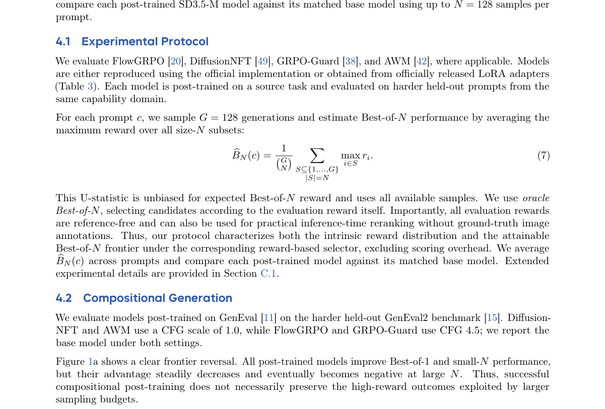

*Result - Quantile transfer across held-out tasks. GenEval2 exhibits negative upper-tail lift and frontier reversal; TextInVision exhibits positive but strongly decaying upper-tail lift; and Parti-Prom*

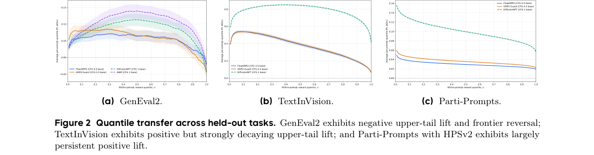

**Why this ranks #1**: 这是本批次最该先读的一篇，它直接质疑视觉 RL 后训练在推理期 Best-of-N 扩展下的收益是否可迁移。在 GenEval2 上所有后训练模型（FlowGRPO / GRPO-Guard / AWM / DiffusionNFT）的 Best-of-1 都提升，但优势随 N 增大持续衰减、最终被基座 SD3.5-M 反超，对应的上尾奖励分位提升是 FlowGRPO -0.019、GRPO-Guard -0.041。QUPO 把标量 advantage 换成可控的分位数效用混合后，GenEval2 Best-of-1 从 0.1804 提到 0.2287，Best-of-128 仍高于基座（0.7000 对 0.6850），在 ConceptMix 上也保住了大 N 前沿（0.8559 对 0.8543）。

---

### 2. OmniOPD: Stable On-Policy Distillation for Joint Audio-Video Generation

**arXiv**: [2611.02803](https://arxiv.org/abs/2611.02803) | **Score**: 9.3 (relevance 9.5 x 0.7 + quality 9.0 x 0.3) | **Tags**: rl-aigc, on-policy-distillation, audio-video-generation, cross-modal-interference, teacher-student, reward-design, University of Science and Technology of | **Categories**: cs.AI, cs.CV, cs.SD | **Pages**: 17

**Authors**: Zihao Fan; Xin Lu; Jie Huang; Hexin Zhang; Xueyang Fu; Zheng-Jun Zha

**Affiliation**: University of Science and Technology of China

**Abstract**

> Reinforcement learning (RL) elevates joint audio-video generation, but optimizing heterogeneous, modality-specific audio and video rewards often introduces cross-modal interference. On-policy distillation (OPD) alleviates this issue by transferring the capabilities of specialized audio and video RL teachers into a single student model. However, a significant imbalance in cross-modal token counts leaves audio with sparse supervision, causing unstable distillation. We observe that naively increasing the audio loss weight fails to solve this problem since audio learning relies heavily on visual context, indicating richer visual cues are crucial to offset sparse audio signals. To address this, we propose OmniOPD, a modality-wise on-policy distillation framework designed for balanced and stable audio-video generation. First, we construct privileged visual information using asymmetric noise scheduling, allowing the audio teacher to generate more informative targets from cleaner video context. Second, we introduce grouped multi-noise sampling to expand audio supervision coverage and stabilize training. Third, we introduce timestep-wise importance weighting based on teacher-student transition divergence, preserving reliable supervision while down-weighting unreliable learning signals, to stabilize fluctuations in audio learning. Evaluated on JavisBench and VBench demonstrate OmniOPD preserves audio quality while significantly enhancing video generation, achieving effective joint distillation.

**Key findings**

- **Finding**: 在 JavisBench 上 OmniOPD 得到 VQ 3.347 / AQ 5.449 / TA-IB 0.192 / CLIP 0.310 / DeSync 0.457，全面优于 LTX-2.3 基线（VQ 2.714 / AQ 5.252 / JavisScore 0.222 / DeSync 0.584）；消融显示非对称噪声偏移 s=1.5 把 VQ 从 3.174 提到 3.332、AQ 从 5.342 提到 5.376、JavisScore 从 0.226 提到 0.232，分组数 G=3 得 JavisScore 0.233、信任域比例 p=0.5 得 AQ 5.407，去掉时间步加权则退回 3.174 / 5.342 / 0.226。
- **Inference**: 音视频联合生成里「稀疏模态的监督密度」和「跨模态干扰」比奖励项怎么设计更决定成败；作者用「加音频权重无效、给更干净的视觉上下文才有效」这一诊断把问题从损失加权转移到了条件构造，对做多模态 RL 或多教师蒸馏的团队是可迁移的方法论。
- **Recommendation**: 若在做音视频/多模态生成后训练，先做三个几乎免费的消融——噪声偏移 s、分组数 G、时间步加权——看 JavisBench 的 AQ 与 VQ 是否同时上升再投入蒸馏算力；注意其 JavisScore 0.232 仍低于单独的视频教师 0.238 和音频教师 0.251，说明联合蒸馏买到的是音视频平衡而非单指标最优。

**Key figures**

*Framework - Motivation analysis of audio-video joint learning. (a) Audio and video exhibit a sub- stantial token imbalance, leading to training instability. (b) Optimization guided solely by audio rewar*

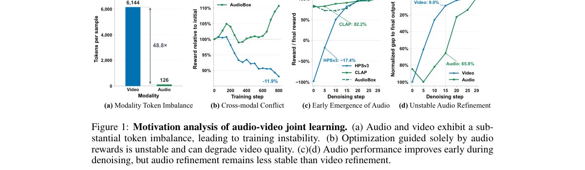

*Result - A comprehensive analysis of audio-video coupling during optimization. The top row compares optimization with video-only, audio-only, and joint rewards. The middle row compares three joint-re*

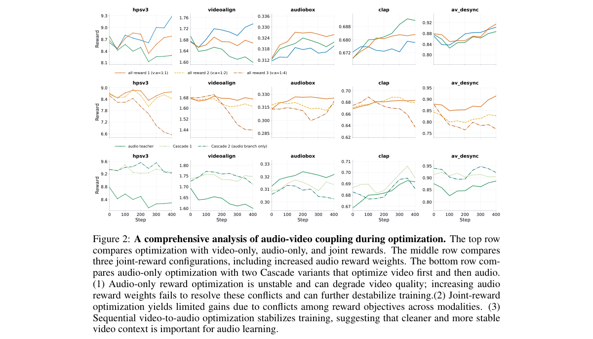

**Why this ranks #2**: 多模态生成里 RL 直接优化异构的音频/视频奖励会产生跨模态干扰，这篇给的替代路径是把专用 RL 教师蒸馏进一个学生模型。关键诊断是：单纯加大音频损失权重无效，因为音频学习高度依赖视觉上下文；用非对称噪声调度给音频教师更干净的视频上下文后，JavisBench 视觉质量 VQ 从 3.174 升到 3.332、音频质量 AQ 从 5.342 升到 5.376。分组多噪声采样（G=3 时 JavisScore 0.233）与基于师生转移散度的时间步重要性加权（p=0.5 时 AQ 5.407）进一步稳定了稀疏的音频监督。

---

### 3. Efficient Hybrid Distillation: Synergizing Score and Adversarial Objectives for One-Step Diffusion

**arXiv**: [2611.03017](https://arxiv.org/abs/2611.03017) | **Score**: 8.8 (relevance 9.0 x 0.7 + quality 8.5 x 0.3) | **Tags**: rl-aigc, one-step-generation, distillation, adversarial-training, flow-matching, image-generation, Tsinghua University | **Categories**: cs.CV | **Pages**: 32

**Authors**: Fei Peng; Junqiang Wu; Haoxian Tan; Jun Zhou; Jie Hu; Xiaoming Wei; Jie Guo; Xiu Li

**Affiliation**: Tsinghua University; Peng Cheng Laboratory; Meituan

**Abstract**

> Numerous distillation methods have been developed to accelerate diffusion models. Recent research indicates that hybrid strategies---blending different paradigms---yield superior results compared to single-method approaches. However, current works predominantly rely on a simple combination of objectives, leaving the question of how to effectively synergize them largely underexplored. In this paper, we specifically investigate the synergy between Score Distillation and Adversarial Distillation. We reveal that their operating zones are distinct and complementary: Score Distillation is effective in high-noise regimes for capturing the global distribution yet lacks fine-grained supervision in low-noise regions. Conversely, Adversarial Distillation is effective in low-noise regions but is prone to instability and suffers from discriminator failure when applied to high-noise intervals. Leveraging this insight, we propose Efficient Adversarial Score Distillation (EASD), a framework that synergizes these objectives via a regime-adaptive sampling strategy, directing each objective to focus on its effective interval. We further apply this paradigm to DiT-based Flow Matching models. Empirically, our method achieves a promising one-step FID of 1.39 on ImageNet 256$\times$256 using the SiT-XL/2+REPA model. This work provides a concrete guideline for maximizing the potential of hybrid distillation. Our code and model are available at https://github.com/pf0607/EASD .

**Key findings**

- **Finding**: EASD 对 Score 蒸馏用 Logit-Normal(0.8,1.6) 采样、对抗蒸馏用 Logit-Normal(-0.8,1.6) 采样，在 ImageNet 256×256 上以 SiT-XL/2+REPA 蒸馏得一步 FID 1.49（20 epoch）、1.39（60 epoch，Iterative Warmup）或 1.41（Fake Score EMA），优于从零训练的快速流模型（Shortcut-XL/2 一步 FID 3.80、IMM-XL/2 八步 1.99）；ImageNet 64×64 上 100K 步达 FID 1.46 对 DMD2 的 1.51（200K 步），延长训练 140K 步达 1.15 对 DMD2 的 1.28。
- **Inference**: 一步生成的质量上限不只由学生架构决定，更取决于训练目标在噪声时间轴上的分工是否与各自的有效区间对齐；消融显示直接砍掉不生效的区间比调权重更有效，这提示多目标蒸馏应当按时间步分区调度而不是加权求和。
- **Recommendation**: 复现时先做区间消融再谈混合——去掉最低噪声区间 U(0.2,1.0) 得 FID 2.18，优于全区间的 2.29，继续截断到 U(0.3,1.0) 反而退化到 2.45，而只用高噪声做对抗蒸馏会崩到 FID 9.98；结论目前只在 ImageNet 64/256 与 EDM、SiT 两类骨干上验证，尚未覆盖文本到图像这类对齐敏感任务。

**Key figures**

*Framework - Qualitative Results on ImageNet 256×256. Samples generated by our EASD-XL/2 with one inference step. More results are provided in Appendix Section I.*

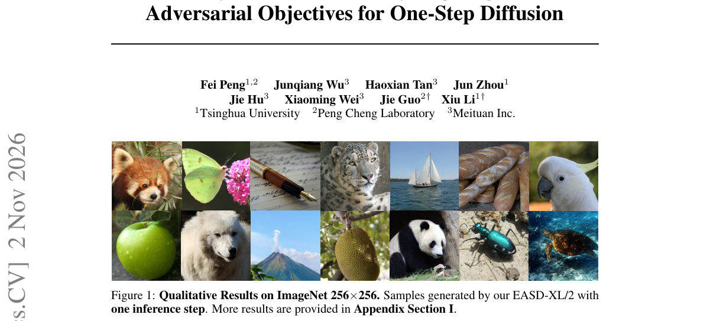

*Result - Unified View of Distillation Ob- jectives. Score Distillation explicitly regresses (sreal −sfake) via a “Composite Discriminator”;*

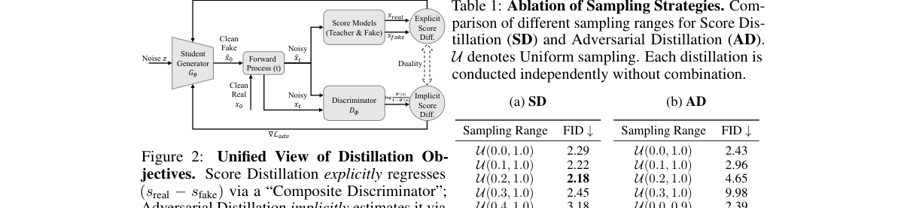

**Why this ranks #3**: 它把对抗目标放进了少步生成蒸馏这条 RL/AIGC 交叉线上，并给出可操作的分区结论：Score Distillation 在高噪声区间擅长抓全局分布却缺低噪声细节监督，Adversarial Distillation 在低噪声有效却会在高噪声出现判别器失效。用 regime-adaptive 采样把两者分配到各自生效的区间后，SiT-XL/2+REPA 在 ImageNet 256×256 上训练 20 epoch 即达一步 FID 1.49，60 epoch 达 1.39，在 ImageNet 64×64 上 100K 步达 1.46，超过 DMD2 用 200K 步的 1.51。

---

### 4. Latent Diffusion-GAN: Adversarial Learning in the Autoencoded Latent Space

**arXiv**: [2611.02625](https://arxiv.org/abs/2611.02625) | **Score**: 8.5 (relevance 8.5 x 0.7 + quality 8.5 x 0.3) | **Tags**: rl-aigc, adversarial-training, latent-diffusion, energy-discriminator, text-to-image, Sookmyung Women's University | **Categories**: cs.CV, cs.LG | **Pages**: 21

**Authors**: U-Chae Jun; Jaeeun Ko; Jiwoo Kang

**Affiliation**: Sookmyung Women's University

**Abstract**

> Diffusion models are powerful generative frameworks for producing high-quality images by denoising latent variables from random noise. However, training with likelihood-based objectives, such as denoising score matching, can lead to locally over-smoothed high-frequency details, including fine textures and sharp edges, thereby limiting perceptual fidelity and structural detail. Adversarial training with GANs enhances sharpness but typically requires additional discriminator networks, increasing computational costs and destabilizing training. To this end, we propose Latent Diffusion Generative Adversarial Networks (LD-GAN), a novel framework that seamlessly integrates adversarial learning into diffusion models without modifying their original pipeline. LD-GAN leverages the pretrained variational autoencoder (VAE) in latent diffusion models as an energy-based discriminator, enabling adversarial training without extra parameters and preserving the structured latent priors learned from large datasets. We also introduce a structural consistency energy that aligns encoder and decoder feature representations, thereby enhancing perceptual quality and compatibility with the pretrained latent space. Extensive experiments demonstrate that LD-GAN significantly improves sample fidelity, perceptual sharpness, and diversity over state-of-the-art baseline methods across various generation tasks while ensuring efficient training dynamics.

**Key findings**

- **Finding**: LD-GAN 用 VAE 解码器与编码器组成能量判别器评估潜变量与重建的一致性，并加入多尺度结构一致性能量（|L|=3、λadv=0.01、λSC=0.05）；在 8 张 H100 上与 SD-2.1 同为 2M 步训练 17 天后，FID 从 13.79 降到 9.42、CLIP score 从 0.3098 升到 0.3428；SD-3.5-M 上 FID 7.983 降到 6.732、CLIP 0.3521 升到 0.3705；GLIGEN 的 FID 11.97 降到 9.03、CLIP 0.286 升到 0.318，Textual Inversion 的 FID 12.65 降到 8.43、CLIP 相似度 0.754 升到 0.792。
- **Inference**: 「对抗信号不一定要来自一个额外的判别器网络」这一点对算力受限团队价值很高——同一骨干下用现成的自编码器当判别器就能拿到可观收益，说明对抗训练与似然目标的冲突更多来自判别器质量，而不是二者天然不可兼容。
- **Recommendation**: 落地关键是复用目标模型自带的 VAE，并做两个消融——去掉结构一致性能量、以及在 SD-3.5 这类 16 通道潜变量上把 λadv 降到 0.005、学习率降到 5e-5；注意所有对比都是同预算训练而非零成本增强，且 margin m 需每 5 个 epoch 用训练集平均重建误差重估。

**Key figures**

*Framework - Overview of LD-GAN. The generated latent ˆzt is pro- duced by denoising ˜zt = zt + ϵ using the generator (i.e., UNet). At each timestep t, both the real latent zt and the generated la- tent*

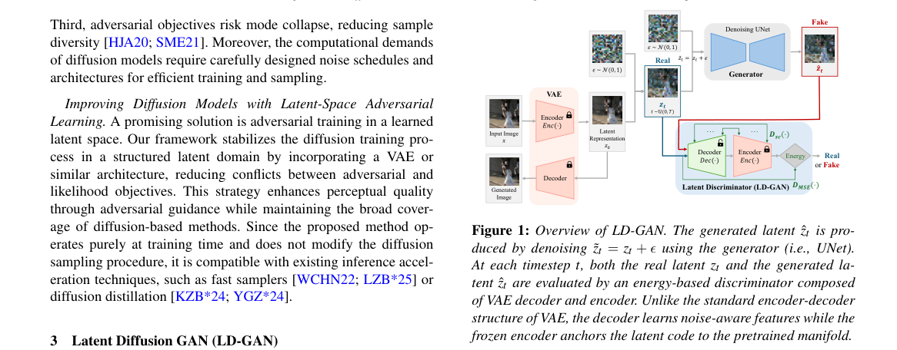

*Result - Comparison with LD-GAN and Stable Diffusion [RBL*22] trained on the LAION-5B dataset [SBV*22].*

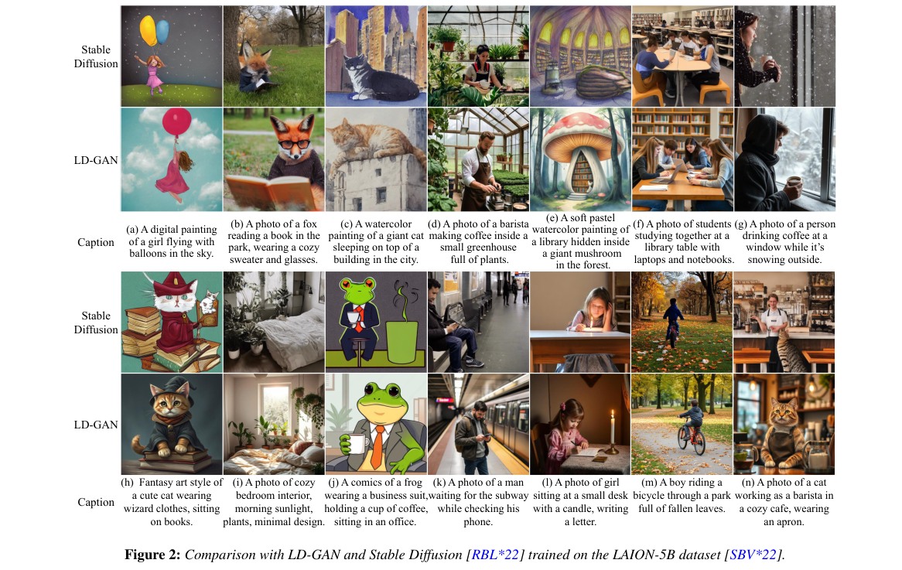

**Why this ranks #4**: 对抗训练通常要额外挂一个判别器网络，而 LD-GAN 把 latent diffusion 里本来就有的 VAE 编码器与解码器改造成能量判别器，零新增参数完成对抗训练，并用结构一致性能量对齐编码器与解码器的多尺度特征来稳住潜空间结构。在 SD-2.1 上 FID 从 13.79 降到 9.42、CLIP 从 0.3098 升到 0.3428，在 SD-3.5-M 上 FID 7.983 降到 6.732，条件生成上 GLIGEN 的 FID 从 11.97 降到 9.03、Textual Inversion 从 12.65 降到 8.43。

---

### 5. Utility-Aware Generative Recommendation: Utility-Enriched Semantic Codes and Utility-Guided Decoding

**arXiv**: [2611.02981](https://arxiv.org/abs/2611.02981) | **Score**: 8.0 (relevance 8.0 x 0.7 + quality 8.0 x 0.3) | **Tags**: rl-aigc, generative-recommendation, semantic-ids, online-ab-test, utility-alignment, beam-search, Kuaishou Technology | **Categories**: cs.LG | **Pages**: 12

**Authors**: Yang Hu; Duo Wang; Ning Li; Kang Li; Junda She; Chengcheng Guo; Kuo Cai; Bin Liu; Youhua Liu; Xiaoshuang Chen

**Affiliation**: Kuaishou Technology

**Abstract**

> Generative recommendation has been widely adopted in large-scale industrial recommendation systems, where multimodal item embeddings are quantized into offline semantic identifiers (SIDs) and items are retrieved by autoregressively generating their SIDs. However, conventional SID construction often underrepresents item utility reflected in post-exposure behaviors such as shares, long views, and video completion, making semantically similar items with different utility insufficiently distinguishable while struggling to accommodate rapidly changing utility signals. Moreover, generation likelihood may be misaligned with downstream utility, causing high-utility candidates to be prematurely pruned during beam search before post-generation reranking or training-time reward alignment can effectively compensate. To address these limitations, we propose UAGR, which aligns both SID construction and decoding with downstream multi-objective utility. Our Utility-Enriched Semantic Codes preserve the original semantic information while incorporating item-level utility without increasing SID length or vocabulary size, supporting incremental utility updates with no additional tokenization or sequence-decoding cost. Meanwhile, our Utility-Guided Decoding estimates candidate utility by combining predictions of multiple post-exposure outcomes and incorporates these estimates into beam scoring, reducing the risk of prematurely pruning high-utility paths while enabling flexible utility control without interfering with generative backbone training. Extensive offline experiments and online A/B tests under real-world traffic demonstrate the effectiveness and deployability of UAGR, which has been fully deployed on Kuaishou and increases video watch time by 0.206\% online.

**Key findings**

- **Finding**: UAGR 在 SID 末层用 Bs=10 bit 语义加 Bu=3 bit 效用做无查找量化实现 UE-SID（3×8192 码本、beam size 200），并用多后验行为预测的效用分数参与 beam 打分实现 UGD；在 KuaiRand 离线集上 Recall@3 相对最强基线提升 7.74%、NDCG@3 提升 16.52%，并在所有指标上超过 GRPO 训练时对齐与生成后重排两种基线（同一 OneRec-1.7B 底座），UGD 单独使用也优于 GRPO；高效用候选在 beam 前缀存活率上提升最大出现在第二层解码（+16.3 个百分点）；快手线上 A/B 统计显著（双侧 t 检验 p<0.05）：App 使用时长 +0.074%、视频观看时长 +0.206%、播放量 +0.164%、QPS -0.03%。
- **Inference**: 效用信息注入的位置比注入方式更重要——GRPO 在完整 SID 序列上优化奖励，但 beam search 对中间前缀做不可逆剪枝，训练期奖励无法补救剪枝阶段已经丢掉的高效用路径，所以把效用直接放进解码打分（推理期）比继续加 RL 训练更有效，这是工业级规模的「RL 后训练 vs 推理期扩展」取舍证据。
- **Recommendation**: 做生成式推荐或任何带自回归解码加剪枝的系统，先测「效用进表示」还是「效用进解码打分」哪条更省事：UE-SID 不增加序列长度与词表大小、支持增量效用更新，UGD 不需要改动生成主干训练；注意线上结论来自单一平台与单一 base model，跨域迁移性尚未验证。

**Key figures**

*Framework - Overview of UAGR. (a) Utility-Enriched Semantic Codes encode item-level utility in the final SID token without increasing SID length or vocabulary size. (b) The utility estimation module, wi*

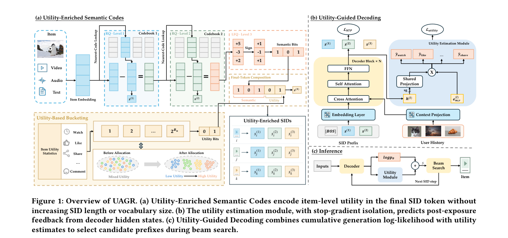

*Result - Illustration of utility-guided beam search. Ex- panded SID prefixes are scored by cumulative generation log-likelihood and current-step utility estimates before prun- ing to retain the top-𝐾*

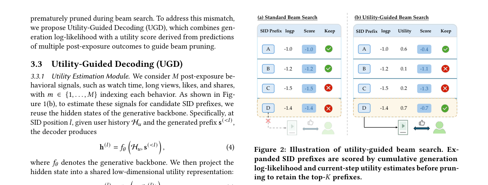

**Why this ranks #5**: 这是本批次唯一带线上 A/B 的生成式模型工作（已在快手全量部署），也罕见地直接把常规 RL 路线当基线打：作者把同一批效用信号分别用 GRPO 训练时对齐和生成后重排实现，UAGR 在全部离线指标上优于两者，只用解码侧的 UGD 也胜过 GRPO。离线 KuaiRand 上 Recall@3 相对最强基线提升 7.74%、NDCG@3 提升 16.52%，线上 App 使用时长 +0.074%、视频观看时长 +0.206%、播放量 +0.164%、QPS -0.03%。

---

### 6. Balancing Representations by Identifying and Generating Under-represented Data

**arXiv**: [2611.02952](https://arxiv.org/abs/2611.02952) | **Score**: 7.7 (relevance 7.5 x 0.7 + quality 8.0 x 0.3) | **Tags**: rl-aigc, self-supervised-learning, long-tail, diffusion, data-repair, representation, Humboldt-Universitat zu Berlin | **Categories**: cs.AI, cs.CV | **Pages**: 21

**Authors**: Filipe Laitenberger; Hirokatsu Kataoka; Yuki Asano; Cees Snoek; Mohammadreza Salehi

**Affiliation**: Humboldt-Universitat zu Berlin; University of Oxford; University of Technology Nuremberg; University of Amsterdam

**Abstract**

> Self-supervised learning inherits the coverage of its source data. When an unlabeled corpus is long-tailed, the representation becomes dense around frequent modes and thin where coverage is weak. Objectives for long-tailed SSL reweight the images already in the corpus and add no new ones. We introduce BRIDGE (Balancing Representations by Identifying and Generating Under-represented Data), a label-free feedback loop around the source set. The current encoder scores every source image by its mean kNN distance, and a budgeted acquisition rule selects images from a band of that score distribution where support is thin and the generator still produces faithful variants. A frozen image-to-image diffusion model then adds local variants of the selected anchors, and pretraining continues on the enlarged source set. We formulate acquisition as recoverability-weighted allocation of local support and derive when a finite budget should favor a sparse band that excludes the extreme tail and when reallocation after each repair is optimal under a fixed objective. Across five long-tailed, web-scraped and synthetic source regimes, BRIDGE has the highest seven-task linear-probe and kNN average of the compared methods, and paired experiments extend the gain to ViT-S under contrastive and self-distillation objectives, to low-label fine-tuning and to semantic segmentation. The linear-probe gain is smaller under masked reconstruction. Generated repair matches an oracle that restores the withheld real images, and under a frozen encoder the inserted images shrink the neighborhoods of the selected anchors about twice as much as those of matched unselected images. BRIDGE needs no labels and leaves the pretraining objective unchanged, so it can be added to pretraining on uncurated web data, where the encoder decides which images to generate.

**Key findings**

- **Finding**: BRIDGE 用当前编码器的平均 kNN 距离给源图打分，在预算约束下从稀疏带（排除极端尾部）选锚点，再用冻结的图生图扩散模型生成局部变体扩充源集后重做预训练；在五种长尾、爬取与合成源上，SimCLR 的七任务 linear-probe 平均提升 2.4 到 10.6 点，linear-probe 与 kNN 平均均为对比方法最优；ImageNet-100 施加幂律不均衡时修复加 11.1 分、类别均衡源只加 0.1 分；ViT-S 上 SimCLR/MoCo v3/DINO 的 linear-probe 平均提升 2.0 到 2.8 点，低标签微调提升 2.0 与 3.2 点，PASCAL VOC 分割提升 2.4 mIoU；生成修复 41.5 接近补真实 withheld 图的 oracle 40.7；稀疏带选点比均匀选点高 6.6 到 6.8 分、比 top-tail 选点高 7.8 到 8.0 分。
- **Inference**: 扩散模型在长尾问题上的价值不一定是「生成更多样本」，而是「在正确的表示空间位置修复样本分布」；论文给出的「预算应落在稀疏带而非均匀或极端尾部」的推导与实验一致，说明选点策略比生成分布更值得优化。
- **Recommendation**: 做长尾自监督可直接复用它的无标签选点规则（kNN 距离打分加截断分数带加最远点采样去冗余）再挂一个冻结图生图修复器；注意这是补位论文、与 RL 无关，且线性探测增益在掩码重建目标下明显变小，修复收益依赖预训练目标是否真的需要语义结构。

**Key figures**

*Framework - Overview of BRIDGE. Left, an imbalanced source set embedded by the SSL encoder, with sparse under-represented samples in red. Right, the loop. Distance to the k nearest neighbors in the curr*

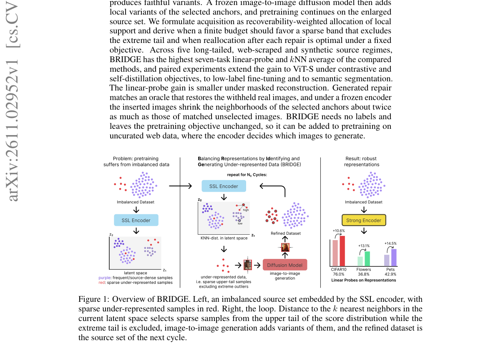

*Result - Score histogram of one ImageNet-100- LT run at cycle 0 with the 75th and 99th per- centiles marked. The green pool holds the 4B scores nearest the modal bin of the band, which lies at its lo*

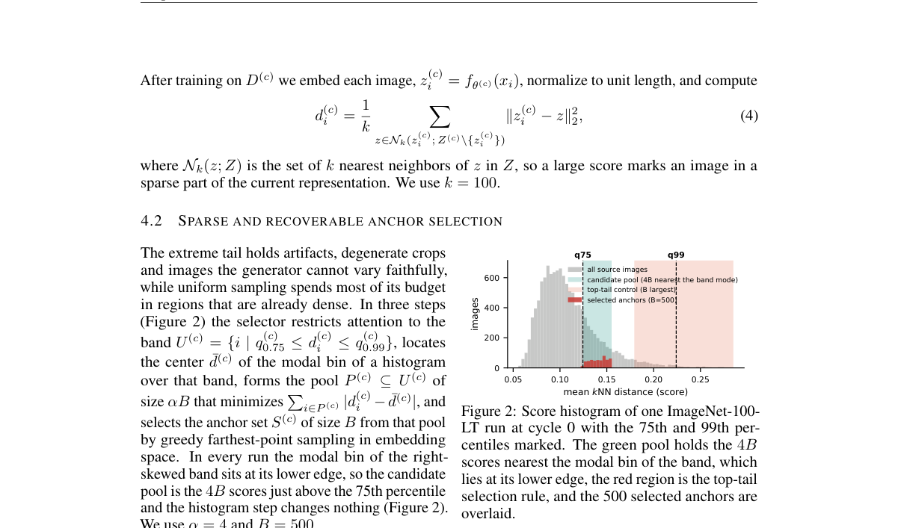

**Why this ranks #6**: 本批次「RL for AIGC」（扩散与流匹配 RL、生成式奖励模型）方向的硬供给只有 5 篇，剩下 5 个名额用「生成内容模型方向但不含 RL」的相邻论文补位，这篇是其中之一。它的信息量在于把扩散生成器当数据修复算子而不是采样器：编码器用平均 kNN 距离给源图打分，只在稀疏但生成器仍能忠实变化的分数带里选锚点，再由冻结的图生图扩散模型补局部变体。修复效果达到补真实 withheld 图像的 oracle 水平（41.5 对 40.7），幂律不均衡的 ImageNet-100 上加 11.1 分而同规模类别均衡数据只加 0.1 分。  [wild-card=yes] 该论文用扩散生成修复长尾自监督数据，属于「生成模型作为数据引擎」的方向，本身不含 RL，补位计入。

---

### 7. Probing Local Conditional Fit for Diffusion Model Membership Inference

**arXiv**: [2611.02578](https://arxiv.org/abs/2611.02578) | **Score**: 7.1 (relevance 7.0 x 0.7 + quality 7.5 x 0.3) | **Tags**: rl-aigc, membership-inference, privacy-audit, text-to-image, forward-only, model-security, Sony Group | **Categories**: cs.AI, cs.CV, cs.LG | **Pages**: 24

**Authors**: ByungHee Cha; Naoki Murata; Yuhta Takida; Jong Chul Ye; Yuki Mitsufuji

**Affiliation**: Sony Group Corporation; KAIST

**Abstract**

> Membership inference determines whether a candidate example was used to train a text-to-image diffusion model and is an important tool for auditing training-data use. We identify a directional membership signal in \emph{conditional prediction shifts}, the changes in predicted noise under alternative text conditions at a fixed noisy input: whether movement toward the alternative prediction initially lowers or raises the denoising loss from its value under the original caption. Members exhibit less room for such local improvement. To quantify this response, we propose \emph{LoFIT} (Local Conditional Fit), which measures the initial response of the denoising loss along normalized prediction shifts and aggregates it across multiple text conditions and diffusion states. LoFIT requires no target-model gradients and can be computed using only forward queries to the denoiser. Evaluations on four datasets show improved membership discrimination across fine-tuned and pretrained models. LoFIT distinguishes members early in fine-tuning, while the naive denoising-loss baseline remains near chance. Controlled comparisons show that the membership signal is concentrated in the first-order response, with little discrimination from prediction-shift magnitude alone.

**Key findings**

- **Finding**: LoFIT 在固定噪声输入上沿归一化的条件预测偏移方向测去噪损失的一阶初始响应，并在多个文本条件与扩散状态上聚合；四个数据集上优于 CLiD 与 PFAMI，微调 SD v1.4 在 Flickr30k、COCO、Pokemon 上的 AUROC 分别为 0.935、0.954、0.896，预训练 SD v1.5 上为 0.602；受控分解显示判别信号集中在一阶响应而非偏移幅度本身，微调早期即可区分成员，而朴素去噪损失基线接近随机。
- **Inference**: 审计信号从「绝对去噪损失」转到「局部可改进空间」，既让成员检测在只需前向查询的条件下变得可行，也说明过拟合的判别特征是条件化的局部性质而非全局误差水平——同一套前向查询就能给扩散 RL 后训练的数据泄漏做低成本体检。
- **Recommendation**: 做扩散 RL/DPO 后训练或对外发布模型时，把它当成上线前的例行检查，LoFIT 只做前向查询，成本远低于需要梯度的攻击；注意优势建立在四个数据集与特定骨干上，预训练模型上 AUROC 仅 0.602，说明它对微调过拟合更敏感，外推到其他架构需要重测。

**Key figures**

*Framework - Illustration of LoFIT for a queried image-caption pair. At a fixed noisy input, r denotes the original-caption prediction error relative to the target noise, and δ the prediction shift towar*

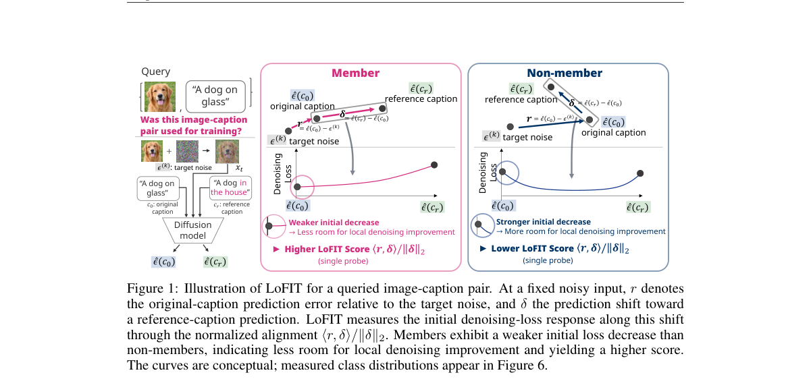

*Result - Query efficiency on Flickr30k and LAION-MI. CLiD curves use the released statistic with two-fold cross-fitted calibration (Appendix A.3); “our prompts” and “our states” denote our reference*

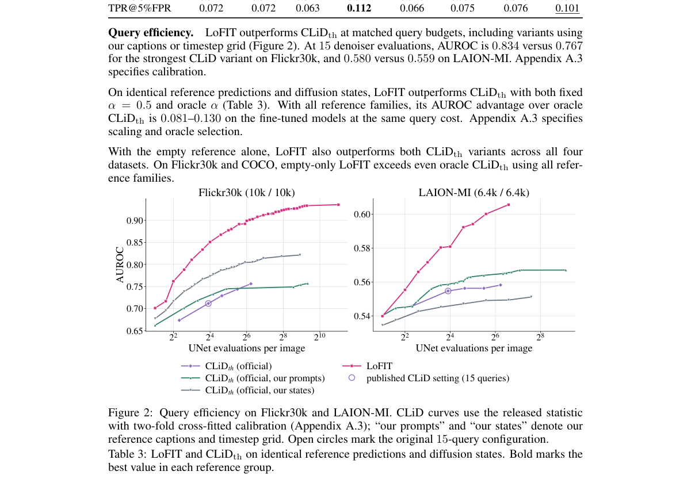

**Why this ranks #7**: 这同样是补位论文——本批次 RL for AIGC 硬供给只有 5 篇，其余名额由不含 RL 的生成内容模型论文填充——但对这条线有直接工程含义：任何在开源图像或用户数据上做扩散 RL/DPO 后训练的团队都绕不开成员推断风险。LoFIT 只用去噪器的前向查询、不需要目标模型梯度，就能测出「条件预测偏移下的一阶去噪损失响应」，在微调 SD v1.4 上 AUROC 达 0.935、0.954、0.896，优于 CLiD 与 PFAMI 等基线。  [wild-card=yes] 该论文是扩散模型的成员推断攻击，属于生成模型隐私审计方向，本身不含 RL，补位计入。

---

### 8. Unlocking the Potential of Contrastive Regularization for Diffusion Transformer Training

**arXiv**: [2611.02921](https://arxiv.org/abs/2611.02921) | **Score**: 7.1 (relevance 7.0 x 0.7 + quality 7.5 x 0.3) | **Tags**: rl-aigc, diffusion-transformer, contrastive-learning, representation-regularization, imagenet, Nanyang Technological University | **Categories**: cs.CV, cs.LG | **Pages**: 29

**Authors**: Yi Tan; Beier Zhu; Sirui Chen; Yunzhe Lin; Yuan Zhou; Cheng Chen; Xingyu Zhu; Tianrun Chen; Yanbin Hao; Hanwang Zhang

**Affiliation**: Nanyang Technological University; University of Science and Technology of China; Tongji University

**Abstract**

> Representation regularization has emerged as an effective way to improve diffusion transformer training. Yet one of the most canonical regularizers--InfoNCE-style contrastive learning--remains largely underexplored in this setting. We naturally ask a question: can standard contrastive learning serve as an effective regularizer for diffusion transformers? Surprisingly, we find that naive InfoNCE regularization brings only marginal gains. Our analysis reveals that the objective is easily dominated by a shortcut: near-orthogonal noise components in diffusion inputs provide a bypass for enlarging negative-pair distances while weakening positive-pair alignment, especially at high noise levels. To unlock the benefit of contrastive regularization, we propose Clean Representation-ANchored Contrastive (CRAN) regularization. Specifically, CRAN anchors contrastive dispersion with clean-sample representation distances, transferring clean relational semantic structure to noisy diffusion representations to suppress the noise shortcut. Extensive experiments on ImageNet show that CRAN consistently improves diffusion transformer training across model scales and training budgets, outperforming internal feature-alignment and dispersive regularization baselines while matching external DINO-guided REPA. These results re-establish InfoNCE-based contrastive learning as an effective regularizer for diffusion training, once its noise-driven over-dispersion is properly constrained.

**Key findings**

- **Finding**: CRAN 用干净样本表示的成对距离锚定 InfoNCE 的负样本分散上限以抑制噪声捷径；在 ImageNet 256×256 上 SiT-B/2 训练 400K 迭代的 FID-50K 为基线 33.0、SRA 29.1、SRA+Dispersive 28.6、DiverseDiT 28.1、SRA2 28.9、CRAN 26.3；SiT-XL/2 上 CRAN 仅用 1M 迭代就达无 CFG FID 7.5（超过原版 SiT-XL/2 训练 7M 迭代），最终 6.2 是不使用外部预训练视觉编码器方法中的最好结果，带 CFG 训练 800 epoch 达 FID 1.45、超过 MaskDiT 与 SD-DiT，并追平依赖外部 DINO 特征的 REPA；消融显示固定锚定 mfix=0.5（cos 60°）即把 FID 从 28.5 降到 27.0。
- **Inference**: 对做扩散 RL/DPO 的团队，这意味着「先把骨干表示训好」的收益可能大于在后训练阶段调奖励；同时它给出一个可复用的诊断——只要对比正则的负对距离随噪声强度一起膨胀，就说明模型在用噪声捷径而不是语义。
- **Recommendation**: 把 CRAN 当成低成本前置实验：在自己的骨干上加一层干净样本锚定的对比正则，几百 K 迭代就能看到 FID 差异（SiT-B/2 上 26.3 对 28.5），再决定是否值得把算力投到后训练；注意它不含任何 RL 成分，结论集中在 ImageNet 类条件生成，掩码重建等目标下线性探测增益明显更小。

**Key figures**

*Framework - Diagnostic studies of the noise shortcut. (a) Standard InfoNCE rapidly over-disperses negative pairs and weakens positive-pair alignment, while CRAN alleviates both effects. (b) The over-dis*

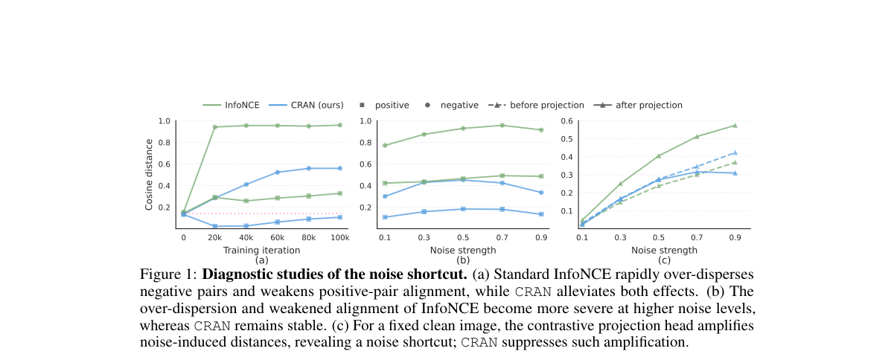

**Why this ranks #8**: 这是补位论文——本批次 RL for AIGC 的硬供给只有 5 篇，其余名额用不含 RL 的生成内容模型论文填充——但它提供的是后训练的前置条件：扩散 Transformer 的表示质量决定了 RL/DPO 后训练的上限，而 CRAN 指出 InfoNCE 在扩散训练里几乎无效，是因为输入高斯噪声的近正交分量提供了撑开负样本距离的捷径，反而削弱正样本对齐。用干净样本的表示距离锚住对比分散后，SiT-B/2 的 FID-50K 从基线 33.0 降到 26.3（InfoNCE 只有 28.5），SiT-XL/2 无 CFG 达 6.2、800 epoch 带 CFG 达 1.45。  [wild-card=yes] 该论文是扩散 Transformer 的对比正则训练方法，属于生成模型训练方法但不含 RL，补位计入。

---

### 9. LAND: Learning an Adaptive Number of Draws for Bayesian Best-of-N Selection

**arXiv**: [2611.03388](https://arxiv.org/abs/2611.03388) | **Score**: 7.1 (relevance 7.0 x 0.7 + quality 7.5 x 0.3) | **Tags**: rl-aigc, best-of-n, compute-allocation, bayesian-decision, machine-translation, inference-efficiency, Aleph Alpha Research | **Categories**: cs.AI | **Pages**: 9

**Authors**: Koen Oostermeijer; Teryn Jones

**Affiliation**: Aleph Alpha Research

**Abstract**

> Best-of-N decoding improves generation quality by sampling multiple candidates and selecting the best, but it allocates equal compute to sources regardless of how much they benefit from additional sampling: the expected benefit is small for sources with low-variance score distributions and potentially much larger for those with high-variance distributions. To address this shortcoming, we propose LAND (Learning an Adaptive Number of Draws), which dynamically allocates samples according to their posterior-predictive marginal value. LAND learns a discrete empirical mixture of source-conditioned score distributions from calibration data, updates its belief about a source as completion scores are observed, and stops sampling when the expected improvement of another draw falls below a shared compute price. Across machine-translation experiments with multiple models and language pairs, LAND achieves better MetricX scores than fixed best-of-N at matched average compute. Conversely, at matched translation quality, LAND requires approximately 20-40% fewer candidate generations. Adaptive allocation therefore provides a simple way to retain the benefits of best-of-N while substantially improving its compute efficiency.

**Key findings**

- **Finding**: LAND 用源条件的离散经验混合建模分数分布，部署时顺序生成并打分、用后验预测的边际改进对比一个全局算力价格决定是否继续采样；在机器翻译上以 MetricX 同时作选择与评估（预算 N=1 到 32），Gemma4 31B 四个语向对上同等抽取预算下 MetricX 持续优于固定 best-of-N，图中工作点处省下约 20-30% 的候选生成，另用 Qwen3 30B-A3B 在乌克兰语→德语、荷兰语→匈牙利语上验证，跨模型、语向与预算合计省下约 20-40% 的完成数。
- **Inference**: 固定 Bo-N 的浪费主要来自给低方差样本也分配同样预算，这与 QUPO 的结论互补：既然 Bo-N 的收益集中在高奖励上尾，就没有必要对每个 prompt 都把预算堆到同一个 N，把推理期算力当成可分配的停止问题，是比继续做 RL 后训练更便宜的收益来源。
- **Recommendation**: 部署 Bo-N 时先做这件小事——按源统计分数方差做分层采样预算，比全局调 N 便宜得多；若要照搬 LAND，注意实验只在机器翻译上、且用 MetricX 同时做选择与评估，作者明确说明它验证的是过滤目标的优化效率而非下游模型训练效果。

**Key figures**

*Framework - Fixed best-of-N always generates the same number of candidates for every source. However, higher overall scores can be achieved by allocating less com- pute to sources whose candidate scores*

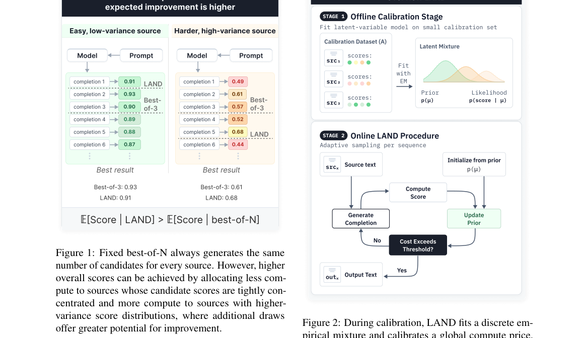

*Result - During calibration, LAND fits a discrete em- pirical mixture and calibrates a global compute price. At deployment, candidates are generated and scored se- quentially, the posterior over sour*

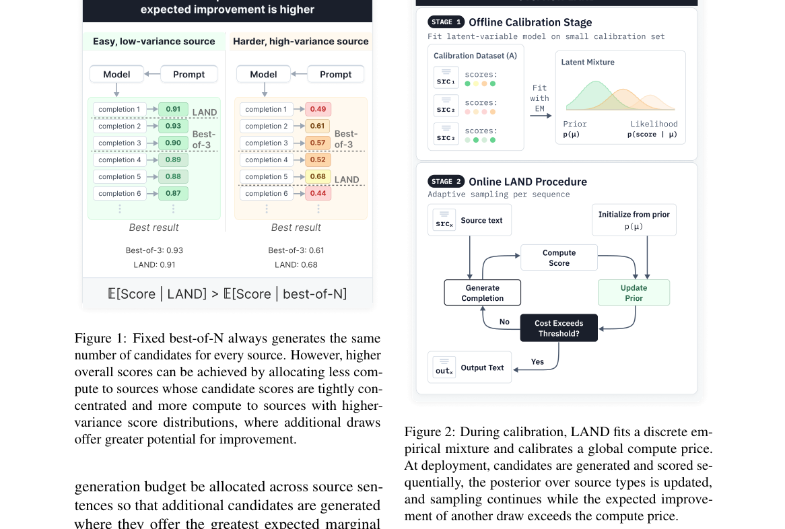

**Why this ranks #9**: 补位论文——本批次 RL for AIGC 的硬供给只有 5 篇，其余 5 个名额用不含 RL 的生成内容模型论文补位。它之所以值得进这条线，是因为与 QUPO 正好构成一对：QUPO 指出 Bo-N 会把权重压到奖励分布上尾，LAND 则给出推理期把预算按期望边际收益动态分配的方案。LAND 从校准数据学出源条件分数分布的离散经验混合，按观测到的完成分数更新后验，当再一次采样的期望改进低于全局算力价格时停止，在 Gemma4 四个语向对上同等平均算力下 MetricX 优于固定 Bo-N，同等质量下少生成约 20-40% 候选。  [wild-card=yes] 该论文研究生成式解码的 Best-of-N 采样预算自适应分配，属于推理期扩展而非 RL 训练，补位计入。

---

### 10. GEAR: Generative Editing for Scene-Conditioned Outfit Retrieval for VR Travel

**arXiv**: [2611.02363](https://arxiv.org/abs/2611.02363) | **Score**: 6.7 (relevance 6.5 x 0.7 + quality 7.0 x 0.3) | **Tags**: rl-aigc, generative-retrieval, diffusion-editing, virtual-reality, vlm-pipeline, human-study, University of Science Ho Chi Minh City | **Categories**: cs.CV | **Pages**: 14

**Authors**: Gia-Huy Dinh; Thinh-Phuc Nguyen; Thanh-Hai Nguyen; Lam-Huy Nguyen-Ngoc; Hoang-Bach Nguyen-Phan; Nam-Quan Nguyen; Minh-Triet Tran; Trung-Nghia Le

**Affiliation**: University of Science Ho Chi Minh City; Vietnam National University Ho Chi Minh City

**Abstract**

> In virtual environments, choosing appropriate outfits requires contextual harmony with surrounding scenes, yet bridging the visual gap between 3D ambient views and catalog garment assets remains challenging. This paper investigates scene-conditioned outfit retrieval for interactive 3D environments, where a user's egocentric view serves as the retrieval signal. We present GEAR (Generative Editing for Asset Retrieval), a framework that bridges the cross-domain gap by synthesizing intermediate visual queries rather than predicting direct compatibility. GEAR uses a vision-language model to describe suitable clothing from a captured scene, employs an instruction-guided diffusion model to render the concept onto a standardized reference character, and utilizes the cropped clothing region to retrieve existing 2D outfit assets via embedding similarity. An interactive Unity prototype demonstrates real-time scene capture, asset retrieval, and in-engine 3D avatar fitting. We benchmark GEAR against direct visual similarity, aesthetic scoring, and VLM-based reranking on a controlled dataset using automated Swiss-system pairwise judgments, where GEAR achieves competitive top-ranked performance (mean Elo@5 of 1012.75 and top-10 overlap of 0.180) alongside 0.539 pairwise agreement. Furthermore, a user study across 20 virtual travel scenes demonstrates that GEAR achieves the highest overall participant preference in both visual appeal (34.5%) and contextual suitability (34.5%).

**Key findings**

- **Finding**: GEAR 用 VLM 描述与场景适配的服装概念、用指令引导扩散模型渲染到标准化参考角色、裁剪服装区做嵌入相似度检索，并与直接视觉相似度、美学分、VLM 重排三种基线在受控数据集上用自动化 Swiss-system 成对判定比较：GEAR 的 top-ranked 平均 Elo@5 为 1012.75、top-10 overlap 0.180、成对一致率 0.539；在 20 个虚拟旅行场景的用户研究中，视觉美感与场景适配两项的总体偏好率均为 34.5%，均居首位。
- **Inference**: 这是「生成模型作为检索查询构造器」的用法，与 RL 无关但同属生成内容模型的落地问题——把跨域缺口转成一次可控编辑，比训练一个跨域匹配器更省事，也说明生成模型在资产检索这类场景的可行商业路径是改造查询而不是扩大生成分布。
- **Recommendation**: 如果你的问题也是「3D 场景视图到 2D 目录资产」，可以照抄这条三段式管线（VLM 描述加指令编辑渲染参考图加裁剪区域检索），不必先训跨域表征；但要接受它的边界——评测只有 20 个场景的用户研究，0.539 的成对一致率说明自动判定与人类判断仍有明显分歧，结论尚未在更大规模资产库上验证。

**Key figures**

*Framework - Overview of scene-conditioned outfit retrieval in an interactive 3D environment. The user’s current scene view serves as a query to retrieve and rank outfits according to their contextual comp*

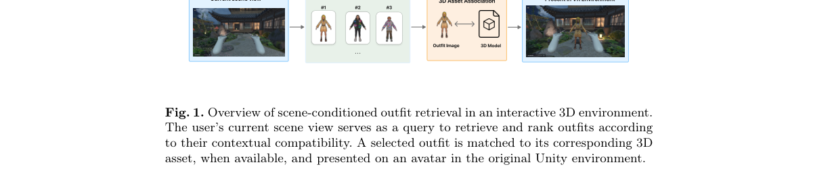

*Result - GEAR retrieval pipeline. A VLM suggests clothing for the scene, and FLUX edits a reference character to wear it. The clothing region of the generated image is cropped and used to search an ind*

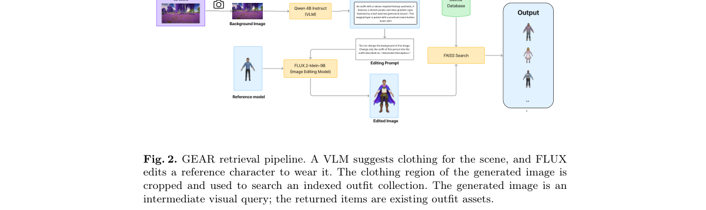

**Why this ranks #10**: 补位论文——本批次 RL for AIGC 的硬供给只有 5 篇，其余名额用不含 RL 的生成内容模型论文补位。它的价值在于把生成模型用在检索链路上而不是采样链路上：用 VLM 描述场景该穿什么，再用指令引导扩散模型把概念渲染到标准参考角色上，裁出服装区域去做 2D 服装资产检索，从而绕开 3D 环境视图与商品图之间的跨域鸿沟。受控数据集上 top-ranked 平均 Elo@5 达 1012.75，20 个虚拟旅行场景的用户研究中视觉美感与场景适配偏好都以 34.5% 居首。  [wild-card=yes] 该论文用指令扩散模型合成中间查询再做服装检索，属于生成式编辑应用，本身不含 RL，补位计入。

---

