# ArXiv Daily Digest - 2026-11-03 (核心强化学习, 10 papers)

**Generated**: 2026-11-03 17:30 CST

**Source**: arXiv cs.CV, cs.SD, eess.AS, cs.CL, cs.AI, cs.RO, cs.LG submissions, listing day 2026-11-02 (announced 2026-11-03 00:00 UTC)

**Batch window**: 2026-11-01T18:00:00Z .. 2026-11-02T18:00:00Z（arXiv 公告批次横跨两个 UTC 日：前一日 18:00 UTC 起算，当日 17:59:59 UTC 截止）

**Track**: rl_core (top 10 of 564 papers scanned, 70 full reads)

**Scope**: RL 算法与理论、多智能体 RL、sim-to-real 与机器人策略学习

---

## Top 10 - 核心强化学习

### 1. Value Forcing: Aligning Return Distributions at All Noise Levels

**arXiv**: [2611.02160](https://arxiv.org/abs/2611.02160) | **Score**: 9.3 (relevance 9.5 x 0.7 + quality 9.0 x 0.3) | **Tags**: rl-core, flow-matching, distributional-value, offline-rl, bellman-consistency, Princeton University | **Categories**: cs.AI, cs.LG | **Pages**: 33

**Authors**: Chongyi Zheng; Zhiyuan Zhou; Qiyang Li; Benjamin Eysenbach; Sergey Levine

**Affiliation**: Princeton University; University of California Berkeley

**Abstract**

> Learning accurate value functions is central to reinforcement learning (RL), yet remains challenging because supervision is limited and indirect: ground-truth values are unavailable, and each transition in the data only provides an immediate reward that can be used to construct bootstrapped targets as supervision. This challenge is particularly pronounced when data is limited or reward signals are sparse, as is common in real-world applications such as robotics. We argue that the key to accurate value learning in this limited data regime is extracting richer learning signals from the available data. In this paper, we introduce Value Forcing, a new approach that uses flow matching to estimate return distributions and enables accurate value learning from limited data. Our key insight is that we can extract richer learning signals by enforcing Bellman consistency at every noise level. Empirically, Value Forcing improves the accuracy of estimating the return distribution, and prevents the distribution from collapsing to a single value, as occurs with prior methods. We instantiate Value Forcing with two practical value-learning algorithms: VF, an actor-critic method, and IVF, an implicit value-learning method. We evaluate both algorithms across $26$ long-horizon tasks in the offline RL setting and find that they outperform prior value-learning methods, with particularly large gains when data is limited. Our project website is available at https://chongyi-zheng.github.io/value-forcing.

**Key findings**

- **Finding**: 用 flow matching 估计回报分布并在每个噪声级别强制 Bellman 一致性，得到显式的 VF 与隐式的 IVF 两个算法；在 OGBench 20 个任务（cube-triple、cube-quadruple、puzzle-4x4、humanoidmaze-giant 各 5 个）与 OCBench 6 个任务共 26 个长程离线 RL 任务上评估，回报分布的 1-Wasserstein 距离在四个 OGBench 域上均低于 Value Flows、FlowCritic、PCBF 三个 flow 基线，数据从 100% 降到 10% 时差距进一步拉大。
- **Inference**: 稀疏或错误的稠密监督会让回报分布坍缩成点质量，从而架空分布式价值学习本身——瓶颈在监督信号的密度而非 critic 的容量，这一点对所有使用 bootstrapping 的离线 RL 都成立。
- **Recommendation**: 若在稀疏奖励或小数据离线 RL 上遇到价值过估计，先复现 cube-triple 上的 1-Wasserstein 对比、确认分布是否坍缩，再把 Bellman 一致性加到每个噪声级别；注意结论建立在长程任务与 action chunking 上，稠密奖励的短程任务上收益未必明显。

**Key figures**

*Framework - We introduce Value Forcing, a new approach to learning distributional value functions with flow matching that supervises the learned return distribution at every flow noise level through Bel*

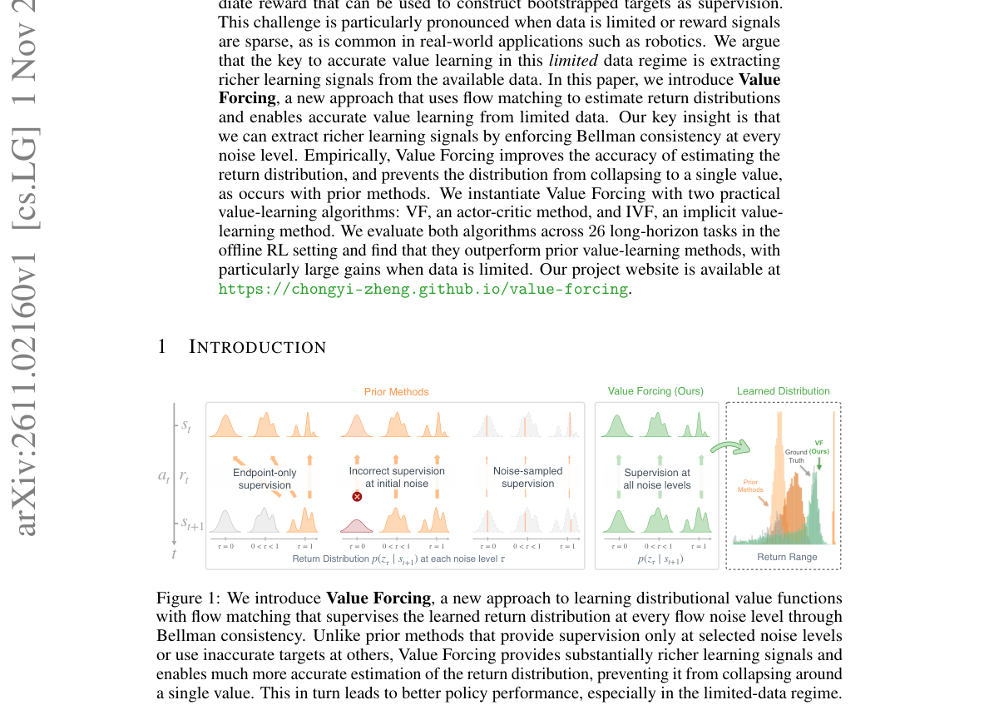

*Result - Value Forcing learns more accurate return distributions than prior flow-based return estimators. (Left) We collect datasets to conduct policy evaluation experiments at a single state from ea*

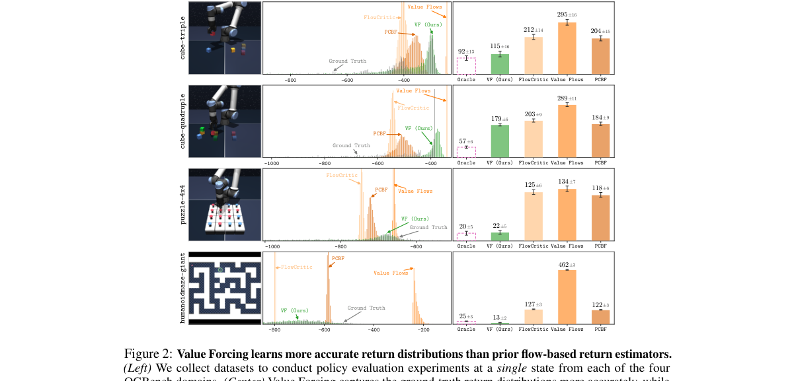

**Why this ranks #1**: 价值学习在数据有限或奖励稀疏时最容易被单一的 bootstrap 目标带偏，这篇用 flow matching 估计回报分布，并在每个噪声级别强制 Bellman 一致性，从同一批数据里挖出更丰富的监督信号。论文先指出先前的分布式方法会把回报分布压成点质量，再在 OGBench 20 个任务与 OCBench 6 个任务共 26 个长程离线 RL 任务上验证 VF 与 IVF 都优于 FlowCritic、Value Flows、PCBF 等基线，数据越少优势越大。对做离线 RL 价值模型的人，这直接给出了「学回报分布而非标量 Q」的落地方案。

---

### 2. Neural Actor--Critic Learning with Minimax Critics and Reflected Langevin Sampling

**arXiv**: [2611.03352](https://arxiv.org/abs/2611.03352) | **Score**: 9.2 (relevance 9.5 x 0.7 + quality 8.5 x 0.3) | **Tags**: rl-core, minimax-bellman, reflected-langevin, finite-sample-bound, continuous-control, Wuhan University | **Categories**: cs.LG, stat.ML | **Pages**: 99

**Authors**: Kunqi Huang; Lican Kang; Hongrui Shu; Jincheng Ying

**Affiliation**: Wuhan University

**Abstract**

> Actor--critic methods rely on critic gradients to improve continuous-action policies, yet finite-sample guarantees must control both value and gradient errors and their propagation through the actor. We develop a neural actor-critic procedure that combines a regularized minimax Bellman estimator over sigmoid networks with a finite reflected Langevin sampler driven by the fitted critic gradient. Under uniform Bellman regularity and covered reset sampling, a positive high-order action-derivative penalty yields value and action-gradient risk bounds with classical nonparametric minimax exponents up to logarithmic factors. We propagate estimation, mixing, discretization, temperature, and policy-iteration errors to obtain return guarantees, with refinements for bounded multimodal potentials and strongly concave regimes. Empirical studies across controlled simulations, logged continuous-control data, and a simulated decision task show favorable performance relative to the considered baselines.

**Key findings**

- **Finding**: 组合正则化 minimax Bellman 估计（sigmoid 网络）与由拟合 critic 梯度驱动的有限反射 Langevin 采样器，给出值风险与动作梯度风险的非参数 minimax 指数级界（差对数因子），并把估计、混合、离散化、温度与策略迭代误差传播为回报保证；每个受控环境 100 次重复中一阶实现的平均最终回报高于 uniform 与多项式 critic 对照，六个记录数据集上 sigmoid DNN 的平均预测误差低于 Linear，而与 Quadratic 及训练目标标准化折扣回报下的策略排序则依数据集而变，模拟建筑能耗数据上神经 critic 决策的平均供暖负荷与 regret 也低于 Linear 和 Uniform。
- **Inference**: 连续控制的有限样本理论以往基本只保证值误差，这条工作说明动作梯度误差必须被单独控制才能谈策略改进——直接把 critic 梯度当策略梯度用，在有限样本下可能系统性偏掉。
- **Recommendation**: 适合作为理论对照阅读；若要复现，请注意实验规模很小（受控仿真 100 次重复加六个记录数据集），与 Quadratic、策略排序的对比又依数据集而变，直接拿它指导大规模连续控制训练还缺算力与规模的证据。

**Why this ranks #2**: 这篇把 actor-critic 的有限样本保证补齐到动作梯度层面：critic 用 sigmoid 网络上的正则化 minimax Bellman 估计，actor 用拟合出的 critic 梯度驱动有限反射 Langevin 采样，并给出值风险与动作梯度风险的经典非参数 minimax 指数级界。论文同时把估计、混合、离散化、温度与策略迭代误差一并传播到回报保证上，对关心「连续控制里到底哪个误差项主导」的读者很有价值。实验覆盖受控仿真、六个记录型连续控制数据集与模拟建筑能耗决策任务。

---

### 3. SGR-OPSD: Learning from Subgoal Plans with Graph-Regularized Credit Assignment for Agentic Reinforcement Learning

**arXiv**: [2611.02414](https://arxiv.org/abs/2611.02414) | **Score**: 8.7 (relevance 9.0 x 0.7 + quality 8.0 x 0.3) | **Tags**: rl-core, subgoal-planning, turn-level-credit, agentic-rl, privileged-feedback, East China Normal University | **Categories**: cs.AI | **Pages**: 16

**Authors**: Shu Liu; Yang Chong; WenShi Chen; Man Lan

**Affiliation**: East China Normal University; Meituan

**Abstract**

> OPSD provides dense supervision for agentic reinforcement learning through privileged information feedback. However, existing privileged information often lacks explicit task-progression planning, while teacher-student log-probability gaps reflect shifts in model preference rather than true task progress. To address these limitations, we propose Subgoal-Guided Graph-Regularized OPSD (SGR-OPSD), a framework that combines subgoal supervision with interaction-derived evidence for turn-level credit assignment. Specifically, SGR-OPSD uses LLM-generated subgoal plans to provide dense action-level guidance, converting them into advantage weights via a constrained, KL-regularized objective. To ground credit in observed outcomes, we construct a Subgoal Progress Graph that estimates empirical returns from sampled transition frequencies. The graph compares empirical action returns against the state average to derive preferences that calibrate the teacher's credit weights. Evaluated on ALFWorld, WebShop, and Search-QA across two model scales (Qwen2.5-3B and 7B), SGR-OPSD consistently outperforms GRPO and strong self-distillation baselines, improving success rates over GRPO by up to 7.4 percentage points and reaching 85.8% on ALFWorld with Qwen2.5-7B. Ablation studies confirm that subgoal guidance and graph-based weight calibration are key to these performance gains.

**Key findings**

- **Finding**: 用 LLM 生成的子目标计划经约束的 KL 正则目标转成优势权重，并用子目标进展图把经验动作回报与状态均值对比得到的偏好用于校准教师信用；在 ALFWorld、WebShop、Search-QA 上以 Qwen2.5-3B/7B 评测，相对 GRPO 的成功率最多提升 7.4 个百分点，Qwen2.5-7B 在 ALFWorld 达到 85.8%，消融显示子目标引导与图校准两者都不可省。
- **Inference**: 稠密监督本身不是越多越好——图校准的作用是把「模型自认为在推进」与「交互证据里的真实回报」对齐，说明特权信息反馈需要一个独立于教师偏好的验证通道。
- **Recommendation**: 消融已表明两部分都要保留，适合在 agentic RL 里直接接在自己的 GRPO 训练脚本上试；注意它的子目标来自 LLM 生成、教师来自更强模型，收益上限取决于教师质量与子目标计划的可执行性，在长程或工具调用任务上需重新验证。

**Key figures**

*Framework - Overview of SGR-OPSD. (a) Subgoal-guided OPSD produces credit weights, which are jointly cali- brated using subgoal progress graph evidence. (b) The figure shows a real example in which cali*

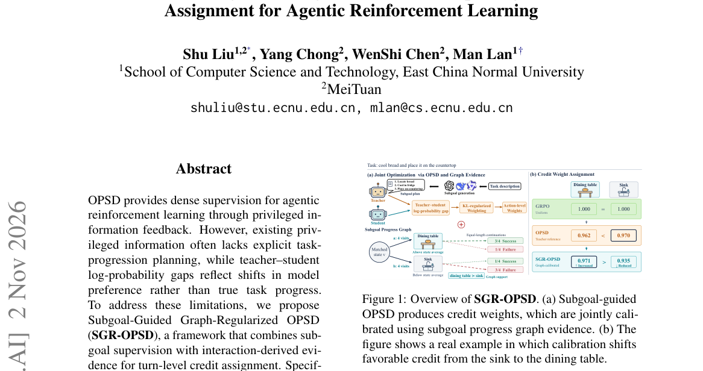

*Result - Overview of SGR-OPSD. Subgoal plans guide teacher feedback, which constrained KL weighting converts into turn-level credit weights. The Subgoal Progress Graph uses student trajectories to de*

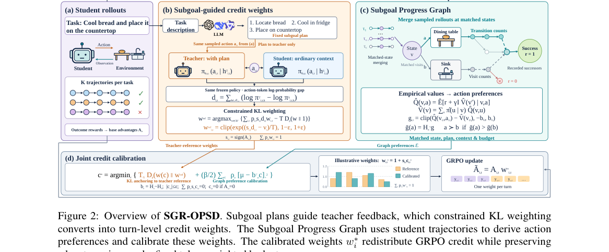

**Why this ranks #3**: 这篇直指 agentic RL 里稠密监督的来源问题：特权信息反馈没有显式的任务推进规划，师生 log 概率差只反映偏好迁移而非真实进展。作者用 LLM 生成的子目标计划提供动作级引导，再把子目标进展图（Subgoal Progress Graph）里由采样转移频率估计的经验回报与状态均值作比较，用来校准教师给出的信用权重。在 ALFWorld、WebShop、Search-QA 上用 Qwen2.5-3B 与 7B 两个尺度评测，相对 GRPO 最多提升 7.4 个百分点，Qwen2.5-7B 在 ALFWorld 达到 85.8%。

---

### 4. ANCHOR: KL-Anchored Adaptation for Stable Offline-to-Online RL

**arXiv**: [2611.02177](https://arxiv.org/abs/2611.02177) | **Score**: 8.5 (relevance 8.5 x 0.7 + quality 8.5 x 0.3) | **Tags**: rl-core, offline-to-online, kl-anchoring, catastrophic-failure, conservative-regularization, University of Michigan | **Categories**: cs.AI, cs.LG | **Pages**: 37

**Authors**: Geonwoo Cho; Jaegyun Im; Doyoon Kim; Lexin Li

**Affiliation**: University of Michigan; Gwangju Institute of Science and Technology; Pohang University of Science and Technology; University of California Berkeley

**Abstract**

> Offline-to-online reinforcement learning (RL) follows the pretrain-finetune paradigm: an agent is first pretrained on historical data and then adapted through online interaction. We study offline-to-online adaptation without offline replay, where the agent must improve using only the pretrained model and newly collected experience. A key challenge is to avoid catastrophic failure, a sharp early performance collapse during online fine-tuning, while still achieving strong asymptotic performance. Through controlled experiments, we show that removing offline replay can induce catastrophic failure, while retaining strong conservative regularization from offline RL can suppress final online performance. We also find that common stabilization strategies do not reliably prevent early collapse, and that the critic-side mechanisms we test are insufficient on their own. Motivated by these findings, we propose ANCHOR, a simple adaptation method that anchors the actor to the offline-pretrained policy early in online fine-tuning, anneals this constraint over time, and retains only a small residual conservative critic regularizer. We provide a theoretical interpretation showing that KL anchoring helps preserve critic reliability across nearby occupancy distributions, with a two-phase regret bound explaining when anchoring should be maintained or relaxed. Across FrankaKitchen, AntMaze, and Adroit tasks, ANCHOR substantially reduces catastrophic failure while maintaining strong asymptotic performance. Ablations show that KL annealing and the residual conservative weight are important for balancing early stability and online adaptation, while additional analysis shows that ANCHOR is most beneficial when the pretrained policy contains useful behavior to preserve. Code is available at https://github.com/Cho-Geonwoo/ANCHOR.

**Key findings**

- **Finding**: 受控实验先证明去掉离线回放会引发灾难性失败、保留强保守正则又会压低最终在线性能，随后提出 ANCHOR——早期用 KL 把 actor 锚在离线预训练策略上并随时间退火、只保留极小的保守 critic 正则；在 FrankaKitchen、AntMaze、Adroit 的六个任务（kitchen-mixed、kitchen-partial、antmaze-large-diverse、antmaze-large-play、door-binary、pen-binary）上先离线预训练再在线微调 400K 步，ANCHOR 平均最终成功率最好且显著降低早期崩溃，基线为 WSRL、PORL、Cal-QL、CQL、IQL、SAC。
- **Inference**: 早期崩溃的根因不是 critic 本身不准，而是占据分布漂移破坏了 critic 的可靠性；KL 锚定之所以有效，是因为它把在线数据维持在 critic 仍然可信的邻域内，这也解释了为什么单在 critic 侧加保守正则不够。
- **Recommendation**: 消融显示 KL 退火与残余保守权重两者都必须保留，但方法有明确边界：在 relocate-binary 与 antmaze-ultra-diverse 上 ANCHOR 同样无法超过预训练策略，把 KL 锚定接到 IQL 上也只降低早期崩溃、不改善渐近性能，所以只在预训练策略本身含可用行为时才值得投入。

**Key figures**

*Framework - Controlled analysis of offline data and conservative regularization. Success rates of CQL during online fine-tuning across four tasks. (a) Keeping the conservative regularizer α during onlin*

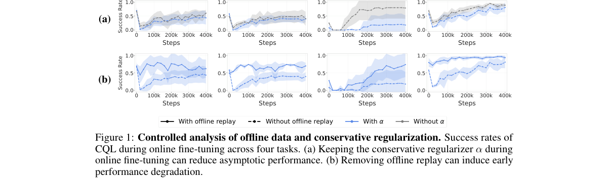

*Result - ANCHOR improves both early stability and final performance. Existing methods do not consistently achieve both low catastrophic failure and strong asymptotic performance across tasks. In cont*

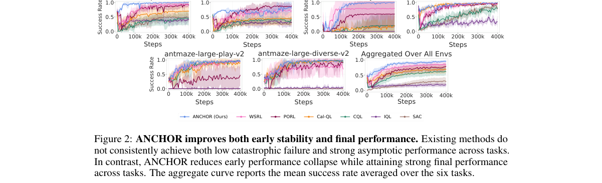

**Why this ranks #4**: 这篇把「离线预训练后在线微调」的早期崩溃当成一个可设计的对象来做：先用受控实验证明去掉离线回放会引发灾难性失败、而保留强保守正则又会压低最终性能，再用「早期把 actor 锚在离线预训练策略上、随时间退火、只留极小保守 critic 正则」这一简单方案同时拿到低崩溃和强渐近性能。理论侧给出两阶段 regret 分解，说明 KL 锚定在什么条件下该维持、什么时候该放松。对做 offline-to-online 的团队，这是一份少见的把失败模式先量化再修掉的实证研究。

---

### 5. KlaskTron-IL: A Contact-Rich Adversarial Imitation Learning Benchmark with a Validated Sim-to-Real Bridge

**arXiv**: [2611.03091](https://arxiv.org/abs/2611.03091) | **Score**: 8.3 (relevance 8.5 x 0.7 + quality 8.0 x 0.3) | **Tags**: rl-core, imitation-learning, sim-to-real, contact-rich, adversarial-robotics, ETH Zurich | **Categories**: cs.RO | **Pages**: 13

**Authors**: Nicklas Sohm; Aswin Ramachandran; Raffaello D'Andrea

**Affiliation**: ETH Zurich

**Abstract**

> KlaskTron is an open-hardware physical platform for two-player adversarial reinforcement learning, with a learned actuator model that supports zero-shot sim-to-real transfer of trained policies. Building on this platform, we contribute KlaskTron-IL: a multi-tier imitation learning dataset (80k human demonstration timesteps collected directly on the physical robot, 320k symmetry-augmented timesteps, and synthetic expert trajectories up to 5M steps generated by the zero-shot-validated PPO policy), and diagnostic baselines that expose three characteristic failure modes of standard IL methods under contact-rich adversarial dynamics: BC's data scaling plateau, GAIL's interpretable but weak-gradient discriminator (Spearman $ρ= -1.0$ peg-ball proximity recovery, but a logit span under 0.1), and an asymmetric BC-prior x reward-density interaction. Because the policy interface used throughout this paper is the same one the actuator model bridges to hardware, a policy trained on this benchmark can run unchanged on the physical robot, as we demonstrate zero-shot for the strongest BC baseline, so long as its commands respect the actuator model's $\pm 0.2$ m/s identification range.

**Key findings**

- **Finding**: 构建开源硬件平台 KlaskTron 用于两人对抗 RL，配学习到的执行器模型支持零样本 sim-to-real；KlaskTron-IL 提供 80k 真机人工示范步、320k 对称增强步与最多 5M 步由零样本验证的 PPO 策略生成的合成专家轨迹，并用诊断基线暴露三种失效模式：BC 出现数据规模饱和、GAIL 判别器可解释但梯度弱（peg-ball 邻近恢复 Spearman ρ=−1.0，logit 跨度低于 0.1）、BC 先验与奖励密度存在非对称交互。
- **Inference**: GAIL 的失效方式很有代表性——判别器排序完全正确却没有可用梯度，说明在接触丰富的对抗动力学里，判别式 IL 的瓶颈是信用分配而不是容量或数据量。
- **Recommendation**: 建议直接用这套分层数据重跑 BC、观察规模饱和出现在哪一档，再决定要不要投额外采集；但注意真机零样本迁移的前提是命令不超过执行器模型的 ±0.2 m/s 辨识范围，超出即失效。

**Key figures**

*Framework - KlaskTron-IL system architecture. Dashed blocks are inherited from the platform [7]. Solid blocks are contributions of this paper. The simulator and physical robot expose the same 12D state*

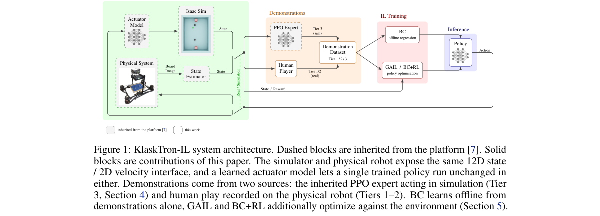

*Result - Peg occupancy: BC rollout (left) vs. human demonstrations (right). The BC policy occupies wall regions; expert demonstrations do not.*

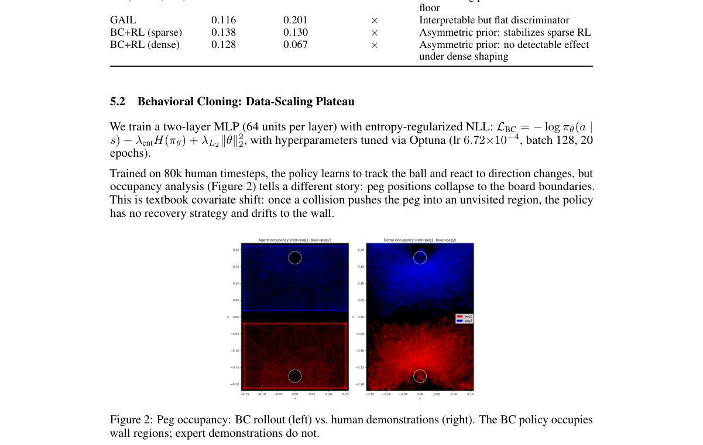

**Why this ranks #5**: 这篇给接触丰富的对抗动力学提供了一个物理真机的模仿学习基准，而不是又一个仿真套件：80k 真机人工示范、320k 对称增强步、最多 5M 步由零样本验证过的 PPO 策略生成的合成专家轨迹，分层数据加诊断基线。更有价值的是它把标准 IL 的三种典型失效模式量化了出来——BC 的数据规模饱和、GAIL 判别器梯度太弱（peg-ball 邻近恢复 Spearman ρ=−1.0 但 logit 跨度不到 0.1）、以及 BC 先验与奖励密度的非对称交互。对做真机模仿学习的人，这是难得的可直接取用的分层数据与故障诊断。

---

### 6. An Axiomatic Framework for Reinforcement Learning in Open Multi-Agent Systems

**arXiv**: [2611.03301](https://arxiv.org/abs/2611.03301) | **Score**: 8.0 (relevance 8.0 x 0.7 + quality 8.0 x 0.3) | **Tags**: rl-core, open-multi-agent, shapley-value, axiomatic-design, ad-hoc-teamwork, University of Bristol | **Categories**: cs.AI, cs.LG, cs.MA | **Pages**: 43

**Authors**: Jianhong Wang; Yang Li; Samuel Kaski; Jonathan Lawry

**Affiliation**: University of Bristol; Shanghai Jiao Tong University; ELLIS Institute Finland

**Abstract**

> Open multi-agent systems, where only a subset of agents are controllable, are central to real-world domains such as smart grids, yet lack a principled foundation for reinforcement learning algorithm design. We study this setting through n-agent ad hoc teamwork (NAHT), a recent framework for learning in open multi-agent environments. We propose an axiomatic framework that derives value function learning from the Shapley axioms (Efficiency, Symmetry and Linearity), treating them as structural constraints rather than heuristic design choices. This formulation builds on a novel NAHT decomposition, which characterises the fundamental difference between open and fully controllable multi-agent systems, and establishes a cooperative game-theoretic foundation for learning. We further show that enforcing these axioms on learning individual value functions recovers the Shapley value for Dec-POMDPs, providing a principled bridge between reinforcement learning and classical cooperative game theory. Building on this framework, we introduce Shapley Machines and Banzhaf Machines, two generic algorithmic templates that can be instantiated with standard reinforcement learning methods. When applied to strong base algorithms such as IPPO and POAM, our methods consistently improve learning efficiency and generalisation to unseen agent types and conventions across NAHT benchmark tasks. The code of experiments is published on https://github.com/hsvgbkhgbv/axiomatic-rl-naht.

**Key findings**

- **Finding**: 从 Shapley 公理（有效性、对称性、线性）推导价值函数学习，提出 Shapley Machine 与 Banzhaf Machine 两个可插拔模板并实例化为 SM-POAM、SM-IPPO、BM-POAM、BM-IPPO；在改造过的 MPE-PP 与 SMAC 的 NAHT 任务上每个指标用 128 个 episode、5 个随机种子并报 95% 置信区间，结果显示每个基算法（IPPO-NAHT 或 POAM）的 Shapley 或 Banzhaf 变体至少有一个取得最好表现，用非空联盟基博弈数量设定 TTD(λ) 的 n-step 分量数（MPE-PP m=7、5v6 m=31、8v9 m=120）几乎能最大化学习性能。
- **Inference**: 公理框架的价值不在于给出新基线，而在于把「为什么这么设计」变成可否证的问题——结果里 Efficiency 公理在部分场景反而降低性能，说明三条公理并非同等必要。
- **Recommendation**: 适合作为方法论参考，特别是想知道开放多智能体里价值分解该满足什么性质时；注意 8v9 与 10v11 上基博弈数远超 episode 长度（511 对 150），只能用 episode 长度近似，此时 Banzhaf Machine 与基线在实现上等价、增益不成立。

**Key figures**

*Framework - Example of state- specific cooperative games. The red and blue vectors are two games represented by dif- ferent basis game sets, denoted by ws(M) and us(M). Their difference is measured by t*

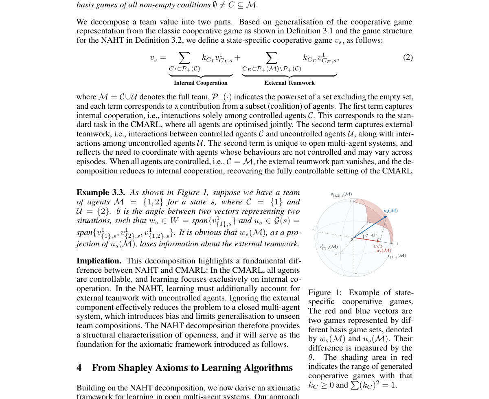

*Result - Experiments verifying that the number of n-step return components in TTD(λ) can be determined by the number of non-empty coalition basis games. In MPE-PP the number of basis games is m = 7,*

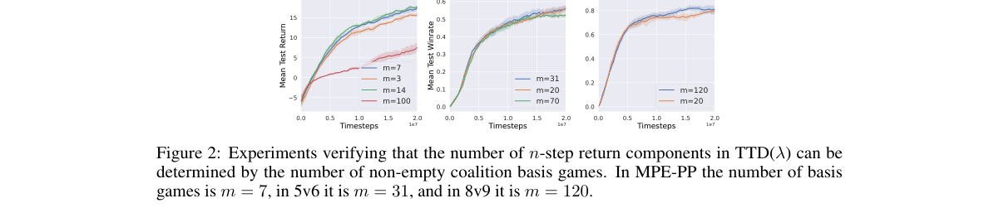

**Why this ranks #6**: 这篇把开放多智能体系统里的价值函数学习从启发式设计变成公理推导：用 Shapley 三公理（有效性、对称性、线性）作为结构约束，并给出一个新的 NAHT 分解刻画开放系统与全可控系统的根本差别，由此证明在单个价值函数上强制这些公理可还原 Dec-POMDP 的 Shapley 值。落到算法上是 Shapley Machines 与 Banzhaf Machines 两个可插拔模板，装到 IPPO 和 POAM 上就得到 SM-IPPO、SM-POAM、BM-IPPO、BM-POAM，在 NAHT 基准上一致提升学习效率与对未见智能体类型及约定的泛化。

---

### 7. Inferring Transferable Rewards via Active Inverse Reinforcement Learning

**arXiv**: [2611.03296](https://arxiv.org/abs/2611.03296) | **Score**: 8.0 (relevance 8.0 x 0.7 + quality 8.0 x 0.3) | **Tags**: rl-core, inverse-rl, active-learning, sample-complexity, transferable-reward, EPFL | **Categories**: cs.HC, cs.LG | **Pages**: 39

**Authors**: Victor Villin; Till Freihaut; Andreas Schlaginhaufen; Christos Dimitrakakis; Maryam Kamgarpour; Giorgia Ramponi

**Affiliation**: EPFL; University of Zurich; University of Neuchatel

**Abstract**

> Inverse Reinforcement Learning (IRL) aims to recover expert rewards that transfer across environments with differing dynamics. Prior work has shown that such transfer is possible when gathering expert demonstrations across sufficiently different dynamics. In practice, however, expert demonstrations are costly, making it critical to select the right dynamics to reduce the quantity of expert data required for learning transferable rewards. We propose a two-phase approach: we first cycle through the available dynamics to obtain a reliable reward estimate, then actively select dynamics to reduce our uncertainty about the expert reward. Crucially, this yields novel sample complexity guarantees on transfer that hold for any dynamics, with a rate independent of the number of available dynamics. Empirically, our method significantly reduces the number of expert demonstrations needed to learn a transferable reward.

**Key findings**

- **Finding**: 提出两阶段主动 IRL，先轮转可用动力学完成热身得到可靠奖励估计，再按信息增益（实验用 log-det 准则）主动挑选动力学；理论上跨训练集的最坏次优性为 Õ(d⋆dU/(nm))，速率与可用动力学个数无关，而轮转只能保证 Õ(d⋆|P|/(nm))；在 |S|=20、|A|=5、|P|=10 的随机 MDP（20 个随机种子、n=100 条专家轨迹）上，1000 个未见动力学的最坏次优性（×100）为 Active only 2.86 / 12.63、两阶段 2.93 / 13.63、ED 3.32 / 16.52、轮转 3.15 / 19.59、固定动力学 IRL 18.18 / 24.36、GAIL 26.62 / 96.06，在 |P|=100 的迷宫任务上不带热身的主动选择用 20 条轨迹就达到轮转用 100 条才有的次优性。
- **Inference**: 主动挑选动态性能省下专家数据的原因是把「动力学数量」换成了「特征维度」——只有当可用动力学远多于可辨识方向时这个替换才有意义，这直接决定了该方法适用的场景形状。
- **Recommendation**: 结论有明确边界：热身长度取预算的三分之一偏保守（在最异质设置下 Active only 反而最好），实验也都在可精确求解的小型 MDP 上、扩展性被作者留作未来工作；建议先在自己的环境集合上量出轮转基线的差距再决定是否投入。

**Key figures**

*Framework - Worst-case suboptimality over the training set P as a function of the number of observed expert trajectories on randomly generated MDPs. Each plot corresponds to a different type of training*

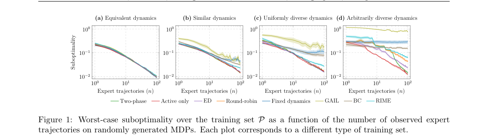

*Result - Number of times each dynamics in the train- ing set P is selected after 100 rounds, for two types of training set. Dynamics are ordered by increasing average dissimilarity to the rest of P,*

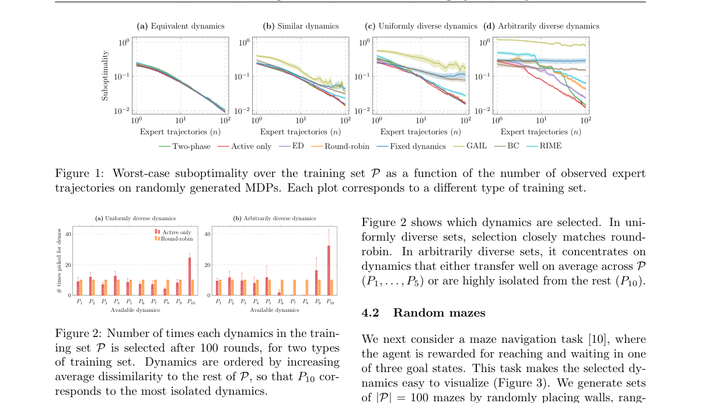

**Why this ranks #7**: 这篇问的是 IRL 里一个很实际的成本问题：跨动力学可迁移的奖励需要专家在足够多样的动力学下示范，但专家数据很贵，能不能让学习者自己挑「让专家在哪种动力学下演示」。答案是两阶段：先用轮转把奖励估计热身到可靠，再主动挑信息增益最大的动力学，实验用 log-det 准则。新结果的可迁移次优界速率与可用动力学数量无关，这是把「多样性」从经验判断变成可证明性质的第一步。

---

### 8. Behavior-Discriminative Reward Shaping for Reward-Robust Reinforcement Learning

**arXiv**: [2611.02415](https://arxiv.org/abs/2611.02415) | **Score**: 8.0 (relevance 8.0 x 0.7 + quality 8.0 x 0.3) | **Tags**: rl-core, reward-robust-rl, potential-based-shaping, uncertainty-set, policy-gradient, Tulane University | **Categories**: cs.LG | **Pages**: 55

**Authors**: Zixuan Liu; Fangzheng Wu; Brian Summa; Zizhan Zheng

**Affiliation**: Tulane University

**Abstract**

> Reward-robust RL typically models misspecification by specifying an uncertainty set that constrains the discrepancy of plausible rewards from a base reward. However, such reward space discrepancies can be behaviorally irrelevant: under potential-based reward shaping (PBRS), many distinct rewards preserve policy ordering. This can introduce substantial redundancy into standard uncertainty sets and degrade optimization performance. We propose Shaping-Aware Reward-Robust RL, which constructs uncertainty sets over PBRS equivalence classes by projecting each reward to a canonical representative, ensuring that the resulting set contains only rewards that induce behaviorally distinct policy rankings. We prove that this projection preserves the optimal robust value while shrinking the uncertainty set and improving empirical performance. Using the connection between robustness and regularization, we obtain a practical algorithm to solve the shaping-aware reward-robust RL problem and enjoy convergence guarantees under standard assumptions. Experiments on benchmarks spanning diverse task domains and levels of complexity show consistent improvements over representative robust RL baselines and exhibit improved robustness to reward perturbations.

**Key findings**

- **Finding**: 构造 PBRS 等价类上的投影不确定集，每个奖励取其 Ω∗ 几何下最小的规范代表，并证明投影保持最优鲁棒值、收紧对手搜索空间，实现在策略梯度更新前用同批次数据学一个势网络再替换奖励；在 MiniGrid、Hopper、Walker2d、HalfCheetah、Humanoid、Reacher、Seaquest、Pong、Adroit Pen 上以 PPO 为基线、每策略 100 个 episode、5 个随机种子取 95% 置信区间，平均累计回报相对标准鲁棒 RL 提升 17.6%（熵正则）与 39.0%（KL 正则），其中 HalfCheetah 的 KL 变体从 1583.30 提到 3288.30（+107.7%）、Adroit Pen 从 4434.22 提到 6087.30（+37.3%）。
- **Inference**: MiniGrid 上观测到标准基线的对手更新有相当比例落在 PBRS 不变方向上，即优化预算被浪费掉了——这说明不确定集设计里「行为无关的方向」是普遍存在的冗余，而非个别实现的问题。
- **Recommendation**: 这是可直接落地的改法，PPO 或 SAC 加一步投影即可；但要注意两点边界：收敛保证依赖投影损失的强凸假设（神经网络设定下并不直接成立），作者也自陈算法属于「受理论启发的近似实现」，投影误差只随采样数 N 以 O((log N + log(1/δ))/N)^(1/4) 衰减。

**Key figures**

*Result - MiniGrid evaluation comparing the standard max-min baseline and our shaping-aware method. (a) Grid-world task: the agent starts in the top-left cell and must reach the goal in the bottom-rig*

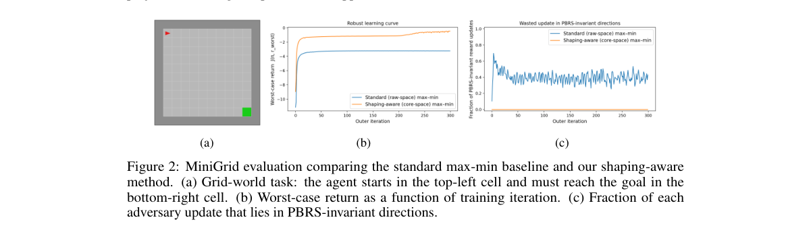

**Why this ranks #8**: 奖励鲁棒 RL 通常用一个不确定集约束「合理奖励与基准奖励的差距」，但在势函数塑形（PBRS）下大量不同的奖励根本不改变策略排序，等于给对手塞了大量冗余搜索维度。这篇把每个奖励投影到其 PBRS 等价类的规范代表上，使不确定集只包含行为上真正可区分的奖励，并证明该投影不改变最优鲁棒值、同时收紧不确定集。落地实现是把投影当成对环境奖励的替换，因此任何优化期望回报的算法（SAC、PPO）都能直接套上。

---

### 9. Iterative Gumbel Planning for Continuous Control

**arXiv**: [2611.02236](https://arxiv.org/abs/2611.02236) | **Score**: 8.0 (relevance 8.0 x 0.7 + quality 8.0 x 0.3) | **Tags**: rl-core, search-based-planning, factorized-policy, gumbel-topk, continuous-control, Texas A&M University | **Categories**: cs.AI, cs.LG | **Pages**: 22

**Authors**: Shaohuai Liu; Weirui Ye; Yilun Du; Le Xie

**Affiliation**: Texas A&M University; MIT CSAIL; Harvard University

**Abstract**

> Search-based planning remains a powerful policy improvement paradigm in reinforcement learning, driving milestone successes in discrete domains. However, extending this paradigm to continuous control exposes a structural mismatch: search evaluates a finite set of action candidates, whereas continuous RL typically relies on Gaussian policies. We show that winner-action distillation into a continuous Gaussian induces a \textit{projection error} and a stepwise variance-expanding gradient tendency when the selected action is sufficiently far from the current mean. Empirically, this tendency is associated with elevated terminal variance and a return gap on the evaluated tasks. To address this, we propose \textbf{Iterative Gumbel Planning (IGP)}. By adopting a per-dimension factorized categorical policy, IGP naturally aligns the policy support with the search candidates, eliminating the projection error and reducing the residual approximation to a bounded discretization error. To bypass the combinatorial explosion of high-dimensional discrete action spaces, IGP pairs Gumbel Top-$K$ candidate sampling with an MPPI-style multi-round iterative search to refine the policy at each state. Empirically, IGP achieves state-of-the-art aggregate performance and sample efficiency on DMControl and HumanoidBench. Furthermore, it produces more stable action sequences with lower temporal variance, demonstrating its practical potential for real-world robotic deployment.

**Key findings**

- **Finding**: 证明高斯策略做胜出动作蒸馏时只要残差超过标准差就会在梯度下降下放大 σ，并给出逐维因子化 categorical 策略加 Gumbel Top-K 候选采样与 MPPI 式多轮迭代的 IGP；在 1M 环境步的 DMC-Hard 七个任务上对标 TD-MPC2、BRC、BRC-ST、EZ-M，EZ-IGP 把 EZ-M 的 dog-run 从 405.874±50.808 提到 613.257±6.546、dog-trot 从 815.958 提到 942.814、humanoid-walk 从 779.404 提到 911.542、humanoid-run 从 259.030 提到 369.468，且同骨干、同 K=8 候选与 16 次模拟、两轮精炼的高斯对照在三个 DMC humanoid 任务上仍落后 139–150 分，该对照的 dist/policy_sigma 从 1.76±0.16 升到早期峰值 3.02±0.16 并在训练末 10% 仍停在 2.11±0.04。
- **Inference**: 这说明「搜索加蒸馏」的失败不在搜索质量而在策略类的不匹配——离散化把一个不可消除的投影残差换成了可控、且随 bin 数收缩的离散化误差，代价是任务特定的归纳偏置缺口。
- **Recommendation**: 可以在已有 TD-MPC2 或 EZ 风格代码上直接替换策略头试试，但要注意它并非全面胜出：在 HB-Hard 的 crawl、sit、balance 上落后最强基线，作者也承认现有对比无法把 bin 分辨率、动作因子化、探索与目标选择的影响单独分离。

**Key figures**

*Framework - Factorized policies achieve SOTA per- formance. Across high-dimensional continuous- control benchmarks, our iteratively refined policy consistently attains strong returns.*

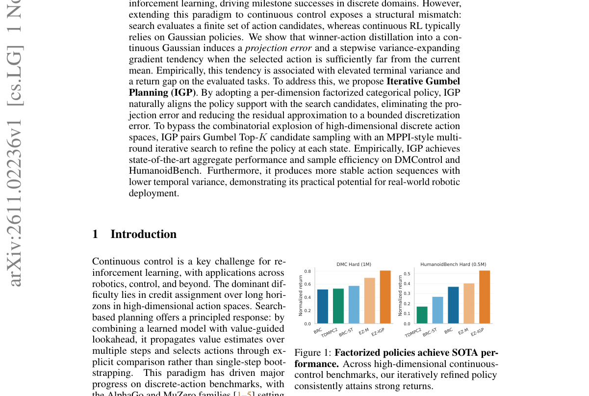

*Result - Comparison of MPPI and Iterative Gumbel Planning (IGP). While standard MPPI refines trajectories over an unbounded continuous action space, IGP natively operates in a factorized discrete pol*

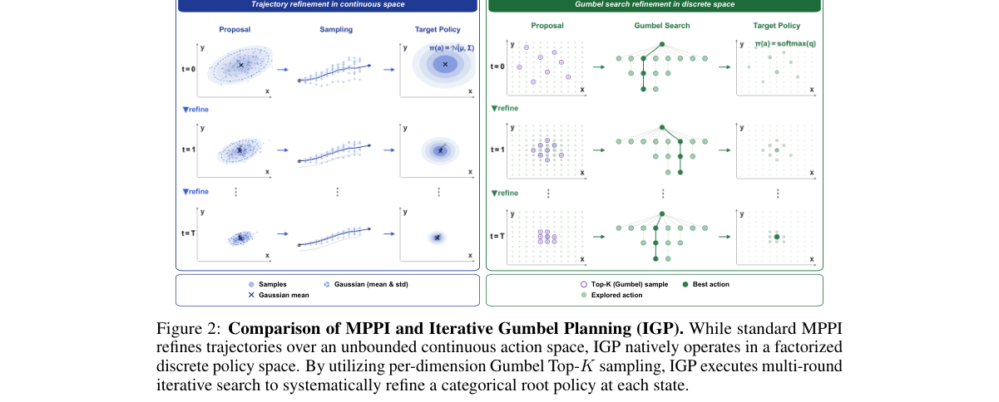

**Why this ranks #9**: 搜索式规划在离散域一路封神，但搬到连续控制就撞上结构性错配：搜索评估的是有限个动作候选，连续 RL 却依赖高斯策略。这篇先把病灶讲清楚——把胜出动作蒸馏进高斯会产生投影误差，并导致「胜出动作离当前均值足够远时方差逐步膨胀」的梯度倾向；再给出 IGP：用逐维因子化 categorical 策略让策略支撑与搜索候选天然对齐，残差只剩有界的离散化误差，高维组合爆炸则由 Gumbel Top-K 采样加 MPPI 式多轮迭代搜索解决。

---

### 10. MAPO: Mixture of Experts with Alternating Policy Optimization for Universal Humanoid Motion Tracking

**arXiv**: [2611.02613](https://arxiv.org/abs/2611.02613) | **Score**: 8.0 (relevance 8.0 x 0.7 + quality 8.0 x 0.3) | **Tags**: rl-core, mixture-of-experts, policy-gradient, humanoid, motion-tracking, KAIST | **Categories**: cs.RO | **Pages**: 21

**Authors**: Seonghyeon Lim; Hyeonwoo Lee; Mincheol Kim; Kimin Lee; Hyun Myung

**Affiliation**: KAIST

**Abstract**

> Universal humanoid motion tracking is essential for enabling humanoid robots to perform diverse tasks in human environments. To capture the wide diversity of human motions, mixture-of-experts (MoE) policies have been widely adopted, leveraging dynamic routing to enhance policy expressiveness. However, we identify that divergence between old and updated policies can be misestimated during policy-gradient updates of MoE policies, due to their dynamic routing. Because most policy-gradient algorithms regulate policy updates based on the divergence, this misestimation can lead to either overly conservative or excessively large updates, which can yield a suboptimal policy. In this paper, we propose Mixture of Experts with Alternating Policy Optimization (MAPO), which alternately optimizes the router and the experts to avoid the divergence misestimation. MAPO consistently tracks 182 motions that PPO with MoE fails to track, whereas PPO with MoE tracks only one motion that MAPO fails to track. MAPO also attains the highest tracking success rate among the compared methods and the lowest tracking error across most error metrics, demonstrating its superior performance. Videos can be found on the project website: https://mapo-corl2026.github.io/MAPO/

**Key findings**

- **Finding**: 识别出 MoE 动态路由导致的散度误估现象——数据收集策略与更新后策略之间的散度无法准确反映 MoE 策略更新的真实幅度，进而让基于散度的策略梯度更新走向过度保守或过大更新；提出 MAPO 交替优化 router 与 experts，在通用人形运动跟踪上 MAPO 能持续跟踪 182 个带 MoE 的 PPO 跟不住的动作，而 PPO+MoE 跟住了 1 个 MAPO 跟不住的动作，MAPO 同时取得最高的跟踪成功率与多数误差指标上最低的跟踪误差。
- **Inference**: 这把 MoE 策略的工程问题定位到「更新幅度控制器失灵」而非「表达力不足」——同样的骨干只要把散度估计修对就能多跟住上百个动作，说明不少 MoE 论文的收益是被实现细节吃掉的。
- **Recommendation**: 若你在用 MoE 加策略梯度做机器人策略，优先检查散度估计与路由变化之间的关系，这比换骨干更省成本；边界是结论建立在人形运动跟踪这类高维接触任务上，比较对象只限 PPO+MoE，尚未覆盖 SAC 等其他算法族。

**Key figures**

*Framework - MAPO resolves the divergence misestimation problem that hinders policy-gradient training of MoE policies, enabling effective humanoid motion tracking. Consequently, MAPO successfully tracks*

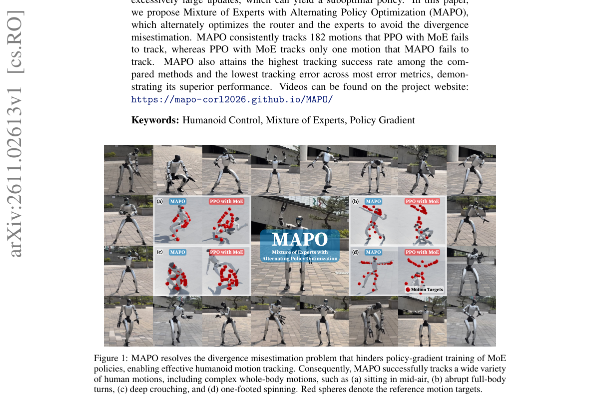

**Why this ranks #10**: MoE 策略用于通用人形运动跟踪很常见，但这篇指出一个容易被忽略的坑：MoE 的动态路由会让「旧策略与更新后策略的散度」在策略梯度更新中被误估，而多数策略梯度算法正是靠这个散度来调节更新幅度，于是更新可能过度保守或过大，最终得到次优策略。MAPO 的解法很直接——交替优化 router 与 experts，绕开散度误估。在 182 个通用人形动作上，MAPO 能全部跟踪，而带 MoE 的 PPO 只跟住 1 个反向的例子。

---

