# ArXiv Daily Digest - 2026-11-03 (LLM 后训练 RL, 10 papers)

**Generated**: 2026-11-03 17:30 CST

**Source**: arXiv cs.CV, cs.SD, eess.AS, cs.CL, cs.AI, cs.RO, cs.LG submissions, listing day 2026-11-02 (announced 2026-11-03 00:00 UTC)

**Batch window**: 2026-11-01T18:00:00Z .. 2026-11-02T18:00:00Z（arXiv 公告批次横跨两个 UTC 日：前一日 18:00 UTC 起算，当日 17:59:59 UTC 截止）

**Track**: rl_llm (top 10 of 564 papers scanned, 70 full reads)

**Scope**: LLM 后训练的 RL：RLHF / DPO / GRPO / RLAIF / RLVR / on-policy 蒸馏

---

## Top 10 - LLM 后训练 RL

### 1. Controlling Sharpening in LLM Post-Training

**arXiv**: [2611.03146](https://arxiv.org/abs/2611.03146) | **Score**: 9.3 (relevance 9.5 x 0.7 + quality 9.0 x 0.3) | **Tags**: rl-llm, sharpening, pass-at-k, policy-optimization, adaptive-pressure, EPFL | **Categories**: cs.LG | **Pages**: 42

**Authors**: Simon Matrenok; Nicolas Menet; Nicolas Flammarion; Andreas Krause

**Affiliation**: EPFL; ETH Zurich

**Abstract**

> LLM post-training via reinforcement learning has shown consistent improvements in accuracy at the cost of reducing behavioral coverage - a phenomenon known as sharpening that can stall progress on difficult tasks. Repeated sampling objectives such as $\mathrm{pass@k}$ and $\mathrm{max@k}$ are known to mitigate sharpening, but the mechanism behind it remains poorly understood. Moreover, existing approaches for $\mathrm{@k}$ optimization use dedicated algorithms, and no general framework exists for adapting established policy optimization methods from $\mathrm{@}1$ to $\mathrm{@k}$. We derive the optimal policies for KL-regularized $\mathrm{pass@k}$ and $\mathrm{max@k}$ objectives in closed form. Our explicit solutions reveal that $\mathrm{@k}$ optimization naturally redistributes learning pressure based on prompt difficulty, directing it toward harder problems. Crucially, we show that standard $\mathrm{@}1$ objectives achieve these exact same optimal policies through prompt-adaptive regularization or reward transformation. Ultimately, this yields an optimizer-independent explanation for why $\mathrm{@k}$ objectives reduce sharpening on easy tasks while prioritizing success on harder ones. Building on these insights, we introduce $\mathrm{@k}$ Adaptive Pressure for Policy Optimization (KAPPO). Following a one-time reference calibration, KAPPO seamlessly adapts existing $\mathrm{@}1$ methods to $\mathrm{@k}$ via prompt-adaptive regularization or reward transformation, without otherwise altering their training procedures. Experiments with several RL methods on mathematical reasoning and code generation demonstrate that KAPPO provides direct control over sharpening. Crucially, we demonstrate that $\mathrm{@k}$ pressure can be fully realized with single completion training, matching the performance of multi-completion $\mathrm{@k}$ optimizers at a fraction of the cost.

**Key findings**

- **Finding**: 推导 KL 正则下 pass@k 与 max@k 目标的闭式最优策略，证明 @k 优化会按提示难度重分配学习压力（简单题加强正则、难题保留优化压力），并证明标准 @1 目标经提示自适应正则或奖励变换即可达到同一最优策略；据此提出 KAPPO，通过一次性参考校准把 A*PO、GRPO、DPO 等 @1 优化器改造成 @k 优化器，在数学推理（OLMo-3-7B-Instruct-SFT、Qwen3-4B-Base，AIME 2026）与代码生成（Qwen3-4B-Base，LiveCodeBench v6 hard 子集，max@k）上验证 k>1 训练在更大评测预算下反超 k=1，@k-A*PO 在 MATH Level 5 验证上与需要每提示至少 k 条 rollout 的专用多采样优化器 PKPO 持平，而参考校准的训练开销不超过 5%。
- **Inference**: 「@k 效果必须靠多采样」这一直觉被证伪——@k 压力可以完全由单次 completion 的 @1 优化器承载，真正稀缺的不是采样条数而是衡量提示难度的校准信号。
- **Recommendation**: 对已有 GRPO 或 DPO 训练脚本，这是低成本可试的改动，只需一次性参考校准；但要注意结论建立在二值与连续可验证奖励的 KL 正则设定上，且作者自陈 @k 并不总是保留更多 pass@1 收益，选 k 时要在自己的评测预算分布上验证。

**Key figures**

*Framework - Adaptive pressure induced by @k objectives. (a) For binary rewards, increasing k strength- ens regularization on easy tasks while retaining greater optimization pressure on difficult tasks.*

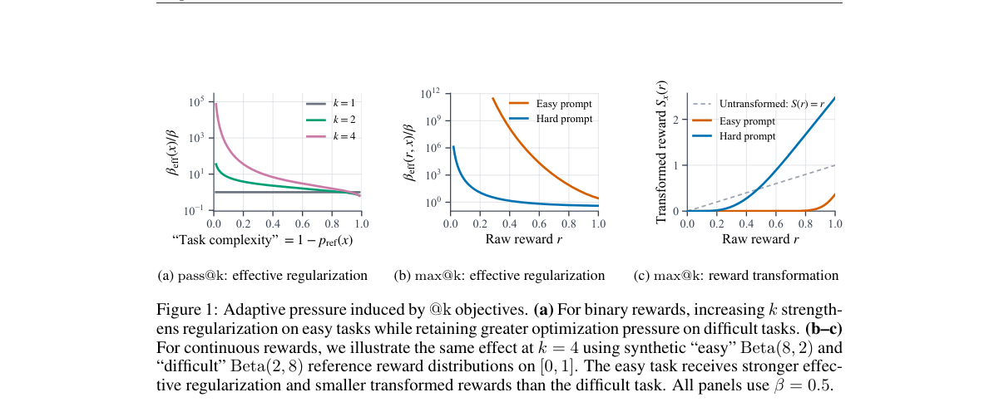

*Result - pass@keval on AIME 2026 as the sampling budget at test time (keval) increases. Setting k > 1 during training consistently reduces sharpening. In Figure (a), we plot standard GRPO and @k-A⋆PO*

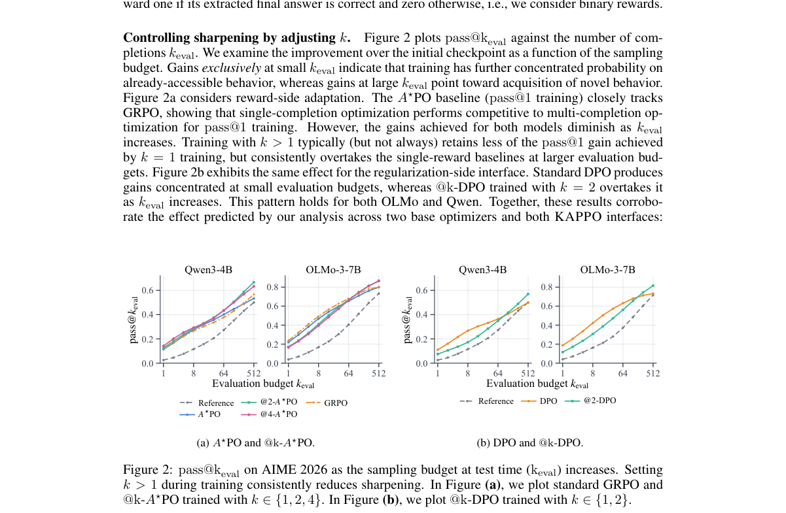

**Why this ranks #1**: LLM 后训练用 RL 换来准确率的同时会「锐化」，行为覆盖变窄，难题上的进展因此停滞；pass@k、max@k 这类重复采样目标能缓解，但机制一直没被讲清楚，也没有把现有 @1 优化器改造成 @k 的通用框架。这篇给出 KL 正则下 pass@k 与 max@k 目标的闭式最优策略，并证明这些最优策略可以由标准 @1 目标经提示自适应的正则或奖励变换得到，从而给出一个与优化器无关的解释。

---

### 2. Order-Only On-Policy Distillation

**arXiv**: [2611.02112](https://arxiv.org/abs/2611.02112) | **Score**: 9.3 (relevance 9.5 x 0.7 + quality 9.0 x 0.3) | **Tags**: rl-llm, on-policy-distillation, ranking-loss, teacher-temperature, math-reasoning, University of Memphis | **Categories**: cs.CL, cs.LG | **Pages**: 15

**Authors**: Guangzeng Han; Yu Wu; Xiaolei Huang

**Affiliation**: University of Memphis; University of Missouri

**Abstract**

> On-policy distillation (OPD) trains a student on its own generations by matching the teacher's token probabilities. These probabilities entangle two kinds of information: which tokens the teacher prefers, and how confident it is. The latter reflects the teacher's own capacity and calibration, which a smaller student may be unable to reproduce. Because the teacher temperature changes these values without changing the ordering, OPD is also sensitive to the temperature choice. We ask whether the teacher's ordering of candidate tokens is enough, and propose Order-Only On-Policy Distillation (O$^{3}$PD). At each student-generated prefix, O$^{3}$PD trains the student to reproduce the order of the teacher's top-$K$ tokens, without fitting their probability values. The objective is therefore invariant to the teacher temperature and needs no temperature tuning. Across six teacher--student pairs, O$^{3}$PD outperforms OPD on the average over HMMT25, AIME24, and AIME25 in every pair, by up to 2.9 points, with gains of up to 5.6 points on AIME25. Other ranking losses yield similar gains, so the benefit comes from ordinal supervision itself. Analysis shows that O$^{3}$PD departs further from the teacher's probabilities than OPD, yet reproduces its ranking more faithfully and yields a stronger student. The ranking, not the probability values, thus carries the knowledge that on-policy distillation needs to transfer.

**Key findings**

- **Finding**: 提出 O3PD，只在学生生成的前缀上拟合教师 top-K token 的相对顺序（默认相邻成对约束），不对齐概率值，因而对教师温度不变且无需温度调参；在六组师生配对上以 HMMT25、AIME24、AIME25 三项平均对比 OPD，每一组都更优，最多提升 2.9 个点、在 AIME25 上最多提升 5.6 个点；换用其他排序损失也有类似收益，说明增益来自序数监督本身，分析显示 O3PD 离教师概率更远却更好地复现了教师排序。
- **Inference**: 「蒸馏就是概率匹配」这个默认设定其实把教师自身的容量限制当成了信号，序数监督之所以更优，是因为它只传递相对偏好这一可迁移成分。
- **Recommendation**: 适合已在做 OPD 的团队直接替换损失函数试；边界是结论建立在数学推理的师生配对上、且只在 top-K 排序层面成立，若教师与学生的 tokenizer 或粒度差异较大，需要先确认 top-K 的对齐方式。

**Key figures**

*Result - Overview of O3PD. The figure shows the default adjacent logistic loss, any other order- only objective can take its place (Section 3.3).*

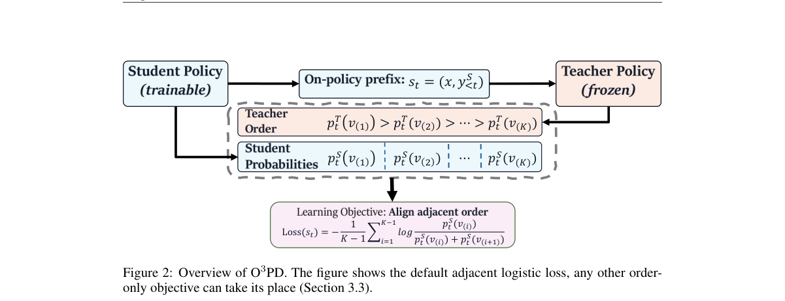

**Why this ranks #2**: OPD 用师生 token 概率做监督，但这组概率同时编码了「老师偏好哪些 token」和「老师有多自信」，后者反映老师自身的容量与校准，小学生模型往往复制不了，还让方法对教师温度异常敏感。这篇把两者拆开，只让学生复现老师 top-K token 的排序而不拟合概率值，目标因而对教师温度不变、无需调温。结论很直接——排序才是蒸馏需要传递的知识。

---

### 3. Bernoulli On-Policy Distillation: Don't Ignore High-Confidence Student Tokens

**arXiv**: [2611.02093](https://arxiv.org/abs/2611.02093) | **Score**: 9.3 (relevance 9.5 x 0.7 + quality 9.0 x 0.3) | **Tags**: rl-llm, on-policy-distillation, gradient-allocation, high-confidence-tokens, reverse-kl, University of Surrey | **Categories**: cs.LG | **Pages**: 14

**Authors**: Mingyu Cao; Yaokai Jin; Shiwei Liu; Lu Yi

**Affiliation**: University of Surrey; University College London; Max Planck Institute for Intelligent Systems; LIS Institute Tubingen

**Abstract**

> On-policy distillation (OPD) trains a student language model on its own trajectories using token-level supervision from a stronger teacher. We show that standard sampled reverse-KL OPD systematically suppresses updates to high-confidence tokens, such that their weak gradient contribution does not necessarily imply weak or uninformative teacher supervision. We introduce Bernoulli On-Policy Distillation (Bernoulli OPD), which directly matches the teacher and student probabilities for that token. This yields a bounded probability space correction that preserves teacher-student disagreement while avoiding the additional confidence-dependent suppression induced by vanilla OPD. Fixed-rollout analyses show that Bernoulli OPD substantially restores optimization signal to high-confidence tokens while remaining sensitive to teacher-student disagreement. We further analyze the resulting model behavior through confidence distributions, answer calibration, policy movement, and training dynamics, showing that Bernoulli OPD's gains cannot be explained simply by longer reasoning, larger optimization steps, or more uniform imitation of the teacher. Code is available at https://github.com/duterscmy/Bernoulli-OPD.

**Key findings**

- **Finding**: 证明标准采样式 reverse-KL OPD 的采样 token 梯度为 −A(1−p_S)，会系统性压制高置信 token 的更新，并据此提出 Bernoulli OPD，直接匹配教师与学生在采样 token 上的伯努利边缘概率，梯度为 p_S−p_T，同时去掉对数概率差与 1−p_S 两个抑制源；在 Qwen3-1.7B 学生配 Qwen3-4B-Instruct-2507 教师的主设置中，五个基准平均从 vanilla OPD 的 44.38 提升到 51.76（+7.38），同设置下 SuRe 为 44.95（+0.57）、PowerOPD 为 47.67（+3.29）、诊断变体 GC-OPD 为 49.11（+4.73），且在另外三组师生配对（Qwen3-8B-DAPO-RL 教师与 DeepSeek-R1-Distill-Qwen-1.5B 学生）上均有 0.98 到 7.38 点的增益。
- **Inference**: 分解后的证据说明真正起作用的是概率空间的直接匹配而非仅仅去掉 1−p_S，因为 GC-OPD 与 Bernoulli OPD 的差距（49.11 对 51.76）明显大于 SuRe 那种调权重方式所能带来的（+0.57）。
- **Recommendation**: 改动局限在损失函数，工程成本低，适合在现有 OPD 流水线里直接替换；作者同时给出了 Balanced Bernoulli OPD 与尺度匹配对照，说明增益不能简单归因于更长的推理或更大的更新步长，但论文只在数学推理基准上验证，跨到代码与工具调用仍待检验。

**Key figures**

*Framework - Token distribution and gradient allocation across student-confidence regions. In our primary setting, about 72% of sampled*

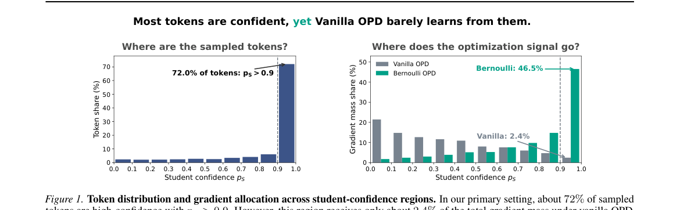

*Result - Training with high-confidence sampled tokens. This*

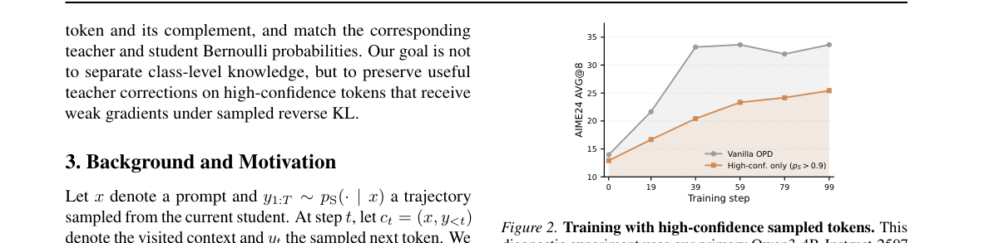

**Why this ranks #3**: 标准采样式 reverse-KL 的 OPD 有个几何性质：梯度带 1−p_S 因子，学生本来就自信的 token 会被系统性压制，但这些 token 上的教师监督未必弱或无用。这篇把问题定位到 softmax 几何本身，提出 Bernoulli OPD 直接匹配教师与学生在该 token 上的概率差，去掉对数比与 1−p_S 两个抑制源，同时保留师生分歧的可观测性。配套的 GC-OPD 作为诊断对照，把「只去掉 1−p_S」和「换成概率空间匹配」两件事分开验证。

---

### 4. Meet Students Where They Are: Student-Prefix Teacher Adaptation for On-Policy Distillation

**arXiv**: [2611.03133](https://arxiv.org/abs/2611.03133) | **Score**: 9.0 (relevance 9.0 x 0.7 + quality 9.0 x 0.3) | **Tags**: rl-llm, on-policy-distillation, teacher-adaptation, rlvr, prefix-recovery, Beijing Jiaotong University | **Categories**: cs.CL | **Pages**: 15

**Authors**: Xue Zhang; Songming Zhang; Yunlong Liang; Fandong Meng; Yufeng Chen; Jinan Xu

**Affiliation**: Beijing Jiaotong University; Weixin AI Tencent

**Abstract**

> On-policy distillation (OPD) mitigates the student's exposure bias by optimizing on student-generated trajectories. However, student-generated prefixes may contain reasoning errors or follow patterns unfamiliar to the teacher, undermining the reliability of its token-level supervision. This degradation becomes more pronounced as prefixes grow longer. To address this teacher-side distribution mismatch, we propose Student-Prefix Teacher Adaptation (SPTA), which adapts the teacher to the states on which it is queried during distillation. Specifically, before OPD starts, we collect student rollout prefixes with random lengths and continually train the teacher to continue from the prefixes using reinforcement learning with verifiable rewards (RLVR). By treating each prefix as context and rewarding correct final answers, the teacher learns to recover from student-induced states rather than imitate the student's reasoning. Then, the adapted teacher is used for standard OPD, with no changes to the distillation objective. Experiments on mathematical reasoning benchmarks show that our SPTA improves average student performance over standard OPD and OPD with task-level RLVR-adapted teachers. These results highlight the importance of adapting teachers not only to solve problems independently, but also to provide reliable guidance on the states their students actually visit.

**Key findings**

- **Finding**: 提出 SPTA，在 OPD 开始前用随机长度前缀条件化做 RLVR 训练老师从学生前缀续写并以最终答案正确为奖励，之后冻结该老师做标准 OPD；在 AIME24、AIME25、AMC23、HMMT24、HMMT25 上以 avg@16 评测三组师生配对，Qwen3-4B 到 Qwen3-4B-Base 的五基准平均从 31.52 提到 35.30（+3.78）、DeepSeek-R1-Distill-Qwen-7B 到 1.5B 从 30.20 提到 33.23（+3.03）、JustRL-DeepSeek-1.5B 到 R1-Distill-1.5B 从 41.97 提到 42.79（+0.82），而作为对照的任务级 RLVR 适配老师只带来 0.45 与 2.16 点提升。
- **Inference**: 关键对照数据是第二组配对里原始 OPD 只从 29.58 动到 30.20、五个基准中三个还不如未蒸馏学生——前缀条件化不是锦上添花，而是让 OPD 在这种配对下真正起作用的必要条件。
- **Recommendation**: 对用蒸馏做小模型压缩的团队，先检查教师在学生前缀上的续写恢复率再决定要不要蒸馏；边界是教师 RLVR 会牺牲部分干净提示上的能力（Qwen3-4B 干净准确率从 60.99% 降到 54.39%），收益也依赖学生与教师的前缀分布相近，作者未验证跨域遗忘。

**Key figures**

*Framework - Standard OPD and Student-Prefix Teacher Adaptation (SPTA). (a) In standard OPD, student rollouts may enter regions unfamiliar to the teacher, reducing supervision reliability. (b) SPTA first*

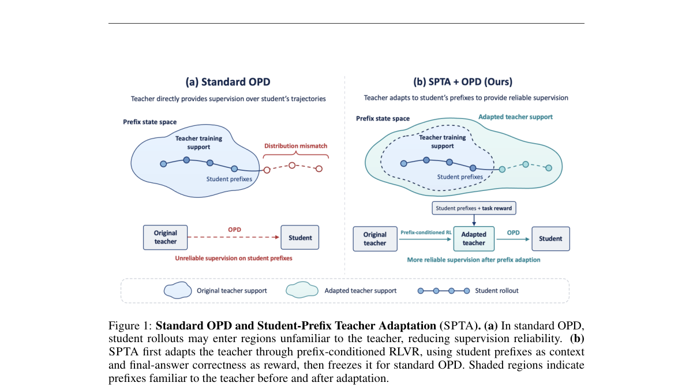

*Result - Student-prefix adaptation improves teacher recovery. Mean accuracy (avg@16 across five benchmarks) versus the fraction of a student rollout retained as context. Each panel compares the origi*

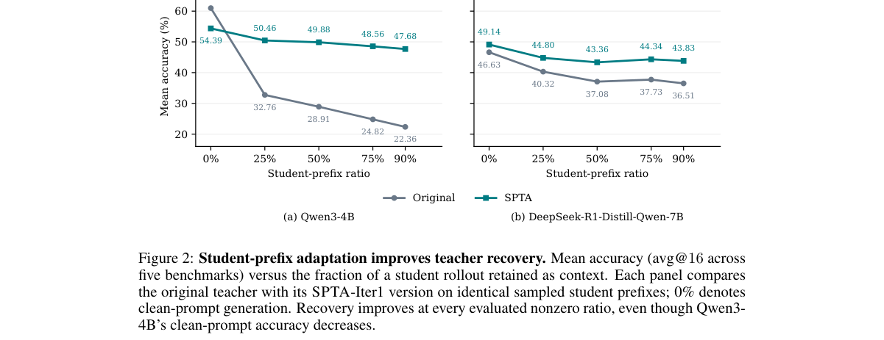

**Why this ranks #4**: OPD 在学生自己的轨迹上训练缓解了暴露偏差，但学生前缀里可能有推理错误或老师不熟悉的模式，老师的逐 token 监督随之可靠性下降，且前缀越长越严重。这篇不动蒸馏目标，而是先把老师适配到学生实际会走到的状态上：蒸馏前收集不同长度前缀，用可验证奖励的 RL 训练老师从这些前缀续写并拿到正确答案，让老师学会「从学生造成的状态里恢复」而不是模仿学生的推理。

---

### 5. SpecOPD: Branch-Parallel On-Policy Distillation for Speculative Decoding

**arXiv**: [2611.02846](https://arxiv.org/abs/2611.02846) | **Score**: 9.0 (relevance 9.0 x 0.7 + quality 9.0 x 0.3) | **Tags**: rl-llm, speculative-decoding, on-policy-distillation, parallel-rollout, acceptance-length, Qwen Business Unit of Alibaba | **Categories**: cs.AI | **Pages**: 28

**Authors**: Tianyu Liu; Jun Zhang; Wenjie Huang; Yuhao Shen; Tianqi Xu; Xinyue Hao; Hongyaoxing Gu; Xuyang Liu; Baolin Zhang; Yating Zhu; Shuang Ge; Jun Dai

**Affiliation**: Qwen Business Unit of Alibaba; University of Science and Technology of China; Zhejiang University; Carnegie Mellon University

**Abstract**

> Speculative decoding (SD) accelerates large language model inference by reducing the sequential cost of token-by-token generation. Advanced SD methods reduce proposal cost with parallel drafters that predict entire blocks in one forward pass, but overall speedup still depends on acceptance length. On-policy distillation (OPD) can push well-trained drafters beyond acceptance-length plateaus, yet conventional pipelines collect supervision through sequential draft-and-verify rollouts. Our key insight is that on-policy supervision need not inherit these dependencies: a draft block can be supervised using only its reference prefix and draft-sampled history. We propose SpecOPD, a branch-parallel OPD framework that parallelizes draft sampling and target supervision across independent branches drawn from the evolving drafter policy at reference anchors. We pack these branches into proposal trees to share target-prefix computation, using tree masks for full attention, branch-consistent indexer groups for sparse attention, and indexed state replay for linear attention to preserve each branch's history. We train the drafter with an E2E-TV surrogate that directly targets acceptance length. Our study spans 8B full-attention (GQA), 27B full-linear (GQA--GDN), and 125B sparse-linear (QSA--GDN) targets, three parallel draft architectures (DFlash, DSpark, and DFlash V2), and four task domains (dialogue, coding, mathematics, and agentic). SpecOPD achieves up to 41.45% higher mean acceptance length, $16.09\times$ supervised-token throughput over sequential-rollout OPD under native configurations, and up to $3.56\times$ generation speedup over autoregressive decoding.

**Key findings**

- **Finding**: 提出 SpecOPD，在参考锚点处从不断演化的 drafter 策略并行采样多条独立分支并打包成 proposal tree，用 tree mask 做全注意力、分支一致的 indexer group 做稀疏注意力、索引化状态重放做线性注意力以保留各分支历史，再用 E2E-TV 代理目标直接优化接受长度；覆盖 8B 全注意力、27B 全线性、125B 稀疏线性三类目标模型，DFlash、DSpark、DFlash V2 三种并行 draft 架构与对话、代码、数学、agent 四个任务域，平均接受长度最高提升 41.45%，监督 token 吞吐相对顺序 rollout 的 OPD 达 16.09 倍，相对自回归解码生成加速最高 3.56 倍。
- **Inference**: 把「在线」与「串行」解耦是这里的主要贡献——监督信号的来源从 rollout 的依赖结构里被剥离出来，因此吞吐提升（16.09 倍）远大于模型质量提升的量级，这是训练系统改造而非算法原理改造。
- **Recommendation**: 如果你在训练投机解码的 drafter，这套并行监督几乎是即插即用的收益；需要注意的是结论依赖线性与稀疏注意力下的索引化状态重放等工程实现，文中给的规模参照是八卡上的 Qwen3.8-27B 配 DFlash V2，跨到别的注意力实现需自行验证等价性。

**Key figures**

*Framework - SpecOPD improves training throughput. Qwen3.8-27B with DFlash V2 on eight high-performance GPUs. (a) Sequential draft-and-verify rollouts versus parallel drafting and target scoring, shown*

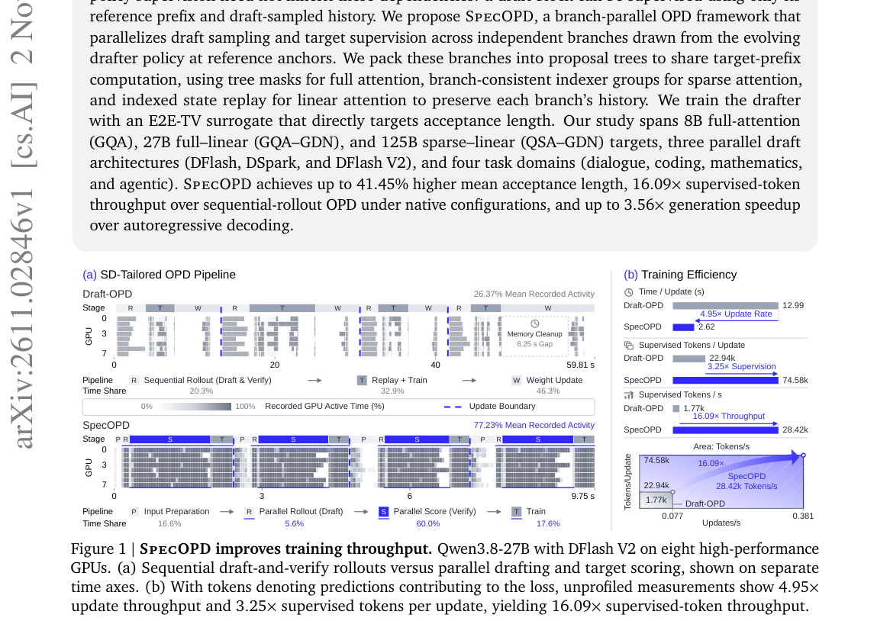

*Result - Proposal tree construction. 1O We randomly sample anchors from a reference response and extract target context features. 2O The current drafter samples continuations in parallel at these an*

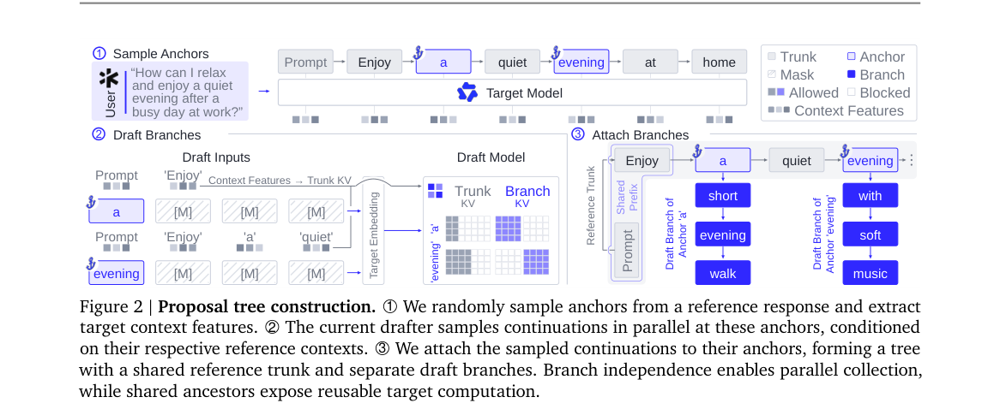

**Why this ranks #5**: 投机解码加速 LLM 推理，但并行 drafter 的整体加速仍取决于接受长度，而 OPD 能把训练好的 drafter 推过接受长度平台期——瓶颈在于传统流水线要顺序地做 draft-and-verify rollout 才能收监督。这篇的关键观察是在线监督不必继承这些依赖：一个 draft block 只用它的参考前缀和自身采样历史就能被监督，于是可以在参考锚点处并行采样出多条独立分支，把它们打包成 proposal tree 共享目标前缀计算。

---

### 6. Chain of Faith: Policy-Internal Rewards for Reasoning Reliance

**arXiv**: [2611.02672](https://arxiv.org/abs/2611.02672) | **Score**: 8.5 (relevance 8.5 x 0.7 + quality 8.5 x 0.3) | **Tags**: rl-llm, reasoning-reliance, grpo, policy-internal-reward, faithfulness, University of California Davis | **Categories**: cs.AI, cs.LG | **Pages**: 22

**Authors**: Fanyu meng; Zhaodan Kong; Xin Liu

**Affiliation**: University of California Davis

**Abstract**

> Chain-of-thought (CoT) explanations can sound plausible while having little influence on a model's final answer. We study four rewards that use the policy's own signals to encourage reliance on generated reasoning: gradient sensitivity, confidence gaps, progressive confidence gains, and reasoning--prompt swaps. We add each reward to group relative policy optimization (GRPO) and evaluate two small instruction-tuned models on GSM8K and StrategyQA using reasoning edits, paraphrases, and prompt hints. Several configurations increase answer reliance to reasoning edits, while effects on accuracy and paraphrase robustness vary. We also observe answer copying at a high reward weight and high reliance in decomposition settings with poor task accuracy. The study compares practical objectives for reasoning reliance, confirms the trade-off between reliance and performance, and proposes four lightweight rewards that can improve reasoning reliance.

**Key findings**

- **Finding**: 把梯度敏感度、置信度差、渐进置信增益、推理-提示互换四种仅用策略自身答案似然与梯度的 rollout 级奖励分别加入 GRPO，在 Llama-3.2-1B-Instruct 与 Qwen2.5-1.5B-Instruct 上于 GSM8K 与 StrategyQA 用 plain-CoT 与分解式两种格式评测；plain-CoT 的 GSM8K 上 Llama 加梯度奖励后原生准确率从 0.396 降到 0.334、Qwen 的 StrategyQA 从 0.811 降到 0.719，而 plain-CoT GSM8K 的 Llama 上四种奖励都同时提升三项依赖指标，分解式设置下 Llama 在 StrategyQA 的准确率低至 0.001–0.044。
- **Inference**: 这实质上是一次「忠实度与性能」的帕累托前沿测绘，而不是一个可以直接拿用的算法——四种奖励各擅胜场，最优选择随模型、任务与提示格式而变，且依赖度可以被退化解刷高。
- **Recommendation**: 建议把它当诊断工具而非训练配方：先用推理编辑、打乱与提示注入测出你模型的依赖度基线，再决定是否需要奖励；作者自己明确观察到高奖励权重（λ=0.1）下出现把答案抄进推理链的退化行为，且长度与依赖度呈负相关（r=−0.33），所以别指望靠它顺带提升准确率。

**Key figures**

*Framework - Answer-change diagnostics. Columns show GSM8K and StrategyQA. Rows show the intervention types. L/Q denote Llama/Qwen, and P/D denote plain/decomposition formats. Colors and hatches identify*

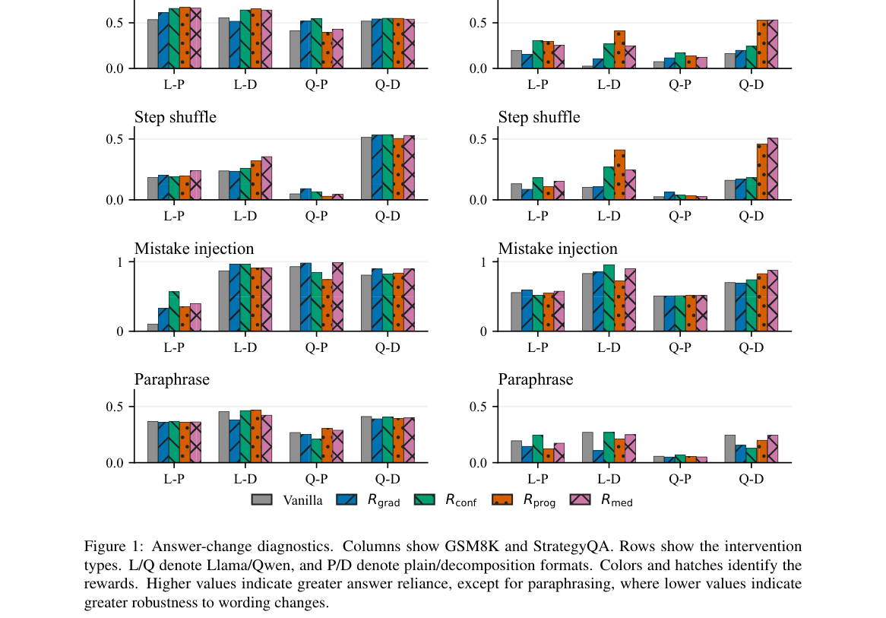

*Result - Native accuracy versus average perturbation sensitivity on GSM8K (left) and StrategyQA (right). Circles denote Llama and triangles Qwen. Filled markers denote plain CoT and hollow markers de*

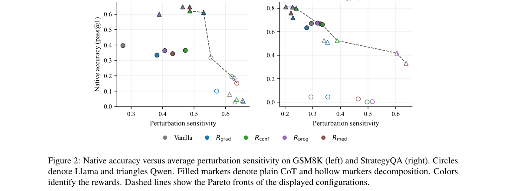

**Why this ranks #6**: 思维链可能听起来合理却对最终答案毫无影响，这篇把这个「依赖度」当成可训练目标：设计梯度敏感度、置信度差、渐进置信增益与推理-提示互换四种只用策略自身信号的奖励，加到 GRPO 上，在 GSM8K 与 StrategyQA 上用 Llama 与 Qwen 两个小模型、plain-CoT 与分解式两种格式评测。结论并不乐观但很有价值——依赖度与准确率是竞争关系，加了依赖奖励准确率常下降，且高权重下会诱发答案复制这种退化解。

---

### 7. What Drives the Zero-to-One Jump? Diagnosing and Steering Hard-Prompt Learning in RLVR

**arXiv**: [2611.02747](https://arxiv.org/abs/2611.02747) | **Score**: 8.5 (relevance 8.5 x 0.7 + quality 8.5 x 0.3) | **Tags**: rl-llm, rlvr, hard-prompt, entropy-signal, group-relative, Shanghai Jiao Tong University | **Categories**: cs.AI, cs.LG | **Pages**: 17

**Authors**: Rui Zhu; Yumou Liu; Zhenzhe Zheng; Fan Wu

**Affiliation**: Shanghai Jiao Tong University

**Abstract**

> Reinforcement Learning with Verifiable Rewards (RLVR) has substantially improved mathematical reasoning, yet progress on hard prompts often stalls: a prompt can remain unsolved for many training steps before abruptly transitioning to solved--a discrete "zero-to-one" jump whose underlying dynamics and steerability remain poorly understood. We investigate two questions: what drives this transition, and can it be steered? Through event-based analysis measuring the time-to-first-positive (TTFP), we find that negative rollouts preceding successful transitions consistently retain higher early-stage generation entropy, distinguishing near-solvable failures from dead ends. This signal motivates NAPO (Negative-Augmented Policy Optimization), a method integrated with Group Relative Policy Optimization (GRPO) that ranks negatives in unsolved groups via an early-branching driver and assigns graded advantages, injecting informative gradients precisely where standard group-relative updates vanish. Under fixed rollout budgets, NAPO accelerates early solution discovery and improves Pass@256 by 10.0 points on AIME24 and 6.6 points on AIME2025, demonstrating that zero-to-one transitions are diagnosable and steerable through driver-guided negative learning. Our code is available at https://github.com/jameszhu-pixel-time/Z2O.

**Key findings**

- **Finding**: 用首次命中正样本时间（TTFP）的事件分析发现，成功跃迁之前的负样本 rollout 在早期阶段始终保持更高的生成熵，据此提出 NAPO——在 GRPO 内部用早期分支驱动给未解出组内的负样本排序并分配分级优势，在标准组相对更新消失的地方注入有效梯度；在固定 rollout 预算下，Pass@256 在 AIME24 上提升 10.0 个点、在 AIME2025 上提升 6.6 个点。
- **Inference**: 难题上 GRPO 的失败模式不是梯度太小而是梯度方向无信息——当整组都是负样本时组相对优势恒为零，而正确样本出现前的负样本其实带着「接近解出」的信号，只是被组相对归一化抹平了。
- **Recommendation**: 对主攻难题 RLVR 的团队，这是一条直接可插的改动且不增加 rollout 预算；但要注意收益集中在难提示上，简单题上负样本排序带来的额外梯度未必有益，是否对全部提示一视同仁地应用需要自己验证。

**Key figures**

*Framework - Overview of NAPO pipeline*

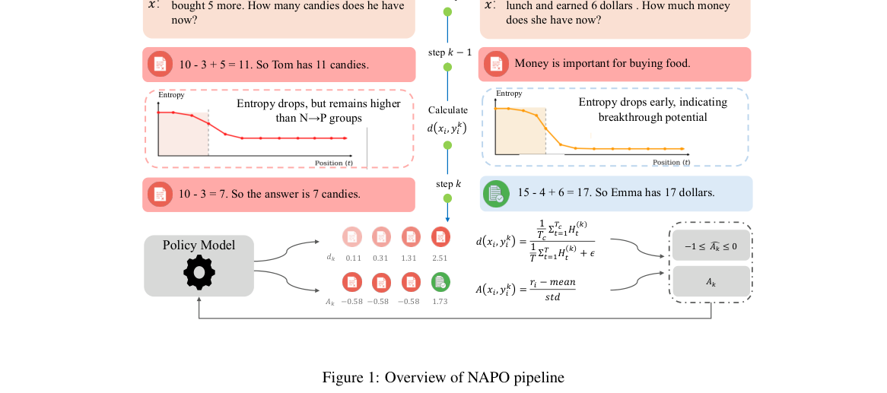

**Why this ranks #7**: RLVR 在数学推理上很有效，但难题经常卡住——一个提示可能几十个训练步都解不出来，然后突然跳变到解出，这个「从 0 到 1」的离散跃迁的机制与可操控性一直没讲清楚。这篇用基于事件的首次命中时间（TTFP）分析，发现成功跃迁之前的负样本 rollout 在早期阶段保留更高的生成熵，从而把「差一点就解出」和「彻底死路」区分开。基于这个信号提出 NAPO，接进 GRPO 后在固定 rollout 预算下把难题的首次解出显著提前。

---

### 8. Hindsight Credit Assignment over Trees for Agentic RL

**arXiv**: [2611.02706](https://arxiv.org/abs/2611.02706) | **Score**: 8.5 (relevance 8.5 x 0.7 + quality 8.5 x 0.3) | **Tags**: rl-llm, tree-rollout, hindsight-credit, agentic-rl, group-relative, Alibaba Cloud Computing | **Categories**: cs.AI, cs.LG | **Pages**: 19

**Authors**: Penghong Zhao; Yihao Chen; Maoheng Yuan; Yunjian Zhang; Abudukelimu Wuerkaixi; Haoran Xu; Man Lv; Yaolong Wang; Zhijie Sun; Guohua Liu; Yuewei Zhang

**Affiliation**: Alibaba Cloud Computing; Fudan University

**Abstract**

> Reinforcement learning for long-horizon LLM agents faces a fundamental dilemma: successful experiences are essential for policy improvement, yet limited policy capabilities make such experiences difficult to discover. Sparse outcome rewards compound this challenge, leaving sampled trajectories with little relative feedback for learning. In this paper, we propose TriGRPO, a tree-based reinforcement learning framework that turns scarce successes into exploration and learning signals through hindsight credit assignment within and across rollout trees. TriGRPO constructs rollout trees through hindsight-guided branching: when an ongoing trajectory reaches a matched decision state, a successful action discovered during rollout initiates a sibling branch that continues autonomously, enabling further exploration and parent-sibling comparisons. Three complementary groups organize policy optimization over these trees: root groups capture within-prompt relative returns, node groups assign credit from parent-sibling outcome differences, and cross groups supplement sparse feedback with historical performance on related tasks. Experimental results demonstrate consistent gains in task performance and rollout efficiency across model scales, highlighting structured hindsight credit assignment as an effective approach to long-horizon agent learning.

**Key findings**

- **Finding**: 提出 TriGRPO，用前缀共享的 rollout 树配合事后引导分支——当无引导轨迹到达与成功库中某条轨迹匹配且动作不同的状态时，注入该成功动作生成兄弟分支自主续跑，形成隔离该状态动作因果效应的 node 组；再以 root 组给组内相对回报、cross 组用任务与任务类型的历史 EMA 基线补充稀疏反馈；在 ALFWorld（128 个测试任务）与 SearchQA（51,713 个测试问题、跨 7 个基准）上与 GRPO、Tree-GRPO、GiGPO、GSPO 比较，3 个随机种子的峰值验证成功率在 Qwen2.5 各尺度上为 88.3%、93.8%、93.8%，比最强基线高 1.6–6.2 个点、比 root-only GRPO 高 15.5–20.9 个点，对 Tree-GRPO 的领先从 1.5B 的 1.6 点扩大到 3B 与 7B 的 16.5 点，pick2 任务上领先 30–38 点、heat 上超过 40 点。
- **Inference**: 增益集中在需要多子目标组合的长任务、在短任务上保持竞争力，这个分布本身就验证了机制解释——事后分支只在失败轨迹真正分叉处触发，盲目的树扩展不会有这种选择性。
- **Recommendation**: 适合做长程 agentic RL 的团队直接试，成本主要是树 rollout 的额外预算（ALFWorld 每提示 8 条根轨迹、最多 12 个叶子）；注意结论基于 ALFWorld 与 SearchQA，node 组假设状态精确匹配，真实环境中匹配噪声会让信用变脏，作者也把理论收益限定在精确匹配与成功条件采样下。

**Key figures**

*Framework - TriGRPO enhances agentic RL through hind- sight credit assignment. (a) Credit assignment across trees, within a tree, and at branch nodes. (b) Superior Pareto frontier of success versus cost*

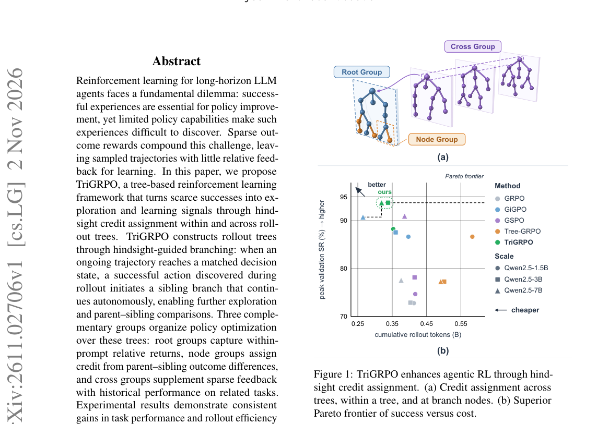

*Result - Overview of the TriGRPO training pipeline. Tree-structured rollouts generate R root trajectories per prompt, expanded into prefix-sharing trees. During training, successful trajectories popu*

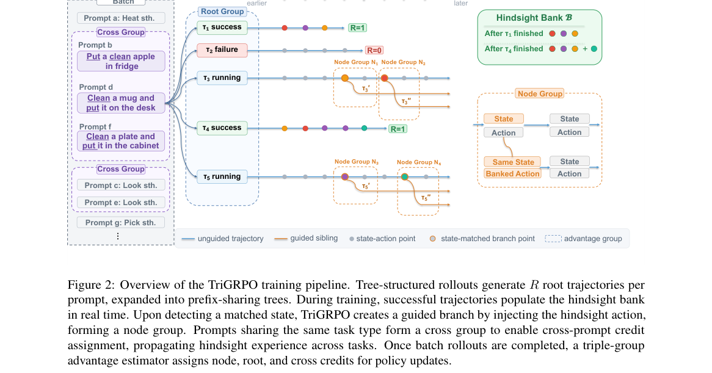

**Why this ranks #8**: 长程 LLM 智能体的 RL 有个根本两难：成功经验是改进所必需，但能力有限时又很难发现成功，稀疏结果奖励让采样轨迹几乎没有相对反馈。这篇用「事后信用分配」破这个局：构造 rollout 树，当进行中的轨迹走到一个与成功轨迹匹配的状态时，用那条成功动作开出一条兄弟分支继续自主探索，从而把稀缺成功转化为树内与树间的学习信号。由此得到 root、node、cross 三组优势，把信用分配拆成三个粒度。

---

### 9. Whitened Advantage Summation Policy Optimization: Correlation-Aware Aggregation for Multi-Reward Reinforcement Learning

**arXiv**: [2611.02609](https://arxiv.org/abs/2611.02609) | **Score**: 8.0 (relevance 8.0 x 0.7 + quality 8.0 x 0.3) | **Tags**: rl-llm, multi-reward, reward-correlation, advantage-whitening, policy-optimization, ProofMed AI | **Categories**: cs.AI, cs.LG | **Pages**: 21

**Authors**: Olaitan Olaleye; Jayson Meribe; Temidayo Olaleye

**Affiliation**: ProofMed AI; Stanford University

**Abstract**

> Reinforcement learning for language models often combines several rewards by normalizing each one and adding them with fixed weights. When the rewards are correlated, the variation they share is counted once for every reward that carries it. In terms of the ZCA-decorrelated components of the reward signal, the weighted sum applies weights $Σ^{1/2} w$ rather than the chosen weights $w$, where $Σ$ is the reward correlation matrix. We study WAS-PO, which whitens the normalized advantages with $Σ^{-1/2}$ before adding them, so that the chosen weights apply to those components. We derive the scalarized objective whose gradient it follows when normalization statistics are held fixed, show that its weights on the raw rewards can be negative, give an exact two-reward condition under which the lighter-weighted reward is reversed, and give a loose bound on the error from estimating $Σ$ during training. On tool calling with Qwen2.5-1.5B-Instruct, WAS-PO reached a higher mean training reward than GDPO in all seven seeds with three rewards (3.8% higher) and all three seeds with four (3.9% higher). WAS-PO also replaces GDPO's per-prompt normalization with batch-level normalization, and we did not separate the two changes with three or four rewards. The training-reward gains did not carry over to held-out accuracy, which was slightly lower than GDPO's with three rewards (not significant) and 0.03 lower in absolute terms with four (two seeds evaluated). With two rewards, WAS-PO trailed GDPO in training reward, and a three-seed control weakly suggests that the gap comes from batch-level normalization rather than whitening. In a math setting where the two rewards were nearly identical by construction, WAS-PO drove down the lighter-weighted reward, as the sign condition predicts.

**Key findings**

- **Finding**: 证明在 ZCA 去相关基下，多奖励归一化加权求和实际施加权重 Σ^{1/2}w 而非选定的 w，并提出 WAS-PO 用 Σ^{-1/2} 白化归一化优势后再加权；在 Qwen2.5-1.5B-Instruct 的工具调用任务上，三奖励时 7 个种子全部高于 GDPO 的平均训练奖励 3.8%、四奖励时 3 个种子全部高 3.9%，但两奖励时反而落后，且训练奖励增益没有传导到留出准确率（三奖励下略低但不显著，四奖励下绝对值低 0.03），作者用三种子对照弱提示差距来自批量级归一化而非白化本身。
- **Inference**: 这篇最有价值的部分其实是负面结果——相关性感知的多奖励合成在训练奖励上更好看、在留出准确率上却更差，说明「把奖励去相关」可能只是换掉了权重语义而没有改善优化方向。
- **Recommendation**: 除非你确实在多奖励场景里观察到权重被相关性污染，否则不建议为它改训练栈；真要用请注意两点边界——理论保证的是所选权重在白化基下正确、而非在原始奖励上正确，且作者自己承认批量级归一化与白化这两个改动没有分开做。

**Key figures**

*Framework - Training reward of GRPO, GDPO and WAS-PO. Curves and ±1 SD bands are computed over a subset of the seeds (three at K = 2). The per-seed AUCs in Tables 7 and 5 cover all seven seeds.*

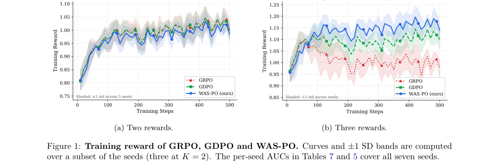

**Why this ranks #9**: LLM 后训练里常把多个奖励各自归一化后按固定权重相加，但当奖励之间高度相关时，共享的那部分波动会被重复计入——按 ZCA 去相关分解来看，加权求和实际施加的是 Σ^{1/2}w 而不是选定的 w。这篇提出用 Σ^{-1/2} 先白化归一化优势再相加，并给出所遵循的标量化目标、权重可能为负的结论与双奖励下轻权重被反转的精确条件。难得的是作者做了大量自我否定式的对照。

---

### 10. RLVR Sharpens the Pencil, Not the Mind

**arXiv**: [2611.02574](https://arxiv.org/abs/2611.02574) | **Score**: 8.0 (relevance 8.0 x 0.7 + quality 8.0 x 0.3) | **Tags**: rl-llm, rlvr, sharpening, probing, mechanistic-interpretability, Indian Institute of Technology Roorkee | **Categories**: cs.LG | **Pages**: 9

**Authors**: Shreeyam Bangera; Manya Gupta

**Affiliation**: Indian Institute of Technology Roorkee

**Abstract**

> Models like DeepSeek-R1 made Reinforcement Learning with Verifiable Rewards (RLVR) famous: reward a model for correct answers and it gets dramatically better at reasoning without being taught how. The leading explanation is sharpening---that the base model already knows how to solve these problems and RLVR just makes it more likely to reach for its best solution paths. This has only ever been checked by comparing before and after training, never by watching what changes inside across it. We tracked OLMo-2-1B across all 13 training checkpoints on GSM8K. First-try accuracy climbs from 58.0% to 61.3%, but ask the model 256 times and solution coverage actually rises from 94.5% to 96.9%, proving the knowledge was already there. We then planted reasoning mistakes into problems and trained simple probes to detect them. Those probes held between AUROC 0.798 and 0.840 across all 13 checkpoints and 3 error types, a spread smaller than the confidence interval; the model never builds a sharper internal picture of what a reasoning mistake looks like. The one place we find real internal change is at the final answer token, where a probe distinguishing early from late checkpoints hits an AUROC of 0.93, while the same probe on the actual reasoning steps lands near chance. RLVR makes the model lead with its best thinking. It does not change what that thinking is.

**Key findings**

- **Finding**: 追踪 OLMo-2-1B 在 GSM8K 上全部 13 个训练 checkpoint，首答准确率从 58.0% 升到 61.3%，而采样 256 次的解覆盖率只从 94.5% 升到 96.9%；向题目植入推理错误后训练的探针在 13 个 checkpoint 与 3 类错误上 AUROC 始终在 0.798–0.840（波动小于置信区间），而区分训练早晚期 checkpoint 的探针在最终答案 token 上 AUROC 达 0.93、作用在实际推理步骤上则接近随机。
- **Inference**: 数据同时支持「锐化」与「能力早已存在」：覆盖率本来就高说明知识在基座里，但探针在推理步骤上毫无反应说明 RLVR 并没有在模型内部建立「什么算推理错误」的表征，它只是让模型更早地走最优路径。
- **Recommendation**: 这篇的价值主要在诊断方法而非算法：如果你在评估 RLVR 的收益，pass@256 这类深覆盖指标必须一起看，否则会把锐化误当成能力获得；同时注意结论基于 1B 规模模型与 GSM8K 单一数据集，扩展到更大模型或代码推理尚无证据。

**Key figures**

*Framework - First-try accuracy and deep coverage across training. (a) pass@k curves from the deep sweep. (b) pass@1 rises by +3.3 pts while pass@256 does not narrow; the model’s solution coverage stays*

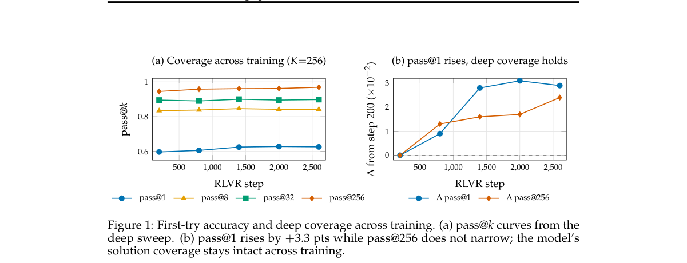

**Why this ranks #10**: 「RLVR 只是锐化基座模型已有能力」这个解释一直只被训练前后对比验证过，从没有人沿着训练过程去看模型内部到底变了什么。这篇把 OLMo-2-1B 在 GSM8K 上的全部 13 个 checkpoint 逐个追踪，并往题目里植入推理错误、训练探针去检测。结果是：唯一发生真实内部变化的位置是最终答案 token，而不是推理步骤本身——这直接反驳了「RLVR 教会模型识别错误推理」的直觉。

---

